> 교재 PART 01 CHAPTER 01(p.2~74, 핵심이론 01~35)을 정리한 문서. 네 번에 나눠 받았고 **모두 수신 완료**. 회차별 기록과 처음 남긴 메모는 [수신 기록](#수신%20기록)에 그대로 있다.

# 교재 CHAPTER 01 PLC제어 특수모듈 프로그램 개발 정리

> [!summary] 이 챕터를 한 문장으로
> **"목표대로 움직이게 하는 방법(제어 이론)"** 을 배우고, 그 방법을 공장에서 실제로 돌리는 **두뇌(PLC·마이크로프로세서)와 신경(센서 신호·통신)** 을 배우는 챕터다. 1과목 자동제어 20문항 중 가장 큰 덩어리다.

## 학습 목표

이 챕터를 마치면 다음을 할 수 있어야 한다.

1. 블록선도에서 목표값·동작신호·조작량·제어량·외란을 찾고, 개루프와 폐루프를 구분한다.
2. 라플라스 변환표로 시간 함수 ↔ $s$ 함수를 바꾸고, 블록선도를 하나의 전달함수로 줄인다.
3. 감쇠비 $\zeta$로 제동 상태를 판정하고, 오버슈트·상승·정착 시간과 안정도(루스, 근궤적, 보드)를 읽는다.
4. P·I·D 동작의 장단점을 비교하고, 문제의 증상(잔류편차, 느린 응답)에 맞는 조합을 고른다.
5. PLC 구성(CPU·메모리·입출력·특수모듈)과 스캔 방식, 래더 작성 규칙, A/D 분해능을 계산한다.
6. 시퀀스 회로(자기유지·인터로크·플립플롭)와 직렬 통신(RS-232/422/485) 특징을 구분한다.

## 한눈에 보기

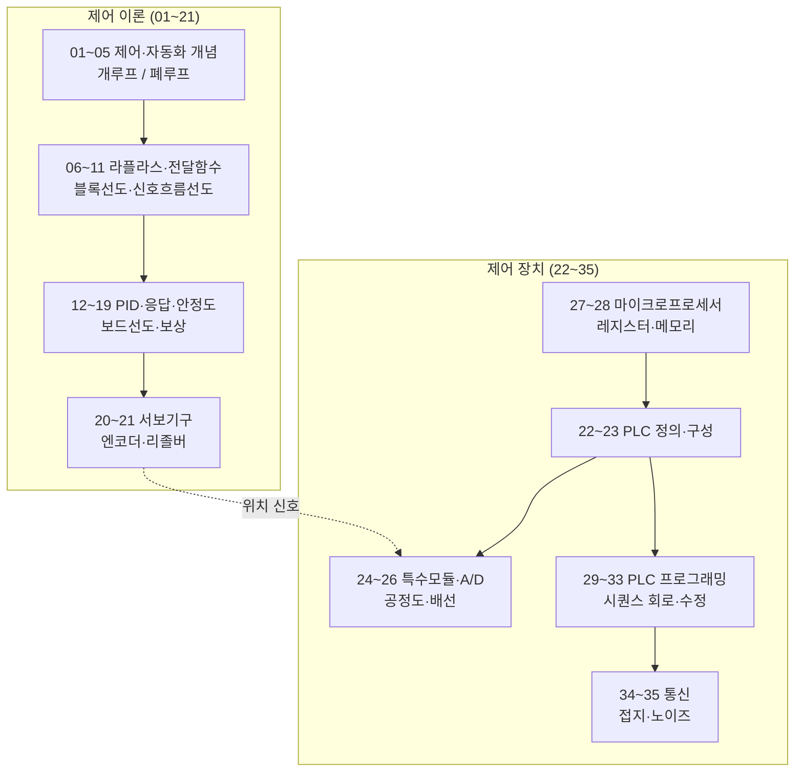

## 수신 메모 (정리한 쪽에서 남긴 확인 사항)

- 요청문의 `{CHAPTER}`가 비어 있어 CHAPTER 01로 가정하고 PART 01 핵심이론의 CHAPTER 01을 읽음.
- 페이지 번호는 PART 01 지면 인쇄 번호(p.2~p.74). 목차 링크 숫자와 달라 (확인 필요).
- 뷰어 탭 제목은 "2025"판.
- 공식·그림은 텍스트 추출에서 빠진 것이 많아, 화면으로 확인한 식 외에는 일반식으로 쓰고 (확인 필요)를 붙임.

## 단원 목록

제목을 누르면 아래 해당 절로, 오른쪽 노트를 누르면 정리해 둔 단원노트로 간다.

| 번호 | 교재 제목 | 쪽 | 정리한 노트 |
| :---: | --- | --- | --- |
| 01 | [자동제어](#핵심이론%2001%20자동제어) | p.2 | [자동제어계의 기초](../10_자동제어/자동제어계의_기초.md) |
| 02 | [자동화](#핵심이론%2002%20자동화) | p.3 | [자동제어계의 기초](../10_자동제어/자동제어계의_기초.md) |
| 03 | [피드백에 따른 제어의 구분](#핵심이론%2003%20피드백에%20따른%20제어의%20구분) | p.5 | [자동제어계의 기초](../10_자동제어/자동제어계의_기초.md) |
| 04 | [분류 기준에 따른 제어의 종류](#핵심이론%2004%20분류%20기준에%20따른%20제어의%20종류) | p.7 | [자동제어계의 기초](../10_자동제어/자동제어계의_기초.md) |
| 05 | [퍼지제어](#핵심이론%2005%20퍼지제어) | p.8 | [자동제어계의 기초](../10_자동제어/자동제어계의_기초.md) |
| 06 | [라플라스 변환](#핵심이론%2006%20라플라스%20변환) | p.9 | [라플라스 변환과 전달함수](../10_자동제어/라플라스_변환과_전달함수.md) |
| 07 | [전달함수의 정의](#핵심이론%2007%20전달함수의%20정의) | p.13 | [라플라스 변환과 전달함수](../10_자동제어/라플라스_변환과_전달함수.md) |
| 08 | [간단한 제어요소의 전달함수](#핵심이론%2008%20간단한%20제어요소의%20전달함수) | p.14 | [라플라스 변환과 전달함수](../10_자동제어/라플라스_변환과_전달함수.md) |
| 09 | [시스템의 모델링](#핵심이론%2009%20시스템의%20모델링) | p.16 | [라플라스 변환과 전달함수](../10_자동제어/라플라스_변환과_전달함수.md) |
| 10 | [블록선도를 이용한 전달함수식](#핵심이론%2010%20블록선도를%20이용한%20전달함수식) | p.19 | [라플라스 변환과 전달함수](../10_자동제어/라플라스_변환과_전달함수.md) |
| 11 | [신호흐름선도](#핵심이론%2011%20신호흐름선도) | p.22 | [라플라스 변환과 전달함수](../10_자동제어/라플라스_변환과_전달함수.md) |
| 12 | [전달함수 - PID 제어](#핵심이론%2012%20전달함수%20-%20PID%20제어) | p.23 | [자동제어계의 기초](../10_자동제어/자동제어계의_기초.md) |
| 13 | [제어계 해석 - 입력](#핵심이론%2013%20제어계%20해석%20-%20입력) | p.24 | [과도응답과 안정도](../10_자동제어/과도응답과_안정도.md) |
| 14 | [제어계의 해석 - 응답과 특성방정식](#핵심이론%2014%20제어계의%20해석%20-%20응답과%20특성방정식) | p.26 | [과도응답과 안정도](../10_자동제어/과도응답과_안정도.md) |
| 15 | [제어계의 해석 - 시간 응답](#핵심이론%2015%20제어계의%20해석%20-%20시간%20응답) | p.27 | [과도응답과 안정도](../10_자동제어/과도응답과_안정도.md) |
| 16 | [제어계 - 주파수 응답](#핵심이론%2016%20제어계%20-%20주파수%20응답) | p.29 | [과도응답과 안정도](../10_자동제어/과도응답과_안정도.md) |
| 17 | [안정도](#핵심이론%2017%20안정도) | p.30 | [과도응답과 안정도](../10_자동제어/과도응답과_안정도.md) |
| 18 | [전달함수의 보드(Bode)선도](#핵심이론%2018%20전달함수의%20보드%28Bode%29선도) | p.32 | [과도응답과 안정도](../10_자동제어/과도응답과_안정도.md) |
| 19 | [보상회로](#핵심이론%2019%20보상회로) | p.35 | [과도응답과 안정도](../10_자동제어/과도응답과_안정도.md) |
| 20 | [서보기구](#핵심이론%2020%20서보기구) | p.35 | [서보 모터와 서보 제어](../10_자동제어/서보모터와_서보제어.md) |
| 21 | [서보기구의 종류](#핵심이론%2021%20서보기구의%20종류) | p.37 | [서보 모터와 서보 제어](../10_자동제어/서보모터와_서보제어.md) |
| 22 | [PLC제어의 정의 및 특징](#핵심이론%2022%20PLC제어의%20정의%20및%20특징) | p.38 | [PLC 구성과 특성](../10_자동제어/PLC_구성과_특성.md), [PLC 프로그래밍 언어와 명령어](../10_자동제어/PLC_프로그래밍_언어와_명령어.md) |
| 23 | [PLC 구성장치](#핵심이론%2023%20PLC%20구성장치) | p.40 | [PLC 구성과 특성](../10_자동제어/PLC_구성과_특성.md) |
| 24 | [PLC 특수 프로그래밍 준비하기](#핵심이론%2024%20PLC%20특수%20프로그래밍%20준비하기) | p.43 | [특수모듈 프로그래밍](../10_자동제어/특수모듈_프로그래밍.md), [데이터 통신](../10_자동제어/데이터_통신.md) |
| 25 | [공정도와 배선도](#핵심이론%2025%20공정도와%20배선도) | p.46 | [특수모듈 프로그래밍](../10_자동제어/특수모듈_프로그래밍.md) |
| 26 | [PLC 모듈 간 인터페이스](#핵심이론%2026%20PLC%20모듈%20간%20인터페이스) | p.48 | [특수모듈 프로그래밍](../10_자동제어/특수모듈_프로그래밍.md) |
| 27 | [마이크로프로세서](#핵심이론%2027%20마이크로프로세서) | p.50 | [마이크로프로세서](../10_자동제어/마이크로프로세서.md) |
| 28 | [마이크로프로세서 레지스터 및 메모리](#핵심이론%2028%20마이크로프로세서%20레지스터%20및%20메모리) | p.53 | [마이크로프로세서](../10_자동제어/마이크로프로세서.md) |
| 29 | [PLC 프로그래밍](#핵심이론%2029%20PLC%20프로그래밍) | p.56 | [PLC 프로그래밍 언어와 명령어](../10_자동제어/PLC_프로그래밍_언어와_명령어.md) |
| 30 | [PLC 프로그램 작성](#핵심이론%2030%20PLC%20프로그램%20작성) | p.58 | [PLC 프로그래밍 언어와 명령어](../10_자동제어/PLC_프로그래밍_언어와_명령어.md) |
| 31 | [시퀀스 제어](#핵심이론%2031%20시퀀스%20제어) | p.61 | [논리회로](../10_자동제어/논리회로.md) |
| 32 | [시퀀스 제어의 회로](#핵심이론%2032%20시퀀스%20제어의%20회로) | p.63 | [논리회로](../10_자동제어/논리회로.md) |
| 33 | [프로그램 확인 및 수정 보완](#핵심이론%2033%20프로그램%20확인%20및%20수정%20보완) | p.68 | [PLC 시뮬레이션과 수정보완](../10_자동제어/PLC_시뮬레이션과_수정보완.md) |
| 34 | [통신(1)](#핵심이론%2034%20통신%281%29) | p.70 | [데이터 통신](../10_자동제어/데이터_통신.md), [PLC 시뮬레이션과 수정보완](../10_자동제어/PLC_시뮬레이션과_수정보완.md) |
| 35 | [통신(2)](#핵심이론%2035%20통신%282%29) | p.73, 챕터 마지막 절 | [데이터 통신](../10_자동제어/데이터_통신.md), [PLC 시뮬레이션과 수정보완](../10_자동제어/PLC_시뮬레이션과_수정보완.md) |

---

## 핵심이론별 정리

35개 절을 여덟 묶음으로 나눴다. 각 절은 **한마디 직관 → 그림 → 공식 → 교재 정리(키워드·문제 유형)** 순서다.

| 묶음 | 절 | 주제 |
| --- | --- | --- |
| Ⅰ | 01~05 | 제어와 자동화의 기초 |
| Ⅱ | 06~11 | 라플라스 변환과 전달함수 |
| Ⅲ | 12~19 | PID·응답·안정도·주파수 응답 |
| Ⅳ | 20~21 | 서보기구 |
| Ⅴ | 22~26 | PLC 구성과 특수모듈 |
| Ⅵ | 27~28 | 마이크로프로세서 |
| Ⅶ | 29~33 | PLC 프로그래밍과 시퀀스 회로 |
| Ⅷ | 34~35 | 통신과 노이즈 대책 |

## Ⅰ. 제어와 자동화의 기초 (01~05)

### 핵심이론 01 자동제어

교재 p.2 · 정리한 노트: [자동제어계의 기초](../10_자동제어/자동제어계의_기초.md)

**한마디로**: 에어컨을 떠올리면 된다. 희망 온도 24 ℃(목표값)를 정하면, 실내 온도(제어량)를 재서 목표와 비교하고, 그 차이(동작신호)만큼 압축기 세기(조작량)를 바꾼다. 누가 창문을 열어 더운 바람이 들어오면 그게 외란이다.

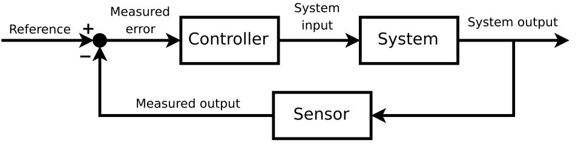

*영문 라벨 읽기: Reference = **목표값**, Measured error = **동작신호**, Controller = 조절부, System input = **조작량**, System output = **제어량**, Sensor = 검출부. 출력이 Sensor를 거쳐 왼쪽 검은 점(+/−, **Summing Point**)으로 되돌아오는 길이 '피드백'이고, 이 점이 오차를 찾는 곳이다.*

$$\text{동작신호 } e = r - b \qquad (r: \text{목표값(기준 입력)},\ b: \text{검출(피드백) 신호})$$

| 용어 | 에어컨 예 | 한 줄 정의 |
| --- | --- | --- |
| 목표값(기준 입력) | 희망 온도 24 ℃ | 제어량이 따라가야 할 값 |
| 동작신호 | 24 ℃ − 현재 온도 | 비교부가 내보내는 차이 |
| 조절부(제어기) | 에어컨 제어 보드 | 동작신호로 명령을 만든다 |
| 조작부(액추에이터) | 압축기·팬 | 명령을 힘·동작으로 바꾼다 |
| 조작량 | 압축기 출력 | 제어 대상에 가하는 양 |
| 제어량 | 실내 온도 | 제어하고 싶은 출력 |
| 외란 | 열린 창문 | 원치 않게 끼어드는 입력 |

> [!question] 시험에서는
> "제어량을 지배하려고 제어 대상에 가하는 양" → **조작량**. 제어량(출력)과 바꿔 낸 보기가 단골이다.

*1차 수신 원제목: 01 자동제어 (p.2~3)*

- 핵심 키워드: 제어 / 자동제어 / 자동화, 블록선도, 목표값·조작량·제어량·외란, 제어요소·동작신호·조절부(제어기)·조작부(액추에이터).
- 강조: 자동제어의 특징은 작업 연계, 반복작업, 무인 운영, 설비·프로그램 구축 필요. 조작량↔제어량, 목표값(기준 입력)↔동작신호 구분.
- 문제 유형: 자동제어 특징이 아닌 것 → 원자재비 증가 / 제어량을 지배하려고 대상에 가하는 양 → 조작량 / 전기식 조절기 특성이 아닌 것 → 스파크 방폭에 신경 쓸 필요가 없다는 보기 / 오차를 찾는 요소 → Summing Point.
- 헷갈림: 기준 입력 ≠ 동작신호. 전기식 조절기는 정전·전기충격 등 전기적 영향을 받음.

### 핵심이론 02 자동화

교재 p.3 · 정리한 노트: [자동제어계의 기초](../10_자동제어/자동제어계의_기초.md)

**한마디로**: 자동제어가 "기계 한 대를 목표대로 움직이게 하는 것"이라면, 자동화는 "공장 전체 흐름을 사람 손 없이 돌리는 것"이다. 아래 용어들은 컴퓨터가 생산을 맡는 범위가 넓어지는 순서로 보면 외우기 쉽다.


> [!tip] 자동창고 구성
> 래크(선반) + **스태커 크레인**(레일을 따라 움직이며 선반에 팰릿을 넣고 꺼내는 장치) + 컨베이어 + 팰릿. "입출고 명령에 따라 선반에 적재·하역하는 장치"는 스태커 크레인이다.

*1차 수신 원제목: 02 자동화 (p.3~5)*

- 핵심 키워드: 자동화 특징(연속작업, 품질 균질화, 정밀·반복, 위험작업 대체, 설비 구축·보전 필요), 자동창고(래크, 컨베이어, 스태커 크레인, 팰릿), 메커트로닉스.
- 용어: CNC(단품가공 자동), DNC(한 시스템으로 여러 공작기계), CAD(설계), CAM(CAD 데이터로 CNC 가공), FMS(유연생산), FA(반입~검사 전 공정 자동), CIMS(컴퓨터 통합 생산), FMC(교재 표기 "유무선 통합" – 확인 필요).
- 문제 유형: 입출고 명령에 따라 선반 적재·하역 → 스태커 크레인 / 소량 다품종에 가장 유연 → FMS / CAD 효과가 아닌 것 → 설계 해석이 어렵다 / 기계-전자 융합 → 메커트로닉스 / 그림의 가공시스템 → DNC(확인 필요).

### 핵심이론 03 피드백에 따른 제어의 구분

교재 p.5 · 정리한 노트: [자동제어계의 기초](../10_자동제어/자동제어계의_기초.md)

**한마디로**: 개루프는 **눈 감고 토스트 굽기**(타이머 2분이 끝나면 탔든 덜 익었든 멈춤), 폐루프는 **눈 뜨고 굽기**(색을 보면서 불을 조절)다. 결과를 보고 다시 고치느냐가 유일한 차이다.

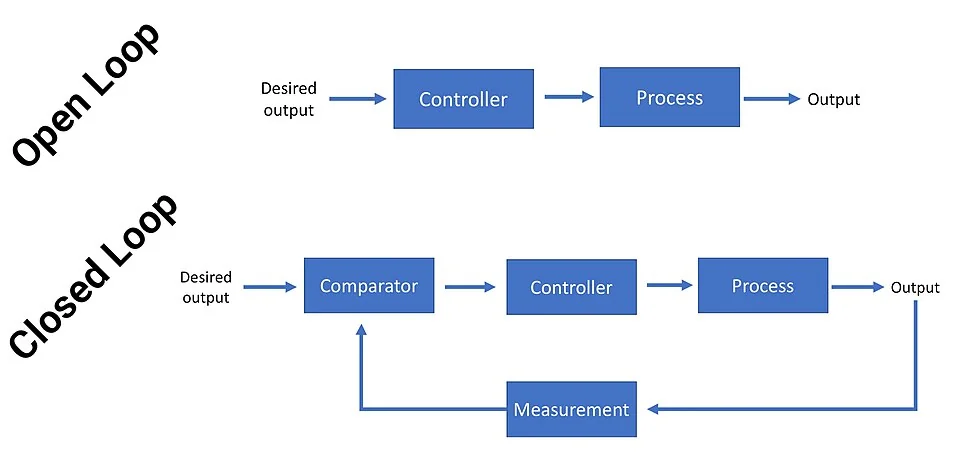

*아래 폐루프에만 있는 두 상자 — Measurement(**검출부**)와 Comparator(**비교부**) — 가 두 방식의 차이 전부다.*

| 구분 | 개루프(열린 루프) | 폐루프(닫힌 루프, 피드백) |
| --- | --- | --- |
| 출력 확인 | 안 함 | 검출해서 목표와 비교 |
| 정확도 | 외란에 약함 | 외란을 보정, 정확 |
| 구조 | 간단, 저렴 | 검출부·비교부가 더 필요 |
| 예 | 시퀀스 제어, 세탁기, 신호등 | 에어컨 온도, 서보 위치 |

> [!question] 시험에서는
> 시퀀스(순차) 제어와 피드백 제어를 가르는 장치 → **비교부**. 외란 변수가 여러 개인 곳에 개루프는 부적합하다.

*1차 수신 원제목: 03 피드백에 따른 제어의 구분 (p.5~6)*

- 열린 루프(개회로, 정성적): 출력 점검 없음. 시퀀스 제어, 자동 세탁기, 무인 신호등.
- 닫힌 루프(피드백, 폐회로, 정량적): 출력이 목표에 가도록 입력 조정. 궤환요소가 더 필요하지만 정확.
- 반폐쇄회로: CNC에서 서보모터 축이나 볼스크루 회전각으로 위치 검출.
- 시간 응답: 목표값에 대한 출력의 시간적 변화. 신호 4종: 입력(기준)신호, 동작신호, 검출신호, 오차(조절)신호.
- 문제 유형: 개회로 부적합 → 외란변수 여러 개 / 순서대로 진행 → 시퀀스 제어 / 피드백 특징이 아닌 것 → 순차 진행 / 순차와 피드백의 차이 → 비교부 / 출력의 시간적 변화 → 시간 응답 / 검출신호와 목표로 조작부 신호를 만드는 곳 → 조절부.

### 핵심이론 04 분류 기준에 따른 제어의 종류

교재 p.7 · 정리한 노트: [자동제어계의 기초](../10_자동제어/자동제어계의_기초.md)

**한마디로**: 분류 문제는 질문 세 개로 풀린다. ① **무엇을** 제어하나(제어량) ② **목표값이 어떻게** 변하나(제어목표) ③ **어떻게** 움직이나(제어동작).

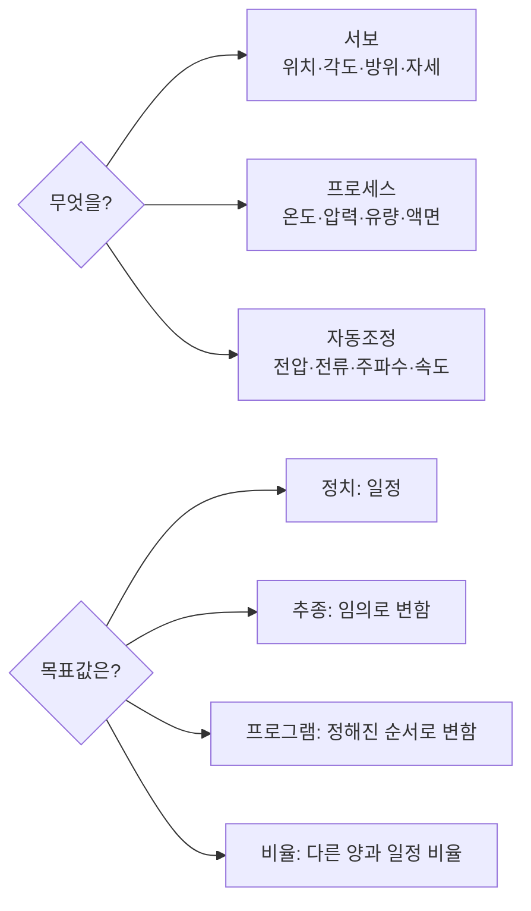

> [!tip] 외우는 법
> 서보는 **"위각방자"**(위치·각도·방위·자세), 프로세스는 **"온압유액"**(온도·압력·유량·액면). 매년 나오는 문제다.

*1차 수신 원제목: 04 분류 기준에 따른 제어의 종류 (p.7~8)*

- 제어량: 서보(위치·각도·방위·자세), 프로세스(압력·온도·유량·밀도), 자동조정(전압·전류·주파수·속도 등). 해설: 매년 출제.
- 제어목표: 정치(주파수 제어, 발전기 조속기, 자동전압조정장치), 추종(서보, 요격 미사일), 프로그램(무인열차 속도), 비율(열처리로 온도).
- 제어동작: 연속(P·I·D) / 불연속(샘플값, On-off). 제어방식: 최적, 적응, 디지털(수치제어).
- 문제 유형: 온도·압력·유량·액면 → 프로세스 / 정치제어 아닌 것 → 잉크젯 헤드 위치 / 열처리로 온도 → 비율제어 / 양자화 신호 → 디지털 제어.

### 핵심이론 05 퍼지제어

교재 p.8 · 정리한 노트: [자동제어계의 기초](../10_자동제어/자동제어계의_기초.md)

**한마디로**: "조금 덥다", "꽤 덥다" 같은 사람의 애매한 말을 0~1 사이 숫자(소속도)로 바꿔서 제어하는 방법이다. 25 ℃는 '따뜻함' 0.7, '더움' 0.3처럼 두 상태에 동시에 걸칠 수 있다.


*경계가 칼같이 나뉘지 않고 겹쳐 있는 것이 핵심이다. 그래서 정확한 수학 모델이 없어도 사람의 경험 규칙("조금 더우면 팬을 약하게")으로 제어할 수 있다.*

*1차 수신 원제목: 05 퍼지제어 (p.8~9)*

- 근사적 추론으로 사람 판단처럼 유연하게 제어. 이해 쉬움, 확장성, 부정확한 정보에 관대, 비선형 모델링, 기존 제어와 혼합, 일상 언어 기반, 외란에 강함.
- 단순 온도 제어에는 비용효율이 떨어짐.
- 문제 유형: 퍼지 특징이 아닌 것 → PID 같은 선형제어가 근본 / 퍼지 개선 대상으로 부적합 → 냉각수 저장조 온도제어.

## Ⅱ. 라플라스 변환과 전달함수 (06~11)

### 핵심이론 06 라플라스 변환

교재 p.9 · 정리한 노트: [라플라스 변환과 전달함수](../10_자동제어/라플라스_변환과_전달함수.md)

**한마디로**: 라플라스 변환은 **미분방정식을 곱셈·나눗셈 문제로 바꾸는 번역기**다. 로그가 곱셈을 덧셈으로 바꿔 계산을 쉽게 하듯, 미분은 $\times s$, 적분은 $\div s$로 바뀐다. 풀고 나서 역변환하면 시간 응답이 나온다.


$$F(s) = \int_0^\infty f(t)\,e^{-st}\,dt \qquad \mathcal{L}\!\left[\frac{df}{dt}\right] = sF(s) - f(0) \qquad \mathcal{L}\!\left[\int f\,dt\right] = \frac{F(s)}{s}$$

| $f(t)$ | $F(s)$ | 시험 포인트 |
| --- | --- | --- |
| $\delta(t)$ (임펄스) | $1$ | 임펄스 → 1 |
| $u(t)$ (단위 계단), 상수 $K$ | $\dfrac{1}{s}$, $\dfrac{K}{s}$ | 계단 → $1/s$ |
| $t$ | $\dfrac{1}{s^2}$ | |
| $t^n$ | $\dfrac{n!}{s^{n+1}}$ | $10t^5 \to 10 \cdot 120/s^6 = 1200/s^6$ |
| $e^{-at}$ | $\dfrac{1}{s+a}$ | |
| $t e^{-at}$ | $\dfrac{1}{(s+a)^2}$ | $te^{-t} \to 1/(s+1)^2$ |
| $\sin\omega t$ | $\dfrac{\omega}{s^2+\omega^2}$ | 분자가 $\omega$ |
| $\cos\omega t$ | $\dfrac{s}{s^2+\omega^2}$ | 분자가 $s$ |

> [!tip] 감 잡기
> $e^{-at}$를 곱하면 $s$ 자리에 $s+a$가 들어간다(제1 이동). $T$초 늦추면 $e^{-Ts}$가 곱해진다(제2 이동). 이 두 가지로 표의 절반이 설명된다.

*1차 수신 원제목: 06 라플라스 변환 (p.9~12)*

- 이유: 주파수 영역 해석, 미분방정식을 대수식처럼, 초기조건 반영. "시간영역 해석이 쉬워진다"는 틀린 서술.
- 식: 정의 $F(s)=\int_0^\infty f(t)e^{-st}dt$, 제1이동 $\mathcal{L}[e^{\pm at}f(t)]=F(s\mp a)$, 도함수 $sF(s)-f(0)$, $s^2F(s)-sf(0)-f'(0)$, 적분 $F(s)/s$, 제2이동 $\mathcal{L}[f(t-T)]=e^{-Ts}F(s)$.
- 부분분수 예: $\dfrac{4}{s^3+3s^2+2s}=\dfrac{2}{s}+\dfrac{2}{s+2}-\dfrac{4}{s+1}$ → $2+2e^{-2t}-4e^{-t}$.
- 변환표: δ→1, u→1/s, t→1/s², t²→2/s³, tⁿ→n!/sⁿ⁺¹, e^{-at}→1/(s+a), te^{-at}→1/(s+a)², tⁿe^{-at}→n!/(s+a)ⁿ⁺¹, cos·sin, 감쇠 cos·sin, cosh→s/(s²−ω²), sinh→ω/(s²−ω²).
- 문제 유형: 특징 아닌 것 → 시간영역 해석 쉬움 / K → K/s / 임펄스 → 1 / 계단 → 1/s / $V(s)=sLI(s)$ / $te^{-t}$ → $1/(s+1)^2$ / $e^{-at}$ 그래프 → $1/(s+a)$ / $10t^5$ → $1200/s^6$ / 부분분수 역변환 / 사각 펄스 → $\frac{3}{s}(e^{-as}-e^{-bs})$ 꼴.

### 핵심이론 07 전달함수의 정의

교재 p.13 · 정리한 노트: [라플라스 변환과 전달함수](../10_자동제어/라플라스_변환과_전달함수.md)

**한마디로**: 전달함수는 시스템의 **성격표**다. 어떤 입력을 넣든 "출력 ÷ 입력"의 비율은 그 시스템만의 고유한 값이라 바뀌지 않는다. 초기 상태가 섞이면 비율이 흐려지므로 **초기조건은 모두 0**으로 둔다.


$$G(s) = \frac{Y(s)}{X(s)} \quad (\text{모든 초기조건} = 0) \qquad = \mathcal{L}[\text{임펄스 응답}]$$

*1차 수신 원제목: 07 전달함수의 정의 (p.13)*

- 임펄스 응답의 라플라스 변환, 모든 초기조건 0, $G(s)=Y(s)/X(s)$. 시스템 고유 특성이라 입력이 바뀌어도 불변.
- 문제 유형: 정의 시 고려 → 초깃값 0 / 일반식 → 출력 변환 ÷ 입력 변환.

### 핵심이론 08 간단한 제어요소의 전달함수

교재 p.14 · 정리한 노트: [라플라스 변환과 전달함수](../10_자동제어/라플라스_변환과_전달함수.md)

**한마디로**: 복잡한 시스템도 몇 가지 기본 블록(비례·미분·적분·지연)을 이어 붙인 것이다. 블록마다 "입력이 들어오면 출력이 어떻게 반응하는가"의 성격이 다르다.

| 요소 | 전달함수 | 계단 입력을 넣으면 |
| --- | --- | --- |
| 비례 | $K$ | 즉시 $K$배 |
| 미분 | $Ks$ | 변하는 순간만 튐 |
| 적분 | $\dfrac{K}{s}$ | 계속 쌓여 증가 |
| 1차 지연 | $\dfrac{K}{1+Ts}$ | 지수적으로 천천히 따라감 |
| 2차 지연(표준형) | $\dfrac{\omega_n^2}{s^2+2\zeta\omega_n s+\omega_n^2}$ | $\zeta$에 따라 진동하며 수렴 |
| 낭비 시간 | $e^{-Ls}$ | $L$초 뒤에 그대로 |

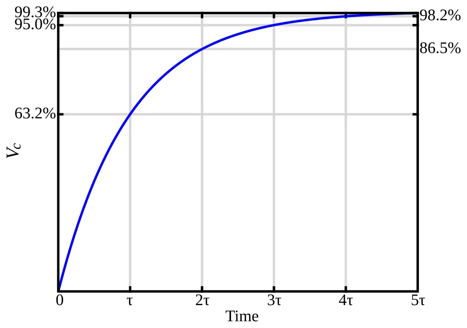

*1차 지연 요소의 대표가 RC 회로다. 시정수 τ(=RC)에서 **63.2 %**, 3τ에서 95 %, 5τ에서 99.3 %에 도달한다. 그래서 "약 5τ면 다 찼다"고 본다.*

$$y(t) = K\left(1 - e^{-t/T}\right) \quad\Rightarrow\quad y(T) = 0.632K$$

> [!question] 시험에서는
> "시정수 = 정상값의 **63.2 %** 에 도달하는 시간, **작을수록 응답이 빠르다**." 36.8 %와 바꿔 내는 함정이 있다.

*1차 수신 원제목: 08 간단한 제어요소의 전달함수 (p.14~15)*

- 비례·미분·적분·1차 앞선·1차 지연·2차 지연·낭비시간·표준 2차. 시정수 = 정상값의 63.2 % 도달 시간, 작을수록 빠름.
- 예시 연결(교재): 미분요소 = 속도계 발전기·RC 미분회로, 적분요소 = 수위계·RC 적분회로, 1차 지연 = RLC 직렬·수위계 (식은 확인 필요).
- 문제 유형: 1차 지연 → $K/(1+Ts)$ / 시정수 → 작을수록 빠름 / ζ=0.4, ωn=1 → $1/(s^2+0.8s+1)$.

### 핵심이론 09 시스템의 모델링

교재 p.16 · 정리한 노트: [라플라스 변환과 전달함수](../10_자동제어/라플라스_변환과_전달함수.md)

**한마디로**: 스프링에 매달린 추와 RLC 회로는 **똑같은 모양의 방정식**을 따른다. 그래서 하나를 알면 나머지는 이름만 바꿔 풀 수 있다(상사).

$$m\ddot{x} + c\dot{x} + kx = F \qquad\Longleftrightarrow\qquad L\ddot{q} + R\dot{q} + \frac{1}{C}q = V$$

| 기계(직선) | 전기 | 역할 |
| --- | --- | --- |
| 힘 $F$ | 전압 $V$ | 원인(입력) |
| 속도 $v$ | 전류 $i$ | 흐름 |
| 변위 $x$ | 전하 $q$ | 쌓인 양 |
| 질량 $m$ | 인덕턴스 $L$ | 변화를 싫어함(관성), 에너지 축적 |
| 댐퍼 $c$ | 저항 $R$ | 에너지를 열로 버림 |
| 스프링 $k$ | $1/C$ (커패시터) | 에너지 축적 |

*1차 수신 원제목: 09 시스템의 모델링 (p.16~18)*

- 에너지 축적 요소(커패시터·인덕턴스·스프링·운동량) vs 저항 요소(저항·댐퍼, 축적 안 함).
- 상사: 힘↔토크↔전압, 속도↔각속도↔전류, 운동량↔각운동량↔자속, 변위↔각변위↔전하량, 질량↔관성모멘트↔인덕턴스.
- 문제 유형: $X/F = 1/(Ms^2)$ / 직렬 RLC 공진 시 위상각 0 / 공진 설명 중 틀린 것 → 전압·전류 이상(異相) (실제 동상) / RC 시정수 → RC / RL 직렬에서 주파수 감소 → 위상각 감소 / 그림 문제 3개(확인 필요).
- 헷갈림: 병렬공진 = 임피던스 최대, 직렬공진 = 전류 최대.

### 핵심이론 10 블록선도를 이용한 전달함수식

교재 p.19 · 정리한 노트: [라플라스 변환과 전달함수](../10_자동제어/라플라스_변환과_전달함수.md)

**한마디로**: 블록선도 문제는 결국 **"화살표 뭉치를 상자 하나로 줄이기"** 다. 직렬은 곱하고, 병렬은 더하고, 피드백 고리는 공식 하나로 접는다.

| 피드백 루프 | 하나로 줄인 결과 |
| :---: | :---: |
|  |  |

$$\text{직렬: } G_1G_2 \qquad \text{병렬: } G_1 \pm G_2 \qquad \text{부(−)피드백: } \frac{G}{1+GH}$$

*그림 기호로는 $G = P_1$, $H = P_2$. 비교점의 ∓는 부피드백(−)이면 분모가 $1 + P_1P_2$, 정피드백(+)이면 $1 - P_1P_2$라는 뜻이다.*

> [!tip] 감 잡기
> 피드백 공식은 **"앞으로 가는 길 ÷ (1 + 한 바퀴 도는 길)"** 로 외운다. 루프가 여러 겹이면 **안쪽 루프부터** 접는다.

*1차 수신 원제목: 10 블록선도를 이용한 전달함수식 (p.19~21)*

- 직렬 곱, 병렬 합, 피드백 결합, 가산점·인출점 이동. 가산점 입력이 3개면 둘로 나눠 합성. 안쪽 루프부터.
- 해설 풀이: 경로 합 ÷ (1 − 폐루프 합) (메이슨 형태).
- 문제 유형: 그림 블록선도 6문항 (값 0.7, 3 등, 확인 필요).

### 핵심이론 11 신호흐름선도

교재 p.22 · 정리한 노트: [라플라스 변환과 전달함수](../10_자동제어/라플라스_변환과_전달함수.md)

**한마디로**: 신호흐름선도는 블록선도를 **점(마디)과 화살표(가지)만으로** 다시 그린 지도다. 상자가 없어서 복잡한 루프도 메이슨 공식 하나로 바로 계산한다.


$$M = \frac{\sum_k P_k \Delta_k}{\Delta}, \qquad \Delta = 1 - \sum L_1 + \sum L_2 - \cdots$$

*$P_k$: k번째 전향 경로 이득, $L_1$: 각 루프 이득, $L_2$: 서로 닿지 않는 두 루프 이득의 곱.*

> [!question] 시험에서는
> **경로 이득은 가지 이득의 곱**이다. "합"이라고 한 보기가 틀린 것으로 나왔다.

*1차 수신 원제목: 11 신호흐름선도 (p.22)*

- 마디, 가지, 경로, 전향경로, 피드백 루프, 경로 이득. 기본법칙 3가지(더하기, 전송, 곱하기). 가지는 단방향, 입력마디는 보내기만, 출력마디는 받기만.
- 문제 유형: 틀린 것 → "경로 이득은 합".

## Ⅲ. PID·응답·안정도·주파수 응답 (12~19)

### 핵심이론 12 전달함수 - PID 제어

교재 p.23 · 정리한 노트: [자동제어계의 기초](../10_자동제어/자동제어계의_기초.md)

**한마디로**: 차선 가운데로 차를 모는 운전자를 떠올린다. **P**는 벗어난 거리만큼 핸들을 꺾고, **I**는 계속 한쪽으로 쏠리는 버릇(잔류편차)을 기억했다가 지우고, **D**는 차가 빠르게 다가오면 미리 반대로 꺾어 넘치지 않게 한다.

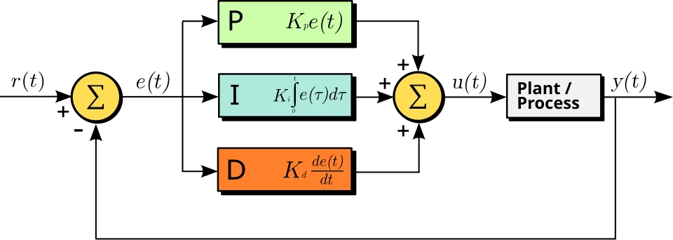

$$u(t) = K_p\,e(t) + K_i\int_0^t e(\tau)\,d\tau + K_d\,\frac{de(t)}{dt} \qquad G_c(s) = K_p\left(1 + \frac{1}{T_i s} + T_d s\right)$$

| 동작 | 좋아지는 것 | 대가 |
| --- | --- | --- |
| P (비례) | 빠른 상승, 단순·저렴 | **잔류편차(오프셋)** 남음, 오버슈트 |
| I (적분) | **오프셋 제거** | 느려짐, 진동·발산 가능 |
| D (미분) | **응답 속도·안정성**(미리 대응) | 단독 사용 불가, 잡음에 민감 |
| PI | 정상 특성(오프셋 제거) | |
| PD | 과도 특성(속응성) — 진상 보상기와 비슷 | |
| PID | 과도 + 정상 모두 | 조정할 파라미터가 3개 |

> [!question] 시험에서는
> "응답 속도만 개선" → **PD**, "오프셋 제거, 발산 가능성" → **PI**, "과도·정상 모두 개선" → **PID**. 불연속 동작의 대표는 **2위치(On-Off)**.

**1차 수신분**

*1차 수신 원제목: 12 전달함수 - PID 제어 (p.23~24) — **여기서 끊김***

- 비례(P), 미분(D), 적분(I), PID. 교재는 PID를 정밀도와 성능이 가장 뛰어… (이후 미수신)

**2차 수신분**

- **12 PID (p.23~24)**: P = 싸고 정밀도 낮음, 상승 빠르나 오버슈트 크고 잔류편차. D = 응답 속도만 개선, P와 병용, 대규모 설비. I = 오프셋 제거, 느리고 비싸며 발산 가능성. PID = 과도·정상 모두 개선. 예제: 응답만 개선 → PD / 오프셋 제거·발산 가능 → PI / PID는 과도·정상 모두 개선 / 파라미터 틀린 것(리셋률, 수식 누락) / PD ↔ 진상보상기 / 불연속 → 2위치.

### 핵심이론 13 제어계 해석 - 입력

교재 p.24 · 정리한 노트: [과도응답과 안정도](../10_자동제어/과도응답과_안정도.md)

**한마디로**: 시스템의 성격을 알아보려고 일부러 **정해진 모양의 시험 신호**를 넣어 본다. 의사가 무릎을 망치로 톡 쳐서 반사를 보는 것과 같다.

| 입력 | 비유 | 라플라스 | 이 입력의 응답 이름 |
| --- | --- | --- | --- |
| 임펄스 | 망치로 한 번 톡 | $1$ | 임펄스 응답 |
| 계단 | 스위치를 켜 두기 | $1/s$ | **인디셜 응답** |
| 경사(램프) | 일정 속도로 올리기 | $1/s^2$ | 속도 응답 |
| 포물선 | 점점 빨리 올리기 | $1/s^3$ | 가속도 응답 |
| 정현파 | 일정 주기로 흔들기 | $\omega/(s^2+\omega^2)$ | **주파수 응답** |

$$e_{ss} = \lim_{t\to\infty} e(t) = \lim_{s\to 0} s\,E(s) \qquad (\text{최종값 정리})$$

- **13 입력 (p.24~25)**: 임펄스·계단(인디셜 응답)·경사·포물선(가속도)·정현파(주파수 응답). 정상 오차 $e_{ss} = \lim_{s\to0} sE(s)$. 예제: 주파수 응답 입력 → 정현파 / 계단 응답 이름 → 인디셜 / 기준 입력 아닌 것 → 전달함수 / 단위 계단 정상 오차 → 0.

### 핵심이론 14 제어계의 해석 - 응답과 특성방정식

교재 p.26 · 정리한 노트: [과도응답과 안정도](../10_자동제어/과도응답과_안정도.md)

**한마디로**: 문이 천천히 닫히게 하는 **도어 클로저**를 생각한다. 힘이 약하면 문이 쾅 닫혔다가 튕기며 흔들리고(**아제동**), 너무 세면 한참 걸려 닫히고(**과제동**), 딱 맞으면 가장 빨리 튕김 없이 닫힌다(**임계제동**). 이 세기가 감쇠비 $\zeta$다.

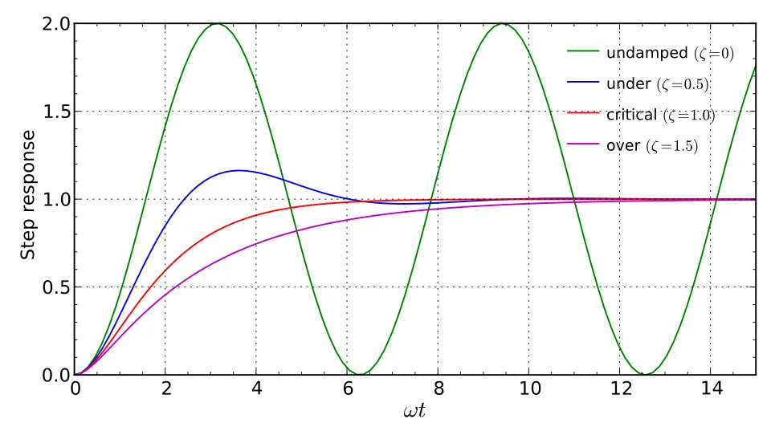

*범례 읽기: undamped(ζ=0) = **무제동**(끝없이 진동), under(ζ=0.5) = **아제동**(한 번 넘쳤다가 수렴), critical(ζ=1) = **임계제동**(넘치지 않는 가장 빠른 곡선), over(ζ=1.5) = **과제동**(가장 느림).*

$$s^2 + 2\zeta\omega_n s + \omega_n^2 = 0 \quad\Rightarrow\quad s = -\zeta\omega_n \pm \omega_n\sqrt{\zeta^2 - 1}$$

| $\zeta$ | 상태 | 근 | 응답 |
| --- | --- | --- | --- |
| $\zeta < 0$ | 불안정 | 우반면 | 점점 커짐 |
| $\zeta = 0$ | 무제동 | 허수축 위 | 끝없이 진동 |
| $0 < \zeta < 1$ | 아(부족)제동 | 켤레 복소근 | 감쇠 진동 |
| $\zeta = 1$ | 임계제동 | 같은 실근(중근) | 진동 없이 가장 빠름 |
| $\zeta > 1$ | 과제동 | 서로 다른 두 실근 | 느리게 접근 |

- **14 응답과 특성방정식 (p.26~27)**: ζ<0 불안정, 0 무제동, 0~1 아제동, 1 임계, >1 과제동. 예제: ζ=0.2, ωn=1 → $1/(s^2+0.4s+1)$ / ζ=1 → 임계제동 / 특성근 −4, −5.

### 핵심이론 15 제어계의 해석 - 시간 응답

교재 p.27 · 정리한 노트: [과도응답과 안정도](../10_자동제어/과도응답과_안정도.md)

**한마디로**: 계단 입력에 대한 응답 곡선 하나에서 **"얼마나 빨리, 얼마나 넘치고, 언제 자리 잡나"** 를 숫자로 읽어 내는 것이 시간 응답 특성이다.

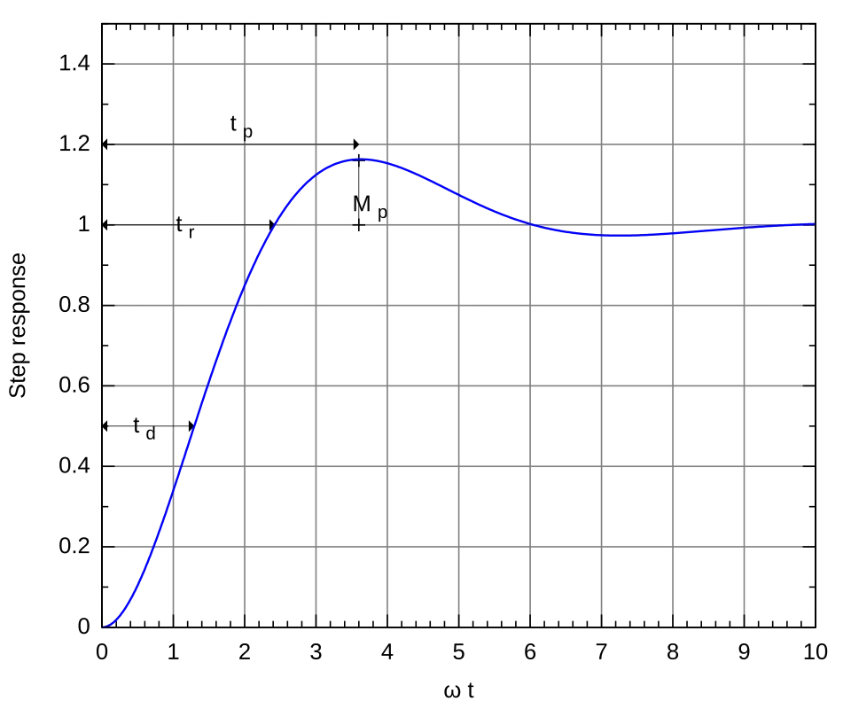

*그림 기호: $t_d$ 지연 시간(50 % 도달), $t_r$ 상승 시간, $t_p$ 최대 오버슈트가 나오는 시각, $M_p$ 최대 오버슈트. **주의**: 이 그림의 $t_r$은 0 → 100 % 기준으로 그려져 있다. 교재 정의는 **10 → 90 %** 이니 시험에는 교재 정의로 답한다. 정착 시간은 그림에 없다(±5 % 띠 안에 머물기 시작하는 시각).*

| 특성 | 교재 정의 |
| --- | --- |
| 지연 시간 $t_d$ | 최종값의 **50 %** 도달 |
| 상승 시간 $t_r$ | **10 % → 90 %** |
| 정착 시간 $t_s$ | 최종값의 **±5 %** 안에 들어와 머무름 |
| 최대 오버슈트 | 최종값을 넘은 최대량 |

$$\text{백분율 오버슈트} = \frac{\text{최대 오버슈트}}{\text{최종값}} \times 100\ [\%] \qquad \text{감쇠비(교재)} = \frac{\text{제2 오버슈트}}{\text{최대 오버슈트}}$$

- **15 시간 응답 (p.27~28)**: 지연 50 %, 상승 10→90 %, 정착 5 % 이내, 오버슈트, 제2오버슈트. 교재식 감쇠비 = 제2오버슈트 ÷ 최대오버슈트, 백분율 오버슈트 = 최대오버슈트 ÷ 최종값 × 100. 예제: 백분율 오버슈트 / 지연시간 10 % 보기는 틀림 / 시간영역 성능 아닌 것 → 감도.

### 핵심이론 16 제어계 - 주파수 응답

교재 p.29 · 정리한 노트: [과도응답과 안정도](../10_자동제어/과도응답과_안정도.md)

**한마디로**: 시스템을 **여러 속도로 흔들어 보고**, 출력이 얼마나 크게(진폭비) 얼마나 늦게(위상차) 따라오는지 재는 방법이다. 정현파를 넣으면 같은 주파수의 정현파가 크기와 위상만 바뀌어 나온다.

$$G(j\omega) = |G(j\omega)|\,\angle G(j\omega) \qquad \text{진폭비} = |G(j\omega)|,\quad \text{위상차} = \angle G(j\omega)$$

**계산 예**: 입력 $100\sin 500t$ → 출력 $50\sin(500t - 60°)$ → 진폭비 $50/100 = 0.5$, 위상차 $60°$ 늦음.

- **16 주파수 응답 (p.29)**: 진폭비 = |G(jω)|, 위상차 = ∠G(jω). 예제: 벡터 궤적 반원 / 기본 입력 정현파 / 100 sin 500t → 50 sin(500t − 60°): 0.5, 60°.

### 핵심이론 17 안정도

교재 p.30 · 정리한 노트: [과도응답과 안정도](../10_자동제어/과도응답과_안정도.md)

**한마디로**: 그릇 바닥에 놓인 공은 건드려도 제자리로 돌아오고(안정), 언덕 꼭대기 공은 살짝만 밀어도 굴러떨어진다(불안정). 제어계에서는 **특성방정식의 근(극점)이 s평면 왼쪽 반에 모두 있으면 안정**이다.


| 판별법 | 보는 것 |
| --- | --- |
| 루스-허위츠 | 계수 부호가 모두 같고 0이 없고, 루스 표 **제1열 부호 변화 없음** (변화 횟수 = 우반면 근 수) |
| 근궤적 | $K$ 변화에 따른 극점 이동. 극점에서 출발해 영점으로, 실수축 대칭 |
| 나이퀴스트·보드 | 이득 여유(GM)·위상 여유(PM)가 양수 |

> [!question] 시험에서는
> 안정도 판별법이 **아닌** 것 → **블록선도**. 근궤적 개수 = 극점 수와 영점 수 중 **큰 쪽**.

- **17 안정도 (p.30~32)**: Routh 조건(계수 부호 같음, 0 없음, 제1열 부호 불변), 근궤적(극점→영점, 실수축 대칭, 개수 = 극점·영점 중 많은 쪽, 점근선 수 = 극점 수 − 영점 수), GM·PM. 예제: 판별법 아닌 것 → 블록선도 / 안정도 관련 → 이득 여유 / 응답성·안정성 표시 아닌 것 → 피크시간 / 근궤적 수 5 / 실수축 대칭 / K 범위(수식 누락).

### 핵심이론 18 전달함수의 보드(Bode)선도

교재 p.32 · 정리한 노트: [과도응답과 안정도](../10_자동제어/과도응답과_안정도.md)

**한마디로**: 주파수 응답을 **로그 눈금 그래프 두 장**(크기 dB, 위상 °)으로 그린 것이 보드 선도다. 곱셈이 로그에서 덧셈이 되므로, 요소별 직선을 그려서 더하기만 하면 된다.

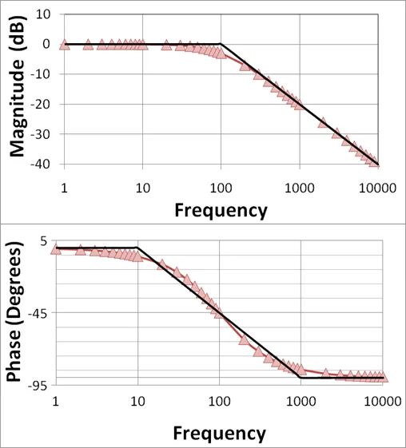

*검은 직선이 손으로 그리는 점근선, 세모 점이 실제 값이다. 절점 주파수(여기서는 100)에서 실제 크기는 점근선보다 **3 dB** 낮고, 위상은 정확히 **−45°** 다.*

$$g = 20\log_{10}|G(j\omega)|\ [\text{dB}] \qquad |G| = \tfrac{1}{\sqrt{2}} \;\Rightarrow\; -3\ \text{dB}$$

| 요소 | 기울기 | 위상 |
| --- | --- | --- |
| 미분 $s$ | +20 dB/dec | +90° |
| 적분 $1/s$ | −20 dB/dec | −90° |
| 1차 앞섬 $1+Ts$ | 절점 뒤 +20 dB/dec | 0 → +90° (절점에서 +45°) |
| 1차 지연 $1/(1+Ts)$ | 절점 뒤 −20 dB/dec | 0 → −90° (절점에서 −45°) |

- **18 보드선도 (p.32~34)**: 미분 +90°·+20 dB/dec, 적분 −90°·−20, 1차 앞선·지연 절점 이후 ±20, 절점 −3 dB. 2차 지연·낭비 요소는 출제 가능성 낮다고 교재가 밝힘. 예제: 1 + jω → 45° / ω = 10에서 −40 dB/dec / 절점 −3 dB / 약 60 dB / −3 dB = 1/√2배.

### 핵심이론 19 보상회로

교재 p.35 · 정리한 노트: [과도응답과 안정도](../10_자동제어/과도응답과_안정도.md)

**한마디로**: 보상회로는 제어계의 성격을 **"조금 더 빠르게" 또는 "조금 더 정확하게"** 고치는 덧붙임 회로다. 진상은 위상을 앞당겨 반응을 빠르게(PD와 비슷), 지상은 위상을 늦추는 대신 정상 오차를 줄인다(PI와 비슷).

| 보상 | 위상 | 개선되는 것 | 닮은 제어 |
| --- | --- | --- | --- |
| 진상(Lead) | 앞당김 | 속응성·과도 특성 | PD |
| 지상(Lag) | 늦춤 | 정상 오차 | PI |
| 진지상 | 둘 다 | 과도 + 정상 | PID |

- **19 보상회로 (p.35)**: 지상 = 위상 늦춤, 진상 = 위상 앞당김. 조건 부등호는 수식 누락(확인 필요).

## Ⅳ. 서보기구 (20~21)

### 핵심이론 20 서보기구

교재 p.35 · 정리한 노트: [서보 모터와 서보 제어](../10_자동제어/서보모터와_서보제어.md)

**한마디로**: 서보기구는 **명령한 위치·각도를 끝까지 쫓아가는** 추종 제어 장치다. 로봇 팔이 "30° 돌아"라는 명령을 받으면, 실제로 몇 도 돌았는지 계속 재면서 30°에 정확히 멈춘다. 그 "재는 눈"이 엔코더와 리졸버다.

| 엔코더: 원판의 무늬를 빛으로 읽는다 | 리졸버: 회전각에 따라 코일 전압이 바뀐다 |
| :---: | :---: |
|  | 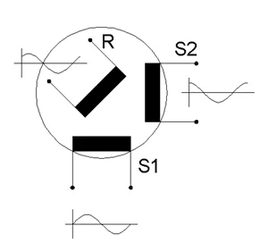 |
| 그림은 **3비트 앱솔루트형**: 트랙 3개의 흑백 조합으로 8개 위치(45°마다)를 바로 읽음. **인크리멘탈형**은 슬릿을 지난 펄스 수를 셈. 속도·방향·회전 수는 재지만 **토크는 못 잼** | 회전각을 sin·cos 전압으로 |

| 방식 | 위치를 재는 곳 | 특징 |
| --- | --- | --- |
| 개방(오픈) 루프 | 재지 않음 (스테핑 모터) | 간단, 탈조 시 모름 |
| 반폐쇄 루프 | 모터 축·볼스크루 **회전각** | **CNC에서 가장 많이 씀** |
| 폐쇄 루프 | 테이블의 **직선 이동량** (리니어 스케일) | 가장 정확, 비쌈 |
| 복합 | 반폐쇄 + 폐쇄 | 대형·고정밀 |

$$\text{이동량} = \text{펄스 수} \times \text{펄스당 이동량} \qquad \text{속도} = \text{펄스 주파수(pps)} \times \text{펄스당 이동량}$$

- **20 서보기구 (p.35~36)**: 개방·반폐쇄(CNC 최다, 모터 축·볼스크루 회전각)·폐쇄(직선 이동량)·복합. 리졸버 = 회전각 전기 검출, 인코더 = 속도·방향·횟수(토크 불가), 커플링 = 백래시 방지, 이동량 ∝ 펄스 수, 속도 ∝ 펄스 주파수(pps). 예제: 속도·위치 측정 → 폐루프 / CNC 최다 → 반폐쇄 / 방위 30°·키 60° → 30° / 인코더로 못 재는 것 → 토크.

### 핵심이론 21 서보기구의 종류

교재 p.37 · 정리한 노트: [서보 모터와 서보 제어](../10_자동제어/서보모터와_서보제어.md)

**한마디로**: 서보기구는 **머리(신호 변환부)** 가 명령을 계산하고 **근육(파워 변환부)** 이 힘을 낸다. 근육을 무엇으로 쓰느냐에 따라 전기식·유압식·공압식으로 나뉜다.

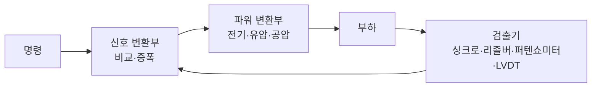

| 구분 | 출력 | 속도 | 비고 |
| --- | --- | --- | --- |
| 전기식 | 중 | 빠름 | 경제적. 직류식 = 기동 토크 큼, 교류식 = 브러시 없음·보수 쉬움 |
| 유압식 | **고출력** | 빠름 | 안내밸브식·분사관식 |
| 공압식 | 저출력 | 중 | 저렴·깨끗 |

- **21 서보기구 종류 (p.37~38)**: 신호 변환부 + 파워 변환부. 전기식(중출력, 빠름, 경제적, 직류식 = 속도 범위 넓고 기동토크 큼·구조 복잡, 교류식 = 브러시 없음·보수 쉬움), 유압식(고출력, 안내밸브식·분사관식), 공압식(저출력, 저렴, 깨끗). 검출기 싱크로·리졸버·퍼텐쇼미터·LVDT. 예제: 신호 종류 아닌 것 → 기계식 / 신호 변환에 공압식이 많이 쓰인다 → 틀림 / 전기식은 유압식보다 경제적 / 높은 출력에 교류식 적합 → 틀림 / 보수 용이·내환경성 → 교류식 특징 / 절대위치 → 원점 기준.

## Ⅴ. PLC 구성과 특수모듈 (22~26)

### 핵심이론 22 PLC제어의 정의 및 특징

교재 p.38 · 정리한 노트: [PLC 구성과 특성](../10_자동제어/PLC_구성과_특성.md), [PLC 프로그래밍 언어와 명령어](../10_자동제어/PLC_프로그래밍_언어와_명령어.md)

**한마디로**: 예전 제어반은 릴레이 수백 개를 전선으로 엮어 회로를 만들었다. 동작을 바꾸려면 배선을 다시 해야 했다. PLC는 그 회로를 **프로그램으로 바꾼 산업용 컴퓨터**라서, 수정은 키보드로 끝난다.

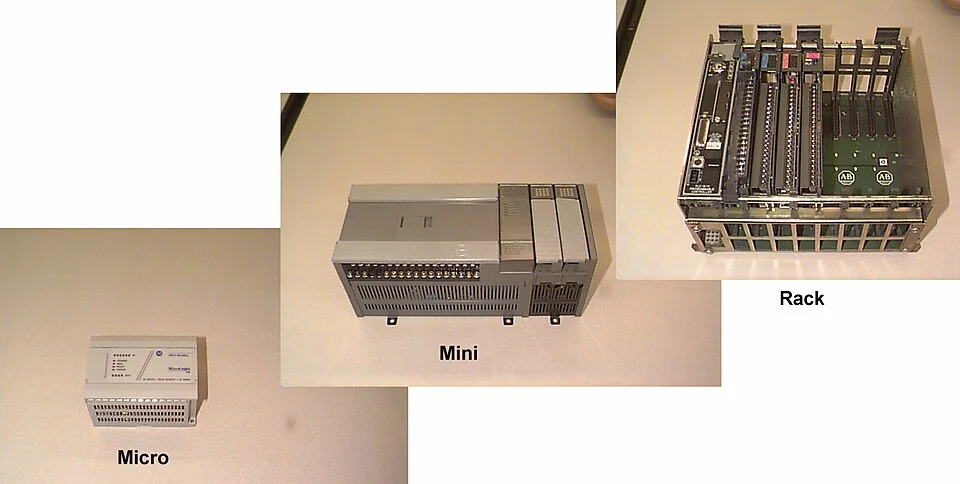

*왼쪽 마이크로·미니형은 CPU·전원·입출력이 한 몸인 **일체형**(소규모 설비), 오른쪽 **랙(모듈)형**은 베이스의 슬롯에 전원·CPU·입출력·특수모듈을 골라 꽂는다(대규모, 확장 쉬움).*

| 항목 | 릴레이 제어반 | PLC |
| --- | --- | --- |
| 회로 변경 | 배선 다시 | **프로그램 수정** |
| 크기 | 큼 | 작음 |
| 기능 | 접점 논리만 | 산술·논리 연산, 타이머·카운터, 통신 |
| 신뢰성 | 접점 마모 | 무접점, 높음 |

- **22 PLC 정의·특징 (p.38~40)**: 반도체 IC 무접점 제어장치. 특징: 확장·보수 쉬움, 산술·논리 연산, 외부 통신, 배선 간소, 신뢰성, 비밀 유지, 변경 쉬움. 회로 표현 4가지: 래더, 명령어, 논리기호, 불 대수. 국내 PLC: LS XG, 미쓰비시 Melsec, 지멘스, 오므론. 명령 LD/LDI/LDP/LDF/AND/ANDI/OR/ORI. 예제: 범용 PLC 기능 아닌 것 → 영상처리 / 특징 아닌 것 → 수정·변경이 어렵다 / 모선 시작 → LD / 회로도 방식 아닌 것 → 플로차트 / 자기진단으로 못 찾는 것 → 입출력 접점 이상.

### 핵심이론 23 PLC 구성장치

교재 p.40 · 정리한 노트: [PLC 구성과 특성](../10_자동제어/PLC_구성과_특성.md)

**한마디로**: PLC 안은 사람 몸과 같다. **입력부(감각)** 가 스위치·센서 신호를 받고, **CPU(두뇌)** 가 메모리의 프로그램대로 판단하고, **출력부(손발)** 가 램프·솔레노이드·모터를 움직인다.

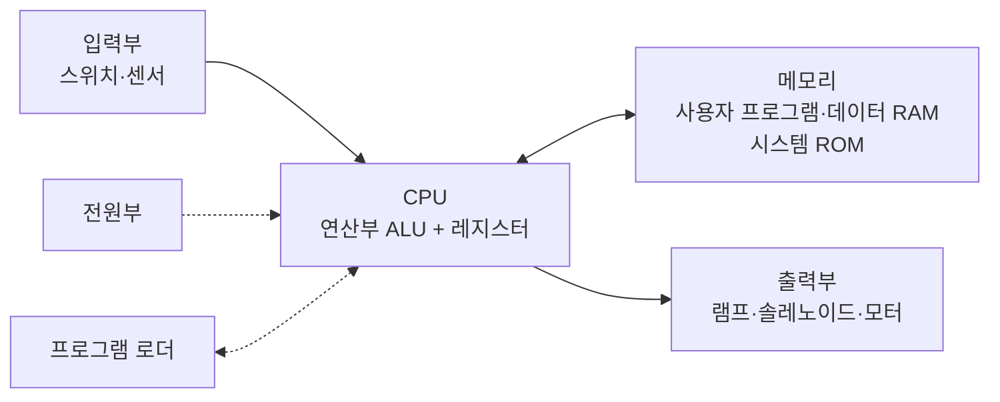

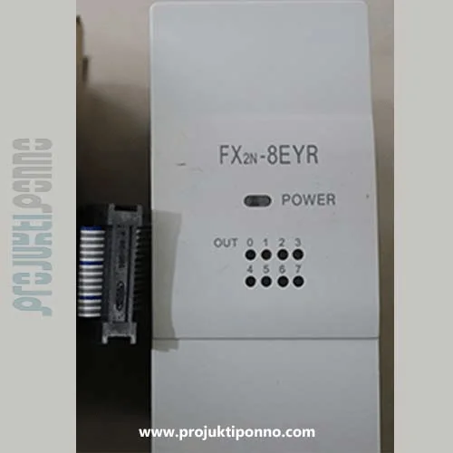

- **23 PLC 구성장치 (p.40~42)**: CPU(해독·연산), ALU, RAM(사용자 프로그램·데이터, 변경 가능), ROM·PROM·EPROM(소거 가능), 프로그램 로더(입력·모니터링·편집), 프로그램 카운터(다음 실행 주소, 어드레스 버퍼로 보낸 뒤 +1). PLC = 입력·논리연산·제어·출력 장치. 입출력 요구 3가지(전기 규격 일치, 노이즈 차단, 연결 쉬움). 메모리 4종(사용자 프로그램·데이터 = RAM, 시스템 = 제작사, 레지스터 = 계산 중 값). 시스템 형태: 단독·집중(1대 정지 시 전체 정지)·분산(고장 영향 국한)·계층(컴퓨터 + PLC). 예제: 변경 가능한 메모리 → 프로그램 메모리 / EPROM 소거 불가 → 틀림 / 로더 기능 아닌 것 → 전원 안정화 / 연산부 + 레지스터부 → CPU / PC 역할 → 다음 명령 주소 / 입출력 요구 아닌 것 → 디지털 기기만 사용.

### 핵심이론 24 PLC 특수 프로그래밍 준비하기

교재 p.43 · 정리한 노트: [특수모듈 프로그래밍](../10_자동제어/특수모듈_프로그래밍.md), [데이터 통신](../10_자동제어/데이터_통신.md)

**한마디로**: 일반 입출력은 ON/OFF만 다룬다. 아주 빠른 펄스, 정밀한 위치, 연속적인 아날로그 값처럼 **CPU가 스캔하면서 처리하기 버거운 일**은 전문가 모듈(특수모듈)에 맡긴다.

| 특수모듈 | 맡는 일 |
| --- | --- |
| 고속 카운터 | 스캔보다 빠른 펄스(엔코더) 계수, 1·2·4체배 |
| 위치결정 | 서보·스테핑 모터 위치·속도 제어 |
| 아날로그 입력(A/D) | 4~20 mA, 0~10 V 등 → 디지털 값 |
| 아날로그 출력(D/A) | 디지털 값 → 전압·전류 |
| 통신·링크 | 필드버스, 리모트 I/O, 상위 컴퓨터 |

- **24 특수 프로그래밍 준비 (p.43~45)**: 명령어 체계 = 기본(접점·코일·타이머·카운터)·응용(데이터 처리·사칙)·특수(특수모듈 읽기·쓰기). 고속 카운터: 설정값 도달 후에도 최댓값까지 계수, 가감산, 1·2·4체배, 대소 비교, 일치 신호 직접 출력, 1만~50만 count/s. 위치제어모듈: 시퀀스와 위치제어를 PLC 한 대로, 위치 데이터 저장, 자가진단. 아날로그 범위 1~5 V, 0~10 V, ±10 V, 4~20 mA, 0~20 mA, 디지털 0~16,000(확인 필요). 열전대 모듈 = 부호 있는 16비트. 링크: 상위·PLC(내부 릴레이 사용, I/O 점수 소모 없음)·I/O·리모트 I/O(외선 공사비 감소)·필드버스(한 가닥 시리얼, 배선비↓, 보전 쉬움, 확장 유연, 노이즈에 강함, 통신모듈에 직결). 예제: 명령어 체계 아닌 것 → 사용자 명령어 / CPU 처리가 어려운 정보 → 특수모듈 / 한 가닥 통신선 → 필드버스 링크.

### 핵심이론 25 공정도와 배선도

교재 p.46 · 정리한 노트: [특수모듈 프로그래밍](../10_자동제어/특수모듈_프로그래밍.md)

**한마디로**: 공정도는 **기계 동작의 악보**다. 실린더 A, B가 몇 번째 박자(스텝)에 나가고(1) 들어오는지(0)를 칸 위에 그려 두면, 프로그램을 짜기 전에 순서가 한눈에 보인다.

**변위단계선도 예 (A+ → B+ → A− → B−)**

| 실린더 | 스텝 1 | 스텝 2 | 스텝 3 | 스텝 4 | 스텝 5(=1) |
| --- | :---: | :---: | :---: | :---: | :---: |
| A | 0 → **1** | 1 | 1 → **0** | 0 | 0 |
| B | 0 | 0 → **1** | 1 | 1 → **0** | 0 |

*규칙: 칸 간격은 일정, 상태는 스텝선에서만 바뀐다, 전진 = 1·후진 = 0.*

- **25 공정도와 배선도 (p.46~47)**: 공정 표현 = 서술식·기호식(+/−)·테이블·그래프(작동선도·시간선도). 변위단계선도 규칙(칸 간격 일정, 스텝선에서 변화, 끝점이 다르면 다른 스텝, 중간 속도 변화는 중간 스텝, 전진 1·후진 0). 아날로그 모듈 채널 2·4·8·16, 전압형·전류형·겸용형, 배선 후 파라미터 설정. 위치 운전 데이터 축당 400개, 전환제어(위치/속도, 속도/위치, 위치/토크). 예제: 시간선도 고르기(그림) / 원점복귀가 종료 시에만 가능 → 틀림.

### 핵심이론 26 PLC 모듈 간 인터페이스

교재 p.48 · 정리한 노트: [특수모듈 프로그래밍](../10_자동제어/특수모듈_프로그래밍.md)

**한마디로**: 센서의 연속적인 아날로그 값을 PLC가 이해하는 숫자로 바꾸는 과정은 **"자로 재서 눈금을 읽는 것"** 과 같다. 일정 간격으로 재고(샘플링), 가장 가까운 눈금으로 반올림하고(양자화), 그 눈금 번호를 2진수로 적는다(부호화).

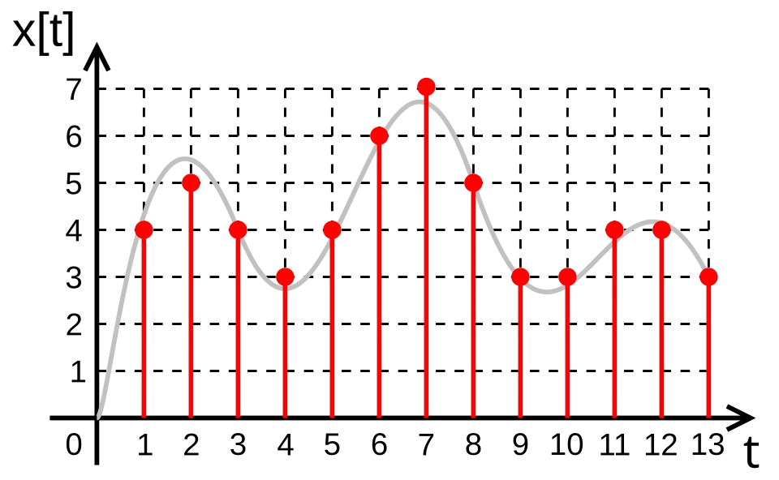

$$\text{분해능} = \frac{1}{2^n - 1} \qquad (n\text{비트})$$

- **계산 예**: 4비트 → $1/15 \approx 6.67\,\%$.
- **계산 예**: 0~200 ℃를 0.5 ℃ 단위로 → $200/0.5 = 400$단계 → $2^8 = 256 < 400 \le 2^9 = 512$ → **9비트**.

| A/D 방식 | 속도 | 특징 |
| --- | --- | --- |
| 병렬 비교형 | **가장 빠름** | 비교기가 많아 비쌈 |
| 축차 비교형 | 빠름 | 저렴, 가장 흔함 |
| 2중 적분형 | 느림 | **잡음에 강함** |
| 계수 비교형 | 느림 | 구조 간단 |

- **26 모듈 간 인터페이스 (p.48~50)**: 입력 DC 24 V 또는 AC 110/220 V. 배선: 교류·아날로그 출력은 별도 케이블, AWG22(0.3 mm²) 이상, 고온 기기 회피, 극성 확인, 동력선과 분리. 변환 3단계 = 샘플링·양자화·부호화(인코더). 분해능 $1/(2^n-1)$: 4비트 → 6.67 %. 0~200 ℃를 0.5 ℃ 단위 → 400단계 → 9비트. A/D: 계수 비교형(느림)·축차 비교형(빠르고 저렴)·2중 적분(잡음에 강함, 느림)·병렬 비교형(가장 빠름, 비쌈). 예제: 서미스터 → A/D / 다른 하나 → 사다리형(D/A) / 4비트 6.67 % / 9비트.

## Ⅵ. 마이크로프로세서 (27~28)

### 핵심이론 27 마이크로프로세서

교재 p.50 · 정리한 노트: [마이크로프로세서](../10_자동제어/마이크로프로세서.md)

**한마디로**: 마이크로프로세서는 **레시피를 한 줄씩 읽는 요리사**다. 메모리(레시피 책)에서 명령을 꺼내고(인출), 무슨 뜻인지 해석하고(해독), 실제로 계산한다(실행). 이 일을 버스라는 길로 주고받는다.


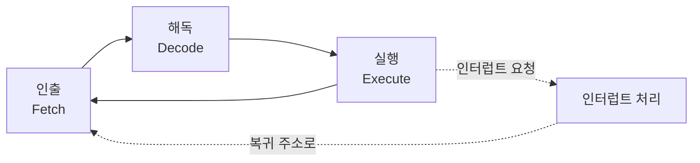

> [!tip] 인터럽트 vs 폴링
> **인터럽트**는 손님이 초인종을 누르면 하던 일을 멈추고 나가는 방식, **폴링**은 손님이 왔는지 문을 차례로 계속 열어 보는 방식이다. **DMA**는 CPU를 거치지 않고 택배를 창고에 바로 넣는 것이다.

- **27 마이크로프로세서 (p.50~52)**: 마이크로컨트롤러, CISC/RISC, 버스(어드레스·데이터·제어), 연산은 덧셈 기본(뺄셈 = 보수, 곱셈 = 덧셈 반복, 나눗셈 = 뺄셈 반복), 명령 사이클(인출 → 해독 → 실행 → 데이터 인출), 채널(IOP), DMA(CPU 거치지 않음, 완료는 인터럽트), 인터럽트(정전·오버플로·입출력 완료, 벡터 주소, 복귀), 우선순위(데이지 체인, 폴링). 예제: 한 칩 통합 → 마이크로컨트롤러 / 버스 아닌 것 → 명령 버스 / 처리 후 복귀 → 인터럽트 / 순차 점검 → 폴링 / CPU 기능 아닌 것 → DMA.

### 핵심이론 28 마이크로프로세서 레지스터 및 메모리

교재 p.53 · 정리한 노트: [마이크로프로세서](../10_자동제어/마이크로프로세서.md)

**한마디로**: 레지스터는 요리사 **손 바로 옆의 작은 접시**(가장 빠르고 작다), 메모리는 **냉장고**(크고 조금 느리다)다. 스택은 **접시 쌓기**처럼 마지막에 올린 것을 먼저 꺼낸다(LIFO).


$$\text{주소선 } n\text{개} \;\Rightarrow\; 2^n\text{개 주소} \qquad 16\text{개} \Rightarrow 2^{16} = 65{,}536 = 64\text{K}$$

| 레지스터 | 역할 |
| --- | --- |
| 누산기(ACC) | 연산 결과를 잠시 담음 |
| 상태(플래그) | 부호·자리올림·0 여부 표시 |
| 프로그램 카운터(PC) | **다음에 실행할 명령 주소** |
| 스택 포인터 | 스택 맨 위 위치. 서브루틴·인터럽트 **복귀 주소** 저장 |

- **28 레지스터와 메모리 (p.53~56)**: 누산기, 상태(플래그), 인덱스, 스택(LIFO), 세그먼트(CS·DS·SS·ES), 주소 지정(암묵·즉시·직접·간접), SRAM·DRAM(재생 필요)·SDRAM·ROM·PROM·EEPROM. 주소선 n개 → $2^n$. 예제: 일시 저장 → RAM / 빠른 소규모 → 레지스터 / 인터럽트 복귀 주소(교재 정답표 누산기로 보임, 일반적으로 스택 – 확인 필요) / 세그먼트 아닌 것 → BS / 플래그 → 상태 레지스터 / LIFO / 주소 16·데이터 8 → 64 kbyte / 직접 주소 특징 아닌 것 → 대용량 주소 표현 / 재생 필요 → DRAM / 서브루틴 복귀 → 스택.

## Ⅶ. PLC 프로그래밍과 시퀀스 회로 (29~33)

### 핵심이론 29 PLC 프로그래밍

교재 p.56 · 정리한 노트: [PLC 프로그래밍 언어와 명령어](../10_자동제어/PLC_프로그래밍_언어와_명령어.md)

**한마디로**: PLC는 프로그램을 한 번 실행하고 끝내지 않는다. **출석 부르기를 무한히 반복**하듯, 입력을 한꺼번에 읽고 → 프로그램을 위에서 아래로 실행하고 → 출력을 한꺼번에 내보내는 한 바퀴(스캔)를 계속 돈다. 한 바퀴 시간이 스캔 타임이다.


$$\text{응답 시간} = \text{입력 응답} + \text{출력 응답} + \text{수행 시간} \qquad 5 + 15 + (5000 \times 2\,\mu s = 10) = 30\ \text{ms}$$

- **29 PLC 프로그래밍 (p.56~58)**: 스캔타임, 스텝(접점·코일 각 1스텝), 디버깅, 니모닉(핸디 로더)·래더·SFC. 총 시간 = 입력 응답 + 출력 응답 + 수행 시간: 5,000스텝 × 2 μs = 10 ms → 5 + 15 + 10 = 30 ms. 예제: 스캔타임 / 30 ms / 래더 / 어셈블리 명령은 래더 명령 아님 / 최소 스텝 6(그림) / Debug.

### 핵심이론 30 PLC 프로그램 작성

교재 p.58 · 정리한 노트: [PLC 프로그래밍 언어와 명령어](../10_자동제어/PLC_프로그래밍_언어와_명령어.md)

**한마디로**: 래더도는 **사다리 모양의 전기 회로도**다. 왼쪽 세로선(모선)에서 전기가 출발해 접점을 지나 오른쪽 끝의 코일까지 가면 출력이 켜진다고 읽는다.


> [!tip] 래더 작성 규칙 한 줄 요약
> 출력(코일)은 **오른쪽 끝**에, 같은 출력은 **한 번만**, 회로는 **위에서 아래로** 전개한다.

- **30 PLC 프로그램 작성 (p.58~60)**: 순서 = 데이터 메모리 할당 → 프로그램 작성 → 입출력 주소 할당 → 컴파일 → 전송 → 저장/종료. 직접변수 %IX·%QX·%MX(베이스.슬롯.접점), 네임드 변수(한글 8자·영문 16자, 대소문자 구분 없음, 타이머·카운터는 직접변수 없음). 래더 규칙(회로 끊지 않기, 출력은 오른쪽 끝, 이름 붙이기, 아래로 전개, 출력 중복 금지, 한 링에서 여러 갈래 금지). 쓰기는 PAUSE·REMOTE 모드에서, 쓰면 이전 프로그램 삭제. 세트/리셋 코일, ON/OFF 딜레이, 가산/감산 카운터. 운전 모드 RUN·STOP·Remote·PAUSE.

### 핵심이론 31 시퀀스 제어

교재 p.61 · 정리한 노트: [논리회로](../10_자동제어/논리회로.md)

**한마디로**: 릴레이는 **전자석이 당기는 원격 스위치**다. 작은 전류로 코일에 전기를 넣으면 철판이 끌려가 큰 전류가 흐르는 접점이 붙거나 떨어진다. 시퀀스 제어는 이런 스위치들을 정해진 순서대로 켜고 끄는 것이다.


| 접점 | 평소(코일 OFF) | 코일 ON | 다른 이름 |
| --- | --- | --- | --- |
| a접점 | 열림 | 닫힘 | 메이크(NO) |
| b접점 | 닫힘 | 열림 | 브레이크(NC) |
| c접점 | a + b 공통 | 전환 | 트랜스퍼 |

- **31 시퀀스 제어 (p.61~63)**: 정해진 순서, 비교·검출·조정 없음. a·b·c접점. 유접점(자유 구성, 부피 큼, 지연·스파크) vs 무접점(소형, 빠름). 무접점 릴레이 장점(빠름, 장수명, 스파크·소음 없음, 소형) / 단점(ON 시 임피던스 높음, OFF 시 누설전류, 순간 간섭·전압에 약함, 비쌈). 검출부(리밋·광전·근접·리드·플로트 스위치, 열전쌍). 예제: 시퀀스 제어 아닌 것 → 전기로 온도제어 / 검출부 아닌 것 → 타이머 / 유접점 단점 아닌 것 → 소비전력이 작다 / 전자제어 틀린 것 → 노이즈에 강하다 / 명령표 빈칸.

### 핵심이론 32 시퀀스 제어의 회로

교재 p.63 · 정리한 노트: [논리회로](../10_자동제어/논리회로.md)

**한마디로**: 시퀀스 회로의 기본기는 **자기유지**다. 시작 버튼에서 손을 떼도 출력이 꺼지지 않도록, 출력 자신의 a접점으로 버튼을 우회해 "스스로 붙잡게" 한다. **인터로크**는 정회전과 역회전처럼 동시에 켜지면 안 되는 두 출력이 서로의 b접점으로 상대를 막는 것이다.

```text
자기유지 회로 (PB1: 기동, PB2: 정지 b접점, MC: 출력)

 ──┤ PB1 ├──┬──┤/PB2├──( MC )
            │
 ──┤ MC  ├──┘        ← MC 자신의 a접점이 PB1을 우회해 붙잡는다
```

| RS 플립플롭 S R | 출력 | JK 플립플롭 J K | 출력 |
| :---: | --- | :---: | --- |
| 0 0 | 이전 유지 | 0 0 | 이전 유지 |
| 0 1 | 리셋 (0) | 0 1 | 리셋 (0) |
| 1 0 | 세트 (1) | 1 0 | 세트 (1) |
| 1 1 | **불확정(금지)** | 1 1 | **반전** |

$$\text{T 플립플롭 } n\text{단} \Rightarrow f_{out} = \frac{f}{2^n} \qquad 8\ \text{MHz},\ 5\text{단} \Rightarrow 8\,\text{MHz}/32 = 250\ \text{kHz}$$

**3차 수신분**

- **32 시퀀스 제어의 회로 (p.63~67)**: AND·OR·NOT, 한시동작·순시동작·순시동작 한시복귀, 기동우선·정지우선, 자기유지, 일치, 우선동작 순차, 신입신호 우선, 인터로크, 캐스케이드, 플립플롭, 플리커, 촌동. … (여기서 끊김)

**4차 수신분**

- **32 시퀀스 제어의 회로 (p.63~67)**: 회로는 왼쪽에서 오른쪽, 위 줄부터 한 줄씩 읽는다. AND·OR·NOT, 한시동작·순시동작·순시동작 한시복귀, 기동우선·정지우선(접점 배치를 바꿈), 자기유지, 일치, 우선동작 순차, 신입신호 우선(새 신호가 앞 신호를 끊음), 인터로크(동시 동작 금지, 기기 보호·안전), 캐스케이드(에너지원 순차 공급, 밸브 5개 이상이면 압력 저하 주의), 촌동(누르는 동안만), 플립플롭(다음 입력까지 유지), 플리커(설정 간격 ON/OFF 반복). T-FF n단 → $f/2^n$ (8 MHz, 5단 → 250 kHz). 퀴즈 4명 인터로크 → 1명당 b접점 3개. RS: 00 불변, 01 리셋, 10 세트, 11 불확정. JK: 11 반전. 예제: 인터로크 / 일정시간동작회로 / Ex-OR / b접점 3개 / 250 kHz / RS S=0·R=1 → 0 / JK J=0·K=1 → 0.

### 핵심이론 33 프로그램 확인 및 수정 보완

교재 p.68 · 정리한 노트: [PLC 시뮬레이션과 수정보완](../10_자동제어/PLC_시뮬레이션과_수정보완.md)

**한마디로**: 짠 프로그램은 **화면 → 모형 → 실물** 순서로 시험한다. 시뮬레이터로 화면에서 돌려 보고, 트레이너(스위치 박스)로 손으로 눌러 보고, 마지막에 강제 입출력으로 실제 설비 일부를 움직여 본다.


- **33 프로그램 확인 및 수정 보완 (p.68~69)**: 완전성 검사 3가지 = 시뮬레이터(그래픽, 추상적), 조작 스위치 박스·트레이너(실물 시험), 강제 입출력(프로그램 이해 전제, 부분 확인). 접속 RS-232C·USB·Ethernet·Modem, 접속 설정 로컬·Remote 1·Remote 2. RS-232C 오류 → 케이블·COM 포트 번호·단선·PLC 정상 여부, USB 오류 → 장치관리자 인식. 이력(전원 차단·에러·모드 전환)은 [에러/경고 상세 정보] 창. 트러블슈팅 순서: 기계·전원·입출력기기·배선·표시창 → PLC 상태·프로그램 → STOP에서 전원 OFF/ON → 원인 추정. RUN 중 수정. 예제: 이력을 [읽기] 창에서 본다 → 틀림.

## Ⅷ. 통신과 노이즈 대책 (34~35)

### 핵심이론 34 통신(1)

교재 p.70 · 정리한 노트: [데이터 통신](../10_자동제어/데이터_통신.md), [PLC 시뮬레이션과 수정보완](../10_자동제어/PLC_시뮬레이션과_수정보완.md)

**한마디로**: 데이터를 보내는 방법은 두 가지다. **병렬**은 8차선 도로로 8비트를 한꺼번에(빠르지만 선이 많고 비쌈, 근거리), **직렬**은 1차선으로 한 비트씩 줄 세워(선이 적고 싸서 공장 통신의 기본) 보낸다.


| 규격 | 통신 방식 | 연결 | 비고 |
| --- | --- | --- | --- |
| RS-232C | 전이중 | 1 : 1 | 짧은 거리, TXD↔RXD 교차 |
| RS-422 | 전이중 | 1 : N | 차동 신호, 먼 거리 |
| RS-485 | **반이중** | N : N (멀티드롭) | 차동 신호, 공장에서 가장 흔함 |

$$\text{비동기 1프레임} = \text{시작 1} + \text{데이터 8} + \text{패리티 1} + \text{정지 1} = 11\ \text{비트}$$

- **34 통신(1) (p.70~72)**: 교재 접지 서술은 옛 종별 접지 기준(PLC = 3종, 400 V 미만, 100 Ω 이하, 2.5 mm² 이상, 전원부·제어부·기타 분리 접지; 2종 수치는 확인 필요). 병렬(고속·비쌈·근거리) vs 직렬(저렴, 일반적). 교재 표현: 동기식 = 수신 측 상태를 확인하고 전송, 비동기식 = 확인 없이 전송(UART, 노이즈·거리 약함). RS232·RS422 전이중, RS485 반이중. RS232 결선 TXD→RXD, RTS→CTS, DTR↔DSR. 입력 핀 DCD·RXD·DSR·CTS·RI, 출력 핀 TXD·DTR·RTS. 속도 = baud rate, 전송량 = bps. 비동기 프레임 11비트(시작 1 + 데이터 8 + 패리티 1 + 정지 1). 예제: 접지 목적 아닌 것 → 센서 신호 증폭 / 반이중 → RS485 / 1비트씩 싸게 → 직렬 / UART 세트 아닌 것 → 체크 / RXD 상대 → TXD / 통신 속도(정답표 확인 필요).

### 핵심이론 35 통신(2)

교재 p.73, 챕터 마지막 절 · 정리한 노트: [데이터 통신](../10_자동제어/데이터_통신.md), [PLC 시뮬레이션과 수정보완](../10_자동제어/PLC_시뮬레이션과_수정보완.md)

**한마디로**: 공장은 모터와 인버터가 내는 전기 잡음(노이즈)으로 가득하다. 대책의 핵심은 **잡음이 PLC로 들어오는 길을 끊는 것**이다. 포토커플러는 신호를 **빛으로만** 건네서 입력 쪽과 PLC 쪽을 전기적으로 완전히 떼어 놓는다.

| 포토커플러: 안의 LED 빛을 수광 소자가 받는다 | 토큰 링: 토큰을 가진 장치만 전송한다 |
| :---: | :---: |
| 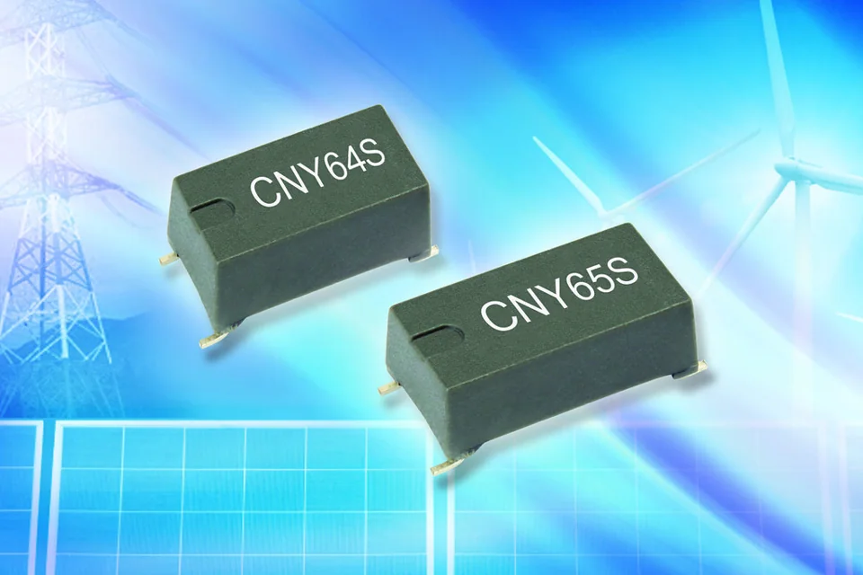 |  |

> [!tip] 워치독 타이머
> 경비원이 "정해진 시간마다 이상 없다는 신호가 안 오면 비상벨"을 누르는 장치다. 프로그램이 멈추거나 무한 루프에 빠져 신호가 끊기면 PLC가 이를 알아채고 출력을 안전하게 정지한다.

- **35 통신(2) (p.73~74)**: 브로드밴드(다채널 동시), 베이스밴드(변조 없이), 캐리어밴드(반송파). LAN: 토큰 링, Gigabit Ethernet, 무선 랜. 노이즈 대책: 입력부(스파크·서지킬러, DC 릴레이 환류 다이오드, 포토커플러, 배리스터), 전원부(제어·모터 전원 분리, 차폐선, 실드·절연 트랜스, EMI 필터), 출력부(스파크킬러, 누설전류 제거, 정전압 회로). 잡음 여유. CC-Link(연결점 적고 거리 길 때 공사비 절감), USB(OS 종료 없이 연결·분리). 자가진단(메모리 상태, 배터리 전압, 코딩 에러, 전원), Watchdog Timer. 예제: 다채널 동시 → 브로드밴드 / 입력부 노이즈 차단 → 포토커플러 / 자가진단과 먼 것 → 메모리 액세스 타임 체크.

---

## 참고

### 그림 출처

모두 위키미디어 공용(Wikimedia Commons) 자료이고, 노트에 맞게 크기를 줄이고 WebP로 변환했다.

| 그림 | 작성자 | 라이선스 |
| --- | --- | --- |
| [Feedback loop with descriptions](https://commons.wikimedia.org/wiki/File:Feedback_loop_with_descriptions.svg) | Orzetto | [CC BY-SA 4.0](https://creativecommons.org/licenses/by-sa/4.0) |
| [Open loop vs closed loop](https://commons.wikimedia.org/wiki/File:Open_loop_vs_closed_loop.jpg) | Wjcw | [CC BY-SA 4.0](https://creativecommons.org/licenses/by-sa/4.0) |
| [Series RC capacitor voltage](https://commons.wikimedia.org/wiki/File:Series_RC_capacitor_voltage.svg) | No machine-readable author provided. Ktims assumed (based on copyright claims). | 퍼블릭 도메인 |
| [Feedback Loop](https://commons.wikimedia.org/wiki/File:Feedback_Loop.svg) | Inductiveload | 퍼블릭 도메인 |
| [Feedback Loop Equivalent 1](https://commons.wikimedia.org/wiki/File:Feedback_Loop_Equivalent_1.svg) | Inductiveload | 퍼블릭 도메인 |
| [PID en](https://commons.wikimedia.org/wiki/File:PID_en.svg) | Arturo Urquizo | [CC BY-SA 3.0](https://creativecommons.org/licenses/by-sa/3.0) |
| [Second order transfer function](https://commons.wikimedia.org/wiki/File:Second_order_transfer_function.svg) | Krishnavedala | [CC BY-SA 3.0](https://creativecommons.org/licenses/by-sa/3.0) |
| [Second order under-damped response](https://commons.wikimedia.org/wiki/File:Second_order_under-damped_response.svg) | Krishnavedala | [CC BY-SA 3.0](https://creativecommons.org/licenses/by-sa/3.0) |
| [Low-Pass filter Bode Magnitude and Phase plots](https://commons.wikimedia.org/wiki/File:Low-Pass_filter_Bode_Magnitude_and_Phase_plots.png) | User:Brews_ohare | CC0 |
| [Encoder Disc (3-Bit)](https://commons.wikimedia.org/wiki/File:Encoder_Disc_(3-Bit).svg) | jjbeard | 퍼블릭 도메인 |
| [ResolverPrinzip](https://commons.wikimedia.org/wiki/File:ResolverPrinzip.png) | Heinz Seehagel (Hasee) | 퍼블릭 도메인 |
| [Programmable logic controller](https://commons.wikimedia.org/wiki/File:Programmable_logic_controller.jpg) |  | [CC BY-SA 3.0](http://creativecommons.org/licenses/by-sa/3.0/) |

## 수신 기록

교재를 네 번에 나눠 받은 기록과 각 회차를 반영한 노트.

### 1차 수신분: 01~11절 + 12절 앞부분

> 사용자가 Claude in Chrome으로 교보 뷰어의 교재 PART 01 CHAPTER 01을 읽고 정리한 문서.
> **1차 수신분: 01~11절 전체 + 12절 앞부분.** 12절(PID) 뒷부분과 13~35절은 아직 받지 않음.
> 01~11절은 2026-11-02에 [자동제어계의 기초](../10_자동제어/자동제어계의_기초.md), [라플라스 변환과 전달함수](../10_자동제어/라플라스_변환과_전달함수.md)에 반영함.

### 2차 수신분: 12~22절 (23절 앞에서 끊김)

> 2026-11-02 수신. 12절 → [자동제어계의 기초](../10_자동제어/자동제어계의_기초.md), 13~19절 → [과도응답과 안정도](../10_자동제어/과도응답과_안정도.md), 20~21절 → [서보 모터와 서보 제어](../10_자동제어/서보모터와_서보제어.md), 22절 → [PLC 구성과 특성](../10_자동제어/PLC_구성과_특성.md)·[PLC 프로그래밍 언어와 명령어](../10_자동제어/PLC_프로그래밍_언어와_명령어.md)에 반영.
- **23절부터 미수신.**

### 3차 수신분: 23~31절 + 32절 앞부분 (32절 중간에서 끊김)

> 2026-11-02 수신. 23절 → [PLC 구성과 특성](../10_자동제어/PLC_구성과_특성.md), 24~26절 → [특수모듈 프로그래밍](../10_자동제어/특수모듈_프로그래밍.md)·[데이터 통신](../10_자동제어/데이터_통신.md), 27~28절 → [마이크로프로세서](../10_자동제어/마이크로프로세서.md)(새 노트), 29~30절 → [PLC 프로그래밍 언어와 명령어](../10_자동제어/PLC_프로그래밍_언어와_명령어.md), 31절 → [논리회로](../10_자동제어/논리회로.md)에 반영.
- **32절 나머지와 33~35절 미수신.**

### 4차 수신분: 32~35절 + 챕터 요약 (CHAPTER 01 수신 완료)

> 2026-11-02 수신. 32절 → [논리회로](../10_자동제어/논리회로.md), 33절·35절 노이즈·자가진단 → [PLC 시뮬레이션과 수정보완](../10_자동제어/PLC_시뮬레이션과_수정보완.md), 34~35절 통신 → [데이터 통신](../10_자동제어/데이터_통신.md), 챕터 요약 → [기출분석 – 자동제어](../01_시험안내/기출분석_자동제어.md)에 반영.
- **챕터 요약(정리한 쪽이 고른 10개)**: PID, ζ 제동 상태, 과도 응답 지표, 안정도 판별, 보드선도, 서보기구, PLC 특징·구성, A/D·D/A, 마이크로프로세서, 시퀀스 회로·통신.
- **읽기 완료 보고**: CHAPTER 01은 p.2~74, 핵심이론 01~35 전체. CHAPTER 02는 p.75부터. 그림 기반 문제(17-6, 20-2, 25-1, 29-5, 29-7, 30-2, 34-2)와 정답표·해설 불일치(28-3, 34-7, 22절 변경 용이성)는 교재 원문 확인 필요.
