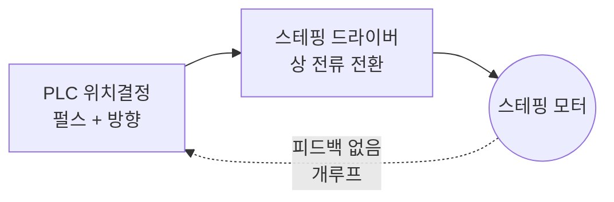

# DC 모터와 스테핑 모터

> [!summary] 핵심 요약
> - DC 모터 속도: $N = \dfrac{V - I_a R_a}{k\Phi}$ → 전압을 올리거나 자속을 줄이면 빨라진다.
> - DC 모터 종류: 타여자, 분권(속도 일정), **직권(기동 토크 큼, 무부하 위험)**, 복권.
> - **BLDC**: 브러시 대신 전자식 정류(홀 센서) → 수명 길고 노이즈 적음.
> - **스테핑 모터**: 펄스 하나에 일정 각도(스텝각)씩 회전. **개루프**로 위치 제어. 스텝각 = 360° ÷ 1회전 스텝 수.

> [!warning] 자주 틀리는 포인트
> - **직권 전동기는 무부하 운전 금지**: 부하가 없으면 속도가 위험하게 올라간다. 벨트 대신 기어·직결로 연결.
> - DC 모터 역회전: **전기자 또는 계자 중 한쪽**의 극성을 바꾼다. 둘 다 바꾸면 그대로.
> - 스테핑 모터는 부하가 너무 크거나 가속이 너무 빠르면 **탈조**(펄스를 놓쳐 위치가 틀어짐)한다. 개루프라 스스로 알아채지 못한다.
> - 2상 스테핑 모터 기본 스텝각 **1.8°**(200 스텝/회전), 5상은 **0.72°**(500 스텝/회전).
> - 스테핑 모터 **회전 속도는 입력 펄스 주파수**, **회전 각도는 입력 펄스 수**에 비례한다. 펄스 진폭·여자 전류가 속도를 정하지 않는다.
> - 스테핑 모터 종류는 **VR·PM·HB** 세 가지뿐. "브러시형·인버터형·CD형"은 없다.
> - 스테핑 모터의 틀린 설명 단골: "공진이 없다"(저속에서 **공진·진동 있음**), "관성이 큰 부하에 강하다"(**약하다**), "정지 시 유지 토크가 없다"(여자 중 **홀딩 토크 있음**), "스텝 오차가 누적된다"(**누적되지 않음**).
> - 1상 여자는 토크가 작고 **감쇠 진동이 커서 난조가 일어나기 쉽다**. 2상 여자는 토크가 크고, 1-2상 여자는 스텝각이 절반이라 **분해능이 가장 높다**.
> - 회전수 식 $N = \dfrac{\theta_s \times n}{360}$ ($n$: 분당 펄스 수). 분모는 **360**이다 (180 아님).
> - 일정 토크에서 DC 모터의 **자속을 늘리면 속도가 줄어든다** ($N \propto 1/\Phi$).
> - 기동 토크가 큰 것은 **직권**. 분권은 속도가 거의 일정한 것이 특징이고 기동 토크가 큰 것은 아니다.
> - DC 모터 속도는 **전압(PWM)** 으로 제어한다. 주파수로 속도가 바뀌는 것은 교류·스테핑 모터 이야기.

## 개념 정리

### DC 모터

| 종류 | 계자 연결 | 특징·용도 |
| --- | --- | --- |
| 타여자 | 별도 전원 | 정밀 속도 제어 |
| 분권 | 전기자와 병렬 | 부하가 변해도 속도 거의 일정 (공작기계) |
| 직권 | 전기자와 직렬 | 기동 토크 큼, 부하 따라 속도 크게 변함 (전차, 크레인) |
| 복권 | 직렬 + 병렬 | 분권과 직권의 중간 |
| 영구자석형 | 자석 | 소형, 가장 흔함 |

**속도 제어**

| 방법 | 내용 | 특징 |
| --- | --- | --- |
| 전압 제어 | 전기자 전압 조정 | 광범위·고효율, **정토크** 제어 (워드 레오나드, PWM 초퍼) |
| 계자 제어 | 계자 자속 조정 | 정격 이상 속도, **정출력** 제어 |
| 저항 제어 | 전기자 직렬 저항 | 손실 큼, 효율 나쁨 |

- **PWM**: 스위칭 소자를 빠르게 켜고 끄며 **듀티비**로 평균 전압 조절. 평균 전압 = 전원 전압 × 듀티비.
- **H-브리지**: 4개의 스위치로 전류 방향을 바꿔 정·역회전. 같은 쪽 위·아래 스위치가 동시에 켜지면 단락(관통 전류) → 데드 타임.
- 제동: 발전 제동(저항에서 소비), 회생 제동(전원으로 되돌림), 역전 제동(플러깅).

**구조**

| 부분 | 역할 |
| --- | --- |
| 계자 (고정자) | 자속을 만든다 (영구자석 또는 계자 코일) |
| 전기자 (회전자) | 전류가 흘러 토크 발생 |
| **정류자** | 브러시와 접촉해 전기자에 **직류를 공급하고 전류 방향을 바꿔** 한 방향 토크 유지 |
| 브러시 | 정류자에 전류 공급. 마모 → 교환 필요, 불꽃·노이즈 원인 |

- 장점: 기동 토크 큼, 전압-속도 특성이 **직선적**, 제어 간단·저렴. 단점: 브러시 마모·노이즈.

**토크 계산**: $T = \dfrac{P}{\omega} = \dfrac{60P}{2\pi N}$

- 실용식: $T[\text{N·m}] \approx 9549\dfrac{P[\text{kW}]}{N[\text{rpm}]}$, $T[\text{kgf·m}] \approx 974\dfrac{P[\text{kW}]}{N[\text{rpm}]}$
- 예: 15 kW, 1800 rpm → $974 \times 15/1800 \approx 8.1$ kgf·m (≈ 79.6 N·m)

### BLDC 모터

- 회전자 영구자석, 고정자 권선. 홀 센서로 회전자 위치를 읽고 드라이버가 전류를 전환.
- 장점: 브러시 마모·불꽃 없음, 고효율, 고속. 단점: 드라이버 필요.

### 스테핑 모터

| 구분 | 내용 |
| --- | --- |
| 종류 | 영구자석(PM)형, 가변 릴럭턴스(VR)형, **하이브리드(HB)형**(가장 많이 사용) |
| 구동 방식 | 1상 여자, 2상 여자(토크 큼), 1-2상 여자(하프 스텝, 각도 절반) |
| 마이크로스텝 | 전류를 단계적으로 바꿔 스텝각을 잘게 나눔 → 진동 감소 |

| 구조 | 회전자 | 특징 |
| --- | --- | --- |
| VR (가변 릴럭턴스) | 톱니 모양 철심 | 자석 없음, 무여자 시 유지 토크 없음 |
| PM (영구자석) | 영구자석 | 무여자 정지 때도 **디텐트 토크** 있음, 스텝각 큼 |
| HB (하이브리드) | 자석 + 톱니 철심 (자석이 직류 바이어스 자계) | 고분해능·고토크, 가장 널리 사용 |

| 여자 방식 (2상·4상 기준) | 특징 |
| --- | --- |
| 1상 여자 | 한 번에 한 상, 전류·발열·전원 용량 작음, **토크 작고 난조 쉬움** |
| 2상 여자 | 두 상 동시, 토크 크고 진동 적음, 가장 일반적 |
| 1-2상 여자 | 1상·2상 번갈아 → **하프 스텝**, 스텝각 1/2, 분해능 최고 |

- 4상 모터에 "3상 여자"라는 방식은 없다.

**구동 회로**

| 구분 | 내용 |
| --- | --- |
| 유니폴라 | 권선 전류 한 방향(+ 또는 0), 회로 간단 |
| 바이폴라 | 전류 방향을 바꿈(H-브리지), 같은 모터에서 **토크가 더 큼** |
| 정전압 구동 | 직렬 저항으로 전류 제한, 간단하지만 고속 토크 저하 |
| 2전압(듀얼 전압) 구동 | 처음에 높은 전압으로 전류를 빨리 올림 |
| **정전류 초퍼(PWM) 구동** | 높은 전압을 스위칭해 전류를 일정하게 → 저손실, **전류 상승 시간 개선**, 고속 특성 좋음 |

**계산**
- 회전 각도 = 스텝각 × 펄스 수
- 회전 속도 $N[\text{rpm}] = \dfrac{\text{스텝각} \times \text{pps}}{360} \times 60$
  - 예: 1.8°, 1000 pps → $1.8 \times 1000 / 360 = 5$ rev/s → **300 rpm**
- 분당 펄스 수 $n$으로 주어지면 $N = \dfrac{\theta_s \times n}{360}$
  - 예: 7.5°, 분당 960 펄스 → $7.5 \times 960 / 360 = 20$ rpm
- 하프 스텝: 스텝각 0.72°인 모터를 1-2상 여자 → 펄스당 **0.36°**
- 직선 이송 속도: 펄스당 이송량 × 초당 펄스 수. 예: 0.005 mm/펄스, 8000 펄스를 4초에 → $0.005 \times 2000 = 10$ mm/s = **0.6 m/min**

**장점과 단점**

| 장점 | 단점 |
| --- | --- |
| 펄스로 **개루프** 위치·속도 제어, 피드백 센서 불필요 | 저속에서 **진동·공진** |
| 회전각이 펄스 수에 비례, 스텝 오차가 **누적되지 않음** | 고속에서 토크 저하, **탈조** |
| 디지털 기기와 인터페이스 쉬움, 정·역 전환·변속 쉬움 | **관성이 큰 부하에 약함** |
| 여자 정지 시 **홀딩 토크**로 위치 유지 | 분해능이 스텝각으로 한정 |
| 브러시 없음, 저렴 | |

**특성 용어**
- **유지 토크(홀딩 토크)**: 정지 상태에서 여자된 채 버티는 최대 토크.
- **디텐트 토크**: 전원이 없을 때 자석이 버티는 토크.
- **풀인(자기 기동) 영역**: 가속 없이 바로 기동·정지할 수 있는 영역.
- **풀아웃(슬루) 영역**: 가감속을 하면 탈조 없이 쓸 수 있는 영역.

### 모터 비교

| 항목 | DC | 스테핑 | AC 서보 | 유도전동기 |
| --- | --- | --- | --- | --- |
| 제어 | 전압 | 펄스 (개루프) | 펄스·아날로그 (폐루프) | 인버터 |
| 위치 정밀도 | 낮음 | 중간 | 높음 | 낮음 |
| 고속 토크 | 좋음 | 떨어짐 | 좋음 | 좋음 |
| 가격 | 낮음 | 낮음 | 높음 | 낮음 |

## 그림

## 기출 포인트

출처: 생산자동화산업기사 2016–2020년 필기 14회분 (cbtbank.kr). 스테핑 모터는 옛 4과목에서 가장 자주 나온 모터 주제.

- 스테핑 모터 특징으로 틀린 것 (공진, 관성 부하, 홀딩 토크, 오차 누적, 회전수 식) — 5회 (2016-2, 2016-3, 2017-3, 2018-1, 2018-2)
- 스테핑 모터 종류 (VR·PM·HB, 없는 형식 고르기, 하이브리드형 구조) — 4회 (2017-1, 2017-3, 2018-1, 2020-1·2)
- 여자 방식 (1-2상 고분해능, 4상의 여자법, 1상 여자 특징) — 3회 (2016-1, 2016-3, 2020-1·2)
- 스텝각·회전수·이송 속도 계산 (하프 스텝 각, 분당 펄스 → rpm, 펄스 → m/min) — 3회 (2016-1, 2017-2, 2020-1·2)
- 펄스 입력 / 속도 = 펄스 주파수 / 위치 검출기 불필요 — 4회 (2018-3 ×2, 2020-1·2, 2020-3)
- 구동 회로 (저손실·전류 상승 개선 = PWM 정전류, 구동법이 아닌 것) — 2회 (2016-3, 2019-2)
- DC 모터 (분권 특징, 정류자·브러시, 주파수로 속도 제어하지 않음, PWM 속도 제어, 자속과 회전수, 출력·회전수 → 토크) — 7회 (2016-1, 2017-1, 2018-1, 2018-2 ×2, 2019-2 ×2)

## 관련 단원

- [유도전동기와 인버터](유도전동기와_인버터.md)
- [서보 모터와 서보 제어](서보모터와_서보제어.md)
- [특수모듈 프로그래밍](특수모듈_프로그래밍.md)

## 체크리스트

- [ ] DC 모터 속도 식에서 속도를 바꾸는 요소를 말한다
- [ ] 분권·직권 전동기의 특징과 직권의 무부하 위험을 안다
- [ ] PWM 듀티비로 평균 전압을 계산한다
- [ ] 스텝각과 pps로 회전 속도를 계산한다
- [ ] 탈조의 원인과 대책을 설명한다
- [ ] 풀인·풀아웃 영역을 구분한다
- [ ] 스테핑 모터 VR·PM·HB 구조를 구분하고, 없는 형식을 골라낸다
- [ ] 1상·2상·1-2상 여자의 토크·분해능·난조 특성을 비교한다
- [ ] 분당 펄스 수·pps·하프 스텝으로 회전수와 이송 속도를 계산한다
- [ ] 스테핑 모터의 "틀린 설명" 4가지(공진·관성·홀딩 토크·오차 누적)를 바로 잡는다
- [ ] 유니폴라·바이폴라, 정전압·초퍼 구동을 구분한다
- [ ] DC 모터 정류자의 역할과 출력·회전수로 토크를 계산한다

## 참고

- [큐넷 자동화설비산업기사 출제기준](https://www.q-net.or.kr/crf005.do?id=crf00503&jmCd=2034)
