# DC 모터와 스테핑 모터

> [!summary] 핵심 요약
> - DC 모터 속도: $N = \dfrac{V - I_a R_a}{k\Phi}$ → 전압을 올리거나 자속을 줄이면 빨라진다.
> - DC 모터 종류: 타여자, 분권(속도 일정), **직권(기동 토크 큼, 무부하 위험)**, 복권.
> - **BLDC**: 브러시 대신 전자식 정류(홀 센서) → 수명 길고 노이즈 적음.
> - **스테핑 모터**: 펄스 하나에 일정 각도(스텝각)씩 회전. **개루프**로 위치 제어. 스텝각 = 360° ÷ 1회전 스텝 수.

> [!warning] 자주 틀리는 포인트
> - **직권 전동기는 무부하 운전 금지**: 부하가 없으면 속도가 위험하게 올라간다. 벨트 대신 기어·직결로 연결.
> - DC 모터 역회전: **전기자 또는 계자 중 한쪽**의 극성을 바꾼다. 둘 다 바꾸면 그대로.
> - 스테핑 모터는 부하가 너무 크거나 가속이 너무 빠르면 **탈조**(펄스를 놓쳐 위치가 틀어짐)한다. 개루프라 스스로 알아채지 못한다.
> - 2상 스테핑 모터 기본 스텝각 **1.8°**(200 스텝/회전), 5상은 **0.72°**(500 스텝/회전).
> - 스테핑 모터 **회전 속도는 입력 펄스 주파수**, **회전 각도는 입력 펄스 수**에 비례한다. 펄스 진폭·여자 전류가 속도를 정하지 않는다.
> - 스테핑 모터 종류는 **VR·PM·HB** 세 가지뿐. "브러시형·인버터형·CD형"은 없다.
> - 스테핑 모터의 틀린 설명 단골: "공진이 없다"(저속에서 **공진·진동 있음**), "관성이 큰 부하에 강하다"(**약하다**), "정지 시 유지 토크가 없다"(여자 중 **홀딩 토크 있음**), "스텝 오차가 누적된다"(**누적되지 않음**).
> - 1상 여자는 토크가 작고 **감쇠 진동이 커서 난조가 일어나기 쉽다**. 2상 여자는 토크가 크고, 1-2상 여자는 스텝각이 절반이라 **분해능이 가장 높다**.
> - 회전수 식 $N = \dfrac{\theta_s \times n}{360}$ ($n$: 분당 펄스 수). 분모는 **360**이다 (180 아님).
> - 스테핑 모터 구동법은 **직렬** 저항 구동이다. "병렬 저항 구동"은 없다 (교재 41-1). 스트레인 게이지는 구동 회로 요소가 아니다.
> - 회전 각도는 펄스 수에 **비례** ("반비례"는 틀림). 펄스 **주파수**에 비례하는 것은 회전 **속도**.
> - VR형은 회전 방향이 전류 극성과 **무관**, PM형·HB형은 전류 극성에 따른다.
> - 교재(39절)는 스테핑 모터를 위치·속도 제어가 목적인 **서보 모터의 하나**로 분류하고, 단점에 "홀딩 토크 발생"을 넣는다(장점으로도 보는 성질이니 문맥으로 판단).
> - 일정 토크에서 DC 모터의 **자속을 늘리면 속도가 줄어든다** ($N \propto 1/\Phi$).
> - 기동 토크가 큰 것은 **직권**. 분권은 속도가 거의 일정한 것이 특징이고 기동 토크가 큰 것은 아니다.
> - DC 모터 속도는 **전압(PWM)** 으로 제어한다. 주파수로 속도가 바뀌는 것은 교류·스테핑 모터 이야기.
> - DC 모터에는 **브러시가 있다**. "브러시가 없어 잔고장이 적다"는 틀림 (교재 33-1).
> - 여자 전류를 **외부 전원**에서 받는 것은 **타여자**. 직권·분권·복권은 자기 전원을 나눠 쓰는 **자여자** (교재 33-2).
> - 복권은 두 가지: **가동 복권**(두 자속이 더해짐, 토크 크고 무부하에도 안전), **차동 복권**(자속이 상쇄, 역회전 위험 → 거의 안 씀).

## 학습 목표

이 단원을 마치면 다음을 할 수 있어야 한다.

1. DC 모터의 구조(계자·전기자·정류자·브러시)와 정류자가 하는 일을 설명한다.
2. 타여자·분권·직권·복권의 결선을 그리고, 속도 특성·기동 토크·무부하 위험을 비교한다.
3. 속도 식 $N = \dfrac{V - I_a R_a}{k\Phi}$로 전압·자속이 속도에 주는 영향을 말하고, PWM 듀티비로 평균 전압을, 출력·회전수로 토크를 계산한다.
4. 스테핑 모터 VR·PM·HB형의 구조를 구분하고, 1상·2상·1-2상 여자의 토크·전류·분해능을 비교한다.
5. 스텝각·펄스 수·펄스 주파수로 회전 각도, 회전수(rpm), 이송 속도를 계산한다.
6. 스테핑 모터의 장단점, 탈조, 풀인·풀아웃 영역과 구동 회로(유니폴라·바이폴라, 정전류 초퍼)를 설명한다.

## 한눈에 보기

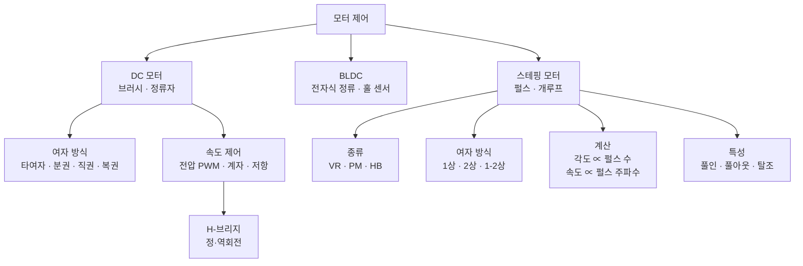

## 1. DC 모터의 원리와 구조

**직관**: 자석 사이에 놓인 코일에 전류를 흘리면 플레밍 왼손 법칙으로 힘을 받아 돈다. 그런데 반 바퀴를 넘어가면 힘의 방향이 거꾸로 되어 멈춰 버린다. 그래서 **반 바퀴마다 전류 방향을 뒤집어 주는 스위치**가 필요한데, 그것이 회전축에 붙은 **정류자**와 거기에 닿아 미끄러지는 **브러시**다.

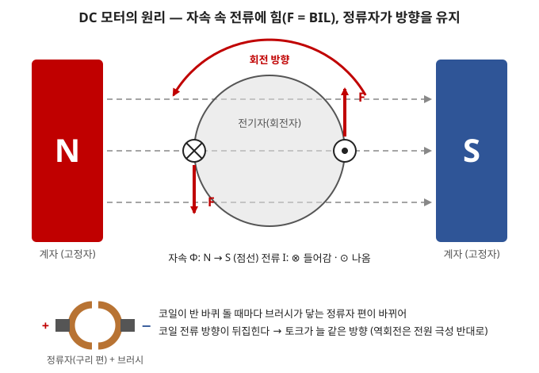

*자속(점선)은 N에서 S로, 왼쪽 도체에는 전류가 들어가고(⊗) 오른쪽 도체에서는 나온다(⊙). 플레밍 왼손 법칙으로 왼쪽은 아래, 오른쪽은 위로 힘 $F = BIL$을 받아 회전 토크가 생긴다. 코일이 반 바퀴 돌면 두 도체의 자리가 바뀌는데, 그때 브러시가 닿는 **정류자 편**도 바뀌어 전류 방향이 뒤집히므로 토크 방향이 그대로 유지된다.*

### DC 모터 구조

**구조**

| 부분 | 역할 |
| --- | --- |
| 계자 (고정자) | 자속을 만든다 (영구자석 또는 계자 코일) |
| 전기자 (회전자) | 전류가 흘러 토크 발생 |
| **정류자** | 브러시와 접촉해 전기자에 **직류를 공급하고 전류 방향을 바꿔** 한 방향 토크 유지 |
| 브러시 | 정류자에 전류 공급. 마모 → 교환 필요, 불꽃·노이즈 원인 |

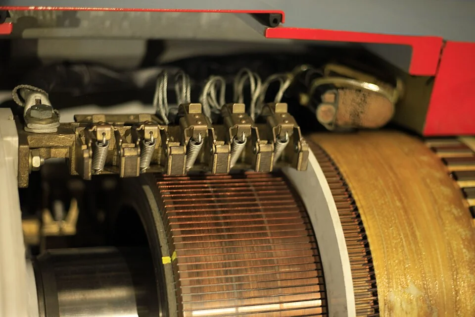

*가운데 줄무늬 구리 원통이 **정류자**, 그 위에 스프링(코일 모양)으로 눌러 붙인 네모난 덩어리들이 **탄소 브러시**다. 브러시는 회전하는 정류자에 계속 문질러지므로 닳아 없어지고 가루·불꽃이 생긴다 — DC 모터의 "브러시 교환·노이즈" 단점이 바로 여기서 나온다.*

- 구조는 **주프레임**(외함, 브러시, 계자극 = 고정부)과 **전기자 장치**(전기자, 정류자, 전기자 도체). 극수(2·4·6·8극)는 용량과 속도로 정하고, 소형은 영구자석 자극을 쓴다.
- 장점: 회전 방향·속도 제어가 쉽고 힘이 크다. 단점: 정류자·브러시 때문에 구조가 복잡하다.
- 장점: 기동 토크 큼, 전압-속도 특성이 **직선적**, 제어 간단·저렴. 단점: 브러시 마모·노이즈.

> [!question] 시험에서는
> "DC 모터는 브러시가 없어 잔고장이 적다"는 틀린 보기다. 브러시가 없는 것은 BLDC다. 정류자의 역할은 "전기자에 직류를 공급하고 전류 방향을 바꾼다"로 외운다.

## 2. DC 모터의 종류 (여자 방식)

**직관**: DC 모터는 자석(계자)을 전자석으로 만들 때 **그 전자석 코일을 어디에 연결하느냐**로 성격이 갈린다. 전기자와 **직렬**이면 부하 전류가 그대로 계자 전류가 되어 기동 때 자속·토크가 함께 커지고, **병렬**이면 전원 전압이 일정한 한 자속도 일정해 속도가 거의 변하지 않는다.

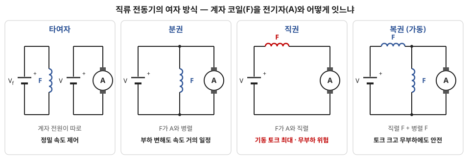

*F는 계자 코일, A는 전기자(브러시 두 개 사이). 타여자만 계자에 **따로 전원 $V_f$** 가 있고, 나머지 셋은 한 전원을 나눠 쓰는 **자여자**다. 빨간 직권 코일은 부하 전류가 그대로 흐르는 자리라 무부하가 되면 자속이 사라지고 속도가 치솟는다.*

| 종류 | 계자 연결 | 특징·용도 |
| --- | --- | --- |
| 타여자 | 별도 전원 | 정밀 속도 제어 |
| 분권 | 전기자와 병렬 | 부하가 변해도 속도 거의 일정 (공작기계) |
| 직권 | 전기자와 직렬 | 기동 토크 큼, 부하 따라 속도 크게 변함 (전차, 크레인) |
| 복권 | 직렬 + 병렬 | 분권과 직권의 중간 |
| 영구자석형 | 자석 | 소형, 가장 흔함 |

**교재(33절)의 용도·특징**

| 종류 | 특징 | 용도 (교재) |
| --- | --- | --- |
| 타여자 | 계자 제어·전압 제어 모두 가능, 큰 출력. 설비가 복잡해 비싸고 보수 어려움 | 대형 산업용 공작기계 |
| 직권 | 부하가 늘면 속도 크게 감소, 줄면 급상승 → 무부하 위험. **직류·교류 겸용** | 청소기, 전기 드릴, 크레인, 전동차 |
| 분권 | 여자 전류 일정 → 부하가 변해도 속도 거의 일정 | 정밀 속도 제어 공작기계, 압연기 |
| 가동 복권 | 토크 크고 무부하에도 위험 속도가 되지 않음 | 절단기, 엘리베이터, 공기압축기 |
| 차동 복권 | 자속 상쇄, 역회전 가능 | 특수한 경우 외 사용 안 함 |

> [!tip] 감 잡기
> 직권 = "부하가 클수록 힘이 세지는 모터"(전차가 언덕에서 버팀). 대신 부하가 사라지면 폭주하므로 벨트(끊어질 수 있음)가 아니라 기어·직결로 잇는다.

## 3. DC 모터 속도 제어 — 전압·PWM·H-브리지

**직관**: DC 모터는 "전압을 올리면 빨라지는" 단순한 모터다. 속도 식의 분자(전압)를 키우거나 분모(자속)를 줄이면 빨라진다. 자속을 줄여서 빨라지는 것이 처음엔 어색하지만, 자속이 약하면 같은 역기전력을 내기 위해 더 빨리 돌아야 한다고 생각하면 된다.

$$
N = \frac{V - I_a R_a}{k\Phi}
$$

**속도 제어**

| 방법 | 내용 | 특징 |
| --- | --- | --- |
| 전압 제어 | 전기자 전압 조정 | 광범위·고효율, **정토크** 제어 (워드 레오나드, PWM 초퍼) |
| 계자 제어 | 계자 자속 조정 | 정격 이상 속도, **정출력** 제어 |
| 저항 제어 | 전기자 직렬 저항 | 손실 큼, 효율 나쁨 |

### PWM

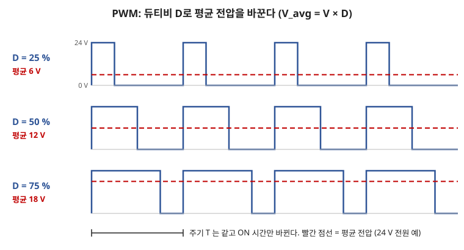

*파란 파형은 스위치가 켜지고 꺼지는 모습, 빨간 점선이 모터가 "느끼는" 평균 전압이다. 듀티비가 25 % → 75 %로 커지면 평균 전압이 6 V → 18 V로 커진다. 주파수(주기)는 그대로이므로 **DC 모터 속도는 주파수가 아니라 전압(듀티비)으로 제어**한다.*

$$
V_{avg} = V \times D, \qquad D = \frac{t_{on}}{T}
$$

- **PWM**: 스위칭 소자를 빠르게 켜고 끄며 **듀티비**로 평균 전압 조절. 평균 전압 = 전원 전압 × 듀티비.

### H-브리지와 제동

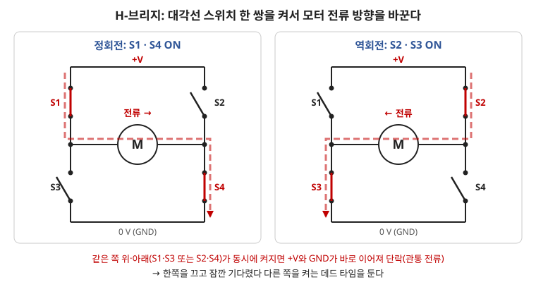

*빨간 점선이 전류 경로다. 왼쪽은 S1→M(왼→오)→S4, 오른쪽은 S2→M(오→왼)→S3로 흘러 모터 전압의 극성이 반대가 된다. 스위치 자리에 트랜지스터·MOSFET을 쓰고 켜는 시간을 PWM으로 조절하면 **방향과 속도를 한 회로로** 제어할 수 있다.*

- **H-브리지**: 4개의 스위치로 전류 방향을 바꿔 정·역회전. 같은 쪽 위·아래 스위치가 동시에 켜지면 단락(관통 전류) → 데드 타임.
- 제동: 발전 제동(저항에서 소비), 회생 제동(전원으로 되돌림), 역전 제동(플러깅).

> [!question] 시험에서는
> DC 모터를 거꾸로 돌리려면 전기자 **또는** 계자 한쪽의 극성만 바꾼다. 둘 다 바꾸면 그대로 돈다. H-브리지는 전기자 전압의 극성을 바꾸는 회로다.

## 4. 토크 계산

**직관**: 출력(일률)이 같으면 천천히 돌수록 힘(토크)이 크다. 자전거 낮은 기어가 언덕에서 힘이 센 것과 같다.

**토크 계산**: $T = \dfrac{P}{\omega} = \dfrac{60P}{2\pi N}$

- 실용식: $T[\text{N·m}] \approx 9549\dfrac{P[\text{kW}]}{N[\text{rpm}]}$, $T[\text{kgf·m}] \approx 974\dfrac{P[\text{kW}]}{N[\text{rpm}]}$
- 예: 15 kW, 1800 rpm → $974 \times 15/1800 \approx 8.1$ kgf·m (≈ 79.6 N·m)

## 5. BLDC 모터

**직관**: DC 모터의 약점인 브러시·정류자를 없애고, 그 "반 바퀴마다 전류 뒤집기"를 **전자 회로(드라이버)** 가 대신한다. 그러려면 회전자가 지금 어디 있는지 알아야 해서 홀 센서를 단다.

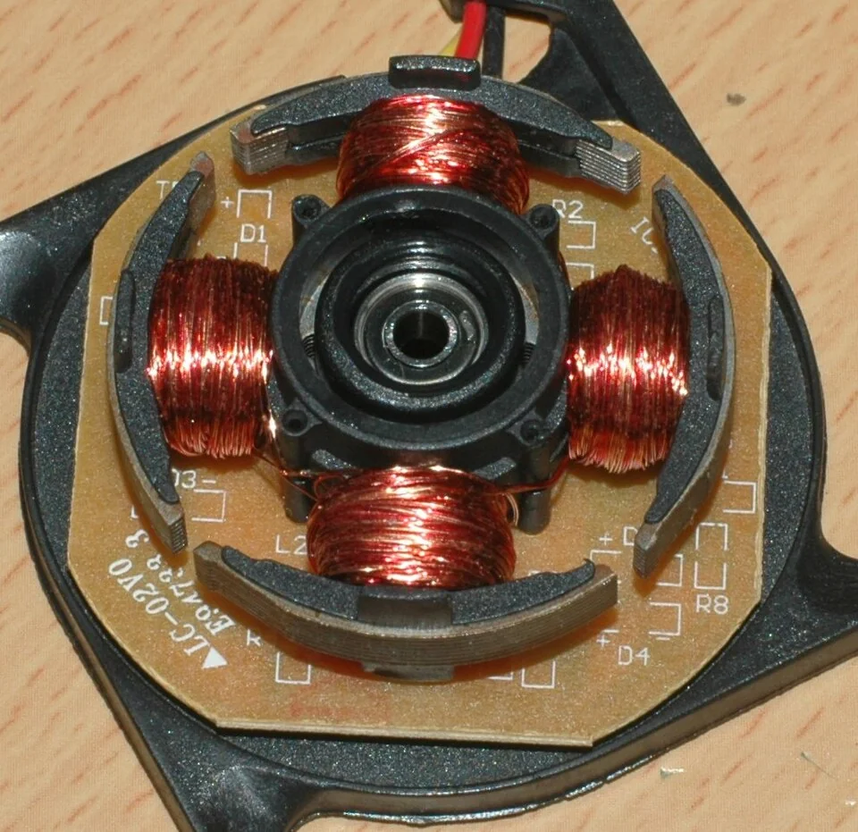

*냉각팬의 날개(회전자, 안쪽에 영구자석 링)를 떼어 낸 모습이다. **권선이 고정자 쪽**에 있고 브러시·정류자가 없다. 코일 아래 기판의 구동 회로가 회전자 위치(홀 센서)를 보고 코일 전류를 차례로 바꿔 준다 — 정류자 역할을 전자 회로가 대신하는 것이다.*

- 회전자 영구자석, 고정자 권선. 홀 센서로 회전자 위치를 읽고 드라이버가 전류를 전환.
- 장점: 브러시 마모·불꽃 없음, 고효율, 고속. 단점: 드라이버 필요.

## 6. 스테핑 모터의 원리와 종류

**직관**: 스테핑 모터는 **시계 초침**처럼 "딸깍, 딸깍" 정해진 각도씩 움직인다. 고정자 전자석을 차례로 켜면 회전자 톱니가 가장 가까운 전자석 쪽으로 끌려가 한 칸씩 이동한다. 펄스 1개 = 한 칸이므로 펄스 수만 세면 위치를 알 수 있어 **센서 없이(개루프)** 위치를 제어한다.

$$
\text{스텝각} = \frac{360^\circ}{\text{1회전 스텝 수}} \qquad (1.8^\circ \Rightarrow 200\text{ 스텝/회전},\ 0.72^\circ \Rightarrow 500\text{ 스텝/회전})
$$

| 구분 | 내용 |
| --- | --- |
| 종류 | 영구자석(PM)형, 가변 릴럭턴스(VR)형, **하이브리드(HB)형**(가장 많이 사용) |
| 구동 방식 | 1상 여자, 2상 여자(토크 큼), 1-2상 여자(하프 스텝, 각도 절반) |
| 마이크로스텝 | 전류를 단계적으로 바꿔 스텝각을 잘게 나눔 → 진동 감소 |

### VR · PM · HB 구조

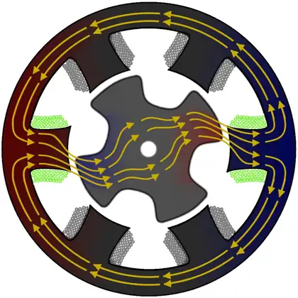 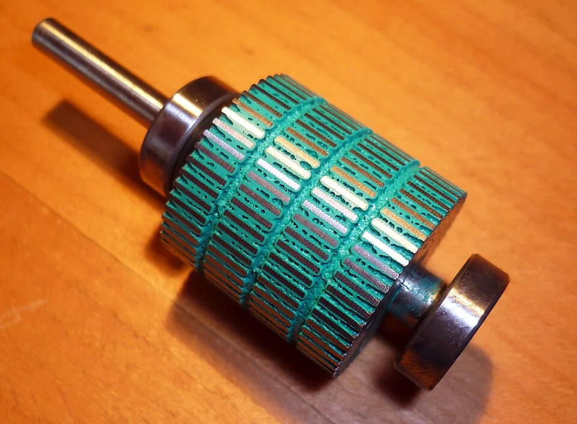

*왼쪽은 **VR형**의 원리다. 회전자는 자석이 아닌 톱니 모양 철심이라, 노란 자속선이 지나는 길(자기 저항)이 가장 짧아지는 자리로 톱니가 끌려간다. 켜는 고정자 극 쌍을 차례로 옮기면 회전자가 따라 돈다. 끌림은 전류 극성과 상관이 없어서 **VR형은 회전 방향이 전류 극성과 무관**하다. 오른쪽은 **HB형** 회전자 실물로, 잘게 판 톱니 철심 두 덩어리가 축 방향 영구자석을 사이에 두고 있어 톱니마다 N·S가 생긴다(직류 바이어스 자계). 톱니가 많아 1.8°처럼 작은 스텝각을 낸다.*

| 구조 | 회전자 | 특징 |
| --- | --- | --- |
| VR (가변 릴럭턴스) | 톱니 모양 철심 | 자석 없음, 무여자 시 유지 토크 없음 |
| PM (영구자석) | 영구자석 | 무여자 정지 때도 **디텐트 토크** 있음, 스텝각 큼 |
| HB (하이브리드) | 자석 + 톱니 철심 (자석이 직류 바이어스 자계) | 고분해능·고토크, 가장 널리 사용 |

- 교재(40절): VR형은 고정자 12극, 회전 방향이 전류 극성과 무관. PM형은 구조 간단·저렴. HB형은 PM과 VR의 복합형으로, 공극에 **직류 바이어스 자계**를 만들어 제어하고 바이폴라 구동을 쓴다(교재는 고정자 영구자석 8극으로 서술). 종류에 **브러시형은 없다**.
- 고정자 극(상) 수로 단상·2상·3상·4상·5상으로 나눈다. 고정자 전자석을 차례로 자화해 돌리고, **가속하려면 펄스 주파수를 높인다**. 고정자–회전자 공극은 **작을수록** 토크와 위치 정밀도에 유리하다.

> [!question] 시험에서는
> "스테핑 모터의 종류가 아닌 것"으로 브러시형·인버터형·CD형이 나온다. 종류는 VR·PM·HB 셋뿐이다. "직류 바이어스 자계"라는 말이 보이면 HB형.

## 7. 여자 방식 — 1상 · 2상 · 1-2상

**직관**: 전자석을 한 번에 하나만 켜면(1상) 힘이 약하고 흔들리며, 두 개씩 켜면(2상) 두 자석이 함께 당겨 힘이 세다. 하나–둘–하나–둘을 번갈아 켜면(1-2상) 회전자가 두 자석 **사이**에도 멈추므로 한 칸이 반으로 쪼개진다.

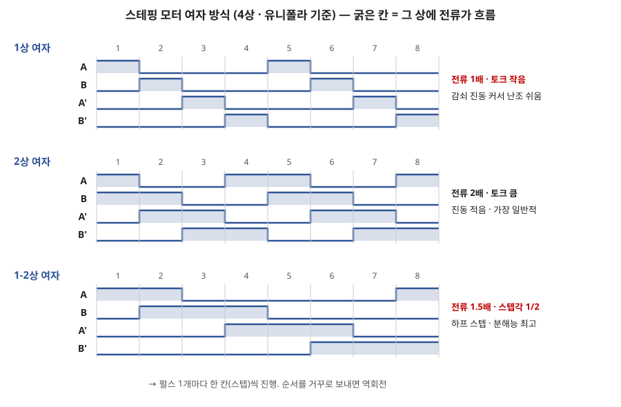

*A'·B'는 A·B의 반대 상(Ā·B̄)이다. 칠해진 칸이 전류가 흐르는 상이다. 한 순간에 켜진 상의 수를 세면 1상 = 1개, 2상 = 2개, 1-2상 = 1개와 2개를 번갈아 → 평균 **1.5개**라 전류가 각각 1배·2배·1.5배다. 1-2상은 같은 상 순서를 도는 데 8스텝이 걸리므로 스텝각이 **절반**이다.*

| 여자 방식 (2상·4상 기준) | 특징 |
| --- | --- |
| 1상 여자 | 한 번에 한 상, 전류·발열·전원 용량 작음, **토크 작고 난조 쉬움** |
| 2상 여자 | 두 상 동시, 토크 크고 진동 적음, 가장 일반적 |
| 1-2상 여자 | 1상·2상 번갈아 → **하프 스텝**, 스텝각 1/2, 분해능 최고 |

- 4상 모터에 "3상 여자"라는 방식은 없다.
- 교재(41절) 전류 비교: 1상 여자를 기준으로 2상 여자는 **2배**, 1-2상 여자는 **1.5배**. 1.8° HB형을 1-2상(반스텝)으로 돌리면 펄스당 **0.9°**.
- 펄스 변화 방법: **PWM**(펄스 폭을 바꿈), **PAM**(전압 높이를 바꿈).

## 8. 구동 회로

**직관**: 코일은 전류가 갑자기 늘지 못하는 성질(인덕턴스)이 있어, 펄스가 빨라지면 전류가 다 차기 전에 다음 펄스가 와서 토크가 떨어진다. 구동 회로는 결국 **"전류를 얼마나 빨리 올리느냐"** 의 싸움이다. 높은 전압으로 밀어 넣고 전류는 초퍼로 일정하게 잡는 것이 정전류 초퍼 구동이다.

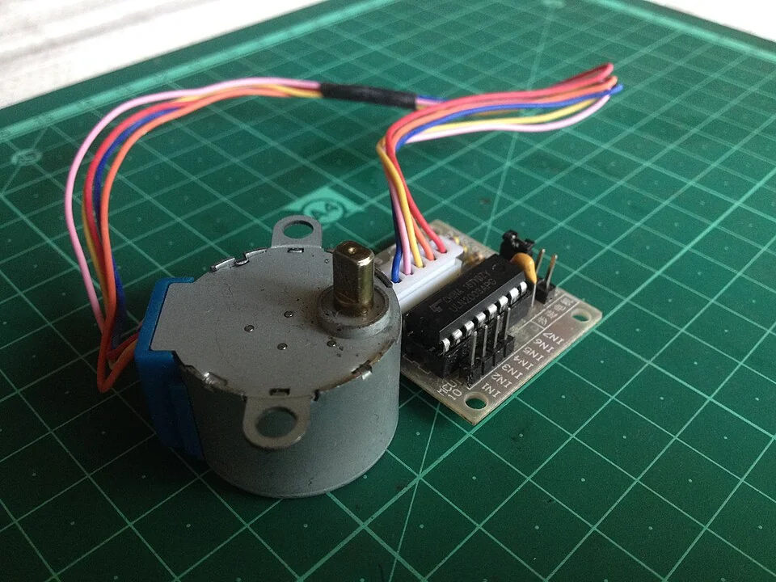

*실습용으로 흔한 조합이다. 모터 선이 **5가닥**인 것은 4개 코일의 공통선(+)이 하나로 묶인 **유니폴라** 결선이기 때문이고, 드라이버 IC(ULN2003, 트랜지스터 어레이)가 각 상을 GND 쪽에서 켜고 끈다 — 전류는 한 방향으로만 흐른다. 바이폴라 모터(선 4가닥)는 H-브리지 드라이버로 전류 방향을 바꿔 같은 크기에서 더 큰 토크를 낸다.*

**구동 회로**

| 구분 | 내용 |
| --- | --- |
| 유니폴라 | 권선 전류 한 방향(+ 또는 0), 회로 간단 |
| 바이폴라 | 전류 방향을 바꿈(H-브리지), 같은 모터에서 **토크가 더 큼** |
| 정전압(직렬 저항) 구동 | 직렬 저항으로 전류 제한, 간단하지만 고속 토크 저하 |
| 2전압(과전압) 구동 | 기동할 때 높은 전압으로 전류를 빨리 올리고 안정되면 낮은 전압으로 |
| **정전류 초퍼(PWM) 구동** | 높은 전압을 스위칭해 전류를 일정하게 → 저손실, **전류 상승 시간 개선**, 고속 특성 좋음 |

> [!question] 시험에서는
> "구동법이 아닌 것" → **병렬** 저항 구동(직렬 저항 구동만 있다), 스트레인 게이지(회로 요소가 아님). "저손실·전류 상승 시간 개선" → **정전류 초퍼(PWM)**.

## 9. 스테핑 모터 계산

**직관**: 펄스 **개수**는 "몇 칸 갔나"(각도·거리), 펄스 **주파수**는 "얼마나 빨리 가나"(속도)다. 단위만 맞추면 모든 문제가 곱셈과 나눗셈이다.

$$
\theta = \theta_s \times \text{펄스 수}, \qquad N[\text{rpm}] = \frac{\theta_s \times \text{pps}}{360} \times 60 = \frac{\theta_s \times n}{360}
$$

**계산**
- 회전 각도 = 스텝각 × 펄스 수
- 회전 속도 $N[\text{rpm}] = \dfrac{\text{스텝각} \times \text{pps}}{360} \times 60$
  - 예: 1.8°, 1000 pps → $1.8 \times 1000 / 360 = 5$ rev/s → **300 rpm**
- 분당 펄스 수 $n$으로 주어지면 $N = \dfrac{\theta_s \times n}{360}$
  - 예: 7.5°, 분당 960 펄스 → $7.5 \times 960 / 360 = 20$ rpm
- 하프 스텝: 스텝각 0.72°인 모터를 1-2상 여자 → 펄스당 **0.36°**
- 직선 이송 속도: 펄스당 이송량 × 초당 펄스 수. 예: 0.005 mm/펄스, 8000 펄스를 4초에 → $0.005 \times 2000 = 10$ mm/s = **0.6 m/min**
  - 예 (교재 42-2): 12초에 20,000펄스, 0.01 mm/펄스 → 분당 100,000펄스 × 0.01 mm = 1,000 mm/min = **1 m/min**.
- 바퀴 구동 이동 거리 = 반지름 × 회전각[rad]. 예 (교재 42-3): 1.8°, 200펄스 = 1회전, 반지름 2.6 cm → $2\pi \times 2.6 \approx 16.3$ cm.

> [!tip] 감 잡기
> rpm 문제는 "초당 몇 바퀴?"를 먼저 구한다. 1.8°×1000 pps = 초당 1800° = 초당 5바퀴 → ×60 = 300 rpm. 분모가 360인 이유는 한 바퀴가 360°이기 때문이다.

## 10. 장단점과 특성 (풀인 · 풀아웃 · 탈조)

**직관**: 스테핑 모터는 "시키는 만큼 정확히 가는" 대신 "못 따라가도 모르는" 모터다. 부하가 무겁거나 갑자기 빨리 돌리라고 하면 펄스를 놓쳐(탈조) 위치가 틀어지는데, 피드백이 없어 스스로는 알아채지 못한다.

**장점과 단점**

| 장점 | 단점 |
| --- | --- |
| 펄스로 **개루프** 위치·속도 제어, 피드백 센서 불필요 | 저속에서 **진동·공진** |
| 회전각이 펄스 수에 비례, 스텝 오차가 **누적되지 않음** | 고속에서 토크 저하, **탈조** |
| 디지털 기기와 인터페이스 쉬움, 정·역 전환·변속 쉬움 | **관성이 큰 부하에 약함** |
| 여자 정지 시 **홀딩 토크**로 위치 유지 | 분해능이 스텝각으로 한정 |
| 브러시 없음, 저렴 | |

- 교재(38절) 정리: 펄스당 회전각은 **1.8°**(200스텝/회전)와 **0.9°**(400스텝/회전). 구조·회로가 간단하고 응답이 빠르며 싸서 **짧은 거리의 디지털 제어**에 맞고, 정지 토크가 커서 **전자 브레이크가 필요 없다**. 회전 속도가 펄스 속도에 비례해 속도 제어가 쉽다.
- 교재 단점: 대용량 구동에 부적합, 모터 자체에 **피드백 장치가 없어** 실제 이동 거리를 모름, 크기에 비해 토크 작음, 과부하에서 난조, 고속 어려움, 저속 진동.

### 특성 곡선

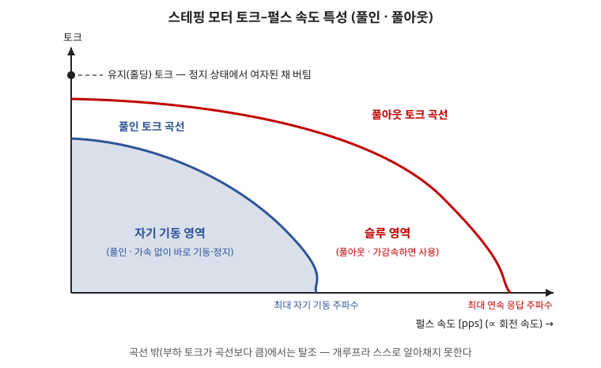

*펄스 속도가 오를수록 낼 수 있는 토크가 줄어든다(코일 전류가 다 차지 못하기 때문). 파란 영역 안에서는 가속 없이 바로 기동·정지해도 되고, 그 바깥의 슬루 영역은 **천천히 가감속**해야만 쓸 수 있다. 부하가 빨간 곡선보다 크면 탈조한다. 맨 위 점은 정지 상태의 유지(홀딩) 토크다.*

**특성 용어**
- **유지 토크(홀딩 토크)**: 정지 상태에서 여자된 채 버티는 최대 토크.
- **디텐트 토크**: 전원이 없을 때 자석이 버티는 토크.
- **풀인(자기 기동) 영역**: 가속 없이 바로 기동·정지할 수 있는 영역.
- **풀아웃(슬루) 영역**: 가감속을 하면 탈조 없이 쓸 수 있는 영역.

> [!tip] 탈조 대책
> 가감속(사다리꼴 속도 패턴) 넣기, 부하 관성 줄이기(감속기), 토크 여유 있는 모터·정전류 초퍼 드라이버 쓰기, 마이크로스텝으로 공진 피하기. 정말 놓치면 안 되면 엔코더를 달아 폐루프(서보)로 간다.

## 11. 모터 비교

| 항목 | DC | 스테핑 | AC 서보 | 유도전동기 |
| --- | --- | --- | --- | --- |
| 제어 | 전압 | 펄스 (개루프) | 펄스·아날로그 (폐루프) | 인버터 |
| 위치 정밀도 | 낮음 | 중간 | 높음 | 낮음 |
| 고속 토크 | 좋음 | 떨어짐 | 좋음 | 좋음 |
| 가격 | 낮음 | 낮음 | 높음 | 낮음 |

## 그림

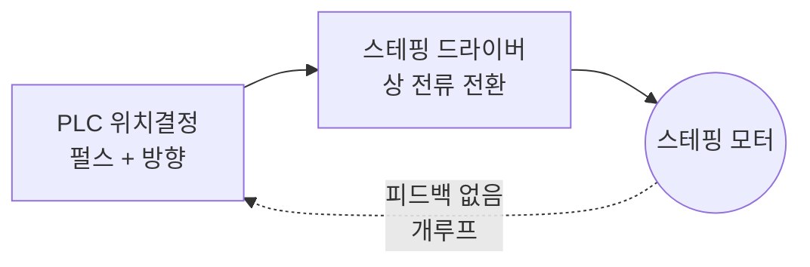

## 기출 포인트

출처: 생산자동화산업기사 2016–2020년 필기 14회분 (cbtbank.kr). 스테핑 모터는 옛 4과목에서 가장 자주 나온 모터 주제.

- 스테핑 모터 특징으로 틀린 것 (공진, 관성 부하, 홀딩 토크, 오차 누적, 회전수 식) — 5회 (2016-2, 2016-3, 2017-3, 2018-1, 2018-2)
- 스테핑 모터 종류 (VR·PM·HB, 없는 형식 고르기, 하이브리드형 구조) — 4회 (2017-1, 2017-3, 2018-1, 2020-1·2)
- 여자 방식 (1-2상 고분해능, 4상의 여자법, 1상 여자 특징) — 3회 (2016-1, 2016-3, 2020-1·2)
- 스텝각·회전수·이송 속도 계산 (하프 스텝 각, 분당 펄스 → rpm, 펄스 → m/min) — 3회 (2016-1, 2017-2, 2020-1·2)
- 펄스 입력 / 속도 = 펄스 주파수 / 위치 검출기 불필요 — 4회 (2018-3 ×2, 2020-1·2, 2020-3)
- 구동 회로 (저손실·전류 상승 개선 = PWM 정전류, 구동법이 아닌 것) — 2회 (2016-3, 2019-2)
- DC 모터 (분권 특징, 정류자·브러시, 주파수로 속도 제어하지 않음, PWM 속도 제어, 자속과 회전수, 출력·회전수 → 토크) — 7회 (2016-1, 2017-1, 2018-1, 2018-2 ×2, 2019-2 ×2)

**교재 예제 유형** (Win-Q 2025 PART 01 CHAPTER 02, 33·38절): DC 모터의 틀린 설명(브러시가 없다), 외부에서 여자 전류를 받는 방식(타여자), 간단한 구조·짧은 거리 디지털 제어·큰 정지 토크·피드백 없음을 가진 모터(스테핑). 39~42절: 위치 검출기 없이 지령만큼 도는 모터, 특성이 아닌 것(고속·고토크), 틀린 설명(진동 없음·관성 부하에 강함), 종류가 아닌 것(브러시형), 직류 바이어스 자계(HB형), 구동법이 아닌 것(병렬 저항), 회전각은 펄스 수에 비례, 여자 방식 표(1상, 그림), 저손실 구동(PWM), 반스텝 0.9°, 회로 요소가 아닌 것(스트레인 게이지), rpm 식, 이송 속도(1 m/min), 바퀴 이동 거리(16.3 cm), 펄스 주파수 ∝ 회전 속도.

## 관련 단원

- [유도전동기와 인버터](유도전동기와_인버터.md)
- [서보 모터와 서보 제어](서보모터와_서보제어.md)
- [특수모듈 프로그래밍](특수모듈_프로그래밍.md)

## 체크리스트

- [ ] DC 모터 속도 식에서 속도를 바꾸는 요소를 말한다
- [ ] 분권·직권 전동기의 특징과 직권의 무부하 위험을 안다
- [ ] PWM 듀티비로 평균 전압을 계산한다
- [ ] 스텝각과 pps로 회전 속도를 계산한다
- [ ] 탈조의 원인과 대책을 설명한다
- [ ] 풀인·풀아웃 영역을 구분한다
- [ ] 스테핑 모터 VR·PM·HB 구조를 구분하고, 없는 형식을 골라낸다
- [ ] 1상·2상·1-2상 여자의 토크·분해능·난조 특성을 비교한다
- [ ] 분당 펄스 수·pps·하프 스텝으로 회전수와 이송 속도를 계산한다
- [ ] 스테핑 모터의 "틀린 설명" 4가지(공진·관성·홀딩 토크·오차 누적)를 바로 잡는다
- [ ] 유니폴라·바이폴라, 정전압·초퍼 구동을 구분한다
- [ ] DC 모터 정류자의 역할과 출력·회전수로 토크를 계산한다

## 참고

- [큐넷 자동화설비산업기사 출제기준](https://www.q-net.or.kr/crf005.do?id=crf00503&jmCd=2034)

### 그림 출처

위키미디어 공용(Wikimedia Commons)과 Openverse에서 가져온 공개 라이선스 자료이고, 노트에 맞게 크기를 줄이고 WebP로 변환했다 (VR형 애니메이션은 1 MB 이하로 다시 압축).

| 그림 | 작성자 | 라이선스 | 출처 |
| --- | --- | --- | --- |
| [Commutator and brushes DC motor](https://commons.wikimedia.org/wiki/File:Commutator_and_brushes_DC_motor.jpg) | Christian Kral | [CC BY 4.0](https://creativecommons.org/licenses/by/4.0) | Wikimedia Commons |
| [Stator of a brushless DC motor](https://commons.wikimedia.org/wiki/File:Stator_of_a_brushless_DC_motor.jpg) | No machine-readable author provided. Xmastree~commonswiki assumed (based on copyright claims). | 퍼블릭 도메인 | Wikimedia Commons |
| [Motore a riluttanza magnetica variabile](https://commons.wikimedia.org/wiki/File:Motore_a_riluttanza_magnetica_variabile.gif) | Carmelo 1955 | [CC BY-SA 4.0](https://creativecommons.org/licenses/by-sa/4.0) | Wikimedia Commons |
| [Stepper motor rotor](https://commons.wikimedia.org/wiki/File:Stepper_motor_rotor.jpg) | Dolly1010 | [CC BY 3.0](https://creativecommons.org/licenses/by/3.0) | Wikimedia Commons |
| [28BYJ-48 unipolar stepper motor with ULN2003 driver](https://commons.wikimedia.org/wiki/File:28BYJ-48_unipolar_stepper_motor_with_ULN2003_driver.jpg) | Kushagra Keshari | [CC BY-SA 4.0](https://creativecommons.org/licenses/by-sa/4.0) | Wikimedia Commons |

직접 그린 그림(SVG, 이 볼트용으로 새로 작성): DC모터 원리, DC모터 여자방식, PWM 듀티비, H브리지, 스테핑 여자방식, 스테핑 토크속도.

