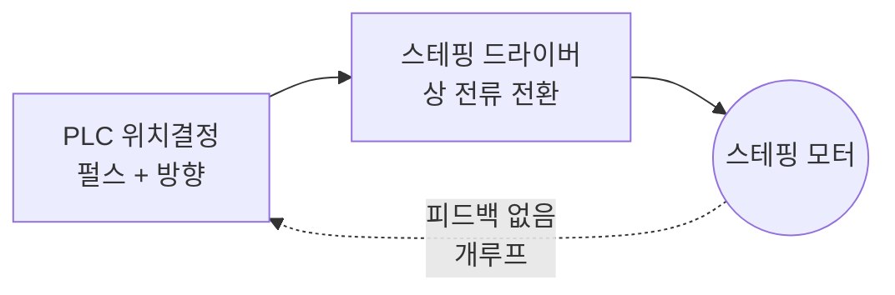

# DC 모터와 스테핑 모터

> [!summary] 핵심 요약
> - DC 모터 속도: $N = \dfrac{V - I_a R_a}{k\Phi}$ → 전압을 올리거나 자속을 줄이면 빨라진다.
> - DC 모터 종류: 타여자, 분권(속도 일정), **직권(기동 토크 큼, 무부하 위험)**, 복권.
> - **BLDC**: 브러시 대신 전자식 정류(홀 센서) → 수명 길고 노이즈 적음.
> - **스테핑 모터**: 펄스 하나에 일정 각도(스텝각)씩 회전. **개루프**로 위치 제어. 스텝각 = 360° ÷ 1회전 스텝 수.

> [!warning] 자주 틀리는 포인트
> - **직권 전동기는 무부하 운전 금지**: 부하가 없으면 속도가 위험하게 올라간다. 벨트 대신 기어·직결로 연결.
> - DC 모터 역회전: **전기자 또는 계자 중 한쪽**의 극성을 바꾼다. 둘 다 바꾸면 그대로.
> - 스테핑 모터는 부하가 너무 크거나 가속이 너무 빠르면 **탈조**(펄스를 놓쳐 위치가 틀어짐)한다. 개루프라 스스로 알아채지 못한다.
> - 2상 스테핑 모터 기본 스텝각 **1.8°**(200 스텝/회전), 5상은 **0.72°**(500 스텝/회전).

## 개념 정리

### DC 모터

| 종류 | 계자 연결 | 특징·용도 |
| --- | --- | --- |
| 타여자 | 별도 전원 | 정밀 속도 제어 |
| 분권 | 전기자와 병렬 | 부하가 변해도 속도 거의 일정 (공작기계) |
| 직권 | 전기자와 직렬 | 기동 토크 큼, 부하 따라 속도 크게 변함 (전차, 크레인) |
| 복권 | 직렬 + 병렬 | 분권과 직권의 중간 |
| 영구자석형 | 자석 | 소형, 가장 흔함 |

**속도 제어**

| 방법 | 내용 | 특징 |
| --- | --- | --- |
| 전압 제어 | 전기자 전압 조정 | 광범위·고효율, **정토크** 제어 (워드 레오나드, PWM 초퍼) |
| 계자 제어 | 계자 자속 조정 | 정격 이상 속도, **정출력** 제어 |
| 저항 제어 | 전기자 직렬 저항 | 손실 큼, 효율 나쁨 |

- **PWM**: 스위칭 소자를 빠르게 켜고 끄며 **듀티비**로 평균 전압 조절. 평균 전압 = 전원 전압 × 듀티비.
- **H-브리지**: 4개의 스위치로 전류 방향을 바꿔 정·역회전. 같은 쪽 위·아래 스위치가 동시에 켜지면 단락(관통 전류) → 데드 타임.
- 제동: 발전 제동(저항에서 소비), 회생 제동(전원으로 되돌림), 역전 제동(플러깅).

### BLDC 모터

- 회전자 영구자석, 고정자 권선. 홀 센서로 회전자 위치를 읽고 드라이버가 전류를 전환.
- 장점: 브러시 마모·불꽃 없음, 고효율, 고속. 단점: 드라이버 필요.

### 스테핑 모터

| 구분 | 내용 |
| --- | --- |
| 종류 | 영구자석(PM)형, 가변 릴럭턴스(VR)형, **하이브리드(HB)형**(가장 많이 사용) |
| 구동 방식 | 1상 여자, 2상 여자(토크 큼), 1-2상 여자(하프 스텝, 각도 절반) |
| 마이크로스텝 | 전류를 단계적으로 바꿔 스텝각을 잘게 나눔 → 진동 감소 |

**계산**
- 회전 각도 = 스텝각 × 펄스 수
- 회전 속도 $N[\text{rpm}] = \dfrac{\text{스텝각} \times \text{pps}}{360} \times 60$
  - 예: 1.8°, 1000 pps → $1.8 \times 1000 / 360 = 5$ rev/s → **300 rpm**

**특성 용어**
- **유지 토크(홀딩 토크)**: 정지 상태에서 여자된 채 버티는 최대 토크.
- **디텐트 토크**: 전원이 없을 때 자석이 버티는 토크.
- **풀인(자기 기동) 영역**: 가속 없이 바로 기동·정지할 수 있는 영역.
- **풀아웃(슬루) 영역**: 가감속을 하면 탈조 없이 쓸 수 있는 영역.

### 모터 비교

| 항목 | DC | 스테핑 | AC 서보 | 유도전동기 |
| --- | --- | --- | --- | --- |
| 제어 | 전압 | 펄스 (개루프) | 펄스·아날로그 (폐루프) | 인버터 |
| 위치 정밀도 | 낮음 | 중간 | 높음 | 낮음 |
| 고속 토크 | 좋음 | 떨어짐 | 좋음 | 좋음 |
| 가격 | 낮음 | 낮음 | 높음 | 낮음 |

## 그림

## 관련 단원

- [유도전동기와 인버터](유도전동기와_인버터.md)
- [서보 모터와 서보 제어](서보모터와_서보제어.md)
- [특수모듈 프로그래밍](특수모듈_프로그래밍.md)

## 체크리스트

- [ ] DC 모터 속도 식에서 속도를 바꾸는 요소를 말한다
- [ ] 분권·직권 전동기의 특징과 직권의 무부하 위험을 안다
- [ ] PWM 듀티비로 평균 전압을 계산한다
- [ ] 스텝각과 pps로 회전 속도를 계산한다
- [ ] 탈조의 원인과 대책을 설명한다
- [ ] 풀인·풀아웃 영역을 구분한다

## 참고

- [큐넷 자동화설비산업기사 출제기준](https://www.q-net.or.kr/crf005.do?id=crf00503&jmCd=2034)
