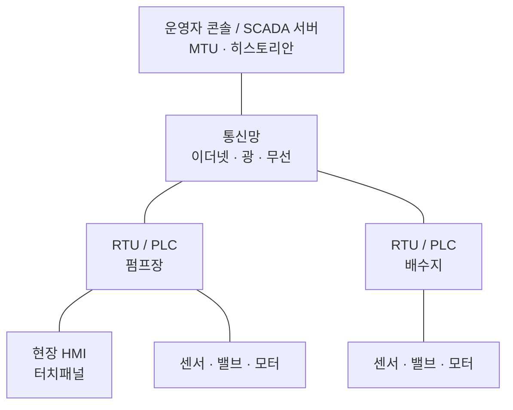

# HMI와 SCADA

> [!summary] 핵심 요약
> - **HMI**(Human Machine Interface): 사람이 설비 상태를 보고 조작하는 화면 장치. 현장에서는 터치패널.
> - **SCADA**(Supervisory Control And Data Acquisition): 넓은 지역의 설비를 중앙에서 **감시·제어하고 데이터를 수집**하는 시스템.
> - HMI 작화 흐름: 기종·통신 설정 → **태그(디바이스) 연결** → 화면·오브젝트 작성 → 알람·트렌드·레시피 → 시뮬레이션 → 다운로드.
> - 서로 다른 제조사 장비를 잇는 표준 인터페이스: **OPC (DA → UA)**.

> [!warning] 자주 틀리는 포인트
> - SCADA는 **감시(Supervisory)** 가 중심. 빠른 실시간 제어는 현장 PLC가 맡는다.
> - **DCS**는 한 공장 안 연속 공정(화학·발전)의 분산 제어, **SCADA**는 광역(상하수도·전력망·가스관) 감시에 강하다.
> - 스위치 오브젝트: **모멘터리**(누르는 동안만 ON), **얼터네이트**(누를 때마다 반전), 세트/리셋.
> - HMI 스위치로 직접 PLC 출력(P, Y)을 켜지 말고 **내부 릴레이(M)** 를 거쳐 프로그램에서 인터록 후 출력.

## 개념 정리

### HMI 구성과 기능

| 기능 | 내용 |
| --- | --- |
| 화면 표시 | 램프, 수치 표시, 그래프, 애니메이션으로 설비 상태 표시 |
| 조작 | 스위치, 수치 입력(설정값 변경), 화면 전환 |
| 알람 | 이상 발생 시 메시지·이력, 확인(ACK) |
| 트렌드 | 아날로그 값의 시간 추이 그래프 |
| 레시피 | 제품별 설정값 묶음을 한 번에 PLC로 전송 |
| 데이터 로깅 | 생산량·이력 저장 (USB, SD) |
| 보안 | 사용자 레벨별 조작 권한, 비밀번호 |

### 터치 패널 방식

| 방식 | 특징 |
| --- | --- |
| 저항막 | 압력 감지, 장갑 끼고 사용 가능, 저렴, 산업용에 많음 |
| 정전용량 | 손가락 전하 감지, 멀티터치, 장갑 사용 제한 |
| 적외선 | 화면 가장자리 적외선 격자 차단 감지, 대형 화면 |
| 초음파(SAW) | 표면 탄성파, 투과율 좋음, 오염에 약함 |

### HMI–PLC 연결

- **직접 접속**: 시리얼(RS-232C/485) 또는 이더넷으로 PLC 메모리를 직접 읽고 씀.
- 통신 설정 항목: 통신 방식, 국번, 보율·데이터 비트·패리티·스톱 비트(시리얼), IP·포트(이더넷).
- **태그**: 화면 오브젝트와 PLC 디바이스 주소를 묶은 이름. 비트 태그(M, P), 워드 태그(D).
- 통신 이상 시 화면에 통신 에러 표시 → 케이블, 국번, 설정 불일치 확인.

### SCADA 구성

| 요소 | 역할 |
| --- | --- |
| HMI / 운영자 콘솔 | 중앙 감시 화면 |
| MTU (Master Terminal Unit) | 중앙 서버, 데이터 수집·명령 송신 |
| RTU (Remote Terminal Unit) | 원격 현장 단말, 신호 수집·제어 |
| PLC | 현장 제어 (RTU 역할도 함) |
| 통신망 | 유선·무선·광, 원거리 전송 |
| 히스토리안 DB | 장기 데이터 저장·보고서 |

### PLC · DCS · SCADA 비교

| 항목 | PLC | DCS | SCADA |
| --- | --- | --- | --- |
| 범위 | 기계·라인 | 공장 단위 연속 공정 | 광역 분산 설비 |
| 강점 | 고속 시퀀스 제어 | 루프 제어, 이중화 | 원격 감시·데이터 수집 |
| 예 | 조립 라인 | 정유, 발전소 | 상하수도, 전력 계통, 가스관 |

### OPC

- **OPC DA**: 윈도우 COM/DCOM 기반 실시간 데이터 교환 (구형).
- **OPC UA**: 플랫폼 독립, 보안(암호화·인증) 내장, 정보 모델 → 스마트 팩토리 표준.

### 화면 설계 원칙

- 정상은 차분한 색, **이상·경보는 빨강·노랑**처럼 눈에 띄게. 색만으로 구분하지 말고 글자·모양도 함께.
- 화면 계층: 개요(전체) → 공정별 → 상세 → 알람·트렌드.
- 위험한 조작에는 **확인 창**이나 2단계 조작.

## 그림

## 관련 단원

- [데이터 통신](데이터_통신.md)
- [PLC 구성과 특성](PLC_구성과_특성.md)

## 체크리스트

- [ ] HMI와 SCADA의 정의와 차이를 말한다
- [ ] 알람·트렌드·레시피 기능을 구분한다
- [ ] 터치 방식 4가지의 특징을 비교한다
- [ ] SCADA 구성 요소(MTU, RTU, 통신망)를 설명한다
- [ ] PLC·DCS·SCADA의 적용 분야를 구분한다
- [ ] 모멘터리·얼터네이트 스위치를 구분한다

## 참고

- [큐넷 자동화설비산업기사 출제기준](https://www.q-net.or.kr/crf005.do?id=crf00503&jmCd=2034)
- [OPC Foundation – OPC UA](https://opcfoundation.org/about/opc-technologies/opc-ua/)
