# HMI와 SCADA

> [!summary] 핵심 요약
> - **HMI**(Human Machine Interface): 사람이 설비 상태를 보고 조작하는 화면 장치. 현장에서는 터치패널.
> - **SCADA**(Supervisory Control And Data Acquisition): 넓은 지역의 설비를 중앙에서 **감시·제어하고 데이터를 수집**하는 시스템.
> - HMI 작화 흐름: 기종·통신 설정 → **태그(디바이스) 연결** → 화면·오브젝트 작성 → 알람·트렌드·레시피 → 시뮬레이션 → 다운로드.
> - 서로 다른 제조사 장비를 잇는 표준 인터페이스: **OPC (DA → UA)**.

> [!warning] 자주 틀리는 포인트
> - SCADA는 **감시(Supervisory)** 가 중심. 빠른 실시간 제어는 현장 PLC가 맡는다.
> - **DCS**는 한 공장 안 연속 공정(화학·발전)의 분산 제어, **SCADA**는 광역(상하수도·전력망·가스관) 감시에 강하다.
> - 스위치 오브젝트: **모멘터리**(누르는 동안만 ON), **얼터네이트**(누를 때마다 반전), 세트/리셋.
> - HMI 스위치로 직접 PLC 출력(P, Y)을 켜지 말고 **내부 릴레이(M)** 를 거쳐 프로그램에서 인터록 후 출력.
> - HMI는 **비전문가도** 쉽게 조작하게 만든 장치다. "전문 프로그래머가 있어야 운용한다"는 보기는 틀림 (교재 01절).
> - 그래픽 요소 바꿔치기 함정: "이미지로 출력 상태 확인"은 **램프**, 상수·증감 설정은 **설정값 버튼** (교재 03절).
> - 기능 설계는 **하드웨어 연결(통신 설정 → I/O 리스트 → 드라이버) 다음에 그래픽**을 만든다. 그래픽을 먼저 그리는 순서는 틀림.
> - 원거리 설비를 데이터 통신으로 계측·감시·제어하는 시스템 = 교재 용어로 **TTS**.

## 학습 목표

이 단원을 마치면 다음을 할 수 있어야 한다.

1. MMI와 HMI, HMI와 SCADA의 정의를 말하고 차이를 설명한다.
2. HMI 기능(화면 표시·조작·알람·트렌드·레시피·로깅·보안)과 시스템 구성 3가지(STAND-ALONE, 분산, 이중화)를 구분한다.
3. HMI 기능 설계 순서를 말하고, 그래픽이 하드웨어 연결 **뒤**에 오는 이유를 설명한다.
4. 그래픽 요소 8가지와 모멘터리·얼터네이트·세트/리셋 스위치를 타임차트로 구분한다.
5. 터치 패널 4방식의 감지 원리와 장단점을 비교한다.
6. SCADA 구성 요소(MTU·RTU·통신망·히스토리안)와 4대 기능을 말하고, PLC·DCS·SCADA의 적용 범위와 OPC DA·UA의 차이를 구분한다.

## 한눈에 보기

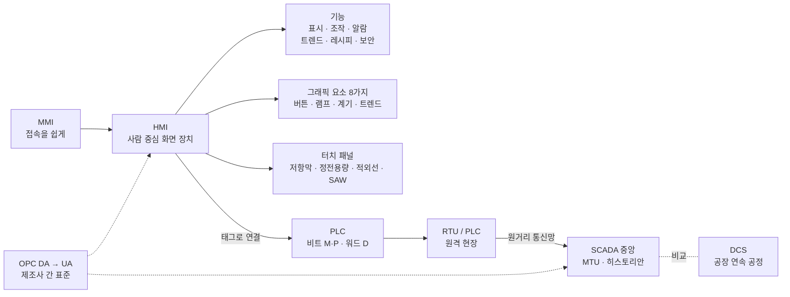

## 1. MMI와 HMI (교재 01절)

**직관**: 자동차 계기판과 핸들을 떠올리면 된다. 운전자는 엔진 내부를 몰라도 계기판(표시)을 보고 페달·스위치(조작)로 차를 다룬다. 설비의 **계기판 + 조작 스위치**를 화면 하나로 모은 것이 HMI다. 그래서 "전문 프로그래머가 있어야 운용한다"는 보기는 HMI의 목적과 정반대다.

| 버튼·램프를 판에 박은 옛 조작반 | 화면 하나로 바뀐 HMI 터치패널 |
| --- | --- |
| 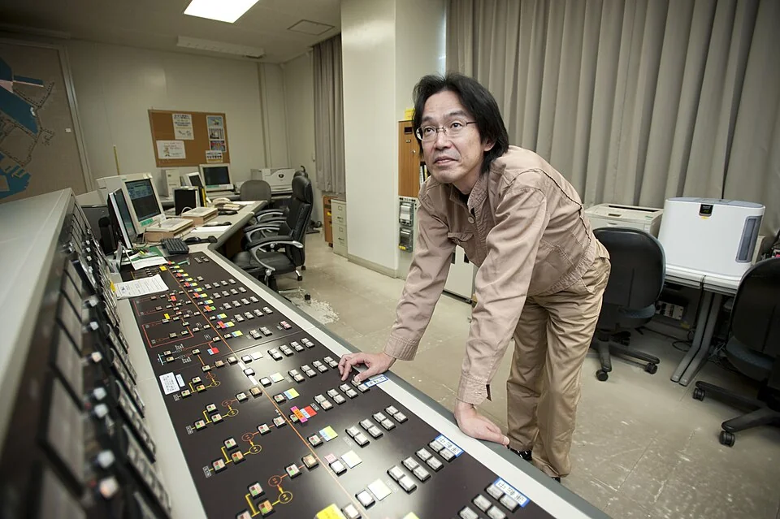 | 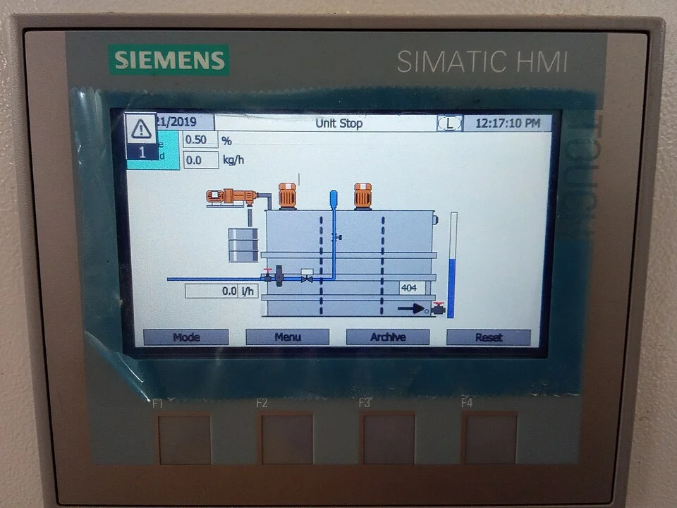 |

*사진 앞쪽 판은 설비 계통도를 그려 놓고 그 위에 **버튼과 램프를 직접 박아 넣은** 옛 방식 조작반(미믹 패널)이다. 작업자가 계통도를 따라 손으로 스위치를 누른다. 이 사진은 미 해군 자료에서 SCADA로 전력 부하를 맞추는 장면으로 소개된다. 오른쪽 HMI는 같은 일을 **화면 속 그림 + 터치 버튼**으로 한다 — 탱크·펌프 공정도(상태 표시), 수치 표시칸, 왼쪽 위 경보 아이콘(알람), 아래쪽 Mode·Menu·Archive·Reset 화면 버튼이 한 화면에 모여 있고, 패널 아래 F1~F4는 물리 기능 키다.*

- **MMI**: 작업자와 설비 사이의 접속을 쉽게 하자는 개념.
- **HMI**: 여기에 **사람 중심** 관점을 더해 사람과 기계의 소통을 돕는 시스템. 교재는 기계에 "인격을 부여한" 개념이라고 표현한다.
- HMI 소프트웨어 특징: 직관적 GUI, 개방형 구조, 현장 정보의 DB화·그래픽·트렌드·리포트, 네트워크·이중화 지원, COM/DCOM 표준.
- HMI가 연결하는 기계장비: **PLC**와 **계측장치**(과학·항해·공업·의료·전기계측·물리량 계측기).
- PC 기반이라 Windows 환경(멀티태스킹, ActiveX, OLE, OPC)을 쓰고, **PC 성능이 오르면 HMI 성능도 빠르게 오른다** (교재 02절).

> [!tip] 이름 구분
> MMI는 "Man"이 들어간 **접속(인터페이스)** 자체, HMI는 "Human"으로 바꾸며 **사람이 편한가**를 앞세운 말이다. 시험 보기에서는 "사람 중심", "인격 부여"가 나오면 HMI 쪽 설명이다.

## 2. HMI 구성과 기능

**직관**: HMI 기능은 "보기 → 누르기 → 알려주기 → 기록하기 → 지키기" 다섯 동사로 묶으면 외우기 쉽다. 표시·조작은 지금 이 순간, 알람은 이상할 때, 트렌드·로깅은 지나간 시간, 보안은 누가 만질 수 있는가를 다룬다.

| 기능 | 내용 |
| --- | --- |
| 화면 표시 | 램프, 수치 표시, 그래프, 애니메이션으로 설비 상태 표시 |
| 조작 | 스위치, 수치 입력(설정값 변경), 화면 전환 |
| 알람 | 이상 발생 시 메시지·이력, 확인(ACK) |
| 트렌드 | 아날로그 값의 시간 추이 그래프 |
| 레시피 | 제품별 설정값 묶음을 한 번에 PLC로 전송 |
| 데이터 로깅 | 생산량·이력 저장 (USB, SD) |
| 보안 | 사용자 레벨별 조작 권한, 비밀번호 |

> [!question] 시험에서는
> 세 기능이 자주 바꿔치기된다. **알람** = 이상 발생 알림과 확인(ACK), **트렌드** = 아날로그 값이 시간에 따라 어떻게 변했는지 그래프, **레시피** = 제품 A·B마다 다른 온도·속도·시간 설정값을 **묶어서 한 번에** PLC로 보내는 것. "모델 바꿀 때 설정값 수십 개를 한꺼번에" → 레시피.

## 3. HMI 시스템 구성 (교재 02절)

**직관**: 가게 하나는 사장 혼자 계산·재고·장부를 다 본다(STAND-ALONE). 체인점이 되면 계산대·창고·본사 서버로 일을 나눈다(분산). 병원처럼 멈추면 안 되는 곳은 발전기를 하나 더 둔다(이중화).

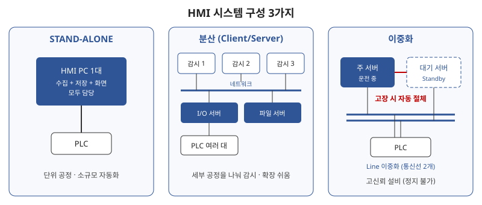

*가운데 분산형에서 **PLC와 직접 통신하는 것은 I/O 서버**이고, 감시 PC들은 네트워크로 서버의 데이터를 받아 보기만 한다. 오른쪽 이중화는 **서버 이중화**(주 서버 고장 → 대기 서버로 자동 절체)와 **Line 이중화**(통신선 2개)를 함께 그렸다.*

| 구성 | 용도 | 특징 |
| --- | --- | --- |
| STAND-ALONE | 단위 공정, 소규모 자동화 | 한 대가 수집·저장·화면 기능을 모두 맡음 |
| 분산 (Client/Server) | 세부 공정을 나눠 감시 | 감시·제어, I/O, 파일 서버를 네트워크로 연결, 확장 쉬움 |
| 이중화 | 고신뢰 설비 | Line 이중화, 서버 이중화(주 서버 고장 시 대기 서버로 **자동 절체**) |

- 적용 분야: 공정 자동화(오폐수, 소각로), 공장 자동화(생산관제, 설비진단), 빌딩 자동화, 원격감시·제어(**TTS**).

## 4. HMI 기능 설계 순서 (교재 02절)

**직관**: 집을 지을 때 **배관·전기 공사를 먼저 하고 벽지를 바른다.** 벽지(그래픽)를 먼저 바르면 배선(통신·태그)을 넣을 때 다 뜯어야 한다. HMI도 장비와 통신이 정해져야 화면의 버튼·램프에 연결할 주소(태그)가 생긴다.

1. 개발 방식 결정: 전용 HMI 소프트웨어 또는 VB·C/C++로 직접 개발.
2. 장비·드라이버 선택, **통신 방법 설정**.
3. 네트워크 설정, **I/O 리스트** 작성.
4. **드라이버와 DB** 구성.
5. **그래픽 화면** 생성.
6. 트렌드, 리포트, 알람 리스트 추가.

- 통신: 직렬(기본 RS-232C, 고성능은 RS-422/485 + 직렬통신보드) 또는 Ethernet(TCP/IP).
- Ethernet 드라이버 설치: IP 주소 할당 → TCP/IP 설치·환경 설정 → 통신 테스트.

> [!question] 시험에서는
> 순서 문제는 "그래픽 화면 생성"이 몇 번째에 오는지를 본다. **통신 → I/O 리스트 → 드라이버·DB → 그래픽 → 트렌드·리포트·알람** 순서다. 직렬 통신 규격(RS-232C·422·485) 차이는 [데이터 통신](데이터_통신.md)에서 정리했다.

## 5. 그래픽 요소와 화면 (교재 03절)

**직관**: HMI 화면은 **입력 장치이자 출력 장치**다. 손가락이 닿는 것(버튼류)은 입력 변수, 눈으로 보는 것(램프·계기·그래프)은 출력 변수와 연결된다.

HMI 화면은 터치로 입력하고 상태를 출력하는 장치라서 입력 변수와 출력 변수를 모두 다룬다.

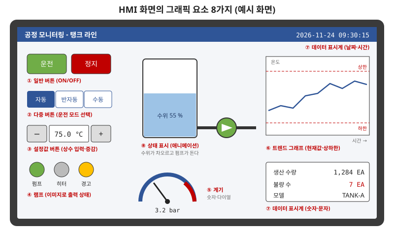

*왼쪽 열 ①~③은 **입력**(누르거나 값을 넣는 것), ④~⑧은 **출력**(보여 주는 것)이다. 시험 함정인 "이미지로 출력 상태 확인"은 ④ **램프**, "상수 입력·증감 설정"은 ③ **설정값 버튼**이다. ⑦ 데이터 표시계는 오른쪽 위 날짜·시간과 오른쪽 아래 생산 수량처럼 **숫자·문자·날짜·시간**을 글자로 보여 준다.*

| 요소 | 쓰임 |
| --- | --- |
| 일반 버튼 | ON/OFF (즉시·한시·지연 동작 설정) |
| 다중 버튼 | 작업 단계, 운전 모드(자동·반자동·수동) 선택 |
| 설정값 버튼 | 상수 입력, 증감 설정 |
| 램프 | 이미지로 출력 상태 확인 |
| 계기 | 숫자·다이얼 표시 |
| 트렌드 그래프 | 현재값, 최소·최대, 상·하한을 그래프로 |
| 데이터 표시계 | 숫자, 문자, 날짜, 시간 |
| 상태 표시 | 애니메이션으로 작동 상태 |

### 스위치 오브젝트의 동작 방식

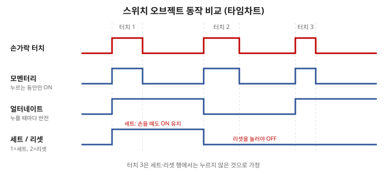

*같은 손가락 동작(빨강)이라도 출력은 다르다. **모멘터리**는 손가락 파형과 똑같고(초인종), **얼터네이트**는 누를 때마다 뒤집힌다(전등 스위치). **세트/리셋**은 버튼이 둘로 나뉘어, 세트를 누르면 손을 떼도 ON이 유지되고 리셋을 눌러야 꺼진다. 조그(인칭) 운전처럼 손을 떼면 바로 멈춰야 하는 조작에는 모멘터리를 쓴다.*

- 배치: **단일 페이지**(한눈에 모니터링) / **다중 페이지**(메인 + 서브, 디자인 통일 필요).
- 화면 종류: 공정 모니터링, 트렌드(시간에 따른 추세), 데이터 조회(생산량·불량 수 DB), IO 모니터링(입출력 ON/OFF), 수동 조작(구동 요소를 버튼으로), 환경설정(권한·통신·모델 변경).

## 6. 터치 패널 방식

**직관**: 화면이 손가락을 알아채는 방법은 네 가지다. **눌러서 두 막을 붙이거나**(저항막), **손의 전기를 빼앗거나**(정전용량), **빛을 가리거나**(적외선), **소리(초음파)를 흡수하거나**(SAW).

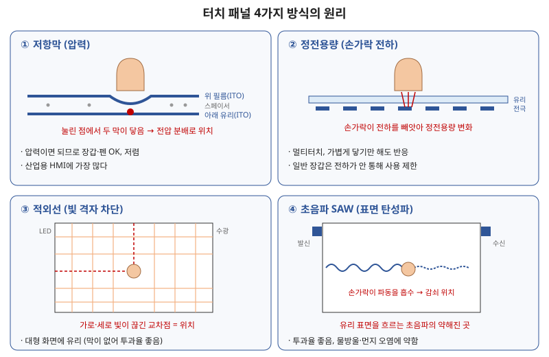

*산업 현장에서 **저항막**이 많은 이유는 압력만 있으면 되기 때문이다 — 작업 장갑이나 펜으로 눌러도 된다. 반대로 **정전용량**은 손가락의 전하가 필요해서 일반 장갑으로는 반응하지 않지만, 스마트폰처럼 멀티터치가 된다.*

| 방식 | 특징 |
| --- | --- |
| 저항막 | 압력 감지, 장갑 끼고 사용 가능, 저렴, 산업용에 많음 |
| 정전용량 | 손가락 전하 감지, 멀티터치, 장갑 사용 제한 |
| 적외선 | 화면 가장자리 적외선 격자 차단 감지, 대형 화면 |
| 초음파(SAW) | 표면 탄성파, 투과율 좋음, 오염에 약함 |

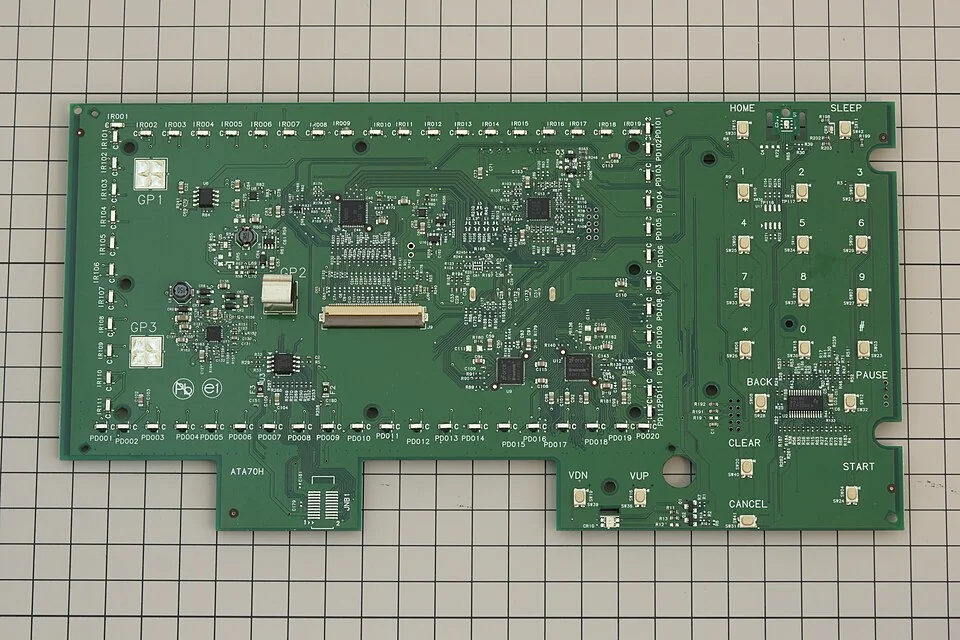

*실제 적외선 터치 기판이다. 기판 가장자리를 따라 위·왼쪽 변의 **IR(발광 LED)** 과 마주 보는 아래·오른쪽 변의 **PD(포토다이오드, 수광)** 가 짝을 이룬다. LED와 수광 소자 줄이 화면 테두리를 감싸서, 손가락이 화면 위에 오면 그 자리의 가로·세로 빛이 끊겨 위치가 정해진다. 화면 앞에 막을 덧씌우지 않으므로 투과율이 좋고 대형 화면에 쓴다. (오른쪽 버튼들은 이 기기 자체의 조작 키다.)*

## 7. HMI–PLC 연결

**직관**: 태그는 **전화번호부의 이름**과 같다. 화면 버튼에는 "RUN_SW"라는 이름만 붙이고, 그 이름이 PLC의 어느 주소(M100)로 연결되는지는 태그 목록에서 한 번만 정한다. 주소가 바뀌어도 태그 목록만 고치면 된다.

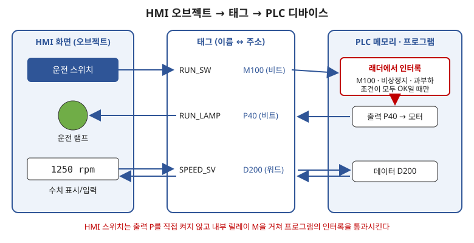

*빨간 상자가 핵심이다. HMI 스위치는 **내부 릴레이 M100**만 켜고, 실제 출력 P40은 PLC 프로그램이 비상정지·과부하 같은 **인터록 조건을 모두 확인한 뒤** 켠다. HMI가 P를 직접 켜면 화면 터치 한 번으로 안전 조건을 건너뛸 수 있다. 램프는 PLC 출력 P40을 **읽어서** 보여 주는 출력 방향, 수치는 D 레지스터를 읽고 쓰는 양방향이다.*

- **직접 접속**: 시리얼(RS-232C/485) 또는 이더넷으로 PLC 메모리를 직접 읽고 씀.
- 통신 설정 항목: 통신 방식, 국번, 보율·데이터 비트·패리티·스톱 비트(시리얼), IP·포트(이더넷).
- **태그**: 화면 오브젝트와 PLC 디바이스 주소를 묶은 이름. 비트 태그(M, P), 워드 태그(D).
- 통신 이상 시 화면에 통신 에러 표시 → 케이블, 국번, 설정 불일치 확인.

> [!tip] 통신 에러가 뜨면
> HMI와 PLC는 **양쪽 설정이 한 글자라도 다르면** 통신하지 못한다. 시리얼은 보율·데이터 비트·패리티·스톱 비트·국번이, 이더넷은 IP 대역·포트가 맞는지 확인한다. 케이블 핀 배치(RS-232C 송수신 교차)도 흔한 원인이다.

## 8. SCADA 구성

**직관**: SCADA는 **도시 전체의 CCTV 관제센터**와 같다. 관제센터(중앙)는 수십 km 떨어진 펌프장·배수지·변전소를 화면으로 지켜보고 필요할 때 명령을 보내지만, 각 현장의 빠른 동작은 그곳의 RTU·PLC가 알아서 한다.

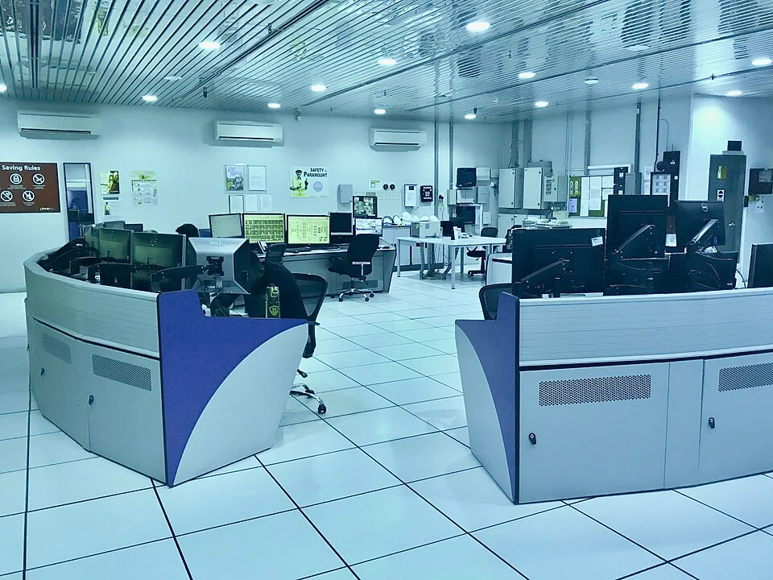

*싱가포르 재생수(NEWater) 시설의 SCADA 실이다. 운영자 콘솔(HMI)에 모니터를 여러 대 두어 공정 화면, 알람, 트렌드를 동시에 띄운다. 이 방에는 펌프·밸브가 없다 — 실제 설비는 멀리 떨어진 현장에 있고 **통신망으로 데이터만** 들어온다.*

| 요소 | 역할 |
| --- | --- |
| HMI / 운영자 콘솔 | 중앙 감시 화면 |
| MTU (Master Terminal Unit) | 중앙 서버, 데이터 수집·명령 송신 |
| RTU (Remote Terminal Unit) | 원격 현장 단말, 신호 수집·제어 |
| PLC | 현장 제어 (RTU 역할도 함) |
| 통신망 | 유선·무선·광, 원거리 전송 |
| 히스토리안 DB | 장기 데이터 저장·보고서 |

| 모듈형 RTU | PLC형 RTU 컨트롤러 |
| --- | --- |
| 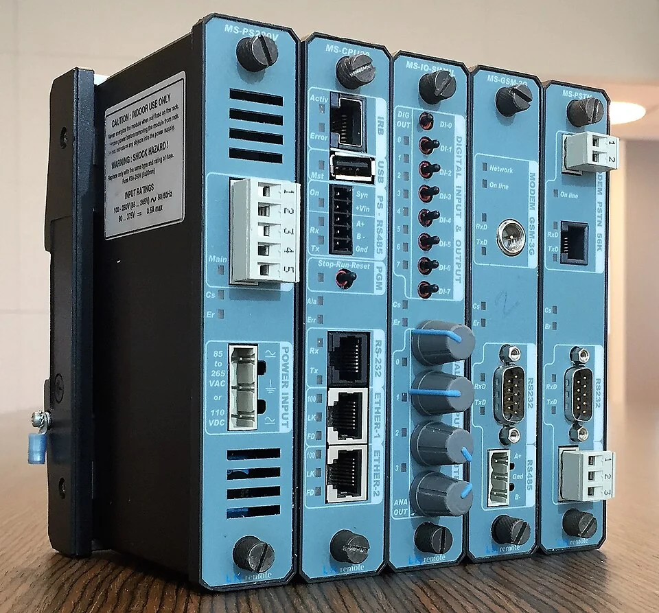 | 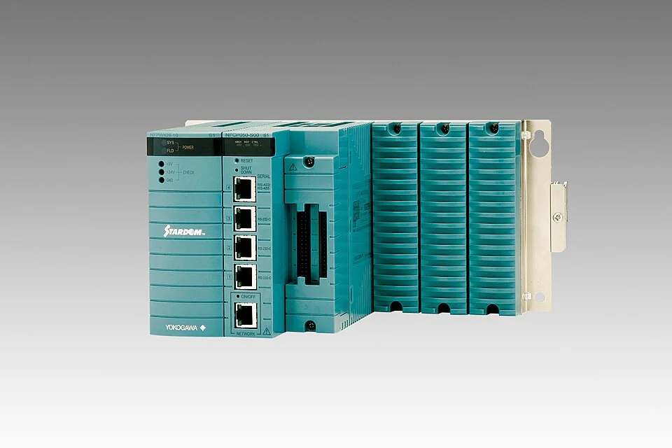 |

*왼쪽 RTU에는 PLC에서 보기 힘든 **GSM(이동통신) 모뎀과 PSTN(전화선) 모뎀 모듈**이 있다. 유선망이 없는 먼 현장에서도 중앙(MTU)과 통신하기 위해서다 — 이것이 RTU의 정체성이다. 오른쪽은 PLC처럼 생긴 컨트롤러에 직렬·네트워크 포트를 여러 개 둔 형태로, 표의 "PLC(RTU 역할도 함)"를 보여 준다.*

- 교재(01절) 정의: SCADA = **집중원격감시제어시스템**. 원격 장치(RTU)의 상태를 모아 기록·표시하고 중앙에서 감시·제어한다. 발전·송배전, 석유화학, 제철처럼 흩어진 시설에 쓴다.
- **SCADA 4대 기능** (ANSI/IEEE 권고): 경보, 감시제어(수동·자동·복합), 지시·표시, 디지털 펄스 합산 표시.

> [!tip] 4대 기능 외우기
> **경·감·지·합** — 경보, 감시제어, 지시·표시, (펄스) 합산 표시. 디지털 펄스 합산은 전력량계·유량계가 내는 펄스를 세어 누적량을 보여 주는 기능이다.

## 9. PLC · DCS · SCADA 비교

**직관**: 셋을 구분하는 첫 기준은 **넓이**다. 기계 하나·라인 하나는 PLC, 공장 하나(울타리 안)는 DCS, 울타리 밖 수십~수백 km에 흩어진 설비는 SCADA.

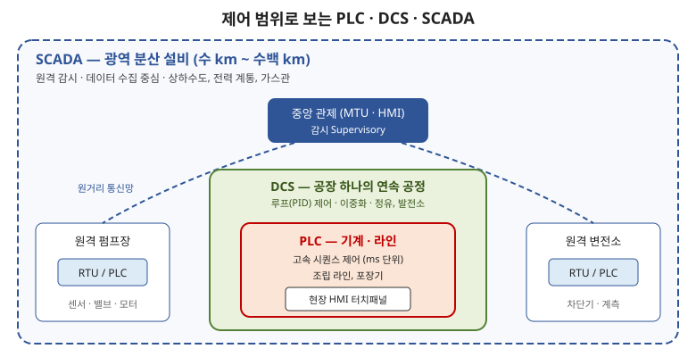

*범위가 넓어질수록 **제어보다 감시**의 비중이 커진다. PLC는 ms 단위 시퀀스를 직접 돌리고, DCS는 공장 안 수많은 PID 루프를 이중화해서 돌리며, SCADA는 멀리 있는 RTU·PLC가 제어한 결과를 모아 **감시(Supervisory)** 한다.*

| 항목 | PLC | DCS | SCADA |
| --- | --- | --- | --- |
| 범위 | 기계·라인 | 공장 단위 연속 공정 | 광역 분산 설비 |
| 강점 | 고속 시퀀스 제어 | 루프 제어, 이중화 | 원격 감시·데이터 수집 |
| 예 | 조립 라인 | 정유, 발전소 | 상하수도, 전력 계통, 가스관 |

> [!question] 시험에서는
> "SCADA가 빠른 실시간 제어를 직접 담당한다"는 틀린 보기다. 정유 공장 **안**의 연속 공정은 DCS, 여러 지역의 **상하수도·전력망·가스관**은 SCADA로 고른다.

## 10. OPC

**직관**: OPC는 **멀티탭 표준 콘센트**와 같다. 나라마다 플러그 모양이 다르면 기기마다 변환 어댑터(전용 드라이버)가 필요하지만, 표준 콘센트가 하나 있으면 어떤 기기든 꽂힌다.

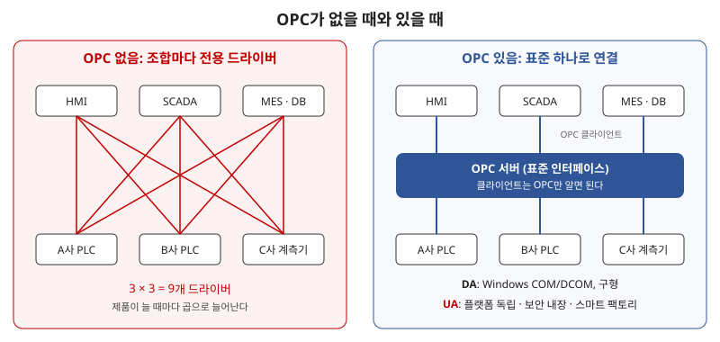

*소프트웨어 3개 × 장비 3개면 전용 드라이버가 9개지만, OPC를 쓰면 장비 쪽은 OPC 서버만, 소프트웨어 쪽은 OPC 클라이언트만 지원하면 된다. 제품이 늘어도 드라이버 수가 곱이 아니라 합으로만 늘어난다.*

- **OPC DA**: 윈도우 COM/DCOM 기반 실시간 데이터 교환 (구형).
- **OPC UA**: 플랫폼 독립, 보안(암호화·인증) 내장, 정보 모델 → 스마트 팩토리 표준.

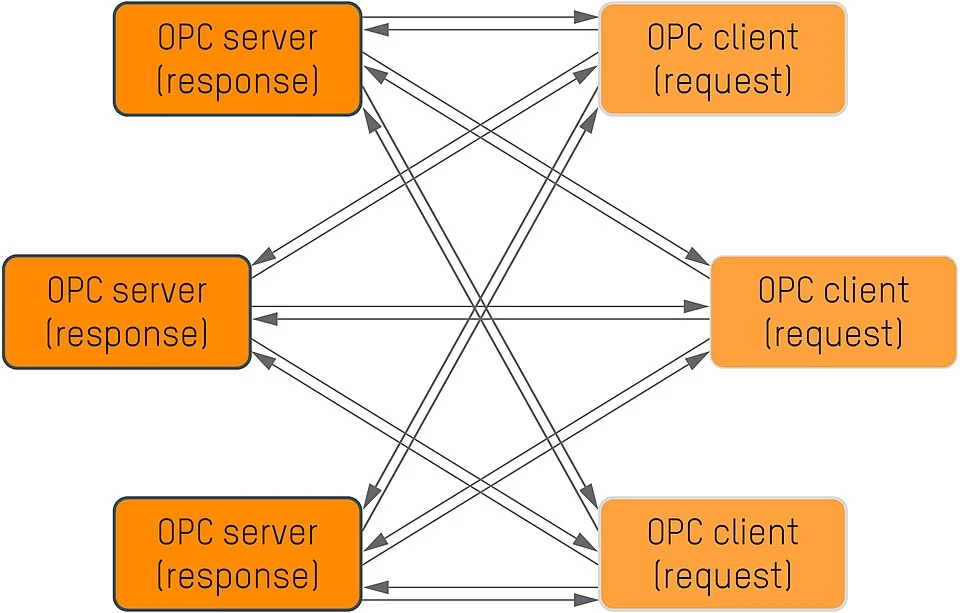

*OPC UA에서 클라이언트(요청)는 필요한 서버 어디에나 접속해 데이터를 요청하고, 서버(응답)는 여러 클라이언트에 동시에 답한다. DA는 윈도우 DCOM에 묶여 같은 윈도우 네트워크 안에서만 쓰기 쉬웠지만, UA는 운영체제와 무관하게 이런 다대다 연결을 보안(암호화·인증)을 갖춰 구성할 수 있다.*

## 11. 화면 설계 원칙

**직관**: 좋은 HMI 화면은 **평소에는 조용하고, 문제가 생기면 시끄럽다.** 정상인데도 색이 화려하면 정작 경보가 묻힌다.

- 정상은 차분한 색, **이상·경보는 빨강·노랑**처럼 눈에 띄게. 색만으로 구분하지 말고 글자·모양도 함께.
- 화면 계층: 개요(전체) → 공정별 → 상세 → 알람·트렌드.
- 위험한 조작에는 **확인 창**이나 2단계 조작.

> [!tip] 색만으로 구분하지 않는 이유
> 색각 이상이 있는 작업자도 있고, 현장 조명·화면 반사로 색이 달라 보이기도 한다. 그래서 경보 램프에는 "과열" 같은 글자나 깜박임, 아이콘 모양을 같이 쓴다.

## 그림

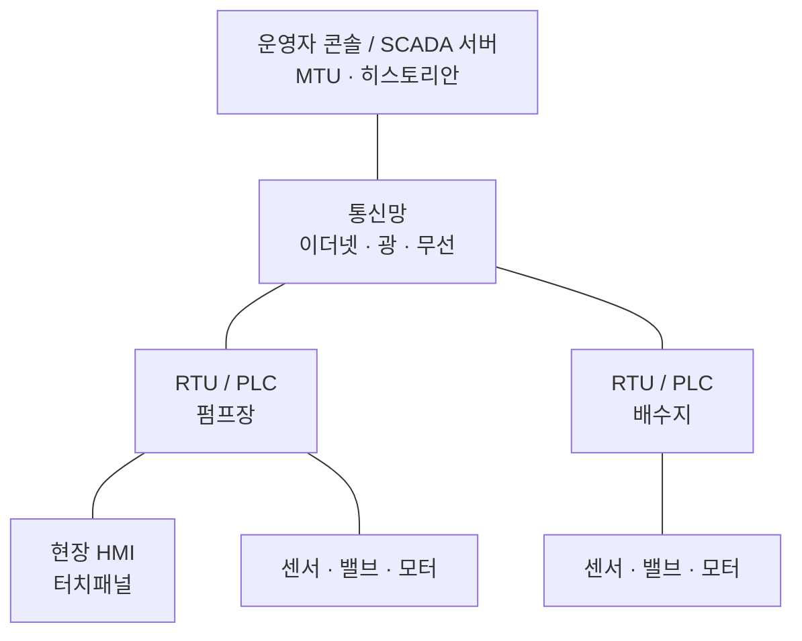

## 기출 포인트

옛 생산자동화산업기사 2016–2020년 14회분에는 HMI·SCADA 문제가 없었다 (0회). 새 출제기준에서 생긴 범위라 교재 예제로 대비한다.

**교재 예제 유형** (Win-Q 2025 PART 01 CHAPTER 02, 01~03절): HMI 설명 중 틀린 것(전문 프로그래머 필요), 기능 설계 순서, 원격 계측·감시·제어 시스템 용어(TTS), 그래픽 요소 설명 바꿔치기(램프 vs 설정값 버튼).

## 관련 단원

- [데이터 통신](데이터_통신.md)
- [PLC 구성과 특성](PLC_구성과_특성.md)
- [PLC 프로그래밍 언어와 명령어](PLC_프로그래밍_언어와_명령어.md) — 내부 릴레이 M과 인터록
- [PLC 시뮬레이션과 수정보완](PLC_시뮬레이션과_수정보완.md)

## 체크리스트

- [ ] HMI와 SCADA의 정의와 차이를 말한다
- [ ] 알람·트렌드·레시피 기능을 구분한다
- [ ] 터치 방식 4가지의 특징을 비교한다
- [ ] SCADA 구성 요소(MTU, RTU, 통신망)를 설명한다
- [ ] PLC·DCS·SCADA의 적용 분야를 구분한다
- [ ] 모멘터리·얼터네이트 스위치를 구분한다
- [ ] HMI 시스템 구성 3가지(STAND-ALONE, 분산, 이중화)를 구분한다
- [ ] HMI 기능 설계 순서를 말한다 (그래픽은 하드웨어 연결 뒤)
- [ ] 그래픽 요소 8가지의 쓰임을 구분한다
- [ ] SCADA 4대 기능을 말한다

## 참고

- [큐넷 자동화설비산업기사 출제기준](https://www.q-net.or.kr/crf005.do?id=crf00503&jmCd=2034)
- [OPC Foundation – OPC UA](https://opcfoundation.org/about/opc-technologies/opc-ua/)

### 그림 출처

위키미디어 공용(Wikimedia Commons)과 Openverse에서 가져온 공개 라이선스 자료이고, 노트에 맞게 크기를 줄이고 WebP로 변환했다.

| 그림 | 작성자 | 라이선스 | 출처 |
| --- | --- | --- | --- |
| [US Navy 110328-N-OJ170-009 Hideji Kawasaki operates the supervisory control and data acquisition (SCADA) system to balance an electrical load insid](https://commons.wikimedia.org/wiki/File:US_Navy_110328-N-OJ170-009_Hideji_Kawasaki_operates_the_supervisory_control_and_data_acquisition_(SCADA)_system_to_balance_an_electrical_load_insid.jpg) | U.S. Navy photo by Joe Schmitt | 퍼블릭 도메인 | Wikimedia Commons |
| [SIMATIC HMI](https://commons.wikimedia.org/wiki/File:SIMATIC_HMI.jpg) | ZianMan | [CC BY-SA 4.0](https://creativecommons.org/licenses/by-sa/4.0) | Wikimedia Commons |
| [Infrared touchscreen pcb](https://commons.wikimedia.org/wiki/File:Infrared_touchscreen_pcb.jpg) | Jrw01 | [CC BY 4.0](https://creativecommons.org/licenses/by/4.0) | Wikimedia Commons |
| [NEWater S.C.A.D.A. room](https://commons.wikimedia.org/wiki/File:NEWater_S.C.A.D.A._room.jpg) | Z22 | [CC BY-SA 4.0](https://creativecommons.org/licenses/by-sa/4.0) | Wikimedia Commons |
| [Remote Terminal Unit Modular](https://commons.wikimedia.org/wiki/File:Remote_Terminal_Unit_Modular.jpg) | FernaCM | [CC BY-SA 4.0](https://creativecommons.org/licenses/by-sa/4.0) | Wikimedia Commons |
| [FCN-RTU](https://commons.wikimedia.org/wiki/File:FCN-RTU.jpg) | Edver | [CC BY-SA 3.0](https://creativecommons.org/licenses/by-sa/3.0) | Wikimedia Commons |
| [OPC-UA-Server-Client](https://commons.wikimedia.org/wiki/File:OPC-UA-Server-Client.jpg) | Monkhiker | [CC BY-SA 4.0](https://creativecommons.org/licenses/by-sa/4.0) | Wikimedia Commons |

직접 그린 그림(SVG, 이 볼트용으로 새로 작성): HMI 시스템구성, HMI 화면요소, 모멘터리 얼터네이트, 터치패널 4방식, HMI 태그연결, PLC DCS SCADA 범위, OPC 개념.

