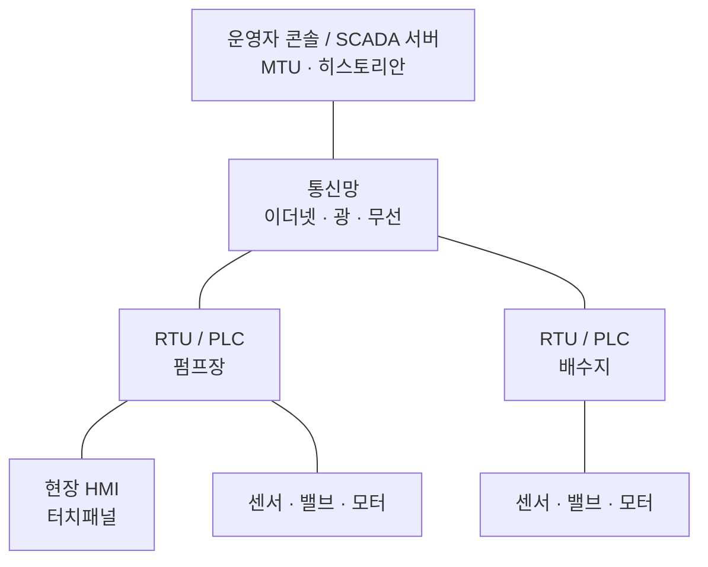

# HMI와 SCADA

> [!summary] 핵심 요약
> - **HMI**(Human Machine Interface): 사람이 설비 상태를 보고 조작하는 화면 장치. 현장에서는 터치패널.
> - **SCADA**(Supervisory Control And Data Acquisition): 넓은 지역의 설비를 중앙에서 **감시·제어하고 데이터를 수집**하는 시스템.
> - HMI 작화 흐름: 기종·통신 설정 → **태그(디바이스) 연결** → 화면·오브젝트 작성 → 알람·트렌드·레시피 → 시뮬레이션 → 다운로드.
> - 서로 다른 제조사 장비를 잇는 표준 인터페이스: **OPC (DA → UA)**.

> [!warning] 자주 틀리는 포인트
> - SCADA는 **감시(Supervisory)** 가 중심. 빠른 실시간 제어는 현장 PLC가 맡는다.
> - **DCS**는 한 공장 안 연속 공정(화학·발전)의 분산 제어, **SCADA**는 광역(상하수도·전력망·가스관) 감시에 강하다.
> - 스위치 오브젝트: **모멘터리**(누르는 동안만 ON), **얼터네이트**(누를 때마다 반전), 세트/리셋.
> - HMI 스위치로 직접 PLC 출력(P, Y)을 켜지 말고 **내부 릴레이(M)** 를 거쳐 프로그램에서 인터록 후 출력.
> - HMI는 **비전문가도** 쉽게 조작하게 만든 장치다. "전문 프로그래머가 있어야 운용한다"는 보기는 틀림 (교재 01절).
> - 그래픽 요소 바꿔치기 함정: "이미지로 출력 상태 확인"은 **램프**, 상수·증감 설정은 **설정값 버튼** (교재 03절).
> - 기능 설계는 **하드웨어 연결(통신 설정 → I/O 리스트 → 드라이버) 다음에 그래픽**을 만든다. 그래픽을 먼저 그리는 순서는 틀림.
> - 원거리 설비를 데이터 통신으로 계측·감시·제어하는 시스템 = 교재 용어로 **TTS**.

## 개념 정리

### MMI와 HMI (교재 01절)

- **MMI**: 작업자와 설비 사이의 접속을 쉽게 하자는 개념.
- **HMI**: 여기에 **사람 중심** 관점을 더해 사람과 기계의 소통을 돕는 시스템. 교재는 기계에 "인격을 부여한" 개념이라고 표현한다.
- HMI 소프트웨어 특징: 직관적 GUI, 개방형 구조, 현장 정보의 DB화·그래픽·트렌드·리포트, 네트워크·이중화 지원, COM/DCOM 표준.
- HMI가 연결하는 기계장비: **PLC**와 **계측장치**(과학·항해·공업·의료·전기계측·물리량 계측기).
- PC 기반이라 Windows 환경(멀티태스킹, ActiveX, OLE, OPC)을 쓰고, **PC 성능이 오르면 HMI 성능도 빠르게 오른다** (교재 02절).

### HMI 구성과 기능

| 기능 | 내용 |
| --- | --- |
| 화면 표시 | 램프, 수치 표시, 그래프, 애니메이션으로 설비 상태 표시 |
| 조작 | 스위치, 수치 입력(설정값 변경), 화면 전환 |
| 알람 | 이상 발생 시 메시지·이력, 확인(ACK) |
| 트렌드 | 아날로그 값의 시간 추이 그래프 |
| 레시피 | 제품별 설정값 묶음을 한 번에 PLC로 전송 |
| 데이터 로깅 | 생산량·이력 저장 (USB, SD) |
| 보안 | 사용자 레벨별 조작 권한, 비밀번호 |

### HMI 시스템 구성 (교재 02절)

| 구성 | 용도 | 특징 |
| --- | --- | --- |
| STAND-ALONE | 단위 공정, 소규모 자동화 | 한 대가 수집·저장·화면 기능을 모두 맡음 |
| 분산 (Client/Server) | 세부 공정을 나눠 감시 | 감시·제어, I/O, 파일 서버를 네트워크로 연결, 확장 쉬움 |
| 이중화 | 고신뢰 설비 | Line 이중화, 서버 이중화(주 서버 고장 시 대기 서버로 **자동 절체**) |

- 적용 분야: 공정 자동화(오폐수, 소각로), 공장 자동화(생산관제, 설비진단), 빌딩 자동화, 원격감시·제어(**TTS**).

### HMI 기능 설계 순서 (교재 02절)

1. 개발 방식 결정: 전용 HMI 소프트웨어 또는 VB·C/C++로 직접 개발.
2. 장비·드라이버 선택, **통신 방법 설정**.
3. 네트워크 설정, **I/O 리스트** 작성.
4. **드라이버와 DB** 구성.
5. **그래픽 화면** 생성.
6. 트렌드, 리포트, 알람 리스트 추가.

- 통신: 직렬(기본 RS-232C, 고성능은 RS-422/485 + 직렬통신보드) 또는 Ethernet(TCP/IP).
- Ethernet 드라이버 설치: IP 주소 할당 → TCP/IP 설치·환경 설정 → 통신 테스트.

### 그래픽 요소와 화면 (교재 03절)

HMI 화면은 터치로 입력하고 상태를 출력하는 장치라서 입력 변수와 출력 변수를 모두 다룬다.

| 요소 | 쓰임 |
| --- | --- |
| 일반 버튼 | ON/OFF (즉시·한시·지연 동작 설정) |
| 다중 버튼 | 작업 단계, 운전 모드(자동·반자동·수동) 선택 |
| 설정값 버튼 | 상수 입력, 증감 설정 |
| 램프 | 이미지로 출력 상태 확인 |
| 계기 | 숫자·다이얼 표시 |
| 트렌드 그래프 | 현재값, 최소·최대, 상·하한을 그래프로 |
| 데이터 표시계 | 숫자, 문자, 날짜, 시간 |
| 상태 표시 | 애니메이션으로 작동 상태 |

- 배치: **단일 페이지**(한눈에 모니터링) / **다중 페이지**(메인 + 서브, 디자인 통일 필요).
- 화면 종류: 공정 모니터링, 트렌드(시간에 따른 추세), 데이터 조회(생산량·불량 수 DB), IO 모니터링(입출력 ON/OFF), 수동 조작(구동 요소를 버튼으로), 환경설정(권한·통신·모델 변경).

### 터치 패널 방식

| 방식 | 특징 |
| --- | --- |
| 저항막 | 압력 감지, 장갑 끼고 사용 가능, 저렴, 산업용에 많음 |
| 정전용량 | 손가락 전하 감지, 멀티터치, 장갑 사용 제한 |
| 적외선 | 화면 가장자리 적외선 격자 차단 감지, 대형 화면 |
| 초음파(SAW) | 표면 탄성파, 투과율 좋음, 오염에 약함 |

### HMI–PLC 연결

- **직접 접속**: 시리얼(RS-232C/485) 또는 이더넷으로 PLC 메모리를 직접 읽고 씀.
- 통신 설정 항목: 통신 방식, 국번, 보율·데이터 비트·패리티·스톱 비트(시리얼), IP·포트(이더넷).
- **태그**: 화면 오브젝트와 PLC 디바이스 주소를 묶은 이름. 비트 태그(M, P), 워드 태그(D).
- 통신 이상 시 화면에 통신 에러 표시 → 케이블, 국번, 설정 불일치 확인.

### SCADA 구성

| 요소 | 역할 |
| --- | --- |
| HMI / 운영자 콘솔 | 중앙 감시 화면 |
| MTU (Master Terminal Unit) | 중앙 서버, 데이터 수집·명령 송신 |
| RTU (Remote Terminal Unit) | 원격 현장 단말, 신호 수집·제어 |
| PLC | 현장 제어 (RTU 역할도 함) |
| 통신망 | 유선·무선·광, 원거리 전송 |
| 히스토리안 DB | 장기 데이터 저장·보고서 |

- 교재(01절) 정의: SCADA = **집중원격감시제어시스템**. 원격 장치(RTU)의 상태를 모아 기록·표시하고 중앙에서 감시·제어한다. 발전·송배전, 석유화학, 제철처럼 흩어진 시설에 쓴다.
- **SCADA 4대 기능** (ANSI/IEEE 권고): 경보, 감시제어(수동·자동·복합), 지시·표시, 디지털 펄스 합산 표시.

### PLC · DCS · SCADA 비교

| 항목 | PLC | DCS | SCADA |
| --- | --- | --- | --- |
| 범위 | 기계·라인 | 공장 단위 연속 공정 | 광역 분산 설비 |
| 강점 | 고속 시퀀스 제어 | 루프 제어, 이중화 | 원격 감시·데이터 수집 |
| 예 | 조립 라인 | 정유, 발전소 | 상하수도, 전력 계통, 가스관 |

### OPC

- **OPC DA**: 윈도우 COM/DCOM 기반 실시간 데이터 교환 (구형).
- **OPC UA**: 플랫폼 독립, 보안(암호화·인증) 내장, 정보 모델 → 스마트 팩토리 표준.

### 화면 설계 원칙

- 정상은 차분한 색, **이상·경보는 빨강·노랑**처럼 눈에 띄게. 색만으로 구분하지 말고 글자·모양도 함께.
- 화면 계층: 개요(전체) → 공정별 → 상세 → 알람·트렌드.
- 위험한 조작에는 **확인 창**이나 2단계 조작.

## 그림

## 기출 포인트

옛 생산자동화산업기사 2016–2020년 14회분에는 HMI·SCADA 문제가 없었다 (0회). 새 출제기준에서 생긴 범위라 교재 예제로 대비한다.

**교재 예제 유형** (Win-Q 2025 PART 01 CHAPTER 02, 01~03절): HMI 설명 중 틀린 것(전문 프로그래머 필요), 기능 설계 순서, 원격 계측·감시·제어 시스템 용어(TTS), 그래픽 요소 설명 바꿔치기(램프 vs 설정값 버튼).

## 관련 단원

- [데이터 통신](데이터_통신.md)
- [PLC 구성과 특성](PLC_구성과_특성.md)

## 체크리스트

- [ ] HMI와 SCADA의 정의와 차이를 말한다
- [ ] 알람·트렌드·레시피 기능을 구분한다
- [ ] 터치 방식 4가지의 특징을 비교한다
- [ ] SCADA 구성 요소(MTU, RTU, 통신망)를 설명한다
- [ ] PLC·DCS·SCADA의 적용 분야를 구분한다
- [ ] 모멘터리·얼터네이트 스위치를 구분한다
- [ ] HMI 시스템 구성 3가지(STAND-ALONE, 분산, 이중화)를 구분한다
- [ ] HMI 기능 설계 순서를 말한다 (그래픽은 하드웨어 연결 뒤)
- [ ] 그래픽 요소 8가지의 쓰임을 구분한다
- [ ] SCADA 4대 기능을 말한다

## 참고

- [큐넷 자동화설비산업기사 출제기준](https://www.q-net.or.kr/crf005.do?id=crf00503&jmCd=2034)
- [OPC Foundation – OPC UA](https://opcfoundation.org/about/opc-technologies/opc-ua/)
