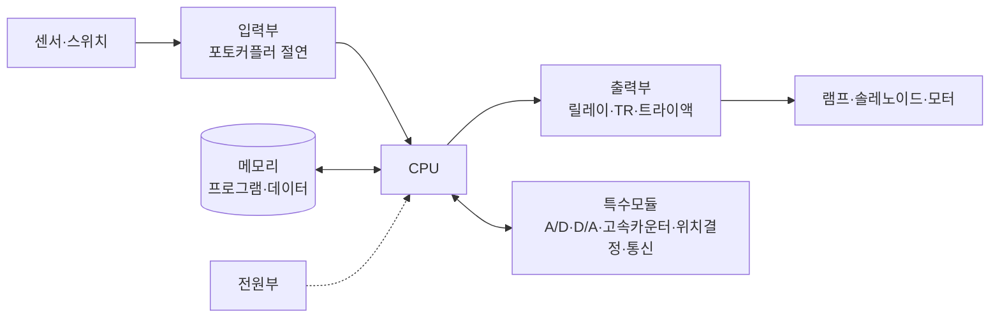

# PLC 구성과 특성

> [!summary] 핵심 요약
> - PLC = CPU + 메모리 + 입력부 + 출력부 + 전원부. 프로그래밍 장치와 특수모듈은 여기에 덧붙는다.
> - 동작은 **스캔 방식**: 입력 리프레시 → 프로그램 실행(위→아래, 왼→오른) → 출력 리프레시 → 자기진단·통신을 계속 반복한다.
> - 출력 형식은 **릴레이(AC/DC, 느림)**, **트랜지스터(DC 전용, 고속)**, **트라이액/SSR(AC 전용, 고속)** 세 가지.
> - 릴레이 시퀀스와 달리 배선을 바꾸지 않고 **프로그램만 바꿔** 동작을 바꿀 수 있다.

> [!warning] 자주 틀리는 포인트
> - 트랜지스터 출력은 **AC 부하를 직접 구동할 수 없다**. AC 고속 개폐는 트라이액(SSR).
> - 입력이 바뀌어도 출력은 **해당 스캔이 끝나야** 반영된다. 스캔 타임보다 짧은 펄스는 놓칠 수 있다 → 고속카운터·인터럽트 입력 사용.
> - 워치독 타이머(WDT)는 스캔 타임이 설정값을 넘으면 CPU를 정지시키는 **감시 기능**이지, 사용자 타이머가 아니다.
> - IEC 61131-3 언어 5종: LD, FBD, IL, ST, SFC. 이 중 **그래픽 언어는 LD·FBD·SFC**, 텍스트 언어는 IL·ST.

## 개념 정리

### 하드웨어 구성

| 구성 요소 | 역할 | 시험 포인트 |
| --- | --- | --- |
| CPU | 프로그램 해석·연산, 입출력 제어 | 스캔 동작, 자기진단 |
| 메모리 | 프로그램 영역(사용자 프로그램), 데이터 영역(디바이스 값) | 시스템 프로그램은 ROM, 사용자 프로그램·데이터는 RAM(+배터리 백업) 또는 플래시 |
| 입력부 | 스위치·센서 신호를 CPU 레벨로 변환 | 포토커플러로 **절연**, 노이즈 차단 |
| 출력부 | CPU 결과로 램프·릴레이·솔레노이드 구동 | 릴레이 / 트랜지스터 / 트라이액 |
| 전원부 | AC 입력 → 내부 DC(5V, 24V) 공급 | |
| 주변기기 | 프로그램 작성·모니터링 (PC 툴, 로더) | |

### 입력부: 싱크와 소스

- **NPN 센서**: 출력이 신호선을 0V 쪽으로 끌어내림 → PLC 입력 **COM에 +24V**. 전류는 PLC 입력 단자에서 **센서 쪽으로 흘러 나간다**.
- **PNP 센서**: 출력이 신호선에 +24V를 내보냄 → PLC 입력 **COM에 0V**. 전류는 센서에서 PLC 입력 단자로 **흘러 들어온다**.
- 이름은 제조사마다 기준이 다르다. 미쓰비시는 NPN용을 **싱크 입력**, PNP용을 **소스 입력**이라 부른다. 시험에서는 COM 극성과 전류 방향으로 판단하는 것이 안전하다.
- 센서 출력 형식과 COM 극성이 맞지 않으면 신호가 안 들어온다.

### 출력부 형식 비교

| 형식 | 부하 전원 | 응답 속도 | 수명 | 용도 |
| --- | --- | --- | --- | --- |
| 릴레이 | AC·DC 모두 | 느림 (ms 단위) | 접점 마모로 짧음 | 범용, 전압 혼용 |
| 트랜지스터 | DC만 | 빠름 | 김 | 펄스 출력, 서보·스테핑 위치제어 |
| 트라이액(SSR) | AC만 | 빠름 | 김 | 히터 등 잦은 AC 개폐 |

### 스캔 동작과 스캔 타임

- **스캔 타임** = 입력 리프레시 + 프로그램 연산 + 출력 리프레시 + 기타 처리에 걸리는 1회 시간.
- 프로그램이 길수록, 명령이 복잡할수록 스캔 타임이 늘어난다.
- 입력 리프레시 방식(일괄 처리) 때문에 프로그램 실행 중에는 입력 이미지가 고정된다 → 같은 스캔 안에서 결과가 일관된다.
- 운전 모드: **RUN**(실행), **STOP**(정지, 프로그램 쓰기), **PAUSE**(출력 유지한 채 일시정지), **REMOTE**(통신으로 모드 전환).

### 릴레이 시퀀스 vs PLC

| 항목 | 릴레이 시퀀스 | PLC |
| --- | --- | --- |
| 제어 변경 | 배선 변경 | 프로그램 변경 |
| 접점 수 | 릴레이당 제한 | 내부 접점은 사실상 무제한 |
| 처리 방식 | 병렬 동시 동작 | 직렬 순차 스캔 |
| 크기·보수 | 크고 접점 마모 | 소형, 자기진단 |
| 기능 | ON/OFF 중심 | 연산·타이머·카운터·통신 |

### 주요 디바이스 (제조사마다 이름이 다르다)

| 기능 | LS XGT | 미쓰비시 |
| --- | --- | --- |
| 입출력 | P | X(입력), Y(출력) |
| 내부 보조 릴레이 | M | M |
| 정전 유지 릴레이 | K | L(래치) |
| 타이머 / 카운터 | T / C | T / C |
| 데이터 레지스터 | D | D |
| 특수 릴레이(플래그) | F | SM(M8000대) |

### 특수모듈 (이 과목 주요항목의 핵심)

- **A/D 변환 모듈**: 아날로그 입력(4~20 mA, 0~10 V)을 디지털 값으로. 분해능(비트 수)이 클수록 정밀.
- **D/A 변환 모듈**: 디지털 값을 아날로그 출력으로. 인버터 속도 지령 등.
- **고속카운터 모듈**: 엔코더 펄스처럼 스캔보다 빠른 펄스를 셈.
- **위치결정 모듈**: 펄스 열 출력으로 서보·스테핑 모터 위치·속도 제어.
- **통신 모듈**: RS-232C/485, Ethernet, 필드버스(→ 데이터 통신 단원).
- **온도 제어(측온 저항체·열전대) 모듈**: PID 제어 포함.

## 그림

## 관련 단원

- [논리회로](논리회로.md)
- [출제기준 요약](../01_시험안내/출제기준_2027-2030.md)

## 체크리스트

- [ ] PLC 5대 구성 요소와 역할을 말할 수 있다
- [ ] 스캔 순서 4단계를 순서대로 쓸 수 있다
- [ ] 출력 형식 3종의 부하 전원·속도 차이를 구분한다
- [ ] NPN/PNP 센서에 맞는 COM 극성(+24V / 0V)을 고를 수 있다
- [ ] IEC 61131-3 언어 5종을 그래픽/텍스트로 나눌 수 있다
- [ ] 특수모듈 종류와 용도를 연결할 수 있다

## 참고

- [큐넷 자동화설비산업기사 출제기준](https://www.q-net.or.kr/crf005.do?id=crf00503&jmCd=2034)
- IEC 61131-3 (PLC 프로그래밍 언어 국제 표준)
