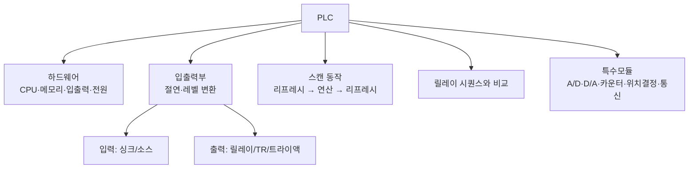
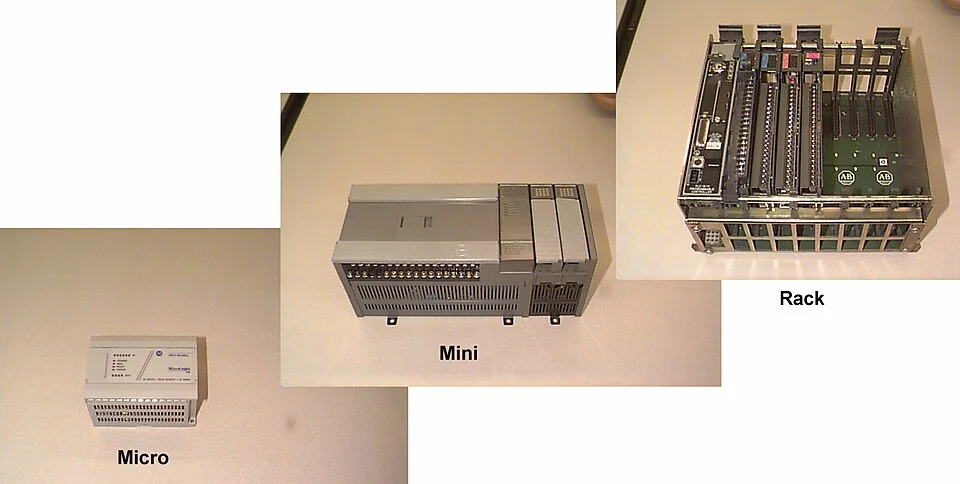
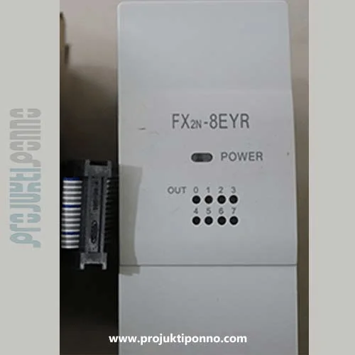
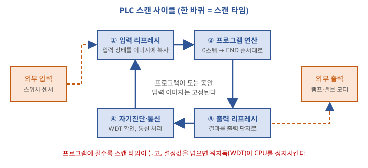
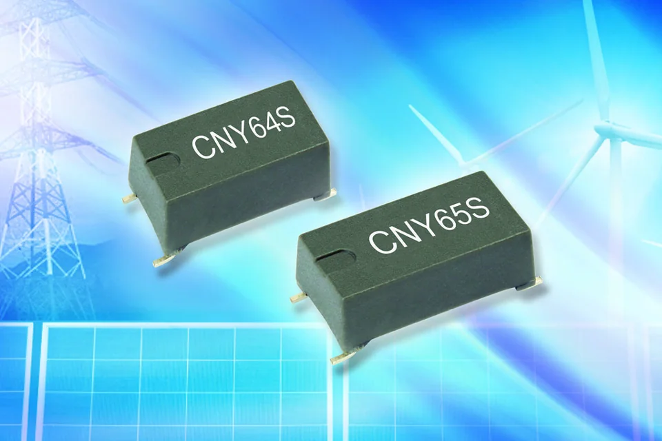
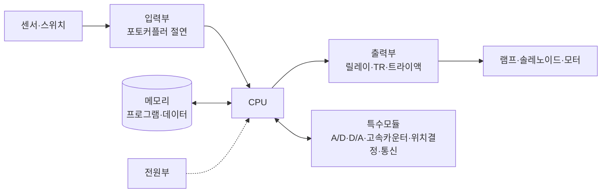

# PLC 구성과 특성

> [!summary] 핵심 요약
> - PLC = CPU + 메모리 + 입력부 + 출력부 + 전원부. 프로그래밍 장치와 특수모듈은 여기에 덧붙는다.
> - 동작은 **스캔 방식**: 입력 리프레시 → 프로그램 실행(위→아래, 왼→오른) → 출력 리프레시 → 자기진단·통신을 계속 반복한다.
> - 출력 형식은 **릴레이(AC/DC, 느림)**, **트랜지스터(DC 전용, 고속)**, **트라이액/SSR(AC 전용, 고속)** 세 가지.
> - 릴레이 시퀀스와 달리 배선을 바꾸지 않고 **프로그램만 바꿔** 동작을 바꿀 수 있다.

> [!warning] 자주 틀리는 포인트
> - 트랜지스터 출력은 **AC 부하를 직접 구동할 수 없다**. AC 고속 개폐는 트라이액(SSR).
> - 입력이 바뀌어도 출력은 **해당 스캔이 끝나야** 반영된다. 스캔 타임보다 짧은 펄스는 놓칠 수 있다 → 고속카운터·인터럽트 입력 사용.
> - 워치독 타이머(WDT)는 스캔 타임이 설정값을 넘으면 CPU를 정지시키는 **감시 기능**이지, 사용자 타이머가 아니다.
> - IEC 61131-3 언어 5종: LD, FBD, IL, ST, SFC. 이 중 **그래픽 언어는 LD·FBD·SFC**, 텍스트 언어는 IL·ST.
> - PLC 본체 구성은 **CPU·메모리·입출력부·전원부**. **조작부**(제어 이론 용어)나 **프로그램 로더**(주변기기)는 본체 구성이 아니다. CPU부는 연산부 + 프로그램 메모리 + 데이터 메모리이며 "래더 다이어그램부" 같은 것은 없다.
> - **입력 기기**: 푸시버튼, 토글·캠 스위치, 리밋 스위치, 근접·광전 센서, 엔코더. **출력 기기**: 램프, 솔레노이드 밸브, 전자 클러치, 부저, 전자접촉기 코일. 전자 밸브는 출력, 리밋 스위치는 입력이다.
> - 포텐쇼미터처럼 **아날로그 신호**를 내는 기기는 디지털 입력(DIO)에 직접 못 붙인다 → A/D 모듈.
> - 릴레이 출력은 **AC 220 V 부하도 구동**한다. "PLC 출력에 AC 부하를 연결할 수 없다"는 틀린 말. AC 입력 모듈을 쓰면 AC 스위치도 입력할 수 있다.
> - PLC 장점에 **프로그램 호환성이 높다**는 없다. 제조사마다 명령어·디바이스가 달라 호환성이 낮다.
> - **스캔 타임** = PLC가 사용자 프로그램을 **1회 연산(처음 → END)하는 시간**. 입력 신호 1개 처리 시간이 아니다.
> - PLC는 릴레이보다 **수정·변경이 쉽다**. "어렵다"는 틀린 보기 (교재 22-2). 범용 PLC 기능에 **영상 처리**는 없다.
> - PLC **자기진단**은 CPU·메모리·모듈 같은 내부 이상을 찾는다. 외부 기기 쪽 **입출력 접점 이상**은 자기진단으로 찾지 못한다.
> - PLC 회로 표현 방식은 **래더, 명령어(니모닉), 논리 기호, 불 대수** 4가지. **플로차트**는 회로도 방식이 아니다.

## 학습 목표

이 단원을 마치면 다음을 할 수 있어야 한다.

1. PLC 본체의 구성(CPU·메모리·입력부·출력부·전원부)과 주변기기(로더)를 구분한다.
2. 메모리 4종(사용자 프로그램·데이터·시스템·레지스터)과 RAM/ROM 계열의 특성을 연결한다.
3. NPN/PNP 센서에 맞는 입력 COM 극성(+24 V / 0 V)을 고른다.
4. 릴레이·트랜지스터·트라이액 출력의 부하 전원·속도·수명 차이를 비교해 용도를 정한다.
5. 스캔 사이클 4단계를 순서대로 말하고 스캔 타임을 정의한다.
6. 릴레이 시퀀스와 PLC를 제어 변경·처리 방식·확장성으로 비교한다.

## 한눈에 보기

## 개념 정리

### 하드웨어 구성

**비유**: PLC는 **작은 컴퓨터 + 튼튼한 단자대**다. 사람의 몸에 비유하면 CPU는 뇌, 메모리는 기억, 입력부는 감각기관, 출력부는 손발, 전원부는 심장이다.

*왼쪽 아래 Micro는 CPU·입출력·전원이 한 덩어리인 일체형이고, 오른쪽 Rack은 빈 슬롯에 CPU·입출력·특수모듈을 골라 꽂는 모듈형이다. 입출력 점수와 확장 필요에 따라 고른다.*

| 구성 요소 | 역할 | 시험 포인트 |
| --- | --- | --- |
| CPU | 프로그램 해석·연산, 입출력 제어 | 스캔 동작, 자기진단 |
| 메모리 | 프로그램 영역(사용자 프로그램), 데이터 영역(디바이스 값) | 시스템 프로그램은 ROM, 사용자 프로그램·데이터는 RAM(+배터리 백업) 또는 플래시 |
| 입력부 | 스위치·센서 신호를 CPU 레벨로 변환 | 포토커플러로 **절연**, 노이즈 차단 |
| 출력부 | CPU 결과로 램프·릴레이·솔레노이드 구동 | 릴레이 / 트랜지스터 / 트라이액 |
| 전원부 | AC 입력 → 내부 DC(5V, 24V) 공급 | |
| 주변기기 | 프로그램 작성·모니터링 (PC 툴, 로더) | |

- 교재(23절)의 기능 구분: PLC = **입력 장치 + 논리 연산 장치 + 제어 장치 + 출력 장치**. CPU는 **연산부(ALU) + 레지스터부**로 된 중추 장치다.
- **프로그램 로더**: 프로그램 입력·모니터링·편집. **전원 안정화는 로더 기능이 아니다**.
- **프로그램 카운터**: 다음에 실행할 명령의 **주소**를 가진다. 내용을 어드레스 버퍼로 보낸 직후 1 증가.

**메모리 4종 (교재)**

| 메모리 | 내용 | 소자 |
| --- | --- | --- |
| 사용자 프로그램 메모리 | 제어 내용 저장, **변경 가능** | RAM |
| 데이터 메모리 | 입출력·내부 릴레이·타이머 값 | RAM |
| 시스템 메모리 | 제작사가 넣은 운영 프로그램 | ROM |
| 레지스터 메모리 | 지금 계산 중인 값 | – |

- ROM 계열: PROM(한 번 쓰기), **EPROM(자외선으로 소거 가능)**, EEPROM(전기로 소거). "EPROM은 지울 수 없다"는 틀린 보기.

**PLC 제어 시스템 형태**

| 형태 | 구성 | 특징 |
| --- | --- | --- |
| 단독 | 기계 1대 : PLC 1대 | 릴레이반 대체 수준 |
| 집중 | PLC 1대가 여러 대상 | PLC가 멈추면 **전체가 멈춤** |
| 분산 | 대상마다 PLC, 서로 신호 주고받음 | 한 대가 고장 나도 전체는 유지 |
| 계층 | 상위 컴퓨터 + PLC | 생산 정보 종합 관리 |

### 입력부: 싱크와 소스

**비유**: 수도관에 물이 **들어가는 쪽**과 **나오는 쪽**의 차이다. 같은 24 V 회로라도 전류가 센서에서 PLC 쪽으로 오느냐(소스·PNP), PLC에서 센서 쪽으로 가느냐(싱크·NPN)에 따라 COM에 붙일 극성이 반대가 된다.

> [!question] 시험에서는
> "센서가 NPN이면 COM = +24 V, PNP면 COM = 0 V". 전류가 **입력 단자로 들어오면** 소스(PNP), **나가면** 싱크(NPN)로 판단하면 제조사 용어에 흔들리지 않는다.

- **NPN 센서**: 출력이 신호선을 0V 쪽으로 끌어내림 → PLC 입력 **COM에 +24V**. 전류는 PLC 입력 단자에서 **센서 쪽으로 흘러 나간다**.
- **PNP 센서**: 출력이 신호선에 +24V를 내보냄 → PLC 입력 **COM에 0V**. 전류는 센서에서 PLC 입력 단자로 **흘러 들어온다**.
- 이름은 제조사마다 기준이 다르다. 미쓰비시는 NPN용을 **싱크 입력**, PNP용을 **소스 입력**이라 부른다. 시험에서는 COM 극성과 전류 방향으로 판단하는 것이 안전하다.
- 센서 출력 형식과 COM 극성이 맞지 않으면 신호가 안 들어온다.

### 출력부 형식 비교

*릴레이 출력 모듈의 실물. 단자(OUT 0~7)마다 LED가 있어 출력 상태를 눈으로 확인할 수 있다. 릴레이는 AC·DC 모두 되지만 느리고 접점이 닳는다.*

| 형식 | 부하 전원 | 응답 속도 | 수명 | 용도 |
| --- | --- | --- | --- | --- |
| 릴레이 | AC·DC 모두 | 느림 (ms 단위) | 접점 마모로 짧음 | 범용, 전압 혼용 |
| 트랜지스터 | DC만 | 빠름 | 김 | 펄스 출력, 서보·스테핑 위치제어 |
| 트라이액(SSR) | AC만 | 빠름 | 김 | 히터 등 잦은 AC 개폐 |

### 스캔 동작과 스캔 타임

**비유**: 경비원이 순찰을 도는 것과 같다. 정해진 코스(입력 확인 → 프로그램 실행 → 출력 내보내기 → 점검)를 끝없이 돈다. **한 바퀴 도는 시간이 스캔 타임**이다.

*입력 이미지는 ①에서 한 번 복사한 값을 ②에서 계속 쓰므로, 한 스캔 안에서 같은 입력은 항상 같은 값이다. 출력도 ③에서 한꺼번에 내보낸다.*

- **스캔 타임** = 입력 리프레시 + 프로그램 연산 + 출력 리프레시 + 기타 처리에 걸리는 1회 시간.
- 프로그램이 길수록, 명령이 복잡할수록 스캔 타임이 늘어난다.
- 입력 리프레시 방식(일괄 처리) 때문에 프로그램 실행 중에는 입력 이미지가 고정된다 → 같은 스캔 안에서 결과가 일관된다.
- 운전 모드: **RUN**(실행), **STOP**(정지, 프로그램 쓰기), **PAUSE**(출력 유지한 채 일시정지), **REMOTE**(통신으로 모드 전환).

### 릴레이 시퀀스 vs PLC

**직관**: 릴레이반은 **전선으로 만든 프로그램**이라 바꾸려면 배선을 뜯어야 한다. PLC는 **프로그램으로 만든 배선**이라 소프트웨어만 고치면 된다. 그래서 변경·확장·보수가 쉽다.

| 항목 | 릴레이 시퀀스 | PLC |
| --- | --- | --- |
| 제어 변경 | 배선 변경 | 프로그램 변경 |
| 접점 수 | 릴레이당 제한 | 내부 접점은 사실상 무제한 |
| 처리 방식 | 병렬 동시 동작 | 직렬 순차 스캔 |
| 크기·보수 | 크고 접점 마모 | 소형, 자기진단 |
| 기능 | ON/OFF 중심 | 연산·타이머·카운터·통신 |
| 제어 방식 | 하드 로직(배선 논리) | 소프트 로직(프로그램 논리) |
| 확장 | 배선을 다시 해야 함 | 모듈 추가로 쉬움 |

- PLC 정의(교재 22절): 반도체 IC를 써서 **프로그램으로 논리 회로를 만드는 무접점 제어 장치**. 릴레이 제어는 유접점 제어의 대표.
- 교재가 꼽는 PLC 특징: 확장·유지보수 쉬움, 산술·논리 연산, 외부 통신, 배선 간소, 높은 신뢰성, **비밀 유지 쉬움**, 제어 내용 변경 간단.
- 국내에서 많이 쓰는 PLC: LS XG 시리즈, 미쓰비시 MELSEC, 지멘스, 오므론.

### 입출력부의 역할

*입력부의 절연 소자. 발광 다이오드(입력 쪽)와 포토트랜지스터(CPU 쪽)가 **빛으로만** 신호를 주고받아, 외부 24 V·노이즈가 CPU 회로에 전기적으로 들어오지 못한다.*

- **신호 레벨 변환**: 외부 24 V·220 V 신호 ↔ 내부 5 V 논리.
- **절연**: 포토커플러로 외부 회로와 내부 회로를 전기적으로 분리.
- **노이즈 차단**: 입력 필터, 절연으로 노이즈가 CPU에 들어가지 않게.
- **상태 표시**: 입출력 LED로 각 접점 상태를 감시.
- 외부 기기와 전기 규격(전압·전류·형식)이 맞아야 한다. 아날로그 기기는 특수모듈로 연결한다 (디지털 기기만 쓸 수 있는 것은 아님).
- 교재가 꼽는 입출력부 요구 조건 3가지: **전기 규격 일치, 노이즈가 CPU로 전달되지 않을 것, 연결이 쉬울 것**. "디지털 기기만 사용 가능"은 요구 조건이 아니다.
- "기억 선택"은 입출력부 역할이 아니다 (메모리 쪽 일).

### 주요 디바이스 (제조사마다 이름이 다르다)

| 기능 | LS XGT | 미쓰비시 |
| --- | --- | --- |
| 입출력 | P | X(입력), Y(출력) |
| 내부 보조 릴레이 | M | M |
| 정전 유지 릴레이 | K | L(래치) |
| 타이머 / 카운터 | T / C | T / C |
| 데이터 레지스터 | D | D |
| 특수 릴레이(플래그) | F | SM(M8000대) |

### 특수모듈 (이 과목 주요항목의 핵심)

**직관**: 기본 입출력은 켜짐/꺼짐(1비트)만 다룬다. 온도·전압처럼 **연속된 값**이나 스캔보다 빠른 펄스는 전용 모듈이 대신 받아서 숫자로 바꿔 주거나 대신 내보낸다. 자세한 프로그래밍은 [특수모듈 프로그래밍](특수모듈_프로그래밍.md)에서 다룬다.

- **A/D 변환 모듈**: 아날로그 입력(4~20 mA, 0~10 V)을 디지털 값으로. 분해능(비트 수)이 클수록 정밀.
- **D/A 변환 모듈**: 디지털 값을 아날로그 출력으로. 인버터 속도 지령 등.
- **고속카운터 모듈**: 엔코더 펄스처럼 스캔보다 빠른 펄스를 셈.
- **위치결정 모듈**: 펄스 열 출력으로 서보·스테핑 모터 위치·속도 제어.
- **통신 모듈**: RS-232C/485, Ethernet, 필드버스(→ 데이터 통신 단원).
- **온도 제어(측온 저항체·열전대) 모듈**: PID 제어 포함.

## 그림

## 기출 포인트

출처: 생산자동화산업기사 2016–2020년 필기 14회분 (cbtbank.kr).

- PLC 입력 기기와 출력 기기 구분 (리밋·푸시버튼·엔코더는 입력, 램프·솔레노이드는 출력, 아날로그 기기는 DIO 불가) — 6회 (2016-1, 2016-2, 2018-1, 2018-2, 2019-1, 2020-3)
- 입출력부의 역할·요구사항 (포토커플러 절연, 노이즈 차단, 레벨 변환, AC 부하 가능 여부) — 4회 (2017-2, 2018-1, 2018-3, 2020-3)
- PLC 구성 요소 / CPU부 구성 (조작부·로더·래더부는 아님) — 4회 (2016-1, 2017-3, 2019-1, 2020-3)
- PLC의 장점·특징 (릴레이 대비, 소프트 로직, 호환성 함정, 전자식 제어의 노이즈 약점) — 3회 (2018-1, 2019-1, 2019-3)
- 스캔 타임 정의 — 2회 (2017-3, 2019-3)

**교재 예제 유형** (23절): 변경 가능한 메모리(프로그램 메모리), EPROM 소거 불가(틀림), 로더 기능이 아닌 것(전원 안정화), 연산부 + 레지스터부(CPU), 프로그램 카운터 역할, 입출력 요구 조건이 아닌 것(디지털 기기만).

**교재 예제 유형** (Win-Q 2025 PART 01 CHAPTER 01, 22절): 범용 PLC 기능이 아닌 것(영상 처리), PLC 특징이 아닌 것(수정·변경이 어렵다), 모선 시작 명령(LD), 회로도 방식이 아닌 것(플로차트), 자기진단으로 못 찾는 이상(입출력 접점).

## 관련 단원

- [논리회로](논리회로.md)
- [PLC 프로그래밍 언어와 명령어](PLC_프로그래밍_언어와_명령어.md)
- [출제기준 요약](../01_시험안내/출제기준_2027-2030.md)

## 체크리스트

- [ ] PLC 5대 구성 요소와 역할을 말할 수 있다
- [ ] 스캔 순서 4단계를 순서대로 쓸 수 있다
- [ ] 출력 형식 3종의 부하 전원·속도 차이를 구분한다
- [ ] NPN/PNP 센서에 맞는 COM 극성(+24V / 0V)을 고를 수 있다
- [ ] IEC 61131-3 언어 5종을 그래픽/텍스트로 나눌 수 있다
- [ ] 특수모듈 종류와 용도를 연결할 수 있다
- [ ] 보기 속 기기를 PLC 입력 / 출력 / 해당 없음으로 분류한다
- [ ] 입출력부의 역할 4가지(레벨 변환·절연·노이즈 차단·상태 표시)를 말한다
- [ ] PLC 장점 보기 중 "프로그램 호환성"이 함정임을 안다
- [ ] 스캔 타임을 정확히 정의한다

## 참고

- [큐넷 자동화설비산업기사 출제기준](https://www.q-net.or.kr/crf005.do?id=crf00503&jmCd=2034)
- IEC 61131-3 (PLC 프로그래밍 언어 국제 표준)

### 그림 출처

위키미디어 공용(Wikimedia Commons)과 Openverse에서 가져온 공개 라이선스 자료이고, 노트에 맞게 크기를 줄이고 WebP로 변환했다.

| 그림 | 작성자 | 라이선스 | 출처 |
| --- | --- | --- | --- |
| [Programmable logic controller](https://commons.wikimedia.org/wiki/File:Programmable_logic_controller.jpg) |  | [CC BY-SA 3.0](http://creativecommons.org/licenses/by-sa/3.0/) | Wikimedia Commons |
| [PLC Digital Input Output Module](https://commons.wikimedia.org/w/index.php?curid=85230985) | Raihan | [CC BY-SA 4.0](https://creativecommons.org/licenses/by-sa/4.0/) | Openverse (wikimedia) |
| [New CNY64ST and CNY65ST Series High Voltage Isolation Optocouplers](https://www.flickr.com/photos/43093990@N05/6263689593) | Vishay Intertechnology | [CC BY 2.0](https://creativecommons.org/licenses/by/2.0/) | Openverse (flickr) |

직접 그린 그림(SVG, 이 볼트용으로 새로 작성): PLC 스캔.

