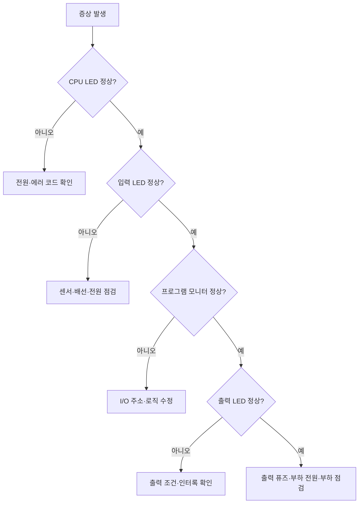

# PLC 시뮬레이션과 수정보완

> [!summary] 핵심 요약
> - 실제 설비에 넣기 전에 **시뮬레이터**로 가상 입력을 주고 출력·타이밍을 확인한다.
> - 현장에서는 **모니터링**(접점·데이터 상태 보기), **강제 입출력(Force)**, **온라인 편집**(RUN 중 수정)으로 디버깅한다.
> - 고장 진단은 PLC 상태 LED·에러 코드 → 입력 → 프로그램 → 출력 순으로 좁혀 간다.
> - 유도성 부하 노이즈 대책: DC는 **플라이휠 다이오드**, AC는 **CR 서지 킬러·바리스터**.

> [!warning] 자주 틀리는 포인트
> - 강제 출력은 설비를 실제로 움직인다. **안전 확인 후** 사용하고 끝나면 반드시 해제.
> - 온라인 편집은 다음 스캔부터 반영되므로 출력이 갑자기 바뀔 수 있다.
> - 입력 LED는 켜지는데 프로그램에서 접점이 안 바뀐다 → **I/O 할당·주소 오류** 의심. 입력 LED도 안 켜진다 → **배선·센서·전원** 의심.
> - 출력 LED는 켜지는데 부하가 안 움직인다 → **출력 접점·퓨즈·부하 전원** 의심.
> - 접지는 다른 기기와 공용하지 않는 **전용 접지**로. 동력선과 신호선은 **분리 배선**.
> - 입력 신호선을 **동력선과 같은 덕트**에 넣는 것은 틀린 시공이다. 접지선은 **굵고 짧게**, "PLC 내부에 접지가 있어 외부 접지 불필요"도 틀린 말.
> - CPU **자기진단**으로 메모리·버스·링크·WDT 이상은 잡지만, 외부 **입출력 접점(배선·센서) 자체의 이상은 발견하지 못한다**.
> - 용어 구분: **로딩** = 주변기기에서 PLC 메모리로 프로그램을 써 넣기, **디버깅** = 오류를 찾고 연산 과정을 추적하기.

## 개념 정리

### 시뮬레이션

- 프로그래밍 툴의 시뮬레이터(예: LS XG5000의 XG-SIM, 미쓰비시 GX Simulator)로 PLC 없이 동작 확인.
- 확인 항목: 동작 순서, 인터록, 타이머·카운터 시간, 비상 정지 시 동작, 경계값.
- **타이밍 차트**로 입력 변화에 따른 출력 변화를 비교한다.
- 한계: 실제 센서 지연, 기계 관성, 노이즈는 재현하지 못한다 → 현장 시운전 필요.

### 디버깅 기능

| 기능 | 내용 |
| --- | --- |
| 모니터링 | 래더 위에 접점 ON/OFF, 현재값 표시 |
| 디바이스 모니터 | 여러 디바이스 값을 표로 감시 |
| 강제 입출력 | 실제 신호와 무관하게 I/O를 ON/OFF |
| 온라인 편집 | RUN 상태에서 프로그램 수정·반영 |
| 트렌드·트리거 모니터 | 값의 시간 변화 기록, 조건 발생 시점 포착 |
| 프로그램 비교 | PLC 안의 프로그램과 PC 파일 차이 확인 |
| 스텝 실행·브레이크 | 한 스텝씩 실행 (지원 기종) |

### 자기진단 기능

| 발견 가능 | 발견 불가 |
| --- | --- |
| 메모리(프로그램·데이터) 이상, 배터리 전압 저하 | 외부 입출력 접점·배선 이상 |
| 입출력 버스·모듈 장착 이상 | 센서·부하 자체 고장 |
| 통신 링크 이상 | 프로그램 논리의 잘못 |
| 워치독 타이머(스캔 타임 초과) | |

- 프로그램 관련 용어: **코딩**(작성) → **로딩**(PLC에 써 넣기) → **디버깅**(오류 찾기·추적) → 운전.

### 수정보완과 문서화

- 수정 전 **백업**(프로그램·파라미터·데이터), 수정 이력·버전 관리.
- 디바이스 **코멘트**와 설명문을 달아 다른 사람이 읽을 수 있게.
- 비상 정지 회로는 PLC 밖에서도 **하드와이어**로 구성 (PLC 고장 시에도 정지 보장).

### 고장 진단 흐름

| 증상 | 점검 순서 |
| --- | --- |
| PWR LED 꺼짐 | 전원 전압, 퓨즈, 전원 모듈 |
| ERR LED 켜짐 / CPU 정지 | 에러 코드 확인 (WDT 초과, 메모리·배터리, 모듈 이상, 파라미터 불일치) |
| 입력 이상 | 센서 전원 → 배선 → 입력 LED → 싱크/소스 형식 |
| 출력 이상 | 출력 LED → 출력 퓨즈 → 부하 전원 → 부하 자체 |
| 간헐적 오동작 | 노이즈, 접지, 접촉 불량, 스캔 타임 대비 짧은 신호 |

### 노이즈 대책

| 대상 | 대책 |
| --- | --- |
| DC 유도성 부하 (솔레노이드, 릴레이 코일) | 플라이휠(환류) 다이오드를 부하와 **역병렬** |
| AC 유도성 부하 | CR 서지 킬러(스너버), 바리스터 |
| 전원 라인 | 노이즈 필터, 절연 트랜스 |
| 신호선 | 실드선(한쪽 접지), 트위스트 페어, 동력선과 분리 |
| 접지 | 전용 접지, 굵고 짧게, 다른 기기와 공용 피하기 |

### 설치 환경

- 주위 온도 대략 0~55 ℃, 습도 결로 없을 것.
- 직사광선, 부식성 가스, 진동·충격, 강한 전자기 노이즈원(인버터, 용접기) 가까이 피하기.
- 방열을 위해 상하 간격 확보, 통풍.
- 제어반 배치: 고압기기·발열체·아크 발생 기기(차단기, 전자접촉기)와 **떨어뜨려** 배치.
- 전원 측 노이즈: **절연(차폐) 변압기**나 노이즈 필터를 거쳐 공급.
- 출력 측 유도성 부하: **서지 킬러(CR)·바리스터**(AC), **다이오드**(DC)를 부하 양단에 접속.
- 접지: 다른 기기와 공용하지 않는 **전용 접지**. 옛 문제에서는 "제3종 전용 접지"로 나왔지만, 2021년 한국전기설비규정(KEC) 시행으로 종별 접지 구분이 없어졌으므로 지금은 "전용·단독 접지, 굵고 짧게"로 기억한다.

## 그림

## 기출 포인트

출처: 생산자동화산업기사 2016–2020년 필기 14회분 (cbtbank.kr).

- 제어반 설치·노이즈·접지 (입력선과 동력선 분리, 차폐 변압기, 서지 킬러, 전용 접지, 입력 노이즈 대책) — 3회 (2019-1, 2019-2, 2020-1·2)
- 디버그·로딩 용어 — 2회 (2016-1, 2017-2)
- CPU 자기진단으로 못 찾는 이상 (입출력 접점) — 1회 (2017-2)

## 관련 단원

- [PLC 구성과 특성](PLC_구성과_특성.md)
- [PLC 프로그래밍 언어와 명령어](PLC_프로그래밍_언어와_명령어.md)
- [센서 회로와 신호처리](센서_회로와_신호처리.md)

## 체크리스트

- [ ] 시뮬레이션으로 확인할 것과 못 하는 것을 구분한다
- [ ] 강제 입출력·온라인 편집의 위험을 설명한다
- [ ] LED 상태로 입력·프로그램·출력 중 고장 위치를 좁힌다
- [ ] DC·AC 유도성 부하의 서지 대책을 구분한다
- [ ] 접지·배선 분리 원칙을 말할 수 있다
- [ ] 자기진단으로 발견할 수 있는 이상과 없는 이상을 구분한다
- [ ] 코딩·로딩·디버깅의 뜻을 구분한다
- [ ] 제어반 설치 시 틀린 시공(동력선과 같은 덕트 등)을 골라낸다

## 참고

- [큐넷 자동화설비산업기사 출제기준](https://www.q-net.or.kr/crf005.do?id=crf00503&jmCd=2034)
