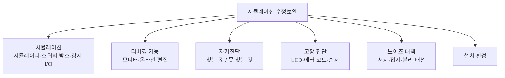
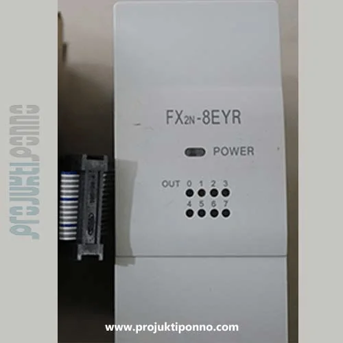
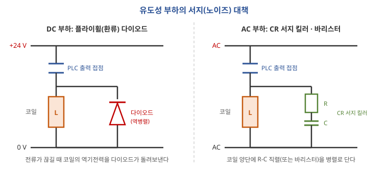
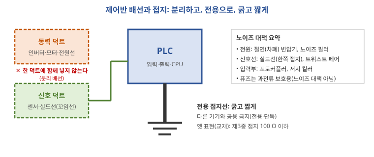
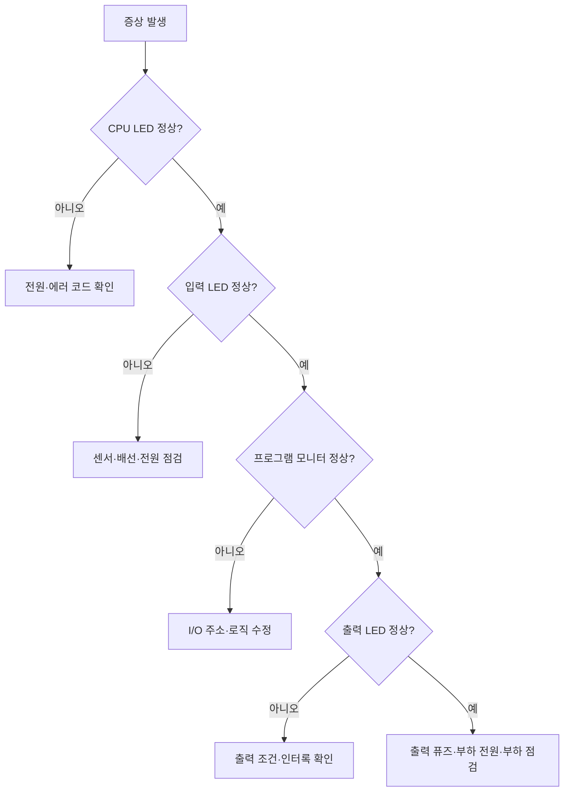

# PLC 시뮬레이션과 수정보완

> [!summary] 핵심 요약
> - 실제 설비에 넣기 전에 **시뮬레이터**로 가상 입력을 주고 출력·타이밍을 확인한다.
> - 현장에서는 **모니터링**(접점·데이터 상태 보기), **강제 입출력(Force)**, **온라인 편집**(RUN 중 수정)으로 디버깅한다.
> - 고장 진단은 PLC 상태 LED·에러 코드 → 입력 → 프로그램 → 출력 순으로 좁혀 간다.
> - 유도성 부하 노이즈 대책: DC는 **플라이휠 다이오드**, AC는 **CR 서지 킬러·바리스터**.

> [!warning] 자주 틀리는 포인트
> - 강제 출력은 설비를 실제로 움직인다. **안전 확인 후** 사용하고 끝나면 반드시 해제.
> - 온라인 편집은 다음 스캔부터 반영되므로 출력이 갑자기 바뀔 수 있다.
> - 입력 LED는 켜지는데 프로그램에서 접점이 안 바뀐다 → **I/O 할당·주소 오류** 의심. 입력 LED도 안 켜진다 → **배선·센서·전원** 의심.
> - 출력 LED는 켜지는데 부하가 안 움직인다 → **출력 접점·퓨즈·부하 전원** 의심.
> - 접지는 다른 기기와 공용하지 않는 **전용 접지**로. 동력선과 신호선은 **분리 배선**.
> - 입력 신호선을 **동력선과 같은 덕트**에 넣는 것은 틀린 시공이다. 접지선은 **굵고 짧게**, "PLC 내부에 접지가 있어 외부 접지 불필요"도 틀린 말.
> - CPU **자기진단**으로 메모리·버스·링크·WDT 이상은 잡지만, 외부 **입출력 접점(배선·센서) 자체의 이상은 발견하지 못한다**.
> - 용어 구분: **로딩** = 주변기기에서 PLC 메모리로 프로그램을 써 넣기, **디버깅** = 오류를 찾고 연산 과정을 추적하기.

## 학습 목표

이 단원을 마치면 다음을 할 수 있어야 한다.

1. 시뮬레이터·조작 스위치 박스·강제 입출력의 장단점을 비교하고, 시뮬레이션의 한계를 말한다.
2. 모니터링·강제 입출력·온라인 편집 등 디버깅 기능의 용도와 주의점을 설명한다.
3. 자기진단으로 찾는 이상과 못 찾는 이상(외부 입출력 접점)을 구분한다.
4. 증상(LED 상태)에 따라 점검 순서를 정해 고장을 좁힌다.
5. DC·AC 유도성 부하의 서지 대책(환류 다이오드, CR 서지 킬러·바리스터)을 고른다.
6. 배선 분리, 전용 접지, 설치 환경 기준을 말한다.

## 한눈에 보기

## 개념 정리

### 시뮬레이션

**비유**: 비행기 조종사가 실제 비행 전에 **모의 비행 장치**로 연습하는 것과 같다. 설비를 부수지 않고 프로그램의 순서·인터록·타이머를 먼저 확인한다. 다만 모의 장치는 실제 바람(센서 지연, 노이즈)까지는 재현하지 못하므로 마지막엔 현장 시운전이 필요하다.

- 프로그래밍 툴의 시뮬레이터(예: LS XG5000의 XG-SIM, 미쓰비시 GX Simulator)로 PLC 없이 동작 확인.
- 확인 항목: 동작 순서, 인터록, 타이머·카운터 시간, 비상 정지 시 동작, 경계값.
- **타이밍 차트**로 입력 변화에 따른 출력 변화를 비교한다.
- 한계: 실제 센서 지연, 기계 관성, 노이즈는 재현하지 못한다 → 현장 시운전 필요.

**프로그램 완전성 검사 3가지 (교재 33절)**

| 방법 | 장점 | 한계 |
| --- | --- | --- |
| 시뮬레이터 | 하드웨어 없이 확인 | 램프 ON/OFF만 보여 다소 추상적 |
| 조작 스위치 박스·트레이너 | 실제 스위치·구동체로 시험 | 장비가 필요 |
| 강제 입출력 | 일부 프로그램을 골라 확인 | 프로그램을 이해하고 있어야 함 |

**PLC 접속과 오류 확인 (교재 33절)**

- 접속 방법: RS-232C, USB, Ethernet, Modem. 접속 설정: 로컬, Remote 1, Remote 2.
- RS-232C 접속이 안 되면: 케이블 연결, **COM 포트 번호 일치**, 결선 단선, PLC 정상 동작 확인.
- USB 접속이 안 되면: 케이블 연결, PC [장치 관리자]에서 PLC가 인식되는지 확인.
- 전원 차단·에러·모드 전환 **이력**은 **[에러/경고 상세 정보]** 창에서 본다 ([읽기] 창이 아님, 교재 예제).

### 디버깅 기능

**직관**: 모니터링은 "**눈으로 보기**"(접점이 켜져 있나), 강제 입출력은 "**손으로 눌러 보기**"(신호를 억지로 ON/OFF), 온라인 편집은 "**달리는 자동차 수리**"(RUN 중에 고치기)다. 뒤로 갈수록 설비에 직접 영향이 크므로 조심해야 한다.

| 기능 | 내용 |
| --- | --- |
| 모니터링 | 래더 위에 접점 ON/OFF, 현재값 표시 |
| 디바이스 모니터 | 여러 디바이스 값을 표로 감시 |
| 강제 입출력 | 실제 신호와 무관하게 I/O를 ON/OFF |
| 온라인 편집 | RUN 상태에서 프로그램 수정·반영 |
| 트렌드·트리거 모니터 | 값의 시간 변화 기록, 조건 발생 시점 포착 |
| 프로그램 비교 | PLC 안의 프로그램과 PC 파일 차이 확인 |
| 스텝 실행·브레이크 | 한 스텝씩 실행 (지원 기종) |

### 자기진단 기능

**직관**: 자기진단은 **PLC가 자기 몸 상태를 스스로 검사**하는 기능이다. 몸 안(메모리·버스·통신·스캔 타임)은 잘 찾지만, 몸 밖의 센서·배선·부하는 볼 수 없다.

| 발견 가능 | 발견 불가 |
| --- | --- |
| 메모리(프로그램·데이터) 이상, 배터리 전압 저하 | 외부 입출력 접점·배선 이상 |
| 입출력 버스·모듈 장착 이상 | 센서·부하 자체 고장 |
| 통신 링크 이상 | 프로그램 논리의 잘못 |
| 워치독 타이머(스캔 타임 초과) | |
| 코딩(문법) 에러, 전원 공급 이상 (교재 35절) | 메모리 액세스 타임 (교재 35-3) |

- 프로그램 관련 용어: **코딩**(작성) → **로딩**(PLC에 써 넣기) → **디버깅**(오류 찾기·추적) → 운전.

### 수정보완과 문서화

- 수정 전 **백업**(프로그램·파라미터·데이터), 수정 이력·버전 관리.
- 디바이스 **코멘트**와 설명문을 달아 다른 사람이 읽을 수 있게.
- 비상 정지 회로는 PLC 밖에서도 **하드와이어**로 구성 (PLC 고장 시에도 정지 보장).

### 고장 진단 흐름

**직관**: 신호가 가는 길(입력 → 프로그램 → 출력)을 **한 칸씩 짚으며 어디서 끊겼는지 찾는다**. LED가 그 칸의 신호등이다.

*단자마다 달린 LED가 그 접점의 상태를 알려 준다. "출력 LED는 켜졌는데 부하가 안 움직인다"면 PLC 프로그램은 정상이고, 출력 접점·퓨즈·부하 전원·부하 쪽을 의심한다.*

| 증상 | 점검 순서 |
| --- | --- |
| PWR LED 꺼짐 | 전원 전압, 퓨즈, 전원 모듈 |
| ERR LED 켜짐 / CPU 정지 | 에러 코드 확인 (WDT 초과, 메모리·배터리, 모듈 이상, 파라미터 불일치) |
| 입력 이상 | 센서 전원 → 배선 → 입력 LED → 싱크/소스 형식 |
| 출력 이상 | 출력 LED → 출력 퓨즈 → 부하 전원 → 부하 자체 |
| 간헐적 오동작 | 노이즈, 접지, 접촉 불량, 스캔 타임 대비 짧은 신호 |

**교재(33절)의 트러블슈팅 순서**: ① 기계·전원·입출력 기기·배선·표시창 확인 → ② PLC 작동 상태와 프로그램 점검 → ③ **STOP 모드에서 전원 OFF/ON**해 이상이 사라지는지 확인 → ④ 고장 원인 추정. 프로그램 오류가 의심되면 **RUN 중 수정**을 쓸 수 있다.

### 노이즈 대책

**비유**: 코일은 전류가 갑자기 끊기면 **관성이 큰 바퀴가 급정지할 때처럼** 큰 전압(역기전력)을 만들어 낸다. 이 서지가 접점과 PLC 내부를 공격하므로, 서지가 흘러갈 **샛길**을 코일 옆에 미리 만들어 둔다.

*왼쪽 DC 회로는 다이오드가 평소엔 전류가 안 흐르는 방향(역방향)으로 코일과 병렬이라 "역병렬"이다. 접점이 열리면 코일 전류가 이 다이오드를 타고 돌아 서지가 사라진다. AC는 극성이 바뀌므로 다이오드 대신 R-C 직렬(서지 킬러)이나 바리스터를 쓴다.*

| 대상 | 대책 |
| --- | --- |
| DC 유도성 부하 (솔레노이드, 릴레이 코일) | 플라이휠(환류) 다이오드를 부하와 **역병렬** |
| AC 유도성 부하 | CR 서지 킬러(스너버), 바리스터 |
| 전원 라인 | 노이즈 필터, 절연 트랜스 |
| 신호선 | 실드선(한쪽 접지), 트위스트 페어, 동력선과 분리 |
| 접지 | 전용 접지, 굵고 짧게, 다른 기기와 공용 피하기 |

**교재(35절)의 부위별 노이즈 대책**

| 부위 | 대책 |
| --- | --- |
| 입력부 | 스파크·서지 킬러, DC 릴레이에 환류 다이오드, **포토커플러**(노이즈를 내부로 전달하지 않음), 배리스터 |
| 전원부 | 제어 전원과 모터 전원 분리, 차폐선, 실드·절연 트랜스, EMI 필터 |
| 출력부 | 스파크 킬러, 누설 전류 제거(저항), 정전압 회로 |

- **잡음 여유(노이즈 마진)**: 잡음이 섞여도 다음 단 입력의 논리값(0/1)이 바뀌지 않는 전압 여유.
- **퓨즈**는 과전류 보호용이지 노이즈 대책이 아니다.

### 설치 환경

*동력선(인버터·모터)은 노이즈를 많이 내므로 신호선과 같은 덕트에 넣지 않는다. 신호선은 실드·꼬임선을 쓰고, 접지는 다른 기기와 공용하지 않는 전용선을 굵고 짧게 한다. 교재의 "제3종 접지, 100 Ω 이하"는 옛 표현이다.*

- 주위 온도 대략 0~55 ℃, 습도 결로 없을 것.
- 직사광선, 부식성 가스, 진동·충격, 강한 전자기 노이즈원(인버터, 용접기) 가까이 피하기.
- 방열을 위해 상하 간격 확보, 통풍.
- 제어반 배치: 고압기기·발열체·아크 발생 기기(차단기, 전자접촉기)와 **떨어뜨려** 배치.
- 전원 측 노이즈: **절연(차폐) 변압기**나 노이즈 필터를 거쳐 공급.
- 출력 측 유도성 부하: **서지 킬러(CR)·바리스터**(AC), **다이오드**(DC)를 부하 양단에 접속.
- 접지: 다른 기기와 공용하지 않는 **전용 접지**. 옛 문제에서는 "제3종 전용 접지"로 나왔지만, 2021년 한국전기설비규정(KEC) 시행으로 종별 접지 구분이 없어졌으므로 지금은 "전용·단독 접지, 굵고 짧게"로 기억한다.
- **교재(34절)는 아직 옛 종별 접지로 설명한다**: PLC는 스파크 방지·전류 안정·외래 잡음 차단이 목적이라 **제3종 접지**(400 V 미만 기계기구, 접지 저항 **100 Ω 이하**, 2.5 mm² 이상 연동선). 잡음 대책용으로 전원부·제어부·기타 기기를 **따로** 접지. 시험 보기가 이 표현으로 나올 수 있으니 숫자까지 알아 둔다.
- PLC 접지의 목적이 **아닌 것**: 센서 입력 신호 증폭 (교재 34-1).

## 그림

## 기출 포인트

출처: 생산자동화산업기사 2016–2020년 필기 14회분 (cbtbank.kr).

- 제어반 설치·노이즈·접지 (입력선과 동력선 분리, 차폐 변압기, 서지 킬러, 전용 접지, 입력 노이즈 대책) — 3회 (2019-1, 2019-2, 2020-1·2)
- 디버그·로딩 용어 — 2회 (2016-1, 2017-2)
- CPU 자기진단으로 못 찾는 이상 (입출력 접점) — 1회 (2017-2)

**교재 예제 유형** (Win-Q 2025 PART 01 CHAPTER 01, 33~35절): 이력 확인 창([에러/경고 상세 정보]), 접지 목적이 아닌 것(신호 증폭), 접지 방법(그림), 입력부 노이즈 차단 요소(포토커플러), 자가진단과 먼 것(메모리 액세스 타임).

## 관련 단원

- [PLC 구성과 특성](PLC_구성과_특성.md)
- [PLC 프로그래밍 언어와 명령어](PLC_프로그래밍_언어와_명령어.md)
- [센서 회로와 신호처리](센서_회로와_신호처리.md)

## 체크리스트

- [ ] 시뮬레이션으로 확인할 것과 못 하는 것을 구분한다
- [ ] 강제 입출력·온라인 편집의 위험을 설명한다
- [ ] LED 상태로 입력·프로그램·출력 중 고장 위치를 좁힌다
- [ ] DC·AC 유도성 부하의 서지 대책을 구분한다
- [ ] 접지·배선 분리 원칙을 말할 수 있다
- [ ] 자기진단으로 발견할 수 있는 이상과 없는 이상을 구분한다
- [ ] 코딩·로딩·디버깅의 뜻을 구분한다
- [ ] 제어반 설치 시 틀린 시공(동력선과 같은 덕트 등)을 골라낸다

## 참고

- [큐넷 자동화설비산업기사 출제기준](https://www.q-net.or.kr/crf005.do?id=crf00503&jmCd=2034)

### 그림 출처

위키미디어 공용(Wikimedia Commons)과 Openverse에서 가져온 공개 라이선스 자료이고, 노트에 맞게 크기를 줄이고 WebP로 변환했다.

| 그림 | 작성자 | 라이선스 | 출처 |
| --- | --- | --- | --- |

직접 그린 그림(SVG, 이 볼트용으로 새로 작성): 서지 대책, 배선 접지.

### 그림 출처

위키미디어 공용(Wikimedia Commons)과 Openverse에서 가져온 공개 라이선스 자료이고, 노트에 맞게 크기를 줄이고 WebP로 변환했다.

| 그림 | 작성자 | 라이선스 | 출처 |
| --- | --- | --- | --- |
| [PLC Digital Input Output Module](https://commons.wikimedia.org/w/index.php?curid=85230985) | Raihan | [CC BY-SA 4.0](https://creativecommons.org/licenses/by-sa/4.0/) | Openverse (wikimedia) |

직접 그린 그림(SVG, 이 볼트용으로 새로 작성): 서지 대책, 배선 접지.

