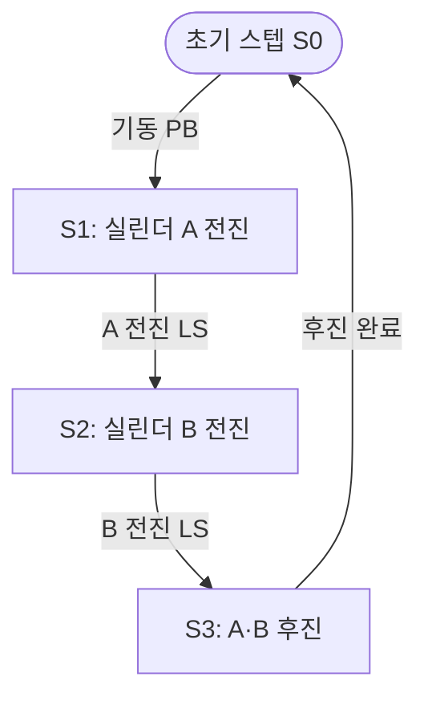

# PLC 프로그래밍 언어와 명령어

> [!summary] 핵심 요약
> - IEC 61131-3 언어: **LD**(래더), **FBD**(기능 블록), **SFC**(순차 기능 차트) = 그래픽 / **IL**(명령어 리스트), **ST**(구조화 텍스트) = 텍스트.
> - 기본 명령: 시작(LOAD), 직렬(AND), 병렬(OR), 부정(NOT), 출력(OUT), 블록 결합(AND LOAD / OR LOAD), 끝(END).
> - 타이머 설정 시간 = **설정값 × 타임베이스**. 예: 100 ms 타이머에 50 → 5초.
> - 같은 출력을 두 번 쓰는 **이중 코일**은 피한다. 마지막 줄 결과만 남는다.

> [!warning] 자주 틀리는 포인트
> - **ON 딜레이(TON)**: 입력 ON 후 설정 시간 뒤 출력 ON. **OFF 딜레이(TOFF)**: 입력 OFF 후 설정 시간 뒤 출력 OFF.
> - **적산 타이머(TMR)** 는 입력이 꺼져도 현재값을 유지한다. 리셋해야 0.
> - 상승 펄스(P, D 명령)는 **1스캔만** ON.
> - 병렬 블록끼리 직렬 연결은 **AND LOAD(ANB)**, 직렬 블록끼리 병렬 연결은 **OR LOAD(ORB)**. 이름과 모양을 거꾸로 외우기 쉽다.
> - IEC 언어 중 **텍스트(문자식) 언어는 IL·ST 두 가지뿐**. FBD·SFC는 이름에 "Diagram/Chart"가 붙은 그래픽 언어다.
> - 니모닉 스텝 수를 셀 때는 **LOAD·AND·OR·OUT·AND LOAD·OR LOAD 하나하나가 1스텝**. 문제가 END 포함 여부를 정해 주므로 꼭 확인한다.
> - 래더 해석 문제에서 출력 자신의 a접점이 기동 접점과 병렬이면 **자기유지**, 상대 출력의 b접점이 직렬이면 **인터록**. 입력 번호만 보고 기동·정지를 단정하지 말고 접점 종류(a/b)로 판단한다.
> - **카운터**는 리셋 전까지 입력 횟수를 세어 설정값에 이르면 출력, **타이머**는 시간을 센다. 보기에서 둘을 바꿔 묻는다.
> - 프로그램 작성 순서(교재 30절): **데이터 메모리 할당 → 프로그램 작성 → 입출력 주소 할당 → 컴파일 → 전송 → 저장·종료**. 컴파일이 전송보다 먼저다.
> - PC에서 PLC로 프로그램을 쓰려면 CPU 모드를 **PAUSE 또는 REMOTE**로 둔다. 쓰면 PLC 안의 **이전 프로그램은 지워진다**.
> - **타이머·카운터에는 직접 변수(%IX 등)를 쓸 수 없다**. 네임드 변수로 쓴다.
> - 오류를 찾고 연산 과정을 따라가는 작업은 **디버깅(Debug)**. 스캔과 다른 개념이다. **어셈블리 명령**은 래더 명령이 아니다.

## 개념 정리

### IEC 61131-3 언어

| 언어 | 형태 | 특징 |
| --- | --- | --- |
| LD (Ladder Diagram) | 그래픽 | 릴레이 회로처럼 그림, 가장 많이 사용 |
| FBD (Function Block Diagram) | 그래픽 | 블록을 선으로 연결, 아날로그·연산에 유리 |
| SFC (Sequential Function Chart) | 그래픽 | 스텝·트랜지션으로 공정 순서 표현 |
| IL (Instruction List) | 텍스트 | 니모닉 명령 나열 (3판부터 비권장) |
| ST (Structured Text) | 텍스트 | 파스칼 비슷, IF·FOR 등 복잡한 연산 |

- 옛 분류(국내 교재)로는 프로그램 표현 방식을 **회로도 방식**(래더도, 논리기호)과 **명령어(니모닉) 방식**, **플로차트 방식**으로 나누기도 한다.
- **래더 다이어그램**은 릴레이 제어 회로(유접점 시퀀스)를 그대로 옮긴 표현이다.
- 교재(29절)의 언어 구분: **니모닉**(어셈블리 같은 문자 언어, 핸디 로더로 간단한 로직 입력), **래더**(릴레이 로직과 닮은 도형 언어), **SFC**.
- **스텝**: 명령의 최소 단위. a접점·b접점·출력 코일이 각각 1스텝.

### 스캔 타임과 응답 시간 계산

- **스캔 타임**: 프로그램 첫 행부터 END까지 한 번 실행하는 시간.
- 총 응답 시간 = **입력 응답 시간 + 프로그램 수행 시간 + 출력 응답 시간**
- **계산 예 (교재 29-2)**: 5,000스텝 × 2 μs = 10 ms(수행 시간), 입력 응답 5 ms, 출력 응답 15 ms → $5 + 10 + 15 = $ **30 ms**
- 단위 주의: 1 ms = 1,000 μs. 2 μs × 10,000스텝 = 20 ms.

### 프로그램 작성 절차와 변수 (교재 30절)

1. 데이터 메모리 할당 → 2. 프로그램 작성(코딩) → 3. 입출력 주소 할당 → 4. **컴파일**(실행 파일 생성, 오류 메시지) → 5. **전송**(로딩, PAUSE·REMOTE 모드) → 6. 저장·종료

| 변수 | 내용 |
| --- | --- |
| 직접 변수 | 제작사가 정한 메모리 주소. 입력 `%IX`, 출력 `%QX`, 내부 메모리 `%MX`. 주소는 **베이스.슬롯.접점** 순 (예: `%IX0.0.1`, `%QX0.1.0`) |
| 네임드 변수 | 사용자가 이름을 붙임. 한글 8자·영문 16자, 대소문자 구분 없음. **타이머·카운터는 네임드 변수로만** |

**래더 작성 규칙 (교재)**

- 회로를 끊지 않는다. 출력 심벌은 **오른쪽 끝**에 둔다.
- 모든 심벌에 이름을 붙인다. 부가 회로는 **아래로** 전개한다.
- **같은 번호의 출력을 중복하지 않는다**(이중 코일 금지). 한 렁에서 여러 갈래로 파생하지 않는다.

| 운전 모드 | 의미 |
| --- | --- |
| RUN | 프로그램 연산·실행 |
| STOP | 연산 정지 |
| REMOTE | 컴퓨터에서 프로그램 전송·모드 변경 가능 |
| PAUSE | 연산 일시 정지, 풀면 이어서 실행 |

### 논리식 → 래더 변환

| 논리식 | 래더 |
| --- | --- |
| $Y = A \cdot B$ | A, B a접점 직렬 |
| $Y = A + B$ | A, B a접점 병렬 |
| $Y = \overline{A} \cdot B$ | A b접점, B a접점 직렬 |
| $Y = (A + B) \cdot C$ | A∥B 블록 다음에 C 직렬 (AND LOAD 또는 OR 후 AND) |
| $Y = A \cdot B + C \cdot D$ | A–B 직렬 블록과 C–D 직렬 블록을 병렬 (OR LOAD) |

- 식에 부정 막대가 **변수 하나**에만 있으면 그 변수의 b접점. **묶음 전체**에 있으면 드모르간으로 먼저 풀어서 접점으로 바꾼다. 예: $\overline{A + B} = \overline{A}\cdot\overline{B}$ → A, B b접점 직렬.

**스텝 수 세기 예** (END 제외): $Y = (A + B) \cdot (C + D)$

```text
LOAD  A
OR    B
LOAD  C
OR    D
AND LOAD
OUT   Y
```

→ 6스텝.

### 기본 명령어 (제조사별 니모닉)

| 기능 | LS XGK | 미쓰비시 |
| --- | --- | --- |
| a접점 시작 / b접점 시작 | LOAD / LOAD NOT | LD / LDI |
| a접점 직렬 / b접점 직렬 | AND / AND NOT | AND / ANI |
| a접점 병렬 / b접점 병렬 | OR / OR NOT | OR / ORI |
| 블록 직렬 / 블록 병렬 | AND LOAD / OR LOAD | ANB / ORB |
| 분기 저장·읽기·해제 | MPUSH / MLOAD / MPOP | MPS / MRD / MPP |
| 출력 | OUT | OUT |
| 세트 / 리셋 | SET / RST | SET / RST |
| 상승·하강 펄스 출력 | D / D NOT | PLS / PLF |
| 상승·하강 펄스 접점 시작 | LOADP / LOADN | LDP / LDF |
| 프로그램 끝 | END | END |

- **모선(왼쪽 세로선)에서 바로 시작**하는 명령은 LD(LOAD)·LDI다. AND·OR 계열은 앞에 시작 명령이 있어야 쓴다 (교재 22-3).
- 교재는 b접점 직렬을 **ANDI**로 적는다. 미쓰비시 매뉴얼 표기는 ANI이니 보기에 둘 중 하나가 나오면 같은 뜻으로 본다.

**니모닉 ↔ 래더 변환 예** (자기유지 회로, LS 니모닉)

```text
LOAD     P00      ; 기동 PB
OR       P20      ; 출력 자기유지 접점
AND NOT  P01      ; 정지 PB (b접점)
OUT      P20      ; 출력
END
```

### 타이머

| 종류 | 동작 |
| --- | --- |
| TON (ON 딜레이) | 입력 ON → 설정 시간 후 출력 ON, 입력 OFF 시 즉시 리셋 |
| TOFF (OFF 딜레이) | 입력 ON → 즉시 출력 ON, 입력 OFF → 설정 시간 후 출력 OFF |
| TMR (적산) | 입력 ON 시간 누적, 리셋 전까지 유지 |
| TMON (모노스테이블) | 입력 상승 시 설정 시간 동안 출력 ON |
| TRTG (리트리거블) | 시간 중에 다시 입력이 오면 처음부터 다시 셈 |

- 타임베이스: 1 ms, 10 ms, 100 ms 등. 설정값 × 타임베이스 = 시간.

### 카운터

| 종류 | 동작 |
| --- | --- |
| CTU (가산) | 상승 에지마다 +1, **현재값 ≥ 설정값**이면 출력 ON |
| CTD (감산) | 설정값에서 −1, **현재값 ≤ 0**이면 출력 ON |
| CTUD (가감산) | 가산·감산 입력 따로 |
| CTR (링) | 설정값 도달 시 출력 후 다음 펄스에 0으로 |

- 카운터는 리셋 입력이 들어오기 전까지 현재값을 유지한다.

### 응용 명령

| 분류 | 예 |
| --- | --- |
| 전송 | MOV (데이터 복사), BMOV (블록) |
| 비교 | CMP, `=`, `>`, `<` 접점형 비교 |
| 산술 | ADD, SUB, MUL, DIV, INC, DEC |
| 논리 연산 | WAND, WOR, WXOR (워드 단위) |
| 변환 | BCD, BIN ([수의 표현과 코드](수의_표현과_코드.md)) |
| 시프트·회전 | SHL, SHR, ROL, ROR |
| 흐름 제어 | JMP, CALL, FOR/NEXT |

### 프로그래밍 원칙

- 위에서 아래, 왼쪽에서 오른쪽으로 실행된다.
- 출력 코일 오른쪽에는 접점을 둘 수 없다.
- 직렬 접점이 많은 회로는 위에, 병렬이 많은 블록은 왼쪽에 두면 스텝이 줄어든다.
- 정·역 운전 등은 **인터록**과 **타이머 지연**을 함께 쓴다.

## 그림



## 기출 포인트

출처: 생산자동화산업기사 2016–2020년 필기 14회분 (cbtbank.kr).

- 논리식을 PLC 래더로 바꾸기 — 2회 (2020-1·2 ×2)
- 래더 해석 (입력·기동·자기유지·인터록 접점 판별), 니모닉 스텝 수 세기 — 2회 (2019-2 ×2)
- IEC 언어 분류 (문자식 언어가 아닌 것), 프로그램 표현 방식 분류 — 2회 (2017-3, 2019-2)
- 래더 다이어그램의 의미 (릴레이 회로 표현) — 1회 (2018-1)
- 카운터 기능 정의 — 1회 (2017-1)
- 참고: 옛 시험의 C언어·PC 기반 제어 문항(반복문·조건문·`#include`·`printf` 형식·비트 시프트)은 새 출제기준 밖이다 → [기출분석](../01_시험안내/기출분석_자동제어.md)

**교재 예제 유형** (Win-Q 2025 PART 01 CHAPTER 01, 29~30절): 한 사이클 실행 시간(스캔 타임), 총 응답 시간 30 ms, 그림의 언어(래더), 래더 명령이 아닌 것(어셈블리 명령), 래더 최소 스텝 수(그림), 오류 추적(Debug), 래더 해석(그림), 프로그램 작성 순서, OFF 딜레이 타이머 동작(그림).

## 관련 단원

- [논리회로](논리회로.md)
- [PLC 구성과 특성](PLC_구성과_특성.md)
- [특수모듈 프로그래밍](특수모듈_프로그래밍.md)

## 체크리스트

- [ ] IEC 61131-3 5개 언어를 그래픽·텍스트로 나눈다
- [ ] 자기유지 래더를 니모닉으로 바꿔 쓸 수 있다
- [ ] AND LOAD / OR LOAD가 필요한 회로를 알아본다
- [ ] TON·TOFF·TMR 타이밍 차트를 그릴 수 있다
- [ ] 타이머 설정값과 타임베이스로 시간을 계산한다
- [ ] 이중 코일이 왜 문제인지 설명한다
- [ ] 부정이 들어간 논리식을 b접점 래더로 바꾼다
- [ ] 래더를 니모닉으로 바꿔 스텝 수를 센다
- [ ] 래더에서 자기유지 접점과 인터록 접점을 찾는다

## 참고

- [큐넷 자동화설비산업기사 출제기준](https://www.q-net.or.kr/crf005.do?id=crf00503&jmCd=2034)
- IEC 61131-3 (PLC 프로그래밍 언어 국제 표준)
