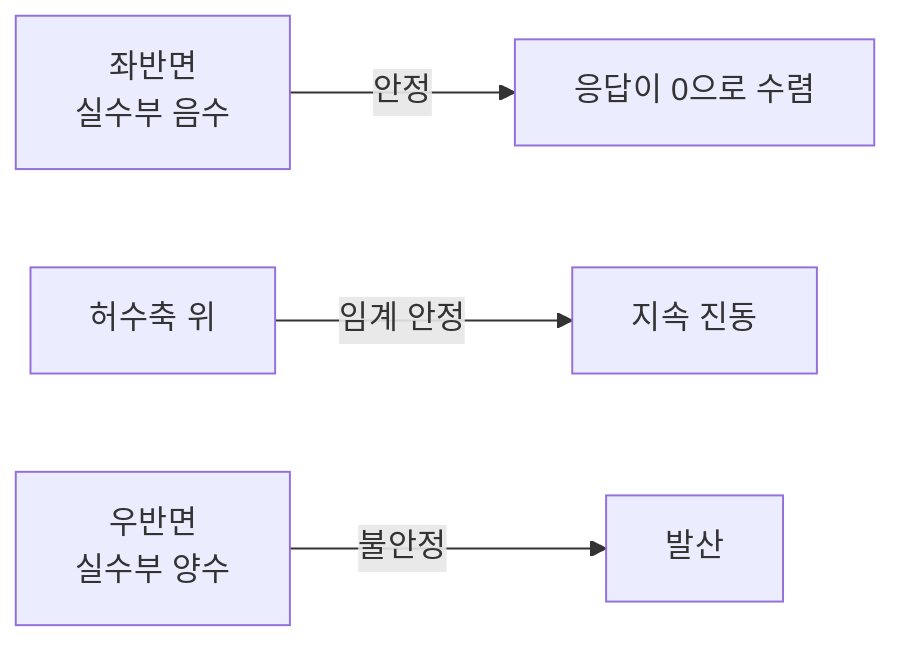
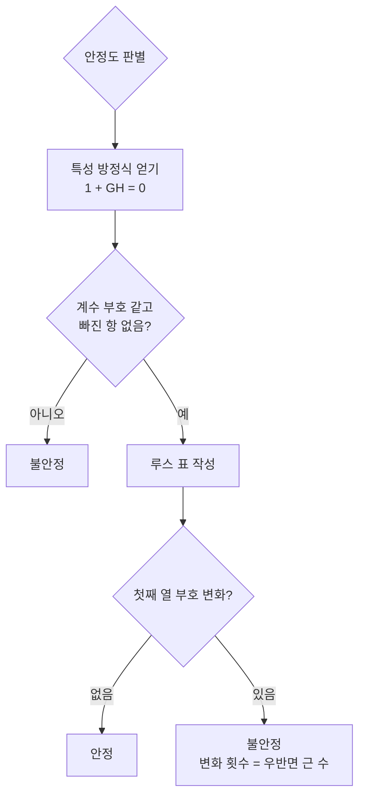

# 과도응답과 안정도

> [!summary] 핵심 요약
> - 시험 신호: **계단**(과도 응답·급변 외란), **램프**(등속), **포물선**(등가속), **임펄스**, **정현파**(주파수 응답).
> - 1차계 $\dfrac{K}{Ts+1}$: 계단 입력 후 $t = T$(시정수)에서 최종값의 **63.2 %**. 시정수가 작을수록 빠르다.
> - 2차계 감쇠비 $\zeta$: $0$ 무제동(지속 진동), $0<\zeta<1$ 부족제동, $1$ 임계제동, $>1$ 과제동.
> - **안정 조건**: 특성 방정식의 근(폐루프 극점)이 모두 **s 평면 좌반면**. 계산은 **루스-허위츠** 표로.
> - 주파수 응답: 이득 $= 20\log_{10}|G(j\omega)|$ [dB]. 안정도 여유는 **이득 여유·위상 여유**로 본다.

> [!warning] 자주 틀리는 포인트
> - **지연 시간 = 최종값의 50 %**, **상승 시간 = 10 → 90 %**, 정정 시간 = ±2 %(또는 5 %) 안에 들어가는 시간. 셋을 바꿔 묻는다.
> - "피크 시간"은 **시간 영역** 지표. 대역폭·이득 여유·위상 여유가 주파수 영역 지표.
> - 제어계 성능의 3요소는 **속응성, 안정도, 정상 편차(정확도)**. 결합계수 같은 낯선 말은 함정.
> - 특성근이 **허수축 위**면 지속 진동(임계 안정), **우반면**이면 불안정.
> - 근궤적은 **실수축에 대칭**이다 (복소근은 켤레로 나오므로). 허수축 대칭이 아니다.
> - 절점 주파수($\omega = 1/T$)에서 1차 지연의 이득은 **−3 dB**, 위상은 **−45°**.
> - −3 dB는 크기 $1/\sqrt{2} \approx 0.707$배다. 1/2배가 아니다 (1/2배는 약 −6 dB).
> - **진상 보상 ↔ PD**(과도 특성·속응성 개선), **지상 보상 ↔ PI**(정상 편차 개선).

## 개념 정리

### 시험 입력 신호

| 신호 | 식 | 쓰임 |
| --- | --- | --- |
| 단위 임펄스 | $\delta(t)$, $R(s)=1$ | 응답 = 전달함수의 역변환 (가중 함수) |
| 단위 계단 | $u(t)$, $1/s$ | **과도 응답**, 갑작스런 외란·목표값 변화. 응답 이름: **인디셜 응답** |
| 단위 램프(경사) | $t$, $1/s^2$ | 등속 추종 |
| 포물선 | $t^2/2$, $1/s^3$ | 등가속 추종 |
| 정현파 | $\sin\omega t$ | **주파수 응답** |

- 전달함수 자체는 입력 신호가 아니다 (기준 입력으로 쓰지 않음).

### 과도 응답 지표 (단위 계단 응답)

| 지표 | 정의 |
| --- | --- |
| 지연 시간 $t_d$ | 최종값의 **50 %** 도달 |
| 상승 시간 $t_r$ | **10 % → 90 %** |
| 최대 오버슈트 | $\dfrac{\text{최대값} - \text{최종값}}{\text{최종값}} \times 100\ [\%]$ |
| 피크 시간 $t_p$ | 최대 오버슈트가 나오는 시간 |
| 정정 시간 $t_s$ | 최종값 ±2 % (또는 ±5 %) 안에 머물기 시작 |
| 정상 편차 | 충분히 지난 뒤 남는 오차 |

### 1차 지연계와 시정수

- $G(s) = \dfrac{K}{Ts + 1}$, 단위 계단 응답 $c(t) = K\left(1 - e^{-t/T}\right)$.

| 시간 | 최종값 대비 |
| --- | --- |
| $T$ | 63.2 % |
| $2T$ | 86.5 % |
| $3T$ | 95.0 % |
| $4T$ | 98.2 % |

- 시정수 $T$: RC 회로 $T = RC$, RL 회로 $T = L/R$.
- 시정수가 **작을수록 응답이 빠르다**. 1차계는 오버슈트가 없다.
- 감소(방전) 곡선에서는 $T$ 후 처음 값의 **36.8 %** 가 남는다.

### 2차 지연계와 감쇠비

- 표준형 $G(s) = \dfrac{\omega_n^2}{s^2 + 2\zeta\omega_n s + \omega_n^2}$, $\omega_n$: 고유 주파수, $\zeta$: 감쇠비(제동비).

| $\zeta$ | 이름 | 계단 응답 | 특성근 |
| --- | --- | --- | --- |
| $0$ | 무제동 | 일정 진폭 지속 진동 | 허수축 위 켤레근 |
| $0 < \zeta < 1$ | 부족제동 | 감쇠 진동, 오버슈트 있음 | 좌반면 켤레 복소근 |
| $1$ | 임계제동 | 진동 없이 가장 빠름 | 실수 중근 |
| $\zeta > 1$ | 과제동 | 진동 없이 느림 | 서로 다른 두 실근 |

- 최대 오버슈트 $= e^{-\zeta\pi/\sqrt{1-\zeta^2}}$ → $\zeta$가 작을수록 커진다.
- **계산 예 1**: $\zeta = 0.5$, $\omega_n = 2$ → $G(s) = \dfrac{4}{s^2 + 2s + 4}$
- **계산 예 2**: $G(s) = \dfrac{9}{s^2 + 6s + 9}$ → $\omega_n = 3$, $2\zeta\omega_n = 6$ → $\zeta = 1$ → **임계제동**

### 안정도와 특성근

- 특성 방정식 $1 + G(s)H(s) = 0$ 의 근 = 폐루프 극점.

- **점근 안정**: 모든 근의 실수부가 음수. 예: $s^2 + 3s + 2 = (s+1)(s+2)$ → 근 −1, −2 → 안정. $s^2 + 2s - 3 = (s+3)(s-1)$ → 근 +1 → 불안정.
- 빠른 판별: 계수 중 **부호가 다르거나 빠진 항**이 있으면 불안정(필요 조건).

### 루스-허위츠 판별법

1. 특성 방정식 $a_0 s^n + a_1 s^{n-1} + \cdots + a_n = 0$의 계수를 첫 줄($a_0, a_2, a_4, \dots$)과 둘째 줄($a_1, a_3, a_5, \dots$)에 번갈아 쓴다.
2. 셋째 줄부터는 바로 위 두 줄로 계산한다. 위 두 줄이 $(p_1, p_2, \dots)$, $(q_1, q_2, \dots)$이면 새 원소 $= \dfrac{q_1 p_2 - p_1 q_2}{q_1}$, 그다음은 $\dfrac{q_1 p_3 - p_1 q_3}{q_1}$.
3. **첫째 열의 부호 변화 횟수 = 우반면 근의 수**. 모두 같은 부호면 안정.

**계산 예**: $s^3 + 3s^2 + 2s + K = 0$ 이 안정한 $K$ 범위

| 행 | 1열 | 2열 |
| --- | --- | --- |
| $s^3$ | 1 | 2 |
| $s^2$ | 3 | $K$ |
| $s^1$ | $\dfrac{3 \cdot 2 - 1 \cdot K}{3} = \dfrac{6 - K}{3}$ | 0 |
| $s^0$ | $K$ | |

- 첫째 열 모두 양수: $6 - K > 0$, $K > 0$ → **$0 < K < 6$**
- $K = 6$이면 $s^1$ 행이 0 → 허수축 위 근, 지속 진동(임계).
- 4차식도 같은 방법: 행이 하나 더 늘 뿐, 마지막 두 행 조건($s^1$ 행 > 0, $s^0$ 행 = 상수항 > 0)을 연립한다.

### 근궤적

- 개루프 이득 $K$를 0 → ∞로 바꿀 때 폐루프 극점이 움직이는 자취.

| 규칙 | 내용 |
| --- | --- |
| 가지 수 | 특성 방정식의 차수 = **개루프 극점 수와 영점 수 중 큰 쪽** (보통 극점 수) |
| 시작 / 끝 | $K = 0$에서 **극점**, $K \to \infty$에서 **영점**(또는 무한원점) |
| 대칭 | **실수축 대칭** |
| 실수축 위 궤적 | 오른쪽에 있는 극점 + 영점 수가 홀수인 구간 |
| 허수축과 만나는 점 | 루스 표에서 임계 $K$ |

- 예: $G(s)H(s) = \dfrac{K(s+1)}{s(s+2)(s+3)}$ → 극점 3개, 영점 1개 → 근궤적 **3개**.

### 주파수 응답

- 정현파 입력 $A\sin\omega t$ → 선형계 출력은 같은 주파수 $B\sin(\omega t + \phi)$.
  - **진폭비** $= B/A = |G(j\omega)|$, **위상차** $= \phi = \angle G(j\omega)$.
  - 예: 입력 진폭 10, 출력 진폭 4, 출력이 30° 늦음 → 진폭비 0.4, 위상 −30°.
- **이득 [dB]** $= 20\log_{10}|G(j\omega)|$

| 크기 배율 | dB |
| --- | --- |
| 1 | 0 |
| $1/\sqrt{2}$ (0.707) | −3 |
| 2 | +6 |
| 10 | +20 |
| 100 | +40 |
| 1000 | +60 |
| 0.1 | −20 |

- **계산 예 1**: $G(s) = 1 + sT$, $\omega T = 100$ → $|G| = \sqrt{1 + 100^2} \approx 100$ → **약 40 dB**
- **계산 예 2**: $G(s) = \dfrac{10}{s}$, $\omega = 100$ → $|G| = 0.1$ → **−20 dB**

**보드 선도 (Bode)**

| 요소 | 이득 기울기 | 위상 |
| --- | --- | --- |
| $K$ | 0 dB/dec (수평, 높이 $20\log K$) | 0° |
| $1/s$ (적분) | −20 dB/dec | −90° |
| $s$ (미분) | +20 dB/dec | +90° |
| $\dfrac{1}{Ts+1}$ | 절점 $1/T$까지 0, 이후 −20 dB/dec | 0 → −45°(절점) → −90° |
| $Ts + 1$ | 절점 이후 +20 dB/dec | 0 → +45° → +90° |

- 보드 선도 모양 → 전달함수: 낮은 주파수에서 기울기가 −20이면 적분 요소($1/s$)가 하나, 꺾이는 점이 절점 $1/T$.

**나이퀴스트 선도 (벡터 궤적)**

- $\omega$를 0 → ∞로 바꾸며 $G(j\omega)H(j\omega)$를 복소평면에 그린 궤적.
  - $\dfrac{K}{Ts+1}$: 실수축 $K$에서 시작해 원점으로 들어가는 **반원**(제4사분면).
  - $\dfrac{K}{s(Ts+1)}$: 시작점이 $-j\infty$ 쪽(위상 −90°), −180°로 원점에 접근.
  - 형(type)이 하나 늘 때마다($1/s$ 하나) 시작 위상이 −90°씩 돌아간다.
- **판별**: 개루프가 안정할 때, 궤적이 **$(-1, j0)$ 점을 감싸지 않으면** 폐루프 안정.
- **이득 여유(GM)**: 위상이 −180°인 주파수에서 궤적이 실수축을 $-a$에서 지나면 $GM = 20\log\dfrac{1}{a}$ [dB]. 클수록 안정.
- **위상 여유(PM)**: 이득이 1(0 dB)인 주파수에서 위상이 −180°보다 얼마나 앞서는지.

### 보상기

| 보상기 | 극점·영점 배치 | 효과 | 대응 제어 |
| --- | --- | --- | --- |
| 진상(Lead) | 영점이 극점보다 원점에 가까움 | 위상을 앞당김 → **속응성·과도 특성** 개선, 안정도 여유 증가 | PD |
| 지상(Lag) | 극점이 영점보다 원점에 가까움 | 저주파 이득 증가 → **정상 편차** 개선 | PI |
| 진지상 | 둘의 조합 | 과도·정상 특성 함께 개선 | PID |

- 형식 $\dfrac{s + z}{s + p}$ 이면 $z < p$ 가 진상, $z > p$ 가 지상. 문제마다 문자 배치가 다르므로 **어느 쪽이 원점에 가까운지**로 판단한다.

## 그림

## 기출 포인트

출처: 생산자동화산업기사 2016–2020년 필기 14회분 (cbtbank.kr).

- 시험 입력 신호의 용도 (과도 응답·외란 → 계단, 주파수 응답 → 정현파, 기준 입력이 아닌 것) — 5회 (2016-2, 2016-3, 2017-1, 2018-3, 2020-1·2)
- 과도 응답 지표 정의 (지연 시간 50 %, 최대 오버슈트, 인디셜 응답, 성능 3요소) — 5회 (2017-2, 2017-3, 2018-1, 2018-2, 2019-1)
- 시정수 (RC 회로 시정수, 시정수와 응답 속도, 63.2 %) — 3회 (2017-2, 2018-1, 2020-3)
- 2차계 감쇠비 (주어진 $\zeta$, $\omega_n$으로 전달함수 쓰기, 제동 종류 판별) — 2회 (2017-2, 2020-3)
- 안정 조건 (s 평면 좌반면, 점근 안정 고르기, 루스-허위츠로 $k$ 범위, 안정도와 이득 여유) — 4회 (2017-1, 2017-3, 2018-1, 2020-3)
- 근궤적 (가지 수 세기, 실수축 대칭) — 3회 (2017-1, 2018-1, 2018-2)
- 주파수 응답 (진폭비·위상차, 절점 −3 dB, $1+sT$ 이득 dB, −3 dB의 크기 배율, 보드 선도 → 전달함수, 나이퀴스트 선도 → 전달함수, 주파수 영역 지표가 아닌 것) — 8회 (2016-1, 2016-3, 2017-3 ×2, 2018-1, 2018-3, 2019-3, 2020-3)
- 진상·지상 보상기 (PD ↔ 진상, 지상 조건) — 3회 (2016-1 ×2, 2019-2)

## 관련 단원

- [자동제어계의 기초](자동제어계의_기초.md)
- [라플라스 변환과 전달함수](라플라스_변환과_전달함수.md)
- [서보 모터와 서보 제어](서보모터와_서보제어.md)

## 체크리스트

- [ ] 시험 신호 5종과 각각의 용도를 말한다
- [ ] 지연·상승·정정 시간과 오버슈트를 정의한다
- [ ] 1차계 시정수에서 63.2 %, 36.8 %를 쓴다
- [ ] 2차계 전달함수에서 $\omega_n$, $\zeta$를 읽고 제동 종류를 판별한다
- [ ] 특성근 위치로 안정·임계·불안정을 구분한다
- [ ] 3차·4차 특성 방정식으로 루스 표를 만들어 $K$ 범위를 구한다
- [ ] 근궤적 가지 수와 대칭성을 안다
- [ ] 진폭비·위상차와 dB 이득을 계산한다 (−3 dB, 20 dB/dec)
- [ ] 1차 지연의 보드·나이퀴스트 선도 모양을 그린다
- [ ] 이득 여유·위상 여유의 뜻과 진상·지상 보상기의 효과를 안다

## 참고

- [큐넷 자동화설비산업기사 출제기준](https://www.q-net.or.kr/crf005.do?id=crf00503&jmCd=2034)
- [기출분석 – 자동제어](../01_시험안내/기출분석_자동제어.md)
