# 근접센서와 광전센서

> [!summary] 핵심 요약
> - **유도형 근접센서**: 고주파 자계 + 와전류 → **금속만** 검출.
> - **정전용량형 근접센서**: 정전용량 변화 → **금속·비금속(물, 분말, 플라스틱, 나무)** 모두 검출.
> - **광전센서** 3방식: 투과형(검출 거리 가장 김, 신뢰성 높음), 회귀반사형(반사판 사용), 확산반사형(물체에 직접 반사, 거리 짧음).
> - 접촉식인 리밋 스위치는 확실하지만 마모가 있고, 비접촉 센서는 수명이 길고 빠르다.

> [!warning] 자주 틀리는 포인트
> - 유도형의 표준 검출 거리는 **철(Fe)** 기준. 알루미늄·구리 같은 비철금속은 **검출 거리가 짧아진다**.
> - 투명체(유리, PET)는 회귀반사형에서 놓치기 쉽다 → 투명체 전용 센서나 초음파 센서.
> - 확산반사형은 물체의 **색·재질·표면 상태**에 따라 검출 거리가 달라진다. 검은색·무광은 짧아진다.
> - **Light ON**: 수광할 때 출력 ON. **Dark ON**: 빛이 가려질 때 출력 ON.
> - 리드 스위치는 **자석**에 반응한다. 공압 실린더 피스톤 위치 검출에 많이 쓴다.
> - **리밋 스위치는 접촉식**이다. 근접·광전·초음파·포토 인터럽터는 비접촉식.
> - 광전센서는 **응답이 빠르고** 검출 거리가 길며 대상이 넓다. "응답 속도가 느리다"는 틀린 말. 단 **먼지·연기·오염에는 약하다** (반사형 특히).
> - 광전센서 방식 이름: 투과형, (미러) 회귀반사형, 직접(확산) 반사형, 한정 반사형. "간접 반사형"은 없다.
> - **포토 인터럽터**: 발광부·수광부가 ㄷ자로 **마주 보고**, 사이를 물체가 가리면 검출 → 회전수·위치·계수. **포토 커플러**: 발광·수광부가 한 패키지 안에서 **전기적으로 절연**된 채 신호 전달 → 절연용.
> - 초음파 센서는 **투명체도 검출**한다(소리 반사이므로). 압전 효과로 송수신하고, 주파수가 높을수록 지향성이 날카롭다. 온도에 따라 음속이 변해 보정이 필요하다.
> - 사람 눈과 비슷한 분광 감도로 색을 구분하는 것은 **컬러 센서**.
> - 유도형으로 검출이 어려운 것은 **플라스틱**(비금속). "센서 전극의 + 전하가 늘어난다"는 정전용량형 원리이지 고주파 발진형(유도형) 원리가 아니다 (교재 24-1, 24-5).
> - **광전 효과** = 빛을 받으면 전자가 튀어나옴(포토다이오드). **광도전 효과** = 빛을 받으면 도전율 증가, 즉 저항 감소(CdS).
> - 교재 표현: 근접센서는 "위치 결정용 센서로 가장 적합", 자기형(리드 스위치)은 접점이 있지만 "접촉식보다 빠르다".
> - 비접촉식 스위치는 스위칭이 **빠르다** ("스위칭 주기가 길다"는 틀림). 마모가 없어 수명·신뢰성이 좋고 밀봉 구조라 환경에 강하다.
> - 리드 스위치는 자기형 근접센서지만 **유접점**이다. 유리관이라 **충격에 약하고**, 자석 배치에 따라 감지 지점이 여러 곳 생길 수 있다.

## 학습 목표

이 단원을 마치면 다음을 할 수 있어야 한다.

1. 리밋·마이크로·리드 스위치와 근접·광전·초음파 센서를 **접촉식 / 비접촉식**으로 나누고 장단점을 말한다.
2. 유도형 근접센서의 동작 순서(고주파 → 와전류 → 발진 감쇠 → 출력)를 설명하고, 유도형·정전용량형의 검출 대상을 구분한다.
3. 응차 거리·응답 주파수·차폐형/비차폐형 같은 근접센서 용어를 설명한다.
4. 광전센서 4방식(투과·회귀반사·확산반사·한정반사)을 그림으로 구분하고, Light ON / Dark ON 출력을 고른다.
5. 포토다이오드·포토트랜지스터·CdS·포토 인터럽터·포토 커플러를 원리와 용도로 구분하고, 초음파 센서로 거리를 계산한다.
6. DC 3선식 NPN·PNP 배선과 2선식의 누설 전류 문제를 설명하고, 센서 선정 순서를 말한다.

## 한눈에 보기

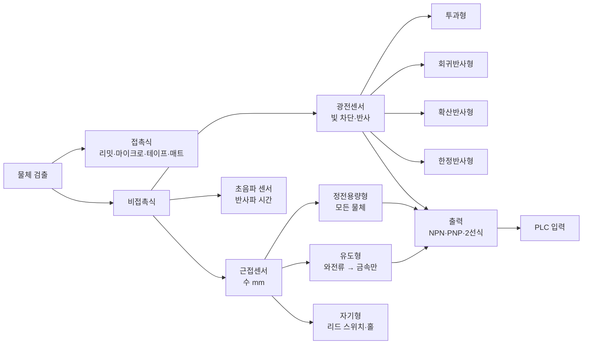

## 1. 접촉식과 비접촉식: 검출 센서 한눈에 비교

**직관**: 문이 닫혔는지 알려면 **손으로 만져 보는 방법**(리밋 스위치)과 **눈으로 보는 방법**(광전센서), **가까이 가면 느껴지는 방법**(근접센서)이 있다. 만지는 쪽은 확실하지만 닳고, 보는 쪽은 빠르고 닳지 않지만 먼지에 눈이 가려질 수 있다.

### 검출 센서 비교

| 센서 | 원리 | 검출 대상 | 특징 |
| --- | --- | --- | --- |
| 리밋 스위치 | 기계적 접촉 | 모든 물체 | 확실, 큰 전류 가능, 마모·채터링 |
| 유도형 근접 | 와전류에 의한 발진 감쇠 | 금속 | 먼지·기름에 강함, 거리 수 mm |
| 정전용량형 근접 | 정전용량 변화 | 금속·비금속 | 레벨 검출, 감도 조정 필요, 습기 영향 |
| 광전 | 빛의 차단·반사 | 대부분 물체 | 거리 길고 빠름, 먼지·외란광 영향 |
| 초음파 | 반사파 왕복 시간 | 투명체·액면 포함 | 색·투명도 무관, 온도 영향 |
| 홀 센서 | 홀 효과 (자계 → 전압) | 자석·자계 | 회전수, BLDC 위치 |
| 리드 스위치 | 자석으로 접점 붙음 | 자석 | 실린더 위치, 무전원 |

> [!question] 시험에서는
> "접촉식 스위치는?" → **리밋 스위치**(마이크로·테이프·매트·터치 포함). 근접·광전·초음파·포토 인터럽터는 모두 **비접촉식**이다. 리드 스위치는 **유접점**이지만 검출체(자석)에 닿지 않으므로 비접촉 검출이다.

## 2. 스위치 (교재 26절)

**직관**: 스위치는 사람이나 기계의 "동작"을 **전기 신호 한 개**로 바꾸는 가장 단순한 센서다. 손가락으로 누르면 누름 버튼, 기계 팔이 부딪히면 리밋 스위치, 자석이 지나가면 리드 스위치가 된다.

- 역할: 신호를 만들어 제어를 시작·계속하고, 회로 접점을 이루며, 회로 사이 연결점이 된다.
- 종류: **누름 버튼**(누를 때 신호), **유지형**(셀렉터·토글, 반대로 조작할 때까지 유지), **나이프 스위치**(단상·3상, 보통 퓨즈 내장), **센서형**(감지해서 신호).
- 접촉식: 마이크로, 리밋, 테이프, 매트, 터치 스위치. 비접촉식: 근접(고주파·정전용량·자기형), 광전(투과·반사), 영역 감지(광전·초음파·적외선).

| 리밋 스위치 (현장 설치 예) | 마이크로 스위치 (롤러 플런저형) |
| --- | --- |
| 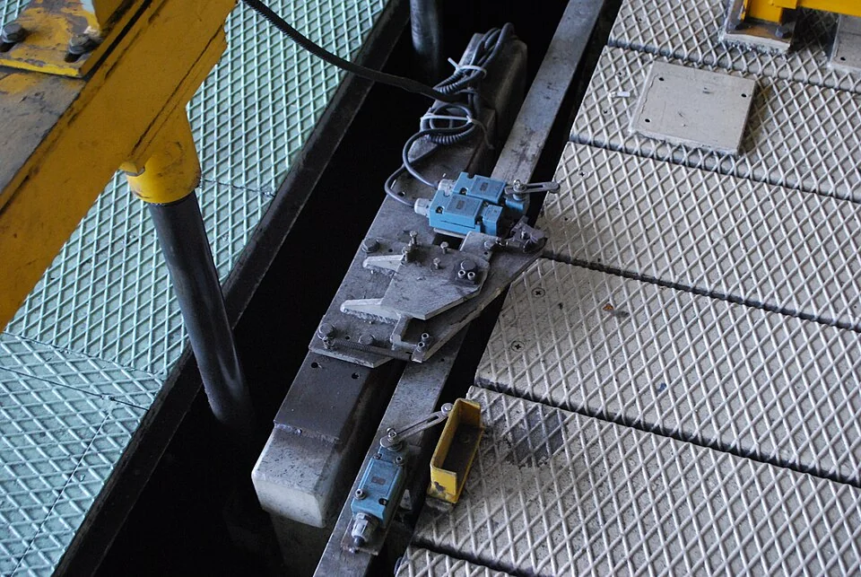 | 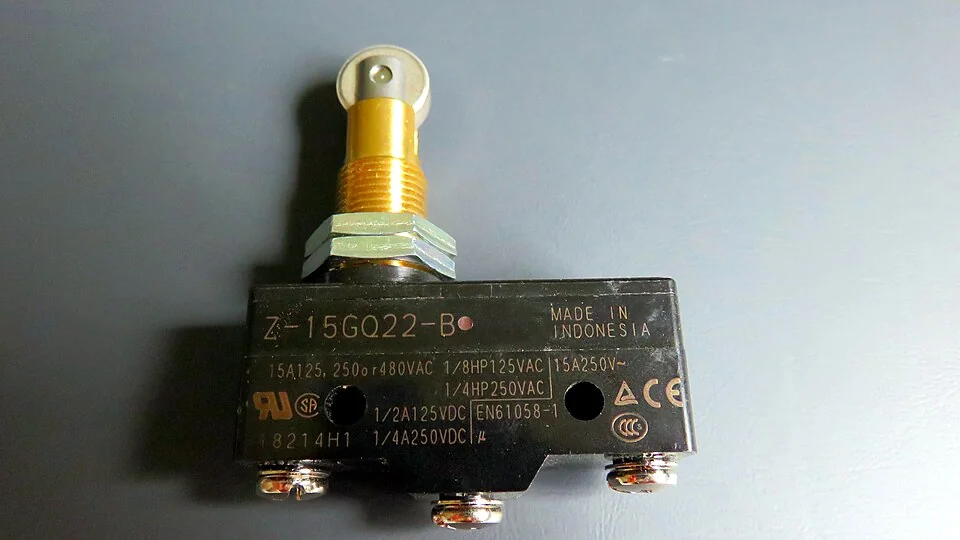 |

*왼쪽은 설비 레일에 붙인 리밋 스위치 두 개다. 움직이는 금속 도그가 **롤러 레버를 밀어** 끝 위치를 알린다. 오른쪽은 그 속에 들어가는 마이크로 스위치로, 몸체에 "15 A 250 VAC"가 찍혀 있어 작아도 **큰 전류를 직접 개폐**할 수 있음을 보여 준다. 아래 나사 단자 3개는 공통(COM)·a접점(NO)·b접점(NC)이다.*

| 스위치 | 특징 |
| --- | --- |
| 리밋 스위치 | 마이크로 스위치를 보호 케이스에 넣은 것. 롤러 레버에 힘이 가해지면 동작 → 액추에이터 시작·끝 위치, 힘이 가해졌는지 검출. 허용력 안에서 사용 |
| 마이크로 스위치 | 아주 작고 **스냅 액션**으로 접점이 빠르게 반전(판 스프링 = 고정밀, 코일 스프링 = 보급형). 장점: 소형, 큰 전류 개폐, 반복 정밀도, 저렴. 단점: 바운스·채터링, 반도체보다 짧은 수명, 동작 소음, 미소 전류(드라이 서킷)에 약함, 완전 밀폐 아님 |
| 테이프·매트 스위치 | 매트는 테이프 스위치를 병렬로 깐 것. 로봇 셀에 사람이 들어오면 **인터록** |
| 리드 스위치 | 유리관 속 자성 리드가 외부 자석에 붙음(유접점). 빠르고 수명 길며 소형·저가, 내전압 10 kV 이상(교재). 충격에 약함 |

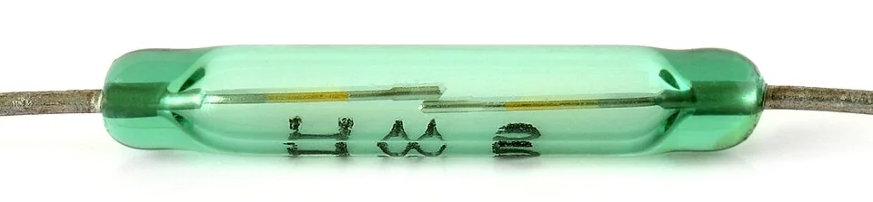

*유리관 가운데에서 두 리드 끝이 **겹쳐 있지만 닿지 않은** 것이 보인다. 자석이 다가오면 두 리드가 서로 반대 극으로 자화되어 끌어당겨 붙는다(접점 ON). 얇은 유리관이라 **충격에 약하다**.*

> [!tip] 감 잡기
> 공압 실린더 몸통에 붙은 작은 센서가 대부분 리드 스위치(또는 홀 센서)다. 피스톤에 박힌 **자석**이 지나갈 때 유리관 속 리드가 붙어 위치를 알린다. 그래서 리드 스위치는 "자기형 근접센서"이면서도 **접점이 있는(유접점)** 스위치다.

## 3. 근접센서 원리 (교재 24절)

**직관**: 금속 탐지기를 떠올리면 된다. 코일에서 나온 교류 자계 속에 금속이 들어오면 금속 안에 **와전류**가 돌면서 코일의 에너지를 빼앗는다. 센서는 "발진이 약해졌다"는 것만 보고 금속이 왔다고 판단한다. 그래서 플라스틱·나무처럼 와전류가 안 생기는 물체는 못 본다.

| 유도형 근접센서 | 정전용량형 근접센서 |
| --- | --- |
| 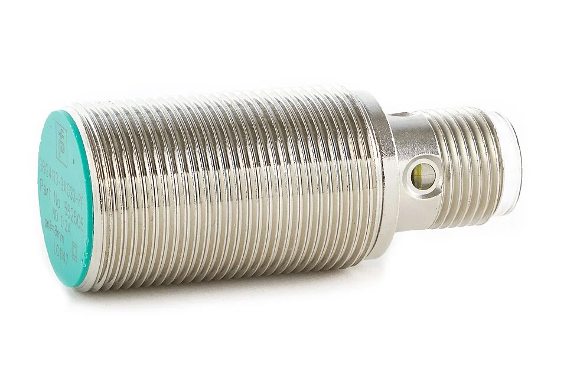 | 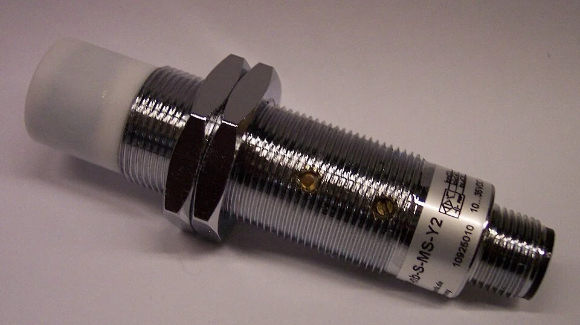 |

*둘 다 겉모습은 나사산이 있는 원통형이고, 패널에 구멍을 뚫어 너트로 조여 고정한다(오른쪽 사진의 육각 너트 두 개). 검출은 끝의 **플라스틱 검출면**에서 일어난다. 왼쪽 유도형은 검출면 안에 코일이, 오른쪽 정전용량형은 전극이 들어 있다. 정전용량형은 몸체에 **감도 조정**부가 있는 것이 보통이다.*

- 공통 장점: 비접촉이라 대상 손상 없음, 물·기름 환경 가능, 반복 정밀도 높음, 무접점이라 수명 길고 응답 빠름. 단점: 검출 거리가 광전(빔) 센서보다 짧고, 유도형은 금속만.

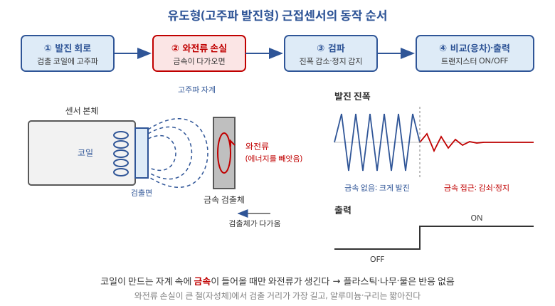

*위의 네 블록이 시험에 나오는 **동작 순서**다. 아래 왼쪽: 코일의 고주파 자계 속에 금속이 들어오면 금속 안에 와전류(빨간 고리)가 돈다. 아래 오른쪽: 그 손실 때문에 발진 진폭이 줄거나 멈추고, 검파·비교 회로가 이를 보고 출력을 ON으로 바꾼다.*

- **유도형(고주파 발진형) 동작 순서**: 코일이 고주파 자계를 만듦 → 금속이 다가오면 **와전류** 발생 → 발진이 약해지거나 멈춤 → 검파 → ON/OFF 출력. 자성체(철)에서 감도가 가장 좋다.
- **정전용량형**: 물체가 다가오면 전극의 정전용량이 늘어남. 모든 물체를 검출하고 색·종류 영향이 없지만, 응답이 느리고 습도 등 환경 영향을 받는다.
- **자기형**: 자석의 자력으로 수 mm 거리에서 신호. 대표는 리드 스위치.
- 헤드 구조는 실드형·비실드형, 출력 회로는 DC 2선식, NPN·PNP 오픈 컬렉터, 아날로그 전압·전류 출력.

$$
C = \varepsilon \frac{A}{d}
$$

*정전용량형은 전극과 물체 사이를 콘덴서로 본다. 물체가 다가오면 거리 $d$가 줄고, 물·플라스틱처럼 유전율 $\varepsilon$이 큰 물체가 들어오면 $C$가 커진다. 그래서 금속이 아니어도 검출된다.*

> [!question] 시험에서는
> "고주파 발진형 근접센서의 설명으로 틀린 것" → "물체가 다가오면 센서 전극의 **+ 전하가 늘어난다**"는 **정전용량형** 원리다. 유도형의 키워드는 **고주파 자계·와전류·발진 감쇠**. 또 유도형으로 검출이 어려운 것은 **플라스틱**이다.

## 4. 근접센서의 용어

**직관**: 방의 온도 조절기가 25 ℃에서 켜지고 25 ℃에서 바로 꺼지면 경계에서 수없이 깜빡인다. 그래서 "25 ℃에서 켜고 26 ℃에서 끈다"처럼 **켜는 점과 끄는 점을 일부러 벌려 둔다.** 근접센서의 응차 거리가 바로 이 간격이다.

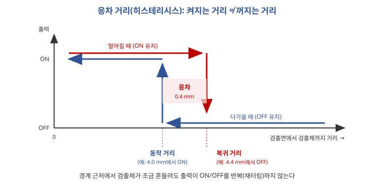

*파란 길(다가올 때)은 4.0 mm에서 ON이 되고, 빨간 길(멀어질 때)은 4.4 mm까지 ON을 유지하다 OFF가 된다. 그 사이 0.4 mm(예시 값)가 **응차**다. 검출체가 경계 근처에서 조금 흔들려도 출력이 떨리지 않는다.*

- **검출 거리**: 표준 검출체가 다가올 때 출력이 바뀌는 거리.
- **응차 거리(히스테리시스)**: 동작 거리와 복귀 거리의 차이 → 경계에서 출력이 떨리는 것(채터링) 방지.
- **응답 주파수**: 1초에 검출할 수 있는 최대 횟수.
- **차폐형 / 비차폐형**: 차폐형은 금속에 묻어 설치 가능, 거리 짧음. 비차폐형은 거리 길지만 주변 금속 영향.

$$
\text{응차 거리} = \text{복귀 거리} - \text{동작 거리}
$$

> [!tip] 감 잡기
> 응답 주파수가 100 Hz인 센서는 1초에 검출체가 **100개**까지 지나가도 하나하나 셀 수 있다. 기어 이빨처럼 빠르게 지나가는 물체를 세려면 응답 주파수부터 확인한다.

## 5. 광전센서 방식

**직관**: 광전센서는 **빛으로 만든 문지방**이다. 빛이 가려지거나(투과·회귀반사) 물체에 맞고 튕겨 오면(확산·한정반사) 신호를 낸다. 빛은 멀리 가고 빠르므로 검출 거리가 길고 응답이 빠르지만, 렌즈에 먼지가 끼면 눈이 가려진다.

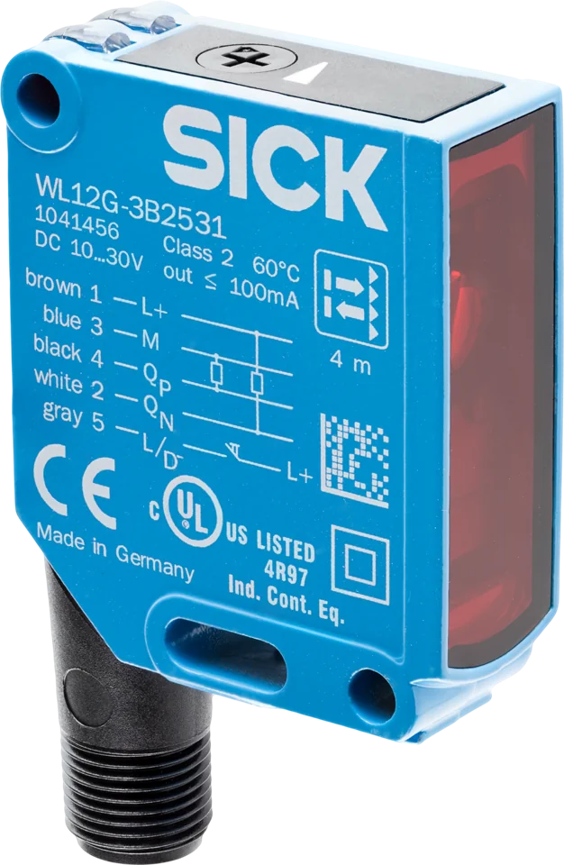

*실제 회귀반사형 광전센서다. 오른쪽 **붉은 렌즈** 안에 투광부와 수광부가 함께 들어 있고, 라벨의 반사판 그림과 "4 m"가 반사판까지의 검출 거리다. 라벨 배선표가 8절의 선 색 규칙(갈색 +V, 청색 0 V, 흑색 출력)과 그대로 맞는다. 맨 아래 gray "L/D"는 Light ON / Dark ON 선택 단자다.*

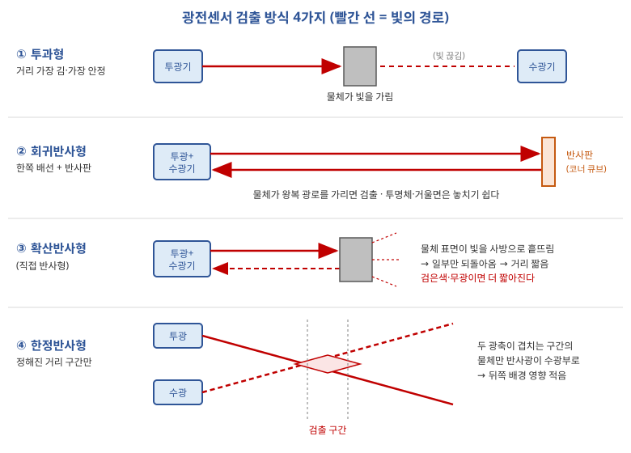

*①·②는 **빛이 끊기면** 검출하고, ③·④는 **물체가 반사한 빛을 받으면** 검출한다. ①은 빛이 한 번만 지나가므로 가장 멀리·안정적으로 검출하고, ③은 물체가 흩뜨린 빛의 일부만 돌아오므로 거리가 짧고 색에 민감하다. ②의 반사판은 빛을 온 방향 그대로 되돌리는 코너 큐브라서, 투명한 병이나 거울면 물체가 끼어도 빛이 충분히 돌아와 놓치기 쉽다.*

| 방식 | 구성 | 장점 | 단점 |
| --- | --- | --- | --- |
| 투과형 | 투광기와 수광기 마주봄 | 검출 거리 가장 길고 안정 | 양쪽 배선, 광축 맞춤 |
| 회귀반사형 | 투수광기 + 반사판 | 한쪽 배선 | 투명체·경면체 검출 약함 |
| 확산반사형 | 투수광기 하나, 물체가 반사 | 설치 간단 | 거리 짧음, 색·재질 영향 |
| 한정반사형 | 특정 거리 구간만 검출 | 배경 영향 적음 | 검출 범위 좁음 |

- 광원: 적외선 LED(거리), 적색 LED(광축 확인 쉬움), 레이저(정밀).
- 광섬유 센서: 앰프와 파이버 분리 → 좁은 공간, 고온 부위.
- 광센서 선정 시 고려: 검출 거리, 응답 속도(동작 속도), 출력 레벨, 신뢰성, 환경. (제조 방식은 사용자가 고려할 항목이 아님)

### Light ON과 Dark ON

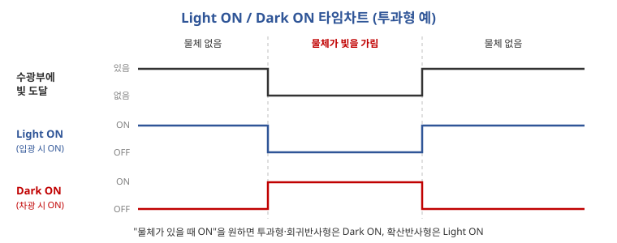

*투과형에서 물체가 빛을 가리는 가운데 구간을 보면, **Light ON**(입광 시 ON)은 꺼지고 **Dark ON**(차광 시 ON)은 켜진다. 같은 센서라도 스위치 하나로 둘 중 하나를 고를 수 있는 제품이 많다.*

> [!question] 시험에서는
> 광전센서 방식 이름으로 **"간접 반사형"은 없다.** 있는 것은 투과형, (미러) 회귀반사형, 직접(확산) 반사형, 한정 반사형. 또 광전센서는 **응답이 빠르다** — "응답 속도가 느리다"는 틀린 보기다.

## 6. 광 소자 정리

**직관**: 광전센서의 "눈"에 해당하는 수광 소자는 두 부류다. 빛을 받으면 **전자가 튀어나와 전류가 생기는 것**(광전 효과: 포토다이오드·포토트랜지스터)과, 빛을 받으면 **저항이 줄어드는 것**(광도전 효과: CdS)이다. 여기에 발광 LED와 수광 소자를 한 몸에 묶은 것이 포토 인터럽터·리플렉터·커플러다.

| CdS 셀 (광도전 소자) | 포토 커플러 (절연용) |
| --- | --- |
| 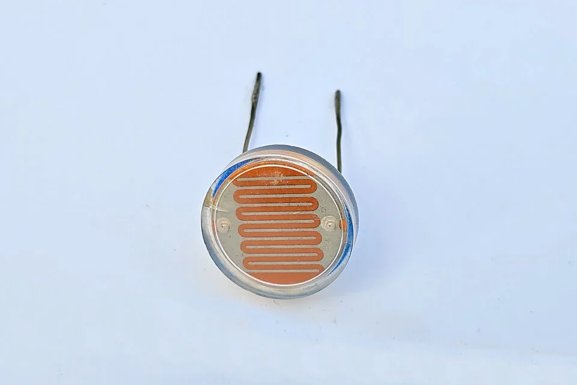 | 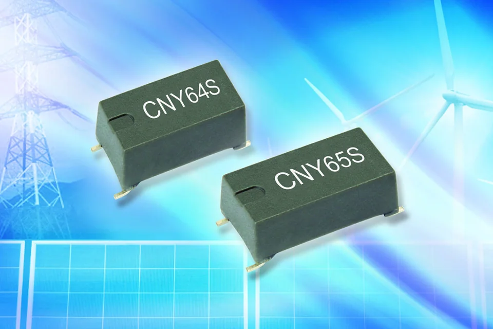 |

*왼쪽 CdS 셀의 주황색 지그재그 띠가 빛을 받는 **광도전 물질(CdS)** 이고, 양옆 은색 면이 전극이다. 띠를 길고 좁게 구불려 놓아 빛에 따른 저항 변화가 크게 드러난다. 빛이 강할수록 저항이 **줄어든다**. 오른쪽 포토 커플러는 몸체 안에 LED와 수광 소자가 마주 보고 들어 있어, 빛으로만 신호를 건네고 **전기적으로는 끊어져(절연)** 있다.*

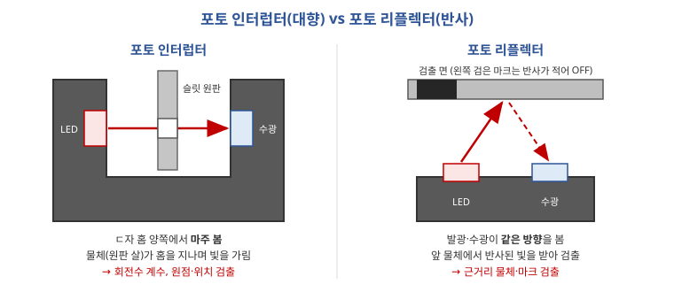

*왼쪽 인터럽터는 원판의 살이 홈을 지날 때마다 빛이 끊겼다 이어져 **펄스**가 나온다(회전수·원점). 오른쪽 리플렉터는 반사가 잘 되는 밝은 면이면 ON, 검은 마크처럼 반사가 적으면 OFF가 되어 마크를 읽는다.*

| 포토 인터럽터 부품(기판에 납땜) | 기구 안에 설치해 쓰는 모습 |
| :-: | :-: |
| 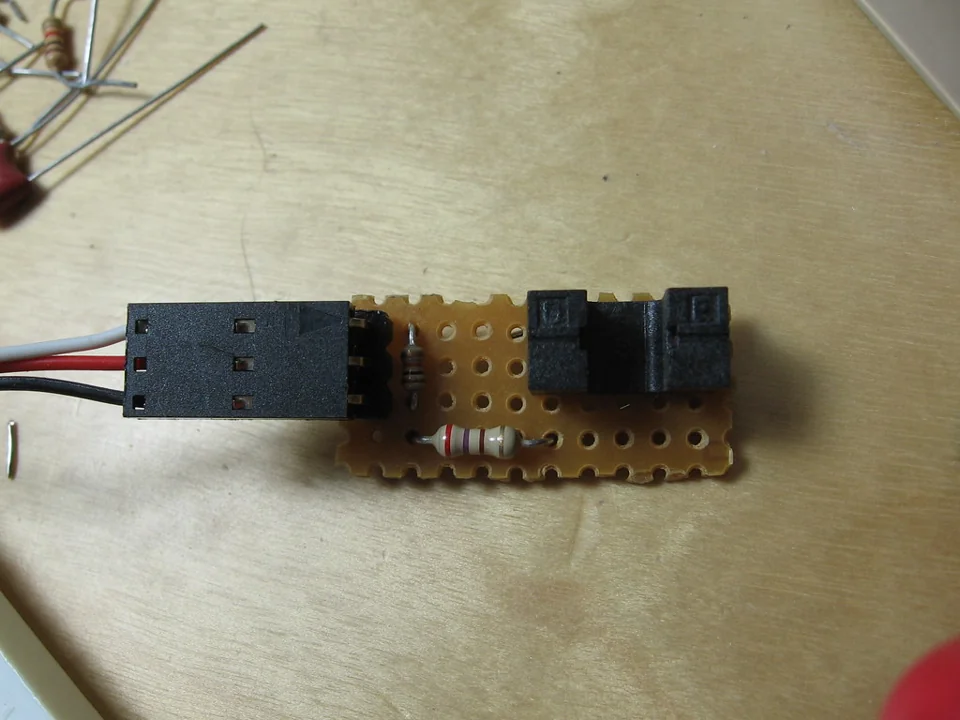 | 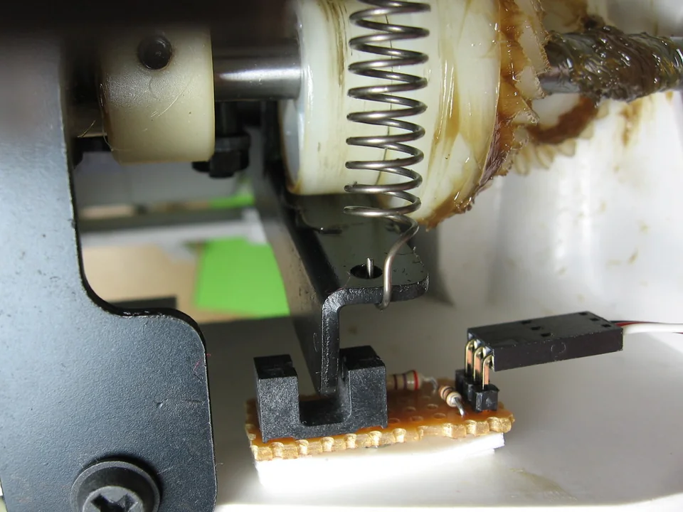 |
| *검은 플라스틱 몸체에 ㄷ자 **홈**이 있고 홈 양쪽이 발광부와 수광부다* | *기구에 달린 검은 막대(플래그)가 홈을 가리면 신호가 변한다 — 원점·끝 위치 검출의 전형적인 쓰임(어떤 기계인지는 사진 설명에 없다)* |

| 소자 | 구조·원리 | 용도 |
| --- | --- | --- |
| 포토다이오드 | 광전 효과, 빠름 | 광량 측정, 통신 |
| 포토트랜지스터 | 광전 효과 + 증폭 | 광전센서 수광부 |
| CdS 셀 | 광도전 효과 (빛 → 저항 감소) | 조도 스위치, 가로등 |
| 포토 인터럽터 | 발광·수광 **대향**, 틈새로 물체 통과 | 회전 원판 계수, 원점 검출 |
| 포토 리플렉터 | 발광·수광 같은 방향, 반사 검출 | 근거리 물체·마크 검출 |
| 포토 커플러 | 발광·수광을 한 패키지에 **절연** 결합 | PLC 입출력 절연 |
| 컬러 센서 | 사람 눈과 비슷한 분광 감도(R·G·B) | 색 판별 |
| 적외선 센서 | 적외선 수광, 감도·응답성 좋고 파장 의존성 있음 | 인체 감지, 비접촉 온도 |

- CdS 셀 사용 온도는 약 −30~60 ℃ (교재 23절). 포토 인터럽터는 소형·경량에 신뢰성·정밀도가 높아 자동문 정지 센서 같은 곳에 쓴다.

> [!tip] 감 잡기
> 이름 끝으로 구분한다. 인터**럽터** = 빛을 **가로막아(interrupt)** 검출 → ㄷ자 홈. 리플**렉터** = **반사(reflect)** 로 검출. **커플러** = 두 회로를 **이어 주되(couple)** 절연 → 검출용이 아니라 신호 전달용.

## 7. 초음파 센서

**직관**: 박쥐나 어군 탐지기처럼 소리를 쏘고 **메아리가 돌아오는 시간**을 잰다. 빛이 아니라 소리의 반사이므로 투명한 유리병도 잘 보이지만, 소리 속도가 온도에 따라 바뀌어 보정이 필요하다.

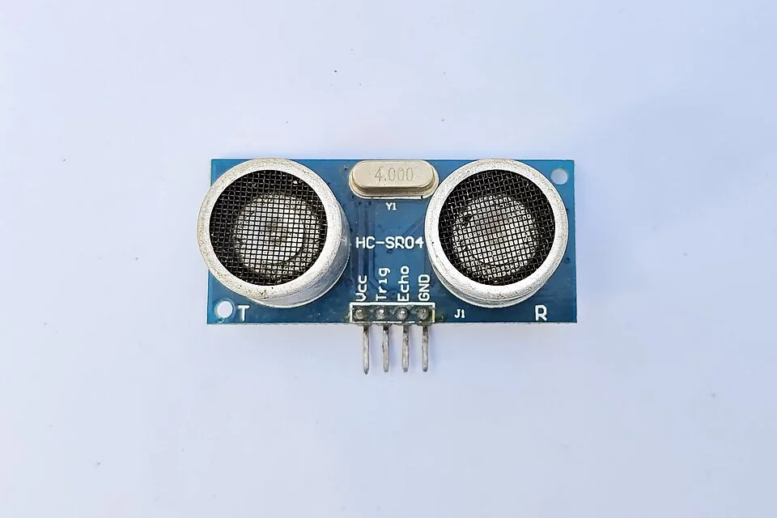

*왼쪽 원통 **T**(Transmitter)가 초음파를 내보내는 송신기, 오른쪽 **R**(Receiver)이 반사파를 받는 수신기다. 둘 다 안에 압전 소자가 들어 있다. Trig 핀으로 발신을 시키면 Echo 핀이 왕복 시간만큼 HIGH가 되어, 그 시간으로 거리를 계산한다.*

- 원리: 압전 소자에 전압을 걸어 초음파 발신(역압전), 반사파를 받아 전압 발생(압전 직접 효과).
- 거리 = 음속 × 왕복 시간 ÷ 2. 거리·두께·액면 측정.
- 장점: 투명체·색과 무관, 먼지·연기에 비교적 강함. 단점: 온도(음속 변화), 흡음재, 근거리 불감대.
- 수치 (교재 24절): 음속은 공기 중 340 m/s, 바닷속 1,480 m/s. 파장은 수 mm~수십 mm. 온도가 오르면 송수신기의 중심 주파수가 내려간다.

$$
L = \frac{v \times t}{2}
$$

**계산 예**: 공기 중에서 반사파가 6 ms 만에 돌아왔다면 $L = \dfrac{340 \times 0.006}{2} = 1.02\text{ m}$. ÷ 2를 빼먹으면 2.04 m로 두 배가 된다 — 소리는 **갔다가 돌아온** 거리를 지났기 때문이다.

> [!question] 시험에서는
> "초음파 센서의 특징으로 틀린 것" → "투명체는 검출할 수 없다"가 틀린 보기다. 소리 반사이므로 **투명체도 검출**한다.

## 8. 출력 형식과 배선

**직관**: 센서 출력은 PLC 입력에 "스위치 하나"를 대신 꽂는 것과 같다. 다만 그 스위치가 트랜지스터라서 **어느 쪽 전원선에 붙어 있느냐**(0 V 쪽이면 NPN, +V 쪽이면 PNP)에 따라 부하를 거는 자리가 달라진다.

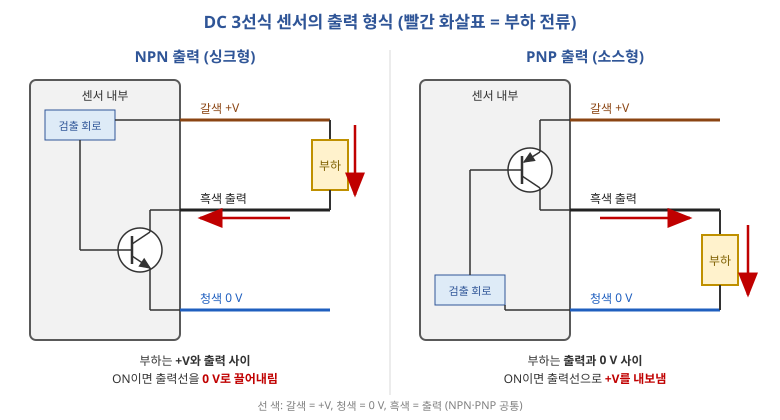

*선 색은 두 형식 모두 갈색 +V, 청색 0 V, 흑색 출력으로 같다. 차이는 센서 안 트랜지스터의 위치다. **NPN**은 출력과 0 V 사이에 있어 전류가 부하 → 센서로 **들어오고(싱크)**, **PNP**는 +V와 출력 사이에 있어 전류가 센서 → 부하로 **나간다(소스)**.*

| 형식 | 배선 | 비고 |
| --- | --- | --- |
| DC 2선식 | 전원과 신호 공용 | 배선 간단, 누설 전류·잔류 전압 주의 |
| DC 3선식 NPN | 갈(+), 청(0V), 흑(출력) | 출력이 0V로 끌어내림 |
| DC 3선식 PNP | 갈(+), 청(0V), 흑(출력) | 출력이 +V를 내보냄 |
| 접점 출력 | 릴레이 | AC·DC 부하 직접 구동 |

- 2선식은 OFF 상태에서도 **누설 전류**가 흘러, 입력 임피던스가 큰 PLC에서 OFF가 안 될 수 있다 → 블리더 저항.

> [!tip] 감 잡기
> 2선식 센서는 자기 회로를 돌릴 전원을 **신호선 두 가닥에서 조금씩 빌려 쓴다.** 그래서 OFF일 때도 수 mA가 흐르고(누설 전류), ON일 때도 몇 V가 센서에 남는다(잔류 전압). PLC 입력 쪽에 병렬로 블리더 저항을 달아 이 누설 전류를 우회시키면 OFF가 확실해진다.

## 9. 센서 선정 순서

**직관**: 센서를 고를 때는 "무엇을 → 어디서 → 어떤 환경에서 → 얼마나 빨리 → 무엇에 연결해서" 순으로 좁혀 간다. 아래 순서가 그대로 체크리스트다.

1. 검출 대상(재질, 크기, 색, 투명도)
2. 검출 거리와 설치 공간
3. 환경(먼지, 기름, 물, 온도, 노이즈)
4. 응답 속도
5. 출력 형식(NPN/PNP, 2선/3선)과 PLC 입력 형식
6. 전원 전압, 보호 등급(IP)

| 검출 조건 | 먼저 떠올릴 센서 |
| --- | --- |
| 금속, 수 mm, 기름·먼지 많음 | 유도형 근접센서 |
| 플라스틱·분말·액체 레벨 | 정전용량형 근접센서 |
| 먼 거리, 빠른 통과 | 투과형 광전센서 |
| 유리병·PET 같은 투명체, 액면 | 초음파 센서 (또는 투명체 전용 광전) |
| 공압 실린더 피스톤 위치 | 리드 스위치·홀 센서 |
| 확실한 기계적 끝 위치, 큰 전류 | 리밋 스위치 |

## 그림

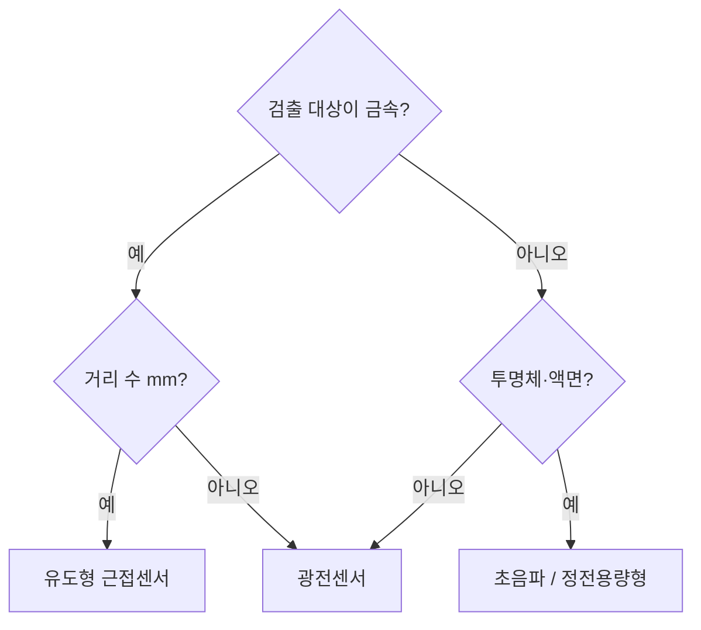

## 기출 포인트

출처: 생산자동화산업기사 2016–2020년 필기 14회분 (cbtbank.kr).

- 광전센서·광 소자 (포토 인터럽터 구조, 포토 커플러, 포토트랜지스터 원리, 반사형 약점, 광전센서 특징·방식 이름, 선정 고려사항, 컬러 센서) — 9회 (2016-1, 2017-1, 2017-3, 2018-1, 2018-3, 2019-1, 2019-3, 2020-1·2, 2020-3)
- 근접센서·접촉 여부 (유도형은 금속만, 전자유도로 금속 판별, 리밋 스위치는 접촉식) — 4회 (2018-1, 2018-2, 2019-3, 2020-1·2)
- 초음파 센서 (거리·두께 측정, 특징으로 틀린 것) — 2회 (2016-1, 2016-2)

**교재 예제 유형** (Win-Q 2025 PART 01 CHAPTER 02, 23~24절): CdS 소자(빛 → 저항), 발광·수광 사이를 물체가 가리는 구조(포토 인터럽터), 유도형으로 감지 어려운 것(플라스틱), 반사로 거리·두께를 재는 센서(초음파), 초음파 센서의 틀린 설명(투명체도 검출됨), 고주파 발진형의 틀린 설명(+ 전하 증가는 정전용량형), 위치·힘 검출 스위치(리밋), 접촉식 스위치(리밋), 투광기·수광기가 있는 스위치(광전), 비접촉식 스위치의 틀린 특징(스위칭이 느리다).

## 관련 단원

- [아날로그 센서와 엔코더](아날로그_센서와_엔코더.md)
- [센서 회로와 신호처리](센서_회로와_신호처리.md)
- [PLC 구성과 특성](PLC_구성과_특성.md)

## 체크리스트

- [ ] 유도형·정전용량형 근접센서의 검출 대상을 구분한다
- [ ] 광전센서 3방식의 장단점을 비교한다
- [ ] Light ON / Dark ON을 구분한다
- [ ] 응차 거리가 필요한 이유를 설명한다
- [ ] 3선식 센서의 선 색깔과 역할을 안다
- [ ] 2선식 센서의 누설 전류 문제를 설명한다
- [ ] 포토 인터럽터와 포토 커플러를 구조·용도로 구분한다
- [ ] 접촉식 / 비접촉식 센서를 분류한다
- [ ] 초음파 센서의 원리(압전)와 투명체 검출 가능 여부를 안다
- [ ] 광전센서 방식 이름 중 없는 것을 골라낸다
- [ ] 유도형 근접센서의 동작 순서(고주파 → 와전류 → 발진 감쇠 → 출력)를 말한다
- [ ] 광전 효과와 광도전 효과를 구분한다

## 참고

- [큐넷 자동화설비산업기사 출제기준](https://www.q-net.or.kr/crf005.do?id=crf00503&jmCd=2034)

### 그림 출처

위키미디어 공용(Wikimedia Commons)과 Openverse에서 가져온 공개 라이선스 자료이고, 노트에 맞게 크기를 줄이고 WebP로 변환했다.

| 그림 | 작성자 | 라이선스 | 출처 |
| --- | --- | --- | --- |
| [Limit Switches](https://commons.wikimedia.org/wiki/File:Limit_Switches.JPG) | Mixabest | [CC BY-SA 3.0](https://creativecommons.org/licenses/by-sa/3.0) | Wikimedia Commons |
| [Z-15GQ22-B Switch MADE IN INDONESIA](https://commons.wikimedia.org/wiki/File:Z-15GQ22-B_Switch_MADE_IN_INDONESIA.jpg) | Helar Lukats | [CC BY-SA 4.0](https://creativecommons.org/licenses/by-sa/4.0) | Wikimedia Commons |
| [Reed switch (aka)](https://commons.wikimedia.org/wiki/File:Reed_switch_(aka).jpg) | André Karwath aka Aka | [CC BY-SA 2.5](https://creativecommons.org/licenses/by-sa/2.5) | Wikimedia Commons |
| [Pepperl+Fuchs inductive proximity switch 3RG4113-3AG33-PF](https://commons.wikimedia.org/wiki/File:Pepperl%2BFuchs_inductive_proximity_switch_3RG4113-3AG33-PF.jpg) | Lucasbosch | [CC BY-SA 3.0](https://creativecommons.org/licenses/by-sa/3.0) | Wikimedia Commons |
| [Capacitiv Proximity Switch](https://commons.wikimedia.org/wiki/File:Capacitiv_Proximity_Switch.jpg) |  | [CC BY-SA 3.0](http://creativecommons.org/licenses/by-sa/3.0/) | Wikimedia Commons |
| [SICK WL12G-3B2531 Photoelectric reflex switch angled1](https://commons.wikimedia.org/wiki/File:SICK_WL12G-3B2531_Photoelectric_reflex_switch_angled1.png) | Lucasbosch | [CC BY-SA 3.0](https://creativecommons.org/licenses/by-sa/3.0) | Wikimedia Commons |
| [25mm light-dependent resistor (LDR) (1)](https://commons.wikimedia.org/wiki/File:25mm_light-dependent_resistor_(LDR)_(1).jpg) | Suyash Dwivedi | [CC BY-SA 4.0](https://creativecommons.org/licenses/by-sa/4.0) | Wikimedia Commons |
| [New CNY64ST and CNY65ST Series High Voltage Isolation Optocouplers](https://www.flickr.com/photos/43093990@N05/6263689593) | Vishay Intertechnology | [CC BY 2.0](https://creativecommons.org/licenses/by/2.0/) | Openverse (flickr) |
| [Photo-interrupter board (front)](https://www.flickr.com/photos/22238428@N05/4278522978) | scanlime | [CC BY-SA 2.0](https://creativecommons.org/licenses/by-sa/2.0/) | Openverse (flickr) |
| [Photo-interrupter mounted](https://www.flickr.com/photos/22238428@N05/4277776529) | scanlime | [CC BY-SA 2.0](https://creativecommons.org/licenses/by-sa/2.0/) | Openverse (flickr) |
| [HC SR04 Ultrasonic Module](https://commons.wikimedia.org/wiki/File:HC_SR04_Ultrasonic_Module.jpg) | Suyash Dwivedi | [CC BY-SA 4.0](https://creativecommons.org/licenses/by-sa/4.0) | Wikimedia Commons |

직접 그린 그림(SVG, 이 볼트용으로 새로 작성): 유도형 근접센서 원리, 응차거리, 광전센서 4방식, LightON DarkON, 포토인터럽터 리플렉터, NPN PNP 배선.

