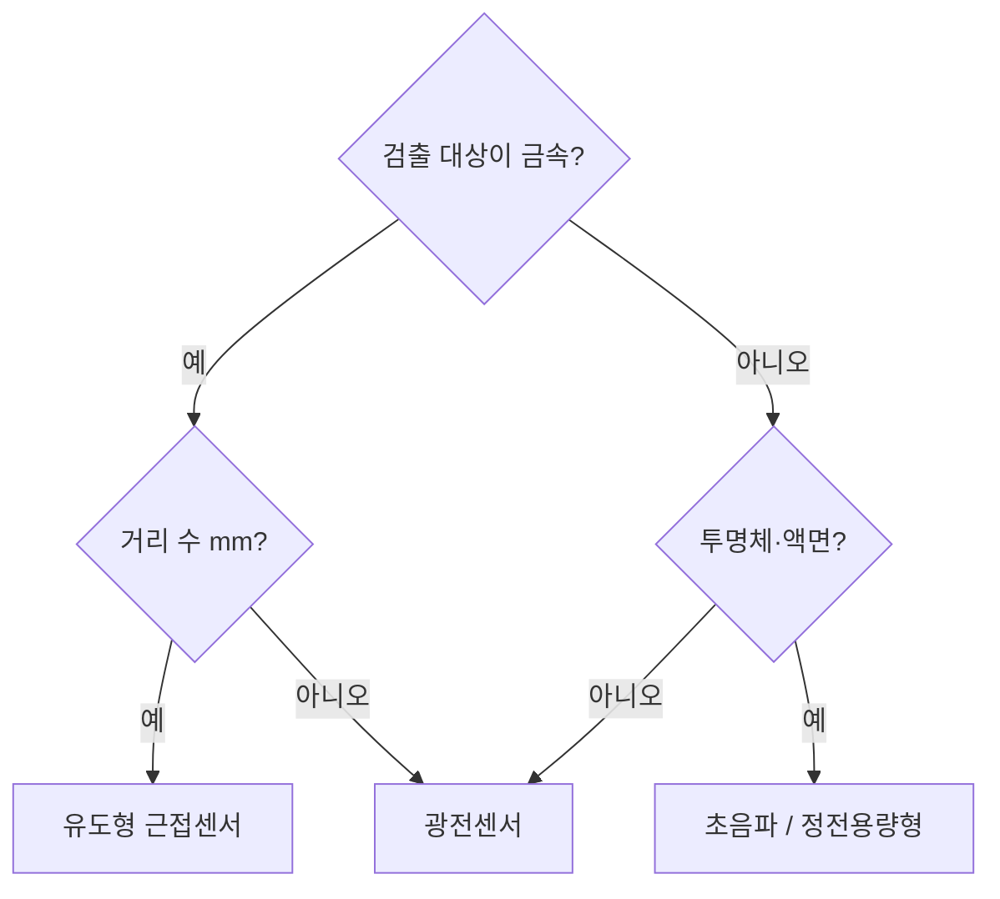

# 근접센서와 광전센서

> [!summary] 핵심 요약
> - **유도형 근접센서**: 고주파 자계 + 와전류 → **금속만** 검출.
> - **정전용량형 근접센서**: 정전용량 변화 → **금속·비금속(물, 분말, 플라스틱, 나무)** 모두 검출.
> - **광전센서** 3방식: 투과형(검출 거리 가장 김, 신뢰성 높음), 회귀반사형(반사판 사용), 확산반사형(물체에 직접 반사, 거리 짧음).
> - 접촉식인 리밋 스위치는 확실하지만 마모가 있고, 비접촉 센서는 수명이 길고 빠르다.

> [!warning] 자주 틀리는 포인트
> - 유도형의 표준 검출 거리는 **철(Fe)** 기준. 알루미늄·구리 같은 비철금속은 **검출 거리가 짧아진다**.
> - 투명체(유리, PET)는 회귀반사형에서 놓치기 쉽다 → 투명체 전용 센서나 초음파 센서.
> - 확산반사형은 물체의 **색·재질·표면 상태**에 따라 검출 거리가 달라진다. 검은색·무광은 짧아진다.
> - **Light ON**: 수광할 때 출력 ON. **Dark ON**: 빛이 가려질 때 출력 ON.
> - 리드 스위치는 **자석**에 반응한다. 공압 실린더 피스톤 위치 검출에 많이 쓴다.
> - **리밋 스위치는 접촉식**이다. 근접·광전·초음파·포토 인터럽터는 비접촉식.
> - 광전센서는 **응답이 빠르고** 검출 거리가 길며 대상이 넓다. "응답 속도가 느리다"는 틀린 말. 단 **먼지·연기·오염에는 약하다** (반사형 특히).
> - 광전센서 방식 이름: 투과형, (미러) 회귀반사형, 직접(확산) 반사형, 한정 반사형. "간접 반사형"은 없다.
> - **포토 인터럽터**: 발광부·수광부가 ㄷ자로 **마주 보고**, 사이를 물체가 가리면 검출 → 회전수·위치·계수. **포토 커플러**: 발광·수광부가 한 패키지 안에서 **전기적으로 절연**된 채 신호 전달 → 절연용.
> - 초음파 센서는 **투명체도 검출**한다(소리 반사이므로). 압전 효과로 송수신하고, 주파수가 높을수록 지향성이 날카롭다. 온도에 따라 음속이 변해 보정이 필요하다.
> - 사람 눈과 비슷한 분광 감도로 색을 구분하는 것은 **컬러 센서**.

## 개념 정리

### 검출 센서 비교

| 센서 | 원리 | 검출 대상 | 특징 |
| --- | --- | --- | --- |
| 리밋 스위치 | 기계적 접촉 | 모든 물체 | 확실, 큰 전류 가능, 마모·채터링 |
| 유도형 근접 | 와전류에 의한 발진 감쇠 | 금속 | 먼지·기름에 강함, 거리 수 mm |
| 정전용량형 근접 | 정전용량 변화 | 금속·비금속 | 레벨 검출, 감도 조정 필요, 습기 영향 |
| 광전 | 빛의 차단·반사 | 대부분 물체 | 거리 길고 빠름, 먼지·외란광 영향 |
| 초음파 | 반사파 왕복 시간 | 투명체·액면 포함 | 색·투명도 무관, 온도 영향 |
| 홀 센서 | 홀 효과 (자계 → 전압) | 자석·자계 | 회전수, BLDC 위치 |
| 리드 스위치 | 자석으로 접점 붙음 | 자석 | 실린더 위치, 무전원 |

### 광전센서 방식

| 방식 | 구성 | 장점 | 단점 |
| --- | --- | --- | --- |
| 투과형 | 투광기와 수광기 마주봄 | 검출 거리 가장 길고 안정 | 양쪽 배선, 광축 맞춤 |
| 회귀반사형 | 투수광기 + 반사판 | 한쪽 배선 | 투명체·경면체 검출 약함 |
| 확산반사형 | 투수광기 하나, 물체가 반사 | 설치 간단 | 거리 짧음, 색·재질 영향 |
| 한정반사형 | 특정 거리 구간만 검출 | 배경 영향 적음 | 검출 범위 좁음 |

- 광원: 적외선 LED(거리), 적색 LED(광축 확인 쉬움), 레이저(정밀).
- 광섬유 센서: 앰프와 파이버 분리 → 좁은 공간, 고온 부위.
- 광센서 선정 시 고려: 검출 거리, 응답 속도(동작 속도), 출력 레벨, 신뢰성, 환경. (제조 방식은 사용자가 고려할 항목이 아님)

### 광 소자 정리

| 소자 | 구조·원리 | 용도 |
| --- | --- | --- |
| 포토다이오드 | 광전 효과, 빠름 | 광량 측정, 통신 |
| 포토트랜지스터 | 광전 효과 + 증폭 | 광전센서 수광부 |
| CdS 셀 | 광도전 효과 (빛 → 저항 감소) | 조도 스위치, 가로등 |
| 포토 인터럽터 | 발광·수광 **대향**, 틈새로 물체 통과 | 회전 원판 계수, 원점 검출 |
| 포토 리플렉터 | 발광·수광 같은 방향, 반사 검출 | 근거리 물체·마크 검출 |
| 포토 커플러 | 발광·수광을 한 패키지에 **절연** 결합 | PLC 입출력 절연 |
| 컬러 센서 | 사람 눈과 비슷한 분광 감도(R·G·B) | 색 판별 |

### 초음파 센서

- 원리: 압전 소자에 전압을 걸어 초음파 발신(역압전), 반사파를 받아 전압 발생(압전 직접 효과).
- 거리 = 음속 × 왕복 시간 ÷ 2. 거리·두께·액면 측정.
- 장점: 투명체·색과 무관, 먼지·연기에 비교적 강함. 단점: 온도(음속 변화), 흡음재, 근거리 불감대.

### 근접센서의 용어

- **검출 거리**: 표준 검출체가 다가올 때 출력이 바뀌는 거리.
- **응차 거리(히스테리시스)**: 동작 거리와 복귀 거리의 차이 → 경계에서 출력이 떨리는 것(채터링) 방지.
- **응답 주파수**: 1초에 검출할 수 있는 최대 횟수.
- **차폐형 / 비차폐형**: 차폐형은 금속에 묻어 설치 가능, 거리 짧음. 비차폐형은 거리 길지만 주변 금속 영향.

### 출력 형식과 배선

| 형식 | 배선 | 비고 |
| --- | --- | --- |
| DC 2선식 | 전원과 신호 공용 | 배선 간단, 누설 전류·잔류 전압 주의 |
| DC 3선식 NPN | 갈(+), 청(0V), 흑(출력) | 출력이 0V로 끌어내림 |
| DC 3선식 PNP | 갈(+), 청(0V), 흑(출력) | 출력이 +V를 내보냄 |
| 접점 출력 | 릴레이 | AC·DC 부하 직접 구동 |

- 2선식은 OFF 상태에서도 **누설 전류**가 흘러, 입력 임피던스가 큰 PLC에서 OFF가 안 될 수 있다 → 블리더 저항.

### 센서 선정 순서

1. 검출 대상(재질, 크기, 색, 투명도)
2. 검출 거리와 설치 공간
3. 환경(먼지, 기름, 물, 온도, 노이즈)
4. 응답 속도
5. 출력 형식(NPN/PNP, 2선/3선)과 PLC 입력 형식
6. 전원 전압, 보호 등급(IP)

## 그림

## 기출 포인트

출처: 생산자동화산업기사 2016–2020년 필기 14회분 (cbtbank.kr).

- 광전센서·광 소자 (포토 인터럽터 구조, 포토 커플러, 포토트랜지스터 원리, 반사형 약점, 광전센서 특징·방식 이름, 선정 고려사항, 컬러 센서) — 9회 (2016-1, 2017-1, 2017-3, 2018-1, 2018-3, 2019-1, 2019-3, 2020-1·2, 2020-3)
- 근접센서·접촉 여부 (유도형은 금속만, 전자유도로 금속 판별, 리밋 스위치는 접촉식) — 4회 (2018-1, 2018-2, 2019-3, 2020-1·2)
- 초음파 센서 (거리·두께 측정, 특징으로 틀린 것) — 2회 (2016-1, 2016-2)

## 관련 단원

- [아날로그 센서와 엔코더](아날로그_센서와_엔코더.md)
- [센서 회로와 신호처리](센서_회로와_신호처리.md)
- [PLC 구성과 특성](PLC_구성과_특성.md)

## 체크리스트

- [ ] 유도형·정전용량형 근접센서의 검출 대상을 구분한다
- [ ] 광전센서 3방식의 장단점을 비교한다
- [ ] Light ON / Dark ON을 구분한다
- [ ] 응차 거리가 필요한 이유를 설명한다
- [ ] 3선식 센서의 선 색깔과 역할을 안다
- [ ] 2선식 센서의 누설 전류 문제를 설명한다
- [ ] 포토 인터럽터와 포토 커플러를 구조·용도로 구분한다
- [ ] 접촉식 / 비접촉식 센서를 분류한다
- [ ] 초음파 센서의 원리(압전)와 투명체 검출 가능 여부를 안다
- [ ] 광전센서 방식 이름 중 없는 것을 골라낸다

## 참고

- [큐넷 자동화설비산업기사 출제기준](https://www.q-net.or.kr/crf005.do?id=crf00503&jmCd=2034)
