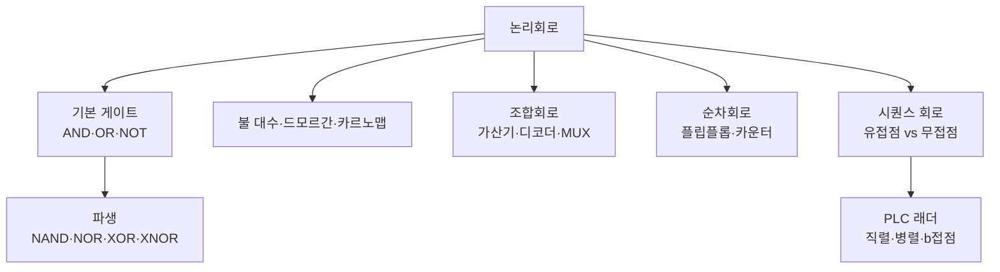
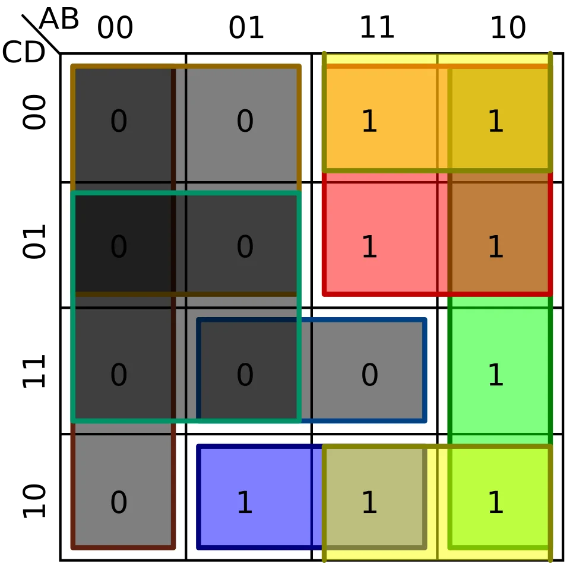
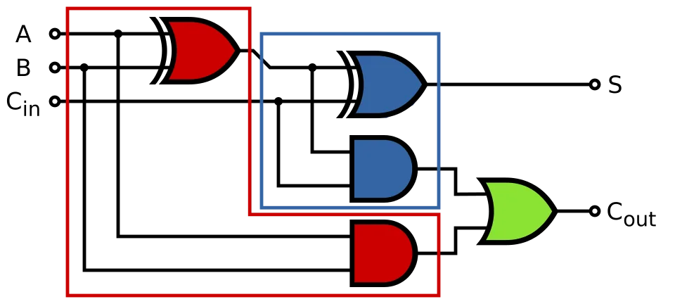
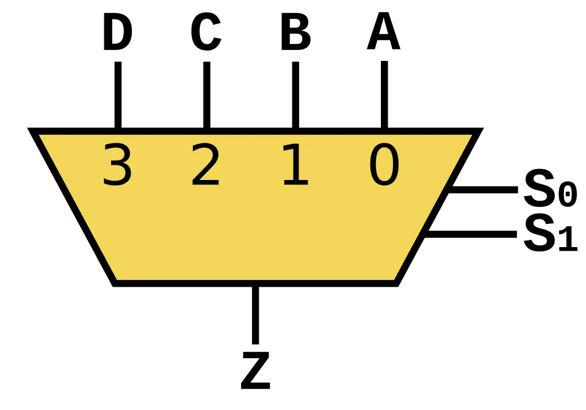
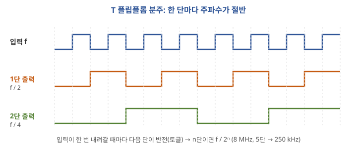
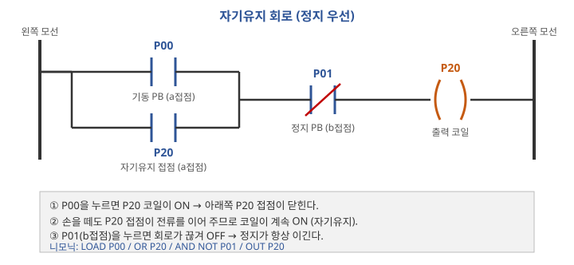
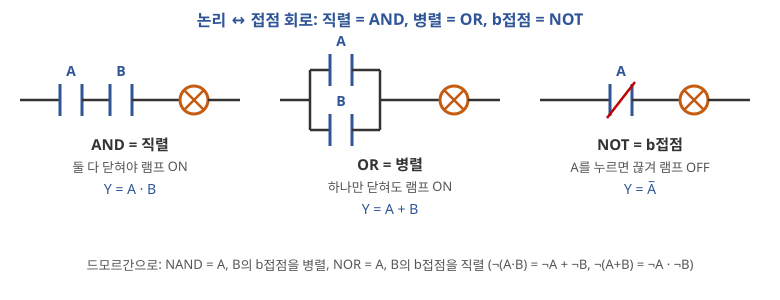

# 논리회로

> [!summary] 핵심 요약
> - 기본 게이트: AND, OR, NOT. 여기서 NAND, NOR, XOR, XNOR가 파생된다. **NAND, NOR는 각각 혼자서 모든 논리를 만들 수 있는 만능 게이트**.
> - 드모르간 정리: $\overline{A \cdot B} = \overline{A} + \overline{B}$, $\overline{A + B} = \overline{A} \cdot \overline{B}$.
> - 래더 대응: **직렬 = AND, 병렬 = OR, b접점 = NOT**.
> - 조합회로는 현재 입력만으로 출력이 정해지고, 순차회로(플립플롭)는 **이전 상태(기억)** 도 출력에 영향을 준다.

> [!warning] 자주 틀리는 포인트
> - XOR는 입력이 **서로 다를 때** 1, XNOR는 **같을 때** 1 (일치 회로).
> - RS 플립플롭에서 S = R = 1은 **금지(부정)** 입력. JK 플립플롭은 이때 **토글(반전)** 한다.
> - $A + AB = A$ (흡수), $A + \overline{A}B = A + B$ — 간략화 문제에서 자주 나온다.
> - 자기유지 회로의 정지 버튼은 **b접점**을 직렬로 넣는다. a접점을 넣으면 평소에 회로가 끊긴다.
> - $A + 1 = 1$ (A가 아님), $A \cdot 1 = A$ (1이 아님), $A + 0 = A$ (0이 아님). 기본 법칙 보기에서 하나씩 바꿔 낸다.
> - **쌍대(双對)**: AND ↔ OR, **1 ↔ 0** 을 바꾼다. 변수에 보수를 붙이지 않는다 (보수까지 붙이면 드모르간).
> - NAND 뒤에 NOT을 붙이면 **AND**, NOR 뒤에 NOT을 붙이면 **OR**.
> - JK 플립플롭에서 J = K = 1로 묶으면 **T 플립플롭**과 같다. RS에서 S = 0, R = 1이면 Q = **0**(리셋).
> - **유접점(릴레이) 시퀀스는 소비 전력이 크다**. 무접점이 빠르고 수명이 길고 소형이지만, 큰 부하를 직접 자주 개폐하는 것은 유접점(전자석) 쪽 장점이다.

## 학습 목표

이 단원을 마치면 다음을 할 수 있어야 한다.

1. AND·OR·NOT·NAND·NOR·XOR·XNOR의 진리표를 보지 않고 쓴다.
2. 불 대수 기본 법칙과 드모르간 정리로 논리식을 간략화한다.
3. 카르노 맵에서 1을 2의 거듭제곱 개로 묶어 최소 논리식을 구한다.
4. 조합회로(가산기·디코더·멀티플렉서)와 순차회로(플립플롭·카운터)를 구분한다.
5. RS·JK·D·T 플립플롭의 동작과 T 플립플롭 분주($f/2^n$)를 계산한다.
6. 논리를 래더(직렬 = AND, 병렬 = OR, b접점 = NOT)로 옮기고 자기유지·인터록을 만든다.

## 한눈에 보기

## 개념 정리

### 기본 게이트와 진리표

**비유**: 스위치 두 개로 전등을 켜는 방법이 전부다. **AND**는 둘 다 눌러야, **OR**는 하나만 눌러도, **NOT**은 누르면 오히려 꺼진다. 나머지 게이트는 이 세 가지를 조합한 변형이다.

*왼쪽부터 AND(둥근 몸통), OR(뾰족한 몸통), NOT(삼각형 + 끝의 작은 원). 끝에 작은 원이 붙으면 "반전"이라는 뜻이므로 AND에 원이 붙으면 NAND, OR에 원이 붙으면 NOR다.*

| A | B | AND | OR | NAND | NOR | XOR | XNOR |
| :-: | :-: | :-: | :-: | :-: | :-: | :-: | :-: |
| 0 | 0 | 0 | 0 | 1 | 1 | 0 | 1 |
| 0 | 1 | 0 | 1 | 1 | 0 | 1 | 0 |
| 1 | 0 | 0 | 1 | 1 | 0 | 1 | 0 |
| 1 | 1 | 1 | 1 | 0 | 0 | 0 | 1 |

- NOT: 입력을 반전. $Y = \overline{A}$
- XOR 식: $Y = A\overline{B} + \overline{A}B = A \oplus B$

### 불 대수 기본 법칙

**직관**: 불 대수는 값이 0과 1뿐인 계산이다. 그래서 $A + A = A$처럼 일반 수학과 다른 규칙이 있다. 식을 단순하게 만들수록 필요한 게이트·접점·스텝 수가 줄어든다.

| 법칙 | 식 |
| --- | --- |
| 항등 | $A + 0 = A$, $A \cdot 1 = A$ |
| 지배(소거) | $A + 1 = 1$, $A \cdot 0 = 0$ |
| 동일 | $A + A = A$, $A \cdot A = A$ |
| 보원 | $A + \overline{A} = 1$, $A \cdot \overline{A} = 0$ |
| 이중 부정 | $\overline{\overline{A}} = A$ |
| 흡수 | $A + AB = A$, $A(A + B) = A$ |
| 분배 | $A(B + C) = AB + AC$, $A + BC = (A + B)(A + C)$ |
| 드모르간 | $\overline{A \cdot B} = \overline{A} + \overline{B}$, $\overline{A + B} = \overline{A} \cdot \overline{B}$ |

**간략화 예**: $Y = AB + A\overline{B} = A(B + \overline{B}) = A$

**간략화 예 2 (드모르간)**: $Y = \overline{\overline{A} + \overline{B}} + \overline{A}B$
- 드모르간: $\overline{\overline{A} + \overline{B}} = AB$ → $Y = AB + \overline{A}B = B(A + \overline{A}) = B$

**간략화 예 3 (흡수)**: $Y = A(A + B) + BC\overline{C} = A + 0 = A$

**쌍대 예**: $A + 0 = A$ 의 쌍대는 $A \cdot 1 = A$, $A(B + C) = AB + AC$ 의 쌍대는 $A + BC = (A + B)(A + C)$.

### 카르노 맵 요령

**비유**: 카르노 맵은 진리표를 **이웃끼리 모이게 다시 배치한 지도**다. 이웃한 칸은 변수가 하나만 다르므로, 이웃한 1을 묶으면 그 변수가 식에서 사라진다.

*색 상자 하나가 묶음 하나다. 열 순서가 00 → 01 → 11 → 10(그레이 코드)이라서 바로 이웃한 칸의 변수가 하나만 다르다. 노란 상자처럼 가장자리를 넘어 위·아래 끝칸을 한 묶음으로 잡을 수도 있다.*

- 인접한 칸은 변수 하나만 다르게 배치한다 (그레이 코드 순서 00 → 01 → 11 → 10).
- 1을 **2의 거듭제곱 개(1, 2, 4, 8)** 단위로, 가능한 한 크게 묶는다. 맨 끝 칸끼리도 이웃이다.
- 묶음 안에서 값이 바뀌는 변수는 사라지고, 그대로인 변수만 남는다.
- **예 (3변수)**: 1인 칸이 $\overline{A}\,\overline{B}C$, $\overline{A}BC$, $ABC$, $A\overline{B}C$ 네 칸(C = 1인 줄 전체) → 한 번에 묶여 $Y = C$.
- 진리표에서 식 고르기: 출력이 **입력이 다를 때만 1**이면 XOR, **같을 때만 1**이면 XNOR, **둘 다 1일 때만 0**이면 NAND.

### 조합회로와 순차회로

**비유**: 조합회로는 **계산기**(지금 누른 숫자만으로 결과가 나온다), 순차회로는 **시계**(이전 상태를 기억해야 다음 시각이 정해진다)다.

*A, B, 아랫자리 올림 $C_{in}$ 세 입력을 더한다. 빨간 상자와 파란 상자가 각각 반가산기(합 = XOR, 올림 = AND)이고, 초록 OR가 두 올림을 합친다. 본문의 "전가산기 = 반가산기 2개 + OR"가 이 그림이다.*

*입력 4개(0~3) 가운데 선택선 $S_1S_0$의 값에 해당하는 하나만 출력 Z로 나간다. 디코더·인코더와 함께 "조합회로"의 대표 부품이다.*

| 구분 | 조합회로 | 순차회로 |
| --- | --- | --- |
| 출력 결정 | 현재 입력만 | 현재 입력 + 이전 상태 |
| 기억 | 없음 | 있음 (플립플롭) |
| 예 | 가산기, 디코더, 인코더, 멀티플렉서 | 카운터, 레지스터, 자기유지 회로 |

- **반가산기**: 합 $S = A \oplus B$, 자리올림 $C = AB$.
- **디코더**: n비트 입력 → $2^n$개 출력 중 하나 선택. **인코더**는 그 반대.
- **멀티플렉서(MUX)**: 여러 입력 중 하나를 선택 신호로 골라 출력.
- **7세그먼트 표시**: 숫자(BCD) → 각 세그먼트 a~g 신호로 바꾸는 것은 **디코더(BCD-to-7세그먼트)**. 공통 캐소드는 1에서 점등, 공통 애노드는 0에서 점등.
  - 예: 공통 캐소드에서 비트를 (g f e d c b a) 순으로 놓으면 "1"은 b, c만 켜서 `000 0110` = 06H.
- **전가산기**: 반가산기 2개 + OR. 아랫자리 자리올림까지 3입력을 더한다.

### 유접점 시퀀스와 무접점 시퀀스

**직관**: 릴레이는 **기계식 스위치**라 느리고 닳지만, 큰 전류를 직접 끊고 노이즈에 강하다. 반도체 논리는 **전자식 스위치**라 빠르고 오래 가지만 전기적 노이즈와 서지에 약하다. 장단이 맞바뀌는 보기가 자주 나온다.

| 항목 | 유접점 (릴레이) | 무접점 (반도체 논리) |
| --- | --- | --- |
| 동작 속도 | 느림 (ms) | 빠름 |
| 수명 | 접점 마모로 짧음 | 길다 (기계적 가동부 없음) |
| 소비 전력 | **크다** (코일 전류) | 작다 |
| 진동·충격 | 약함 | 강함 |
| 노이즈·서지 | 강함 | 약함 |
| 크기 | 큼 | 소형, 복잡한 회로도 가능 |
| 개폐 부하 | 큰 부하를 직접·빈번히 개폐 가능 | 출력 소자 필요 |
| 독립 접점 | 한 릴레이로 여러 독립 회로 개폐 | – |

- 무접점 시퀀스 구성: **입력 회로**(검출기 신호 정리) → **논리(제어) 회로**(판단, 조작 명령 결정) → **출력 회로**(조작기기 구동), + 전원. 공기압 회로는 구성 요소가 아니다.

**교재(31절)로 보충**

- **시퀀스 제어**: 정해진 순서대로 진행. 비교·검출·조정은 하지 않는다 → "전기로 온도 제어"는 시퀀스 제어가 아니다(피드백 제어).
- 접점: **a접점**(평소 열림, 동작하면 닫힘), **b접점**(평소 닫힘), **c접점**(a + b 전환형).
- **검출부**: 리밋·광전·근접·리드·플로트 스위치, 열전쌍, 각종 센서. **타이머는 검출부가 아니다**(제어부 요소).
- 유접점: 자유롭게 구성, 대신 부피 크고 **반응 지연·스파크**, 회로가 복잡하면 읽기 어렵다.

| 무접점 릴레이(SSR) | 내용 |
| --- | --- |
| 장점 | 빠른 반응, 마모 없음(장수명), 스파크·소음 없음, 소형 |
| 단점 | 닫혔을 때도 임피던스가 남음(전압 강하·발열), 열렸을 때 **누설 전류**, 순간 서지·노이즈에 약함, 비쌈 |

- "전자 제어(무접점) 방식은 노이즈에 강하다"는 **틀린 보기**. 무접점은 수명·속도는 좋지만 전기적 노이즈에 약하다.
- "유접점 시퀀스는 소비 전력이 비교적 작다"도 틀린 보기 (코일 전류 때문에 크다).

### 플립플롭

**비유**: 플립플롭은 **전등 스위치 하나짜리 메모**다. 한 번 켜 두면 다음 신호가 올 때까지 상태를 기억한다.

*1단 출력은 입력의 절반, 2단 출력은 1/4 주파수다. T 플립플롭 n단이면 $f_{out} = f_{in}/2^n$이므로, 교재 예의 8 MHz를 5단에 통과시키면 250 kHz가 된다.*

| 종류 | 입력 | 동작 요점 |
| --- | --- | --- |
| RS | S(세트), R(리셋) | S=1 → Q=1, R=1 → Q=0, 둘 다 1 금지 |
| JK | J, K | RS와 같지만 J=K=1이면 토글 |
| D | D | 클록에서 D 값을 그대로 저장 (지연·래치) |
| T | T | T=1이면 클록마다 반전 → 2분주, 카운터 |

**진리표 (교재 32절)**

| 입력 | RS 플립플롭 | JK 플립플롭 |
| --- | --- | --- |
| 0, 0 | 불변 | 불변 |
| 0, 1 (S·J = 0, R·K = 1) | 리셋 (Q = 0) | 리셋 (Q = 0) |
| 1, 0 | 세트 (Q = 1) | 세트 (Q = 1) |
| 1, 1 | **불확정(금지)** | **반전(토글)** |

- **T 플립플롭 분주**: n단을 거치면 출력 주파수 $f_{out} = \dfrac{f_{in}}{2^n}$.
  - **계산 예 (교재 32-5)**: 8 MHz를 5단 → $8000\text{ kHz} / 2^5 = $ **250 kHz**
- 플립플롭은 다음 입력이 올 때까지 상태를 유지하는 **기억 소자**다 (집적회로의 레지스터·카운터).

### 시퀀스 기본 회로 (교재 32절)

**직관**: 시퀀스 회로의 거의 전부는 AND·OR·NOT과 "자기 출력을 다시 입력에 되먹이는 것(자기유지)"의 조합이다.

*정지 우선 자기유지: 기동 접점과 자기 접점이 병렬(OR), 정지 b접점이 직렬(AND NOT)이다. 식으로는 $Y = (\text{START} + Y)\cdot\overline{\text{STOP}}$.*

- 회로는 병렬로 그려져 있어도 동시에 동작하지 않는다. **왼쪽에서 오른쪽, 위 줄부터 한 줄씩** 읽는다.

| 회로 | 동작 |
| --- | --- |
| AND / OR / NOT | 모두 입력 시 출력 / 하나만 입력돼도 출력 / 입력과 반대(b접점) |
| 자기유지 | 한 번 들어온 신호를 자기 접점으로 계속 유지 |
| 기동 우선 / 정지 우선 | 기동·정지가 동시에 들어올 때 어느 쪽이 이기는지. 접점 배치를 바꿔 만든다 |
| 인터로크 | 한쪽이 동작 중이면 다른 쪽 동작을 **금지** (상대의 b접점). 기기 보호·작업자 안전 |
| 신입 신호 우선 | **새로 들어온 신호**가 앞의 신호를 끊고 동작 |
| 우선 동작 순차 | 정해진 순서대로만 동작 |
| 일치 회로 | 두 입력이 같을 때 출력 (XNOR). 다를 때 출력은 Ex-OR |
| 한시 동작 / 순시 동작 한시 복귀 | 설정 시간 뒤 동작 / 바로 동작하고 설정 시간 뒤 복귀 |
| 일정 시간 동작 | 스위치를 켜면 바로 동작, 설정 시간 뒤 정지 |
| 촌동(인칭) | **누르는 동안만** 동작 (자기유지 없음), 의도치 않은 동작 방지 |
| 플리커 | 설정 간격으로 ON/OFF 반복 (경고등) |
| 캐스케이드 | 신호 간섭을 피하려고 에너지원을 그룹별로 순차 공급 (공압 회로, 밸브가 많으면 압력 저하 주의) |

- **퀴즈 게임 인터로크 (교재 32-4)**: 출연자가 4명이면 한 명의 회로에 **다른 3명의 b접점**이 필요하다 → 최소 3개.

### PLC 래더와의 대응

**직관**: 논리 기호가 그림으로 바뀌었을 뿐이다. 직렬은 AND, 병렬은 OR, b접점은 NOT으로 읽으면 어떤 래더든 불 대수 식으로 옮길 수 있다.

*램프가 켜지는 조건이 곧 논리식이다. 아래 표의 "AND·OR·NOT" 세 줄이 이 그림 세 칸에 그대로 대응한다.*

| 논리 | 래더 표현 | 비고 |
| --- | --- | --- |
| AND | a접점 직렬 | 두 조건 모두 만족 |
| OR | a접점 병렬 | 하나만 만족해도 |
| NOT | b접점 | 신호가 없을 때 통전 |
| 자기유지 (RS의 래더판) | 기동 a접점 ∥ 출력 자기 a접점, 정지 b접점 직렬 | 정지 우선형 |
| 인터록 | 상대 출력의 b접점을 직렬 | 정·역 동시 투입 방지 |
| SET / RST 명령 | 래치형 출력 | 자기유지를 명령 하나로 |

자기유지 식(정지 우선): $Y = (\text{START} + Y) \cdot \overline{\text{STOP}}$

## 그림

## 기출 포인트

출처: 생산자동화산업기사 2016–2020년 필기 14회분 (cbtbank.kr). 옛 시험에서 가장 자주 나온 주제 가운데 하나.

- 불 대수 간략화 (드모르간, 흡수, 그림의 논리회로 → 식) — 8회 (2016-1, 2017-2, 2017-3, 2018-3, 2019-1, 2019-3, 2020-3 ×2)
- 불 대수 기본 법칙·쌍대 정리 (틀린 식 고르기) — 4회 (2016-3, 2017-2, 2019-3, 2020-1·2)
- 게이트·진리표 판별 (NAND 식, NAND + NOT, 진리표 → 기호·XOR, 등가 회로, 접점 회로 → 논리 기호) — 7회 (2016-2, 2017-2, 2018-1, 2018-2, 2018-3, 2020-1·2, 2020-3)
- 카르노 맵 읽기 — 1회 (2019-1)
- 반가산기 회로 이름 — 1회 (2016-2)
- 플립플롭 (RS 출력, T 플립플롭, JK에서 J = K = 1) — 3회 (2016-3, 2018-1, 2018-3)
- 유접점·무접점 시퀀스 비교, 무접점 시퀀스 구성 — 4회 (2017-1, 2018-3, 2020-3 ×2)
- 7세그먼트·FND 표시 데이터, 디코더 — 2회 (2016-3, 2017-1)

**교재 예제 유형** (32절): 동작 중 접점으로 다른 기기 동작 금지(인터로크), 켜자마자 동작하고 일정 시간 뒤 정지(일정 시간 동작 회로), PLC 프로그램 → Ex-OR, 퀴즈 4명 b접점 3개, 5단 T-FF 250 kHz, RS S=0·R=1 → 0, JK J=0·K=1 → 0.

**교재 예제 유형** (Win-Q 2025 PART 01 CHAPTER 01, 31절): 시퀀스 제어가 아닌 것(전기로 온도 제어), 검출부가 아닌 것(타이머), 유접점 단점이 아닌 것(소비 전력이 작다), 전자 제어 방식의 틀린 설명(노이즈에 강하다), PLC 명령표 빈칸 채우기.

## 관련 단원

- [PLC 구성과 특성](PLC_구성과_특성.md)
- [PLC 프로그래밍 언어와 명령어](PLC_프로그래밍_언어와_명령어.md)
- [전동기 제어회로와 보호](전동기_제어회로와_보호.md)
- [출제기준 요약](../01_시험안내/출제기준_2027-2030.md)

## 체크리스트

- [ ] 7개 게이트 진리표를 보지 않고 쓸 수 있다
- [ ] 드모르간 정리로 NAND/NOR 식을 바꿀 수 있다
- [ ] 흡수 법칙으로 식을 간략화할 수 있다
- [ ] 4변수 카르노 맵을 묶을 수 있다
- [ ] RS·JK·D·T 플립플롭의 차이를 말할 수 있다
- [ ] 자기유지·인터록 래더를 논리식으로 쓸 수 있다
- [ ] 이중 부정이 섞인 식을 드모르간으로 한 변수까지 줄인다
- [ ] 쌍대 정리와 드모르간 정리의 차이를 안다
- [ ] 진리표만 보고 XOR·XNOR·NAND를 고른다
- [ ] 유접점·무접점 시퀀스의 장단점(특히 소비 전력)을 비교한다
- [ ] 7세그먼트 숫자 표시 데이터를 16진수로 쓴다

## 참고

- [큐넷 자동화설비산업기사 출제기준](https://www.q-net.or.kr/crf005.do?id=crf00503&jmCd=2034)

### 그림 출처

위키미디어 공용(Wikimedia Commons)과 Openverse에서 가져온 공개 라이선스 자료이고, 노트에 맞게 크기를 줄이고 WebP로 변환했다.

| 그림 | 작성자 | 라이선스 | 출처 |
| --- | --- | --- | --- |
| [LogicGates](https://commons.wikimedia.org/wiki/File:LogicGates.svg) | User:Vaughan Pratt | [CC BY 3.0](https://creativecommons.org/licenses/by/3.0) | Wikimedia Commons |
| [Karnaugh map KV K-map 2](https://commons.wikimedia.org/wiki/File:Karnaugh_map_KV_K-map_2.svg) | RosarioVanTulpe | 퍼블릭 도메인 | Wikimedia Commons |
| [Full Adder Modules](https://commons.wikimedia.org/wiki/File:Full_Adder_Modules.svg) | inductiveload | 퍼블릭 도메인 | Wikimedia Commons |
| [Multiplexer 4-to-1](https://commons.wikimedia.org/wiki/File:Multiplexer_4-to-1.svg) | en:User:Cburnett | [CC BY-SA 3.0](http://creativecommons.org/licenses/by-sa/3.0/) | Wikimedia Commons |

직접 그린 그림(SVG, 이 볼트용으로 새로 작성): 분주 타임차트, 자기유지 래더, 논리 접점대응.

