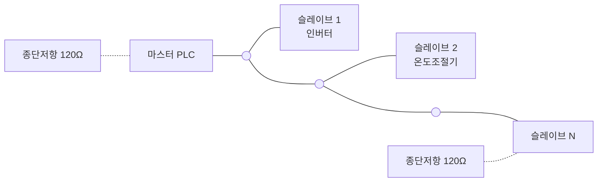

# 데이터 통신

> [!summary] 핵심 요약
> - PLC 통신은 대부분 **직렬·비동기** 방식. 한 글자 = 스타트 비트 + 데이터(7/8) + 패리티 + 스톱 비트(1/2).
> - **RS-232C**는 1:1, 단일 종단, 약 15 m. **RS-485**는 차동 신호, 1:N 멀티드롭(32대), 약 1.2 km.
> - 오류 **검출**: 패리티, 체크섬, CRC. 오류 **정정**: 해밍 코드.
> - 산업용 네트워크: Modbus, Profibus, DeviceNet, CC-Link, EtherCAT, PROFINET, EtherNet/IP.

> [!warning] 자주 틀리는 포인트
> - RS-232C는 **전이중**, RS-485(2선)는 **반이중**. 4선 RS-485/RS-422는 전이중.
> - 차동(평형) 전송이 노이즈에 강한 이유: 두 선에 같이 실린 잡음(공통 모드)은 차이를 볼 때 상쇄된다.
> - RS-485 버스 양 끝에 **종단 저항(약 120 Ω)** 을 단다. 빠지면 반사로 통신 오류.
> - 패리티는 **1비트 오류만** 검출하고, 짝수 개 비트가 틀리면 못 잡는다. 정정은 못 한다.
> - CSMA/CD는 **이더넷**, 토큰 패싱은 **링/토큰 버스**.
> - **1비트 전송 시간 = 1 / 통신 속도(bps)**. 9600 bps → 약 104 μs, 4800 bps → 약 208 μs. 단위(ms, μs)를 꼭 맞춘다.
> - RS-232C 직결 시 내 **RXD는 상대 TXD**에 연결한다 (RXD끼리 연결하면 통신 안 됨).
> - RS-422은 **비트 단위 직렬** 전송이다. "1바이트(8비트)씩 한꺼번에 보낸다"는 병렬 전송 설명이라 틀린 보기.
> - 스트로브·핸드셰이크(애크놀리지) 방식은 **병렬** 전송에서 쓰는 동기 방법이다. 단방향·반이중·전이중은 직렬 통신의 방향 분류.
> - **GPIB(IEEE-488)는 병렬** 계측기 버스. USB, RS-232C, RS-422, RS-485는 직렬.
> - 통신 속도 단위 **baud**는 초당 신호 변화(심볼) 수, **bps**는 초당 비트 수. 2진 신호에서는 값이 같다.

## 개념 정리

### 전송 방식

| 구분 | 내용 |
| --- | --- |
| 병렬 전송 | 여러 비트를 여러 선으로 동시에. 빠르지만 근거리 |
| 직렬 전송 | 한 선으로 비트를 차례로. 원거리, 배선 적음 |
| 비동기식 | 글자마다 스타트/스톱 비트로 맞춤 (조보식) |
| 동기식 | 클록 또는 동기 문자로 블록 단위 전송, 효율 높음 |
| 단방향(Simplex) | 한쪽으로만 (방송) |
| 반이중(Half duplex) | 양방향이지만 번갈아 (무전기) |
| 전이중(Full duplex) | 양방향 동시 (전화) |

**속도 계산 예**: 9600 bps, 8N1 (스타트 1 + 데이터 8 + 스톱 1 = 10비트) → 초당 960글자.

**1비트 시간 계산 예**: 19200 bps → $\dfrac{1}{19200} \approx 52\ \mu s$, 2048 bps → $\dfrac{1}{2048} \approx 0.488\ \text{ms}$

- 직렬 전송: 선 하나로 1비트씩 → **느리지만 배선비가 싸고 원거리**에 유리.
- 병렬 전송: 데이터 비트 수만큼 선 → 빠르지만 근거리. 수신 시점을 **스트로브 신호와 ACK(애크놀리지)** 로 맞춘다 (프린터 센트로닉스, GPIB).
- **베이스밴드**: 디지털 신호를 그대로 한 채널로 전송 (이더넷 대부분). **브로드밴드**: 반송파로 변조해 **한 매체에 여러 채널을 동시에** 실어 전송.
- **USB**: 직렬 버스, 플러그 앤 플레이, 핫 플러그(전원 켠 채, **OS 종료 없이** 연결·분리), 허브로 여러 장치 연결.
- **캐리어밴드**: 반송파 하나에 신호를 실어 보내는 방식 (베이스밴드와 브로드밴드의 중간).
- LAN 방식 예: 토큰 링(토큰 패싱), 이더넷(기가비트), 무선 랜. 토큰 링은 **망 방식**이지 대역 방식(브로드밴드)이 아니다.

**교재(34절)의 표현으로 정리**

- 병렬 통신: 한꺼번에 빠르게, 비쌈, 짧은 거리. 직렬 통신: 1비트씩 한 선으로, 비용이 싸고 요즘은 속도도 충분해 가장 많이 쓴다.
- 교재는 **동기식 = 수신 측 상태를 확인하고 전송**, **비동기식 = 확인하지 않고 전송**으로 설명한다. 비동기식 직렬 전송 장치가 **UART**이며 노이즈와 거리에 약하다. (일반 자료의 설명: 동기식은 공통 클록·동기 문자로 블록 전송, 비동기식은 글자마다 스타트·스톱 비트)
- 비동기 프레임 예: 시작 1 + 데이터 8 + 패리티 1 + 정지 1 = **11비트**. UART 프레임 구성 요소가 아닌 것: "체크"(교재 34-5).
- **baud rate**는 신호 변화 속도(통신 속도), **bps**는 초당 전송 비트 수. 1신호에 1비트면 둘의 값이 같다.

### 직렬 인터페이스 비교

| 항목 | RS-232C | RS-422 | RS-485 |
| --- | --- | --- | --- |
| 신호 | 단일 종단(불평형) | 차동(평형) | 차동(평형) |
| 연결 | 1:1 | 1:10 (송신 1) | N:N 멀티드롭 (32대) |
| 거리 | 약 15 m | 약 1.2 km | 약 1.2 km |
| 통신 | 전이중 | 전이중 (4선) | 반이중 (2선) / 전이중 (4선) |

- RS-232C DB9 커넥터: **2번 RXD, 3번 TXD, 5번 GND**. 장비끼리 직결할 때 2↔3을 엇갈리게(크로스) 연결.
- 교재의 RS-232C 결선: **TXD → 상대 RXD**, RTS → 상대 CTS, DTR ↔ DSR. RXD끼리 잇지 않는다.

| RS-232C 신호 | 방향 (DTE 기준) |
| --- | --- |
| DCD, RXD, DSR, CTS, RI | 입력 |
| TXD, DTR, RTS | 출력 |
| GND | 공통 |

### 오류 제어

- **패리티**: 1의 개수를 짝수(even) 또는 홀수(odd)로 맞추는 1비트 추가.
- **체크섬 / LRC**: 데이터를 더한 값으로 확인. Modbus ASCII가 LRC 사용.
- **CRC**: 다항식 나눗셈의 나머지. 연속 오류에도 강함. Modbus RTU가 CRC-16 사용.
- **해밍 코드**: 검출과 **1비트 정정**까지.
- **ARQ**: 오류가 나면 재전송 요청 (Stop-and-Wait, Go-Back-N, 선택적 재전송).

### OSI 7계층

| 계층 | 이름 | 예 |
| --- | --- | --- |
| 7 | 응용 | Modbus 프로토콜, HTTP |
| 6 | 표현 | 부호화, 암호화 |
| 5 | 세션 | 연결 관리 |
| 4 | 전송 | TCP, UDP |
| 3 | 네트워크 | IP, 라우팅 |
| 2 | 데이터 링크 | 이더넷 MAC, 오류 제어 |
| 1 | 물리 | RS-485, 케이블, 커넥터 |

외우기: 아래에서 위로 **물·데·네·전·세·표·응**.

### 토폴로지와 매체 접근

- **버스형**: 한 줄에 여러 국. 배선 간단, 한 곳 단선 시 전체 영향.
- **스타형**: 중앙 허브(스위치) 중심. 이더넷 기본. 중앙 장애가 치명적.
- **링형**: 고리 연결, 토큰 패싱.
- **트리형 / 메시형**: 계층 확장 / 다중 경로로 신뢰성 높음.
- **CSMA/CD**: 듣고 비어 있으면 보내고, 충돌하면 기다렸다 재전송.
- **토큰 패싱**: 토큰을 가진 국만 송신 → 충돌 없음, 응답 시간 예측 가능.

### 산업용 네트워크

| 이름 | 특징 |
| --- | --- |
| Modbus RTU / ASCII / TCP | 마스터-슬레이브(TCP는 클라이언트-서버), 가장 널리 쓰는 공개 프로토콜 |
| Profibus DP | 지멘스 계열 필드버스, RS-485 기반 |
| DeviceNet | CAN 기반, 디바이스 레벨 |
| CC-Link | 미쓰비시 계열 필드버스. 연결 지점이 적고 거리가 길 때 **배선 공사비 절감** (교재) |
| EtherCAT | 이더넷 기반, 고속 모션 제어 |
| PROFINET, EtherNet/IP | 산업용 이더넷 |
| LS 계열 | Cnet(시리얼), Fnet·Rnet(필드버스), FEnet(이더넷) |

**PLC 통신 링크의 종류 (교재 24절)**

| 링크 | 연결 대상 | 특징 |
| --- | --- | --- |
| 상위 링크 | PC ↔ PLC | 감시·데이터 수집 |
| PLC 링크 | PLC ↔ PLC | 내부 릴레이로 주고받아 **입출력 점수를 쓰지 않음** |
| I/O 링크 | 말단 입출력 기기 | |
| 리모트 I/O | 입출력 모듈을 기계 쪽에 배치 | 모듈은 늘지만 **외선 공사비 감소** |
| 필드버스 | 센서·밸브를 시리얼 한 가닥으로 | 입출력 모듈 없이 **통신 모듈에 바로 연결** |

- **필드버스 장점**: 한 가닥 시리얼 선으로 배선 끝 → 배선비 감소, 보전 쉬움, 확장 유연, 유도 노이즈에 강함. "한 가닥 통신선으로 배선이 끝나는 시스템" = **필드버스 링크** (교재 24-3).

**Modbus 주요 함수 코드**

| 코드 | 동작 |
| --- | --- |
| 01 / 02 | 코일(출력 비트) / 입력 비트 읽기 |
| 03 / 04 | 홀딩 레지스터 / 입력 레지스터 읽기 |
| 05 / 06 | 코일 1개 / 레지스터 1개 쓰기 |
| 15 / 16 | 코일 여러 개 / 레지스터 여러 개 쓰기 |

### 전송 매체

- **트위스트 페어(UTP/STP)**: 꼬아서 유도 잡음 감소, STP는 실드 추가.
- **동축 케이블**: 고주파에 유리.
- **광케이블**: 전자기 노이즈 영향 없음, 장거리·고속, 절연.

## 그림

## 기출 포인트

출처: 생산자동화산업기사 2016–2020년 필기 14회분 (cbtbank.kr).

- 직렬·병렬 전송 구분 (직렬의 특징, 직렬 방식이 아닌 것, 직렬 인터페이스가 아닌 것) — 3회 (2016-3, 2019-2, 2019-3)
- RS-422 특징으로 틀린 것 (바이트 단위 전송 함정) — 2회 (2017-1, 2019-3)
- 1비트 전송 시간 계산 — 2회 (2018-2, 2018-3)
- RS-232C 직결 시 RXD ↔ TXD — 1회 (2018-2)
- 통신 속도 단위 baud — 1회 (2019-1)
- 브로드밴드 (한 매체 여러 채널) — 1회 (2018-1)
- USB의 특징 (직렬 버스) — 1회 (2016-3)

**교재 예제 유형** (Win-Q 2025 PART 01 CHAPTER 01, 24·34~35절): 한 가닥 통신선(필드버스 링크), 반이중 방식(RS-485), 1비트씩 싸게 보내는 방식(직렬), UART 구성이 아닌 것(체크), RXD의 상대 단자(TXD), 통신 속도 단위(baud rate, 정답표 확인 필요), 다채널 동시 전송(브로드밴드).

## 관련 단원

- [PLC 구성과 특성](PLC_구성과_특성.md)
- [수의 표현과 코드](수의_표현과_코드.md)
- [HMI와 SCADA](HMI와_SCADA.md)

## 체크리스트

- [ ] 반이중·전이중을 예와 함께 구분한다
- [ ] RS-232C / RS-422 / RS-485의 신호·거리·연결 대수를 비교한다
- [ ] bps와 글자 수를 계산할 수 있다 (8N1 = 10비트)
- [ ] 패리티·CRC·해밍 코드의 검출/정정 능력을 구분한다
- [ ] OSI 7계층을 순서대로 쓸 수 있다
- [ ] Modbus 함수 코드 03, 06, 16의 뜻을 안다
- [ ] bps에서 1비트 전송 시간을 μs·ms로 계산한다
- [ ] RS-232C 크로스 결선(RXD ↔ TXD)을 설명한다
- [ ] 직렬 / 병렬 인터페이스를 구분한다 (GPIB, 스트로브 방식은 병렬)
- [ ] 베이스밴드와 브로드밴드를 구분한다

## 참고

- [큐넷 자동화설비산업기사 출제기준](https://www.q-net.or.kr/crf005.do?id=crf00503&jmCd=2034)
- [Modbus Organization – 사양 문서](https://modbus.org/specs.php)
