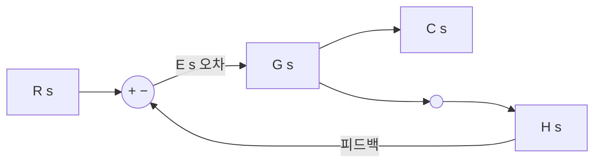

# 라플라스 변환과 전달함수

> [!summary] 핵심 요약
> - 라플라스 변환은 시간 함수 $f(t)$를 $s$ 함수 $F(s)$로 바꿔 **미분 → $s$ 곱하기, 적분 → $s$ 나누기**로 만든다.
> - **전달함수** $G(s) = \dfrac{C(s)}{R(s)}$: 모든 초기값을 0으로 둔 출력 변환 / 입력 변환. **선형 시불변** 시스템에서만 정의되고, 입력 모양과 무관하다. **임펄스 응답의 라플라스 변환**과 같다.
> - 블록선도 합성: 직렬 $G_1G_2$, 병렬 $G_1 \pm G_2$, 부궤환 $\dfrac{G}{1 + GH}$.
> - 신호흐름선도의 **경로 이득은 가지 이득의 곱**. 전체 이득은 메이슨 공식.

> [!warning] 자주 틀리는 포인트
> - 상수 $K$의 변환은 $K/s$이지 $K$가 아니다. **$K$가 그대로 나오는 것은 임펄스 $K\delta(t)$** 다.
> - $t^n$의 변환은 $\dfrac{n!}{s^{n+1}}$. 계수 $n!$을 빠뜨리기 쉽다 ($t^2 \to 2/s^3$).
> - $e^{-at}$ → $\dfrac{1}{s+a}$ (부호 주의: 지수가 $-a$면 분모는 $s+a$).
> - 전달함수는 **비선형 계에서는 정의되지 않는다**. 입력 신호에 따라 바뀌지도 않는다. "입력에 따라 달라진다"는 보기는 틀린 것.
> - 신호흐름선도에서 경로 이득을 **더하면 틀린다**. 곱한다.
> - 부궤환이면 분모가 $1 + GH$, 정궤환이면 $1 - GH$.

## 개념 정리

### 라플라스 변환표

| $f(t)$ | $F(s)$ | 비고 |
| --- | --- | --- |
| $\delta(t)$ (단위 임펄스) | $1$ | |
| $u(t)$ (단위 계단) | $\dfrac{1}{s}$ | 상수 $K$ → $\dfrac{K}{s}$ |
| $t$ (단위 경사) | $\dfrac{1}{s^2}$ | |
| $t^n$ | $\dfrac{n!}{s^{n+1}}$ | 예: $t^3 \to 6/s^4$ |
| $e^{-at}$ | $\dfrac{1}{s + a}$ | |
| $\sin\omega t$ | $\dfrac{\omega}{s^2 + \omega^2}$ | |
| $\cos\omega t$ | $\dfrac{s}{s^2 + \omega^2}$ | |
| $e^{-at}\sin\omega t$ | $\dfrac{\omega}{(s+a)^2 + \omega^2}$ | 감쇠 진동 |
| $e^{-at}\cos\omega t$ | $\dfrac{s+a}{(s+a)^2 + \omega^2}$ | |

**성질**

| 성질 | 식 |
| --- | --- |
| 선형성 | $\mathcal{L}[af + bg] = aF + bG$ |
| 미분 | $\mathcal{L}[f'(t)] = sF(s) - f(0)$ → 초기값 0이면 $sF(s)$ |
| 적분 | $\mathcal{L}\left[\int_0^t f\,dt\right] = \dfrac{F(s)}{s}$ |
| 시간 지연(추이) | $\mathcal{L}[f(t - L)u(t-L)] = e^{-Ls}F(s)$ |
| 복소 추이 | $\mathcal{L}[e^{-at}f(t)] = F(s + a)$ |
| 최종값 정리 | $\lim_{t\to\infty} f(t) = \lim_{s\to 0} sF(s)$ |
| 초기값 정리 | $\lim_{t\to 0} f(t) = \lim_{s\to\infty} sF(s)$ |

**계산 예 1 (복소 추이)**: $F(s) = \dfrac{2}{(s+1)^2 + 4}$ → $\omega = 2$, $a = 1$ → $f(t) = e^{-t}\sin 2t$

**계산 예 2 (부분분수 역변환)**: $F(s) = \dfrac{3}{s(s+3)}$
- $\dfrac{3}{s(s+3)} = \dfrac{A}{s} + \dfrac{B}{s+3}$, $A = \left.\dfrac{3}{s+3}\right|_{s=0} = 1$, $B = \left.\dfrac{3}{s}\right|_{s=-3} = -1$
- $f(t) = 1 - e^{-3t}$

### 전달함수의 성질

- 정의: $G(s) = \dfrac{\mathcal{L}[\text{출력}]}{\mathcal{L}[\text{입력}]}$, **모든 초기 조건 = 0**.
- **선형 시불변(LTI)** 시스템에만 정의된다.
- 시스템 고유의 특성이라 **입력의 종류와 무관**하다.
- 입력이 단위 임펄스면 $R(s) = 1$ → $C(s) = G(s)$. 즉 **임펄스 응답을 변환하면 전달함수**.
  - 예: 임펄스 응답이 $e^{-2t}$ → $G(s) = \dfrac{1}{s+2}$
- 분모 = 0 으로 둔 식이 **특성 방정식**, 그 근이 **극점**, 분자 = 0 의 근이 **영점**.

### 기본 요소의 전달함수

| 요소 | 전달함수 | 예 |
| --- | --- | --- |
| 비례 | $K$ | 지렛대, 증폭기 |
| 미분 | $Ks$ | |
| 적분 | $\dfrac{K}{s}$ | 탱크 수위(유입 유량 → 수위) |
| 1차 지연 | $\dfrac{K}{Ts + 1}$ | RC 회로, 열 시스템 |
| 2차 지연 | $\dfrac{\omega_n^2}{s^2 + 2\zeta\omega_n s + \omega_n^2}$ | 질량-스프링-댐퍼, RLC |
| 부동작 시간(낭비 시간) | $e^{-Ls}$ | 컨베이어 이송 지연 |

### 미분방정식 ↔ 전달함수

- 초기값 0이면 $\dfrac{d}{dt} \to s$, $\dfrac{d^2}{dt^2} \to s^2$로 바꾸면 된다.
- 예: $2\dfrac{d^2c}{dt^2} + 3\dfrac{dc}{dt} + c = r$ → $(2s^2 + 3s + 1)C(s) = R(s)$ → $G(s) = \dfrac{1}{2s^2 + 3s + 1}$
- 반대로 $G(s) = \dfrac{s + 4}{s^2 + 5s + 6}$ 이면 $\ddot c + 5\dot c + 6c = \dot r + 4r$.

### 물리계와 전기계의 상사 (힘-전압 상사)

| 기계 (병진) | 기계 (회전) | 전기 |
| --- | --- | --- |
| 힘 $F$ | 토크 $T$ | 전압 $V$ |
| 질량 $M$ | 관성 모멘트 $J$ | 인덕턴스 $L$ |
| 점성 마찰 계수 $B$ | 회전 마찰 계수 | 저항 $R$ |
| 스프링 상수 $K$ | 비틀림 강성 | 정전용량의 역수 $1/C$ |
| 변위 $x$ | 각변위 $\theta$ | 전하 $q$ |
| 속도 $v$ | 각속도 $\omega$ | 전류 $i$ |

- 병진 운동계의 3 기본 요소: **질량, 감쇠(점성 마찰), 탄성(스프링)**. 속도·변위는 요소가 아니라 변수.
- 질량에 힘을 가해 변위 $x$: $F = M\ddot x$ → $\dfrac{X(s)}{F(s)} = \dfrac{1}{Ms^2}$
- 질량-스프링-댐퍼: $\dfrac{X(s)}{F(s)} = \dfrac{1}{Ms^2 + Bs + K}$

### 전기 회로의 전달함수

| 회로 | 전달함수 |
| --- | --- |
| 콘덴서: 전류 입력 → 전압 출력 | $\dfrac{V(s)}{I(s)} = \dfrac{1}{Cs}$ |
| 코일: 전류 입력 → 전압 출력 | $Ls$ |
| RC 직렬, 출력 = C 양단 (저역통과) | $\dfrac{1}{RCs + 1}$, 시정수 $T = RC$ |
| RC 직렬, 출력 = R 양단 (고역통과) | $\dfrac{RCs}{RCs + 1}$ |
| RL 직렬, 출력 = R 양단 | $\dfrac{1}{(L/R)s + 1}$, 시정수 $T = L/R$ |

- 요령: 저항 $R$, 코일 $Ls$, 콘덴서 $\dfrac{1}{Cs}$ 를 임피던스로 놓고 **분압 공식**을 쓴다.

### 블록선도

| 구성 | 기호 | 의미 |
| --- | --- | --- |
| 전달요소 | 사각형 | 입력에 $G$를 곱함 |
| 가합점(합산점) | 원 (○, ±) | 신호를 더하고 빼서 **오차(편차)** 를 만듦 |
| 인출점 | 점 | 같은 신호를 갈라 보냄 |
| 화살표 | → | 신호 방향 |

| 결합 | 합성 전달함수 |
| --- | --- |
| 직렬 | $G_1 G_2$ |
| 병렬 | $G_1 \pm G_2$ |
| 피드백 (부궤환) | $\dfrac{G}{1 + GH}$ |
| 단위 부궤환 ($H = 1$) | $\dfrac{G}{1 + G}$ |

- 일반 공식: $\dfrac{C}{R} = \dfrac{\text{전향 경로 이득}}{1 - (\text{루프 이득의 합})}$ (부궤환 루프 이득은 음수로 넣는다).
- **계산 예 1**: $G = 4$, $H = 0.5$ 부궤환 → $\dfrac{4}{1 + 2} = \dfrac{4}{3}$
- **계산 예 2 (거꾸로 구하기)**: 단위 부궤환에서 입력 22, 출력 20 → $\dfrac{G}{1+G} = \dfrac{20}{22}$ → $G = 10$
- **계산 예 3 (병렬 + 피드백)**: 전향 $G_1$ 뒤에 $G_2$ 병렬 가지가 있고 전체를 단위 부궤환 → 먼저 병렬을 합치고($G_1 + G_2$) 피드백 공식을 적용 → $\dfrac{G_1 + G_2}{1 + G_1 + G_2}$
- 등가 변환: 가합점을 블록 **앞으로** 옮기면 옮긴 신호에 $1/G$, **뒤로** 옮기면 $G$를 곱한다. 인출점은 그 반대.

### 신호흐름선도

| 용어 | 뜻 |
| --- | --- |
| 마디(노드) | 신호(변수) |
| 가지 | 마디 사이의 이득 |
| 입력 마디 | 나가는 가지만 있음 |
| 출력 마디 | 들어오는 가지만 있음 |
| 경로 | 같은 방향으로 이어진 가지들 |
| 경로 이득 | 경로를 이루는 **가지 이득의 곱** |
| 루프 | 시작 마디로 돌아오는 닫힌 경로 |

- **메이슨 공식**: $\dfrac{C}{R} = \dfrac{\sum_k P_k \Delta_k}{\Delta}$, $\Delta = 1 - \sum L_1 + \sum L_2 - \cdots$ ($L_1$: 각 루프 이득, $L_2$: 서로 닿지 않는 두 루프 곱)

## 그림

## 기출 포인트

출처: 생산자동화산업기사 2016–2020년 필기 14회분 (cbtbank.kr). 회차 표기는 연도-회차.

- 라플라스 변환·역변환 (상수, 계단, $t^n$, 지수, 감쇠 사인, 부분분수, 그래프 → 변환) — 11회 (2016-2, 2016-3 ×3, 2018-1, 2019-1 ×3, 2019-2, 2019-3 ×2)
- 블록선도 합성 전달함수 계산·결합 방식 판별 — 13회 (2016-1, 2016-3 ×2, 2017-1, 2018-2, 2019-1, 2019-2, 2019-3 ×2, 2020-1·2 ×3, 2020-3)
- 신호흐름선도 용어 (경로 이득 = 곱) — 1회 (2018-1)
- 전달함수 정의·성질 (초기값 0, 선형계만, 입력과 무관, 임펄스 응답) — 6회 (2016-1, 2016-2 ×2, 2017-2, 2019-1, 2019-3)
- 물리계·회로의 전달함수 (질량계, 콘덴서, RC 회로, 상사 관계, 병진계 기본 요소, 미분방정식 변환) — 8회 (2016-2 ×2, 2017-2 ×2, 2018-2 ×2, 2019-2, 2020-3)
- 1차 지연 요소의 전달함수 고르기 — 2회 (2017-3, 2018-2)
- 가합점(오차를 만드는 곳) 기호·의미 — 2회 (2016-3, 2018-3)

## 관련 단원

- [자동제어계의 기초](자동제어계의_기초.md)
- [과도응답과 안정도](과도응답과_안정도.md)
- [센서 회로와 신호처리](센서_회로와_신호처리.md)

## 체크리스트

- [ ] 변환표 9개를 보지 않고 쓸 수 있다 (특히 $K/s$, $n!/s^{n+1}$)
- [ ] 복소 추이로 감쇠 진동 함수를 역변환한다
- [ ] 부분분수로 $\dfrac{K}{s(s+a)}$ 꼴을 역변환한다
- [ ] 전달함수의 정의와 "틀린 성질"(비선형, 입력 의존)을 골라낸다
- [ ] 임펄스 응답에서 전달함수를 바로 쓴다
- [ ] 미분방정식 ↔ 전달함수를 서로 바꾼다
- [ ] 힘-전압 상사표(질량-L, 마찰-R, 스프링-1/C)를 안다
- [ ] RC 회로 전달함수와 시정수 $RC$를 쓴다
- [ ] 피드백 블록선도와 병렬 + 피드백 조합을 계산한다
- [ ] 신호흐름선도 경로 이득은 곱이라는 것을 안다

## 참고

- [큐넷 자동화설비산업기사 출제기준](https://www.q-net.or.kr/crf005.do?id=crf00503&jmCd=2034)
- [기출분석 – 자동제어](../01_시험안내/기출분석_자동제어.md)
