# 마이크로프로세서

> [!summary] 핵심 요약
> - **마이크로프로세서** = CPU를 칩 하나에. **마이크로컨트롤러** = 마이크로프로세서 + 메모리 + 입출력을 **한 칩**에 넣은 제어용 마이크로컴퓨터.
> - 버스 3종: **어드레스 버스**(주소, 단방향), **데이터 버스**(데이터, 양방향), **제어 버스**(읽기·쓰기·인터럽트 신호).
> - 입출력 방식: 폴링(CPU가 차례로 확인) → 인터럽트(장치가 CPU를 부름) → **DMA**(CPU를 거치지 않고 메모리와 직접 전송) → 채널(IOP).
> - 주소선이 $n$개면 주소 공간은 $2^n$번지. 주소 16개, 데이터 8개 → $2^{16}$ × 1 byte = **64 KB**.

> [!warning] 자주 틀리는 포인트
> - **"명령 버스"는 없다**. 버스는 어드레스·데이터·제어 3가지 (교재 27-2).
> - **DMA는 CPU의 기능이 아니다**. 주변 장치가 메모리에 직접 접근하는 방식이다 (교재 27-5). 끝나면 인터럽트로 CPU에 알린다.
> - **폴링**은 CPU가 장치를 하나씩 찾아가 확인(소프트웨어). **데이지 체인**은 장치를 직렬로 이어 CPU에 가까운 장치가 우선(하드웨어).
> - **프로그램 카운터**는 **다음** 실행할 명령의 주소, **스택**은 인터럽트·서브루틴의 **복귀 주소**를 쌓는다. 스택은 **LIFO**(나중에 들어간 것이 먼저 나옴).
> - **DRAM**은 콘덴서에 저장해 주기적인 **재생(refresh)** 이 필요하다. SRAM은 플립플롭이라 재생이 필요 없다.
> - 세그먼트 레지스터는 **CS, DS, SS, ES**. "BS"는 없다 (교재 28-4).
> - 플래그 레지스터 = **상태 레지스터**(자리올림·부호·0·오버플로 기억).

## 학습 목표

이 단원을 마치면 다음을 할 수 있어야 한다.

1. 마이크로프로세서와 마이크로컨트롤러를 구분하고, CPU의 세 구성(ALU·제어 장치·레지스터)을 말한다.
2. CISC와 RISC를 명령어 수·길이·사이클로 비교하고, 명령 사이클(인출 → 해독 → 실행)을 순서대로 설명한다.
3. 어드레스·데이터·제어 버스의 방향과 역할을 구분한다 ("명령 버스"는 없다).
4. 폴링·인터럽트·DMA·채널 입출력을 비교하고, 인터럽트 처리 순서와 우선순위 결정 방식(데이지 체인·폴링)을 설명한다.
5. PC·IR·누산기·플래그·스택 포인터·세그먼트 레지스터의 역할과 즉시·직접·간접 주소 지정의 차이를 말한다.
6. SRAM·DRAM·ROM 계열을 구분하고, 주소선 수로 메모리 용량을 계산한다.

## 한눈에 보기

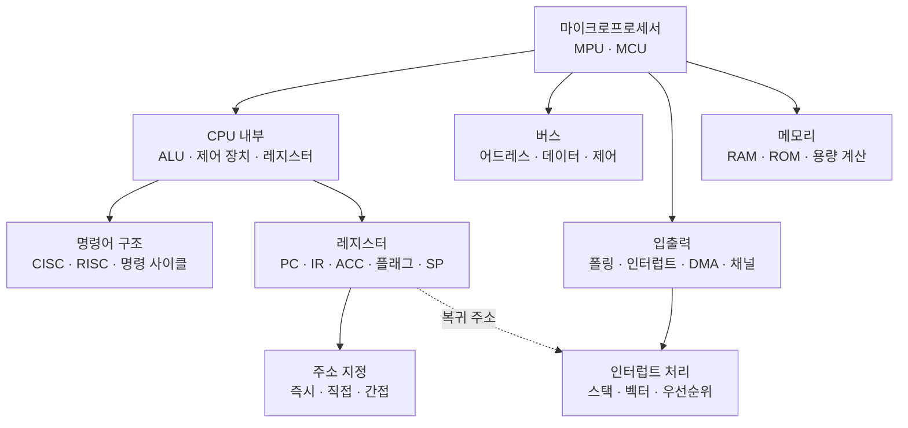

## 개념 정리

### 마이크로프로세서와 마이크로컨트롤러

**비유**: 마이크로프로세서는 **머리(두뇌)만** 있는 칩이라 기억(메모리)과 손발(입출력)을 밖에 따로 붙여야 하고, 마이크로컨트롤러는 **머리·기억·손발을 한 몸에** 갖춘 작은 컴퓨터다. 세탁기·전자레인지·PLC 모듈 안에 들어가는 것은 대부분 마이크로컨트롤러다.

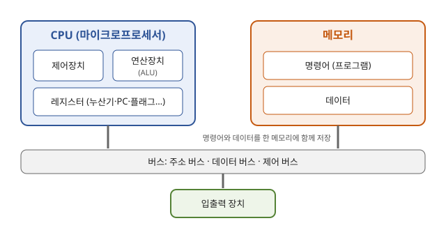

*CPU 안에는 제어장치·연산장치(ALU)·레지스터가 있고, 명령어와 데이터는 같은 메모리에 함께 저장된다. 마이크로프로세서는 왼쪽 CPU 상자만 칩 하나에 담은 것이고, 마이크로컨트롤러는 그림 전체(CPU·메모리·입출력)를 한 칩에 담은 것이다.*

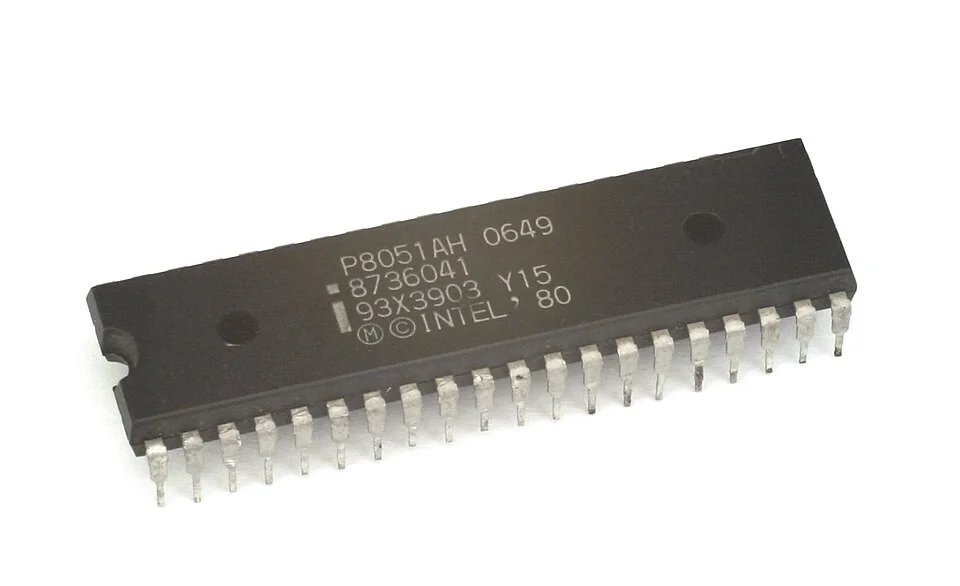

*교재에 나오는 대표 마이크로컨트롤러 8051. 이 한 칩 안에 CPU, 프로그램 ROM, 데이터 RAM, 타이머, 병렬·직렬 포트가 모두 들어 있다.*

| 구분 | 내용 | 예 |
| --- | --- | --- |
| 마이크로프로세서 (MPU) | CPU만 칩 하나에. 메모리·입출력은 외부 | PC용 CPU |
| 마이크로컨트롤러 (MCU) | CPU + 메모리 + 입출력 + 타이머를 **한 칩**에 | AVR, PIC, 8051 |

- CPU 구성: **연산 장치(ALU)** + **제어 장치** + **레지스터**. CPU 기능은 명령 인출·해독·실행, 연산, 데이터 이동, 제어.
- 연산은 **덧셈기가 기본**: 뺄셈 = 보수를 더함, 곱셈 = 덧셈 반복, 나눗셈 = 뺄셈 반복. 곱셈·나눗셈은 느려서 표(테이블) 방식을 쓰기도 한다.

> [!question] 시험에서는
> "마이크로프로세서와 메모리, 입출력을 **한 칩**에 넣은 것"을 물으면 답은 **마이크로컨트롤러**다. "CPU의 기능이 아닌 것"에는 DMA가 자주 정답 보기로 나온다.

### CISC와 RISC

**비유**: CISC는 **만능 공구 세트**(도구 하나로 복잡한 일을 한 번에, 대신 도구마다 크기·사용 시간이 제각각), RISC는 **규격이 같은 단순 공구 여러 개**(하나하나는 단순하지만 같은 박자로 빠르게 줄지어 처리 = 파이프라인)다.

| 구분 | CISC | RISC |
| --- | --- | --- |
| 명령어 | 많고 복잡, 길이 가변 | 적고 단순, **길이 고정** |
| 실행 | 명령마다 여러 사이클 | 대부분 **단일 사이클**, 파이프라인 유리 |
| 장점 | 프로그램이 짧음, 하드웨어 호환성 | 고속, 회로 단순 |
| 예 | 과거 x86 | AVR, PIC, ARM |

> [!tip] 감 잡기
> RISC의 핵심어는 **"단순·고정 길이·1 사이클·파이프라인"** 네 개다. 보기에 "명령어가 많고 복잡하다", "가변 길이"가 나오면 CISC 설명이다.

### 명령 사이클

**비유**: 요리사가 **레시피 한 줄을 읽고(인출) → 무슨 뜻인지 이해하고(해독) → 실제로 조리한다(실행)**. 레시피의 몇 번째 줄을 읽을 차례인지 손가락으로 짚고 있는 것이 프로그램 카운터(PC)다.

한 명령을 끝내면 다시 인출로 돌아가 다음 명령을 가져온다. 이 고리가 쉬지 않고 도는 것이 CPU의 일이다.

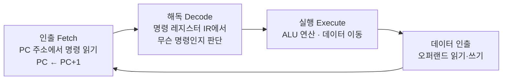

- **인출(Fetch)** → **해독(Decode)** → **실행(Execute)**. 교재는 데이터 인출(오퍼랜드 인출)을 따로 넣어 인출 → 해독 → 실행 → 데이터 인출 순으로 정리한다.
- 인출 단계에서 프로그램 카운터의 주소로 메모리에서 명령을 가져오고, PC는 1 증가한다.

### 버스

**비유**: 버스는 CPU와 메모리·입출력을 잇는 **도로**다. 어드레스 버스는 **"몇 번지로 가라"는 주소표**(CPU가 일방적으로 내보냄), 데이터 버스는 **짐을 실어 나르는 트럭**(오고 가는 양방향), 제어 버스는 **신호등**(지금 읽을지 쓸지, 인터럽트가 왔는지)이다.

$$\text{주소 공간} = 2^{\text{어드레스 버스 선 수}}\ \text{번지}, \qquad \text{한 번에 옮기는 비트 수} = \text{데이터 버스 선 수}$$

| 버스 | 방향 | 내용 |
| --- | --- | --- |
| 어드레스 버스 | CPU → 메모리·I/O (단방향) | 주소. 선 수가 주소 공간을 정함 |
| 데이터 버스 | 양방향 | 데이터. 선 수 = 한 번에 처리하는 비트 수 |
| 제어 버스 | 신호마다 다름 | 읽기·쓰기, 인터럽트 요청, 클록, 리셋 |

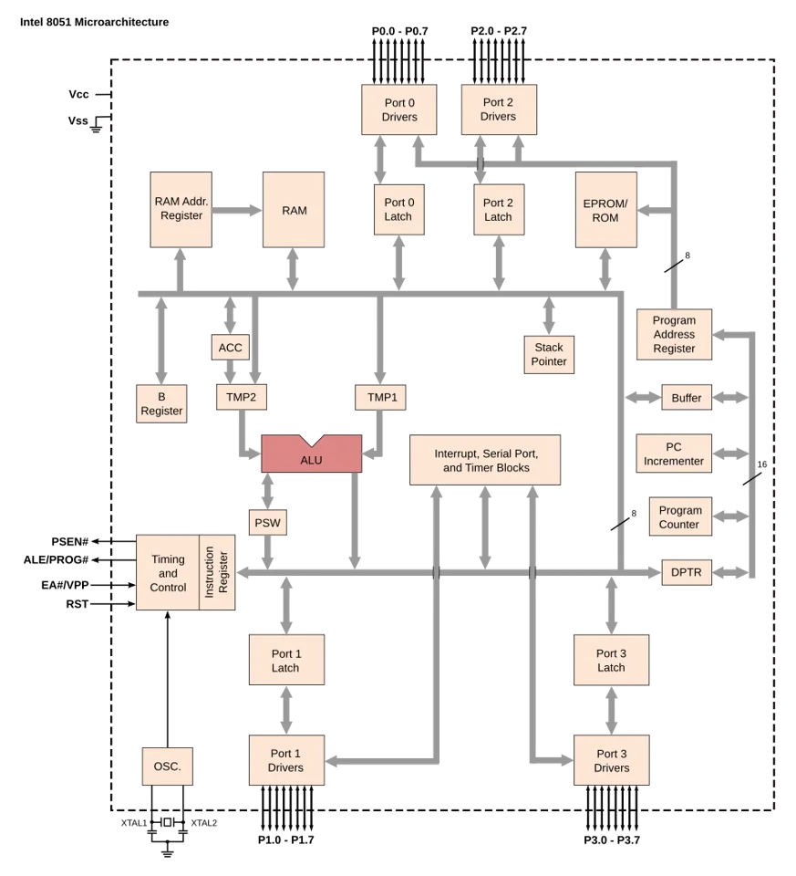

*마이크로컨트롤러 한 칩 안의 블록도. 굵은 회색 선이 내부 버스(8비트 데이터, 16비트 프로그램 주소)이고, ALU·ACC(누산기)·RAM·EPROM/ROM·Port 0~3·타이머/인터럽트/직렬 포트가 모두 여기에 매달려 있다. Program Counter, Stack Pointer, Instruction Register도 보인다 — 아래 레지스터 절의 이름들이 실제 칩에 이렇게 들어 있다.*

> [!question] 시험에서는
> "마이크로프로세서의 버스가 **아닌** 것"의 정답은 **명령 버스**다. 명령어도 메모리에서 **데이터 버스**를 타고 들어온다.

### 입출력과 인터럽트

**비유**: 택배를 기다리는 방법에 빗대면 — **폴링**은 5분마다 현관에 나가 보는 것(내 시간을 버림), **인터럽트**는 초인종이 울리면 나가는 것(그동안 다른 일을 함), **DMA**는 택배 기사가 열쇠를 받아 **창고에 직접 넣고** 다 끝나면 초인종을 한 번 누르는 것, **채널(IOP)** 은 택배만 전담하는 직원을 따로 두는 것이다.

| 방식 | 동작 | 특징 |
| --- | --- | --- |
| 프로그램 I/O (폴링) | CPU가 장치 상태를 계속 확인 | 간단, CPU 시간 낭비 |
| 인터럽트 I/O | 장치가 준비되면 CPU에 요청 | CPU가 다른 일을 할 수 있음 |
| DMA | DMA 제어기가 메모리와 장치 사이를 직접 전송 | 대량 고속 전송, 완료는 인터럽트로 알림 |
| 채널 (IOP) | 입출력 전용 프로세서 | 입출력 장치와 CPU의 속도 차 완화 |

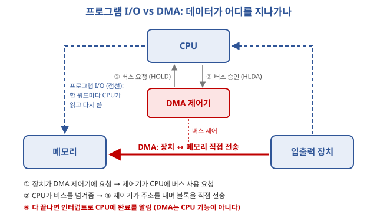

*프로그램 I/O에서는 데이터 한 워드마다 CPU가 읽어서 다시 써야 한다. DMA에서는 ① 버스 요청 → ② 버스 승인 뒤 DMA 제어기가 주소를 내며 블록을 통째로 옮기고, ④ 끝나면 인터럽트로 알린다. CPU는 버스를 빌려준 것뿐이라 DMA는 CPU의 기능이 아니다.*

**인터럽트**

**비유**: 책을 읽다가 전화가 오면 **읽던 쪽에 책갈피를 끼우고(복귀 주소를 스택에 저장)** 전화를 받고(서비스 루틴), 끊은 뒤 **책갈피 자리부터 다시 읽는다(복귀)**. 문장을 읽는 도중에 끊지 않고 그 문장은 끝내고 받는 것이 "현재 명령 마치기"다.

- 발생 원인: 정전, 오버플로, 0으로 나누기, 입출력 완료, 타이머, 외부 신호.
- 처리 순서: 요청 → 현재 명령 마치기 → **복귀 주소·상태를 스택에 저장** → **벡터 주소**로 점프 → 인터럽트 서비스 루틴 실행 → 복귀(스택에서 꺼냄) → 원래 프로그램 계속.

- 우선순위 결정: **데이지 체인**(하드웨어, 직렬 연결 순서), **폴링**(소프트웨어, CPU가 차례로 점검).

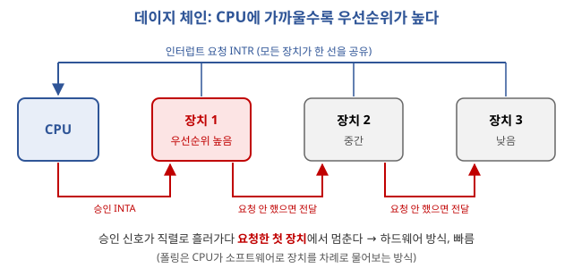

*승인 신호는 CPU에 가장 가까운 장치 1부터 받는다. 장치 1이 요청했으면 거기서 멈추고, 요청하지 않았으면 다음 장치로 넘긴다. 그래서 **CPU에 가까울수록 우선순위가 높고**, 순서가 배선으로 정해지는 하드웨어 방식이다.*

- **핸드셰이킹**: 송신·수신 쪽이 준비 신호를 주고받으며 통신 조건을 맞추는 과정.

> [!question] 시험에서는
> "처리 후 원래 프로그램으로 **복귀**한다" → 인터럽트. "CPU가 장치를 **차례로 점검**한다" → 폴링. "CPU를 거치지 않고 메모리와 직접" → DMA. 인터럽트·서브루틴의 **복귀 주소를 저장하는 곳** → 스택.

### 레지스터

**비유**: 레지스터는 CPU 책상 위의 **메모지**다. 메모리(책장)까지 가지 않고 바로 보고 쓸 수 있어 **훨씬 빠르지만 몇 장밖에 없다**. 메모지마다 용도가 정해져 있다 — "다음에 읽을 줄"(PC), "지금 하는 일"(IR), "계산 중간값"(누산기), "방금 계산 결과가 0이었나·넘쳤나"(플래그).

| 레지스터 | 역할 |
| --- | --- |
| 프로그램 카운터 (PC) | 다음에 실행할 명령의 주소 |
| 명령 레지스터 (IR) | 지금 해독·실행 중인 명령 |
| 누산기 (ACC) | 연산 결과·중간값 보관 |
| 상태 (플래그) 레지스터 | 자리올림(C), 부호(S), 0(Z), 오버플로(V) 표시 |
| 인덱스 레지스터 | 주소 수정(배열 접근) |
| 스택 포인터 (SP) | 스택 맨 위 주소 |
| 세그먼트 레지스터 | CS(코드), DS(데이터), SS(스택), ES(문자열·추가 데이터) 시작 주소 |

- 레지스터는 메모리보다 **훨씬 빠른 작은 기억 장치**다 (교재 28-2).

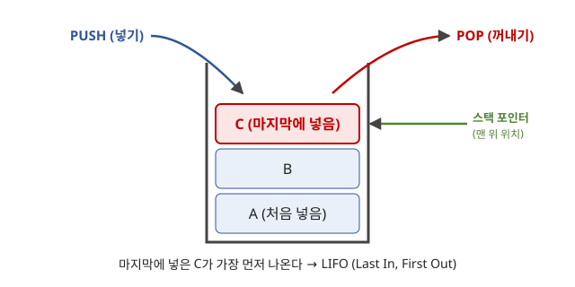

*접시 쌓기처럼 마지막에 넣은 C가 가장 먼저 나온다(Last In, First Out). 인터럽트 안에서 또 인터럽트가 걸려도, 나중에 저장한 복귀 주소부터 꺼내므로 순서가 꼬이지 않는다.*

> [!tip] 감 잡기
> 세그먼트 레지스터 네 개는 **C·D·S·E** (Code, Data, Stack, Extra). 보기에 "BS"가 섞여 있으면 그것이 정답(아닌 것)이다.

### 주소 지정 방식

**비유**: 친구에게 물건을 건네는 방법에 빗대면 — **즉시**는 물건을 **손에 직접** 쥐여 주는 것, **직접**은 "**3번 사물함**에 있어"라고 알려 주는 것, **간접**은 "3번 사물함에 **쪽지**가 있는데 거기 적힌 사물함을 열어 봐"라고 하는 것이다. 한 번 더 찾아가야 하니 느리지만, 쪽지에는 아주 먼 사물함 번호도 적을 수 있다.

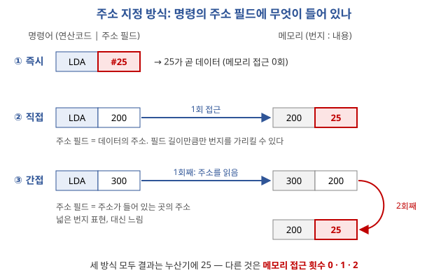

*세 방식 모두 결국 누산기에 25를 넣지만, 메모리를 몇 번 다녀오는지가 다르다. 직접 지정은 주소 필드 비트 수만큼의 번지만 가리킬 수 있어 대용량 주소 표현에 불리하고, 간접 지정은 메모리에 적힌 긴 주소를 쓰므로 넓은 번지를 가리킬 수 있다.*

| 방식 | 오퍼랜드 | 특징 |
| --- | --- | --- |
| 암묵(묵시) | 명령에 정해져 있음 (예: 누산기) | 주소 필드 없음 |
| 즉시 | 명령 안에 **데이터 자체** | 메모리 접근 없이 바로 사용 |
| 직접 | 명령 안에 데이터의 **주소** | 메모리 1회 접근, 빠름. 주소 필드 길이만큼만 표현 → **대용량 주소 표현에 불리** |
| 간접 | 명령 안에 **주소가 있는 곳의 주소** | 넓은 주소 표현, 활용성 높음, 메모리 2회 접근으로 느림 |

- 교재는 직접 지정이 데이터 접근이 가장 빠르다고 설명한다 (간접과 비교한 말). 일반 컴퓨터 구조 책에서는 즉시 지정이 가장 빠르다.

### 메모리

**비유**: RAM은 **화이트보드**(빠르게 쓰고 지우지만 전원이 꺼지면 사라짐), ROM은 **인쇄된 책**(꺼져도 남음). SRAM은 스위치(플립플롭)로 기억해 그대로 유지되고, DRAM은 **조금씩 새는 물컵**(콘덴서)이라 주기적으로 다시 채워야(재생) 한다.

*DRAM 셀은 트랜지스터 1개 + 콘덴서 1개다. 워드선이 게이트를 열면 비트선과 콘덴서가 이어져 읽고 쓴다. 아래 트렌치형은 콘덴서를 깊은 홈 속에 세워 면적을 줄인 것 — 이렇게 셀이 작아서 집적도가 높다. DRAM은 콘덴서에 전하가 있느냐 없느냐로 0/1을 기억한다. 전하가 조금씩 새어 나가므로 주기적으로 읽어서 다시 써 주는 **재생(refresh)** 이 필요하다. 구조가 단순해 집적도가 높고 싸다 → 주기억 장치.*

*서로 출력을 입력으로 물고 있는 인버터 두 개가 상태를 붙잡고 있어서 전원이 있는 한 재생 없이 유지된다. 트랜지스터가 많아 비싸지만 빠르다 → 캐시.*

| 종류 | 특징 |
| --- | --- |
| SRAM | 플립플롭, 빠름, 재생 불필요, 비쌈 → 캐시 |
| DRAM | 콘덴서, **재생 필요**, 집적도 높음·저렴 → 주기억 |
| SDRAM | 클록에 동기화된 DRAM |
| 마스크 ROM | 제조 때 기록, 변경 불가 |
| PROM | 사용자가 한 번만 기록 |
| EPROM | **자외선**으로 지우고 다시 기록 |
| EEPROM·플래시 | **전기**로 지우고 다시 기록 |

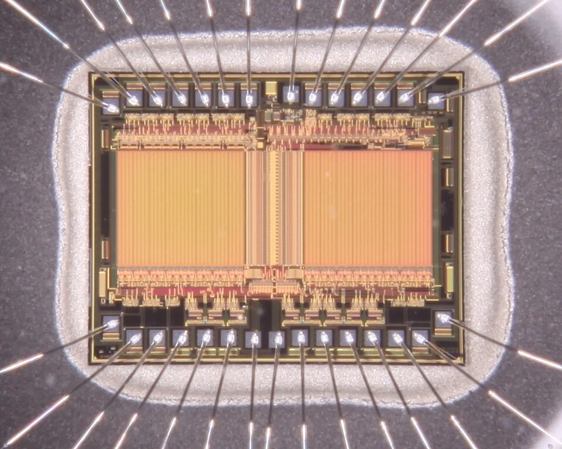

*EPROM 윗면의 투명한 창은 칩 표면에 **자외선**을 직접 쬐어 내용을 지우기 위한 것이다. 가운데 주황색 넓은 영역이 기억 셀 배열이다. 창이 있으면 EPROM, 전기로 지우는 EEPROM·플래시에는 창이 없다.*

- RAM은 휘발성(전원이 꺼지면 지워짐), ROM은 비휘발성. 프로그램·데이터의 **일시 저장**은 RAM (교재 28-1).

**용량 계산**

$$\text{용량} = 2^{\,\text{주소선 수}} \times \text{데이터선 수}\ [\text{bit}]$$

- 용량 = $2^{\text{주소선 수}}$ × 데이터선 수 [bit]
- 예 1: 주소 16개, 데이터 8개 → $2^{16} = 65{,}536$ 번지 × 1 byte = **64 KB**
- 예 2: 주소 24비트 → $2^{24} = 16{,}777{,}216$ 번지 (16 M)
- 예 3: 주소 12개, 데이터 8개 → 4 KB

> [!tip] 감 잡기
> $2^{10} = 1\text{K}$, $2^{20} = 1\text{M}$, $2^{30} = 1\text{G}$만 외우면 된다. 주소 16개 = $2^{6} \times 2^{10}$ = 64 K, 주소 12개 = $2^{2} \times 2^{10}$ = 4 K. 데이터선 8개면 번지당 1 byte이므로 그대로 KB가 된다.

### 주변 장치 인터페이스

**비유**: PPI 8255는 CPU에 **8칸짜리 콘센트 3개(포트 A·B·C)** 를 달아 주는 확장 멀티탭이다. 칸마다 입력으로 쓸지 출력으로 쓸지를 프로그램(제어 워드)으로 정한다.

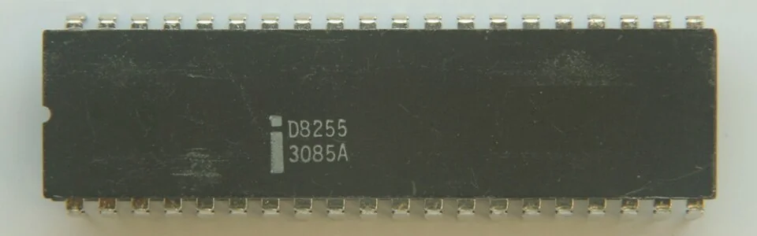

*프로그래머블 병렬 입출력 칩 8255. 40핀 중 24핀이 포트 A·B·C(각 8비트)로 나와 스위치·램프·디스플레이 같은 병렬 장치를 직접 잇는다.*

- **PPI 8255**: 프로그래머블 병렬 입출력 칩. 8비트 포트 A·B·C 3개, 모드 0(기본 입출력)·1(핸드셰이크)·2(양방향).

## 그림

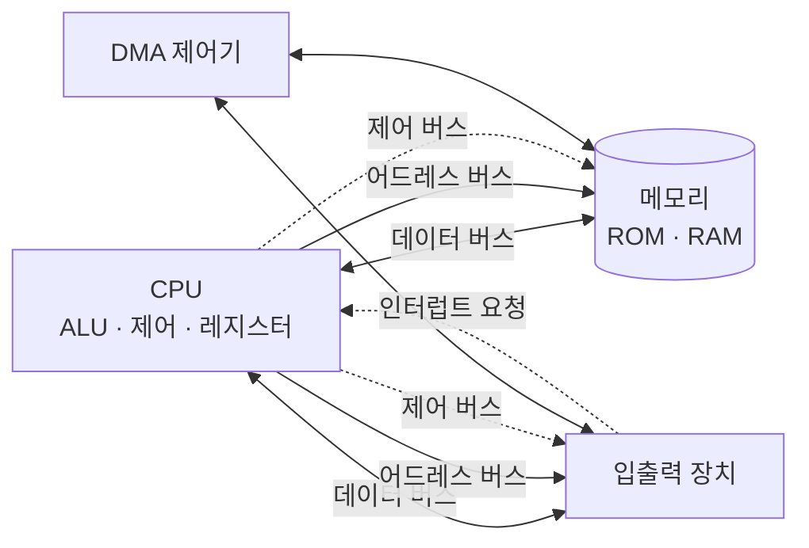

## 기출 포인트

출처: 생산자동화산업기사 2016–2020년 필기 (cbtbank.kr). 옛 시험에서 **약 42문항**(CPU 기능, 레지스터, 스택, 프로그램 카운터, 버스, DMA, 인터럽트, RISC, 명령어 사이클, RAM, PPI 8255)으로, 자동제어 영역에서 비중이 큰 주제다. 주제별 집계는 [기출분석 – 자동제어](../01_시험안내/기출분석_자동제어.md).

**교재 예제 유형** (Win-Q 2025 PART 01 CHAPTER 01, 27~28절): 한 칩 통합(마이크로컨트롤러), 버스가 아닌 것(명령 버스), 처리 후 원래 프로그램으로 복귀(인터럽트), 차례로 점검(폴링), CPU 기능이 아닌 것(DMA), 일시 저장(RAM), 빠른 소규모 기억 장치(레지스터), 인터럽트 복귀 주소, 세그먼트가 아닌 것(BS), 플래그 = 상태 레지스터, 스택 = LIFO, 주소 16·데이터 8 → 64 KB, 직접 주소 지정의 특징이 아닌 것(대용량 주소 표현), 재생 필요(DRAM), 서브루틴 복귀 주소(스택).

- 교재 28-3(인터럽트 복귀 주소)은 정리본상 정답이 누산기로 보이지만 해설은 스택을 설명한다. 일반적으로 복귀 주소는 **스택**에 저장한다 (교재 원문 확인 필요).

## 관련 단원

- [PLC 구성과 특성](PLC_구성과_특성.md)
- [수의 표현과 코드](수의_표현과_코드.md)
- [논리회로](논리회로.md)
- [데이터 통신](데이터_통신.md)

## 체크리스트

- [ ] 마이크로프로세서와 마이크로컨트롤러를 구분한다
- [ ] 버스 3가지와 방향을 말한다 ("명령 버스"는 없음)
- [ ] CISC와 RISC를 비교한다
- [ ] 폴링·인터럽트·DMA·채널을 구분한다
- [ ] 인터럽트 처리 순서와 우선순위 결정 방식(데이지 체인, 폴링)을 안다
- [ ] PC·누산기·플래그·스택·세그먼트 레지스터의 역할을 말한다
- [ ] 즉시·직접·간접 주소 지정을 비교한다
- [ ] SRAM·DRAM·EPROM·EEPROM의 차이를 안다
- [ ] 주소선 수로 메모리 용량을 계산한다

## 참고

- [큐넷 자동화설비산업기사 출제기준](https://www.q-net.or.kr/crf005.do?id=crf00503&jmCd=2034)
- [교재 CH01 정리 (00_Inbox)](../00_Inbox/교재_CH01.md)

### 그림 출처

위키미디어 공용(Wikimedia Commons)과 Openverse에서 가져온 공개 라이선스 자료이고, 노트에 맞게 크기를 줄이고 WebP로 변환했다.

| 그림 | 작성자 | 라이선스 | 출처 |
| --- | --- | --- | --- |
| [KL Intel P8051](https://commons.wikimedia.org/wiki/File:KL_Intel_P8051.jpg) | Konstantin Lanzet (with permission) | [CC BY-SA 3.0](http://creativecommons.org/licenses/by-sa/3.0/) | Wikimedia Commons |
| [Intel 8051 arch](https://commons.wikimedia.org/wiki/File:Intel_8051_arch.svg) | Appaloosa | [CC BY-SA 3.0](https://creativecommons.org/licenses/by-sa/3.0) | Wikimedia Commons |
| [Speicherzelle](https://commons.wikimedia.org/wiki/File:Speicherzelle.svg) | Patrick-Emil Zörner (Paddy) | [CC BY-SA 2.0 de](https://creativecommons.org/licenses/by-sa/2.0/de/deed.en) | Wikimedia Commons |
| [SRAM Cell (6 Transistors)](https://commons.wikimedia.org/wiki/File:SRAM_Cell_(6_Transistors).svg) | Inductiveload | 퍼블릭 도메인 | Wikimedia Commons |
| [EPROM Window -3 20090609](https://commons.wikimedia.org/wiki/File:EPROM_Window_-3_20090609.jpg) | Pascal | CC0 | Wikimedia Commons |
| [Ic-photo-Intel--D8255](https://commons.wikimedia.org/wiki/File:Ic-photo-Intel--D8255.JPG) | Myself User:ZyMOS | [CC BY-SA 4.0](https://creativecommons.org/licenses/by-sa/4.0) | Wikimedia Commons |

직접 그린 그림(SVG, 이 볼트용으로 새로 작성): 폰노이만, DMA 전송, 데이지체인, 스택 LIFO, 주소지정방식.

