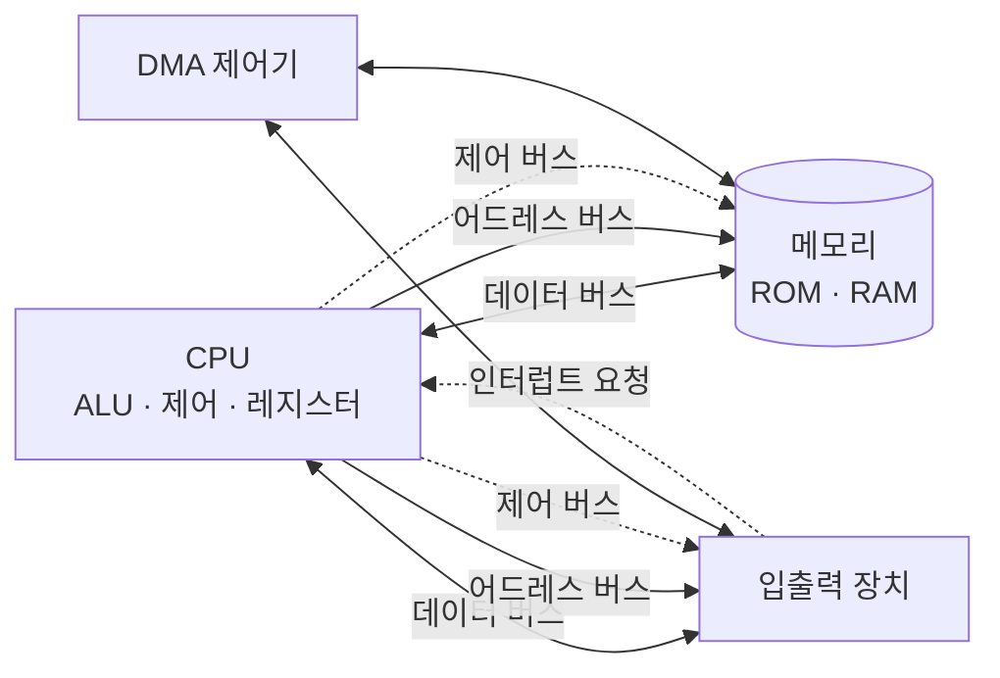

# 마이크로프로세서

> [!summary] 핵심 요약
> - **마이크로프로세서** = CPU를 칩 하나에. **마이크로컨트롤러** = 마이크로프로세서 + 메모리 + 입출력을 **한 칩**에 넣은 제어용 마이크로컴퓨터.
> - 버스 3종: **어드레스 버스**(주소, 단방향), **데이터 버스**(데이터, 양방향), **제어 버스**(읽기·쓰기·인터럽트 신호).
> - 입출력 방식: 폴링(CPU가 차례로 확인) → 인터럽트(장치가 CPU를 부름) → **DMA**(CPU를 거치지 않고 메모리와 직접 전송) → 채널(IOP).
> - 주소선이 $n$개면 주소 공간은 $2^n$번지. 주소 16개, 데이터 8개 → $2^{16}$ × 1 byte = **64 KB**.

> [!warning] 자주 틀리는 포인트
> - **"명령 버스"는 없다**. 버스는 어드레스·데이터·제어 3가지 (교재 27-2).
> - **DMA는 CPU의 기능이 아니다**. 주변 장치가 메모리에 직접 접근하는 방식이다 (교재 27-5). 끝나면 인터럽트로 CPU에 알린다.
> - **폴링**은 CPU가 장치를 하나씩 찾아가 확인(소프트웨어). **데이지 체인**은 장치를 직렬로 이어 CPU에 가까운 장치가 우선(하드웨어).
> - **프로그램 카운터**는 **다음** 실행할 명령의 주소, **스택**은 인터럽트·서브루틴의 **복귀 주소**를 쌓는다. 스택은 **LIFO**(나중에 들어간 것이 먼저 나옴).
> - **DRAM**은 콘덴서에 저장해 주기적인 **재생(refresh)** 이 필요하다. SRAM은 플립플롭이라 재생이 필요 없다.
> - 세그먼트 레지스터는 **CS, DS, SS, ES**. "BS"는 없다 (교재 28-4).
> - 플래그 레지스터 = **상태 레지스터**(자리올림·부호·0·오버플로 기억).

## 개념 정리

### 마이크로프로세서와 마이크로컨트롤러

| 구분 | 내용 | 예 |
| --- | --- | --- |
| 마이크로프로세서 (MPU) | CPU만 칩 하나에. 메모리·입출력은 외부 | PC용 CPU |
| 마이크로컨트롤러 (MCU) | CPU + 메모리 + 입출력 + 타이머를 **한 칩**에 | AVR, PIC, 8051 |

- CPU 구성: **연산 장치(ALU)** + **제어 장치** + **레지스터**. CPU 기능은 명령 인출·해독·실행, 연산, 데이터 이동, 제어.
- 연산은 **덧셈기가 기본**: 뺄셈 = 보수를 더함, 곱셈 = 덧셈 반복, 나눗셈 = 뺄셈 반복. 곱셈·나눗셈은 느려서 표(테이블) 방식을 쓰기도 한다.

### CISC와 RISC

| 구분 | CISC | RISC |
| --- | --- | --- |
| 명령어 | 많고 복잡, 길이 가변 | 적고 단순, **길이 고정** |
| 실행 | 명령마다 여러 사이클 | 대부분 **단일 사이클**, 파이프라인 유리 |
| 장점 | 프로그램이 짧음, 하드웨어 호환성 | 고속, 회로 단순 |
| 예 | 과거 x86 | AVR, PIC, ARM |

### 명령 사이클

- **인출(Fetch)** → **해독(Decode)** → **실행(Execute)**. 교재는 데이터 인출(오퍼랜드 인출)을 따로 넣어 인출 → 해독 → 실행 → 데이터 인출 순으로 정리한다.
- 인출 단계에서 프로그램 카운터의 주소로 메모리에서 명령을 가져오고, PC는 1 증가한다.

### 버스

| 버스 | 방향 | 내용 |
| --- | --- | --- |
| 어드레스 버스 | CPU → 메모리·I/O (단방향) | 주소. 선 수가 주소 공간을 정함 |
| 데이터 버스 | 양방향 | 데이터. 선 수 = 한 번에 처리하는 비트 수 |
| 제어 버스 | 신호마다 다름 | 읽기·쓰기, 인터럽트 요청, 클록, 리셋 |

### 입출력과 인터럽트

| 방식 | 동작 | 특징 |
| --- | --- | --- |
| 프로그램 I/O (폴링) | CPU가 장치 상태를 계속 확인 | 간단, CPU 시간 낭비 |
| 인터럽트 I/O | 장치가 준비되면 CPU에 요청 | CPU가 다른 일을 할 수 있음 |
| DMA | DMA 제어기가 메모리와 장치 사이를 직접 전송 | 대량 고속 전송, 완료는 인터럽트로 알림 |
| 채널 (IOP) | 입출력 전용 프로세서 | 입출력 장치와 CPU의 속도 차 완화 |

**인터럽트**

- 발생 원인: 정전, 오버플로, 0으로 나누기, 입출력 완료, 타이머, 외부 신호.
- 처리 순서: 요청 → 현재 명령 마치기 → **복귀 주소·상태를 스택에 저장** → **벡터 주소**로 점프 → 인터럽트 서비스 루틴 실행 → 복귀(스택에서 꺼냄) → 원래 프로그램 계속.
- 우선순위 결정: **데이지 체인**(하드웨어, 직렬 연결 순서), **폴링**(소프트웨어, CPU가 차례로 점검).
- **핸드셰이킹**: 송신·수신 쪽이 준비 신호를 주고받으며 통신 조건을 맞추는 과정.

### 레지스터

| 레지스터 | 역할 |
| --- | --- |
| 프로그램 카운터 (PC) | 다음에 실행할 명령의 주소 |
| 명령 레지스터 (IR) | 지금 해독·실행 중인 명령 |
| 누산기 (ACC) | 연산 결과·중간값 보관 |
| 상태 (플래그) 레지스터 | 자리올림(C), 부호(S), 0(Z), 오버플로(V) 표시 |
| 인덱스 레지스터 | 주소 수정(배열 접근) |
| 스택 포인터 (SP) | 스택 맨 위 주소 |
| 세그먼트 레지스터 | CS(코드), DS(데이터), SS(스택), ES(문자열·추가 데이터) 시작 주소 |

- 레지스터는 메모리보다 **훨씬 빠른 작은 기억 장치**다 (교재 28-2).

### 주소 지정 방식

| 방식 | 오퍼랜드 | 특징 |
| --- | --- | --- |
| 암묵(묵시) | 명령에 정해져 있음 (예: 누산기) | 주소 필드 없음 |
| 즉시 | 명령 안에 **데이터 자체** | 메모리 접근 없이 바로 사용 |
| 직접 | 명령 안에 데이터의 **주소** | 메모리 1회 접근, 빠름. 주소 필드 길이만큼만 표현 → **대용량 주소 표현에 불리** |
| 간접 | 명령 안에 **주소가 있는 곳의 주소** | 넓은 주소 표현, 활용성 높음, 메모리 2회 접근으로 느림 |

- 교재는 직접 지정이 데이터 접근이 가장 빠르다고 설명한다 (간접과 비교한 말). 일반 컴퓨터 구조 책에서는 즉시 지정이 가장 빠르다.

### 메모리

| 종류 | 특징 |
| --- | --- |
| SRAM | 플립플롭, 빠름, 재생 불필요, 비쌈 → 캐시 |
| DRAM | 콘덴서, **재생 필요**, 집적도 높음·저렴 → 주기억 |
| SDRAM | 클록에 동기화된 DRAM |
| 마스크 ROM | 제조 때 기록, 변경 불가 |
| PROM | 사용자가 한 번만 기록 |
| EPROM | **자외선**으로 지우고 다시 기록 |
| EEPROM·플래시 | **전기**로 지우고 다시 기록 |

- RAM은 휘발성(전원이 꺼지면 지워짐), ROM은 비휘발성. 프로그램·데이터의 **일시 저장**은 RAM (교재 28-1).

**용량 계산**

- 용량 = $2^{\text{주소선 수}}$ × 데이터선 수 [bit]
- 예 1: 주소 16개, 데이터 8개 → $2^{16} = 65{,}536$ 번지 × 1 byte = **64 KB**
- 예 2: 주소 24비트 → $2^{24} = 16{,}777{,}216$ 번지 (16 M)
- 예 3: 주소 12개, 데이터 8개 → 4 KB

### 주변 장치 인터페이스

- **PPI 8255**: 프로그래머블 병렬 입출력 칩. 8비트 포트 A·B·C 3개, 모드 0(기본 입출력)·1(핸드셰이크)·2(양방향).

## 그림

## 기출 포인트

출처: 생산자동화산업기사 2016–2020년 필기 (cbtbank.kr). 옛 시험에서 **약 42문항**(CPU 기능, 레지스터, 스택, 프로그램 카운터, 버스, DMA, 인터럽트, RISC, 명령어 사이클, RAM, PPI 8255)으로, 자동제어 영역에서 비중이 큰 주제다. 주제별 집계는 [기출분석 – 자동제어](../01_시험안내/기출분석_자동제어.md).

**교재 예제 유형** (Win-Q 2025 PART 01 CHAPTER 01, 27~28절): 한 칩 통합(마이크로컨트롤러), 버스가 아닌 것(명령 버스), 처리 후 원래 프로그램으로 복귀(인터럽트), 차례로 점검(폴링), CPU 기능이 아닌 것(DMA), 일시 저장(RAM), 빠른 소규모 기억 장치(레지스터), 인터럽트 복귀 주소, 세그먼트가 아닌 것(BS), 플래그 = 상태 레지스터, 스택 = LIFO, 주소 16·데이터 8 → 64 KB, 직접 주소 지정의 특징이 아닌 것(대용량 주소 표현), 재생 필요(DRAM), 서브루틴 복귀 주소(스택).

- 교재 28-3(인터럽트 복귀 주소)은 정리본상 정답이 누산기로 보이지만 해설은 스택을 설명한다. 일반적으로 복귀 주소는 **스택**에 저장한다 (교재 원문 확인 필요).

## 관련 단원

- [PLC 구성과 특성](PLC_구성과_특성.md)
- [수의 표현과 코드](수의_표현과_코드.md)
- [논리회로](논리회로.md)
- [데이터 통신](데이터_통신.md)

## 체크리스트

- [ ] 마이크로프로세서와 마이크로컨트롤러를 구분한다
- [ ] 버스 3가지와 방향을 말한다 ("명령 버스"는 없음)
- [ ] CISC와 RISC를 비교한다
- [ ] 폴링·인터럽트·DMA·채널을 구분한다
- [ ] 인터럽트 처리 순서와 우선순위 결정 방식(데이지 체인, 폴링)을 안다
- [ ] PC·누산기·플래그·스택·세그먼트 레지스터의 역할을 말한다
- [ ] 즉시·직접·간접 주소 지정을 비교한다
- [ ] SRAM·DRAM·EPROM·EEPROM의 차이를 안다
- [ ] 주소선 수로 메모리 용량을 계산한다

## 참고

- [큐넷 자동화설비산업기사 출제기준](https://www.q-net.or.kr/crf005.do?id=crf00503&jmCd=2034)
- [교재 CH01 정리 (00_Inbox)](../00_Inbox/교재_CH01.md)
