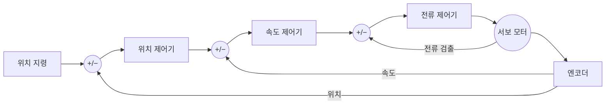

# 서보 모터와 서보 제어

> [!summary] 핵심 요약
> - 서보 = 모터 + 엔코더 + 드라이버로 된 **폐루프** 시스템. 지령을 정확히, 빠르게 따라간다.
> - 제어 루프는 **바깥부터 위치 → 속도 → 전류(토크)**. 안쪽 루프일수록 응답이 빠르다.
> - 제어 모드: **위치 제어**(펄스 지령), **속도 제어**(아날로그 전압), **토크 제어**(아날로그 전압).
> - **전자 기어비**로 지령 펄스 1개당 이동량을 기계 단위(예: 0.001 mm)에 맞춘다.

> [!warning] 자주 틀리는 포인트
> - 게인이 너무 높으면 **진동·소음(헌팅)**, 너무 낮으면 **응답이 느리고 위치 오차가 크다**.
> - 위치 지령과 실제 위치의 차이가 **편차 카운터(위치 편차)** 에 쌓인다. 너무 커지면 과대 편차 알람.
> - 서보 온(SV-ON) 전에 **비상 정지·리밋 신호 배선**을 먼저 확인한다.
> - 수직축(Z축)에는 정전 시 떨어지지 않도록 **브레이크 부착 모터**를 쓴다.
> - 부하 관성이 모터 관성보다 너무 크면(관성비 큼) 제어가 불안정해진다 → 감속기 사용.
> - AC 서보와 DC 서보의 구조상 가장 큰 차이는 **브러시(정류자) 유무**. 브러시 교환이 필요한 것은 **DC 서보**.
> - **동기형 AC 서보는 회전자 위치를 반드시 검출**해야 한다(엔코더·리졸버 필수). "위치 검출기가 필요 없다"는 틀린 말. 제어 회로가 복잡하고 값이 비싸다.
> - 유도기형 AC 서보는 정류자가 없어 **정류 한계가 없다** → 고속·고토크. "정류에 한계가 있다"는 DC 서보 설명.
> - AC 서보는 권선이 **고정자**에 있어 열이 밖으로 잘 빠진다. DC 서보는 회전자(전기자)에서 열이 나 방열이 불리하다. 어느 모터든 "열이 발생하지 않는다"는 틀린 말.
> - 서보 응답을 좋게 하려면 **기계적 시정수·전기적 시정수($L/R$)를 작게**, 회전자 관성을 작게(지름은 작고 길게, 코어리스), 토크 맥동은 작게. "크게 한다"가 나오면 틀린 보기.
> - 서보 위치·속도 검출기: 엔코더, 리졸버, 타코제너레이터(속도), 포텐쇼미터(각도), 싱크로, 차동변압기(변위). **로드셀(힘), 리밋 스위치(ON/OFF), 부르동관(압력)은 아니다**. 타코미터는 속도용이라 회전각 검출용이 아니다.
> - 전기식 서보기구는 유압식보다 **경제적이고 취급이 쉽고 신호 전송이 쉽다**. 큰 출력·빠른 응답은 유압식이 유리. 분사관식은 **유압** 서보. 서보기구는 **피드백이 꼭 필요**하다.
> - **CNC에 가장 많이 쓰는 방식은 반폐쇄회로**다. 폐쇄회로는 가장 정밀하지만 가장 많이 쓰이지는 않는다.
> - **인코더로는 토크를 검출할 수 없다** (속도·방향·회전 수·위치만). 리졸버는 회전각을 전기 신호로 검출한다.
> - "높은 출력에는 교류식 서보가 적합하다"는 틀린 보기. 고출력은 **유압식**. "신호 변환에 공압식이 많이 쓰인다"도 틀림 → 신호 변환은 **전기식**이 유리.
> - 서보기구를 신호 종류로 나누면 전기식·유압식·공압식. **기계식**은 그 분류에 없다.
> - **절대 좌표(앱솔루트)** 는 항상 원점 기준, **증분 좌표(인크리멘털)** 는 바로 앞 위치 기준.
> - 서보 모터는 **회전 방향에 따라 특성이 일정**해야 한다. "방향에 따라 달라도 된다"는 틀림 (교재 36-2).
> - 서보 모터는 동력 공급용이 아니라 **위치·속도 제어용**이다 → 안테나 위치 제어처럼 각도를 맞추는 곳에 쓴다 (교재 36-7).
> - "AC 서보는 자극 위치 검출이 필요 없다"는 틀린 보기. **동기형은 필요**하고, 필요 없는 것은 유도형뿐이다 (교재 37-2).
> - **서보 레디(Servo Ready)**: 전원을 넣은 뒤 컨트롤러가 이상 유무를 확인하기 **전에** 드라이버가 컨트롤러로 보내는 준비 신호 (교재 37-4).
> - 감속기 없이 로봇 암에 직접 붙이는 것은 **다이렉트 드라이브(DD) 서보** (교재 37-3).
> - 서보 제어는 **하위 제어기**다. 상위(PLC, 모션 컨트롤러)의 지령을 받아 손발처럼 움직인다 (교재 35-3, 36-1).
> - 교재(34절) 비교: **동기형** AC 서보는 다이나믹 브레이크가 걸리지만 위치 검출기가 필요, **유도형** AC 서보는 위치 검출 센서가 필요 없지만 정지 중에도 여자 전류가 흘러 발열이 있고 비상 정지 때 **다이나믹 브레이크를 걸 수 없다**.

## 개념 정리

### 서보 시스템 구성

| 구성 | 역할 |
| --- | --- |
| 상위 제어기 (PLC 위치결정 모듈, 모션 컨트롤러) | 위치·속도 지령 |
| 서보 드라이버 (앰프) | 지령과 피드백 비교, 전류 제어 |
| 서보 모터 | AC 서보(동기형 영구자석)가 주류 |
| 엔코더 | 위치·속도 피드백 |
| 기계 (볼스크루, 벨트, 감속기) | 회전 → 직선 운동 변환 |

### 서보 모터의 종류와 특징

| 항목 | DC 서보 | 동기형 AC 서보 (영구자석) | 유도형 AC 서보 |
| --- | --- | --- | --- |
| 브러시·정류자 | **있음** (교환 필요) | 없음 | 없음 |
| 회전자 위치 검출 | 불필요(정류자가 대신) | **필수** | 속도 검출 필요 |
| 권선 위치 / 방열 | 회전자 / 불리 | 고정자 / 유리 | 고정자 / 유리 |
| 제어 회로 | 간단, 저렴 | 복잡, 비쌈 | 복잡 (벡터 제어) |
| 고속·대출력 | 정류 한계로 제한 | 좋음 | 매우 좋음 (대용량) |
| 보수·내환경성 | 나쁨 | 좋음 | 좋음 |

- DC 서보 장점: 기동 토크 큼, 크기 대비 토크 큼, 전압-속도 **선형**, 속도 제어 범위 넓고 제어성 좋음. 대용량에는 계자를 별도 전원으로 여자하는 **타여자형**이 적합.
- DC 서보 속도: $N \propto \dfrac{V - I_aR_a}{\Phi}$ → 토크 일정에서 **자속이 늘면 속도는 줄어든다**.
- **다이렉트 드라이브(DD) 모터**: 감속기 없이 부하에 직접 연결 → 백래시 없음, 강성 높음 (로봇 관절, 인덱스 테이블).
- 서보 모터 용도: 안테나·레이더 위치 제어, 로봇, 공작기계 이송축처럼 **위치·각도를 정밀하게** 맞추는 곳.

**교재(34절)의 서보 모터 비교**

- **DC 서보**: 반도체 스위칭의 **PWM**으로 구동(교류를 정류한 직류를 켜는 시간 폭으로 평균 전압 조절). 전류에 비례한 토크로 선형 제어, 회로 간단, 제어성·경제성 좋음. 단점은 브러시 마모 보수, 정류 불꽃·발열, 짧은 수명.
- **동기형 AC 서보**: 회전자 영구자석, 전류–토크 선형, 제동이 쉽고 다이나믹 브레이크 동작. 회전자 위치 검출(인코더·리졸버) 필요. 전류의 고주파 성분이 토크 리플·진동의 원인이 될 수 있다.
- **유도형 AC 서보**: 일반 유도전동기 구조, 회전자가 간단하고 위치 검출 센서 불필요. 정지 중에도 여자 전류 → 발열 손실, 비상 정지 시 다이나믹 브레이크 불가.
- 교재(37절) 추가: 서보는 전기식·유압식·공압식 중 **전기식**이 신뢰성과 제어 다양성이 가장 높다. DC 서보는 고정자 영구자석·회전자 코일, 전압에 속도·전류에 토크가 비례하고 효율 좋고 저렴하다. AC 서보는 브러시가 없어 보수가 쉽고, 코일이 고정자에 있어 방열이 좋고, 정류 한계가 없어 고속에서도 토크가 크며 **대용량**에 쓰지만, DC보다 **속도 조절이 어렵다**.
- **리니어 서보 모터**: 직선으로 직접 구동, 구조 간단·공간 절약·비접촉이라 소음·마모 적음. 비싸고 강성 문제가 있다.
- **다이렉트 드라이브 서보**: 감속기 없이 부하(로봇 암)에 직결 → 기어의 낮은 강성과 위치 결정 불확실성(백래시)을 없앤다.
- 변조 방식 구분 (교재 34절 해설): 진폭·주파수·위상 변조와 **펄스폭 변조(PWM)**. 시간 폭으로 평균 전압을 바꾸는 것이 PWM.

**서보 제어 용어 (교재 35절)**

| 용어 | 뜻 |
| --- | --- |
| 목표값 (설정값·기준값) | 제어가 도달할 값 |
| 출력값 (실제값·현재값) | 지금 출력 상태 |
| **제어편차** | 목표값 − 출력값 |
| 외란 | 통제할 수 없는 외부 요인이 현재값을 바꿈 |
| 레퍼런스 (참조값) | 외란을 예측 가능한 변수로 다루게 돕는 값 |

- 서보 제어 = 위치·자세·속도·가속도 같은 **기계량**을 목표에 맞추는 피드백 제어. 메인 구동을 보정하는 역할이라 **신속성·응답성**이 중요하다.

**서보 모터의 조건과 검출기 (교재 36절)**

- "모터이지만 목적은 회전력이 아니라 **제어**." 속도·각도를 자유롭게 바꾸고 상태를 알 수 있어야 하며, 관성이 작고, 기동·제동이 자유롭고, 지령에 즉시 반응하고, 방향에 따른 특성이 같아야 한다.
- 검출기: **인코더**(디지털, 위치·속도), **리졸버**(아날로그, 인코더보다 기계적 강도·내구성 좋음), **태코미터**(속도만), **퍼텐쇼미터**(각도, 전체 행정을 0~10 V로). 로드셀은 무게용이라 해당 없음. 인코더로는 회전 **부하(토크)** 를 알 수 없다.

**서보 모터에 요구되는 조건**

- 회전자 **관성이 작을 것** (가늘고 긴 회전자, 코어리스) → 기계적 시정수 작게
- **전기적 시정수 $L/R$가 작을 것** → 전류(토크) 응답 빠르게
- 최대 토크가 크고 토크의 **직선성**이 좋을 것, 토크 맥동이 작을 것
- 넓은 속도 범위, 빈번한 기동·정지·역전에 견딜 것

### 서보기구 (제어 이론 관점)

- 제어량이 **위치·방위·자세·각도(기계적 변위)** 인 피드백 제어계. 목표값의 임의 변화를 추종한다.
- 구성: 지령 → 신호 변환·증폭부(서보 앰프) → 조작부(모터, 서보 밸브) → 제어대상 → 검출부 → 피드백.
- NC 장치의 정보처리 회로가 서보기구로 보내는 지령은 **펄스** 형태.

- 서보기구 = **신호 변환부 + 파워 변환부**. 안정성과 응답성이 중요하다.

| 방식 | 출력 | 장점 | 단점 |
| --- | --- | --- | --- |
| 전기식 | 중 | 신호 전송·취급 쉬움, 반응 빠름, 깨끗, 경제적 | 큰 출력에 불리 |
| 유압식 | 고 | 큰 출력, 빠른 응답, 작고 강력. 안내 밸브식·분사관식 | 배관·누유, 비쌈 |
| 공압식 | 저 | 간단, 저렴, 깨끗, 저출력 신호용 | 압축성 때문에 정밀도 낮음 |

- 전기식 안에서: **직류식**은 속도 제어 범위가 넓고 기동 토크가 크지만 구조가 복잡(브러시), **교류식**은 브러시가 없어 보수가 쉽고 내환경성이 좋다.
- 서보 검출기(교재): 싱크로, 리졸버, 퍼텐쇼미터, LVDT(차동 변압기).

**서보 구성 요소 (교재 20절)**

| 요소 | 역할 |
| --- | --- |
| 서보 모터 | 급가속·급정지에 맞게 만든 모터 |
| 리졸버 | 회전각을 전기 신호로 검출 |
| 인코더 | 속도·방향·회전 수 검출 (**토크는 불가**) |
| 커플링 | 서보 모터와 볼스크루를 직결해 백래시 방지 |
| 지령 펄스 | 이동량 ∝ **펄스 수**, 속도 ∝ **펄스 주파수**(pps, 1초당 펄스 수) |

**CNC 서보 제어 방식**

| 방식 | 검출 위치 | 특징 |
| --- | --- | --- |
| 개방회로 (오픈 루프) | 없음 (스테핑 모터) | 간단, 정밀도 낮음 (위치 오차를 모름) |
| 반폐쇄회로 | 모터 축 엔코더·볼스크루 회전각 | **CNC에 가장 많이 사용**, 볼스크루 오차는 보정으로 |
| 폐쇄회로 | 테이블 리니어 스케일 (직선 이동량) | 가장 정밀, 비쌈, 공진 위험 |
| 복합(하이브리드) | 반폐쇄 + 폐쇄 | 대형·고정밀 기계 (교재는 "반폐쇄회로를 이용한 피드백 제어"로 표현, 확인 필요) |

### 3중 제어 루프

| 루프 | 비교 대상 | 출력 |
| --- | --- | --- |
| 위치 루프 (바깥) | 위치 지령 − 엔코더 위치 | 속도 지령 |
| 속도 루프 (중간) | 속도 지령 − 엔코더 속도 | 전류(토크) 지령 |
| 전류 루프 (안쪽) | 전류 지령 − 실측 전류 | PWM 전압 |

### 제어 모드

| 모드 | 지령 | 용도 |
| --- | --- | --- |
| 위치 제어 | 펄스 열 (펄스 수 = 거리, 주파수 = 속도) | 이송축, 위치 결정 |
| 속도 제어 | 아날로그 ±10 V 또는 통신 | 일정 속도 회전, 상위에서 위치 루프 |
| 토크 제어 | 아날로그 ±10 V | 장력 제어, 압입, 나사 체결 |

### 전자 기어비

- 지령 단위(1펄스당 이동량)를 기계에 맞추는 배율.
- $\text{전자 기어비} = \dfrac{\text{엔코더 1회전 펄스 수}}{\text{1회전당 이동량} \div \text{1펄스 이동량}}$
- **계산 예**: 엔코더 131072 P/R(17비트), 볼스크루 리드 10 mm, 1펄스 = 0.001 mm 로 하고 싶다
  - 1회전에 필요한 지령 펄스 = $10 / 0.001 = 10000$
  - 전자 기어비 = $131072 / 10000$ (드라이버에 분자 131072, 분모 10000 입력)

### 게인 튜닝

| 게인 | 높이면 | 낮추면 |
| --- | --- | --- |
| 위치 루프 게인 | 정정 시간 짧아짐, 오버슈트·진동 | 추종 느림 |
| 속도 루프 게인 | 응답·강성 향상, 진동 위험 | 외란에 약함 |
| 속도 적분 시정수 | (작게 하면) 정상 편차 빨리 제거, 진동 위험 | 느려짐 |

- **오토 튜닝**: 드라이버가 부하 관성을 추정해 게인 자동 설정 → 먼저 실행하고 미세 조정.
- **노치 필터**: 기계 공진 주파수의 진동 제거.

### 시험 운전 순서

1. 배선 점검: 전원(L1·L2·L3), 모터 동력선(U·V·W 순서), 엔코더, 접지, 비상 정지.
2. 전원 투입, 알람 없는지 확인.
3. 파라미터 설정: 제어 모드, 전자 기어비, 회전 방향, 리밋.
4. **JOG 운전**(드라이버 단독)으로 회전 방향·이상음 확인.
5. 상위 제어기와 연결해 저속으로 위치 결정 확인.
6. 오토 튜닝 → 정격 속도 운전 → 원점 복귀 확인.

- 모터 동력선 U·V·W를 바꾸면 유도전동기처럼 역회전하지 **않고 폭주·알람**이 난다. 방향은 파라미터로 바꾼다.

### 유지보수

- 알람 이력 확인: 과전류, 과부하, 엔코더 이상, 과대 편차, 과전압(회생).
- 회생 에너지가 크면 **회생 저항** 추가.
- 앱솔루트 엔코더 백업 배터리 교체(교체 시 전원 유지 또는 원점 재설정).
- 케이블 굴곡부 마모, 커넥터 풀림, 냉각 팬 점검.

## 그림

## 기출 포인트

출처: 생산자동화산업기사 2016–2020년 필기 14회분 (cbtbank.kr). 서보 모터 특징 문제는 거의 매회 1문항 이상.

- AC·DC 서보 모터 특징·구조 비교 (브러시 유무, 동기형 위치 검출 필요, 유도형 정류 한계 없음, 방열, 열 발생, 타여자형, DD 모터, 용도) — 14회 (2016-2, 2016-3, 2017-1 ×2, 2017-2, 2017-3, 2018-2, 2019-1, 2019-2, 2019-3 ×2, 2020-1·2, 2020-3 ×2)
- 서보 응답 개선 조건 (관성·기계적 시정수·전기적 시정수 작게, 요구 특성) — 4회 (2017-2, 2018-1, 2019-2, 2020-3)
- DC 서보에서 자속과 회전수 관계 — 1회 (2019-2)
- 서보 위치·속도 검출기 고르기 (로드셀·리밋 스위치·부르동관 제외, 차동변압기, 타코제너레이터) — 6회 (2016-1 ×2, 2017-2, 2018-2, 2018-3, 2019-3)
- 서보기구 일반 (전기식 vs 유압식, 구성, 피드백 필요, 지령은 펄스) — 7회 (2016-3, 2018-2, 2018-3 ×2, 2019-1, 2019-3, 2020-3)
- CNC 서보 제어 방식 (폐쇄·반폐쇄·개방) — 3회 (2016-1, 2016-2, 2019-2)

**교재 예제 유형** (Win-Q 2025 PART 01 CHAPTER 01, 20~21절): 속도·위치를 재서 제어하는 방식(폐루프), CNC 서보 방식 그림, CNC 최다 방식(반폐쇄), 방위 30°·키 60°의 목표값, 인코더로 못 재는 것(토크), 서보 신호 종류가 아닌 것(기계식), 신호 변환에 공압식(틀림), 전기식의 장점, 고출력 교류식(틀림), 직류 서보 특징으로 틀린 것(보수 용이·내환경성), 절대 위치(원점 기준).

**교재 예제 유형** (CHAPTER 02, 34~36절): 평균 전압을 시간 폭으로 조절하는 변조(PWM), 기준값과 실제값의 차(제어편차), 기계량 제어(서보 제어), NC의 손발(서보기구), 성격이 다른 제어기(서보 = 하위), 서보 모터의 틀린 설명(방향별 특성), 위치·속도 검출이 아닌 것(로드셀), 인코더로 어려운 것(회전 부하), 회전각 센서가 아닌 것(태코미터), CNC의 틀린 설명(개방회로는 피드백 없음), 서보 용도(안테나 위치 제어). 37절: 브러시 교환이 필요한 서보(DC), AC 서보 특징이 아닌 것(자극 위치 검출 불필요), 감속기 없는 직결 모터(DD), 서보 레디의 뜻, DC 서보 응답 개선으로 틀린 것(전기적 시정수를 크게).

## 관련 단원

- [DC 모터와 스테핑 모터](DC모터와_스테핑모터.md)
- [특수모듈 프로그래밍](특수모듈_프로그래밍.md)
- [아날로그 센서와 엔코더](아날로그_센서와_엔코더.md)
- [자동제어계의 기초](자동제어계의_기초.md)
- [과도응답과 안정도](과도응답과_안정도.md)

## 체크리스트

- [ ] 서보의 3중 루프 순서를 그린다
- [ ] 위치·속도·토크 제어 모드의 지령과 용도를 구분한다
- [ ] 전자 기어비를 계산한다
- [ ] 게인을 올리고 내릴 때의 영향을 설명한다
- [ ] 시험 운전 순서를 말한다
- [ ] U·V·W 결선 오류와 방향 변경 방법을 안다
- [ ] DC 서보 / 동기형 AC / 유도형 AC 서보를 브러시·위치 검출·방열·정류 한계로 비교한다
- [ ] 서보 응답 개선 조건(관성·시정수 작게)과 틀린 보기를 구분한다
- [ ] 서보 검출기와 검출기가 아닌 것(로드셀·리밋 스위치·부르동관)을 구분한다
- [ ] 전기식·유압식 서보기구의 장단점을 말한다
- [ ] 개방·반폐쇄·폐쇄 회로 방식의 검출 위치를 안다

## 참고

- [큐넷 자동화설비산업기사 출제기준](https://www.q-net.or.kr/crf005.do?id=crf00503&jmCd=2034)
