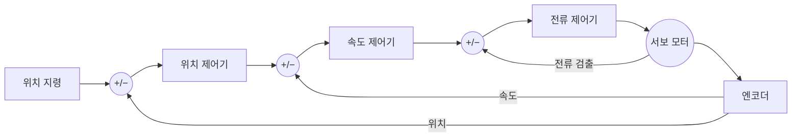

# 서보 모터와 서보 제어

> [!summary] 핵심 요약
> - 서보 = 모터 + 엔코더 + 드라이버로 된 **폐루프** 시스템. 지령을 정확히, 빠르게 따라간다.
> - 제어 루프는 **바깥부터 위치 → 속도 → 전류(토크)**. 안쪽 루프일수록 응답이 빠르다.
> - 제어 모드: **위치 제어**(펄스 지령), **속도 제어**(아날로그 전압), **토크 제어**(아날로그 전압).
> - **전자 기어비**로 지령 펄스 1개당 이동량을 기계 단위(예: 0.001 mm)에 맞춘다.

> [!warning] 자주 틀리는 포인트
> - 게인이 너무 높으면 **진동·소음(헌팅)**, 너무 낮으면 **응답이 느리고 위치 오차가 크다**.
> - 위치 지령과 실제 위치의 차이가 **편차 카운터(위치 편차)** 에 쌓인다. 너무 커지면 과대 편차 알람.
> - 서보 온(SV-ON) 전에 **비상 정지·리밋 신호 배선**을 먼저 확인한다.
> - 수직축(Z축)에는 정전 시 떨어지지 않도록 **브레이크 부착 모터**를 쓴다.
> - 부하 관성이 모터 관성보다 너무 크면(관성비 큼) 제어가 불안정해진다 → 감속기 사용.

## 개념 정리

### 서보 시스템 구성

| 구성 | 역할 |
| --- | --- |
| 상위 제어기 (PLC 위치결정 모듈, 모션 컨트롤러) | 위치·속도 지령 |
| 서보 드라이버 (앰프) | 지령과 피드백 비교, 전류 제어 |
| 서보 모터 | AC 서보(동기형 영구자석)가 주류 |
| 엔코더 | 위치·속도 피드백 |
| 기계 (볼스크루, 벨트, 감속기) | 회전 → 직선 운동 변환 |

### 3중 제어 루프

| 루프 | 비교 대상 | 출력 |
| --- | --- | --- |
| 위치 루프 (바깥) | 위치 지령 − 엔코더 위치 | 속도 지령 |
| 속도 루프 (중간) | 속도 지령 − 엔코더 속도 | 전류(토크) 지령 |
| 전류 루프 (안쪽) | 전류 지령 − 실측 전류 | PWM 전압 |

### 제어 모드

| 모드 | 지령 | 용도 |
| --- | --- | --- |
| 위치 제어 | 펄스 열 (펄스 수 = 거리, 주파수 = 속도) | 이송축, 위치 결정 |
| 속도 제어 | 아날로그 ±10 V 또는 통신 | 일정 속도 회전, 상위에서 위치 루프 |
| 토크 제어 | 아날로그 ±10 V | 장력 제어, 압입, 나사 체결 |

### 전자 기어비

- 지령 단위(1펄스당 이동량)를 기계에 맞추는 배율.
- $\text{전자 기어비} = \dfrac{\text{엔코더 1회전 펄스 수}}{\text{1회전당 이동량} \div \text{1펄스 이동량}}$
- **계산 예**: 엔코더 131072 P/R(17비트), 볼스크루 리드 10 mm, 1펄스 = 0.001 mm 로 하고 싶다
  - 1회전에 필요한 지령 펄스 = $10 / 0.001 = 10000$
  - 전자 기어비 = $131072 / 10000$ (드라이버에 분자 131072, 분모 10000 입력)

### 게인 튜닝

| 게인 | 높이면 | 낮추면 |
| --- | --- | --- |
| 위치 루프 게인 | 정정 시간 짧아짐, 오버슈트·진동 | 추종 느림 |
| 속도 루프 게인 | 응답·강성 향상, 진동 위험 | 외란에 약함 |
| 속도 적분 시정수 | (작게 하면) 정상 편차 빨리 제거, 진동 위험 | 느려짐 |

- **오토 튜닝**: 드라이버가 부하 관성을 추정해 게인 자동 설정 → 먼저 실행하고 미세 조정.
- **노치 필터**: 기계 공진 주파수의 진동 제거.

### 시험 운전 순서

1. 배선 점검: 전원(L1·L2·L3), 모터 동력선(U·V·W 순서), 엔코더, 접지, 비상 정지.
2. 전원 투입, 알람 없는지 확인.
3. 파라미터 설정: 제어 모드, 전자 기어비, 회전 방향, 리밋.
4. **JOG 운전**(드라이버 단독)으로 회전 방향·이상음 확인.
5. 상위 제어기와 연결해 저속으로 위치 결정 확인.
6. 오토 튜닝 → 정격 속도 운전 → 원점 복귀 확인.

- 모터 동력선 U·V·W를 바꾸면 유도전동기처럼 역회전하지 **않고 폭주·알람**이 난다. 방향은 파라미터로 바꾼다.

### 유지보수

- 알람 이력 확인: 과전류, 과부하, 엔코더 이상, 과대 편차, 과전압(회생).
- 회생 에너지가 크면 **회생 저항** 추가.
- 앱솔루트 엔코더 백업 배터리 교체(교체 시 전원 유지 또는 원점 재설정).
- 케이블 굴곡부 마모, 커넥터 풀림, 냉각 팬 점검.

## 그림

## 관련 단원

- [DC 모터와 스테핑 모터](DC모터와_스테핑모터.md)
- [특수모듈 프로그래밍](특수모듈_프로그래밍.md)
- [아날로그 센서와 엔코더](아날로그_센서와_엔코더.md)
- [자동제어계의 기초](자동제어계의_기초.md)

## 체크리스트

- [ ] 서보의 3중 루프 순서를 그린다
- [ ] 위치·속도·토크 제어 모드의 지령과 용도를 구분한다
- [ ] 전자 기어비를 계산한다
- [ ] 게인을 올리고 내릴 때의 영향을 설명한다
- [ ] 시험 운전 순서를 말한다
- [ ] U·V·W 결선 오류와 방향 변경 방법을 안다

## 참고

- [큐넷 자동화설비산업기사 출제기준](https://www.q-net.or.kr/crf005.do?id=crf00503&jmCd=2034)
