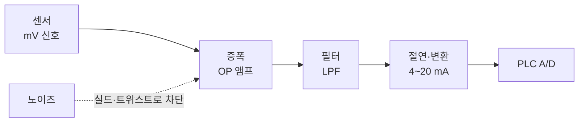

# 센서 회로와 신호처리

> [!summary] 핵심 요약
> - 센서 신호 흐름: 검출 → **증폭** → **필터** → **변환(4~20 mA, A/D)** → PLC.
> - **휘트스톤 브리지** 평형 조건: $R_1 R_4 = R_2 R_3$ (마주 보는 저항의 곱이 같음).
> - OP 앰프: 반전 증폭 $-\dfrac{R_f}{R_i}$, 비반전 증폭 $1 + \dfrac{R_f}{R_i}$, 전압 팔로워 이득 1.
> - 원거리 아날로그 전송은 전압보다 **전류(4~20 mA)** 가 유리하다. 선 저항과 노이즈 영향이 적다.

> [!warning] 자주 틀리는 포인트
> - 전압 팔로워(버퍼)는 증폭하지 않는다. 목적은 **임피던스 변환**(입력 임피던스 높고 출력 임피던스 낮음).
> - 저역통과 필터(LPF)는 **고주파 노이즈 제거**, 고역통과 필터(HPF)는 **직류·저주파 제거**.
> - 아날로그 신호선 실드는 **한쪽만** 접지한다. 양쪽 접지는 접지 루프를 만든다.
> - 채터링(접점 떨림)은 소프트웨어 **디바운스**(필터 시간)나 응차로 막는다.
> - 이상적 OP 앰프: 입력 임피던스 **∞**, 출력 임피던스 **0**, 전압 이득 **∞**, 대역폭 **∞**, 두 입력 사이 전압 0, 온도 영향 없음, 두 입력이 같으면 출력 0. "입력 저항 0", "대역폭 0", "이득이 한정"은 틀린 보기.
> - **비반전 증폭기는 입력과 출력의 위상이 같다**(이득 $1 + R_f/R_i$). 이득이 1인 것은 전압 팔로워, 90° 앞서는 것은 미분기 설명.
> - 입력 쪽이 **콘덴서**, 피드백이 저항이면 **미분기**. 입력이 저항, 피드백이 **콘덴서**면 **적분기**. 입력 저항이 여러 개 병렬로 반전 단자에 모이면 **가산기**.
> - 센서 출력이 비선형이면 그대로 쓰기 어렵다 → **선형화**(리니어라이즈) 처리.
> - "디지털 반가산기"는 OP 앰프(아날로그) 응용 회로가 아니다.

## 개념 정리

### 센서 신호의 종류

| 구분 | 예 | 처리 |
| --- | --- | --- |
| 디지털 ON/OFF | 근접·광전 센서, 리밋 스위치 | PLC 디지털 입력 |
| 펄스 | 엔코더, 유량계 펄스 | 고속카운터 |
| 아날로그 전압 | 0~10 V, 1~5 V | A/D 모듈 |
| 아날로그 전류 | 4~20 mA | A/D 모듈 (250 Ω으로 1~5 V 변환 가능) |
| 미소 신호 | 열전대 mV, 스트레인 게이지 mV | 증폭기·변환기 필요 |

### 4~20 mA 전류 루프의 장점

- 선 저항이 있어도 전류는 그대로 → **원거리 전송**.
- 노이즈 영향이 적다.
- 0 mA = 단선 → **단선 검출** 가능.
- 4 mA로 센서 자체 전원을 공급하는 **2선식 변환기** 가능.

### 휘트스톤 브리지

- 네 저항을 마름모로 연결, 대각선에 전원과 검출기.
- 평형: $R_1 R_4 = R_2 R_3$ → 검출 전압 0. ($R_1$–$R_2$가 한 가지, $R_3$–$R_4$가 다른 가지일 때. 즉 $R_1/R_2 = R_3/R_4$)
- 한 저항(스트레인 게이지, RTD)이 바뀌면 불평형 전압이 생긴다.
- 게이지 수: 1게이지 < 2게이지(하프) < 4게이지(풀 브리지) 순으로 감도 증가, 온도 보상 개선.

### OP 앰프 기본 회로

| 회로 | 이득·출력 | 용도 |
| --- | --- | --- |
| 반전 증폭기 | $V_o = -\dfrac{R_f}{R_i} V_i$ | 증폭 + 위상 반전 |
| 비반전 증폭기 | $V_o = \left(1 + \dfrac{R_f}{R_i}\right) V_i$ | 위상 유지 증폭 |
| 전압 팔로워 | $V_o = V_i$ | 버퍼, 임피던스 변환 |
| 가산기 | 입력들의 가중합 | 신호 합성 |
| 차동 증폭기 | 두 입력의 차 | 브리지 출력, 공통 모드 잡음 제거 |
| 비교기 | 기준보다 크면 +포화, 작으면 −포화 | 레벨 검출 |
| 적분기 / 미분기 | 입력의 적분 / 미분 | 아날로그 연산 |

- 이상적 OP 앰프: 입력 임피던스 ∞, 출력 임피던스 0, 개루프 이득 ∞, 두 입력 전압 같음(가상 단락).
- **계산 예**: 반전 증폭, $R_i = 10\text{ k}\Omega$, $R_f = 100\text{ k}\Omega$, 입력 0.2 V → 출력 −2 V.
- **반전 가산기**: $V_o = -R_f\left(\dfrac{V_1}{R_1} + \dfrac{V_2}{R_2} + \dfrac{V_3}{R_3}\right)$
  - 예: 모든 저항 10 kΩ, 입력 0.1 V, 0.3 V, 0.5 V → $V_o = -(0.1 + 0.3 + 0.5) = -0.9$ V
  - 저항이 모두 같으면 출력은 **입력 합의 부호 반대**. $R_f$가 입력 저항의 k배면 합의 −k배.
- **적분기**: $V_o = -\dfrac{1}{RC}\int V_i\,dt$ (피드백 C). **미분기**: $V_o = -RC\dfrac{dV_i}{dt}$ (입력 C).

### 센서 신호 처리의 목적과 반도체 센서

- 센서를 쓰는 이유: 자동 검출·계측, 분류·자재 관리, 공구 수명·이상 진단, 품질 검사. (설비 비용 절감 자체가 목적은 아니다)
- **선형화**: 비선형 출력(열전대, 서미스터)을 직선 관계로 보정 → 테이블·근사식·전용 회로.
- **반도체 센서의 장점**: 응답이 빠르고 감도가 높으며 소형·집적화·지능화가 쉽다. **무접점**이다 (유접점이 아님).

### 필터

| 필터 | 통과 | 용도 |
| --- | --- | --- |
| 저역통과 (LPF) | 낮은 주파수 | 고주파 노이즈 제거, 평균화 |
| 고역통과 (HPF) | 높은 주파수 | DC 오프셋 제거 |
| 대역통과 (BPF) | 특정 대역 | 특정 신호 추출 |
| 대역저지 (BSF, 노치) | 특정 대역 제외 | 60 Hz 전원 험 제거 |

- RC 필터 차단 주파수: $f_c = \dfrac{1}{2\pi RC}$

### 노이즈 대책

| 노이즈 경로 | 대책 |
| --- | --- |
| 정전 유도 | 실드선, 실드 한쪽 접지 |
| 전자 유도 | 트위스트 페어, 동력선과 이격 |
| 접지 루프 | 일점 접지, 절연 변환기(아이솔레이터) |
| 전원 노이즈 | 라인 필터, 절연 트랜스 |
| 접점 채터링 | 입력 필터 시간, 디바운스 |

- 신호 절연: **포토커플러**(디지털), **절연 앰프·신호 변환기**(아날로그).

### 센서 관리 (점검·교정)

- 정기 점검: 검출면 오염 제거, 광축·거리 확인, 케이블 손상·커넥터 풀림.
- **교정(캘리브레이션)**: 기준기와 비교해 영점·스팬 조정.
- 영점(Zero) 먼저, 스팬(Span) 나중에 맞추고 다시 영점 확인.
- 이력 관리: 교정 일자·결과 기록, 교체 주기.

## 그림

## 기출 포인트

출처: 생산자동화산업기사 2016–2020년 필기 14회분 (cbtbank.kr).

- 이상적 OP 앰프의 특성 (입력 임피던스 ∞, 대역폭 ∞ 등 틀린 것 고르기) — 4회 (2017-3, 2018-1, 2018-2, 2019-1)
- OP 앰프 회로 판별·계산 (반전 가산기 출력, 미분기·적분기 그림 판별, 비반전 증폭기 위상, 응용 회로가 아닌 것, 회로 출력 전압) — 6회 (2016-1, 2016-2, 2018-2, 2018-3, 2020-1·2 ×2)
- 센서 신호의 선형화, 반도체 센서의 장점, 센서 사용 목적 — 3회 (2017-1, 2020-1·2 ×2)

## 관련 단원

- [아날로그 센서와 엔코더](아날로그_센서와_엔코더.md)
- [근접센서와 광전센서](근접센서와_광전센서.md)
- [특수모듈 프로그래밍](특수모듈_프로그래밍.md)
- [전기전자 기초와 소자](전기전자_기초와_소자.md)

## 체크리스트

- [ ] 4~20 mA 전류 신호의 장점 4가지를 말한다
- [ ] 휘트스톤 브리지 평형 조건으로 미지 저항을 구한다
- [ ] 반전·비반전 증폭기 출력 전압을 계산한다
- [ ] LPF·HPF·노치 필터 용도를 구분한다
- [ ] 실드 접지 방법과 이유를 설명한다
- [ ] 영점·스팬 교정 순서를 안다
- [ ] 이상적 OP 앰프 6가지 특성을 말하고 틀린 보기를 고른다
- [ ] 반전 가산기 출력 전압을 계산한다
- [ ] 회로 그림에서 미분기·적분기·가산기·비교기를 구분한다
- [ ] 선형화가 필요한 이유와 반도체 센서의 장점을 말한다

## 참고

- [큐넷 자동화설비산업기사 출제기준](https://www.q-net.or.kr/crf005.do?id=crf00503&jmCd=2034)
