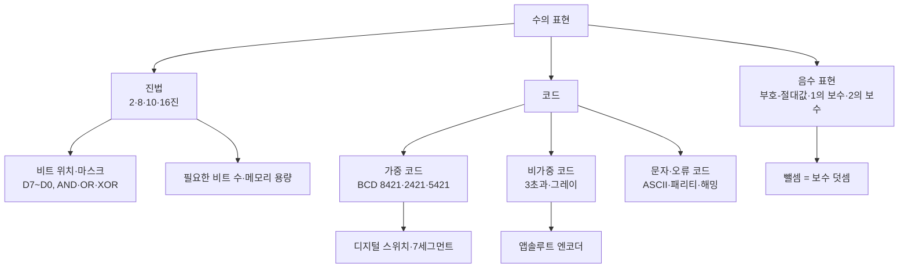
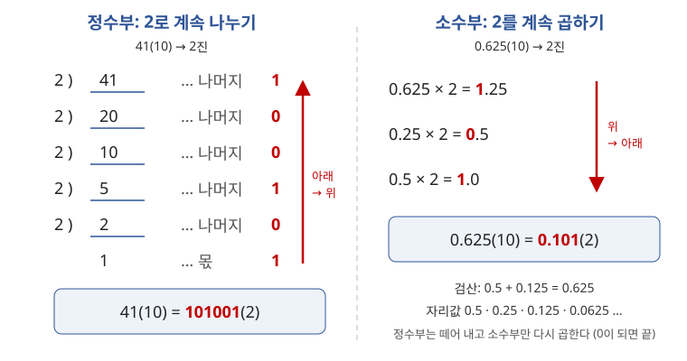
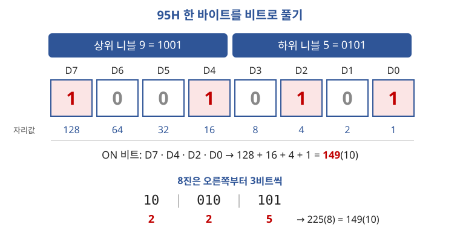
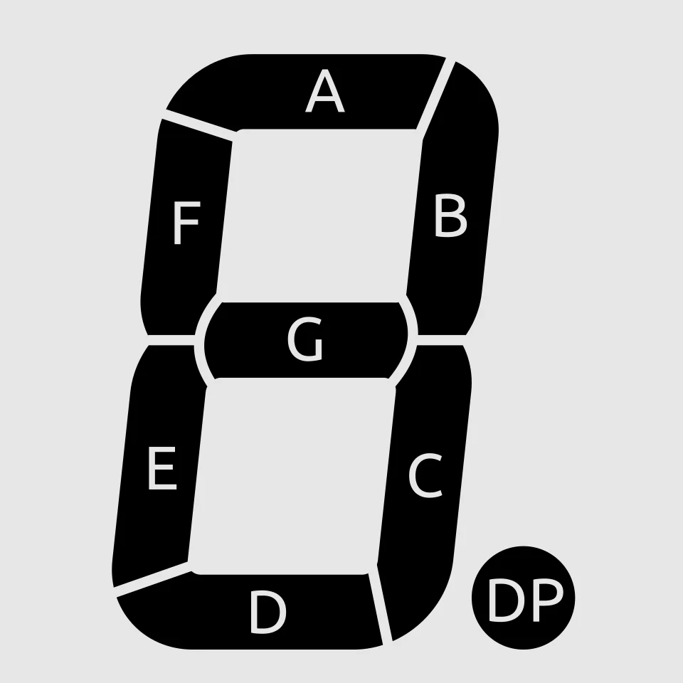
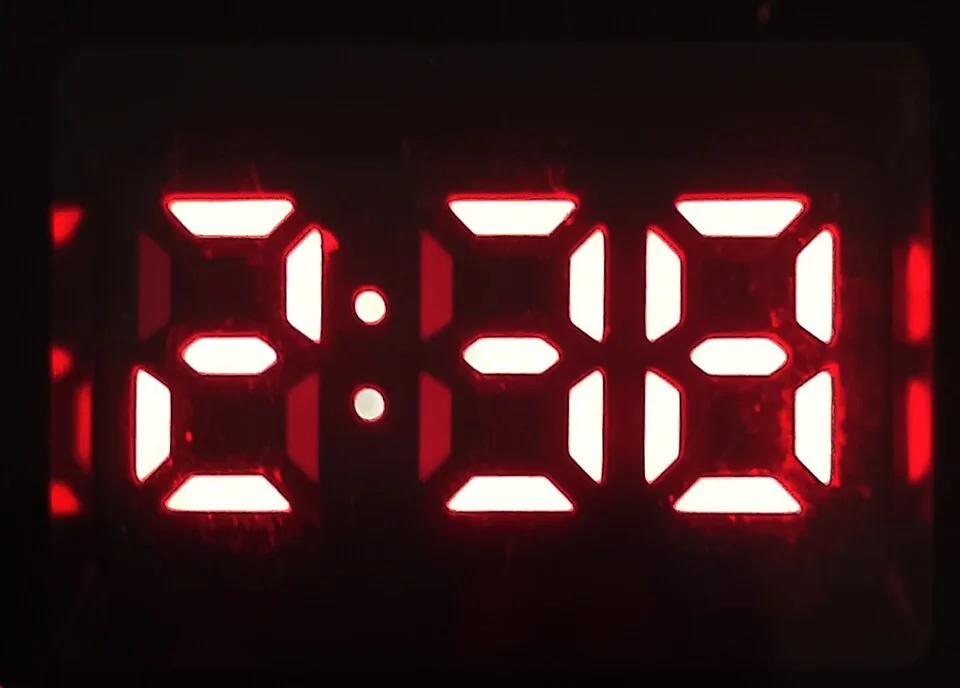
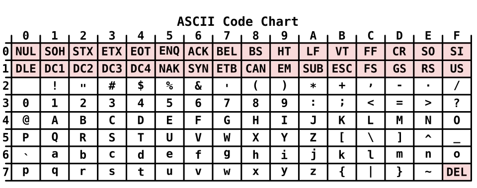
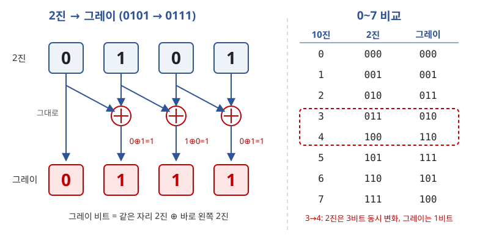
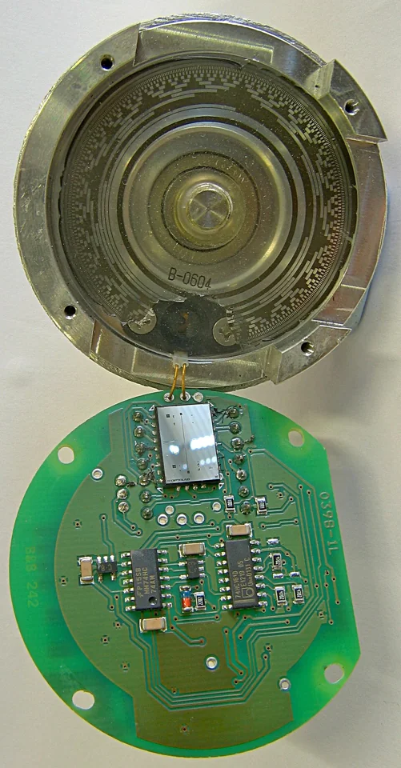
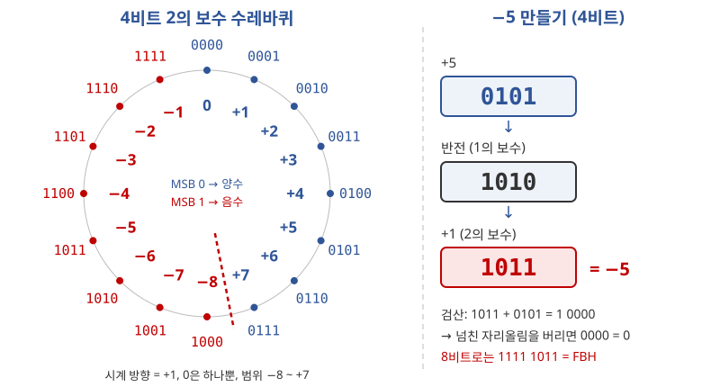
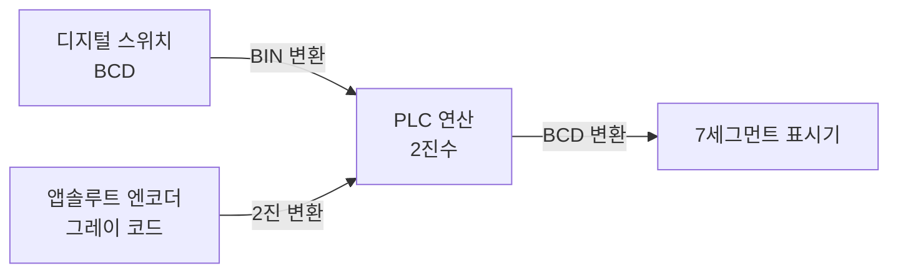

# 수의 표현과 코드

> [!summary] 핵심 요약
> - 2진수 4비트 = 16진수 1자리, 3비트 = 8진수 1자리.
> - **BCD(8421)**: 10진수 한 자리를 4비트로. 디지털 스위치 입력·7세그먼트 표시에 쓴다.
> - **그레이 코드**: 이웃한 값끼리 1비트만 다름 → 앱솔루트 엔코더에서 읽기 오류를 줄인다.
> - 음수는 **2의 보수**로 표현: 비트 반전 + 1.

> [!warning] 자주 틀리는 포인트
> - BCD에서 1010~1111(10~15)은 **쓰지 않는 코드**. 이런 값이 오면 BCD 변환 에러.
> - 25(10진)의 BCD는 `0010 0101`, 2진수는 `11001`. **둘은 다르다**.
> - 3초과 코드는 BCD + 3(0011)이며 **비가중 코드**, 자기 보수 코드.
> - 그레이 코드는 가중치가 없어 **산술 연산에 쓰지 않는다**.
> - 음수 표현 방법은 **부호-절대값, 1의 보수, 2의 보수** 세 가지. 3초과 코드는 음수 표현법이 아니다.
> - 2의 보수 문제는 **비트 수를 먼저 맞춘다**. 5비트로 주어진 수는 5비트 결과, 8비트면 앞의 0까지 채워 8비트로 반전한다.
> - 2진 소수의 자리값은 0.5, 0.25, 0.125, 0.0625 … 이다. 0.1(2진) = 0.5, 0.01(2진) = 0.25.
> - 16진 한 자리 = 4비트. `95H` 같은 값의 각 비트(D7~D0)를 묻는 문제는 상위·하위 니블로 나눠 바로 풀어 쓴다.
> - 그레이 코드는 이웃한 값끼리 **딱 1비트**만 다르다.
> - 컴퓨터가 2의 보수를 쓰는 곳은 **뺄셈·음수 표현**이다. **곱셈**은 2진 곱으로 바로 계산하므로 2의 보수를 쓰지 않는다 (교재 27-8).
> - 8비트 −5 = 0000 0101을 뒤집고 1 더함 → 1111 1011 = **FBH**.

## 학습 목표

이 단원을 마치면 다음을 할 수 있어야 한다.

1. 10진 정수·소수를 2진으로 바꾸고, 2·8·16진수를 서로 묶어 바꾼다.
2. 16진 값(예: `95H`)을 보고 D7~D0 중 어느 비트가 1인지 바로 말한다.
3. 10진수를 BCD로 쓰고, 같은 수의 2진수와 구분한다.
4. 2진 ↔ 그레이 코드를 XOR로 변환하고, 엔코더가 그레이 코드를 쓰는 이유를 설명한다.
5. 정해진 비트 수로 2의 보수를 구해 음수를 표현하고, 뺄셈을 보수 덧셈으로 계산한다.
6. AND·OR·XOR 마스크, 시프트, 필요한 비트 수, 메모리 용량을 계산한다.

## 한눈에 보기

## 개념 정리

### 진법 변환

**직관**: 진법은 "몇 개가 모이면 한 자리 올리느냐"의 차이다. 10진은 10개, 2진은 2개, 16진은 16개에서 올린다. 컴퓨터는 전기가 있다/없다 두 상태만 구분하므로 2진을 쓰고, 2진이 너무 길어 사람이 읽기 편하게 4비트씩 묶은 것이 16진이다.

*왼쪽은 41을 2로 계속 나눠 나머지(빨강)를 **아래에서 위로** 읽어 101001을 얻는 과정, 오른쪽은 0.625에 2를 계속 곱해 정수부(빨강)를 **위에서 아래로** 읽어 0.101을 얻는 과정이다. 읽는 방향이 반대라는 점이 시험 함정이다.*

$$N_{(10)} = \sum d_i \times r^{i} \qquad (r = \text{기수},\ i = \text{자리 번호, 소수점 오른쪽은 음수})$$

| 10진 | 2진 | 8진 | 16진 | BCD |
| :-: | :-: | :-: | :-: | :-: |
| 9 | 1001 | 11 | 9 | 0000 1001 |
| 10 | 1010 | 12 | A | 0001 0000 |
| 15 | 1111 | 17 | F | 0001 0101 |
| 25 | 1 1001 | 31 | 19 | 0010 0101 |
| 100 | 110 0100 | 144 | 64 | 0001 0000 0000 |

- **10진 → 2진**: 2로 계속 나눠 나머지를 아래에서 위로.
- **10진 소수 → 2진**: 2를 곱해 정수부를 위에서 아래로. 예: 0.625 → 0.101
- **2진 → 16진**: 소수점 기준 4비트씩 묶기. 8진은 3비트씩.
- **2진 소수 → 10진 예**: $110.101_{(2)} = 4 + 2 + 0.5 + 0.125 = 6.625$
- **10진 → 16진 예**: $300 = 256 + 44 = 1 \times 16^2 + 2 \times 16 + 12$ → `12C`H
- **필요한 비트 수**: 서로 다른 N개를 구분하려면 $2^n \ge N$ 인 최소 n.
  - 예: 0~15 → 4비트, 200가지 → 8비트($2^7 = 128 < 200 \le 256$), 126가지 → 7비트.

$$2^n \ge N \quad\Rightarrow\quad n = \lceil \log_2 N \rceil$$

**교재(27절) 계산 예**

| 문제 | 답 |
| --- | --- |
| $41_{(10)}$ → 2진 | 101001 |
| $0.6875_{(10)}$ → 2진 | 0.1011 (0.5 + 0.125 + 0.0625) |
| $1011.01_{(2)}$, $101.1_{(2)}$ → 10진 | 11.25, 5.5 |
| $37.2_{(8)}$ → 10진 | 3 × 8 + 7 + 2/8 = 31.25 |
| `2F9`H → 10진 | 2 × 256 + 15 × 16 + 9 = 761 |
| 761 → BCD | 0111 0110 0001 |
| 11 → BCD | 0001 0001 |
| 01011의 2의 보수 | 10101 |
| 1001 1100의 2의 보수 | 0110 0100 |

- 교재 요령: 보기가 여러 진법으로 섞여 있으면 **모두 10진수로 바꿔** 비교한다. 시험 숫자는 크지 않다.
- MSB는 맨 왼쪽(최상위) 비트, LSB는 맨 오른쪽(최하위) 비트.

> [!tip] 감 잡기
> 2의 거듭제곱 1, 2, 4, 8, 16, 32, 64, 128, 256 … 과 소수 쪽 0.5, 0.25, 0.125, 0.0625를 외워 두면, 대부분의 변환은 "어느 자리값을 더하면 이 수가 되나"를 찾는 덧셈 문제로 바뀐다. 예: 41 = 32 + 8 + 1 → 101001.

### 16진수와 비트 위치

**직관**: 16진 한 글자는 4비트 묶음(니블) 하나에 정확히 대응한다. 그래서 16진 두 글자 = 1바이트 = D7~D0 여덟 칸이고, 글자 하나씩 4비트로 풀면 끝이다.

*빨간 칸(D7·D4·D2·D0)이 1인 비트다. 자리값을 더하면 128 + 16 + 4 + 1 = 149이고, 같은 비트열을 오른쪽부터 3비트씩 끊으면 8진수 225가 된다.*

| 16진 | 2진 | 16진 | 2진 |
| :-: | :-: | :-: | :-: |
| 0 | 0000 | 8 | 1000 |
| 1 | 0001 | 9 | 1001 |
| 2 | 0010 | A | 1010 |
| 3 | 0011 | B | 1011 |
| 4 | 0100 | C | 1100 |
| 5 | 0101 | D | 1101 |
| 6 | 0110 | E | 1110 |
| 7 | 0111 | F | 1111 |

- 예: `6CH` = `0110 1100` → D6, D5, D3, D2가 1, 나머지 0.
- 반대로 "D1, D4, D7만 ON" → `1001 0010` = `92H`.

> [!question] 시험에서는
> 스위치 8개(D7~D0)의 ON/OFF 그림을 주고 16진 값을 묻거나(교재 27-10), 16진 값을 주고 켜진 비트를 고르게 한다. **4비트씩 끊고, 각 니블을 8-4-2-1로 읽는다.**

### 비트 연산 (마스크)

**비유**: 마스크는 스프레이 페인트용 **스텐실**이다. AND 마스크의 0 자리는 무조건 0으로 칠해지고(지우기), OR 마스크의 1 자리는 무조건 1로 칠해지며(세우기), XOR 마스크의 1 자리는 원래 색이 뒤집힌다(반전).

| 연산 | 용도 | 예 (`1011 0110`과 연산) |
| --- | --- | --- |
| AND | 원하는 비트만 남기고 나머지 **0으로 지우기**(마스크, 리셋) | AND `0000 1111` → `0000 0110` |
| OR | 원하는 비트를 **1로 세우기**(세트) | OR `0000 0001` → `1011 0111` |
| XOR | 원하는 비트를 **반전** | XOR `1111 0000` → `0100 0110` |
| 오른쪽 시프트 | 1비트마다 ÷2 | `>> 2` → `0010 1101` |
| 왼쪽 시프트 | 1비트마다 ×2 | `<< 1` → `0110 1100` (8비트 넘침 버림) |

$$x \ll n = x \times 2^{n}, \qquad x \gg n = \left\lfloor x / 2^{n} \right\rfloor$$

> [!tip] 감 잡기
> 10진수를 한 자리 왼쪽으로 밀면 ×10이 되듯, 2진수를 한 비트 왼쪽으로 밀면 ×2가 된다. 위 예에서 `1011 0110`(182)을 `>> 2` 하면 `0010 1101`(45) = 182 ÷ 4의 몫이다.

### 메모리 용량 (옛 시험 단골 계산)

**직관**: 주소선 n개는 n비트 주소를 만들므로 $2^n$개의 칸(번지)을 가리킬 수 있고, 데이터선 수는 한 칸에 든 비트 수다. 용량은 "칸 수 × 칸 크기"다.

$$\text{용량} = 2^{\text{주소선 수}} \times \text{데이터선 수}\ [\text{bit}]$$

- 용량 = $2^{\text{주소선 수}}$ × 데이터선 수 [bit].
- 예: 주소선 12개, 데이터선 8개 → $2^{12} = 4096$ 번지 × 8비트 = 4096 바이트 = 4 KB (= 32768 bit).
- 주소선 16개 → 64 K번지. 주소선 2개 → 4가지 주소.

### 데이터 단위

| 단위 | 비트 수 | 비고 |
| --- | --- | --- |
| 비트 | 1 | 접점 하나 (M, P) |
| 니블 | 4 | BCD 한 자리 |
| 바이트 | 8 | |
| 워드 | 16 | PLC 데이터 레지스터 D 한 개 |
| 더블 워드 | 32 | D 두 개 연속 사용 |

- 16비트 부호 없는 범위 0~65535, 부호 있는 범위 −32768~32767.

$$\text{부호 없음: } 0 \sim 2^{n}-1, \qquad \text{부호 있음(2의 보수): } -2^{n-1} \sim 2^{n-1}-1$$

### 코드의 종류

**직관**: 2진수는 계산하기 좋지만 사람이 쓰는 10진 숫자·문자와 바로 대응하지 않는다. 그래서 목적에 맞춰 비트 배열 규칙을 따로 정한 것이 코드다 — 10진 표시용(BCD), 위치 검출용(그레이), 문자용(ASCII), 오류 검출용(패리티·해밍).

| 7세그먼트의 세그먼트 이름 | 실제 7세그먼트 LED 표시 |
| :-: | :-: |
|  |  |

*왼쪽: 막대 7개에 A(위)부터 시계 방향으로 B·C·D·E·F, 가운데 G, 오른쪽 아래 점 DP를 붙인다. 오른쪽: 실제 LED 표시기로, 켜진 막대 조합이 숫자 2·3·8을 만든다. BCD 한 자리(4비트)를 받아 이 7개 막대 신호로 바꾸는 것이 BCD-to-7세그먼트 디코더다([논리회로](논리회로.md)).*

| 코드 | 가중치 | 특징 |
| --- | --- | --- |
| BCD (8421) | 있음 | 10진 자리마다 4비트 |
| 2421, 5421 | 있음 | 자기 보수형(2421) |
| 3초과 (Excess-3) | 없음 | BCD + 3, 자기 보수 |
| 그레이 | 없음 | 인접 값 1비트 변화 |
| ASCII | – | 7비트 문자 코드 (128자), 패리티 붙여 8비트 |
| 패리티·해밍 | – | 오류 검출·정정용 ([데이터 통신](데이터_통신.md)) |

- **BCD 예**: $25 \rightarrow$ `0010` `0101` (2 → 0010, 5 → 0101). 같은 25의 2진수 `11001`과 비트 배열이 다르다.
- **3초과 예**: 5의 BCD `0101` + `0011` = `1000`. 5의 3초과 코드 `1000`을 반전하면 `0111` = 4의 3초과 코드 → 9의 보수(9 − 5 = 4)가 비트 반전으로 바로 나오므로 **자기 보수** 코드다.

*행 번호(0~7)가 상위 3비트, 열 번호(0~F)가 하위 4비트라서 7비트 = 128자다. 분홍색 칸(NUL, STX, ETX, CR, LF …)은 화면에 찍히지 않는 제어 문자로, 통신 프레임의 시작(STX = 02H)·끝(ETX = 03H) 표시에 쓰인다. 숫자 '0'은 30H, 'A'는 41H다.*

### 2진 ↔ 그레이 변환

**비유**: 2진수는 3 → 4로 넘어갈 때 `011` → `100`처럼 세 비트가 **동시에** 바뀌어야 한다. 엔코더 센서 세 개가 정확히 같은 순간에 바뀌지 않으면 그 찰나에 `111`(7) 같은 엉뚱한 값을 읽는다. 그레이 코드는 이웃 값 사이에 **한 비트만** 바뀌게 배열해 이런 순간을 없앤다.

*왼쪽: 맨 앞 비트는 그대로 내려오고, 나머지 그레이 비트는 같은 자리 2진 비트와 바로 왼쪽 2진 비트의 XOR이다. 오른쪽: 3 → 4에서 2진은 3비트가 한꺼번에 바뀌지만(011 → 100), 그레이는 1비트만 바뀐다(010 → 110).*

$$G_{n-1} = B_{n-1}, \qquad G_i = B_{i+1} \oplus B_i \qquad\quad B_{n-1} = G_{n-1}, \qquad B_i = B_{i+1} \oplus G_i$$

- **2진 → 그레이**: 맨 왼쪽 비트는 그대로, 나머지는 **바로 왼쪽 2진 비트와 XOR**.
  - 예: 0101 → 0, 0⊕1=1, 1⊕0=1, 0⊕1=1 → `0111`
- **그레이 → 2진**: 맨 왼쪽은 그대로, 나머지는 **방금 구한 2진 비트와 그레이 비트를 XOR**.
  - 검산 예: 그레이 `0111` → 0, 0⊕1=1, 1⊕1=0, 0⊕1=1 → 2진 `0101` (처음 값으로 돌아온다)

| 3비트 2진 코드 원판 | 3비트 그레이 코드 원판 |
| :-: | :-: |
|  |  |

*두 원판 모두 링 3개 = 3비트, 칸 8개 = 8가지 위치다. 왼쪽 2진 원판은 바깥 링(LSB)이 45°마다 흑백이 바뀌고, 어떤 경계에서는 세 링이 한꺼번에 바뀐다. 오른쪽 그레이 원판은 어느 경계에서든 **한 링만** 바뀌므로 센서가 경계에 걸려도 오차가 한 칸을 넘지 않는다.*

*실제 앱솔루트 엔코더를 열어 본 모습. 위쪽 원판에 여러 겹의 동심원 트랙(13비트)이 그레이 코드 무늬로 새겨져 있고, 아래쪽 기판 가운데의 센서 칩이 이 트랙들을 한꺼번에 읽어 절대 위치를 낸다. 전원이 꺼졌다 켜져도 원점 복귀 없이 위치를 안다([서보모터와 서보제어](서보모터와_서보제어.md)).*

### 보수와 음수

**비유**: 자동차 주행거리계를 0000에서 한 칸 거꾸로 돌리면 9999가 된다. 4비트 카운터도 0000에서 1을 빼면 1111이 되므로, 1111을 −1로 약속하면 덧셈 회로 하나로 뺄셈까지 할 수 있다. 이것이 2의 보수다.

*왼쪽: 16개 비트 패턴을 원으로 놓고, MSB가 0인 오른쪽 반은 0~+7, MSB가 1인 왼쪽 반은 −1~−8로 읽는다. 점선(+7과 −8 사이)을 넘으면 넘침(오버플로)이다. 0은 0000 하나뿐이다. 오른쪽: +5 = 0101을 반전(1010)하고 1을 더하면 1011 = −5이고, 8비트로 늘리면 1111 1011 = FBH다.*

$$-X = \overline{X} + 1 \qquad\quad A - B = A + (\overline{B} + 1) \quad (\text{넘친 자리올림은 버림})$$

- **1의 보수**: 모든 비트 반전.
- **2의 보수**: 1의 보수 + 1. 0이 하나뿐이라 컴퓨터·PLC가 이 방식을 쓴다.
  - 예(8비트): +5 = `0000 0101` → −5 = `1111 1011`
- **10진 보수**: 9의 보수(각 자리 9에서 빼기), 10의 보수(9의 보수 + 1).
- 뺄셈은 **보수 덧셈**으로 처리한다: A − B = A + (B의 2의 보수), 자리올림은 버림.
- **빠른 2의 보수**: 오른쪽부터 처음 나오는 1까지는 그대로 두고, 그 왼쪽 비트만 모두 반전.
  - 예: `0011 0100` → 오른쪽 `100`은 그대로, 왼쪽 `00110`을 반전 → `1100 1100`
- **예 (8비트 −12)**: +12 = `0000 1100` → 반전 `1111 0011` → +1 → `1111 0100` = `F4H`
- 16진으로 답할 때는 8비트 결과를 4비트씩 끊어 바꾼다.
- **보수 뺄셈 예 (8비트 9 − 5)**: `0000 1001` + `1111 1011` = `1 0000 0100` → 넘친 자리올림 버림 → `0000 0100` = 4.

| 음수 표현법 | −5 (8비트) | 0의 표현 | 비고 |
| --- | --- | --- | --- |
| 부호-절대값 | `1000 0101` | +0, −0 두 개 | MSB = 부호, 나머지 = 크기 |
| 1의 보수 | `1111 1010` | +0, −0 두 개 | 비트 반전 |
| 2의 보수 | `1111 1011` = FBH | 하나 | 컴퓨터·PLC 표준 |

### PLC에서의 활용

**직관**: PLC 내부 연산은 2진수로 하지만, 사람이 돌리는 디지털 스위치와 눈으로 보는 7세그먼트는 10진 한 자리씩 다룬다. 그래서 입구에서 BCD → BIN, 출구에서 BIN → BCD로 바꾼다.

- 디지털 스위치(BCD 입력) → **BIN 명령**으로 2진 변환 후 연산.
- 연산 결과 → **BCD 명령**으로 변환해 7세그먼트에 출력.
- 앱솔루트 엔코더 → 그레이 코드를 2진으로 변환해 위치값으로 사용.

> [!question] 시험에서는
> BCD 명령의 입력이 9999(16비트)를 넘거나, BIN 명령에 들어온 니블이 1010~1111이면 **연산 에러**가 난다. "BCD에서 쓰지 않는 코드" 보기와 같은 원리다.

## 그림

## 기출 포인트

출처: 생산자동화산업기사 2016–2020년 필기 14회분 (cbtbank.kr). 거의 매회 1~3문항.

- 진법 변환 (10진 ↔ 2진, 10진 → 16진, 2진 소수 ↔ 10진 소수) — 8회 (2016-2, 2017-1, 2017-3, 2018-2, 2018-3, 2019-1, 2019-2, 2020-3)
- 2의 보수 구하기, 음수 표현 방법 — 5회 (2016-1, 2016-2, 2017-1, 2019-1, 2020-3)
- BCD 변환 — 3회 (2018-1, 2018-2, 2019-3)
- 그레이 코드 성질 — 1회 (2019-2)
- 필요한 비트 수 (N가지 구분) — 2회 (2016-1, 2018-2)
- 16진 값의 비트 위치 판독 / 특정 비트만 ON 하는 16진 값 — 3회 (2017-1, 2017-2, 2017-3)
- 비트 연산 (AND 마스크·리셋, 시프트 방향, 비트 연산 결과) — 3회 (2019-2, 2019-3, 2020-3)
- 메모리 용량·주소 수 계산 (마이크로프로세서 영역, 교재 CH01 28절 → [마이크로프로세서](마이크로프로세서.md)) — 5회 (2016-2 ×2, 2017-1, 2018-3, 2020-3)

**교재 예제 유형** (Win-Q 2025 PART 01 CHAPTER 02, 27절): 10진 정수·소수 → 2진, BCD, 2의 보수(5비트, 8비트 −5 = FBH), 필요한 비트 수(126개 → 7비트), 8진 소수 → 10진, 2의 보수를 쓰지 않는 연산(곱셈), 음수 표현이 아닌 것(3초과 코드), 스위치 입력의 비트 값(그림, 27-10), 2진 소수 → 10진, 그레이 코드의 변화 비트 수(1).

## 관련 단원

- [논리회로](논리회로.md)
- [데이터 통신](데이터_통신.md)
- [PLC 구성과 특성](PLC_구성과_특성.md)
- [마이크로프로세서](마이크로프로세서.md)
- [서보모터와 서보제어](서보모터와_서보제어.md)

## 체크리스트

- [ ] 2·8·10·16진수를 서로 변환할 수 있다
- [ ] 10진수를 BCD로 쓰고, 2진수와 구분한다
- [ ] 2진 ↔ 그레이 코드를 변환할 수 있다
- [ ] 8비트 2의 보수로 음수를 표현할 수 있다
- [ ] 가중 코드와 비가중 코드를 구분한다
- [ ] 2진 소수를 10진 소수로, 10진 소수를 2진 소수로 바꾼다
- [ ] N가지를 구분하는 데 필요한 비트 수를 구한다
- [ ] 16진 값을 보고 어느 비트가 1인지 바로 말한다
- [ ] AND·OR·XOR 마스크 결과와 시프트 방향을 계산한다
- [ ] 주소선·데이터선 수로 메모리 용량을 구한다

## 참고

- [큐넷 자동화설비산업기사 출제기준](https://www.q-net.or.kr/crf005.do?id=crf00503&jmCd=2034)

### 그림 출처

위키미디어 공용(Wikimedia Commons)과 Openverse에서 가져온 공개 라이선스 자료이고, 노트에 맞게 크기를 줄이고 WebP로 변환했다.

| 그림 | 작성자 | 라이선스 | 출처 |
| --- | --- | --- | --- |
| [Seven-segment design + segments](https://commons.wikimedia.org/wiki/File:Seven-segment_design_%2B_segments.svg) | Mercury | [CC BY 4.0](https://creativecommons.org/licenses/by/4.0) | Wikimedia Commons |
| [LED-7-Segment-Display](https://commons.wikimedia.org/wiki/File:LED-7-Segment-Display.jpg) | RetroEditor | [CC BY-SA 4.0](https://creativecommons.org/licenses/by-sa/4.0) | Wikimedia Commons |
| [ASCII Code Chart](https://commons.wikimedia.org/wiki/File:ASCII_Code_Chart.svg) | Anomie | 퍼블릭 도메인 | Wikimedia Commons |
| [Encoder disc (3-Bit binary)](https://commons.wikimedia.org/wiki/File:Encoder_disc_(3-Bit_binary).svg) | en:User:Cburnett | [CC BY-SA 3.0](http://creativecommons.org/licenses/by-sa/3.0/) | Wikimedia Commons |
| [Encoder Disc (3-Bit)](https://commons.wikimedia.org/wiki/File:Encoder_Disc_(3-Bit).svg) | jjbeard | 퍼블릭 도메인 | Wikimedia Commons |
| [Gray code rotary encoder 13-track opened](https://commons.wikimedia.org/wiki/File:Gray_code_rotary_encoder_13-track_opened.jpg) | Mike1024 | 퍼블릭 도메인 | Wikimedia Commons |

직접 그린 그림(SVG, 이 볼트용으로 새로 작성): 진법변환 나눗셈, 비트위치 95H, 그레이 변환, 2의보수 수레바퀴.

