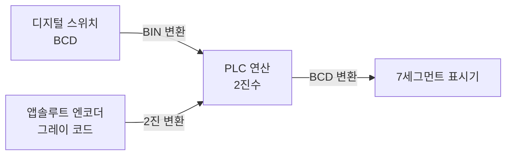

# 수의 표현과 코드

> [!summary] 핵심 요약
> - 2진수 4비트 = 16진수 1자리, 3비트 = 8진수 1자리.
> - **BCD(8421)**: 10진수 한 자리를 4비트로. 디지털 스위치 입력·7세그먼트 표시에 쓴다.
> - **그레이 코드**: 이웃한 값끼리 1비트만 다름 → 앱솔루트 엔코더에서 읽기 오류를 줄인다.
> - 음수는 **2의 보수**로 표현: 비트 반전 + 1.

> [!warning] 자주 틀리는 포인트
> - BCD에서 1010~1111(10~15)은 **쓰지 않는 코드**. 이런 값이 오면 BCD 변환 에러.
> - 25(10진)의 BCD는 `0010 0101`, 2진수는 `11001`. **둘은 다르다**.
> - 3초과 코드는 BCD + 3(0011)이며 **비가중 코드**, 자기 보수 코드.
> - 그레이 코드는 가중치가 없어 **산술 연산에 쓰지 않는다**.
> - 음수 표현 방법은 **부호-절대값, 1의 보수, 2의 보수** 세 가지. 3초과 코드는 음수 표현법이 아니다.
> - 2의 보수 문제는 **비트 수를 먼저 맞춘다**. 5비트로 주어진 수는 5비트 결과, 8비트면 앞의 0까지 채워 8비트로 반전한다.
> - 2진 소수의 자리값은 0.5, 0.25, 0.125, 0.0625 … 이다. 0.1(2진) = 0.5, 0.01(2진) = 0.25.
> - 16진 한 자리 = 4비트. `95H` 같은 값의 각 비트(D7~D0)를 묻는 문제는 상위·하위 니블로 나눠 바로 풀어 쓴다.
> - 그레이 코드는 이웃한 값끼리 **딱 1비트**만 다르다.

## 개념 정리

### 진법 변환

| 10진 | 2진 | 8진 | 16진 | BCD |
| :-: | :-: | :-: | :-: | :-: |
| 9 | 1001 | 11 | 9 | 0000 1001 |
| 10 | 1010 | 12 | A | 0001 0000 |
| 15 | 1111 | 17 | F | 0001 0101 |
| 25 | 1 1001 | 31 | 19 | 0010 0101 |
| 100 | 110 0100 | 144 | 64 | 0001 0000 0000 |

- **10진 → 2진**: 2로 계속 나눠 나머지를 아래에서 위로.
- **10진 소수 → 2진**: 2를 곱해 정수부를 위에서 아래로. 예: 0.625 → 0.101
- **2진 → 16진**: 소수점 기준 4비트씩 묶기. 8진은 3비트씩.
- **2진 소수 → 10진 예**: $110.101_{(2)} = 4 + 2 + 0.5 + 0.125 = 6.625$
- **10진 → 16진 예**: $300 = 256 + 44 = 1 \times 16^2 + 2 \times 16 + 12$ → `12C`H
- **필요한 비트 수**: 서로 다른 N개를 구분하려면 $2^n \ge N$ 인 최소 n.
  - 예: 0~15 → 4비트, 200가지 → 8비트($2^7 = 128 < 200 \le 256$).

### 16진수와 비트 위치

| 16진 | 2진 | 16진 | 2진 |
| :-: | :-: | :-: | :-: |
| 0 | 0000 | 8 | 1000 |
| 1 | 0001 | 9 | 1001 |
| 2 | 0010 | A | 1010 |
| 3 | 0011 | B | 1011 |
| 4 | 0100 | C | 1100 |
| 5 | 0101 | D | 1101 |
| 6 | 0110 | E | 1110 |
| 7 | 0111 | F | 1111 |

- 예: `6CH` = `0110 1100` → D6, D5, D3, D2가 1, 나머지 0.
- 반대로 "D1, D4, D7만 ON" → `1001 0010` = `92H`.

### 비트 연산 (마스크)

| 연산 | 용도 | 예 (`1011 0110`과 연산) |
| --- | --- | --- |
| AND | 원하는 비트만 남기고 나머지 **0으로 지우기**(마스크, 리셋) | AND `0000 1111` → `0000 0110` |
| OR | 원하는 비트를 **1로 세우기**(세트) | OR `0000 0001` → `1011 0111` |
| XOR | 원하는 비트를 **반전** | XOR `1111 0000` → `0100 0110` |
| 오른쪽 시프트 | 1비트마다 ÷2 | `>> 2` → `0010 1101` |
| 왼쪽 시프트 | 1비트마다 ×2 | `<< 1` → `0110 1100` (8비트 넘침 버림) |

### 메모리 용량 (옛 시험 단골 계산)

- 용량 = $2^{\text{주소선 수}}$ × 데이터선 수 [bit].
- 예: 주소선 12개, 데이터선 8개 → $2^{12} = 4096$ 번지 × 8비트 = 4096 바이트 = 4 KB (= 32768 bit).
- 주소선 16개 → 64 K번지. 주소선 2개 → 4가지 주소.

### 데이터 단위

| 단위 | 비트 수 | 비고 |
| --- | --- | --- |
| 비트 | 1 | 접점 하나 (M, P) |
| 니블 | 4 | BCD 한 자리 |
| 바이트 | 8 | |
| 워드 | 16 | PLC 데이터 레지스터 D 한 개 |
| 더블 워드 | 32 | D 두 개 연속 사용 |

- 16비트 부호 없는 범위 0~65535, 부호 있는 범위 −32768~32767.

### 코드의 종류

| 코드 | 가중치 | 특징 |
| --- | --- | --- |
| BCD (8421) | 있음 | 10진 자리마다 4비트 |
| 2421, 5421 | 있음 | 자기 보수형(2421) |
| 3초과 (Excess-3) | 없음 | BCD + 3, 자기 보수 |
| 그레이 | 없음 | 인접 값 1비트 변화 |
| ASCII | – | 7비트 문자 코드 (128자), 패리티 붙여 8비트 |
| 패리티·해밍 | – | 오류 검출·정정용 ([데이터 통신](데이터_통신.md)) |

### 2진 ↔ 그레이 변환

- **2진 → 그레이**: 맨 왼쪽 비트는 그대로, 나머지는 **바로 왼쪽 2진 비트와 XOR**.
  - 예: 0101 → 0, 0⊕1=1, 1⊕0=1, 0⊕1=1 → `0111`
- **그레이 → 2진**: 맨 왼쪽은 그대로, 나머지는 **방금 구한 2진 비트와 그레이 비트를 XOR**.

### 보수와 음수

- **1의 보수**: 모든 비트 반전.
- **2의 보수**: 1의 보수 + 1. 0이 하나뿐이라 컴퓨터·PLC가 이 방식을 쓴다.
  - 예(8비트): +5 = `0000 0101` → −5 = `1111 1011`
- **10진 보수**: 9의 보수(각 자리 9에서 빼기), 10의 보수(9의 보수 + 1).
- 뺄셈은 **보수 덧셈**으로 처리한다: A − B = A + (B의 2의 보수), 자리올림은 버림.
- **빠른 2의 보수**: 오른쪽부터 처음 나오는 1까지는 그대로 두고, 그 왼쪽 비트만 모두 반전.
  - 예: `0011 0100` → 오른쪽 `100`은 그대로, 왼쪽 `00110`을 반전 → `1100 1100`
- **예 (8비트 −12)**: +12 = `0000 1100` → 반전 `1111 0011` → +1 → `1111 0100` = `F4H`
- 16진으로 답할 때는 8비트 결과를 4비트씩 끊어 바꾼다.

### PLC에서의 활용

- 디지털 스위치(BCD 입력) → **BIN 명령**으로 2진 변환 후 연산.
- 연산 결과 → **BCD 명령**으로 변환해 7세그먼트에 출력.
- 앱솔루트 엔코더 → 그레이 코드를 2진으로 변환해 위치값으로 사용.

## 그림

## 기출 포인트

출처: 생산자동화산업기사 2016–2020년 필기 14회분 (cbtbank.kr). 거의 매회 1~3문항.

- 진법 변환 (10진 ↔ 2진, 10진 → 16진, 2진 소수 ↔ 10진 소수) — 8회 (2016-2, 2017-1, 2017-3, 2018-2, 2018-3, 2019-1, 2019-2, 2020-3)
- 2의 보수 구하기, 음수 표현 방법 — 5회 (2016-1, 2016-2, 2017-1, 2019-1, 2020-3)
- BCD 변환 — 3회 (2018-1, 2018-2, 2019-3)
- 그레이 코드 성질 — 1회 (2019-2)
- 필요한 비트 수 (N가지 구분) — 2회 (2016-1, 2018-2)
- 16진 값의 비트 위치 판독 / 특정 비트만 ON 하는 16진 값 — 3회 (2017-1, 2017-2, 2017-3)
- 비트 연산 (AND 마스크·리셋, 시프트 방향, 비트 연산 결과) — 3회 (2019-2, 2019-3, 2020-3)
- 메모리 용량·주소 수 계산 (마이크로프로세서 영역, 새 출제기준 밖) — 5회 (2016-2 ×2, 2017-1, 2018-3, 2020-3)

## 관련 단원

- [논리회로](논리회로.md)
- [데이터 통신](데이터_통신.md)
- [PLC 구성과 특성](PLC_구성과_특성.md)

## 체크리스트

- [ ] 2·8·10·16진수를 서로 변환할 수 있다
- [ ] 10진수를 BCD로 쓰고, 2진수와 구분한다
- [ ] 2진 ↔ 그레이 코드를 변환할 수 있다
- [ ] 8비트 2의 보수로 음수를 표현할 수 있다
- [ ] 가중 코드와 비가중 코드를 구분한다
- [ ] 2진 소수를 10진 소수로, 10진 소수를 2진 소수로 바꾼다
- [ ] N가지를 구분하는 데 필요한 비트 수를 구한다
- [ ] 16진 값을 보고 어느 비트가 1인지 바로 말한다
- [ ] AND·OR·XOR 마스크 결과와 시프트 방향을 계산한다
- [ ] 주소선·데이터선 수로 메모리 용량을 구한다

## 참고

- [큐넷 자동화설비산업기사 출제기준](https://www.q-net.or.kr/crf005.do?id=crf00503&jmCd=2034)
