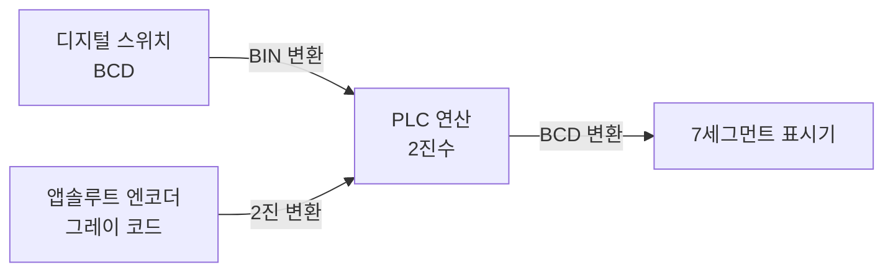

# 수의 표현과 코드

> [!summary] 핵심 요약
> - 2진수 4비트 = 16진수 1자리, 3비트 = 8진수 1자리.
> - **BCD(8421)**: 10진수 한 자리를 4비트로. 디지털 스위치 입력·7세그먼트 표시에 쓴다.
> - **그레이 코드**: 이웃한 값끼리 1비트만 다름 → 앱솔루트 엔코더에서 읽기 오류를 줄인다.
> - 음수는 **2의 보수**로 표현: 비트 반전 + 1.

> [!warning] 자주 틀리는 포인트
> - BCD에서 1010~1111(10~15)은 **쓰지 않는 코드**. 이런 값이 오면 BCD 변환 에러.
> - 25(10진)의 BCD는 `0010 0101`, 2진수는 `11001`. **둘은 다르다**.
> - 3초과 코드는 BCD + 3(0011)이며 **비가중 코드**, 자기 보수 코드.
> - 그레이 코드는 가중치가 없어 **산술 연산에 쓰지 않는다**.

## 개념 정리

### 진법 변환

| 10진 | 2진 | 8진 | 16진 | BCD |
| :-: | :-: | :-: | :-: | :-: |
| 9 | 1001 | 11 | 9 | 0000 1001 |
| 10 | 1010 | 12 | A | 0001 0000 |
| 15 | 1111 | 17 | F | 0001 0101 |
| 25 | 1 1001 | 31 | 19 | 0010 0101 |
| 100 | 110 0100 | 144 | 64 | 0001 0000 0000 |

- **10진 → 2진**: 2로 계속 나눠 나머지를 아래에서 위로.
- **10진 소수 → 2진**: 2를 곱해 정수부를 위에서 아래로. 예: 0.625 → 0.101
- **2진 → 16진**: 소수점 기준 4비트씩 묶기. 8진은 3비트씩.

### 데이터 단위

| 단위 | 비트 수 | 비고 |
| --- | --- | --- |
| 비트 | 1 | 접점 하나 (M, P) |
| 니블 | 4 | BCD 한 자리 |
| 바이트 | 8 | |
| 워드 | 16 | PLC 데이터 레지스터 D 한 개 |
| 더블 워드 | 32 | D 두 개 연속 사용 |

- 16비트 부호 없는 범위 0~65535, 부호 있는 범위 −32768~32767.

### 코드의 종류

| 코드 | 가중치 | 특징 |
| --- | --- | --- |
| BCD (8421) | 있음 | 10진 자리마다 4비트 |
| 2421, 5421 | 있음 | 자기 보수형(2421) |
| 3초과 (Excess-3) | 없음 | BCD + 3, 자기 보수 |
| 그레이 | 없음 | 인접 값 1비트 변화 |
| ASCII | – | 7비트 문자 코드 (128자), 패리티 붙여 8비트 |
| 패리티·해밍 | – | 오류 검출·정정용 ([데이터 통신](데이터_통신.md)) |

### 2진 ↔ 그레이 변환

- **2진 → 그레이**: 맨 왼쪽 비트는 그대로, 나머지는 **바로 왼쪽 2진 비트와 XOR**.
  - 예: 0101 → 0, 0⊕1=1, 1⊕0=1, 0⊕1=1 → `0111`
- **그레이 → 2진**: 맨 왼쪽은 그대로, 나머지는 **방금 구한 2진 비트와 그레이 비트를 XOR**.

### 보수와 음수

- **1의 보수**: 모든 비트 반전.
- **2의 보수**: 1의 보수 + 1. 0이 하나뿐이라 컴퓨터·PLC가 이 방식을 쓴다.
  - 예(8비트): +5 = `0000 0101` → −5 = `1111 1011`
- **10진 보수**: 9의 보수(각 자리 9에서 빼기), 10의 보수(9의 보수 + 1).
- 뺄셈은 **보수 덧셈**으로 처리한다: A − B = A + (B의 2의 보수), 자리올림은 버림.

### PLC에서의 활용

- 디지털 스위치(BCD 입력) → **BIN 명령**으로 2진 변환 후 연산.
- 연산 결과 → **BCD 명령**으로 변환해 7세그먼트에 출력.
- 앱솔루트 엔코더 → 그레이 코드를 2진으로 변환해 위치값으로 사용.

## 그림

## 관련 단원

- [논리회로](논리회로.md)
- [데이터 통신](데이터_통신.md)
- [PLC 구성과 특성](PLC_구성과_특성.md)

## 체크리스트

- [ ] 2·8·10·16진수를 서로 변환할 수 있다
- [ ] 10진수를 BCD로 쓰고, 2진수와 구분한다
- [ ] 2진 ↔ 그레이 코드를 변환할 수 있다
- [ ] 8비트 2의 보수로 음수를 표현할 수 있다
- [ ] 가중 코드와 비가중 코드를 구분한다

## 참고

- [큐넷 자동화설비산업기사 출제기준](https://www.q-net.or.kr/crf005.do?id=crf00503&jmCd=2034)
