# 아날로그 센서와 엔코더

> [!summary] 핵심 요약
> - 온도: **열전대**(제벡 효과, 고온), **측온 저항체 RTD**(Pt100, 정밀), **서미스터**(감도 큼, 좁은 범위).
> - 힘·압력: **스트레인 게이지**(저항 변화 → 휘트스톤 브리지), **로드셀**, **압전 소자**(동적 하중).
> - 변위: **LVDT**(차동 변압기), 포텐셔미터, 리니어 스케일.
> - 회전: **인크리멘털 엔코더**(A·B·Z상 펄스), **앱솔루트 엔코더**(절대 위치, 그레이 코드).

> [!warning] 자주 틀리는 포인트
> - 열전대는 두 접점의 **온도차**로 전압이 생긴다 → **냉접점 보상**이 필요하다.
> - Pt100은 **0 ℃에서 100 Ω**, 온도가 오르면 저항 증가(정특성). 도선 저항을 없애려고 **3선식**으로 배선한다.
> - 서미스터 **NTC**는 온도가 오르면 저항 **감소**, **PTC**는 **증가**.
> - 인크리멘털 엔코더는 전원이 꺼지면 위치를 잃는다 → 원점 복귀 필요. 앱솔루트는 유지.
> - 전자 유량계는 **도전성 액체**만 측정한다 (기름, 가스 불가).
> - 변환 방향으로 구분: **열전대 = 온도 → 전압(열기전력)**, **서미스터·RTD = 온도 → 저항**. "서미스터는 전압을 발생한다"는 틀린 말.
> - 서미스터 종류는 **NTC, PTC, CTR** 세 가지. CTR은 특정 온도에서 저항이 급격히 **감소**(부특성)한다. 그 밖의 이름은 함정.
> - 열전대는 고온·넓은 범위를 재고, 접점이 작아 **형상·치수의 영향을 거의 받지 않는다**. 부착 방법에 따른 오차는 있다.
> - **앱솔루트 엔코더**는 위치마다 고유 코드라 **방향 판별 회로가 필요 없다**. 방향 판별 회로(A·B상 위상 비교)가 필요한 것은 인크리멘털.
> - 엔코더로 위치·속도·회전 방향은 알 수 있지만 **토크는 검출할 수 없다**.
> - 홀 센서는 **전류와 자계에 비례하는 전압**(홀 효과)으로 자계의 방향·세기를 잰다.
> - **가장 높은 온도**를 재는 열전대는 **백금로듐–백금(R·S·B형)**. 범용은 K형(크로멜–알루멜).
> - **태코미터는 회전 속도계**이지 가속도 센서 응용이 아니다. 가속도 센서는 급제동, 엔진 노크, 기계 이상 진동 검출에 쓴다.
> - 인코더(부호기)는 입력 $2^n$개 → 출력 n비트, **디코더**는 입력 n비트 → 출력 $2^n$개. 방향이 반대다. 입력 64개 인코더 → 출력 **6개**.
> - **차동 트랜스(LVDT)는 회전수를 재지 못한다**. 직선 변위 → 전압 변환기다 (교재 25-7).
> - 교재(23절)는 스트레인 게이지가 "정밀도가 높고 모든 압력에 반응한다"고 설명한다. 로드셀은 하중에 비례한 변형을 **저항 변화**로 바꾼다.

## 학습 목표

이 단원을 마치면 다음을 할 수 있어야 한다.

1. 센서마다 **무엇을 무엇으로 바꾸는지**(온도 → 전압/저항, 변형 → 저항, 변위 → 전압, 회전 → 펄스)를 말하고, 제벡·홀·압전·광전 효과와 대표 센서를 연결한다.
2. 열전대·RTD(Pt100)·서미스터(NTC·PTC·CTR)를 원리·범위·특성 곡선으로 구분하고, **냉접점 보상**과 **3선식 배선**이 필요한 이유를 설명한다.
3. 스트레인 게이지 → 휘트스톤 브리지 → 증폭 → 4~20 mA로 이어지는 로드셀 측정 흐름을 설명하고, 압전 소자가 정적 하중을 못 재는 이유를 말한다.
4. 포텐셔미터 출력 전압과 위치를 서로 계산하고, LVDT·리졸버·타코제너레이터를 "직선/회전, 위치/속도"로 구분한다.
5. 인크리멘털·앱솔루트 엔코더를 비교하고, P/R·펄스 수·주파수로 **회전 수, rpm, 출력 주파수, 각도 분해능**을 계산한다.
6. 차압식·전자·터빈·와류·코리올리 유량계의 측정 원리와 제약(도전성 액체, 제곱근 관계, 질량 유량)을 구분한다.

## 한눈에 보기

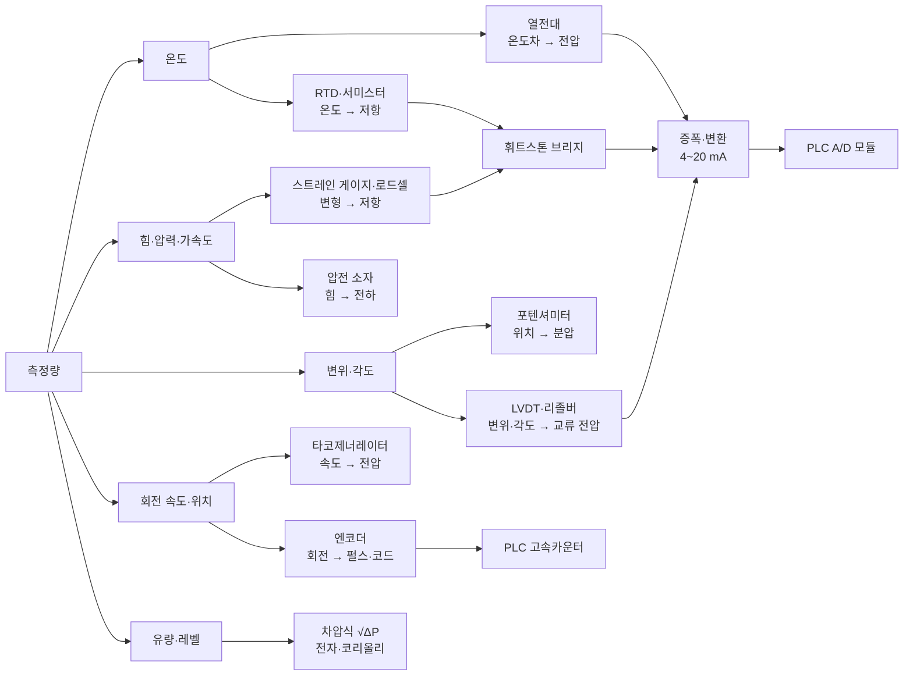

## 1. 센서는 "물리량 → 전기량" 번역기

**직관**: PLC는 전압·전류·펄스만 알아듣는다. 센서는 온도·힘·위치 같은 물리량을 PLC가 알아듣는 말로 **번역**해 주는 장치다. 그래서 시험 문제의 절반은 "이 센서는 **무엇을 무엇으로** 바꾸는가"를 묻는다. 번역 방식(물리 효과)만 알면 센서 이름은 저절로 따라온다.

**센서의 물리 효과 정리**

| 효과 | 입력 → 출력 | 센서 |
| --- | --- | --- |
| 제벡 효과 | 온도차 → 기전력 | 열전대 |
| 홀 효과 | 자계 × 전류 → 전압 | 홀 센서, BLDC 위치 |
| 압전 효과 | 힘 → 전하 (역압전: 전압 → 변형) | 압전 센서, 초음파 센서, 가속도 센서 |
| 광전 효과 | 빛 → 전류·전압 | 포토다이오드, 포토트랜지스터, 태양전지 |
| 광도전 효과 | 빛 → 저항 변화 | CdS 셀 |
| 전자기 유도 | 자속 변화 → 전압 | 타코제너레이터, 차동변압기, 전자 유량계 |
| 저항 변화 | 변형 → 저항 | 스트레인 게이지, 로드셀 |

> [!tip] 감 잡기: 스스로 전압을 내는가?
> 열전대·압전 소자·타코제너레이터·태양전지는 **스스로 전기를 만든다**(기전력형, 전원 불필요). RTD·서미스터·스트레인 게이지·CdS는 **저항만 바뀌므로** 전원을 걸어 주고 브리지·분압으로 전압을 꺼내야 한다. "서미스터는 전압을 발생한다"가 틀린 이유가 이것이다.

### 홀 효과

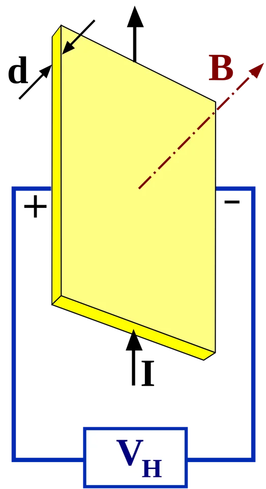

*전류 I(세로)와 자계 B(판을 뚫는 방향)가 서로 직각일 때, 전하가 옆으로 밀려 판의 **좌우 가장자리**에 + −가 쌓인다. 그 사이 전압 $V_H$는 **전류와 자계에 비례**한다. 그래서 전류를 일정하게 흘려 두면 $V_H$로 자계의 세기·방향을 읽을 수 있다 — 홀 센서, BLDC 모터 회전자 위치 검출, 비접촉 전류 센서가 이 원리다.*

$$V_H \propto I \times B$$

## 2. 온도 센서

**직관**: 같은 온도계라도 "숯불 화로 온도(1,000 ℃)"와 "냉장고 온도(4 ℃)를 0.1 ℃까지"는 다른 도구가 필요하다. 아주 뜨거운 곳은 **열전대**, 정밀하게 재려면 **Pt100**, 좁은 범위를 민감하게 보거나 싸게 끝내려면 **서미스터**, 닿을 수 없는 곳은 **방사(적외선) 온도계**를 쓴다.

### 온도 센서 비교

| 센서 | 원리 | 범위·특징 |
| --- | --- | --- |
| 열전대 (TC) | 제벡 효과: 서로 다른 금속 접합부 온도차 → 열기전력 | 고온 측정, 응답 빠름, K형(CA)이 가장 범용 |
| 측온 저항체 (RTD) | 금속(백금) 저항이 온도에 비례 | 정밀·안정, Pt100 |
| 서미스터 | 반도체 저항의 큰 온도 변화 | 감도 높음, 비선형, 좁은 범위 |
| IC 온도 센서 | 반도체 접합 특성 | 상온, 선형 출력 |
| 방사 온도계 (적외선) | 물체가 내는 적외선 | 비접촉, 이동체·고온체 |

- 금속 측온체는 주로 **백금**. **자기 온도 센서**는 자성체가 **큐리점**에서 자성을 잃는 성질을 이용한다.

### 2-1. 열전대: 온도차 → 전압

| 실물 (K형) | 원리 |
| --- | --- |
| 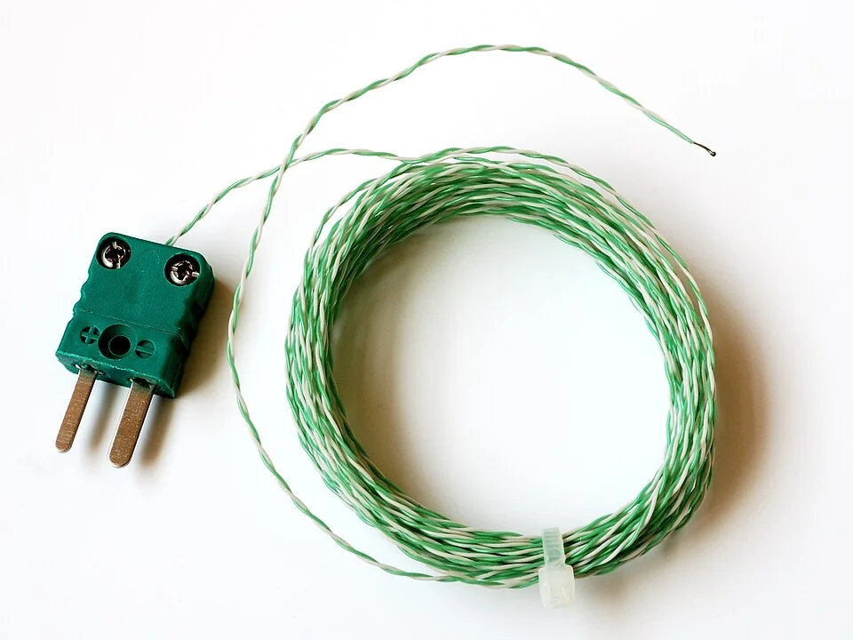 | 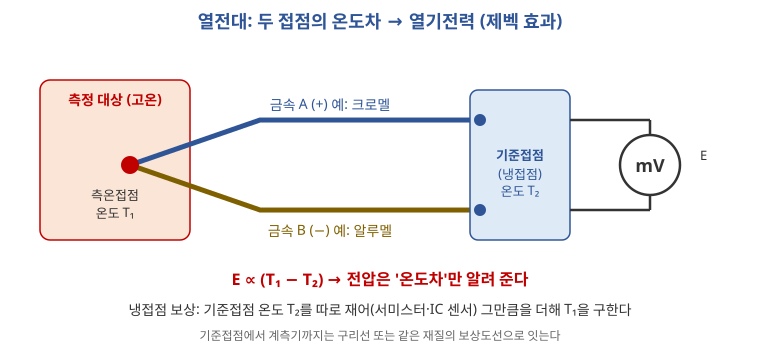 |

*왼쪽 실물은 두 금속선 끝을 꼬아 붙인 것이 전부다. 오른쪽 그림처럼 그 끝(측온접점, $T_1$)과 계측기 쪽 끝(기준접점, $T_2$)의 **온도가 다르면** 두 금속 사이에 mV 단위 전압이 생긴다. 전압이 알려 주는 것은 $T_1$ 자체가 아니라 **온도차**이므로, 기준접점 온도를 따로 재어 더해 주는 **냉접점 보상**이 꼭 필요하다.*

$$E \approx S\,(T_1 - T_2) \qquad (\text{K형 } S \approx 41\ \mu\text{V/℃})$$

- 열전대 관련 효과: **제벡**(온도차 → 전압), **펠티에**(전류 → 흡열·발열), **톰슨**(한 도체 안 온도차 + 전류 → 열).
- 열전대를 이용한 **온도 스위치**: 설정 온도에서 접점을 개폐.
- 예: K형 열전대로 $T_1 - T_2 = 100$ ℃이면 약 $41 \times 100 = 4{,}100\ \mu$V ≈ **4.1 mV**. 이렇게 작은 신호라 증폭기가 필요하다 ([센서 회로와 신호처리](센서_회로와_신호처리.md)).

**열전대 종류 (교재 23절)**

| 형 | 재료 (+ / −) | 대략 범위 | 특징 |
| --- | --- | --- | --- |
| K | 크로멜 / 알루멜 | −200~1,370 ℃ | 가장 범용, 내열성 좋음 |
| J | 철 / 콘스탄탄 | −200~1,100 ℃ (교재 기준) | 진공·산화 분위기 |
| T | 구리 / 콘스탄탄 | −200~400 ℃ | 저온, 균질성 좋음 |
| E | 크로멜 / 콘스탄탄 | −200~800 ℃ | 불활성 가스 분위기 |
| N | 니크로실 / 니실 | 0~1,300 ℃ | K형보다 산화에 강함 |
| R·S·B | 백금로듐 / 백금 | 0~1,760 ℃ | **가장 고온**, 금속 증기에 오염 |

> [!question] 시험에서는
> "가장 고온을 재는 열전대" → **백금로듐–백금(R·S·B)**. "가장 범용" → **K형(크로멜–알루멜)**. "열전대 출력이 나타내는 것" → 두 접점의 **온도차**. 열전대가 "형상·치수의 영향을 크게 받는다"는 틀린 보기다.

### 2-2. 측온 저항체(RTD, Pt100): 온도 → 저항, 정밀

**직관**: 금속 전선은 뜨거워지면 저항이 조금 늘어난다. 백금은 이 변화가 **곧고 안정적**이라 자로 잰 듯 정확하다. 대신 변화량이 작아서(1 ℃당 약 0.39 Ω) 도선 저항 몇 Ω도 큰 오차가 된다.

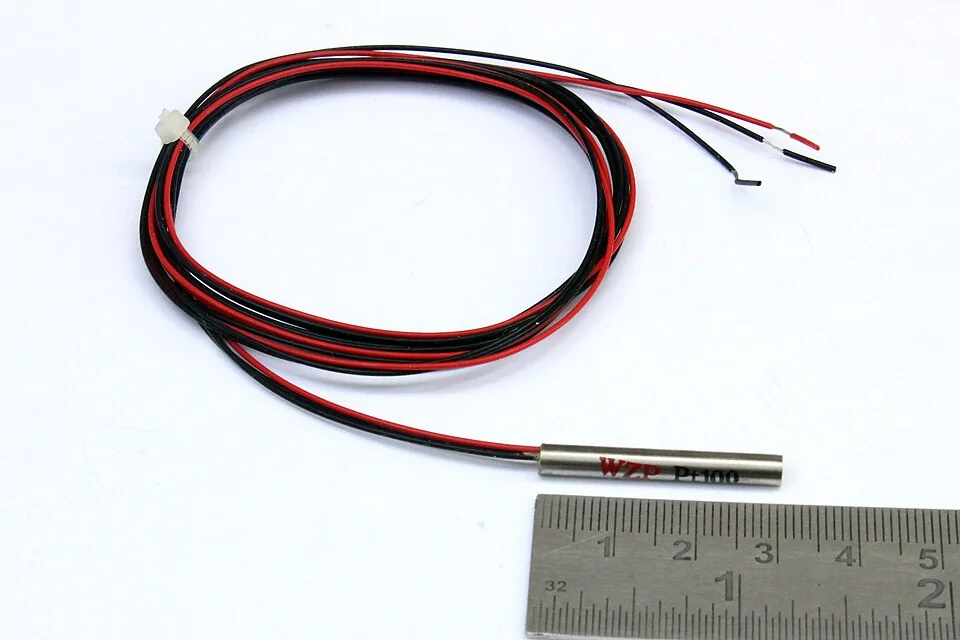

*보호관 안에 백금 저항선이 들어 있다. 도선이 **세 가닥**(빨강 1, 검정 2)인 것이 3선식의 표시다. 한쪽 끝에 한 가닥, 다른 쪽 끝에 두 가닥을 달아 아래 브리지에서 도선 저항을 지운다.*

$$R_t \approx R_0\,(1 + \alpha t), \qquad R_0 = 100\ \Omega\ (0\ ℃),\ \ \alpha \approx 0.00385\ /℃$$

- 예: 100 ℃에서 $R_t \approx 100 \times (1 + 0.385) = $ **138.5 Ω**.

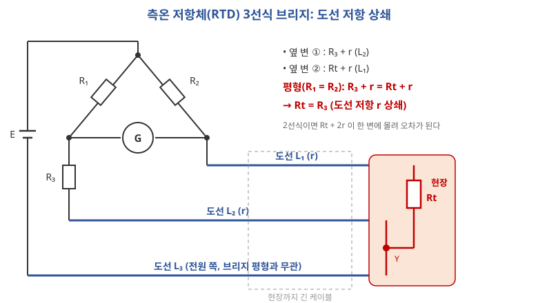

*파란 도선 L₁·L₂는 같은 케이블 속 같은 길이라 저항 r이 같다. L₁은 Rt와, L₂는 R₃와 **이웃한 두 변에 하나씩** 들어가므로 평형식에서 r이 양쪽에 똑같이 더해져 상쇄된다. 2선식이면 두 도선(2r)이 모두 Rt 변에 몰려 그대로 온도 오차가 된다.*

### 2-3. 서미스터: 온도 → 저항, 감도 최고

**직관**: 서미스터는 반도체라 온도에 따른 저항 변화가 금속보다 **수십 배** 크다. 1 ℃ 변화도 쉽게 보이지만, 곡선이 휘어 있어(비선형) 넓은 범위를 정밀하게 재기는 어렵다. PTC·CTR은 특정 온도에서 저항이 "뚝" 바뀌므로 측정보다 **스위치·보호**에 쓴다.

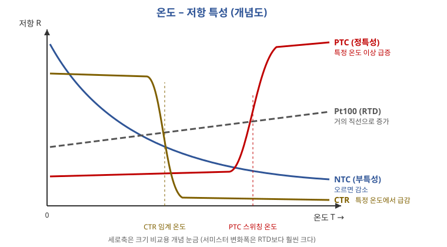

*파란 NTC 곡선은 처음부터 내려가는 **부특성**, 회색 점선 Pt100은 곧게 올라가는 정특성(서미스터보다 변화가 작다)이다. 빨간 PTC는 평평하다가 스위칭 온도를 넘으면 **치솟고**, 갈색 CTR은 임계 온도에서 **뚝 떨어진다**. "특정 온도에서 급감 = CTR, 급증 = PTC"로 외운다.*

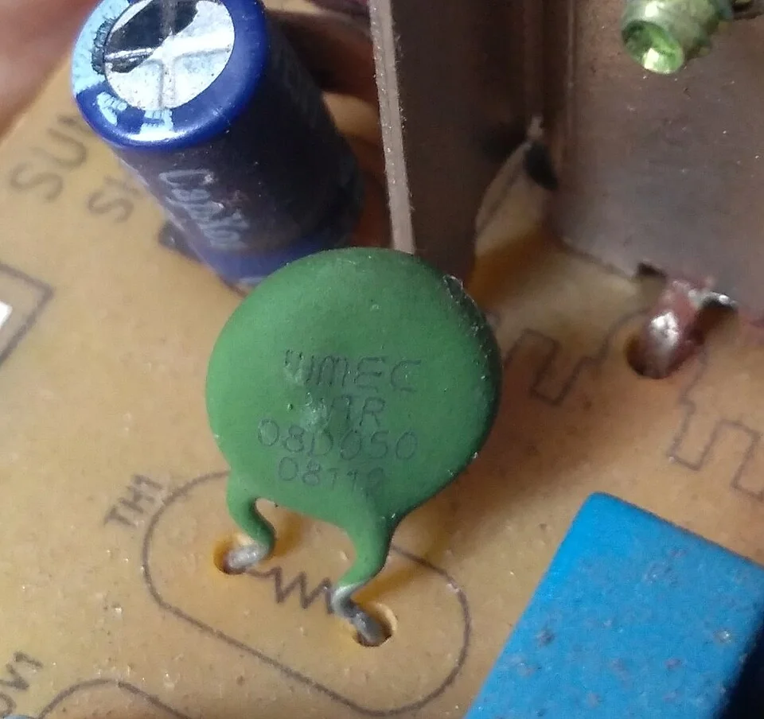

*전원 장치 입력단에 들어간 NTC(기판 표시 TH1). 전원을 켜는 순간에는 차가워서 저항이 커 **돌입 전류를 제한**하고, 전류가 흘러 데워지면 저항이 작아져 손실이 줄어든다. 아래 표의 "돌입 전류 제한" 용도가 바로 이것이다.*

**서미스터 3종**

| 종류 | 온도가 오르면 | 용도 |
| --- | --- | --- |
| NTC (부특성) | 저항 감소 (가장 흔함) | 온도 측정, 돌입 전류 제한 |
| PTC (정특성) | 특정 온도 이상에서 저항 급증 | 과전류·과열 보호, 히터 |
| CTR (임계 온도 저항) | 특정 온도에서 저항 급감 | 온도 경보, 스위치 |

### 온도 센서 정리표

| 센서 | 변환 | 범위 | 선형성 | 기억 포인트 |
| --- | --- | --- | --- | --- |
| 열전대 | 온도**차** → 전압 | 가장 넓고 높음 | 보통 | 냉접점 보상, R·S·B 최고온 |
| RTD(Pt100) | 온도 → 저항(증가) | 중간 | 좋음 | 0 ℃ 100 Ω, 3선식 |
| 서미스터 | 온도 → 저항(크게) | 좁음 | 나쁨 | NTC·PTC·CTR |
| 방사 온도계 | 적외선 → 전기 | 고온·이동체 | — | 비접촉 |

## 3. 힘·압력·가속도 센서

**직관**: 쇠막대도 힘을 받으면 아주 조금 늘어난다. 그 표면에 얇은 금속박 격자(스트레인 게이지)를 붙이면 막대와 함께 늘어나며 저항이 변한다. 변화가 **0.1 %도 안 될 만큼** 작아서, 혼자서는 읽을 수 없고 휘트스톤 브리지로 차이만 뽑아낸다.

### 힘·압력 센서

| 스트레인 게이지 | 로드셀 (S형) |
| --- | --- |
| 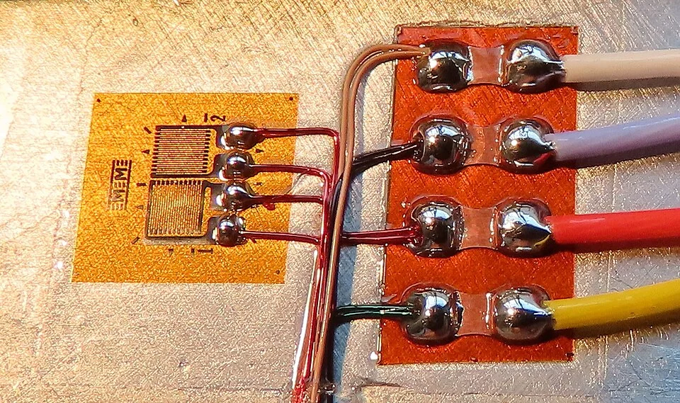 | 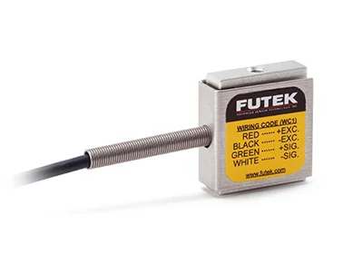 |

*왼쪽 게이지의 격자는 **한 방향으로 길게** 왕복해 그 방향 변형에 가장 민감하다. 오른쪽 로드셀은 금속 블록 안에 이런 게이지를 붙여 브리지로 묶은 완제품이다. 라벨의 배선 코드가 곧 브리지 단자다: **EXC ±**(여자 전원을 거는 두 선)와 **SIG ±**(평형이 깨진 만큼 나오는 mV 신호 두 선).*

$$\frac{\Delta R}{R} = K \cdot \varepsilon \qquad (K: \text{게이지율} \approx 2,\ \ \varepsilon = \Delta L / L: \text{변형률})$$

- **스트레인 게이지**: 늘어나면 저항 증가. 변화율 = **게이지율 × 변형률**. 아주 작은 저항 변화를 **휘트스톤 브리지**로 전압으로 바꾼다.
- 예: $K = 2$, $\varepsilon = 500 \times 10^{-6}$이면 $\Delta R/R = 0.1\ \%$. 120 Ω 게이지라면 $\Delta R$ = **0.12 Ω**뿐이다.
- **로드셀**: 탄성체에 스트레인 게이지를 붙여 무게·힘 측정 (계량기).
- **압전 소자**: 힘을 받으면 전하 발생. 진동·충격 같은 **동적** 측정에 적합, 정적 하중은 불가.
- **압력 센서**: 다이어프램 변형을 스트레인 게이지·정전용량으로 검출. 게이지압(대기압 기준) / 절대압 / 차압.
- 스트레인 게이지는 응답이 빨라 **정압뿐 아니라 동압(변동 압력)** 측정에도 쓴다. 단, 온도 영향이 있어 브리지로 보상한다.
- **가속도 센서**: $F = ma$ 원리. 진동·충격·노크(엔진)·급제동 검출. 온도 검출용이 아니다.

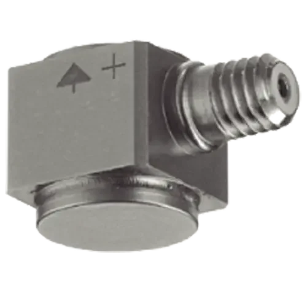

*Kistler 카탈로그의 압전식 가속도 센서 제품 사진(제조사 사진). 작은 **금속 블록** 하나가 센서 전체다. 옆으로 튀어나온 **나사 모양 단자**에 케이블을 연결하고, 아래쪽 **둥근 바닥면**을 진동을 재려는 기계에 붙여 설치한다. 블록 안에 든 압전 소자가 진동으로 생기는 힘(F = ma)을 전하로 바꾼다. 윗면의 화살표와 + 표시는 감지 방향(극성)을 알려 주는 표시로 보인다.*

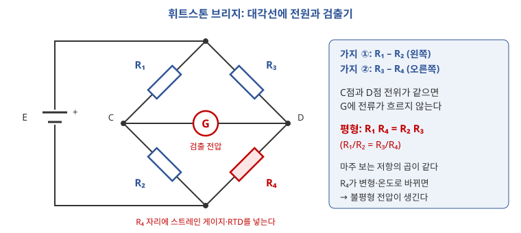

*빨간 R₄ 자리에 스트레인 게이지를 넣는다. 하중이 없을 때 브리지를 평형(G = 0)으로 맞춰 두면, 하중이 걸린 만큼만 C–D 사이에 전압이 나온다. 같은 브리지로 이웃 변에 더미 게이지를 넣으면 **온도에 의한 저항 변화가 상쇄**된다.*

$$\text{평형 조건: } R_1 R_4 = R_2 R_3$$

> [!tip] 압전 소자가 정적 하중을 못 재는 이유
> 압전 소자는 힘이 **변하는 순간** 전하를 만들고, 그 전하는 회로를 통해 금방 새어 나간다. 저울 위에 물건을 올려 두면 처음에만 신호가 나오고 곧 0으로 돌아간다. 그래서 무게(정적)는 로드셀, 진동·충격(동적)은 압전 소자다.

### 3-1. 속도 센서 (교재 24절)

| 센서 | 원리 | 수치 (교재) |
| --- | --- | --- |
| 전자기 직선 속도 센서 (LVT) | 가동 코일·자석의 상대 운동 | 약 10 mV/(mm/s), 10~1,000 Hz |
| 직류 태코미터 | 패러데이 법칙, 속도에 비례한 전압 | 5~10 V / 1,000 rpm |
| 교류 태코미터 | 같은 원리, 교류 출력 | 3~10 V / 1,000 rpm |
| 광전식 태코미터 | 회전 원판의 빛 차단 펄스 | |

- 예: 직류 태코미터 7 V/1,000 rpm에서 출력이 10.5 V이면 $10.5 / 7 \times 1{,}000$ = **1,500 rpm**.

## 4. 변위·위치 센서

**직관**: 자의 눈금을 손가락으로 짚어 읽는 것이 **포텐셔미터**(접촉), 손대지 않고 자석으로 쇠막대 위치를 느끼는 것이 **LVDT**(비접촉), 회전 각도를 같은 방식으로 읽는 것이 **리졸버**다. 속도만 필요하면 작은 발전기인 **타코제너레이터**를 단다.

| 센서 | 원리 | 특징 |
| --- | --- | --- |
| 포텐셔미터 | 가변 저항 분압 | 간단·저렴, 접촉 마모 |
| LVDT | 철심 이동 → 2차 코일 유도 전압 차 | 비접촉, 고정밀, 직선 변위 |
| 리니어 스케일 | 광학·자기 눈금 판독 | 공작기계 정밀 위치 |
| 레이저 변위 센서 | 삼각측량 | 비접촉, 미세 변위 |
| 리졸버 | 회전 변압기, 두 출력의 진폭비로 각도 | 내환경성 강함, 서보 모터 |
| 타코제너레이터 | 회전 → 속도에 비례한 전압 (소형 발전기) | **속도 → 전압** 변환 |
| 싱크로 | 회전 각도 전송용 회전 변압기 | 원격 각도 지시 |

### 4-1. 포텐셔미터: 위치 비율 = 전압 비율

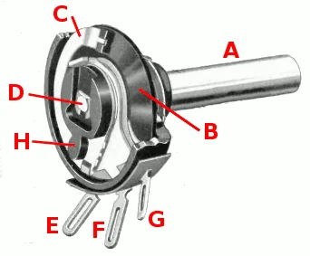

*회전형 포텐셔미터를 잘라 본 그림이다. 축(A)을 돌리면 와이퍼(C)가 말굽 모양 저항체(B) 위를 미끄러진다. 단자 **E·G는 저항체 양 끝**, 가운데 **F는 와이퍼**다. 양 끝에 전압을 걸면 F에서 위치에 비례한 전압이 나온다. 와이퍼가 문질러 움직이므로 **마모**가 단점이다. H는 스위치 겸용 제품에만 있는 캠으로, 축을 끝까지 돌리면 전원 스위치를 켜고 끈다(글자 대응은 원본 그림 설명 기준).*

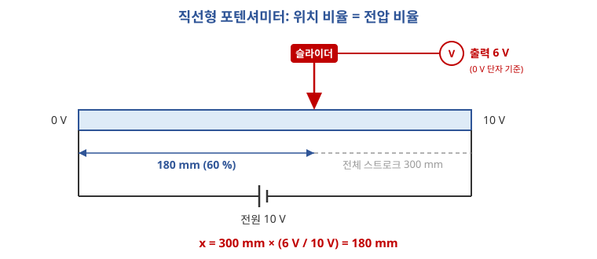

$$V_{out} = V_{in} \times \frac{x}{L} \quad\Longleftrightarrow\quad x = L \times \frac{V_{out}}{V_{in}}$$

- 포텐셔미터 출력은 저항 비율(위치)에 비례: 10 V, 300 mm 스트로크에서 6 V → **180 mm** 위치. 반대로 500 mm 행정 실린더가 300 mm 전진하면 60 % → **6 V**. 기호는 직선형·회전형 두 가지.

### 4-2. LVDT(차동 변압기): 직선 변위 → 교류 전압

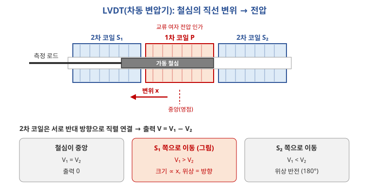

*1차 코일에 교류를 걸면 철심을 통해 양쪽 2차 코일에 전압이 유도된다. 두 2차 코일은 **반대로 이어져** 있어서 철심이 한가운데면 두 전압이 지워져 출력 0, 한쪽으로 밀리면 그쪽 코일 전압이 커져 **변위에 비례한 출력**이 나온다. 이동 방향은 출력의 **위상**(0° / 180°)으로 구분한다. 철심이 코일에 닿지 않으므로 마모가 없다.*

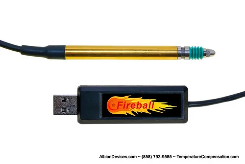

*시판되는 LVDT 프로브(제조사 사진, 이미지에 제조사 안내 문구가 들어 있다). 원통 속에 위 그림의 1차·2차 코일과 철심이 들어 있고, 끝의 접촉 팁이 측정물에 닿아 밀리면 철심이 움직여 직선 변위가 전압으로 나온다. 팁이 스프링으로 되돌아오는 구조라 반복 측정에 쓴다.*

- LVDT는 **직선 변위 전용**이다. 회전수는 재지 못한다(교재 25-7). 회전 각도를 같은 원리로 재는 것이 리졸버, 회전 속도를 전압으로 바꾸는 것이 타코제너레이터.

### 4-3. 리졸버: 회전 각도 → 두 교류 전압의 비

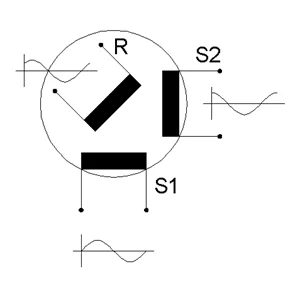

*회전자 코일 R에 교류를 걸고, 서로 **직각**인 고정자 코일 S1·S2에 유도되는 전압을 본다. 회전 각도 θ에 따라 한쪽은 $\sin\theta$, 다른 쪽은 $\cos\theta$에 비례하므로 두 전압의 **비율**로 절대 각도를 안다. 반도체 부품이 없는 코일 덩어리라 진동·충격·열에 강하다.*

- 리졸버 (교재 25절): 아날로그 각도 센서, 진동·충격에 강하고 **절대각** 검출, 소형. 분해능 약 1/3,500.

## 5. 엔코더

**직관**: 자전거 바퀴살 사이로 손전등을 비추고 반대편에서 깜빡임을 세면 바퀴가 얼마나 돌았는지 안다. 이것이 **인크리멘털 엔코더**다(깜빡임 = 펄스). 반면 바퀴 각 위치마다 고유한 무늬를 새겨 두고 그 무늬를 읽으면, 전원이 나갔다 들어와도 "지금 몇 도"인지 바로 안다. 이것이 **앱솔루트 엔코더**다.

| 구분 | 인크리멘털 | 앱솔루트 |
| --- | --- | --- |
| 출력 | A·B상 펄스(90° 위상차) + Z상(1회전 1펄스) | 각 위치마다 고유 코드 |
| 방향 판별 | A·B상 중 어느 쪽이 앞서는지 | 코드 값 변화 |
| 정전 시 | 위치 잃음 → 원점 복귀 | 위치 유지 |
| 가격 | 저렴 | 비쌈 |

### 5-1. 인크리멘털: A·B상 펄스와 4체배

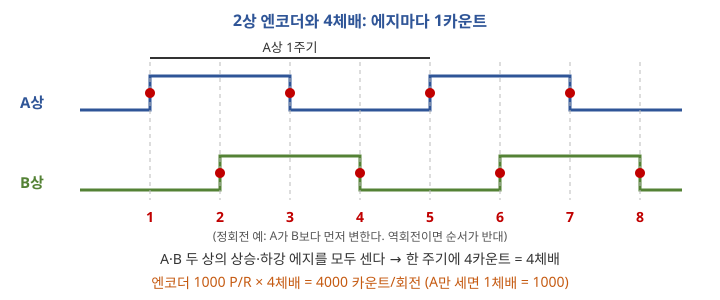

*A상과 B상은 같은 펄스열이 **1/4 주기(90°)** 어긋나 있다. 정회전이면 A가 앞서고 역회전이면 B가 앞선다 — 이것이 **방향 판별**이다. 두 상의 상승·하강 에지를 모두 세면 한 주기에 4카운트(4체배)라 분해능이 4배가 된다. Z상은 1회전에 1번만 나와 **원점** 기준으로 쓴다.*

$$\text{각도 분해능} = \frac{360°}{\text{P/R}} \qquad (\text{4체배 시 } \tfrac{360°}{4 \times \text{P/R}})$$

- **분해능**: 1회전당 펄스 수(P/R). 1000 P/R → 각도 분해능 0.36°. 4체배 시 0.09°.
- 회전수 계산: $N[\text{rpm}] = \dfrac{\text{초당 펄스 수}}{\text{P/R}} \times 60$
  - 예: 1000 P/R에서 5000 pps → 5 rev/s → 300 rpm.
- 회전 수(바퀴) 계산: 펄스 총수 ÷ P/R. 예: 500 P/R에서 1500 펄스 → **3회전**.
- 출력 주파수 계산: $f[\text{Hz}] = \dfrac{N[\text{rpm}]}{60} \times \text{P/R}$
  - 예: 600 rpm, 2000 P/R → $10 \times 2000 = 20000$ Hz = **20 kHz**
- 엔코더 펄스는 스캔보다 빠르므로 PLC에서는 **고속카운터 모듈**로 받는다.
- 예 (교재 25절): 360 P/R에서 400 펄스 → 1회전 + 40/360 회전.

> [!question] 시험에서는
> 계산 세 가지를 단위로 구분한다. **펄스 수 ÷ P/R = 회전 수(바퀴)**, **pps ÷ P/R × 60 = rpm**, **rpm ÷ 60 × P/R = Hz**. 360 P/R로 720 펄스 → **2회전**, 1회전 = 360펄스이므로 1펄스 = 1°다.

### 5-2. 앱솔루트: 위치마다 고유 코드 (그레이 코드)

| 3비트 2진 코드 원판 | 3비트 그레이 코드 원판 |
| --- | --- |
|  |  |

*두 원판 모두 링 3개 = 3비트, 칸 8개 = 8가지 위치(45° 분해능)다. 왼쪽 순 2진 원판은 어떤 경계에서 **세 링이 한꺼번에** 바뀌어, 센서가 경계에 걸리면 엉뚱한 값을 읽을 수 있다. 오른쪽 그레이 원판은 어느 경계에서든 **한 링만** 바뀌므로 오차가 한 칸을 넘지 않는다.*

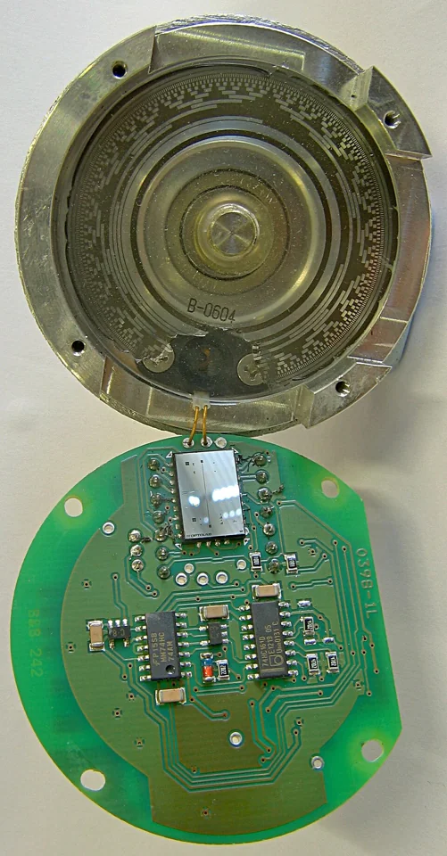

*실제 앱솔루트 엔코더를 열어 본 모습. 원판의 동심원 트랙 13개 = 13비트 = $2^{13}$ = 8,192 위치다. 위치마다 코드가 다르므로 **방향 판별 회로도, 원점 복귀도 필요 없다**.*

- 검출 방식: 광전식, 자기식, 정전용량식, 접점식. 앱솔루트 코드는 순 2진 또는 **그레이 코드**(한 번에 1비트만 바뀌어 읽기 오류가 적음).
- 디지털 회로의 **인코더**($2^n$ 입력 → n비트)와 **디코더**(n비트 → $2^n$ 출력)는 [논리회로](논리회로.md)에서 다룬다.

> [!tip] 엔코더로 알 수 없는 것
> 엔코더는 **각도(위치)** 를 주고, 그 변화율로 **속도**, A·B 순서로 **방향**을 준다. **토크(힘)** 는 축이 얼마나 비틀리는지와 상관없이 같은 펄스가 나오므로 알 수 없다 — 토크는 스트레인 게이지형 토크 센서나 모터 전류로 추정한다.

## 6. 유량·레벨 센서

**직관**: 호스 끝을 손가락으로 좁히면 물이 빨라지고 그 앞쪽 압력이 올라간다. 이 **압력 차이**를 재면 유량을 안다(차압식). 또는 물이 날개를 돌리는 속도(터빈), 물이 자기장을 지나며 만드는 전압(전자식), 휘어진 관이 흔들리는 모양(코리올리)으로도 잴 수 있다.

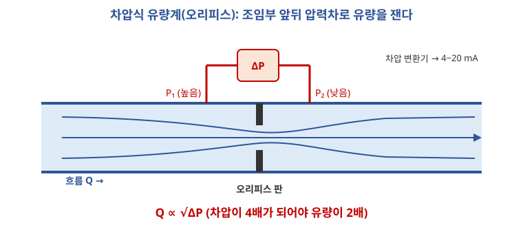

*유선이 오리피스 구멍을 지나며 좁아지고 빨라진다. 베르누이 정리에 따라 빨라진 만큼 압력이 내려가므로 $P_1 > P_2$. 유량은 차압의 **제곱근**에 비례하므로, 유량을 2배로 늘리면 차압은 **4배**가 된다.*

$$Q = k\sqrt{\Delta P} = k\sqrt{P_1 - P_2}$$

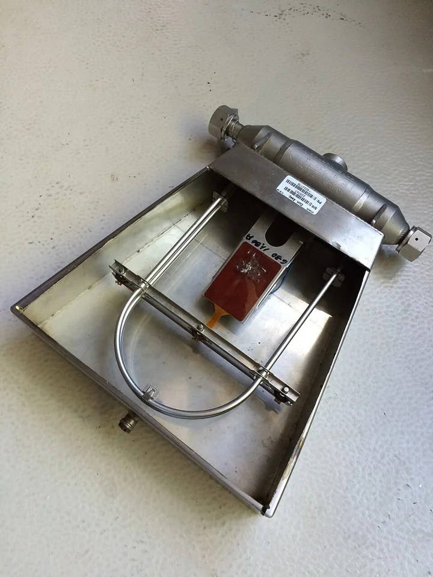

*케이스를 연 코리올리 유량계. 유체는 **U자 관**을 지나간다. 관을 일정하게 진동시키면 흐르는 유체의 코리올리 힘 때문에 관 입구 쪽과 출구 쪽이 **비틀리듯 어긋나고**, 그 어긋남이 **질량 유량**에 비례한다. 밀도·온도가 바뀌어도 질량 유량을 직접 잰다.*

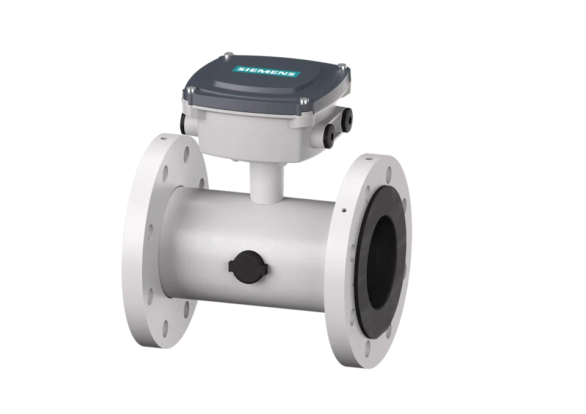

*Siemens 카탈로그의 전자 유량계 센서 제품 이미지(제조사 이미지, 컴퓨터 그래픽 렌더링). 양쪽 **플랜지**로 배관 사이에 끼워 설치하는 굵은 **측정관**이고, 오른쪽 구멍 안쪽의 **검은 고무 라이닝**이 보인다. 관 속에는 오리피스 같은 걸림 부품이 없어 **압력 손실이 없다**. 위쪽 상자는 전압 신호를 유량으로 바꾸는 **변환기**다. 도전성 액체가 이 관을 흐르며 자계를 가로지를 때 생기는 전압(패러데이 법칙)을 재므로, 기름이나 가스처럼 전기가 통하지 않는 유체는 잴 수 없다.*

| 종류 | 원리 | 특징 |
| --- | --- | --- |
| 차압식 (오리피스, 벤투리) | 조임부 앞뒤 압력차 | 유량은 차압의 **제곱근**에 비례 |
| 전자 유량계 | 패러데이 법칙 | 도전성 액체, 압력 손실 없음 |
| 터빈 유량계 | 날개 회전수 | 깨끗한 유체 |
| 와류(Vortex) 유량계 | 칼만 와류 주파수 | 증기·가스 가능 |
| 코리올리 유량계 | 코리올리 힘 | **질량 유량** 직접 측정 |
| 플로트 레벨 | 부력 | 간단 |
| 초음파 레벨 | 반사 시간 | 비접촉 |
| 차압식 레벨 | 액주 압력 | 밀폐 탱크 |

> [!question] 시험에서는
> **전자 유량계**는 흐르는 액체가 도체 역할을 해서 자계 속에서 전압을 만든다(패러데이 법칙) → 액체가 **전기를 통해야** 한다. 기름·가스·순수(초순수)는 못 잰다. 관 안에 걸리는 것이 없어 **압력 손실이 없다**.

## 그림

*로드셀 계량 시스템의 신호 흐름이다. 저항 변화(Ω) → 브리지 전압(mV) → 증폭(V) → 전류 신호(4~20 mA, 노이즈에 강하고 단선 검출 가능) → PLC 디지털 값. 각 단계는 [센서 회로와 신호처리](센서_회로와_신호처리.md)와 [특수모듈 프로그래밍](특수모듈_프로그래밍.md)에서 이어진다.*

## 기출 포인트

출처: 생산자동화산업기사 2016–2020년 필기 14회분 (cbtbank.kr).

- 온도 센서 (서미스터 = 온도 → 저항, NTC·PTC·CTR, 열전대 = 온도 → 전압, 제벡 효과, 열전대 특징, 온도 측정에 맞는 센서) — 12회 (2016-1, 2016-2, 2016-3 ×3, 2017-1, 2017-2, 2018-1, 2018-3, 2019-1, 2019-3, 2020-1·2)
- 엔코더 (펄스 수 → 회전 수, rpm·P/R → 출력 주파수, 앱솔루트형 특징, 검출할 수 없는 양) — 4회 (2016-1, 2017-3 ×2, 2019-1)
- 기타 센서 (로드셀 원리, 스트레인 게이지 특징, 홀 센서, 가속도 센서 용도, 속도 → 전압 = 타코제너레이터, 변위 → 차동변압기) — 6회 (2016-3, 2019-1 ×2, 2019-3, 2020-1·2, 2018-2)

**교재 예제 유형** (Win-Q 2025 PART 01 CHAPTER 02, 23~25절): 로드셀 원리, 열전대를 이용한 스위치(온도 스위치), 가장 고온용 열전쌍(백금로듐–백금), 자장에 비례한 기전력(홀 센서), 서미스터 원리(온도 → 저항), 가속도 센서 응용이 아닌 것(태코미터), 포텐셔미터 전압(6 V), 360 P/R로 720 펄스(2회전), 인코더 입력 유닛(고속 카운터), 앱솔루트형의 틀린 설명(방향 판별 회로 불필요), 인코더 입력 64개 → 출력 6개, 7-세그먼트 앞 소자(디코더, 그림), 회전수를 못 재는 센서(차동 트랜스).

## 관련 단원

- [근접센서와 광전센서](근접센서와_광전센서.md)
- [센서 회로와 신호처리](센서_회로와_신호처리.md)
- [특수모듈 프로그래밍](특수모듈_프로그래밍.md)
- [서보 모터와 서보 제어](서보모터와_서보제어.md)
- [수의 표현과 코드](수의_표현과_코드.md)
- [논리회로](논리회로.md)

## 체크리스트

- [ ] 열전대·RTD·서미스터의 원리와 특징을 구분한다
- [ ] 냉접점 보상과 3선식 RTD의 이유를 설명한다
- [ ] 스트레인 게이지와 휘트스톤 브리지의 관계를 안다
- [ ] 인크리멘털·앱솔루트 엔코더를 비교한다
- [ ] P/R과 펄스 주파수로 회전수를 계산한다
- [ ] 전자·코리올리·차압식 유량계의 특징을 안다
- [ ] 센서마다 "무엇을 무엇으로 바꾸는지"(온도 → 저항/전압, 속도 → 전압)를 말한다
- [ ] NTC·PTC·CTR 서미스터의 온도-저항 특성을 구분한다
- [ ] 엔코더 rpm·P/R로 출력 주파수를 계산한다
- [ ] 제벡·홀·압전·광전 효과와 대표 센서를 연결한다
- [ ] 열전대 형별 재료와 가장 고온용(R·S·B)을 안다
- [ ] 태코미터와 가속도 센서의 용도를 구분한다

## 참고

- [큐넷 자동화설비산업기사 출제기준](https://www.q-net.or.kr/crf005.do?id=crf00503&jmCd=2034)

### 그림 출처

위키미디어 공용(Wikimedia Commons)과 Openverse에서 가져온 공개 라이선스 자료이고, 노트에 맞게 크기를 줄이고 WebP로 변환했다.

| 그림 | 작성자 | 라이선스 | 출처 |
| --- | --- | --- | --- |
| [Hall-Effect-diagram](https://commons.wikimedia.org/wiki/File:Hall-Effect-diagram.svg) | Hall-effect.png: [1] derivative work: Gregors (talk) 13:27, 15 March 2011 (UTC) | [CC BY-SA 3.0](https://creativecommons.org/licenses/by-sa/3.0) | Wikimedia Commons |
| [Thermocouple K (2)](https://commons.wikimedia.org/wiki/File:Thermocouple_K_(2).jpg) | Harke | 퍼블릭 도메인 | Wikimedia Commons |
| [3 wire PT100 Sensor](https://commons.wikimedia.org/wiki/File:3_wire_PT100_Sensor.jpg) | Suyash Dwivedi | [CC BY-SA 4.0](https://creativecommons.org/licenses/by-sa/4.0) | Wikimedia Commons |
| [NTC Thermistor](https://commons.wikimedia.org/wiki/File:NTC_Thermistor.jpg) | Soumyapatra13 | [CC BY-SA 4.0](https://creativecommons.org/licenses/by-sa/4.0) | Wikimedia Commons |
| [Strain gauge 062TZ](https://commons.wikimedia.org/wiki/File:Strain_gauge_062TZ.jpg) | Arnold.p | [CC BY-SA 4.0](https://creativecommons.org/licenses/by-sa/4.0) | Wikimedia Commons |
| [Miniature S-beam load cell](https://commons.wikimedia.org/wiki/File:Miniature_S-beam_load_cell.jpg) | FUTEK Advanced Sensor Technology, Inc. | [CC BY-SA 4.0](https://creativecommons.org/licenses/by-sa/4.0) | Wikimedia Commons |
| [Kistler 압전 가속도 센서 8276A (카탈로그 사진)](https://www.kistler.com/US/en/cp/piezoelectric-accelerometers-8276a/P0000494) | Kistler | 저작권 보유(개인 학습용, 비공개 저장소 한정) | Kistler 카탈로그 |
| [Potentiometer cutaway drawing](https://commons.wikimedia.org/wiki/File:Potentiometer_cutaway_drawing.png) | Original work: Unknown Altered work: Chetvorno | 퍼블릭 도메인 | Wikimedia Commons |
| [Fireball LVDT Digital Measuring Probes from Albion Devices](https://www.flickr.com/photos/60400309@N07/5522197038) | Albion Devices | [CC BY-SA 2.0](https://creativecommons.org/licenses/by-sa/2.0/) | Openverse (flickr) |
| [ResolverPrinzip](https://commons.wikimedia.org/wiki/File:ResolverPrinzip.png) | Heinz Seehagel (Hasee) | 퍼블릭 도메인 | Wikimedia Commons |
| [Encoder disc (3-Bit binary)](https://commons.wikimedia.org/wiki/File:Encoder_disc_(3-Bit_binary).svg) | en:User:Cburnett | [CC BY-SA 3.0](http://creativecommons.org/licenses/by-sa/3.0/) | Wikimedia Commons |
| [Encoder Disc (3-Bit)](https://commons.wikimedia.org/wiki/File:Encoder_Disc_(3-Bit).svg) | jjbeard | 퍼블릭 도메인 | Wikimedia Commons |
| [Gray code rotary encoder 13-track opened](https://commons.wikimedia.org/wiki/File:Gray_code_rotary_encoder_13-track_opened.jpg) | Mike1024 | 퍼블릭 도메인 | Wikimedia Commons |
| [Coriolis Flow Meter](https://commons.wikimedia.org/wiki/File:Coriolis_Flow_Meter.jpg) | Bitjungle | [CC BY-SA 4.0](https://creativecommons.org/licenses/by-sa/4.0) | Wikimedia Commons |
| [Siemens SITRANS FM S500 전자 유량계 센서 (카탈로그 이미지)](https://www.siemens.com/en-us/products/sitrans/f-m-mag-5100-w/) | Siemens | 저작권 보유(개인 학습용, 비공개 저장소 한정) | Siemens 카탈로그 |

제조사 카탈로그 사진은 저작권이 각 회사에 있으며, 개인 학습용으로 비공개 저장소에서만 쓴다(공개 전에 삭제).

직접 그린 그림(SVG, 이 볼트용으로 새로 작성): 열전대 냉접점, RTD 3선식, 온도 저항특성, 휘트스톤 브리지, 포텐셔미터 분압, LVDT 원리, 엔코더 4체배, 차압식 유량계.

