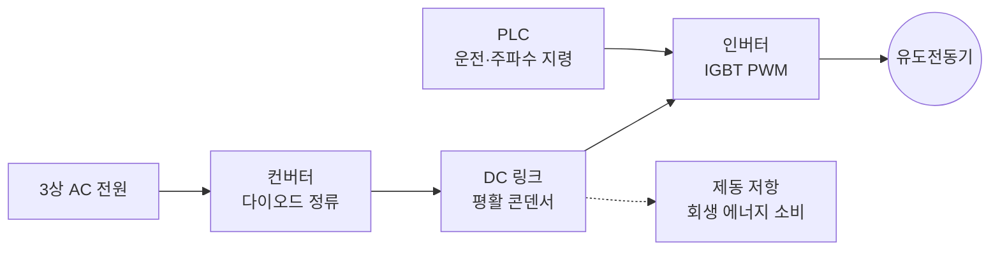

# 유도전동기와 인버터

> [!summary] 핵심 요약
> - 동기 속도 $N_s = \dfrac{120f}{P}$ [rpm], 슬립 $s = \dfrac{N_s - N}{N_s}$, 실제 속도 $N = N_s(1 - s)$.
> - 3상 유도전동기 **역회전**: 세 선 중 **두 선을 바꾼다**.
> - **Y-Δ 기동**: 기동 전류와 기동 토크가 직입 기동의 **1/3**.
> - **인버터**: 주파수를 바꿔 속도 제어. 자속을 일정하게 하려고 전압도 같이 바꾸는 **V/f 일정 제어**가 기본.

> [!warning] 자주 틀리는 포인트
> - 4극, 60 Hz → 동기 속도 **1800 rpm**. 실제 속도는 슬립만큼 조금 낮다 (예: 1750 rpm).
> - 슬립 s = 1은 **정지(기동 순간)**, s = 0은 동기 속도 (유도전동기는 무부하에서도 0이 되지 않음).
> - Y-Δ 기동에서 **전압은 $1/\sqrt{3}$**, 전류·토크는 **1/3**. 둘을 헷갈리기 쉽다.
> - 인버터 출력 측에 **진상 콘덴서나 전자접촉기 개폐를 넣지 않는다** (운전 중 MC 개폐 금지).
> - 감속이 너무 빠르면 **회생 에너지로 과전압 트립** → 감속 시간 늘리기 또는 제동 저항.
> - 고정자 권선이 **120°** 간격이면 **3상**, 180°면 단상 (교재 32-2).
> - **동기전동기는 여자기가 필요**하고 비싸지만 속도가 일정하고 역률 조정이 쉽다. 유도전동기는 여자기가 필요 없다 (교재 32-3).
> - "어댑터(별도 전원 장치) 없이 일반 전원으로 쓰고, 구조가 간단·저렴·견고" → **교류전동기** (교재 32-1).

## 개념 정리

### 유도전동기 원리

- 고정자 3상 권선 → **회전 자계** 발생 → 회전자에 유도 전류 → 토크.
- 회전자는 회전 자계보다 조금 느리게 돈다(슬립이 있어야 유도 전류가 생김).
- 구조: **농형**(간단·튼튼, 가장 많이 사용), **권선형**(2차 저항으로 기동·속도 제어).

**교류전동기의 종류 (교재 32절)**

| 구분 | 권선 배치 | 특징 | 용도 |
| --- | --- | --- | --- |
| 단상 유도전동기 | 180° | 스스로 기동 못 함 → 분상·콘덴서·셰이딩 코일 기동 | 냉장고, 세탁기, 선풍기 (소용량) |
| 3상 유도전동기 | 120° | 3상 전원만으로 회전 자계, 구조 간단 | 공장·빌딩 대용량 동력 |
| 동기전동기 | 단상 180°, 3상 120° | 회전자(교재는 영구자석)가 회전 자계와 **같은 속도**, 여자기 필요·비쌈, 역률 조정 쉬움 | 정속도 대동력 |

- 교류전동기 공통 장점: 일반 교류 전원을 그대로 쓰고, 고정자·회전자만으로 이루어져 저렴하고 견고하다.
- 유도전동기는 슬립 때문에 회전 자계보다 **느리게**, 동기전동기는 **같은 속도**로 돈다.

**계산 예**: 6극, 60 Hz, 실제 1140 rpm
- $N_s = 120 \times 60 / 6 = 1200$ rpm
- $s = (1200 - 1140)/1200 = 0.05$ (5%)

### 기동법 (농형)

| 기동법 | 내용 | 특징 |
| --- | --- | --- |
| 직입(전전압) 기동 | 바로 정격 전압 | 소용량, 기동 전류 5~7배 |
| Y-Δ 기동 | Y로 기동 후 Δ로 전환 | 전류·토크 1/3, 중용량 |
| 리액터 기동 | 직렬 리액터로 전압 강하 | |
| 기동 보상기 | 단권 변압기로 전압 낮춤 | 대용량 |
| 소프트 스타터 | 사이리스터로 전압 서서히 증가 | 충격 감소 |
| 인버터 기동 | 주파수·전압 서서히 증가 | 기동 전류 가장 작음 |

### 속도 제어 방법

$N = \dfrac{120f}{P}(1 - s)$ 에서 바꿀 수 있는 것:

| 방법 | 바꾸는 것 | 비고 |
| --- | --- | --- |
| 주파수 제어 | f | **인버터**, 가장 널리 사용 |
| 극수 변환 | P | 단계적 (2단 속도 모터) |
| 2차 저항 제어 | s | 권선형만 |
| 전압 제어 | s | 범위 좁음 |

### 인버터 구성과 제어

- 구성: **컨버터**(AC → DC 정류) → **DC 링크**(평활 콘덴서) → **인버터**(IGBT PWM으로 DC → 가변 AC).
- **V/f 제어**: 전압/주파수 비를 일정하게 유지. 간단, 범용 팬·펌프.
- **벡터 제어**: 전류를 자속분·토크분으로 나눠 제어 → 저속 토크 우수.
- 팬·펌프는 토크가 속도 제곱, 동력이 **속도 세제곱**에 비례 → 인버터로 큰 에너지 절감.

**주요 파라미터**

| 파라미터 | 의미 |
| --- | --- |
| 가속 / 감속 시간 | 0 → 최고 주파수까지 걸리는 시간 |
| 최고·기저 주파수 | 출력 상한 / 정격 전압이 나오는 주파수 |
| 운전 지령 방법 | 키패드, 단자대(정·역 입력), 통신 |
| 주파수 지령 방법 | 키패드, 아날로그(0~10 V, 4~20 mA), 다단속, 통신 |
| 전자 서멀 | 모터 과부하 보호 |
| 토크 부스트 | 저속에서 전압 보강 |

**주요 트립**: 과전류(OC, 가속 너무 빠름), 과전압(OV, 감속 너무 빠름), 저전압(LV), 과부하(OL), 과열(OH), 지락(GF).

### 단상 유도전동기 기동 방식

- 단상은 회전 자계가 생기지 않아 스스로 기동하지 못한다.
- 기동 토크 큰 순: **반발 기동형 > 콘덴서 기동형 > 분상 기동형 > 셰이딩 코일형**.

## 그림

## 기출 포인트

출처: 생산자동화산업기사 2016–2020년 필기 14회분 (cbtbank.kr).

- 극수·주파수로 동기 속도 계산 — 1회 (2016-2)
- 옛 시험은 유도전동기·인버터를 거의 묻지 않았다. 새 출제기준의 "모터 제어"에는 들어 있으므로 이 노트 내용(슬립, Y-Δ, V/f, 트립)은 교재 기준으로 그대로 준비한다.

**교재 예제 유형** (Win-Q 2025 PART 01 CHAPTER 02, 32절): 어댑터 없이 쓰는 저렴·견고한 전동기(교류), 120° 권선의 상수(3상), 동기전동기의 틀린 설명(여자기 불필요, 그림 문제). 교재 32절에는 동기 속도·슬립 식이 나오지 않는다.

## 관련 단원

- [전동기 제어회로와 보호](전동기_제어회로와_보호.md)
- [DC 모터와 스테핑 모터](DC모터와_스테핑모터.md)
- [서보 모터와 서보 제어](서보모터와_서보제어.md)
- [자동제어계의 기초](자동제어계의_기초.md)

## 체크리스트

- [ ] 극수·주파수로 동기 속도를 계산한다
- [ ] 슬립과 실제 속도를 서로 계산한다
- [ ] Y-Δ 기동의 전압·전류·토크 비율을 안다
- [ ] 3상 유도전동기 역회전 방법을 안다
- [ ] 인버터 구성 3단계와 V/f 제어 이유를 설명한다
- [ ] OC·OV 트립의 원인과 대책을 말한다

## 참고

- [큐넷 자동화설비산업기사 출제기준](https://www.q-net.or.kr/crf005.do?id=crf00503&jmCd=2034)
