# 유도전동기와 인버터

> [!summary] 핵심 요약
> - 동기 속도 $N_s = \dfrac{120f}{P}$ [rpm], 슬립 $s = \dfrac{N_s - N}{N_s}$, 실제 속도 $N = N_s(1 - s)$.
> - 3상 유도전동기 **역회전**: 세 선 중 **두 선을 바꾼다**.
> - **Y-Δ 기동**: 기동 전류와 기동 토크가 직입 기동의 **1/3**.
> - **인버터**: 주파수를 바꿔 속도 제어. 자속을 일정하게 하려고 전압도 같이 바꾸는 **V/f 일정 제어**가 기본.

> [!warning] 자주 틀리는 포인트
> - 4극, 60 Hz → 동기 속도 **1800 rpm**. 실제 속도는 슬립만큼 조금 낮다 (예: 1750 rpm).
> - 슬립 s = 1은 **정지(기동 순간)**, s = 0은 동기 속도 (유도전동기는 무부하에서도 0이 되지 않음).
> - Y-Δ 기동에서 **전압은 $1/\sqrt{3}$**, 전류·토크는 **1/3**. 둘을 헷갈리기 쉽다.
> - 인버터 출력 측에 **진상 콘덴서나 전자접촉기 개폐를 넣지 않는다** (운전 중 MC 개폐 금지).
> - 감속이 너무 빠르면 **회생 에너지로 과전압 트립** → 감속 시간 늘리기 또는 제동 저항.
> - 고정자 권선이 **120°** 간격이면 **3상**, 180°면 단상 (교재 32-2).
> - **동기전동기는 여자기가 필요**하고 비싸지만 속도가 일정하고 역률 조정이 쉽다. 유도전동기는 여자기가 필요 없다 (교재 32-3).
> - "어댑터(별도 전원 장치) 없이 일반 전원으로 쓰고, 구조가 간단·저렴·견고" → **교류전동기** (교재 32-1).

## 학습 목표

이 단원을 마치면 다음을 할 수 있어야 한다.

1. 단상·3상 유도전동기와 동기전동기를 권선 배치·속도·여자기 유무로 구분한다.
2. 회전 자계가 생기는 원리와 슬립이 있어야 토크가 나는 이유를 설명하고, 농형과 권선형 회전자를 구분한다.
3. 극수·주파수로 동기 속도를, 슬립으로 실제 속도를 서로 계산한다.
4. 3상 유도전동기의 역회전 결선과 Y-Δ 기동의 전압·전류·토크 비율을 설명한다.
5. 인버터의 컨버터 → DC 링크 → 인버터 구성과 V/f 일정 제어를 하는 이유를 설명하고, 팬·펌프에서 에너지가 절감되는 양을 계산한다.
6. 주요 파라미터와 OC·OV 트립의 원인·대책을 말한다.

## 한눈에 보기

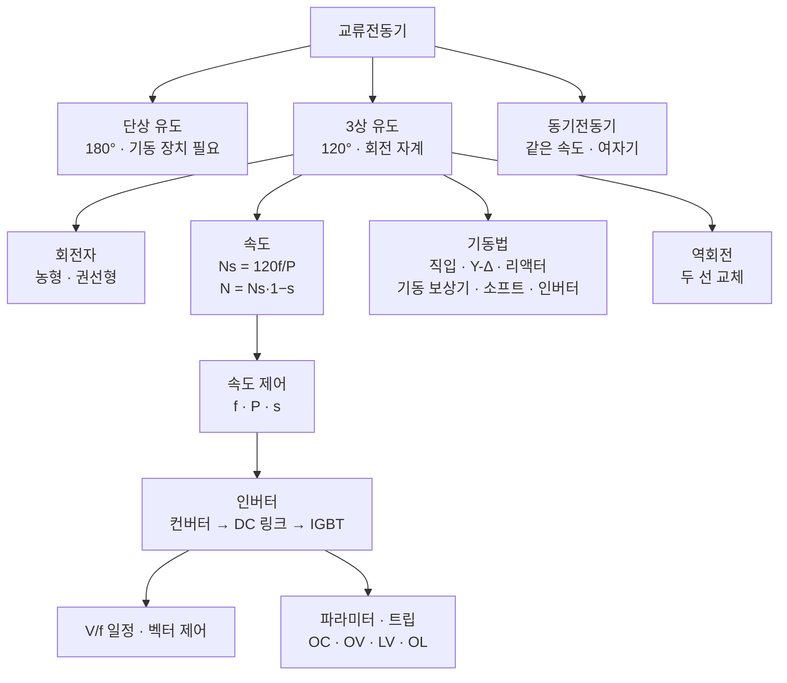

## 1. 교류전동기의 종류

**직관**: 교류전동기는 콘센트의 교류를 **그대로** 꽂아 쓰는 모터다. 브러시·정류자 같은 미끄럼 접점이 없어 고정자와 회전자만 있으면 되므로 싸고 튼튼하다. 차이는 회전자가 회전 자계를 **조금 늦게 쫓아가느냐(유도)**, **딱 붙어서 같이 도느냐(동기)** 다.

**교류전동기의 종류 (교재 32절)**

| 구분 | 권선 배치 | 특징 | 용도 |
| --- | --- | --- | --- |
| 단상 유도전동기 | 180° | 스스로 기동 못 함 → 분상·콘덴서·셰이딩 코일 기동 | 냉장고, 세탁기, 선풍기 (소용량) |
| 3상 유도전동기 | 120° | 3상 전원만으로 회전 자계, 구조 간단 | 공장·빌딩 대용량 동력 |
| 동기전동기 | 단상 180°, 3상 120° | 회전자(교재는 영구자석)가 회전 자계와 **같은 속도**, 여자기 필요·비쌈, 역률 조정 쉬움 | 정속도 대동력 |

- 교류전동기 공통 장점: 일반 교류 전원을 그대로 쓰고, 고정자·회전자만으로 이루어져 저렴하고 견고하다.
- 유도전동기는 슬립 때문에 회전 자계보다 **느리게**, 동기전동기는 **같은 속도**로 돈다.

> [!question] 시험에서는
> "동기전동기는 여자기가 필요 없다"는 틀린 보기다. 여자기가 필요 없는 것은 **유도전동기**다. 권선 배치 각도는 3상 = 120°, 단상 = 180°로 묶어 외운다.

## 2. 유도전동기의 원리와 구조

**직관**: 자석을 원판 위에서 빙빙 돌리면 원판에 맴돌이 전류가 생겨 원판이 자석을 따라 돈다(아라고의 원판). 유도전동기는 이 "도는 자석"을 3상 권선으로 **전기적으로** 만든 것이다. 회전자는 자계를 따라가지만 끝내 같은 속도가 되지 못한다 — 같아지면 자계를 끊지 못해 유도 전류가 사라지기 때문이다.

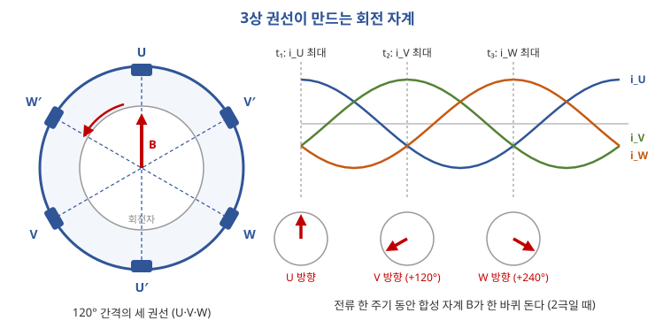

*왼쪽은 고정자에 120° 간격으로 놓인 세 권선, 오른쪽은 그 권선에 흐르는 3상 전류다. 전류가 가장 큰 상이 U → V → W 순서로 바뀌므로, 세 권선이 만드는 **합성 자계 B**의 방향도 U → V → W 쪽으로 120°씩 옮겨 간다. 아무것도 움직이지 않는데 자계만 빙글빙글 도는 것이다. 전원 한 주기에 한 바퀴(2극 기준) — 그래서 회전 자계의 속도가 주파수에 비례하는 동기 속도 $N_s$가 된다.*

- 고정자 3상 권선 → **회전 자계** 발생 → 회전자에 유도 전류 → 토크.
- 회전자는 회전 자계보다 조금 느리게 돈다(슬립이 있어야 유도 전류가 생김).
- 구조: **농형**(간단·튼튼, 가장 많이 사용), **권선형**(2차 저항으로 기동·속도 제어).

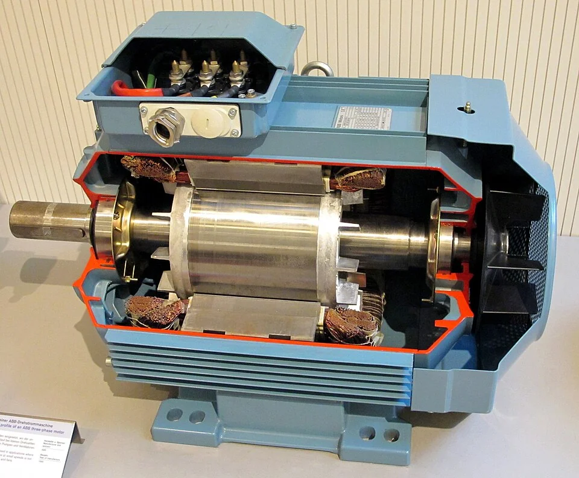

*빨갛게 칠한 단면선 안쪽을 보면, 바깥의 고정자 철심 양 끝으로 **구리 권선 끝(코일 엔드)** 이 삐져나와 있고, 가운데 은색 원통이 **회전자**다. 회전자에는 전선이 연결되어 있지 않다 — 전기는 위쪽 단자함을 통해 고정자에만 들어가고, 회전자 전류는 전자 유도로 생긴다. 오른쪽 덮개 안의 팬은 축에 붙어 같이 돌며 몸체를 식힌다.*

### 농형과 권선형 회전자

| 농형 회전자 (구조 개념) | 농형 회전자 (실물) |
| --- | --- |
| 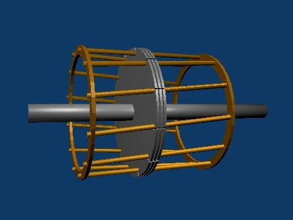 | 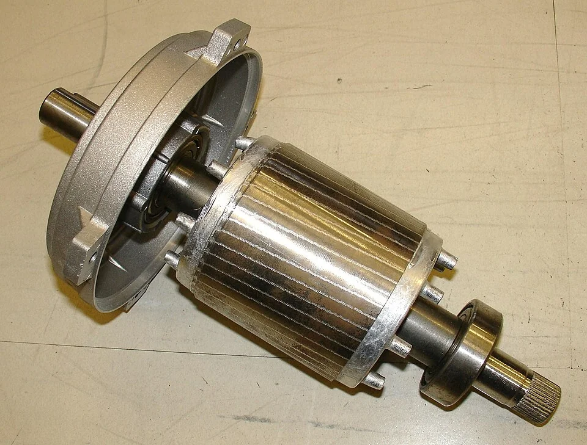 |
| 막대(도체)와 양 끝 **단락 고리**만 남기면 다람쥐 쳇바퀴(squirrel cage) 모양이다. 가운데 원판은 철심 자리를 나타낸다. | 실제로는 도체가 철심 속에 묻혀 있다. 표면의 비스듬한 줄이 도체 홈이고, 양 끝 은색 고리가 **단락환**, 거기 달린 작은 돌기가 냉각 날개다. |

- 농형은 도체가 양 끝에서 **영구 단락**되어 있어 외부에서 저항을 넣을 수 없다. 대신 구조가 단순하고 고장 날 데가 없어 산업 현장 대부분이 농형이다.
- 권선형은 회전자에도 3상 권선을 감고 **슬립링 + 브러시**로 밖으로 꺼내, 외부 저항(2차 저항)을 넣었다 뺐다 한다. 2차 저항을 키우면 기동 전류는 줄고 기동 토크는 커진다.

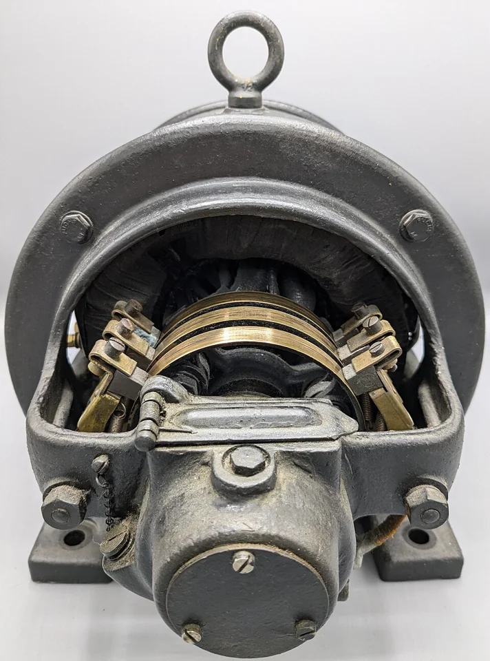

*축 끝의 놋쇠색 **고리 세 개**가 회전자 3상 권선의 끝이고, 양옆의 브러시 홀더가 이 고리에 닿아 전류를 밖으로 꺼낸다. 이 단자에 외부 저항기를 이어 기동 때는 저항을 크게, 가속하면 0으로 줄인다. DC 모터의 정류자(쪼개진 편)와 달리 슬립링은 **끊김 없는 고리**라 전류 방향을 바꾸지 않는다.*

> [!tip] 감 잡기
> "유도"전동기는 회전자에 전기를 **넣지 않고 유도**시킨다. 그래서 회전자 쪽에 미끄럼 접점이 필요 없는 농형이 기본이고, 권선형만 예외로 슬립링을 단다.

## 3. 동기 속도와 슬립

**직관**: 회전 자계는 전원 주파수가 정한 속도로 돈다. 극이 많을수록 한 주기에 조금씩만 나아가므로 느려진다. 회전자는 그보다 **몇 % 느리게** 따라가는데, 그 뒤처짐의 비율이 슬립이다. 부하가 커질수록 더 뒤처져(슬립 증가) 유도 전류와 토크를 더 만든다.

$$
N_s = \frac{120f}{P}\ \text{[rpm]}, \qquad s = \frac{N_s - N}{N_s}, \qquad N = N_s(1 - s)
$$

| 극수 P | 60 Hz 동기 속도 | 50 Hz 동기 속도 |
| --- | --- | --- |
| 2 | 3600 rpm | 3000 rpm |
| 4 | 1800 rpm | 1500 rpm |
| 6 | 1200 rpm | 1000 rpm |
| 8 | 900 rpm | 750 rpm |

**계산 예**: 6극, 60 Hz, 실제 1140 rpm
- $N_s = 120 \times 60 / 6 = 1200$ rpm
- $s = (1200 - 1140)/1200 = 0.05$ (5%)

**계산 예 2**: 4극, 60 Hz, 슬립 3 %
- $N_s = 120 \times 60 / 4 = 1800$ rpm
- $N = 1800 \times (1 - 0.03) = 1746$ rpm

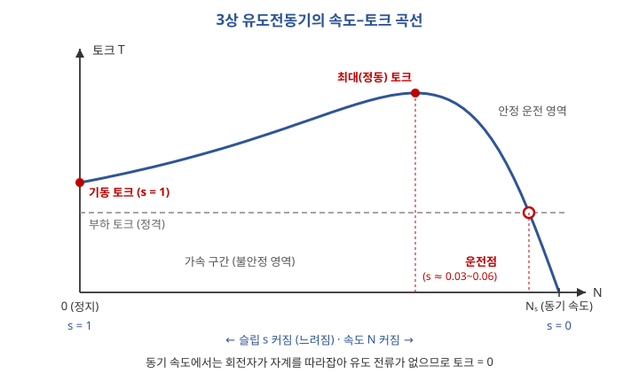

*왼쪽 끝(정지, s = 1)에서도 토크가 있어 스스로 기동한다. 속도가 오르면 토크가 커져 **최대(정동) 토크**에 이른 뒤 급히 떨어지고, 동기 속도 $N_s$에서는 0이 된다. 부하 토크선(회색 점선)과 만나는 **운전점**은 동기 속도보다 몇 % 아래에 있다 — 이것이 "무부하에서도 슬립이 0이 되지 않는" 이유다.*

| 슬립 값 | 상태 |
| --- | --- |
| s = 1 | 정지 (기동 순간) |
| 0 < s < 1 | 전동기 운전 (보통 정격에서 수 %) |
| s = 0 | 동기 속도 — 유도전동기는 도달하지 못함 |
| s < 0 | 동기 속도보다 빠름 → 발전기(회생) 동작 |

> [!question] 시험에서는
> 극수·주파수를 주고 동기 속도를 묻거나, 실제 속도를 주고 슬립을 묻는다. 단위는 **rpm**, 식의 상수는 **120**(= 60 s × 2극 한 쌍)이다. "슬립 0 = 정지"로 바꿔 놓은 보기는 틀림 — 정지는 s = 1.

## 4. 역회전

**직관**: 3상의 회전 자계는 R → S → T 순서(상순)대로 돈다. 두 선을 바꾸면 순서가 R → T → S로 뒤집혀 자계가 반대로 돌고, 회전자도 따라 반대로 돈다.

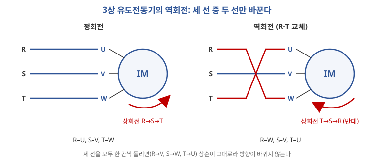

*왼쪽은 정회전 결선, 오른쪽은 R·T 두 선만 엇갈려 꽂은 역회전 결선이다. 바꾸는 두 선은 어느 쌍이든 상관없다. 세 선을 모두 한 칸씩 돌려 꽂으면 상순이 그대로라 방향이 바뀌지 않는다는 점이 함정이다.*

- 3상 유도전동기 **역회전**: 세 선 중 **두 선을 바꾼다**.
- 정·역 운전 회로에서는 정회전용 MC와 역회전용 MC가 이 두 선을 바꿔 연결하고, 두 MC가 동시에 붙으면 **선간 단락**이므로 반드시 인터록을 건다 ([전동기 제어회로와 보호](전동기_제어회로와_보호.md)).
- 인버터 구동 중이면 결선을 바꾸지 않고 인버터의 정·역 입력 단자로 상순을 바꾼다.

## 5. 기동법 (농형)

**직관**: 정지한 유도전동기는 슬립이 1이라 회전자가 자계를 가장 빠르게 끊고, 변압기 2차를 단락한 것처럼 큰 전류(정격의 5~7배)가 흐른다. 작은 모터는 그냥 견디지만, 큰 모터는 배전선 전압을 떨어뜨리므로 **기동할 때만 전압을 낮추는** 여러 방법을 쓴다.

| 기동법 | 내용 | 특징 |
| --- | --- | --- |
| 직입(전전압) 기동 | 바로 정격 전압 | 소용량, 기동 전류 5~7배 |
| Y-Δ 기동 | Y로 기동 후 Δ로 전환 | 전류·토크 1/3, 중용량 |
| 리액터 기동 | 직렬 리액터로 전압 강하 | |
| 기동 보상기 | 단권 변압기로 전압 낮춤 | 대용량 |
| 소프트 스타터 | 사이리스터로 전압 서서히 증가 | 충격 감소 |
| 인버터 기동 | 주파수·전압 서서히 증가 | 기동 전류 가장 작음 |

### Y-Δ 기동

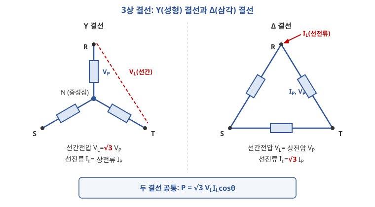

*운전용으로 Δ 결선된 모터를 기동할 때만 Y로 묶는다. Y에서는 각 권선에 선간전압의 $1/\sqrt{3}$만 걸린다.*

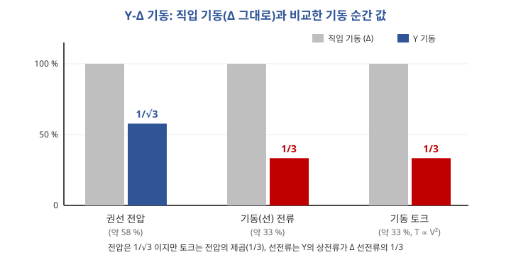

*회색 막대가 직입(Δ 그대로) 기동, 색 막대가 Y 기동이다. 권선 전압은 $1/\sqrt{3}$로만 줄지만, 토크는 전압의 제곱에 비례하므로 $(1/\sqrt{3})^2 = 1/3$, 선전류도 Y의 선전류 = 상전류 = Δ 선전류의 1/3이 된다.*

$$
V_Y = \frac{V_\Delta}{\sqrt{3}}, \qquad I_{Y} = \frac{1}{3} I_{\Delta}, \qquad T_Y = \frac{1}{3} T_{\Delta}
$$

- 기동 토크도 1/3로 줄어들므로 **무거운 부하를 건 채 기동하면** 가속이 안 될 수 있다. 무부하·경부하 기동에 쓴다.
- 회로는 주 MC + Y용 MC + Δ용 MC와 타이머로 짜고, Y·Δ MC 사이에 인터록을 둔다.

> [!question] 시험에서는
> "Y-Δ 기동은 기동 전압이 1/3"은 틀림. 전압은 $1/\sqrt{3}$, **전류·토크가 1/3**이다.

## 6. 속도 제어 방법

**직관**: 속도 식 $N = \frac{120f}{P}(1-s)$에는 손잡이가 세 개 있다 — 주파수 f, 극수 P, 슬립 s. 주파수를 바꾸는 인버터가 연속·고효율이라 거의 모든 현장이 이것을 쓴다.

$N = \dfrac{120f}{P}(1 - s)$ 에서 바꿀 수 있는 것:

| 방법 | 바꾸는 것 | 비고 |
| --- | --- | --- |
| 주파수 제어 | f | **인버터**, 가장 널리 사용 |
| 극수 변환 | P | 단계적 (2단 속도 모터) |
| 2차 저항 제어 | s | 권선형만 |
| 전압 제어 | s | 범위 좁음 |

- 슬립으로 속도를 바꾸는 방법(2차 저항·전압 제어)은 슬립만큼의 전력이 회전자에서 열로 버려지므로 효율이 나쁘다.

## 7. 인버터 구성

**직관**: 인버터는 "교류를 일단 직류로 바꿔 저장했다가, 원하는 주파수의 교류로 다시 잘라 만드는" 장치다. 상용 전원의 60 Hz를 0~수백 Hz로 마음대로 바꿀 수 있다.

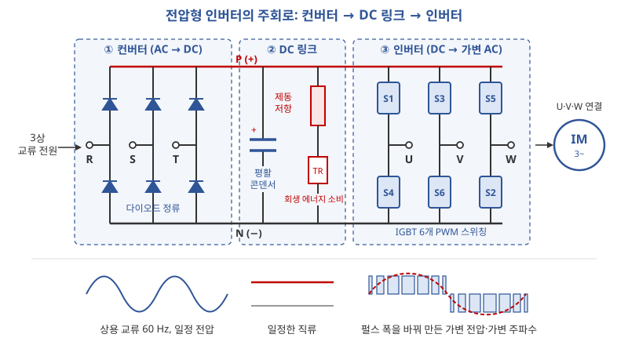

*① 다이오드 브리지가 R·S·T 교류를 직류로 바꾸고, ② 평활 콘덴서가 그 직류를 고르게 저장한다. ③ IGBT 6개가 위·아래로 번갈아 켜지며 **펄스 폭을 사인파 모양으로 바꾼(PWM)** 전압을 U·V·W에 내보낸다. 모터 코일이 전류를 평균내 주므로 모터는 사인파에 가까운 전류로 돈다. 감속할 때 모터가 발전기가 되어 되돌려 보낸 에너지는 다이오드 쪽으로 못 나가고 콘덴서 전압을 올리는데, 이를 **제동 저항**이 열로 태운다.*

- 구성: **컨버터**(AC → DC 정류) → **DC 링크**(평활 콘덴서) → **인버터**(IGBT PWM으로 DC → 가변 AC).

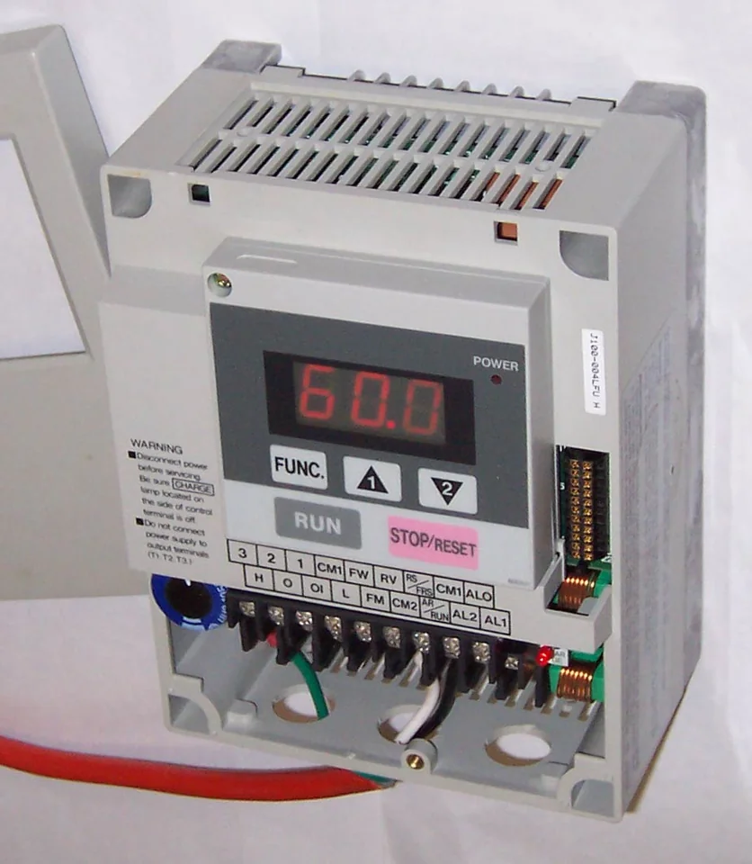

*앞면 표시창의 **60.0**은 출력 주파수 60 Hz다. 키패드로 주파수를 바꾸거나, 아래 단자대의 **FW(정회전)·RV(역회전)** 단자로 운전 지령을, **H·O·OI·L** 단자로 아날로그 주파수 지령(전압 0~10 V / 전류 4~20 mA)을 넣는다 — 아래 9절의 "운전 지령 방법", "주파수 지령 방법"이 바로 이 단자들이다. 왼쪽 경고문은 출력 단자에 전원을 넣지 말고, CHARGE 램프가 꺼진 뒤 정비하라는 내용이다(콘덴서에 남은 직류 전압 때문).*

> [!warning] 배선할 때
> 인버터 출력 측(U·V·W)에는 진상 콘덴서·서지 흡수기를 달지 않고, 운전 중 MC로 끊거나 붙이지 않는다. PWM 펄스가 콘덴서를 직접 충전해 과전류 트립·소자 파손이 난다. 전원 R·S·T와 출력 U·V·W를 바꿔 꽂으면 인버터가 파손된다.

## 8. V/f 제어와 벡터 제어

**직관**: 모터 철심의 자속은 $\Phi \propto V/f$다. 주파수만 낮추고 전압을 그대로 두면 자속이 지나치게 커져 철심이 포화되고 전류가 폭증한다. 그래서 주파수를 반으로 낮추면 전압도 반으로 낮춰 **자속(= 토크를 내는 힘)을 일정하게** 지킨다.

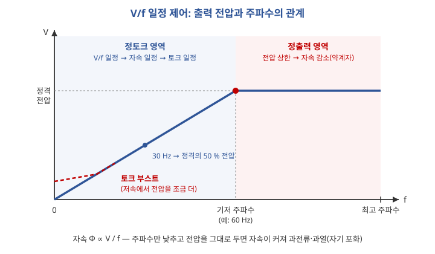

*기저 주파수(보통 60 Hz)까지는 V/f를 일정하게 유지하므로 토크가 일정하다(정토크). 그 이상은 전압을 더 올릴 수 없어 자속이 줄고, 토크 × 속도 = 출력이 일정해진다(정출력). 아주 낮은 주파수에서는 권선 저항의 전압 강하 때문에 토크가 모자라므로 **토크 부스트**로 전압을 조금 더 준다.*

$$
\Phi \propto \frac{V}{f} = \text{일정}
$$

- **V/f 제어**: 전압/주파수 비를 일정하게 유지. 간단, 범용 팬·펌프.
- **벡터 제어**: 전류를 자속분·토크분으로 나눠 제어 → 저속 토크 우수.

| 항목 | V/f 제어 | 벡터 제어 |
| --- | --- | --- |
| 원리 | 전압과 주파수의 비만 맞춤 (개루프) | 전류를 자속분·토크분으로 나눠 DC 모터처럼 제어 |
| 저속 토크 | 약함 (토크 부스트로 보완) | 우수 |
| 속도 정밀도 | 슬립만큼 오차 | 높음 (센서리스·센서 부착형) |
| 용도 | 팬, 펌프, 컨베이어 | 크레인, 엘리베이터, 공작기계 |

### 팬·펌프의 에너지 절감

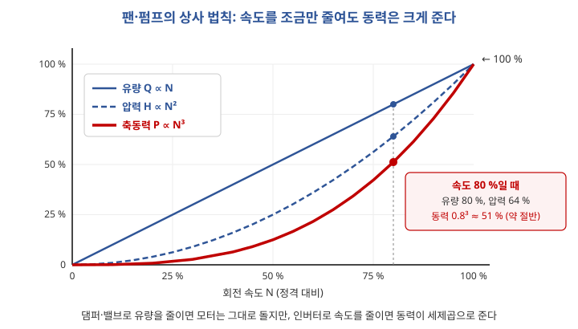

*속도를 80 %로 줄이면 유량은 80 %지만 동력은 $0.8^3 \approx 0.51$, 거의 절반이다. 댐퍼나 밸브를 조여 유량을 줄이면 모터는 여전히 전속력으로 돌기 때문에 이만큼 절약되지 않는다.*

- 팬·펌프는 토크가 속도 제곱, 동력이 **속도 세제곱**에 비례 → 인버터로 큰 에너지 절감.

$$
Q \propto N, \qquad H \propto N^2, \qquad P \propto N^3
$$

## 9. 인버터 파라미터와 트립

**직관**: 인버터는 "얼마나 빨리 올리고 내릴지, 지령을 어디서 받을지, 모터를 어떻게 보호할지"를 숫자(파라미터)로 정해 두고 운전한다. 트립은 그 설정과 실제 부하가 맞지 않을 때 인버터가 스스로를 지키려고 출력을 끊는 것이다.

**주요 파라미터**

| 파라미터 | 의미 |
| --- | --- |
| 가속 / 감속 시간 | 0 → 최고 주파수까지 걸리는 시간 |
| 최고·기저 주파수 | 출력 상한 / 정격 전압이 나오는 주파수 |
| 운전 지령 방법 | 키패드, 단자대(정·역 입력), 통신 |
| 주파수 지령 방법 | 키패드, 아날로그(0~10 V, 4~20 mA), 다단속, 통신 |
| 전자 서멀 | 모터 과부하 보호 |
| 토크 부스트 | 저속에서 전압 보강 |

**주요 트립**: 과전류(OC, 가속 너무 빠름), 과전압(OV, 감속 너무 빠름), 저전압(LV), 과부하(OL), 과열(OH), 지락(GF).

| 트립 | 흔한 원인 | 대책 |
| --- | --- | --- |
| OC 과전류 | 가속 시간이 너무 짧음, 부하 급변, 출력 단락 | 가속 시간 늘리기, 배선·모터 절연 점검 |
| OV 과전압 | 감속 시간이 너무 짧아 회생 에너지가 DC 링크에 쌓임 | 감속 시간 늘리기, **제동 저항(제동 유닛)** 설치 |
| LV 저전압 | 전원 전압 강하, 순간 정전, 결상 | 전원 용량·배선 점검 |
| OL 과부하 | 정격 이상 부하가 오래 걸림 | 부하 줄이기, 용량 큰 인버터·모터 |
| OH 과열 | 냉각 팬 고장, 주위 온도 높음, 통풍 불량 | 팬·필터 청소, 설치 간격 확보 |
| GF 지락 | 출력 배선·모터 권선 절연 파괴 | 절연 저항 측정, 배선 교체 |

> [!tip] 감 잡기
> **가속 = OC, 감속 = OV**. 빨리 올리면 전류가 몰리고, 빨리 내리면 모터가 발전기가 되어 전압이 치솟는다.

## 10. 단상 유도전동기 기동 방식

**직관**: 단상 교류 하나로는 자계가 "왼쪽–오른쪽으로 숨 쉬듯" 바뀔 뿐 돌지 않는다. 그래서 위상이 다른 보조 자계를 하나 더 만들어 처음 한 번만 회전 방향을 정해 준다. 일단 돌기 시작하면 단상으로도 계속 돈다.

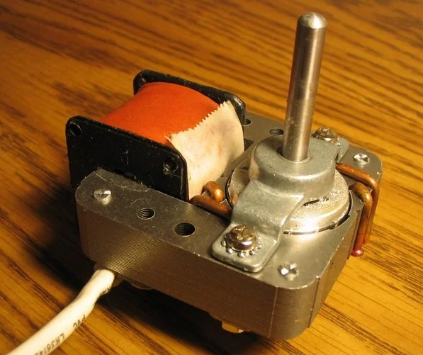

*왼쪽 주황색 덩어리가 단상 **주 코일**, 오른쪽 가운데 축이 꽂힌 둥근 부분이 회전자다. 회전자를 감싸는 자극 끝에 걸린 **구리색 굵은 고리**가 셰이딩 코일이다. 이 단락 고리가 자극 일부의 자속 변화를 늦춰 "자계가 한쪽으로 미끄러지는" 효과를 만든다. 구조가 이렇게 단순해서 싸지만 기동 토크가 가장 작고 회전 방향이 고정된다 — 선풍기·환풍기용.*

- 단상은 회전 자계가 생기지 않아 스스로 기동하지 못한다.
- 기동 토크 큰 순: **반발 기동형 > 콘덴서 기동형 > 분상 기동형 > 셰이딩 코일형**.

| 기동 방식 | 보조 자계 만드는 법 | 특징·용도 |
| --- | --- | --- |
| 반발 기동형 | 정류자·브러시로 반발 토크 | 기동 토크 가장 큼, 구조 복잡 |
| 콘덴서 기동형 | 보조 권선에 콘덴서 직렬 → 위상 약 90° 앞섬 | 기동 토크 큼, 냉장고·펌프·세탁기 |
| 분상 기동형 | 보조 권선의 저항·리액턴스 차이 | 기동 토크 중간, 소형 기계 |
| 셰이딩 코일형 | 자극 일부에 단락 링(셰이딩 코일) | 기동 토크 가장 작음, 역회전 불가, 선풍기·소형 팬 |

## 그림

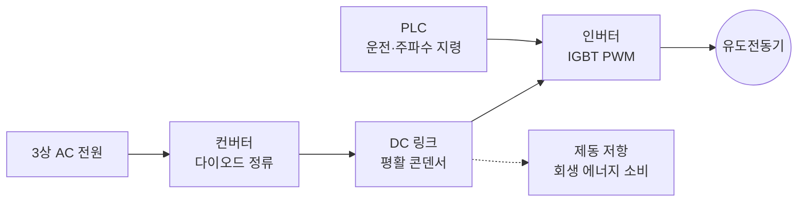

## 기출 포인트

출처: 생산자동화산업기사 2016–2020년 필기 14회분 (cbtbank.kr).

- 극수·주파수로 동기 속도 계산 — 1회 (2016-2)
- 옛 시험은 유도전동기·인버터를 거의 묻지 않았다. 새 출제기준의 "모터 제어"에는 들어 있으므로 이 노트 내용(슬립, Y-Δ, V/f, 트립)은 교재 기준으로 그대로 준비한다.

**교재 예제 유형** (Win-Q 2025 PART 01 CHAPTER 02, 32절): 어댑터 없이 쓰는 저렴·견고한 전동기(교류), 120° 권선의 상수(3상), 동기전동기의 틀린 설명(여자기 불필요, 그림 문제). 교재 32절에는 동기 속도·슬립 식이 나오지 않는다.

## 관련 단원

- [전동기 제어회로와 보호](전동기_제어회로와_보호.md)
- [DC 모터와 스테핑 모터](DC모터와_스테핑모터.md)
- [서보 모터와 서보 제어](서보모터와_서보제어.md)
- [자동제어계의 기초](자동제어계의_기초.md)

## 체크리스트

- [ ] 극수·주파수로 동기 속도를 계산한다
- [ ] 슬립과 실제 속도를 서로 계산한다
- [ ] Y-Δ 기동의 전압·전류·토크 비율을 안다
- [ ] 3상 유도전동기 역회전 방법을 안다
- [ ] 인버터 구성 3단계와 V/f 제어 이유를 설명한다
- [ ] OC·OV 트립의 원인과 대책을 말한다

## 참고

- [큐넷 자동화설비산업기사 출제기준](https://www.q-net.or.kr/crf005.do?id=crf00503&jmCd=2034)

### 그림 출처

위키미디어 공용(Wikimedia Commons)과 Openverse에서 가져온 공개 라이선스 자료이고, 노트에 맞게 크기를 줄이고 WebP로 변환했다.

| 그림 | 작성자 | 라이선스 | 출처 |
| --- | --- | --- | --- |
| [TMW 50906 Schnittmodell einer Drehstrommaschine (Asynchronmaschine)](https://commons.wikimedia.org/wiki/File:TMW_50906_Schnittmodell_einer_Drehstrommaschine_(Asynchronmaschine).jpg) |  | 퍼블릭 도메인 | Wikimedia Commons |
| [Squirrel cage](https://commons.wikimedia.org/wiki/File:Squirrel_cage.jpg) | en:User:Meggar | [CC BY-SA 3.0](http://creativecommons.org/licenses/by-sa/3.0/) | Wikimedia Commons |
| [Wirnik by Zureks](https://commons.wikimedia.org/wiki/File:Wirnik_by_Zureks.jpg) | Zureks | [CC BY-SA 3.0](https://creativecommons.org/licenses/by-sa/3.0) | Wikimedia Commons |
| [Slip ring induction motor](https://commons.wikimedia.org/wiki/File:Slip_ring_induction_motor.jpg) | Oliver Wallscheid | [CC BY 4.0](https://creativecommons.org/licenses/by/4.0) | Wikimedia Commons |
| [Small variable-frequency drive](https://commons.wikimedia.org/wiki/File:Small_variable-frequency_drive.jpg) | C J Cowie | [CC BY-SA 3.0](http://creativecommons.org/licenses/by-sa/3.0/) | Wikimedia Commons |
| [Shaded pole motor](https://commons.wikimedia.org/wiki/File:Shaded_pole_motor.jpg) | The original uploader was Meggar at English Wikipedia. | [CC BY-SA 3.0](http://creativecommons.org/licenses/by-sa/3.0/) | Wikimedia Commons |

직접 그린 그림(SVG, 이 볼트용으로 새로 작성): 회전자계, 토크 슬립 곡선, 역회전 결선, Y 델타 결선, Y델타 기동비교, 인버터 주회로, VF 제어, 팬펌프 세제곱.

