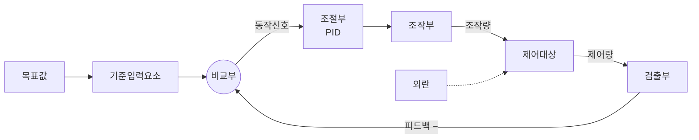

# 자동제어계의 기초

> [!summary] 핵심 요약
> - **시퀀스 제어**: 정해진 순서대로 진행 (개루프). **피드백 제어**: 결과를 되먹여 목표값과 비교·수정 (폐루프).
> - 피드백 제어계 흐름: 목표값 → 비교부 → 동작신호 → 제어요소(조절부+조작부) → 조작량 → 제어대상 → 제어량 → 검출부 → 다시 비교부.
> - **P**: 빠르지만 잔류편차 남음. **I**: 잔류편차 제거. **D**: 변화를 예측해 오버슈트 감소.
> - 폐루프 전달함수: $\dfrac{C(s)}{R(s)} = \dfrac{G(s)}{1 + G(s)H(s)}$

> [!warning] 자주 틀리는 포인트
> - **잔류편차(오프셋)를 없애는 것은 I 동작**. P만으로는 남는다.
> - ON/OFF 제어는 불연속 동작이라 **사이클링(헌팅)** 이 생긴다.
> - 제어량 기준 분류: 위치·방위·자세 = **서보기구**, 온도·압력·유량·액위·농도 = **프로세스 제어**, 전압·주파수·속도 = **자동조정**.
> - 목표값 기준 분류: 일정 = **정치 제어**, 변함 = **추치 제어**(추종·프로그램·비율).
> - 외란은 제어량을 목표값에서 벗어나게 하는 **외부 요인**. 피드백 제어가 외란에 강하다.

## 개념 정리

### 시퀀스 제어 vs 피드백 제어

| 항목 | 시퀀스 제어 | 피드백 제어 |
| --- | --- | --- |
| 루프 | 개루프 | 폐루프 |
| 비교 | 없음 | 목표값과 제어량 비교 |
| 외란 대응 | 약함 | 강함 |
| 구조 | 간단, 저렴 | 복잡, 검출부 필요 |
| 예 | 신호등, 세탁기, 컨베이어 순서 | 에어컨 온도, 서보 위치 |

**시퀀스 제어 종류**

- **순서 제어**: 앞 동작 완료를 확인하고 다음 동작 (리밋 스위치 확인 후 다음 실린더).
- **시한 제어**: 시간 경과로 진행 (신호등).
- **조건 제어**: 입력 조건 조합으로 출력 결정 (인터록, 안전 조건).

### 피드백 제어계 구성 요소

| 요소 | 역할 |
| --- | --- |
| 목표값 | 원하는 제어량의 값 |
| 기준 입력 요소 | 목표값을 비교 가능한 신호로 변환 (설정부) |
| 비교부 | 기준 입력 − 피드백 신호 = 동작신호(편차) |
| 조절부 | 동작신호로 제어 동작(PID) 계산 |
| 조작부 | 조절부 신호로 조작량 생성 (밸브, 모터) |
| 제어대상 | 제어하려는 장치·공정 |
| 검출부 | 제어량을 측정해 되먹임 (센서) |

- 조절부 + 조작부 = **제어요소**.

### 제어 동작

| 동작 | 식 | 특징 |
| --- | --- | --- |
| ON/OFF (2위치) | – | 단순, 사이클링, 오프셋 |
| P (비례) | $K_p e$ | 응답 빠름, 잔류편차 남음 |
| I (적분) | $K_i \int e\,dt$ | 잔류편차 제거, 응답 느려지고 진동 가능 |
| D (미분) | $K_d \dfrac{de}{dt}$ | 오버슈트 감소, 속응성 향상, 노이즈에 민감 |
| PI | P + I | 잔류편차 제거 |
| PD | P + D | 속응성 개선 |
| PID | P + I + D | 가장 일반적, 정상편차·속응성·안정성 균형 |

- **비례대(PB)**: 조작량이 0~100% 변하는 편차 범위. $PB(\%) = \dfrac{100}{K_p}$ → 비례대가 좁을수록 이득이 크다.

### 과도 응답 특성 (계단 입력)

| 용어 | 의미 |
| --- | --- |
| 지연 시간 | 최종값의 50%에 도달하는 시간 |
| 상승 시간 | 최종값의 10% → 90% 걸리는 시간 |
| 최대 오버슈트 | 최종값을 넘은 최대량 (%) |
| 정정 시간 | 최종값의 ±2% (또는 ±5%) 안에 머물기 시작하는 시간 |
| 정상 편차 | 충분한 시간 후 남는 오차 |

### 전달함수

- 정의: 초기값을 0으로 둔 **출력의 라플라스 변환 / 입력의 라플라스 변환**.

| 요소 | 전달함수 |
| --- | --- |
| 비례 | $K$ |
| 적분 | $\dfrac{K}{s}$ |
| 미분 | $Ks$ |
| 1차 지연 | $\dfrac{K}{Ts + 1}$ |
| 2차 지연 | $\dfrac{\omega_n^2}{s^2 + 2\zeta\omega_n s + \omega_n^2}$ |
| 낭비 시간 | $e^{-Ls}$ |

- **블록 선도 합성**: 직렬 $G_1G_2$, 병렬 $G_1 \pm G_2$, 피드백 $\dfrac{G}{1 \mp GH}$ (부궤환이면 분모 +).
- 2차계 감쇠비 $\zeta$: $\zeta < 1$ 부족 감쇠(진동), $\zeta = 1$ 임계 감쇠, $\zeta > 1$ 과감쇠.

## 그림

## 관련 단원

- [PLC 구성과 특성](PLC_구성과_특성.md)
- [특수모듈 프로그래밍](특수모듈_프로그래밍.md)

## 체크리스트

- [ ] 시퀀스·피드백 제어를 루프·비교·외란 기준으로 구분한다
- [ ] 피드백 제어계 블록을 순서대로 그릴 수 있다
- [ ] P·I·D 동작의 장단점과 잔류편차 관계를 안다
- [ ] 서보기구·프로세스 제어·자동조정을 제어량으로 분류한다
- [ ] 상승 시간·정정 시간·오버슈트를 정의할 수 있다
- [ ] 피드백 블록 선도의 전달함수 $G/(1+GH)$를 쓸 수 있다

## 참고

- [큐넷 자동화설비산업기사 출제기준](https://www.q-net.or.kr/crf005.do?id=crf00503&jmCd=2034)
