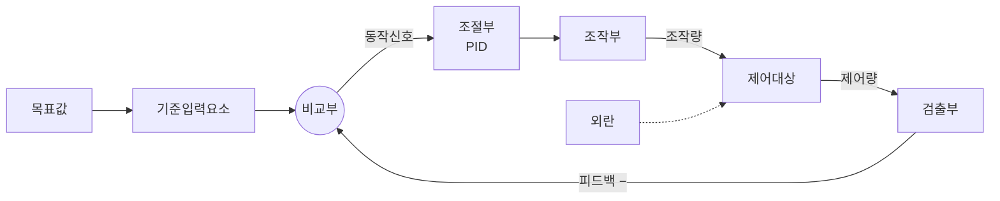

# 자동제어계의 기초

> [!summary] 핵심 요약
> - **시퀀스 제어**: 정해진 순서대로 진행 (개루프). **피드백 제어**: 결과를 되먹여 목표값과 비교·수정 (폐루프).
> - 피드백 제어계 흐름: 목표값 → 비교부 → 동작신호 → 제어요소(조절부+조작부) → 조작량 → 제어대상 → 제어량 → 검출부 → 다시 비교부.
> - **P**: 빠르지만 잔류편차 남음. **I**: 잔류편차 제거. **D**: 변화를 예측해 오버슈트 감소.
> - 폐루프 전달함수: $\dfrac{C(s)}{R(s)} = \dfrac{G(s)}{1 + G(s)H(s)}$

> [!warning] 자주 틀리는 포인트
> - **잔류편차(오프셋)를 없애는 것은 I 동작**. P만으로는 남는다.
> - ON/OFF 제어는 불연속 동작이라 **사이클링(헌팅)** 이 생긴다.
> - 제어량 기준 분류: 위치·방위·자세 = **서보기구**, 온도·압력·유량·액위·농도 = **프로세스 제어**, 전압·주파수·속도 = **자동조정**.
> - 목표값 기준 분류: 일정 = **정치 제어**, 변함 = **추치 제어**(추종·프로그램·비율).
> - 외란은 제어량을 목표값에서 벗어나게 하는 **외부 요인**. 피드백 제어가 외란에 강하다.
> - 시퀀스 제어에는 없고 **피드백 제어에만 있는 것은 비교부**(입출력 비교 장치). 조작부·조절부·출력부는 둘 다 있다.
> - 폐루프는 오차가 줄지만 센서가 늘고 구조가 복잡해져 **값이 비싸진다**. "저렴해진다"는 틀린 보기.
> - 외란이 여러 개이거나 예측이 안 되면 개루프로는 안 된다. 개루프는 외란이 작거나 그 영향을 확실히 알 때만 쓴다.
> - 이름에 속지 말 것: **자동 전원 조정 장치 = 자동조정**(서보기구 아님), **잉크젯 헤드 위치 = 추종**(정치 제어 아님).
> - **열처리로 온도**는 자료마다 답이 갈린다. 교재(04절 예제)는 **비율 제어**, 옛 기출 해설과 일반 제어공학 책은 **프로그램 제어**(시간 계획대로 목표값이 바뀜). 보기에 둘 중 하나만 있으면 그것을 고른다.
> - **서보제어는 추종제어의 예**다. 위치 제어 → 서보 → 추종으로 이어서 외운다.
> - 정치 제어 예(교재): **주파수 제어, 발전기 조속기, 자동 전압 조정 장치**. 이 셋은 제어량으로 나누면 자동조정이기도 하다. 분류 기준이 다르면 이름이 겹칠 수 있다.
> - **퍼지 제어는 PID 같은 선형 제어를 기반으로 하지 않는다**. 단순한 온도 제어에는 퍼지가 오히려 비효율적이다.
> - **조작량** = 제어요소가 제어대상에 주는 양(밸브 개도, 전압, 열). **제어량** = 제어대상에서 나오는 결과(온도 자체).
> - PID 식에서 $T_I$는 **적분 시간**(그 역수가 리셋률), $T_D$는 **미분 시간**(레이트 시간). $T_D$를 리셋률이라 하면 틀린다.
> - 예열 단계의 큰 오버슈트는 편차를 계속 쌓아 두는 **I 동작** 때문(적분 와인드업).

## 개념 정리

### 시퀀스 제어 vs 피드백 제어

| 항목 | 시퀀스 제어 | 피드백 제어 |
| --- | --- | --- |
| 루프 | 개루프 | 폐루프 |
| 비교 | 없음 | 목표값과 제어량 비교 |
| 외란 대응 | 약함 | 강함 |
| 구조 | 간단, 저렴 | 복잡, 검출부 필요 |
| 예 | 신호등, 세탁기, 컨베이어 순서 | 에어컨 온도, 서보 위치 |

**시퀀스 제어 종류**

- **순서 제어**: 앞 동작 완료를 확인하고 다음 동작 (리밋 스위치 확인 후 다음 실린더).
- **시한 제어**: 시간 경과로 진행 (신호등).
- **조건 제어**: 입력 조건 조합으로 출력 결정 (인터록, 안전 조건).

### 피드백 제어계 구성 요소

| 요소 | 역할 |
| --- | --- |
| 목표값 | 원하는 제어량의 값 |
| 기준 입력 요소 | 목표값을 비교 가능한 신호로 변환 (설정부) |
| 비교부 | 기준 입력 − 피드백 신호 = 동작신호(편차) |
| 조절부 | 동작신호로 제어 동작(PID) 계산 |
| 조작부 | 조절부 신호로 조작량 생성 (밸브, 모터) |
| 제어대상 | 제어하려는 장치·공정 |
| 검출부 | 제어량을 측정해 되먹임 (센서) |

- 조절부 + 조작부 = **제어요소**. 조절부는 **제어기**, 조작부는 **액추에이터**에 해당한다.
- **조절부**는 검출 신호와 목표 신호로 조작부에 보낼 신호를 만든다 (교재 3-6 유형).
- 신호 4종(교재): **입력(기준) 신호, 동작 신호, 검출 신호, 오차(조절) 신호**. 기준 입력과 동작 신호를 섞지 말 것.
- **시간 응답**: 목표값에 대해 출력이 시간에 따라 변해 가는 모양.
- **전기식 조절기**는 응답이 빠르고 원격 전송이 쉽지만 정전·전기 충격의 영향을 받고, 폭발 위험 장소에서는 **스파크 방폭**을 고려해야 한다.
- **동작신호(제어 편차)** = 기준 입력 − 피드백 신호. 블록선도에서 원(○) 모양의 **가합점**이 편차를 만든다.
- **기준 입력 신호**: 제어계를 동작시키는 기준으로 들어가는 신호. **조작량**: 제어요소 → 제어대상. **제어량**: 제어대상의 출력.
- 예: 전기로 온도 제어에서 온도 = 제어량, 히터 전압 = 조작량, 열전대 = 검출부.

### 제어계의 분류

| 기준 | 종류 | 예 |
| --- | --- | --- |
| 제어량 | **서보기구**: 위치·방위·자세·각도 (기계적 변위) | 공작기계 테이블, 로봇 팔, 레이더 추적, 자동 조타 |
| 제어량 | **프로세스 제어(공정 제어)**: 온도·압력·유량·액위·농도·pH | 보일러, 화학 공정 |
| 제어량 | **자동조정**: 전압·주파수·속도·장력 | 자동 전압 조정기, 발전기 조속기 |
| 목표값 | **정치 제어**: 목표값 일정 | 항온조, 정전압 |
| 목표값 | **추종 제어**: 목표값이 임의로 변함 | 대공포, 추적 레이더, 프린터 헤드 위치 |
| 목표값 | **프로그램 제어**: 미리 정한 시간 계획대로 변함 | 엘리베이터, 무인 열차 속도, 열처리로 온도 곡선(일반 자료) |
| 목표값 | **비율 제어**: 다른 양과 일정 비율 | 연소 공기비, 열처리로 온도(교재) |
| 제어 동작 | **연속**(P·I·D) / **불연속**(샘플값, ON/OFF) | |
| 제어 방식 | 최적 제어, 적응 제어, **디지털 제어**(수치 제어, 양자화·샘플링된 신호) | PLC·컴퓨터 제어 |
| 제어 정보 | **정성적 제어**(ON/OFF, 있다/없다) / 정량적 제어(양의 크기) | 열린 루프·시퀀스 / 닫힌 루프·피드백 |

- 서보기구·프로세스 제어·자동조정 외의 이름(예: "장치 제어")은 제어량 분류가 아니다.
- **디지털 제어**: A/D로 읽고 D/A로 내보낸다. **샘플링 주기가 짧을수록** 정밀하다(길면 정밀도가 떨어진다).

### 개회로·폐회로·반폐쇄회로

- **열린 루프(개회로)**: 출력을 점검하지 않음. 시퀀스 제어, 자동 세탁기, 무인 신호등.
- **닫힌 루프(폐회로)**: 출력을 되먹여 목표에 맞춤. 궤환 요소가 더 들지만 정확하다.
- **반폐쇄회로**(CNC 서보): 테이블 위치를 직접 재지 않고 **서보모터 축이나 볼스크루 회전각**으로 위치를 검출. 폐쇄회로는 테이블에 단 리니어 스케일로 직접 검출.

### 자동화

- 특징: 연속 작업, 품질 균질화, 정밀·반복 작업, 위험 작업 대체, 인건비 절감. 대신 **설비 구축·보전이 필요**하다.
- 오답 함정: **초기 설비 투자비는 늘어난다**. 원자재비 증가, 설비 수명 감소는 자동화의 효과가 아니다.
- **자동 창고**: 래크(선반), 컨베이어, **스태커 크레인**(입출고 명령에 따라 선반에 넣고 꺼냄), 팰릿.
- **메커트로닉스**: 기계(Mechanics)와 전자(Electronics)의 융합 기술 → 생산성·품질·원가 경쟁력.

| 용어 | 뜻 |
| --- | --- |
| NC / CNC | 수치 제어 / 컴퓨터 수치 제어 공작기계 (선반, 밀링, 머시닝센터) |
| DNC | 컴퓨터 한 대가 **여러 대의 공작기계**를 제어·관리 |
| CAD / CAM | 컴퓨터 설계 / CAD 데이터로 CNC 가공 프로그램 생성 |
| FMC | 유연 생산 셀 (CNC + 자동 공급 장치 1~수 대 단위) |
| FMS | 유연 생산 시스템, **다품종 소량 생산**에 가장 유연 |
| FA | 공장 자동화 (반입·가공·운송·검사 전 공정) |
| CIM(S) | 설계·생산·경영까지 컴퓨터로 통합 |

- CAD 효과: 설계 시간 단축, 표준화, 수정 쉬움, **설계 해석이 쉬워짐**("어려워진다"는 틀린 보기).
- FMC를 교재는 다르게 적었을 수 있다 (정리 문서에서 "유무선 통합"으로 읽힘, 확인 필요).

### 퍼지 제어

- 사람의 판단처럼 "조금 높다, 많이 낮다" 같은 **근사적 추론**으로 제어.
- 특징: 이해 쉬움, 확장성, 부정확한 정보에 관대, **비선형** 대상 모델링 가능, 기존 제어와 혼합 가능, 일상 언어 규칙, 외란에 강함.
- **PID(선형 제어)를 기반으로 하지 않는다**. 모델이 단순한 대상(냉각수 저장조 온도 등)에는 비용 대비 효과가 낮다.

### 제어 동작

| 동작 | 식 | 특징 |
| --- | --- | --- |
| ON/OFF (2위치) | – | 단순, 사이클링, 오프셋 |
| P (비례) | $K_p e$ | 응답 빠름, 잔류편차 남음 |
| I (적분) | $K_i \int e\,dt$ | 잔류편차 제거, 응답 느려지고 진동 가능 |
| D (미분) | $K_d \dfrac{de}{dt}$ | 오버슈트 감소, 속응성 향상, 노이즈에 민감 |
| PI | P + I | 잔류편차 제거 |
| PD | P + D | 속응성 개선 |
| PID | P + I + D | 가장 일반적, 정상편차·속응성·안정성 균형 |

- **비례대(PB)**: 조작량이 0~100% 변하는 편차 범위. $PB(\%) = \dfrac{100}{K_p}$ → 비례대가 좁을수록 이득이 크다.
- ON/OFF(2위치) 조절기는 **불연속 동작**, P·PI·PD·PID는 연속 동작.
- **D 동작**은 편차의 변화율로 미래 값을 예측해 미리 조작 → **속응성 개선**, 오버슈트 감소. 단독으로는 쓰지 않고 PD·PID로 쓴다.

**교재(12절)의 정리**

| 제어 | 속도 | 정밀도·잔류편차 | 특징 |
| --- | --- | --- | --- |
| P | 상승 빠름 | 정밀도 낮음, 잔류편차 있음 | 싸다, 오버슈트 큼 |
| D | 응답 속도만 개선 | – | 단독 불가, P와 병용. 정밀도보다 속도가 중요한 대규모 설비 |
| I | 느림 | 오프셋 제거 | 구성이 예민하고 비쌈, **출력 발산 가능성** |
| PID | 모두 개선 | 가장 우수 | 과도 특성·정상 상태 모두 개선 |

- 교재 예제: 응답 속도만 개선한 조절기 → **PD**, 오프셋을 없애지만 발산 가능성이 있는 조절기 → **PI**, PD에 대응하는 보상기 → **진상 보상기**, 불연속형 조절기 → **2위치(ON/OFF)**.

**조절기 전달함수** ($K_p$: 비례 이득, $T_I$: 적분 시간, $T_D$: 미분 시간)

| 동작 | 전달함수 |
| --- | --- |
| PI | $K_p\left(1 + \dfrac{1}{T_I s}\right)$ |
| PD | $K_p\left(1 + T_D s\right)$ |
| PID | $K_p\left(1 + \dfrac{1}{T_I s} + T_D s\right)$ |

- **계산 예**: $K_p = 2$, $T_I = 4$인 PI → $2\left(1 + \dfrac{1}{4s}\right) = 2 + \dfrac{1}{2s}$

### 과도 응답 특성 (계단 입력)

| 용어 | 의미 |
| --- | --- |
| 지연 시간 | 최종값의 50%에 도달하는 시간 |
| 상승 시간 | 최종값의 10% → 90% 걸리는 시간 |
| 최대 오버슈트 | 최종값을 넘은 최대량 (%) |
| 정정 시간 | 최종값의 ±2% (또는 ±5%) 안에 머물기 시작하는 시간 |
| 정상 편차 | 충분한 시간 후 남는 오차 |

### 전달함수

- 정의: 초기값을 0으로 둔 **출력의 라플라스 변환 / 입력의 라플라스 변환**.

| 요소 | 전달함수 |
| --- | --- |
| 비례 | $K$ |
| 적분 | $\dfrac{K}{s}$ |
| 미분 | $Ks$ |
| 1차 지연 | $\dfrac{K}{Ts + 1}$ |
| 2차 지연 | $\dfrac{\omega_n^2}{s^2 + 2\zeta\omega_n s + \omega_n^2}$ |
| 낭비 시간 | $e^{-Ls}$ |

- **블록 선도 합성**: 직렬 $G_1G_2$, 병렬 $G_1 \pm G_2$, 피드백 $\dfrac{G}{1 \mp GH}$ (부궤환이면 분모 +).
- 2차계 감쇠비 $\zeta$: $\zeta < 1$ 부족 감쇠(진동), $\zeta = 1$ 임계 감쇠, $\zeta > 1$ 과감쇠.
- 변환표·블록선도 계산은 [라플라스 변환과 전달함수](라플라스_변환과_전달함수.md)에 정리.

### 응답·안정도 한눈에

기출에서 매회 1~3문항씩 나온다. 계산 예와 표는 [과도응답과 안정도](과도응답과_안정도.md).

| 주제 | 핵심 한 줄 |
| --- | --- |
| 시정수 | 1차계 계단 응답이 최종값의 **63.2 %** 에 이르는 시간. RC 회로 $T = RC$. 작을수록 빠름 |
| 2차계 | $s^2 + 2\zeta\omega_n s + \omega_n^2$와 비교해 $\zeta$를 구함. $\zeta = 1$ 임계제동 |
| 안정 조건 | 특성근이 모두 **좌반면**. 허수축 위 = 지속 진동 |
| 루스-허위츠 | 첫째 열 부호가 모두 같으면 안정. 예: $s^3 + 3s^2 + 2s + K$ → $0 < K < 6$ |
| 근궤적 | 가지 수 = 극점 수(차수), **실수축 대칭** |
| 보드 선도 | $20\log\lvert G\rvert$ dB. 1차 지연 절점에서 −3 dB, −45° |
| 나이퀴스트 | $(-1, j0)$을 감싸지 않으면 안정. 이득 여유·위상 여유가 안정도 척도 |
| 보상기 | 진상 = PD(속응성), 지상 = PI(정상 편차) |

## 그림

## 기출 포인트

출처: 생산자동화산업기사 2016–2020년 필기 14회분 (cbtbank.kr). 옛 3과목 자동제어에서 가장 자주 나온 단원.

- 제어량·목표값에 따른 분류 (서보기구·프로세스·자동조정, 정치·추종·프로그램, 정성적 제어) — 18회 (2016-1, 2016-2, 2017-1 ×2, 2017-2 ×2, 2017-3 ×2, 2018-2, 2018-3, 2019-1, 2019-2 ×3, 2020-1·2 ×2, 2020-3 ×2)
- PID 제어 동작 (잔류편차 제거 = I, 예측·속응성 = D/PD, 2위치 불연속, PI·PID 전달함수, 오버슈트 원인) — 12회 (2016-1, 2016-2, 2016-3, 2017-2 ×2, 2017-3, 2018-3 ×3, 2019-2, 2019-3, 2020-1·2)
- 개루프 vs 폐루프 (되먹임 제어 정의, 폐루프 특징, 개루프 적용 조건과 예, 타이머 점등 = 순차 제어) — 10회 (2016-2 ×3, 2017-1, 2017-3, 2018-3, 2019-3 ×2, 2020-1·2, 2020-3)
- 피드백 제어계 구성 요소 용어 (비교부·가합점, 조작량, 제어량, 기준 입력, 제어 편차) — 7회 (2016-3, 2017-1, 2017-3 ×2, 2018-1, 2018-3, 2019-2)
- 자동화의 효과로 틀린 것 (원자재비·설비 수명·초기 투자비) — 3회 (2016-1, 2017-1, 2019-1)
- 디지털 제어 (양자화 신호, 샘플링 주기와 정밀도) — 3회 (2019-1, 2019-2, 2020-1·2)
- 응답·안정도·라플라스 계산은 별도 노트의 기출 포인트 참고 (합계 약 60문항)
- NC·CNC·DNC, 메카트로닉스 정의 — 옛 기출 7회. 교재 02절에서 다루므로 범위 안으로 본다.

**교재 예제 유형** (Win-Q 2025 PART 01 CHAPTER 01, 01~05절): 자동제어 특징이 아닌 것(원자재비), 조작량 정의, 전기식 조절기 특성, 오차를 찾는 요소(합산점), 스태커 크레인, FMS, CAD 효과, DNC, 개회로 부적합 조건(외란 여러 개), 피드백과 순차의 차이(비교부), 조절부 정의, 프로세스 제어, 정치 제어가 아닌 것(잉크젯 헤드), 열처리로 온도(비율 제어), 디지털 제어, 퍼지 특징·부적합 대상.

## 관련 단원

- [라플라스 변환과 전달함수](라플라스_변환과_전달함수.md)
- [과도응답과 안정도](과도응답과_안정도.md)
- [PLC 구성과 특성](PLC_구성과_특성.md)
- [특수모듈 프로그래밍](특수모듈_프로그래밍.md)

## 체크리스트

- [ ] 시퀀스·피드백 제어를 루프·비교·외란 기준으로 구분한다
- [ ] 피드백 제어계 블록을 순서대로 그릴 수 있다
- [ ] P·I·D 동작의 장단점과 잔류편차 관계를 안다
- [ ] 서보기구·프로세스 제어·자동조정을 제어량으로 분류한다
- [ ] 상승 시간·정정 시간·오버슈트를 정의할 수 있다
- [ ] 피드백 블록 선도의 전달함수 $G/(1+GH)$를 쓸 수 있다
- [ ] 추종·프로그램·정치 제어를 예로 구분한다 (열처리로, 프린터 헤드, 정전압)
- [ ] 피드백 제어에만 있는 요소(비교부)를 고른다
- [ ] 조작량·제어량·동작신호를 예에 대입해 구분한다
- [ ] PI·PID 조절기 전달함수를 $K_p$, $T_I$, $T_D$로 쓴다
- [ ] 디지털 제어에서 샘플링 주기와 정밀도의 관계를 안다
- [ ] 시정수 63.2 %, 루스 표, 감쇠비 판별을 할 수 있다
- [ ] 반폐쇄회로와 폐쇄회로의 위치 검출 위치를 구분한다
- [ ] CNC·DNC·FMS·FA·CIM과 스태커 크레인을 설명한다
- [ ] 퍼지 제어의 특징과 부적합한 대상을 말한다
- [ ] 열처리로 온도 제어가 교재(비율)와 일반 자료(프로그램)에서 다르게 분류된다는 것을 안다

## 참고

- [큐넷 자동화설비산업기사 출제기준](https://www.q-net.or.kr/crf005.do?id=crf00503&jmCd=2034)
