# 전기 기초와 회로

> [!summary] 핵심 요약
> - 옴의 법칙 $V = IR$, 전력 $P = VI = I^2R = \dfrac{V^2}{R}$.
> - 3상 전력 $P = \sqrt{3}\,V_L I_L \cos\theta$. Y결선은 $V_L = \sqrt{3}V_P$, Δ결선은 $I_L = \sqrt{3}I_P$.
> - 교류: 실효값 = 최대값 × 0.707, 평균값 = 최대값 × 0.637, $\omega = 2\pi f$. $X_L = 2\pi fL$, $X_C = \dfrac{1}{2\pi fC}$.
> - 전자 유도: 자속이 변하면 기전력(패러데이), 방향은 변화를 방해하는 쪽(렌츠).

> [!warning] 자주 틀리는 포인트
> - 저항 직렬은 합 $R_1 + R_2$, 병렬은 $\dfrac{R_1R_2}{R_1 + R_2}$. 콘덴서는 **반대**(병렬이 합).
> - 전압계는 **병렬**, 전류계는 **직렬**. 배율기는 전압계에 직렬, 분류기는 전류계에 병렬.
> - 같은 저항 n개: 직렬 $nR$, 병렬 $R/n$ → **직렬/병렬 비 = $n^2$** (4개면 16). 병렬 합성은 "더하기"가 아니다.
> - 정격 전압보다 낮게 쓰면 저항은 그대로이므로 **전력은 전압의 제곱에 비례**한다 ($P = V^2/R$). 전압이 절반이면 전력은 1/4.
> - 전류의 방향은 **전자 이동 방향과 반대**. 전류는 저항에 **반비례**, 전압에 비례.
> - **기전력은 전압의 다른 이름**이다 ("전류의 다른 이름"은 틀림). 전류가 흐르기 어렵게 하는 작용은 **저항**이다.
> - 교재(CH02 08절)에는 "1초당 흐르는 전기의 양을 전기량이라 하며 쿨롱을 쓴다"는 문장이 있다. 일반 정의로는 **쿨롱[C] = 전하량**, **1초당 흐르는 전하량 = 전류[A]** 이므로 둘을 섞지 않는다.
> - 도선 **반지름을 2배**로 하면 단면적이 4배 → 저항은 **1/4**.
> - 금속을 가열해도 저항은 0이 되지 않는다 (오히려 커짐). 저항이 0에 가까워지는 것은 **극저온의 초전도체**.
> - 병렬회로에서는 저항값과 관계없이 **모든 저항의 단자전압이 같다**. "병렬에서 전압이 저항에 반비례"는 틀림 (반비례하는 것은 전류).
> - 고유저항(비저항) 단위는 **Ω·m** ("Ω/m"는 틀림). 비저항이 가장 작은(전도율이 가장 큰) 금속은 **은**, 그다음 구리.
> - 직류 전위차계는 측정 대상에 **전류를 흘리지 않고** 잰다 → 다른 계기 보정에도 쓴다.
> - 교류가 직류와 같은 열을 낼 때의 값 = **실효값** (평균값 아님).
> - $\omega = 377$ rad/s이면 $f = 60$ Hz, 주기는 **1/60 s** ("1/377 s"는 틀림).
> - 교재(CH02 14절)는 "미국은 50 Hz"라고 적었지만 **미국은 60 Hz**다(50 Hz는 유럽·중국 등). 국가별 주파수를 묻는 보기가 나오면 주의.
> - 교류 전압계 지시값과 AC 220 V 같은 표기는 **실효값**. DC 24 V 같은 직류 전원 표기는 직류분, 즉 **평균값**으로 본다(맥동 없는 직류는 평균값 = 실효값).
> - **주파수가 높을수록 $X_L$은 커지고 $X_C$는 작아진다**. 반대로 외우면 틀린다.
> - **공진 시 전압과 전류는 동상**이다. 직렬 공진은 임피던스 최소·전류 최대, 병렬 공진은 임피던스 최대.
> - 콘덴서 용량을 결정하는 것은 유전율·극판 면적·극판 간격이다. **극판 금속의 종류는 관계없다**.
> - 코일 인덕턴스는 **권수의 제곱**에 비례 → 권수 10배면 100배. 코일 합성은 저항과 같은 방식(직렬은 합).
> - 패러데이 법칙: 유도 기전력은 **자속 변화율(단위 시간당 쇄교 자속 변화)에 비례**한다. 렌츠 법칙: 그 **방향**은 자속 변화를 방해하는 쪽.
> - 쿨롱의 법칙: 힘은 전하량의 곱에 비례, **거리의 제곱에 반비례**("거리에 반비례"는 틀림).

## 학습 목표

이 단원을 마치면 다음을 할 수 있어야 한다.

1. 옴의 법칙·키르히호프 법칙으로 직렬·병렬 회로의 합성저항, 분압, 분류, 전력을 계산한다.
2. 정격보다 낮은 전압에서의 소비 전력과 전력량·줄열을 계산하고, 금속의 고유저항·저항온도계수 순서를 말한다.
3. Y·Δ 결선에서 선간·상 전압과 전류의 관계를 구분하고 3상 전력을 계산한다.
4. $v = V_m\sin(\omega t + \theta)$에서 최대값·실효값·평균값·주파수·주기를 읽고, 피상·유효·무효 전력과 역률을 계산한다.
5. $X_L$, $X_C$, 임피던스, 공진 주파수를 계산하고 주파수에 따른 증감과 공진 때 위상을 설명한다.
6. 콘덴서·코일의 합성과 저장 에너지를 계산하고, 패러데이·렌츠·플레밍·쿨롱 법칙과 변압기 원리를 설명한다.

## 한눈에 보기

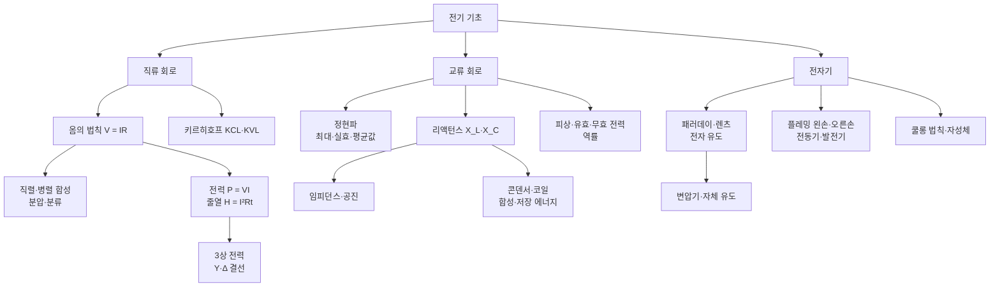

## 개념 정리

### 회로 기초

**직관**: 전기 회로는 물 배관과 닮았다. 전압은 물을 미는 **수압**, 전류는 1초에 흐르는 **물의 양**, 저항은 배관의 **좁은 정도**다. 수압이 크면 물이 많이 흐르고(전압에 비례), 배관이 좁으면 적게 흐른다(저항에 반비례). 이것을 식으로 쓴 것이 옴의 법칙이다.

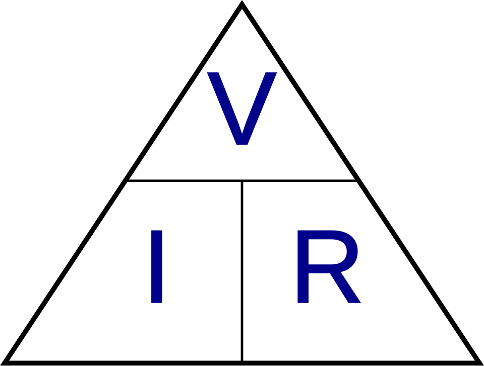

*구하려는 글자를 손가락으로 가리면 남은 두 글자의 관계가 식이 된다. V를 가리면 I × R(옆으로 나란히 = 곱), I를 가리면 V/R, R을 가리면 V/I(위아래 = 나누기).*

$$V = IR \qquad I = \frac{V}{R} \qquad R = \frac{V}{I}$$

| 키르히호프 전류 법칙 (KCL) | 키르히호프 전압 법칙 (KVL) |
| :-: | :-: |
|  | 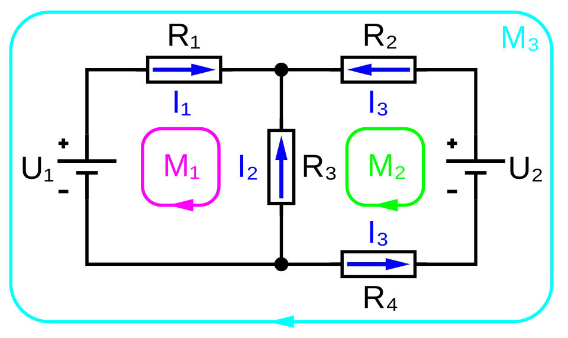 |
| 한 점(마디)에서 들어온 전류 $i_1 + i_2$ = 나간 전류 $i_3 + i_4$. 전하는 쌓이거나 사라지지 않는다 | 루프 M1·M2·M3 중 어느 것을 한 바퀴 돌아도 전원의 전압 상승 합 = 저항의 전압 강하 합. 산을 한 바퀴 돌아 제자리에 오면 높이 변화는 0이다 |

$$\sum I_{\text{들어옴}} = \sum I_{\text{나감}} \qquad \sum V_{\text{상승}} = \sum V_{\text{강하}}$$

| 직렬 연결 | 병렬 연결 |
| :-: | :-: |
| 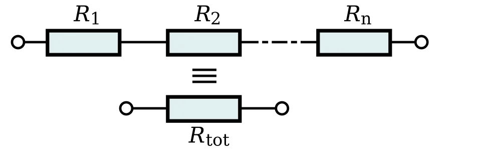 |  |
| 전류가 한 길로만 지나간다 → **전류가 같고**, 전압이 저항 비로 나뉜다 | 모든 저항이 같은 두 선에 걸린다 → **전압이 같고**, 전류가 저항에 반비례해 나뉜다 |
| $R_{tot} = R_1 + R_2 + \cdots + R_n$ | $\dfrac{1}{R_{tot}} = \dfrac{1}{R_1} + \dfrac{1}{R_2} + \cdots + \dfrac{1}{R_n}$ |

*직렬로 저항을 이으면 길이가 늘어난 것과 같아 합성저항이 커지고, 병렬로 이으면 단면적이 넓어진 것과 같아 합성저항이 가장 작은 저항보다도 작아진다.*

> [!tip] 감 잡기
> 같은 저항 n개는 직렬 $nR$, 병렬 $R/n$이라 그 비는 $n^2$이다. 4개면 $4R$ 대 $R/4$, 즉 16배.

| 법칙 | 내용 |
| --- | --- |
| 옴의 법칙 | $V = IR$ |
| 키르히호프 전류 법칙 (KCL) | 한 점에 들어오는 전류 합 = 나가는 전류 합 |
| 키르히호프 전압 법칙 (KVL) | 닫힌 회로의 전압 상승 합 = 전압 강하 합 |
| 분압 | $V_1 = V \dfrac{R_1}{R_1 + R_2}$ |
| 분류 | $I_1 = I \dfrac{R_2}{R_1 + R_2}$ |
| 줄의 법칙 | 열량 $H = I^2Rt$ [J] |
| 전하량 | $Q = It$ [C] (5 A로 2분 → 600 C) |
| 전력량 | $W = Pt$ [J = W·s], 에너지와 같은 단위 |
| 저항 | $R = \rho\dfrac{l}{A}$: 길이에 비례, 단면적에 반비례. 고유 저항은 은 < 구리 < 금 < 알루미늄 |
| 컨덕턴스 | $G = 1/R$, 단위 **지멘스[S]** |

- 직렬은 전류가 같고 전압이 저항 비로 나뉜다. 병렬은 전압이 같고 전류가 저항에 반비례해 나뉜다. 가정 배선은 병렬이라 부하를 늘릴수록 합성저항이 줄고 전체 전류가 커진다.
- 굵기·길이가 같은 두 금속선은 저항 비 = **비저항 비**. V–I 그래프 기울기의 역수($R = V/I$)로 비교한다 (교재 CH02 9-7).

> [!question] 시험에서는
> 분압은 **자기 저항**이 분자($V_1 = V\cdot R_1/(R_1+R_2)$), 분류는 **상대 저항**이 분자($I_1 = I\cdot R_2/(R_1+R_2)$)다. 분자를 바꿔 놓은 보기가 자주 나온다. 전압계는 병렬·전류계는 직렬로 다는 것도 같은 원리(병렬은 전압이 같고 직렬은 전류가 같다)에서 나온다.

**단위와 기본량 (교재 CH02 08절)**

| 양 | 단위 | 메모 |
| --- | --- | --- |
| 전류 | 암페어 [A] | 정의 방향은 + → − (실제 전자는 − → +) |
| 전하량 | 쿨롱 [C] | $Q = It$, 1 C = 1 A × 1 s |
| 전압 (기전력) | 볼트 [V] | 전위차, 전기의 압력 |
| 저항 | 옴 [Ω] | |
| 주파수 | 헤르츠 [Hz] | $f = \omega/2\pi$, $T = 1/f$ |
| 자속밀도 | 테슬라 [T] | |

- 전자 1개 전하량 $e = -1.6\times10^{-19}$ C → 1 C에는 전자 약 $6.25\times10^{18}$개.
- 극성을 단 회전체가 1초에 60바퀴 돌면 $f = 60$ Hz, $\omega = 2\pi \times 60 = 120\pi$ rad/s.

**금속의 저항 성질 (교재 CH02 11절)**

$$R = \rho\frac{l}{A} \qquad (\rho:\ \text{고유저항 [Ω·m]},\ l:\ \text{길이},\ A:\ \text{단면적})$$

| 금속 | 전도율 (순동 = 100 %) | 저항온도계수 (20 ℃) |
| --- | --- | --- |
| 은 | 약 109 % (가장 큼) | 0.0038 |
| 순동 | 100 % (고유저항 1.724 μΩ·cm) | 0.0040 |
| 경동 | 97 % | |
| 알루미늄 | 63.3 % | |
| 철 | | 0.0057 |
| 니켈 | | 0.0059 (가장 큼) |
| 니크롬 | 1.57 % | 0.00017 |
| 망가닌 | | 0.000015 (거의 0 → 표준 저항기) |
| 콘스탄탄 | | −0.000074 (음수) |

- 금속의 고유 성질 3가지: 고유저항, 전도율, 저항온도계수.
- 예: 단면적 2 cm², 길이 10 m 동선 → $R = 1.7\times10^{-8} \times \dfrac{10}{2\times10^{-4}} \approx 8.5\times10^{-4}\ \Omega$.

**저항 측정기 (교재 CH02 11절)**: 직류 저항계(계기 저항 + 전류 제한 저항 + 영점 조정 저항), 분류형 저항계(분류 전류 이용), **직류 전위차계**(전류를 흘리지 않고 전압·전류·전력 측정, 계기 보정용).

### 전력과 열 (교재 CH02 12·19절)

**직관**: 전력은 "1초 동안 하는 일", 전력량은 "그 일을 몇 시간 했는가"다. 같은 전구를 두 배 오래 켜면 전력은 그대로지만 전기요금(전력량)은 두 배가 된다. 저항에 전류가 흐를 때 그 일은 모두 열이 된다고 본 것이 줄의 법칙이다.

$$P = VI = I^2R = \frac{V^2}{R}\ [\text{W}] \qquad W = Pt \qquad H = I^2Rt\ [\text{J}]$$

- $P = VI$ [W], 전력량 $W = Pt$ [Wh 또는 J]. 예: 110 V, 5 A 모터 2시간 → 550 W × 2 h = **1.1 kWh**.
- 줄의 법칙 $H = I^2Rt$ [J]: 전기에너지가 모두 열로 바뀐다고 본 관계. **1 cal = 4.186 J** (약 4.2 J).
- 정격전압: 기기가 정상 동작하는 기준 전압. 우리나라 220 V, 보통 **±10 %** 범위에서 사용.
- 정격전력: 정격전압에서 소비하는 전력. 여기서 저항을 구해 두면 다른 전압에서의 전력을 계산할 수 있다. 예: 정격 600 W 저항에 90 % 전압 → $0.9^2 \times 600 = 486$ W.

> [!tip] 감 잡기
> 기기의 저항은 전압이 바뀌어도 그대로다. 그래서 정격보다 낮은 전압을 걸면 $P = V^2/R$에서 **전압비의 제곱**만큼 전력이 준다. 전압 절반 → 전력 1/4, 90 % → 81 %.

**계산 예**
- 5 A를 1분 → $Q = 5 \times 60 = 300$ C. 30 Ω에 2 A → $V = 60$ V.
- 100 V, 500 W 전열기 → $I = 5$ A, $R = V^2/P = 20\ \Omega$. 이것을 50 V에 쓰면 $P = 50^2/20 = 125$ W (1/4).
- 60 W 전구를 120 V에 → $I = 0.5$ A, $R = 240\ \Omega$. 100 V, 5 A를 2분 → 500 W × 120 s = 60,000 J.
- 같은 저항 3개: 직렬 $3R$, 병렬 $R/3$ → 비 9.
- 직렬 분압: 전체 100 V에 10 Ω, 30 Ω 직렬 → 30 Ω에 걸리는 전압 $100 \times 30/40 = 75$ V.

### 3상 전력과 Y·Δ 결선

**직관**: 3상은 위상이 120°씩 어긋난 교류 세 개를 함께 보내는 방식이다. 세 상의 코일(부하)을 한 점(중성점)에 모아 별 모양으로 이으면 **Y 결선**, 꼬리를 물어 삼각형으로 이으면 **Δ 결선**이다. 어느 쪽이든 "선과 선 사이"에서 재는 값(선간전압·선전류)과 "코일 하나"에 걸리는 값(상전압·상전류)이 다를 수 있고, 그 차이가 $\sqrt{3}$배다.

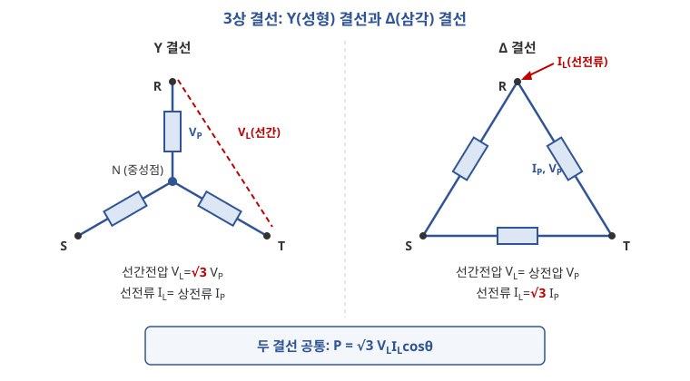

*왼쪽 Y 결선은 선간전압(빨간 점선, R–T 사이)이 코일 두 개에 걸쳐 있어 상전압의 $\sqrt{3}$배이고, 선전류는 코일 하나를 그대로 지나므로 상전류와 같다. 오른쪽 Δ 결선은 반대로 선간에 코일 하나가 바로 걸려 전압이 같고, 한 단자에 두 코일의 전류가 모여 선전류가 상전류의 $\sqrt{3}$배다.*

$$\text{Y 결선: } V_L = \sqrt{3}V_P,\ I_L = I_P \qquad \text{Δ 결선: } V_L = V_P,\ I_L = \sqrt{3}I_P$$

$$P = \sqrt{3}\,V_L I_L \cos\theta = 3\,V_P I_P\cos\theta\ [\text{W}]$$

| 구분 | Y(성형) 결선 | Δ(삼각) 결선 |
| --- | --- | --- |
| 전압 | $V_L = \sqrt{3}V_P$ | $V_L = V_P$ |
| 전류 | $I_L = I_P$ | $I_L = \sqrt{3}I_P$ |
| 중성점 | 있음 | 없음 |
| 3상 전력 | $\sqrt{3}V_L I_L\cos\theta$ | $\sqrt{3}V_L I_L\cos\theta$ |

> [!question] 시험에서는
> "Y는 전압, Δ는 전류에 $\sqrt{3}$"으로 묶어 외운다. 3상 전력 식은 결선과 관계없이 **선간 값**으로 쓰면 $\sqrt{3}$, **상 값**으로 쓰면 3이 붙는다.

### 교류 기초

**직관**: 직류는 한 방향으로 일정하게 미는 물줄기, 교류는 앞뒤로 출렁이는 파도다. 발전기 안에서 자석(또는 코일)이 한 바퀴 돌 때마다 전압이 + 최대 → 0 → − 최대 → 0으로 사인 곡선을 그린다. 크기가 계속 바뀌므로 "얼마짜리 교류"라고 말할 때는 같은 열을 내는 직류값, 즉 **실효값**을 쓴다.

*가로축은 한 주기 0~360°, 세로축 최대값이 $a$다. 점선 높이 $0.707a$가 실효값 $V_{RMS}$, 90°에서의 높이가 최대값 $V_{PK}$, 위 꼭대기에서 아래 바닥까지가 피크-피크값 $V_{PP} = 2a$다. 평균값($0.637a$)은 반 주기만 평균한 값이라 그림에는 없지만 실효값보다 조금 낮다.*

$$V = \frac{V_m}{\sqrt{2}} \approx 0.707V_m \qquad V_{av} = \frac{2V_m}{\pi} \approx 0.637V_m \qquad \omega = 2\pi f,\ T = \frac{1}{f}$$

- 직류는 극성이 일정(전지, 정류기), 교류는 방향과 크기가 주기적으로 바뀐다(발전기의 자석 회전). 220 V는 실효값이고 최대값은 약 311 V.
- 역률 $\cos\theta$ = 유효 전력 / 피상 전력. 유도성 부하가 많으면 역률이 낮다 → **진상 콘덴서**로 개선. 예: 피상 80 kVA, 유효 60 kW → 역률 0.75.
- **피상 전력** $P_a = VI$ [VA]: 전원 용량으로 표시하는 전력. **유효 전력** $P = VI\cos\theta$ [W]: 실제로 일하는 전력. **무효 전력** $P_r = VI\sin\theta$ [var]: 자계·전계만 만들고 일은 하지 않는 전력. 셋은 직각삼각형 관계로 $P_a^2 = P^2 + P_r^2$.

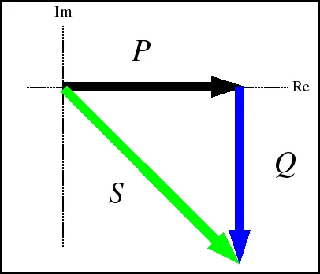

*가로(검정) 화살표가 실제로 일하는 유효 전력 $P$, 세로(파랑)가 무효 전력 $Q$(본문의 $P_r$), 두 화살표를 이은 빗변(초록)이 피상 전력 $S$(본문의 $P_a$)다. $S$와 $P$ 사이 각이 $\theta$이고 $\cos\theta = P/S$가 역률이다. 진상 콘덴서는 세로 성분 $Q$를 줄여 빗변을 가로에 가깝게 눕힌다.*

$$P_a = \sqrt{P^2 + P_r^2} \qquad \cos\theta = \frac{P}{P_a}$$

> [!tip] 감 잡기
> 맥주잔에 비유하면 피상 전력은 잔 전체, 유효 전력은 마실 수 있는 맥주, 무효 전력은 거품이다. 거품(무효 전력)이 많을수록 잔 크기(전원 용량) 대비 맥주(일)가 적다 = 역률이 낮다.

**정현파 읽기**: $v = V_m\sin(\omega t + \theta)$

| 값 | 식 | 예: $v = 200\sin(314t)$ |
| --- | --- | --- |
| 최대값 | $V_m$ | 200 V |
| 실효값 | $V_m/\sqrt{2} \approx 0.707V_m$ | 약 141 V |
| 평균값 | $2V_m/\pi \approx 0.637V_m$ | 약 127 V |
| 각속도 | $\omega = 2\pi f$ | 314 rad/s |
| 주파수 | $f = \omega/2\pi$ | 50 Hz |
| 주기 | $T = 1/f$ | 0.02 s |

- 60 Hz의 각속도는 $2\pi \times 60 \approx 377$ rad/s, 50 Hz는 약 314 rad/s.
- 파형 그림에서 주파수: 한 주기 시간을 읽어 $f = 1/T$.

**리액턴스와 임피던스**

**직관**: 코일은 전류의 변화를 싫어하고(관성), 콘덴서는 직류를 막지만 빨리 출렁이는 교류는 잘 통과시킨다. 그래서 주파수가 올라가면 코일의 방해($X_L$)는 커지고 콘덴서의 방해($X_C$)는 작아진다. 둘이 같아지는 주파수에서 서로 상쇄되는 것이 **공진**이다.

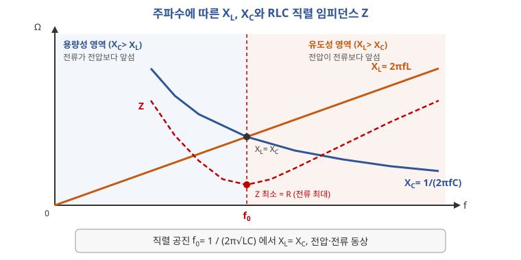

*주황 직선 $X_L = 2\pi fL$은 주파수에 비례해 커지고, 파란 곡선 $X_C = 1/(2\pi fC)$는 반비례해 작아진다. 두 선이 만나는 $f_0$에서 리액턴스가 상쇄되어 RLC 직렬 임피던스(빨간 점선)가 $R$까지 내려가고 전류가 최대가 된다. $f_0$보다 왼쪽은 용량성, 오른쪽은 유도성이다.*

$$X_L = 2\pi fL \qquad X_C = \frac{1}{2\pi fC} \qquad f_0 = \frac{1}{2\pi\sqrt{LC}}$$

| 회로 | 임피던스 |
| --- | --- |
| RL 직렬 | $Z = \sqrt{R^2 + X_L^2}$ |
| RC 직렬 | $Z = \sqrt{R^2 + X_C^2}$ |
| RL 병렬 | $Z = \dfrac{RX_L}{\sqrt{R^2 + X_L^2}}$ |
| RLC 직렬 | $Z = \sqrt{R^2 + (X_L - X_C)^2}$ |
| RLC 직렬 공진 | $X_L = X_C$, $f_0 = \dfrac{1}{2\pi\sqrt{LC}}$, 이때 $Z = R$ |

- 공진 주파수보다 **높으면** $X_L$이 커져 유도성(전압이 전류보다 앞섬), **낮으면** $X_C$가 커져 용량성.
- 역수 개념: 어드미턴스 $Y = 1/Z$, 컨덕턴스 $G = 1/R$, 서셉턴스 $B = 1/X$. 단위는 모두 **지멘스[S]**.
- 인덕턴스 1 H: 전류가 1 A/s로 변할 때 1 V를 만드는 크기. 코일은 전류 변화를 막고(전류 관성), 콘덴서는 전하를 모아 전기장 에너지로 저장하며 직류는 충전 뒤 끊긴다.
- 예: 100 V, $X_C = 5\ \Omega$ → $I = 20$ A. $L = 30$ mH, 50 Hz → $X_L \approx 9.4\ \Omega$. $L = 50$ mH, 60 Hz → $X_L \approx 18.8\ \Omega$.

> [!question] 시험에서는
> "주파수를 높이면 $X_C$가 커진다"처럼 방향을 뒤집은 보기가 단골이다. 직렬 공진(임피던스 최소·전류 최대)과 병렬 공진(임피던스 최대)을 바꿔 놓은 보기도 자주 나온다. 공진 때 전압과 전류는 **동상**이다.

### 콘덴서와 코일

**직관**: 콘덴서는 마주 보는 두 금속판 사이에 전하를 모아 두는 **전기 물탱크**다. 판이 넓을수록, 가까울수록, 사이에 든 물질(유전체)이 전기를 잘 품을수록 많이 담긴다. 코일은 전류가 만든 자기장에 에너지를 담는 **전기 플라이휠**이라, 감은 수가 늘면 그 효과가 제곱으로 커진다.

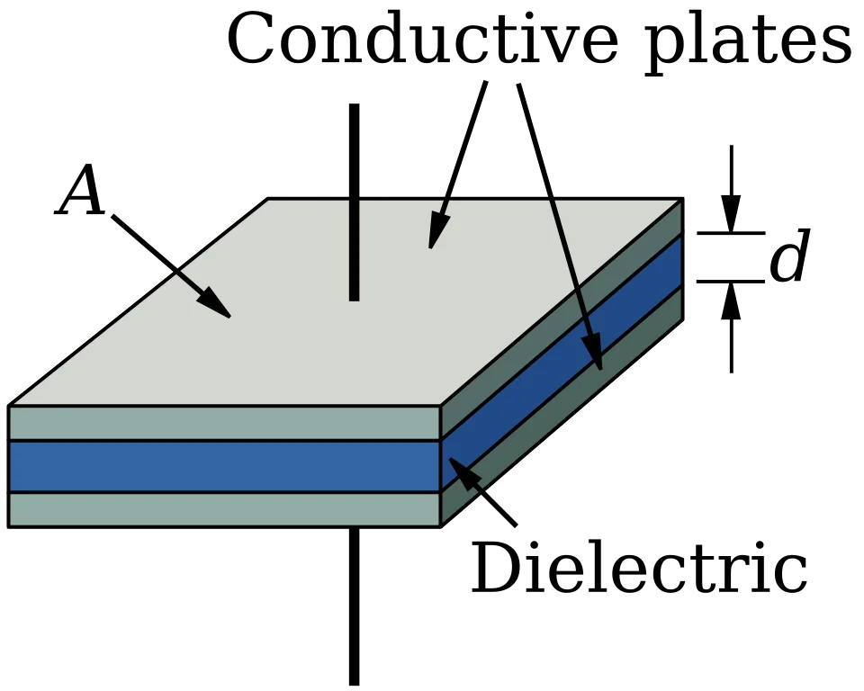

*두 극판의 면적 $A$와 간격 $d$, 그 사이 유전체의 유전율 $\varepsilon$이 용량을 정한다. 극판 금속이 구리든 알루미늄이든 식에 들어가지 않는다는 점이 시험 함정이다.*

$$C = \frac{Q}{V} = \varepsilon\frac{A}{d} \qquad W_C = \frac{1}{2}CV^2 \qquad L \propto \frac{\mu N^2 S}{l} \qquad W_L = \frac{1}{2}LI^2$$

- 정전용량 $C = \dfrac{Q}{V}$ [F]: 1 V당 저장하는 전하량. $C = \varepsilon\dfrac{A}{d}$: 극판 **면적을 크게**, 간격을 **작게**, 유전율을 **크게** 하면 커진다.
- 합성은 저항과 반대: 직렬 $\dfrac{1}{C} = \dfrac{1}{C_1} + \dfrac{1}{C_2} + \cdots$, 병렬 $C = C_1 + C_2 + \cdots$. 예: 1 μF 5개 직렬 → 0.2 μF, 같은 C 3개 직렬 → C/3.
- 콘덴서 직렬은 각 콘덴서의 **전하량이 같고**, 병렬은 **전압이 같아** 용량별로 전하량이 다르다.
- 저장 에너지: 콘덴서 $W = \dfrac{1}{2}CV^2$, 코일 $W = \dfrac{1}{2}LI^2$ (전류 2배 → 4배, 4배 → **16배**).
- 코일: $L \propto \dfrac{\mu N^2 S}{l}$. 직렬 $L_1 + L_2$, 병렬 $\dfrac{L_1L_2}{L_1 + L_2}$ (상호 유도 없을 때).
- 콘덴서 응용: 평활, 결합(직류 차단), 바이패스, 필터, 스파크(아크) 소거, 발진. 교류를 직류로 바꾸는 **정류 자체는 다이오드**의 일. 콘덴서 종류는 [전자 소자와 전원 회로](전자_소자와_전원_회로.md).

### 콘덴서·코일·저항 합성 비교

| 소자 | 직렬 | 병렬 | 저장 에너지 |
| --- | --- | --- | --- |
| 저항 R | 합 | 역수의 합 | (열로 소비) |
| 코일 L | 합 | 역수의 합 | $\frac{1}{2}LI^2$ |
| 콘덴서 C | 역수의 합 | 합 | $\frac{1}{2}CV^2$ |

### 전자기

**직관**: 전기와 자기는 한 쌍이다. 전류가 흐르면 주변에 자기장이 생기고(전류의 자기 작용), 거꾸로 코일을 지나는 자기장이 **변하면** 코일에 전압이 생긴다(전자 유도). 자기장 속 전선에 전류를 흘리면 힘을 받아 움직이고(전동기), 자기장 속에서 전선을 움직이면 전압이 생긴다(발전기). 이 단원의 법칙들은 모두 이 네 가지 장면 중 하나를 설명한다.

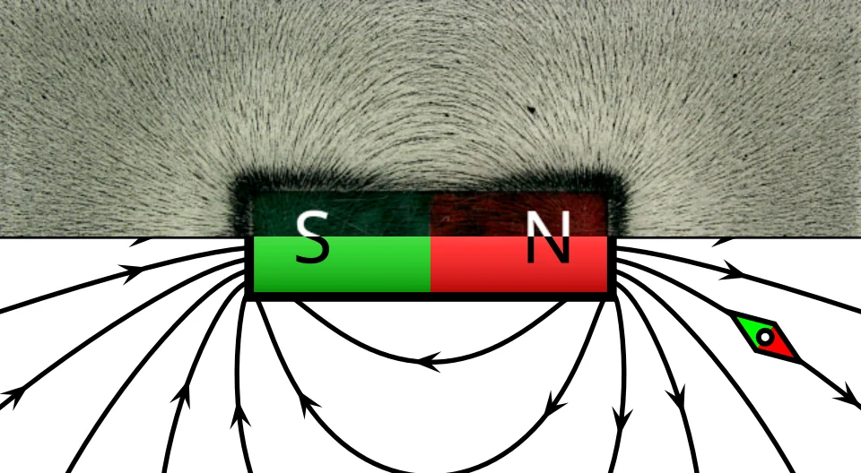

*위쪽은 실제 쇳가루가 늘어선 사진, 아래쪽은 같은 모양을 화살표 선으로 그린 자기력선이다. 선은 자석 밖에서 N극에서 나와 S극으로 들어가고, 극 근처처럼 촘촘한 곳일수록 자속밀도가 크다. 오른쪽 아래 나침반 바늘도 선 방향을 따라 선다.*

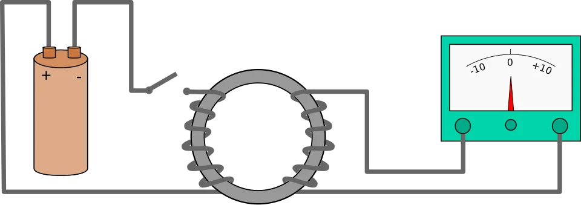

*철 고리 왼쪽 코일은 전지·스위치에, 오른쪽 코일은 검류계에 이어져 있고 두 코일은 전선으로 연결되어 있지 않다. 스위치를 **닫는 순간과 여는 순간**에만 검류계 바늘이 흔들리고, 전류가 일정하게 흐르는 동안은 0에 머문다. 기전력을 만드는 것은 자속 자체가 아니라 **자속의 변화**이며, 닫을 때와 열 때 바늘 방향이 반대인 것이 렌츠 법칙(변화를 방해하는 방향)이다. 이 구조가 그대로 변압기다.*

$$e = -N\frac{d\Phi}{dt} \qquad F = BIl\sin\theta \qquad F = k\frac{Q_1Q_2}{r^2}$$

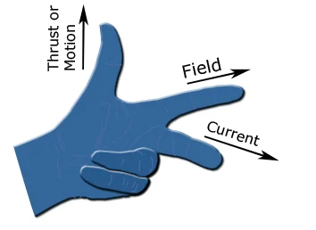

*왼손 세 손가락을 서로 직각으로 펴면 검지(Field)가 자계 방향, 중지(Current)가 전류 방향, 엄지(Thrust or Motion)가 도체가 받는 힘의 방향이다. 전동기의 회전 방향을 정할 때 쓴다. 같은 손가락 배치를 오른손으로 하면 발전기(엄지 = 운동, 중지 = 기전력)가 된다.*

| 법칙·현상 | 내용 |
| --- | --- |
| 전자 유도 (패러데이) | 코일을 지나는 자속이 변하면 기전력 발생. $e = -N\dfrac{d\Phi}{dt}$ → 권수·변화 속도(주파수)에 비례 |
| 렌츠 법칙 | 유도 기전력의 **방향**은 자속 변화를 방해하는 쪽 |
| 플레밍 왼손 법칙 | 전동기: 자계(검지)·전류(중지) → 힘(엄지) |
| 플레밍 오른손 법칙 | 발전기: 자계·운동 → 기전력 |
| 전자력 | 자계 속 도체에 전류가 흐를 때 받는 힘 $F = BIl\sin\theta$ |
| 쿨롱 법칙 | $F = k\dfrac{Q_1Q_2}{r^2}$, 매질(유전율)에 따라 달라짐, 같은 극은 반발 |
| 변압기 | **전자 유도 작용** 이용. $V_1/V_2 = N_1/N_2$ |
| 자기력선 | 자력이 미치는 모양을 나타낸 가상의 선, N → S |
| B-H 곡선 | 자화력 H와 자속밀도 B의 관계(히스테리시스) |

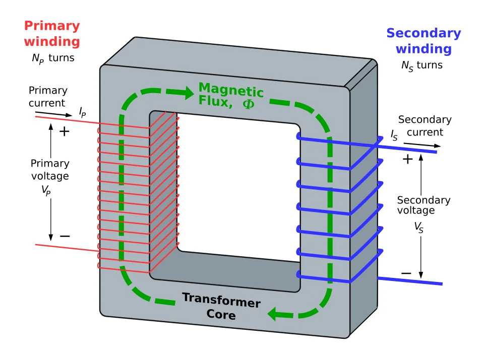

*1차 코일(빨강, 권수 $N_P$)의 교류가 철심 속에 변하는 자속 $\Phi$(초록 점선)를 만들고, 같은 자속이 2차 코일(파랑, 권수 $N_S$)을 지나며 전자 유도로 전압 $V_S$를 만든다. 두 코일은 전기적으로 이어져 있지 않다. 그림처럼 1차 권수가 많으면 2차 전압이 낮아지는 강압 변압기다.*

$$\frac{V_1}{V_2} = \frac{N_1}{N_2} = \frac{I_2}{I_1}$$

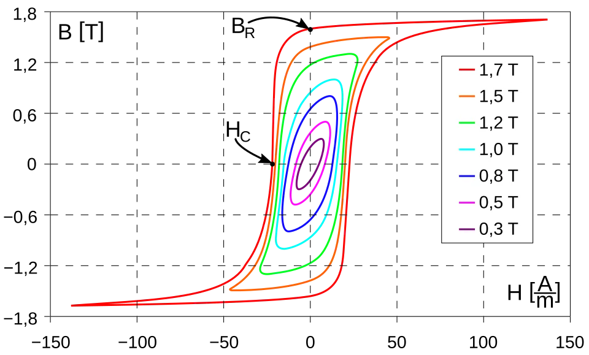

*자화력 $H$를 늘렸다 줄였다 하면 자속밀도 $B$가 같은 길로 돌아오지 않고 고리를 그린다(색마다 최대 $B$가 다른 고리, 숫자의 쉼표는 소수점). $H = 0$이 되어도 남는 $B$가 잔류 자기 $B_R$, $B$를 0으로 만드는 데 필요한 $H$가 보자력 $H_C$다. 고리 넓이만큼이 한 주기 동안 열로 잃는 히스테리시스 손실이다.*

- 정현파 자속의 주파수를 2배로 하면 유기 기전력도 **2배**.
- **자체 유도** (교재 CH02 20절): 코일의 전류가 변하면 그 변화를 방해하는 기전력이 코일 자신에게 생긴다 → 코일이 달린 램프가 천천히 켜지고 꺼진다. $L = \dfrac{N\Phi}{I}$ [H], $e = -L\dfrac{dI}{dt}$. 예: 30회, 0.4 A, $2\times10^{-3}$ Wb → $L = 0.15$ H.
- **유도 전기장**은 자기장이 **변할 때** 생긴다. 직류 전류가 만드는 장은 극성이 변하지 않는다.
- **홀(정공)**: 전자가 빠진 자리, 양전하처럼 행동. 홀 전류는 전자 이동과 **반대 방향**의 (+) 전하 이동.
- 자성체: 강자성체(철·니켈·코발트, 자석에 강하게 끌림, 자화 뒤에도 자성이 남기 쉬움), 상자성체(약하게 같은 방향), **반자성체**(자석과 반대 방향으로 자화, 구리·비스무트). 상자성·반자성은 외부 자계가 있는 동안에만 자화된다.
  - 자석의 N극을 가까이 댔을 때 가까운 쪽에 **N극**이 생기면(밀어냄) **반자성체** (교재 CH02 20-5, 그림 문제. 교재 해설의 극성 서술이 헷갈리게 적혀 있음).

> [!question] 시험에서는
> 패러데이는 기전력의 **크기**(자속 변화율에 비례), 렌츠는 **방향**(변화를 방해)이다. 둘을 바꾼 보기가 많다. 왼손은 **전동기**(힘), 오른손은 **발전기**(기전력)로 짝짓고, 쿨롱 법칙은 **거리의 제곱**에 반비례한다.

## 그림

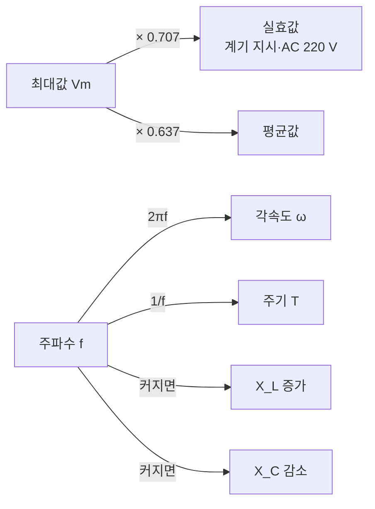

## 기출 포인트

출처: 생산자동화산업기사 2016–2020년 필기 14회분 (cbtbank.kr). 옛 4과목 메카트로닉스에서 매회 4~6문항(반도체 포함).

- 직류 회로·전력 (옴의 법칙, 전력·저항 계산, 정격보다 낮은 전압의 소비 전력, 직렬/병렬 합성비, 분압, 고유 저항, 전하량, 컨덕턴스 단위, 키르히호프, 전류 방향) — 19회 (2016-1, 2016-2, 2016-3, 2017-1, 2017-3 ×3, 2018-1 ×2, 2018-3 ×2, 2019-1 ×2, 2019-2, 2019-3 ×2, 2020-1·2 ×2, 2020-3)
- 교류 (실효·평균·최대값, 주파수·각속도, 리액턴스 계산과 주파수 관계, RLC 공진, RL 병렬 임피던스, 정전용량, 콘덴서 응용, 코일 에너지) — 18회 (2016-1 ×2, 2016-2, 2016-3 ×2, 2017-2 ×3, 2018-2, 2018-3, 2019-1 ×2, 2019-2, 2019-3, 2020-1·2 ×2, 2020-3 ×2)
- 전자기 (전자 유도, 패러데이, 렌츠, 플레밍 왼손, $F = BIl\sin\theta$, 쿨롱, 변압기 원리, 자성체, 자기력선, B-H 곡선) — 15회 (2016-1, 2016-2, 2016-3, 2017-1 ×3, 2017-2, 2017-3, 2018-1, 2018-2, 2019-1, 2019-2 ×2, 2019-3, 2020-3)

**교재 예제 유형** (Win-Q 2025 PART 01 CHAPTER 02, 08~20절): 기전력의 뜻, SI 단위 짝짓기, 전류 방향, 전하량 계산(5 A × 1분), 전자 1개 전하량, 주파수 식, 전압 단위, 반지름 2배일 때 저항, 초전도, 옴의 법칙 계산, 합성저항(그림, 답 5/2 Ω), V–I 그래프로 비저항 비(그림, 답 1:3), 직·병렬 설명 중 틀린 것(병렬 전압은 같음), 콘덴서 직렬 합성(1 μF × 5 → 0.2 μF), 키르히호프 제1법칙, 쿨롱 법칙의 거리 제곱, 동선 저항 계산($8.5\times10^{-4}$ Ω), 비저항이 가장 작은 금속(은), 전력량(1.1 kWh), 줄의 법칙, 패러데이 법칙, 고유저항 단위(Ω·m), 파형의 주파수(그림, 2 Hz), 같은 발열의 교류값(실효값), 실효값 100 V의 최대값, $\omega = 377$의 주기, 같은 저항 4개 직렬/병렬 비(16), RLC·RL 병렬 임피던스 식, $X_C$로 전류, $X_L$ 계산, 공진 주파수, 컨덕턴스 단위, 리액턴스와 주파수, 콘덴서 용량 결정 요소, C 3개 직렬(C/3), 코일 합성(그림, 2.2 H), 권수 10배 → 인덕턴스 100배, 전등의 저항·전력(240 Ω, 60 W), 일(60,000 J), 역률(0.75), 90 % 전압의 전력(486 W), 홀 전류, 유도 전기장, 유도 기전력은 자속 변화에 비례, 직류의 전기장, 반자성체(그림), 전류 4배 → 에너지 16배, 자체 인덕턴스(0.15 H).

## 관련 단원

- [전자 소자와 전원 회로](전자_소자와_전원_회로.md)
- [전기전자장치 조립과 검사](전기전자장치_조립과_검사.md)
- [유도전동기와 인버터](유도전동기와_인버터.md)
- [센서 회로와 신호처리](센서_회로와_신호처리.md)

## 체크리스트

- [ ] 직렬·병렬 합성 저항과 합성 정전 용량을 계산한다
- [ ] 3상 전력과 Y·Δ의 선간·상 관계를 안다
- [ ] 정격보다 낮은 전압에서 소비 전력을 $V^2$ 비례로 계산한다
- [ ] 금속별 전도율·저항온도계수의 순서(은 > 구리, 망가닌 ≈ 0)를 안다
- [ ] 피상·유효·무효 전력을 구분한다
- [ ] $v = V_m\sin\omega t$에서 실효값·평균값·주파수·주기를 읽는다
- [ ] $X_L$, $X_C$를 계산하고 주파수에 따른 증감을 안다
- [ ] 직렬·병렬 공진의 임피던스·전류·위상을 구분한다
- [ ] 코일 인덕턴스의 권수 관계와 저장 에너지를 계산한다
- [ ] 패러데이·렌츠·플레밍·쿨롱 법칙의 내용과 함정을 안다

## 참고

- [큐넷 자동화설비산업기사 출제기준](https://www.q-net.or.kr/crf005.do?id=crf00503&jmCd=2034)

### 그림 출처

위키미디어 공용(Wikimedia Commons)과 Openverse에서 가져온 공개 라이선스 자료이고, 노트에 맞게 크기를 줄이고 WebP로 변환했다.

| 그림 | 작성자 | 라이선스 | 출처 |
| --- | --- | --- | --- |
| [Ohm's law triangle](https://commons.wikimedia.org/wiki/File:Ohm%27s_law_triangle.svg) |  | 퍼블릭 도메인 | Wikimedia Commons |
| [Kirchhoff's Current Law](https://commons.wikimedia.org/wiki/File:Kirchhoff%27s_Current_Law.svg) | inductiveload | 퍼블릭 도메인 | Wikimedia Commons |
| [Kirchhoff-example-circuit-loops](https://commons.wikimedia.org/wiki/File:Kirchhoff-example-circuit-loops.svg) | MikeRun | [CC BY-SA 4.0](https://creativecommons.org/licenses/by-sa/4.0) | Wikimedia Commons |
| [Resistors in Series](https://commons.wikimedia.org/wiki/File:Resistors_in_Series.svg) | Inductiveload | 퍼블릭 도메인 | Wikimedia Commons |
| [Resistors in Parallel](https://commons.wikimedia.org/wiki/File:Resistors_in_Parallel.svg) | Inductiveload | 퍼블릭 도메인 | Wikimedia Commons |
| [Sine wave voltages](https://commons.wikimedia.org/wiki/File:Sine_wave_voltages.svg) | AlanM1 | CC0 | Wikimedia Commons |
| [PowerTriangle](https://commons.wikimedia.org/wiki/File:PowerTriangle.png) | Wtshymanski at English Wikipedia | 퍼블릭 도메인 | Wikimedia Commons |
| [Parallel plate capacitor](https://commons.wikimedia.org/wiki/File:Parallel_plate_capacitor.svg) | inductiveload | 퍼블릭 도메인 | Wikimedia Commons |
| [Bar-magnet-field-and-iron-filings](https://commons.wikimedia.org/wiki/File:Bar-magnet-field-and-iron-filings.svg) | File:VFPt cylindrical magnet thumb.svg: Geek3 derivative work: MikeRun | [CC BY-SA 3.0](https://creativecommons.org/licenses/by-sa/3.0) | Wikimedia Commons |
| [Faraday emf experiment](https://commons.wikimedia.org/wiki/File:Faraday_emf_experiment.svg) | Eviatar Bach | CC0 | Wikimedia Commons |
| [LeftHandOutline](https://commons.wikimedia.org/wiki/File:LeftHandOutline.png) | Douglas Morrison DougM | [CC BY-SA 3.0](http://creativecommons.org/licenses/by-sa/3.0/) | Wikimedia Commons |
| [Transformer3d col3](https://commons.wikimedia.org/wiki/File:Transformer3d_col3.svg) | BillC at English Wikipedia | [CC BY-SA 3.0](http://creativecommons.org/licenses/by-sa/3.0/) | Wikimedia Commons |
| [B-H loop](https://commons.wikimedia.org/wiki/File:B-H_loop.svg) | Original:  ZureksDerivative work:  Sautoir | [CC BY-SA 3.0](http://creativecommons.org/licenses/by-sa/3.0/) | Wikimedia Commons |

직접 그린 그림(SVG, 이 볼트용으로 새로 작성): Y 델타 결선, 리액턴스 공진.

