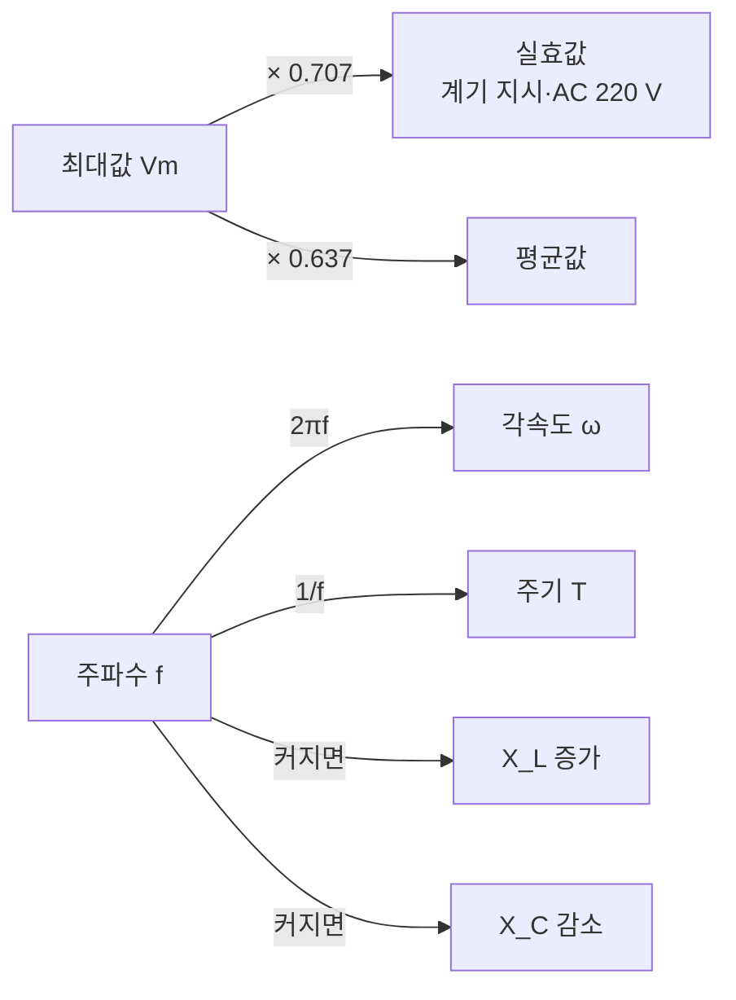

# 전기 기초와 회로

> [!summary] 핵심 요약
> - 옴의 법칙 $V = IR$, 전력 $P = VI = I^2R = \dfrac{V^2}{R}$.
> - 3상 전력 $P = \sqrt{3}\,V_L I_L \cos\theta$. Y결선은 $V_L = \sqrt{3}V_P$, Δ결선은 $I_L = \sqrt{3}I_P$.
> - 교류: 실효값 = 최대값 × 0.707, 평균값 = 최대값 × 0.637, $\omega = 2\pi f$. $X_L = 2\pi fL$, $X_C = \dfrac{1}{2\pi fC}$.
> - 전자 유도: 자속이 변하면 기전력(패러데이), 방향은 변화를 방해하는 쪽(렌츠).

> [!warning] 자주 틀리는 포인트
> - 저항 직렬은 합 $R_1 + R_2$, 병렬은 $\dfrac{R_1R_2}{R_1 + R_2}$. 콘덴서는 **반대**(병렬이 합).
> - 전압계는 **병렬**, 전류계는 **직렬**. 배율기는 전압계에 직렬, 분류기는 전류계에 병렬.
> - 같은 저항 n개: 직렬 $nR$, 병렬 $R/n$ → **직렬/병렬 비 = $n^2$** (4개면 16). 병렬 합성은 "더하기"가 아니다.
> - 정격 전압보다 낮게 쓰면 저항은 그대로이므로 **전력은 전압의 제곱에 비례**한다 ($P = V^2/R$). 전압이 절반이면 전력은 1/4.
> - 전류의 방향은 **전자 이동 방향과 반대**. 전류는 저항에 **반비례**, 전압에 비례.
> - **기전력은 전압의 다른 이름**이다 ("전류의 다른 이름"은 틀림). 전류가 흐르기 어렵게 하는 작용은 **저항**이다.
> - 교재(CH02 08절)에는 "1초당 흐르는 전기의 양을 전기량이라 하며 쿨롱을 쓴다"는 문장이 있다. 일반 정의로는 **쿨롱[C] = 전하량**, **1초당 흐르는 전하량 = 전류[A]** 이므로 둘을 섞지 않는다.
> - 도선 **반지름을 2배**로 하면 단면적이 4배 → 저항은 **1/4**.
> - 금속을 가열해도 저항은 0이 되지 않는다 (오히려 커짐). 저항이 0에 가까워지는 것은 **극저온의 초전도체**.
> - 병렬회로에서는 저항값과 관계없이 **모든 저항의 단자전압이 같다**. "병렬에서 전압이 저항에 반비례"는 틀림 (반비례하는 것은 전류).
> - 고유저항(비저항) 단위는 **Ω·m** ("Ω/m"는 틀림). 비저항이 가장 작은(전도율이 가장 큰) 금속은 **은**, 그다음 구리.
> - 직류 전위차계는 측정 대상에 **전류를 흘리지 않고** 잰다 → 다른 계기 보정에도 쓴다.
> - 교류가 직류와 같은 열을 낼 때의 값 = **실효값** (평균값 아님).
> - $\omega = 377$ rad/s이면 $f = 60$ Hz, 주기는 **1/60 s** ("1/377 s"는 틀림).
> - 교재(CH02 14절)는 "미국은 50 Hz"라고 적었지만 **미국은 60 Hz**다(50 Hz는 유럽·중국 등). 국가별 주파수를 묻는 보기가 나오면 주의.
> - 교류 전압계 지시값과 AC 220 V 같은 표기는 **실효값**. DC 24 V 같은 직류 전원 표기는 직류분, 즉 **평균값**으로 본다(맥동 없는 직류는 평균값 = 실효값).
> - **주파수가 높을수록 $X_L$은 커지고 $X_C$는 작아진다**. 반대로 외우면 틀린다.
> - **공진 시 전압과 전류는 동상**이다. 직렬 공진은 임피던스 최소·전류 최대, 병렬 공진은 임피던스 최대.
> - 콘덴서 용량을 결정하는 것은 유전율·극판 면적·극판 간격이다. **극판 금속의 종류는 관계없다**.
> - 코일 인덕턴스는 **권수의 제곱**에 비례 → 권수 10배면 100배. 코일 합성은 저항과 같은 방식(직렬은 합).
> - 패러데이 법칙: 유도 기전력은 **자속 변화율(단위 시간당 쇄교 자속 변화)에 비례**한다. 렌츠 법칙: 그 **방향**은 자속 변화를 방해하는 쪽.
> - 쿨롱의 법칙: 힘은 전하량의 곱에 비례, **거리의 제곱에 반비례**("거리에 반비례"는 틀림).

## 개념 정리

### 회로 기초

| 법칙 | 내용 |
| --- | --- |
| 옴의 법칙 | $V = IR$ |
| 키르히호프 전류 법칙 (KCL) | 한 점에 들어오는 전류 합 = 나가는 전류 합 |
| 키르히호프 전압 법칙 (KVL) | 닫힌 회로의 전압 상승 합 = 전압 강하 합 |
| 분압 | $V_1 = V \dfrac{R_1}{R_1 + R_2}$ |
| 분류 | $I_1 = I \dfrac{R_2}{R_1 + R_2}$ |
| 줄의 법칙 | 열량 $H = I^2Rt$ [J] |
| 전하량 | $Q = It$ [C] (5 A로 2분 → 600 C) |
| 전력량 | $W = Pt$ [J = W·s], 에너지와 같은 단위 |
| 저항 | $R = \rho\dfrac{l}{A}$: 길이에 비례, 단면적에 반비례. 고유 저항은 은 < 구리 < 금 < 알루미늄 |
| 컨덕턴스 | $G = 1/R$, 단위 **지멘스[S]** |

- 직렬은 전류가 같고 전압이 저항 비로 나뉜다. 병렬은 전압이 같고 전류가 저항에 반비례해 나뉜다. 가정 배선은 병렬이라 부하를 늘릴수록 합성저항이 줄고 전체 전류가 커진다.
- 굵기·길이가 같은 두 금속선은 저항 비 = **비저항 비**. V–I 그래프 기울기의 역수($R = V/I$)로 비교한다 (교재 CH02 9-7).

**단위와 기본량 (교재 CH02 08절)**

| 양 | 단위 | 메모 |
| --- | --- | --- |
| 전류 | 암페어 [A] | 정의 방향은 + → − (실제 전자는 − → +) |
| 전하량 | 쿨롱 [C] | $Q = It$, 1 C = 1 A × 1 s |
| 전압 (기전력) | 볼트 [V] | 전위차, 전기의 압력 |
| 저항 | 옴 [Ω] | |
| 주파수 | 헤르츠 [Hz] | $f = \omega/2\pi$, $T = 1/f$ |
| 자속밀도 | 테슬라 [T] | |

- 전자 1개 전하량 $e = -1.6\times10^{-19}$ C → 1 C에는 전자 약 $6.25\times10^{18}$개.
- 극성을 단 회전체가 1초에 60바퀴 돌면 $f = 60$ Hz, $\omega = 2\pi \times 60 = 120\pi$ rad/s.

**금속의 저항 성질 (교재 CH02 11절)**

| 금속 | 전도율 (순동 = 100 %) | 저항온도계수 (20 ℃) |
| --- | --- | --- |
| 은 | 약 109 % (가장 큼) | 0.0038 |
| 순동 | 100 % (고유저항 1.724 μΩ·cm) | 0.0040 |
| 경동 | 97 % | |
| 알루미늄 | 63.3 % | |
| 철 | | 0.0057 |
| 니켈 | | 0.0059 (가장 큼) |
| 니크롬 | 1.57 % | 0.00017 |
| 망가닌 | | 0.000015 (거의 0 → 표준 저항기) |
| 콘스탄탄 | | −0.000074 (음수) |

- 금속의 고유 성질 3가지: 고유저항, 전도율, 저항온도계수.
- 예: 단면적 2 cm², 길이 10 m 동선 → $R = 1.7\times10^{-8} \times \dfrac{10}{2\times10^{-4}} \approx 8.5\times10^{-4}\ \Omega$.

**저항 측정기 (교재 CH02 11절)**: 직류 저항계(계기 저항 + 전류 제한 저항 + 영점 조정 저항), 분류형 저항계(분류 전류 이용), **직류 전위차계**(전류를 흘리지 않고 전압·전류·전력 측정, 계기 보정용).

### 전력과 열 (교재 CH02 12·19절)

- $P = VI$ [W], 전력량 $W = Pt$ [Wh 또는 J]. 예: 110 V, 5 A 모터 2시간 → 550 W × 2 h = **1.1 kWh**.
- 줄의 법칙 $H = I^2Rt$ [J]: 전기에너지가 모두 열로 바뀐다고 본 관계. **1 cal = 4.186 J** (약 4.2 J).
- 정격전압: 기기가 정상 동작하는 기준 전압. 우리나라 220 V, 보통 **±10 %** 범위에서 사용.
- 정격전력: 정격전압에서 소비하는 전력. 여기서 저항을 구해 두면 다른 전압에서의 전력을 계산할 수 있다. 예: 정격 600 W 저항에 90 % 전압 → $0.9^2 \times 600 = 486$ W.

**계산 예**
- 5 A를 1분 → $Q = 5 \times 60 = 300$ C. 30 Ω에 2 A → $V = 60$ V.
- 100 V, 500 W 전열기 → $I = 5$ A, $R = V^2/P = 20\ \Omega$. 이것을 50 V에 쓰면 $P = 50^2/20 = 125$ W (1/4).
- 60 W 전구를 120 V에 → $I = 0.5$ A, $R = 240\ \Omega$. 100 V, 5 A를 2분 → 500 W × 120 s = 60,000 J.
- 같은 저항 3개: 직렬 $3R$, 병렬 $R/3$ → 비 9.
- 직렬 분압: 전체 100 V에 10 Ω, 30 Ω 직렬 → 30 Ω에 걸리는 전압 $100 \times 30/40 = 75$ V.

### 교류 기초

- 직류는 극성이 일정(전지, 정류기), 교류는 방향과 크기가 주기적으로 바뀐다(발전기의 자석 회전). 220 V는 실효값이고 최대값은 약 311 V.
- 역률 $\cos\theta$ = 유효 전력 / 피상 전력. 유도성 부하가 많으면 역률이 낮다 → **진상 콘덴서**로 개선. 예: 피상 80 kVA, 유효 60 kW → 역률 0.75.
- **피상 전력** $P_a = VI$ [VA]: 전원 용량으로 표시하는 전력. **유효 전력** $P = VI\cos\theta$ [W]: 실제로 일하는 전력. **무효 전력** $P_r = VI\sin\theta$ [var]: 자계·전계만 만들고 일은 하지 않는 전력. 셋은 직각삼각형 관계로 $P_a^2 = P^2 + P_r^2$.

**정현파 읽기**: $v = V_m\sin(\omega t + \theta)$

| 값 | 식 | 예: $v = 200\sin(314t)$ |
| --- | --- | --- |
| 최대값 | $V_m$ | 200 V |
| 실효값 | $V_m/\sqrt{2} \approx 0.707V_m$ | 약 141 V |
| 평균값 | $2V_m/\pi \approx 0.637V_m$ | 약 127 V |
| 각속도 | $\omega = 2\pi f$ | 314 rad/s |
| 주파수 | $f = \omega/2\pi$ | 50 Hz |
| 주기 | $T = 1/f$ | 0.02 s |

- 60 Hz의 각속도는 $2\pi \times 60 \approx 377$ rad/s, 50 Hz는 약 314 rad/s.
- 파형 그림에서 주파수: 한 주기 시간을 읽어 $f = 1/T$.

**리액턴스와 임피던스**

| 회로 | 임피던스 |
| --- | --- |
| RL 직렬 | $Z = \sqrt{R^2 + X_L^2}$ |
| RC 직렬 | $Z = \sqrt{R^2 + X_C^2}$ |
| RL 병렬 | $Z = \dfrac{RX_L}{\sqrt{R^2 + X_L^2}}$ |
| RLC 직렬 | $Z = \sqrt{R^2 + (X_L - X_C)^2}$ |
| RLC 직렬 공진 | $X_L = X_C$, $f_0 = \dfrac{1}{2\pi\sqrt{LC}}$, 이때 $Z = R$ |

- 공진 주파수보다 **높으면** $X_L$이 커져 유도성(전압이 전류보다 앞섬), **낮으면** $X_C$가 커져 용량성.
- 역수 개념: 어드미턴스 $Y = 1/Z$, 컨덕턴스 $G = 1/R$, 서셉턴스 $B = 1/X$. 단위는 모두 **지멘스[S]**.
- 인덕턴스 1 H: 전류가 1 A/s로 변할 때 1 V를 만드는 크기. 코일은 전류 변화를 막고(전류 관성), 콘덴서는 전하를 모아 전기장 에너지로 저장하며 직류는 충전 뒤 끊긴다.
- 예: 100 V, $X_C = 5\ \Omega$ → $I = 20$ A. $L = 30$ mH, 50 Hz → $X_L \approx 9.4\ \Omega$. $L = 50$ mH, 60 Hz → $X_L \approx 18.8\ \Omega$.

### 콘덴서와 코일

- 정전용량 $C = \dfrac{Q}{V}$ [F]: 1 V당 저장하는 전하량. $C = \varepsilon\dfrac{A}{d}$: 극판 **면적을 크게**, 간격을 **작게**, 유전율을 **크게** 하면 커진다.
- 합성은 저항과 반대: 직렬 $\dfrac{1}{C} = \dfrac{1}{C_1} + \dfrac{1}{C_2} + \cdots$, 병렬 $C = C_1 + C_2 + \cdots$. 예: 1 μF 5개 직렬 → 0.2 μF, 같은 C 3개 직렬 → C/3.
- 콘덴서 직렬은 각 콘덴서의 **전하량이 같고**, 병렬은 **전압이 같아** 용량별로 전하량이 다르다.
- 저장 에너지: 콘덴서 $W = \dfrac{1}{2}CV^2$, 코일 $W = \dfrac{1}{2}LI^2$ (전류 2배 → 4배, 4배 → **16배**).
- 코일: $L \propto \dfrac{\mu N^2 S}{l}$. 직렬 $L_1 + L_2$, 병렬 $\dfrac{L_1L_2}{L_1 + L_2}$ (상호 유도 없을 때).
- 콘덴서 응용: 평활, 결합(직류 차단), 바이패스, 필터, 스파크(아크) 소거, 발진. 교류를 직류로 바꾸는 **정류 자체는 다이오드**의 일. 콘덴서 종류는 [전자 소자와 전원 회로](전자_소자와_전원_회로.md).

### 전자기

| 법칙·현상 | 내용 |
| --- | --- |
| 전자 유도 (패러데이) | 코일을 지나는 자속이 변하면 기전력 발생. $e = -N\dfrac{d\Phi}{dt}$ → 권수·변화 속도(주파수)에 비례 |
| 렌츠 법칙 | 유도 기전력의 **방향**은 자속 변화를 방해하는 쪽 |
| 플레밍 왼손 법칙 | 전동기: 자계(검지)·전류(중지) → 힘(엄지) |
| 플레밍 오른손 법칙 | 발전기: 자계·운동 → 기전력 |
| 전자력 | 자계 속 도체에 전류가 흐를 때 받는 힘 $F = BIl\sin\theta$ |
| 쿨롱 법칙 | $F = k\dfrac{Q_1Q_2}{r^2}$, 매질(유전율)에 따라 달라짐, 같은 극은 반발 |
| 변압기 | **전자 유도 작용** 이용. $V_1/V_2 = N_1/N_2$ |
| 자기력선 | 자력이 미치는 모양을 나타낸 가상의 선, N → S |
| B-H 곡선 | 자화력 H와 자속밀도 B의 관계(히스테리시스) |

- 정현파 자속의 주파수를 2배로 하면 유기 기전력도 **2배**.
- **자체 유도** (교재 CH02 20절): 코일의 전류가 변하면 그 변화를 방해하는 기전력이 코일 자신에게 생긴다 → 코일이 달린 램프가 천천히 켜지고 꺼진다. $L = \dfrac{N\Phi}{I}$ [H], $e = -L\dfrac{dI}{dt}$. 예: 30회, 0.4 A, $2\times10^{-3}$ Wb → $L = 0.15$ H.
- **유도 전기장**은 자기장이 **변할 때** 생긴다. 직류 전류가 만드는 장은 극성이 변하지 않는다.
- **홀(정공)**: 전자가 빠진 자리, 양전하처럼 행동. 홀 전류는 전자 이동과 **반대 방향**의 (+) 전하 이동.
- 자성체: 강자성체(철·니켈·코발트, 자석에 강하게 끌림, 자화 뒤에도 자성이 남기 쉬움), 상자성체(약하게 같은 방향), **반자성체**(자석과 반대 방향으로 자화, 구리·비스무트). 상자성·반자성은 외부 자계가 있는 동안에만 자화된다.
  - 자석의 N극을 가까이 댔을 때 가까운 쪽에 **N극**이 생기면(밀어냄) **반자성체** (교재 CH02 20-5, 그림 문제. 교재 해설의 극성 서술이 헷갈리게 적혀 있음).

## 그림

## 기출 포인트

출처: 생산자동화산업기사 2016–2020년 필기 14회분 (cbtbank.kr). 옛 4과목 메카트로닉스에서 매회 4~6문항(반도체 포함).

- 직류 회로·전력 (옴의 법칙, 전력·저항 계산, 정격보다 낮은 전압의 소비 전력, 직렬/병렬 합성비, 분압, 고유 저항, 전하량, 컨덕턴스 단위, 키르히호프, 전류 방향) — 19회 (2016-1, 2016-2, 2016-3, 2017-1, 2017-3 ×3, 2018-1 ×2, 2018-3 ×2, 2019-1 ×2, 2019-2, 2019-3 ×2, 2020-1·2 ×2, 2020-3)
- 교류 (실효·평균·최대값, 주파수·각속도, 리액턴스 계산과 주파수 관계, RLC 공진, RL 병렬 임피던스, 정전용량, 콘덴서 응용, 코일 에너지) — 18회 (2016-1 ×2, 2016-2, 2016-3 ×2, 2017-2 ×3, 2018-2, 2018-3, 2019-1 ×2, 2019-2, 2019-3, 2020-1·2 ×2, 2020-3 ×2)
- 전자기 (전자 유도, 패러데이, 렌츠, 플레밍 왼손, $F = BIl\sin\theta$, 쿨롱, 변압기 원리, 자성체, 자기력선, B-H 곡선) — 15회 (2016-1, 2016-2, 2016-3, 2017-1 ×3, 2017-2, 2017-3, 2018-1, 2018-2, 2019-1, 2019-2 ×2, 2019-3, 2020-3)

**교재 예제 유형** (Win-Q 2025 PART 01 CHAPTER 02, 08~20절): 기전력의 뜻, SI 단위 짝짓기, 전류 방향, 전하량 계산(5 A × 1분), 전자 1개 전하량, 주파수 식, 전압 단위, 반지름 2배일 때 저항, 초전도, 옴의 법칙 계산, 합성저항(그림, 답 5/2 Ω), V–I 그래프로 비저항 비(그림, 답 1:3), 직·병렬 설명 중 틀린 것(병렬 전압은 같음), 콘덴서 직렬 합성(1 μF × 5 → 0.2 μF), 키르히호프 제1법칙, 쿨롱 법칙의 거리 제곱, 동선 저항 계산($8.5\times10^{-4}$ Ω), 비저항이 가장 작은 금속(은), 전력량(1.1 kWh), 줄의 법칙, 패러데이 법칙, 고유저항 단위(Ω·m), 파형의 주파수(그림, 2 Hz), 같은 발열의 교류값(실효값), 실효값 100 V의 최대값, $\omega = 377$의 주기, 같은 저항 4개 직렬/병렬 비(16), RLC·RL 병렬 임피던스 식, $X_C$로 전류, $X_L$ 계산, 공진 주파수, 컨덕턴스 단위, 리액턴스와 주파수, 콘덴서 용량 결정 요소, C 3개 직렬(C/3), 코일 합성(그림, 2.2 H), 권수 10배 → 인덕턴스 100배, 전등의 저항·전력(240 Ω, 60 W), 일(60,000 J), 역률(0.75), 90 % 전압의 전력(486 W), 홀 전류, 유도 전기장, 유도 기전력은 자속 변화에 비례, 직류의 전기장, 반자성체(그림), 전류 4배 → 에너지 16배, 자체 인덕턴스(0.15 H).

## 관련 단원

- [전자 소자와 전원 회로](전자_소자와_전원_회로.md)
- [전기전자장치 조립과 검사](전기전자장치_조립과_검사.md)
- [유도전동기와 인버터](유도전동기와_인버터.md)
- [센서 회로와 신호처리](센서_회로와_신호처리.md)

## 체크리스트

- [ ] 직렬·병렬 합성 저항과 합성 정전 용량을 계산한다
- [ ] 3상 전력과 Y·Δ의 선간·상 관계를 안다
- [ ] 정격보다 낮은 전압에서 소비 전력을 $V^2$ 비례로 계산한다
- [ ] 금속별 전도율·저항온도계수의 순서(은 > 구리, 망가닌 ≈ 0)를 안다
- [ ] 피상·유효·무효 전력을 구분한다
- [ ] $v = V_m\sin\omega t$에서 실효값·평균값·주파수·주기를 읽는다
- [ ] $X_L$, $X_C$를 계산하고 주파수에 따른 증감을 안다
- [ ] 직렬·병렬 공진의 임피던스·전류·위상을 구분한다
- [ ] 코일 인덕턴스의 권수 관계와 저장 에너지를 계산한다
- [ ] 패러데이·렌츠·플레밍·쿨롱 법칙의 내용과 함정을 안다

## 참고

- [큐넷 자동화설비산업기사 출제기준](https://www.q-net.or.kr/crf005.do?id=crf00503&jmCd=2034)
