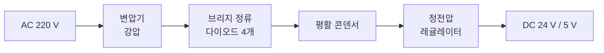

# 전기전자 기초와 소자

> [!summary] 핵심 요약
> - 옴의 법칙 $V = IR$, 전력 $P = VI = I^2R = \dfrac{V^2}{R}$.
> - 3상 전력 $P = \sqrt{3}\,V_L I_L \cos\theta$. Y결선은 $V_L = \sqrt{3}V_P$, Δ결선은 $I_L = \sqrt{3}I_P$.
> - **다이오드**: 한 방향으로만 전류. **트랜지스터**: 작은 베이스 전류로 큰 전류 스위칭·증폭. **SCR**: 게이트로 켜고, 전류가 유지 전류 아래로 떨어져야 꺼짐. **트라이액**: AC 양방향 SCR.
> - **포토커플러**: 빛으로 신호 전달 → 입출력 **전기적 절연**.

> [!warning] 자주 틀리는 포인트
> - 저항 직렬은 합 $R_1 + R_2$, 병렬은 $\dfrac{R_1R_2}{R_1 + R_2}$. 콘덴서는 **반대**(병렬이 합).
> - 실리콘 다이오드 순방향 전압 약 **0.7 V**, LED는 색에 따라 약 1.8~3.3 V.
> - **제너 다이오드**는 **역방향**으로 연결해 정전압을 얻는다.
> - SCR은 게이트 신호를 끊어도 **꺼지지 않는다**. AC에서는 전압이 0을 지날 때 꺼진다.
> - 전압계는 **병렬**, 전류계는 **직렬**. 배율기는 전압계에 직렬, 분류기는 전류계에 병렬.
> - 같은 저항 n개: 직렬 $nR$, 병렬 $R/n$ → **직렬/병렬 비 = $n^2$** (4개면 16). 병렬 합성은 "더하기"가 아니다.
> - 정격 전압보다 낮게 쓰면 저항은 그대로이므로 **전력은 전압의 제곱에 비례**한다 ($P = V^2/R$). 전압이 절반이면 전력은 1/4.
> - 전류의 방향은 **전자 이동 방향과 반대**. 전류는 저항에 **반비례**, 전압에 비례.
> - 교류 전압계 지시값과 AC 220 V 같은 표기는 **실효값**. DC 24 V 같은 직류 전원 표기는 직류분, 즉 **평균값**으로 본다(맥동 없는 직류는 평균값 = 실효값). 정현파 평균값 = 최대값 × 0.637, 실효값 = 최대값 × 0.707.
> - **주파수가 높을수록 $X_L$은 커지고 $X_C$는 작아진다**. 반대로 외우면 틀린다.
> - **공진 시 전압과 전류는 동상**이다. 직렬 공진은 임피던스 최소·전류 최대, 병렬 공진은 임피던스 최대.
> - 패러데이 법칙: 유도 기전력은 **자속 변화율(단위 시간당 쇄교 자속 변화)에 비례**한다. 렌츠 법칙: 그 **방향**은 자속 변화를 방해하는 쪽.
> - 쿨롱의 법칙: 힘은 전하량의 곱에 비례, **거리의 제곱에 반비례**("거리에 반비례"는 틀림).
> - P형 불순물은 3가(붕소·인듐·알루미늄·갈륨), N형은 5가(비소·인·안티몬). **비소는 N형**, **붕소는 P형**.
> - 제너 다이오드는 **역방향 항복** 영역에서 동작 → 정전압 회로.
> - CMOS는 TTL보다 소비 전력이 작고 **잡음 여유가 크다**(속도는 느리고 정전기에 약함).

## 개념 정리

### 회로 기초

| 법칙 | 내용 |
| --- | --- |
| 옴의 법칙 | $V = IR$ |
| 키르히호프 전류 법칙 (KCL) | 한 점에 들어오는 전류 합 = 나가는 전류 합 |
| 키르히호프 전압 법칙 (KVL) | 닫힌 회로의 전압 상승 합 = 전압 강하 합 |
| 분압 | $V_1 = V \dfrac{R_1}{R_1 + R_2}$ |
| 분류 | $I_1 = I \dfrac{R_2}{R_1 + R_2}$ |
| 줄의 법칙 | 열량 $H = I^2Rt$ [J] |
| 전하량 | $Q = It$ [C] (5 A로 2분 → 600 C) |
| 전력량 | $W = Pt$ [J = W·s], 에너지와 같은 단위 |
| 저항 | $R = \rho\dfrac{l}{A}$: 길이에 비례, 단면적에 반비례. 고유 저항은 은 < 구리 < 금 < 알루미늄 |
| 컨덕턴스 | $G = 1/R$, 단위 **지멘스[S]** |

**계산 예**
- 100 V, 500 W 전열기 → $I = 5$ A, $R = V^2/P = 20\ \Omega$. 이것을 50 V에 쓰면 $P = 50^2/20 = 125$ W (1/4).
- 60 W 전구를 120 V에 → $I = 0.5$ A, $R = 240\ \Omega$.
- 같은 저항 3개: 직렬 $3R$, 병렬 $R/3$ → 비 9.
- 직렬 분압: 전체 100 V에 10 Ω, 30 Ω 직렬 → 30 Ω에 걸리는 전압 $100 \times 30/40 = 75$ V.

### 교류 기초

- 실효값 = 최대값 / $\sqrt{2}$ (220 V 실효값의 최대값 ≈ 311 V).
- 유도 리액턴스 $X_L = 2\pi fL$, 용량 리액턴스 $X_C = \dfrac{1}{2\pi fC}$.
- 역률 $\cos\theta$ = 유효 전력 / 피상 전력. 유도성 부하가 많으면 역률이 낮다 → **진상 콘덴서**로 개선.
- 유효 전력 [W], 무효 전력 [var], 피상 전력 [VA]: $S^2 = P^2 + Q^2$.

**정현파 읽기**: $v = V_m\sin(\omega t + \theta)$

| 값 | 식 | 예: $v = 200\sin(314t)$ |
| --- | --- | --- |
| 최대값 | $V_m$ | 200 V |
| 실효값 | $V_m/\sqrt{2} \approx 0.707V_m$ | 약 141 V |
| 평균값 | $2V_m/\pi \approx 0.637V_m$ | 약 127 V |
| 각속도 | $\omega = 2\pi f$ | 314 rad/s |
| 주파수 | $f = \omega/2\pi$ | 50 Hz |
| 주기 | $T = 1/f$ | 0.02 s |

- 60 Hz의 각속도는 $2\pi \times 60 \approx 377$ rad/s, 50 Hz는 약 314 rad/s.
- 파형 그림에서 주파수: 한 주기 시간을 읽어 $f = 1/T$.

**리액턴스와 임피던스**

| 회로 | 임피던스 |
| --- | --- |
| RL 직렬 | $Z = \sqrt{R^2 + X_L^2}$ |
| RC 직렬 | $Z = \sqrt{R^2 + X_C^2}$ |
| RL 병렬 | $Z = \dfrac{RX_L}{\sqrt{R^2 + X_L^2}}$ |
| RLC 직렬 공진 | $X_L = X_C$, $f_0 = \dfrac{1}{2\pi\sqrt{LC}}$ |

- 예: $L = 50$ mH, 60 Hz → $X_L = 2\pi \times 60 \times 0.05 \approx 18.8\ \Omega$
- 코일 저장 에너지 $W = \dfrac{1}{2}LI^2$ (전류 2배 → 4배), 콘덴서 $W = \dfrac{1}{2}CV^2$.
- 정전용량 $C = \varepsilon\dfrac{A}{d}$: 극판 **면적을 크게**, 간격을 **작게**, 유전율을 **크게** 하면 커진다.
- 콘덴서 응용: 평활, 결합(직류 차단), 바이패스, 필터, 스파크(아크) 소거, 발진. 교류를 직류로 바꾸는 **정류 자체는 다이오드**의 일.

### 전자기

| 법칙·현상 | 내용 |
| --- | --- |
| 전자 유도 (패러데이) | 코일을 지나는 자속이 변하면 기전력 발생. $e = -N\dfrac{d\Phi}{dt}$ → 권수·변화 속도(주파수)에 비례 |
| 렌츠 법칙 | 유도 기전력의 **방향**은 자속 변화를 방해하는 쪽 |
| 플레밍 왼손 법칙 | 전동기: 자계(검지)·전류(중지) → 힘(엄지) |
| 플레밍 오른손 법칙 | 발전기: 자계·운동 → 기전력 |
| 전자력 | 자계 속 도체에 전류가 흐를 때 받는 힘 $F = BIl\sin\theta$ |
| 쿨롱 법칙 | $F = k\dfrac{Q_1Q_2}{r^2}$, 매질(유전율)에 따라 달라짐, 같은 극은 반발 |
| 변압기 | **전자 유도 작용** 이용. $V_1/V_2 = N_1/N_2$ |
| 자기력선 | 자력이 미치는 모양을 나타낸 가상의 선, N → S |
| B-H 곡선 | 자화력 H와 자속밀도 B의 관계(히스테리시스) |

- 정현파 자속의 주파수를 2배로 하면 유기 기전력도 **2배**.
- 자성체: 강자성체(철·니켈·코발트, 자석에 강하게 끌림), 상자성체(약하게 같은 방향), **반자성체**(자석과 반대 방향으로 자화, 구리·비스무트).

### 수동 소자

| 소자 | 특징 |
| --- | --- |
| 저항 | 색 띠로 값 표시: 흑0 갈1 적2 등3 황4 녹5 청6 자7 회8 백9, 오차 금 ±5% 은 ±10% |
| 콘덴서 | 직류 차단·교류 통과, 전하 저장. 전해 콘덴서는 극성 있음 |
| 코일(인덕터) | 전류 변화 방해, 교류 차단·직류 통과 |
| 가변 저항 | 분압, 위치 검출(포텐셔미터) |

- 색 띠 예: 갈·흑·적·금 → $10 \times 10^2 = 1\text{ k}\Omega$ ±5%.

### 반도체 소자

| 소자 | 동작 | 용도 |
| --- | --- | --- |
| 다이오드 | 순방향 도통, 역방향 차단 | 정류, 역기전력 흡수(플라이휠) |
| 제너 다이오드 | 역방향 항복 전압 일정 | 정전압 |
| LED | 순방향 전류로 발광 | 표시, 광원 |
| 포토다이오드·포토트랜지스터 | 빛 → 전류 | 광센서 수광부 |
| 트랜지스터 (BJT) | 베이스 전류로 컬렉터 전류 제어 ($I_C = \beta I_B$) | 증폭, 스위칭 |
| MOSFET | 게이트 전압으로 제어, 입력 임피던스 큼 | 고속 스위칭 |
| IGBT | MOSFET 입력 + BJT 출력 | 인버터, 서보 드라이버 |
| SCR (사이리스터) | 게이트 트리거로 턴온, 유지 전류 이하에서 턴오프 | 위상 제어, 정류 |
| 트라이액 | 양방향 SCR | AC 전력 제어, SSR |
| 포토커플러 | 발광부 + 수광부 | 절연, 노이즈 차단 |

### 반도체 기초

| 구분 | 불순물 | 다수 캐리어 |
| --- | --- | --- |
| 진성 반도체 | 없음 (순수 Si, Ge) | 자유전자 수 = 정공 수 |
| N형 | **5가** (비소 As, 인 P, 안티몬 Sb) = 도너 | 자유전자 |
| P형 | **3가** (붕소 B, 인듐 In, 알루미늄 Al, 갈륨 Ga) = 억셉터 | 정공 |

- **도핑**: 순수 반도체에 불순물을 넣어 캐리어 수를 늘리는 과정. 불순물 반도체에도 소수 캐리어는 있다.
- Si 원자끼리는 가전자를 서로 공유하는 **공유 결합**.
- PN 접합의 공핍층 양단 전위차 = **전위 장벽** (Si 약 0.7 V).
- 트랜지스터 전류: $I_E = I_B + I_C$ (예: 20 mA + 400 mA = 420 mA).
- NPN은 베이스에 + 전압을 주면 컬렉터–이미터가 도통, PNP는 베이스를 이미터보다 낮게 하면 도통.
- **FET**: 다수 캐리어만으로 동작(유니폴라), 입력 임피던스가 매우 높고 잡음이 적으며 **열적으로 안정**하다.

| 디지털 IC | TTL | CMOS |
| --- | --- | --- |
| 소비 전력 | 큼 | 매우 작음 |
| 속도 | 빠름 | 느린 편 |
| 잡음 여유 | 작음 | **큼** |
| 정전기 | 강함 | 약함 |
| 출력 형식 | 토템폴, 오픈 컬렉터, 3상태 | |

- **발진 회로**: 정현파(LC, RC, 수정 발진) / 비정현파(**멀티바이브레이터**, 구형파).

### 트랜지스터 스위칭

- **차단 영역**: 베이스 전류 0 → 스위치 OFF.
- **포화 영역**: 베이스 전류 충분 → 스위치 ON ($V_{CE}$ ≈ 0.2 V).
- **활성 영역**: 증폭에 사용.
- NPN 트랜지스터로 릴레이 코일을 구동할 때는 코일 양단에 **플라이휠 다이오드**를 역병렬로 단다.

### 정류와 전원 회로

| 회로 | 특징 |
| --- | --- |
| 반파 정류 | 다이오드 1개, 맥동 큼 |
| 전파 정류 (센터탭) | 다이오드 2개, 센터탭 변압기 |
| 브리지 정류 | 다이오드 4개, 가장 많이 사용 |
| 평활 회로 | 콘덴서로 맥동 감소 |
| 정전압 회로 | 제너 다이오드, 3단자 레귤레이터(7805 = +5 V) |
| SMPS | 고주파 스위칭, 소형·고효율 (PLC 전원 모듈) |

## 그림

## 기출 포인트

출처: 생산자동화산업기사 2016–2020년 필기 14회분 (cbtbank.kr). 옛 4과목 메카트로닉스에서 매회 4~6문항.

- 직류 회로·전력 (옴의 법칙, 전력·저항 계산, 정격보다 낮은 전압의 소비 전력, 직렬/병렬 합성비, 분압, 고유 저항, 전하량, 컨덕턴스 단위, 키르히호프, 전류 방향) — 19회 (2016-1, 2016-2, 2016-3, 2017-1, 2017-3 ×3, 2018-1 ×2, 2018-3 ×2, 2019-1 ×2, 2019-2, 2019-3 ×2, 2020-1·2 ×2, 2020-3)
- 교류 (실효·평균·최대값, 주파수·각속도, 리액턴스 계산과 주파수 관계, RLC 공진, RL 병렬 임피던스, 정전용량, 콘덴서 응용, 코일 에너지) — 18회 (2016-1 ×2, 2016-2, 2016-3 ×2, 2017-2 ×3, 2018-2, 2018-3, 2019-1 ×2, 2019-2, 2019-3, 2020-1·2 ×2, 2020-3 ×2)
- 전자기 (전자 유도, 패러데이, 렌츠, 플레밍 왼손, $F = BIl\sin\theta$, 쿨롱, 변압기 원리, 자성체, 자기력선, B-H 곡선) — 15회 (2016-1, 2016-2, 2016-3, 2017-1 ×3, 2017-2, 2017-3, 2018-1, 2018-2, 2019-1, 2019-2 ×2, 2019-3, 2020-3)
- 반도체 소자 (P/N형 불순물, 도핑, 공유 결합, 전위 장벽, 다이오드, 제너 다이오드 정전압, 트랜지스터 전류·도통 조건, FET, 소자 기호, TTL·CMOS, 발진 회로) — 17회 (2016-2, 2016-3, 2017-2 ×2, 2017-3, 2018-2, 2018-3, 2019-1 ×3, 2019-2 ×4, 2019-3, 2020-3 ×2)

## 관련 단원

- [전기전자장치 조립과 검사](전기전자장치_조립과_검사.md)
- [센서 회로와 신호처리](센서_회로와_신호처리.md)
- [PLC 시뮬레이션과 수정보완](PLC_시뮬레이션과_수정보완.md)

## 체크리스트

- [ ] 직렬·병렬 합성 저항과 합성 정전 용량을 계산한다
- [ ] 3상 전력과 Y·Δ의 선간·상 관계를 안다
- [ ] 저항 색 띠를 읽는다
- [ ] 다이오드·제너·SCR·트라이액의 동작을 구분한다
- [ ] 트랜지스터의 차단·포화 스위칭을 설명한다
- [ ] 정류 회로 3종과 평활·정전압 회로를 안다
- [ ] 정격보다 낮은 전압에서 소비 전력을 $V^2$ 비례로 계산한다
- [ ] $v = V_m\sin\omega t$에서 실효값·평균값·주파수·주기를 읽는다
- [ ] $X_L$, $X_C$를 계산하고 주파수에 따른 증감을 안다
- [ ] 직렬·병렬 공진의 임피던스·전류·위상을 구분한다
- [ ] 패러데이·렌츠·플레밍·쿨롱 법칙의 내용과 함정을 안다
- [ ] P형·N형 불순물 원소를 구분한다
- [ ] TTL과 CMOS의 특징을 비교한다

## 참고

- [큐넷 자동화설비산업기사 출제기준](https://www.q-net.or.kr/crf005.do?id=crf00503&jmCd=2034)
