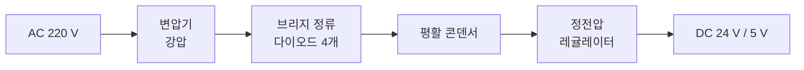

# 전기전자 기초와 소자

> [!summary] 핵심 요약
> - 옴의 법칙 $V = IR$, 전력 $P = VI = I^2R = \dfrac{V^2}{R}$.
> - 3상 전력 $P = \sqrt{3}\,V_L I_L \cos\theta$. Y결선은 $V_L = \sqrt{3}V_P$, Δ결선은 $I_L = \sqrt{3}I_P$.
> - **다이오드**: 한 방향으로만 전류. **트랜지스터**: 작은 베이스 전류로 큰 전류 스위칭·증폭. **SCR**: 게이트로 켜고, 전류가 유지 전류 아래로 떨어져야 꺼짐. **트라이액**: AC 양방향 SCR.
> - **포토커플러**: 빛으로 신호 전달 → 입출력 **전기적 절연**.

> [!warning] 자주 틀리는 포인트
> - 저항 직렬은 합 $R_1 + R_2$, 병렬은 $\dfrac{R_1R_2}{R_1 + R_2}$. 콘덴서는 **반대**(병렬이 합).
> - 실리콘 다이오드 순방향 전압 약 **0.7 V**, LED는 색에 따라 약 1.8~3.3 V.
> - **제너 다이오드**는 **역방향**으로 연결해 정전압을 얻는다.
> - SCR은 게이트 신호를 끊어도 **꺼지지 않는다**. AC에서는 전압이 0을 지날 때 꺼진다.
> - 전압계는 **병렬**, 전류계는 **직렬**. 배율기는 전압계에 직렬, 분류기는 전류계에 병렬.

## 개념 정리

### 회로 기초

| 법칙 | 내용 |
| --- | --- |
| 옴의 법칙 | $V = IR$ |
| 키르히호프 전류 법칙 (KCL) | 한 점에 들어오는 전류 합 = 나가는 전류 합 |
| 키르히호프 전압 법칙 (KVL) | 닫힌 회로의 전압 상승 합 = 전압 강하 합 |
| 분압 | $V_1 = V \dfrac{R_1}{R_1 + R_2}$ |
| 분류 | $I_1 = I \dfrac{R_2}{R_1 + R_2}$ |
| 줄의 법칙 | 열량 $H = I^2Rt$ [J] |

### 교류 기초

- 실효값 = 최대값 / $\sqrt{2}$ (220 V 실효값의 최대값 ≈ 311 V).
- 유도 리액턴스 $X_L = 2\pi fL$, 용량 리액턴스 $X_C = \dfrac{1}{2\pi fC}$.
- 역률 $\cos\theta$ = 유효 전력 / 피상 전력. 유도성 부하가 많으면 역률이 낮다 → **진상 콘덴서**로 개선.
- 유효 전력 [W], 무효 전력 [var], 피상 전력 [VA]: $S^2 = P^2 + Q^2$.

### 수동 소자

| 소자 | 특징 |
| --- | --- |
| 저항 | 색 띠로 값 표시: 흑0 갈1 적2 등3 황4 녹5 청6 자7 회8 백9, 오차 금 ±5% 은 ±10% |
| 콘덴서 | 직류 차단·교류 통과, 전하 저장. 전해 콘덴서는 극성 있음 |
| 코일(인덕터) | 전류 변화 방해, 교류 차단·직류 통과 |
| 가변 저항 | 분압, 위치 검출(포텐셔미터) |

- 색 띠 예: 갈·흑·적·금 → $10 \times 10^2 = 1\text{ k}\Omega$ ±5%.

### 반도체 소자

| 소자 | 동작 | 용도 |
| --- | --- | --- |
| 다이오드 | 순방향 도통, 역방향 차단 | 정류, 역기전력 흡수(플라이휠) |
| 제너 다이오드 | 역방향 항복 전압 일정 | 정전압 |
| LED | 순방향 전류로 발광 | 표시, 광원 |
| 포토다이오드·포토트랜지스터 | 빛 → 전류 | 광센서 수광부 |
| 트랜지스터 (BJT) | 베이스 전류로 컬렉터 전류 제어 ($I_C = \beta I_B$) | 증폭, 스위칭 |
| MOSFET | 게이트 전압으로 제어, 입력 임피던스 큼 | 고속 스위칭 |
| IGBT | MOSFET 입력 + BJT 출력 | 인버터, 서보 드라이버 |
| SCR (사이리스터) | 게이트 트리거로 턴온, 유지 전류 이하에서 턴오프 | 위상 제어, 정류 |
| 트라이액 | 양방향 SCR | AC 전력 제어, SSR |
| 포토커플러 | 발광부 + 수광부 | 절연, 노이즈 차단 |

### 트랜지스터 스위칭

- **차단 영역**: 베이스 전류 0 → 스위치 OFF.
- **포화 영역**: 베이스 전류 충분 → 스위치 ON ($V_{CE}$ ≈ 0.2 V).
- **활성 영역**: 증폭에 사용.
- NPN 트랜지스터로 릴레이 코일을 구동할 때는 코일 양단에 **플라이휠 다이오드**를 역병렬로 단다.

### 정류와 전원 회로

| 회로 | 특징 |
| --- | --- |
| 반파 정류 | 다이오드 1개, 맥동 큼 |
| 전파 정류 (센터탭) | 다이오드 2개, 센터탭 변압기 |
| 브리지 정류 | 다이오드 4개, 가장 많이 사용 |
| 평활 회로 | 콘덴서로 맥동 감소 |
| 정전압 회로 | 제너 다이오드, 3단자 레귤레이터(7805 = +5 V) |
| SMPS | 고주파 스위칭, 소형·고효율 (PLC 전원 모듈) |

## 그림

## 관련 단원

- [전기전자장치 조립과 검사](전기전자장치_조립과_검사.md)
- [센서 회로와 신호처리](센서_회로와_신호처리.md)
- [PLC 시뮬레이션과 수정보완](PLC_시뮬레이션과_수정보완.md)

## 체크리스트

- [ ] 직렬·병렬 합성 저항과 합성 정전 용량을 계산한다
- [ ] 3상 전력과 Y·Δ의 선간·상 관계를 안다
- [ ] 저항 색 띠를 읽는다
- [ ] 다이오드·제너·SCR·트라이액의 동작을 구분한다
- [ ] 트랜지스터의 차단·포화 스위칭을 설명한다
- [ ] 정류 회로 3종과 평활·정전압 회로를 안다

## 참고

- [큐넷 자동화설비산업기사 출제기준](https://www.q-net.or.kr/crf005.do?id=crf00503&jmCd=2034)
