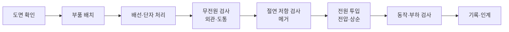

# 전기전자장치 조립과 검사

> [!summary] 핵심 요약
> - 조립 순서: 도면 확인 → 부품 배치 → 배선(동력·제어·신호 분리) → 단자 처리·마킹 → 외관·도통 검사 → 절연 검사 → 통전 기능 검사.
> - KEC 전선 색상: **L1 갈색, L2 흑색, L3 회색, N 청색, 보호도체(PE) 녹색-노란색**.
> - 측정기: **멀티미터**(전압·전류·저항·도통), **메거**(절연 저항), **클램프 미터**(회로를 끊지 않고 전류), **오실로스코프**(파형).
> - 안전 검사의 핵심은 **절연 저항, 접지, 누전 차단, 보호 커버**.

> [!warning] 자주 틀리는 포인트
> - 저항·도통 측정은 반드시 **전원을 끄고** 한다.
> - 메거 측정 전에 반도체 기기(PLC, 인버터)는 분리한다. 고전압으로 손상된다.
> - 클램프 미터는 **한 가닥만** 집는다. 왕복 두 가닥을 같이 집으면 전류가 상쇄돼 0에 가깝게 나온다.
> - KEC 저압 절연 저항 기준: SELV·PELV **0.5 MΩ 이상**(DC 250 V로 측정), FELV·500 V 이하 **1.0 MΩ 이상**(DC 500 V), 500 V 초과 **1.0 MΩ 이상**(DC 1000 V).
> - 옛 기준의 녹색 접지선·적·백·흑 상 구분은 KEC(2021)에서 바뀌었다.

## 개념 정리

### 조립 작업

| 단계 | 내용 |
| --- | --- |
| 도면 해독 | 회로도, 배치도, 부품 목록(BOM), 단자 번호표 |
| 부품 배치 | 발열 부품은 위쪽, 무거운 부품은 아래, 점검 공간 확보 |
| 배선 | 동력선·제어선·신호선 **분리 덕트**, 굽힘 반경 준수 |
| 단자 처리 | 압착 단자(링·Y·핀) 사용, 피복 벗김 길이 일정, 규정 토크로 조임 |
| 마킹 | 전선 양 끝에 단자 번호 표시 (튜브 마커) |
| 정리 | 케이블 타이·덕트 정리, 여유 길이 확보 |

**전선 굵기 선정**: 허용 전류 > 부하 전류, 전압 강하 허용 범위, 기계적 강도. 굵기는 단면적 [mm²]로 표시.

### 측정기 사용법

| 측정기 | 측정 대상 | 사용 요령 |
| --- | --- | --- |
| 멀티미터 (테스터) | 전압, 전류, 저항, 도통, 다이오드 | 측정 전 레인지 확인, 모를 땐 큰 레인지부터 |
| 메거 (절연 저항계) | 절연 저항 [MΩ] | 전원 차단, 반도체 분리, 측정 후 방전 |
| 클램프 미터 | 부하 전류, 누설 전류 | 회로 차단 없이 측정 |
| 접지 저항계 | 접지 저항 [Ω] | 보조 접지봉 2개 사용(3극법) |
| 오실로스코프 | 전압 파형, 주파수, 펄스 | 프로브 배율(×1, ×10) 확인 |
| 검전기 | 충전 여부 | 작업 전 무전압 확인 |

- 오실로스코프 읽기: 주기 = 가로 칸 수 × TIME/DIV, 주파수 = 1/주기, 전압 = 세로 칸 수 × VOLT/DIV.

### 기능 검사

1. **무전원 검사**: 외관(손상·이물), 배선 대조(도면 vs 실제), 도통, 단자 조임.
2. **절연 검사**: 메거로 전선–접지, 전선–전선 사이.
3. **전원 투입 검사**: 전압 측정(정격 ±허용 범위), 극성, 상 순서(상회전계).
4. **동작 검사**: 입력 하나씩 넣어 출력 확인, 비상 정지·인터록·리밋 동작.
5. **부하 운전**: 전류·온도 상승·소음 확인, 기록.

### 안전성 검사

| 항목 | 내용 |
| --- | --- |
| 절연 저항 | KEC 기준 이상 |
| 접지 | 보호 도체 연결 확인, 외함 접지, 접지 저항 측정 |
| 누전 차단 | ELB 테스트 버튼 동작 확인 |
| 보호 장치 | 차단기·퓨즈 정격이 전선·부하에 맞는지 |
| 감전 방지 | 충전부 커버, 외함 잠금, 경고 표지 |
| 비상 정지 | 하드와이어 회로, 복귀 시 자동 재기동 금지 |

### 작업 안전

- **정전 작업 순서**: 차단 → 잠금·표지(LOTO) → 검전 → 잔류 전하 방전 → 단락 접지 → 작업.
- 인버터·서보 드라이버는 전원을 꺼도 **DC 링크 콘덴서에 전압이 남는다** → 충전 표시등이 꺼질 때까지 대기.
- 감전 위험은 전류 크기와 시간에 좌우된다: 수 mA부터 느끼고, 수십 mA에서 위험. 그래서 ELB가 30 mA 기준.
- 보호구: 절연 장갑, 절연화, 보안경.

### 보호 등급 (IP 코드)

- **IP 첫째 숫자**: 고체(먼지) 보호 0~6. **둘째 숫자**: 물 보호 0~8.
- 예: IP65 = 먼지 완전 차단 + 분사수 보호. IP67 = 일시 침수 보호.

## 그림

## 관련 단원

- [전기전자 기초와 소자](전기전자_기초와_소자.md)
- [전동기 제어회로와 보호](전동기_제어회로와_보호.md)
- [PLC 시뮬레이션과 수정보완](PLC_시뮬레이션과_수정보완.md)

## 체크리스트

- [ ] KEC 전선 색상(L1·L2·L3·N·PE)을 외운다
- [ ] 멀티미터·메거·클램프 미터의 용도와 주의점을 구분한다
- [ ] KEC 저압 절연 저항 기준을 말한다
- [ ] 오실로스코프 화면에서 주파수와 전압을 읽는다
- [ ] 정전 작업 순서를 말한다
- [ ] IP 코드 두 숫자의 의미를 안다

## 참고

- [큐넷 자동화설비산업기사 출제기준](https://www.q-net.or.kr/crf005.do?id=crf00503&jmCd=2034)
- 한국전기설비규정(KEC) – 전선 식별, 저압 전로의 절연 성능
