# 전기전자장치 조립과 검사

> [!summary] 핵심 요약
> - 조립 순서: 도면 확인 → 부품 배치 → 배선(동력·제어·신호 분리) → 단자 처리·마킹 → 외관·도통 검사 → 절연 검사 → 통전 기능 검사.
> - KEC 전선 색상: **L1 갈색, L2 흑색, L3 회색, N 청색, 보호도체(PE) 녹색-노란색**.
> - 측정기: **멀티미터**(전압·전류·저항·도통), **메거**(절연 저항), **클램프 미터**(회로를 끊지 않고 전류), **오실로스코프**(파형).
> - 안전 검사의 핵심은 **절연 저항, 접지, 누전 차단, 보호 커버**.

> [!warning] 자주 틀리는 포인트
> - 저항·도통 측정은 반드시 **전원을 끄고** 한다.
> - 메거 측정 전에 반도체 기기(PLC, 인버터)는 분리한다. 고전압으로 손상된다.
> - 클램프 미터는 **한 가닥만** 집는다. 왕복 두 가닥을 같이 집으면 전류가 상쇄돼 0에 가깝게 나온다.
> - KEC 저압 절연 저항 기준: SELV·PELV **0.5 MΩ 이상**(DC 250 V로 측정), FELV·500 V 이하 **1.0 MΩ 이상**(DC 500 V), 500 V 초과 **1.0 MΩ 이상**(DC 1000 V).
> - 옛 기준의 녹색 접지선·적·백·흑 상 구분은 KEC(2021)에서 바뀌었다.
> - **내전압 시험은 전류가 아니라 고전압을 거는 시험**이다. 시험 전압 = 정상 동작 전압 × 2 + 1,000 V (교재 07절).
> - 교재의 NEC·GFCI 차단 기준은 **0.5 mA**다 ("2 mA"는 틀린 보기). 다만 실제 미국 GFCI 차단값은 약 5 mA(4~6 mA)이고, 0.5 mA는 제품 누설전류 허용 한계에 가까운 값이다. 시험에서는 교재 숫자를 쓴다.
> - **접지 연속성**은 낮은 DC 전류(1 A 미만), **접지도통(Ground Bond)** 은 높은 전류(25~30 A). 이름이 비슷해 헷갈린다.
> - 통전 시험 판정: 고유 저항값 → 정상, **∞ Ω → 단선·접속 불량**, **0 Ω 근처 → 단락**.
> - MSA 함정: "편의의 총합(범위에 따른 편의 변화)"은 **선형성**이지 안정성이 아니다.
> - 오실로스코프는 A/D 변환과 메모리를 거치므로 **순간적인 이상 신호를 놓칠 수 있다**.

## 학습 목표

이 단원을 마치면 다음을 할 수 있어야 한다.

1. 제어반 조립 순서(도면 → 배치 → 배선 → 단자 처리·마킹 → 검사)를 말하고, KEC 전선 색상으로 L1·L2·L3·N·PE를 구분한다.
2. 멀티미터·메거·클램프 미터·접지 저항계·오실로스코프·검전기 중 측정 목적에 맞는 기기를 고르고 주의점을 설명한다.
3. 오실로스코프 화면의 칸 수와 TIME/DIV·VOLT/DIV로 주기·주파수·전압을 계산한다.
4. 무전원 → 절연 → 전원 투입 → 동작 → 부하 순서로 기능 검사를 진행하고, MSA 5요소를 구분한다.
5. 내전압 시험 전압을 계산하고, 절연저항·누설전류·접지 연속성·접지도통 시험을 구분하며, 통전 시험에서 단선과 단락을 판정한다.
6. 정전 작업 순서(LOTO 포함)와 IP 코드 두 숫자의 의미를 말한다.

## 한눈에 보기

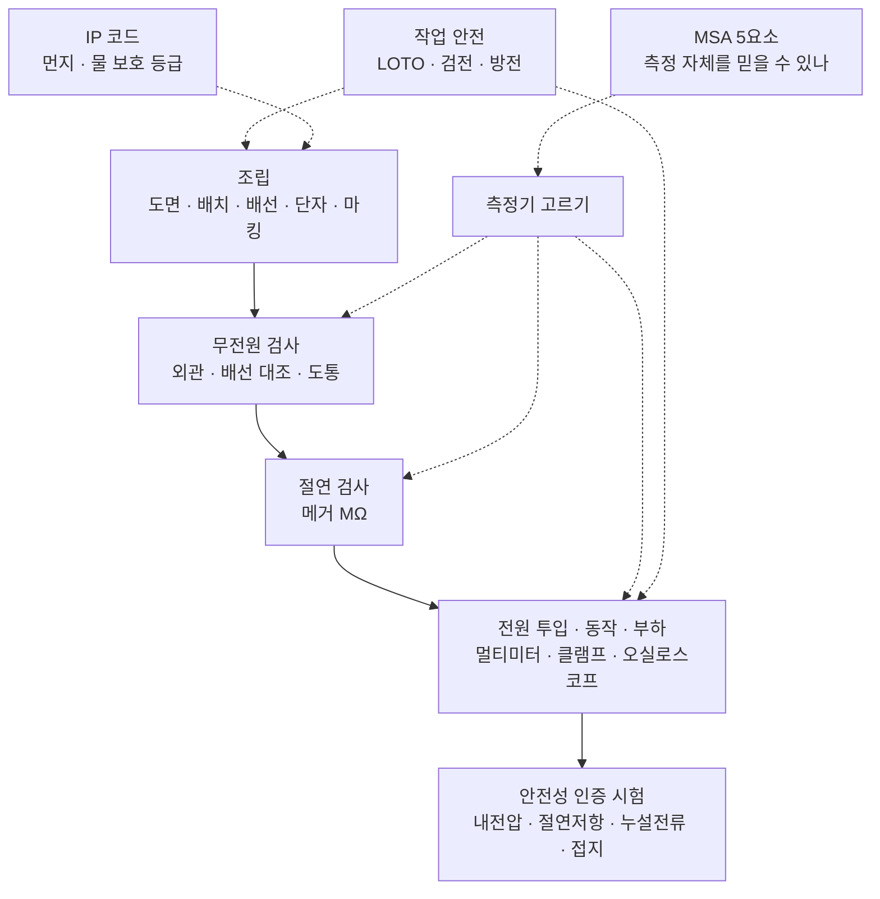

## 1. 조립 작업

**직관**: 제어반 조립은 **이사 짐 싸기**와 같다. 무거운 것은 아래, 뜨거운 것(발열 부품)은 공기가 빠지는 위쪽에 두고, 상자마다 이름표(마킹)를 붙여야 나중에 풀 때(점검할 때) 헤매지 않는다. 그리고 다 싼 뒤에는 전원을 넣기 전에 반드시 검사한다.

| 단계 | 내용 |
| --- | --- |
| 도면 해독 | 회로도, 배치도, 부품 목록(BOM), 단자 번호표 |
| 부품 배치 | 발열 부품은 위쪽, 무거운 부품은 아래, 점검 공간 확보 |
| 배선 | 동력선·제어선·신호선 **분리 덕트**, 굽힘 반경 준수 |
| 단자 처리 | 압착 단자(링·Y·핀) 사용, 피복 벗김 길이 일정, 규정 토크로 조임 |
| 마킹 | 전선 양 끝에 단자 번호 표시 (튜브 마커) |
| 정리 | 케이블 타이·덕트 정리, 여유 길이 확보 |

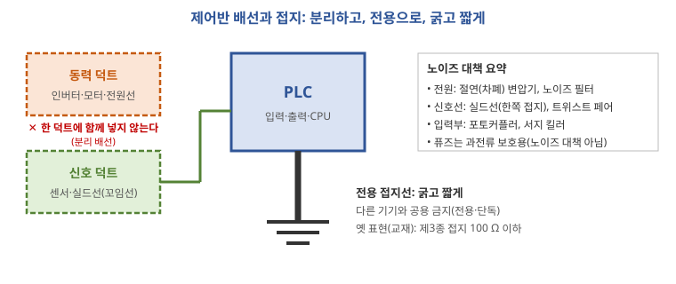

*동력선(모터·인버터 출력)은 큰 전류가 흘러 주변에 잡음을 만든다. 그래서 **동력 덕트와 신호 덕트를 따로** 깔고, 어쩔 수 없이 만나면 직각으로 교차시킨다. PLC 접지는 다른 기기와 공용으로 쓰지 않고 굵고 짧게 뽑는다 — 이 그림은 [PLC 시뮬레이션과 수정보완](PLC_시뮬레이션과_수정보완.md)에서도 쓴다.*

**전선 굵기 선정**: 허용 전류 > 부하 전류, 전압 강하 허용 범위, 기계적 강도. 굵기는 단면적 [mm²]로 표시.

### 전선 색상 (KEC)

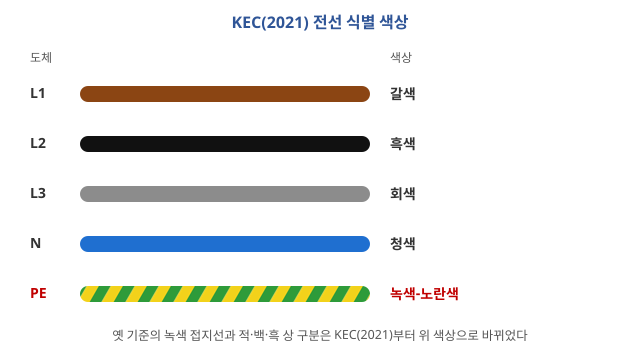

*상(L1·L2·L3)은 **갈·흑·회**, 중성선 N은 **청**, 보호도체 PE만 두 색 **녹색-노란색 줄무늬**다. "녹색 단색 = 접지"는 옛 기준이라 보기로 나오면 틀린 것이다.*

> [!tip] 외우는 법
> 상은 L1부터 **갈 → 흑 → 회** 세 글자를 한 묶음으로 외우고, 남은 둘은 "N은 파랑, PE만 두 색"으로 기억한다. 국제 규격(IEC 60445)과 같은 색이라 해외 장비 도면에서도 그대로 통한다.

### 단자 처리

| 링 단자 모음 | 와이어 페룰(핀 단자) |
| --- | --- |
| 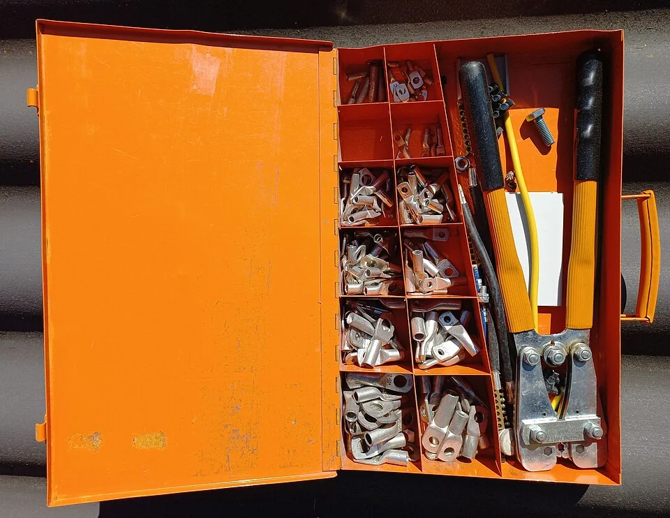 | 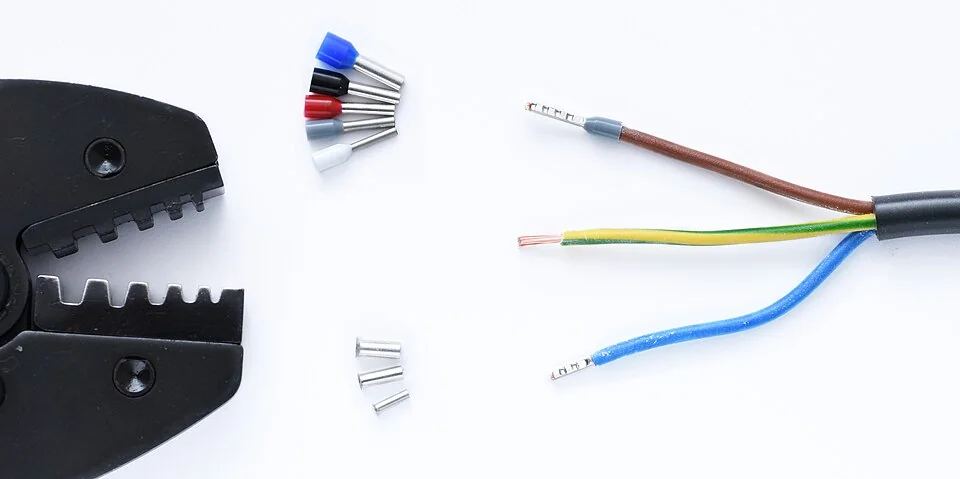 |

*왼쪽 상자는 전선 굵기별로 칸을 나눈 **링 압착 단자**와, 굵은 단자를 눌러 붙이는 **압착 공구**다. 단자 구멍 크기는 나사 지름, 통 크기는 전선 단면적[mm²]에 맞춰 고른다. 링 단자는 나사를 다 풀어야 빠지므로 진동이 있는 곳에 쓴다. 오른쪽 **페룰(핀 단자)** 은 연선 가닥이 흩어지지 않게 단자대에 꽂을 때 쓰며, 절연 슬리브 색이 굵기를 나타낸다. 사진의 케이블 심선 색(갈색 L, 녹색-노란색 PE, 청색 N)도 위 KEC 색상과 같다. 어느 쪽이든 **피복 벗김 길이를 일정하게** 하고 **규정 토크**로 조인다.*

### 배선 용어와 회로도 기호 (교재 04절)

- **커넥터**: 암·수로 나뉘어 전선을 잇고 떼는 부품. **하네스**: 신호 전달용 전선을 가공·결속한 배선 묶음.
- 교재 기호표에 나오는 부품: 정전압 IC(TO-220), 저항기(고정·반고정·가변), 서미스터, 커패시터(무극성·유극성), 인덕터, 트랜스포머, 릴레이, 퓨즈, 수정발진자, 핀 헤더, 암·수 커넥터, NPN 트랜지스터, 다이오드, **제너다이오드**, LED, 푸시버튼, 스위치, 접지, 접속·비접속 와이어.
- 기호 고르기 문제(예: 제너다이오드)가 그림으로 나오므로, 기호 모양은 [전자 소자와 전원 회로](전자_소자와_전원_회로.md)의 소자 표와 함께 교재 그림으로 확인한다.

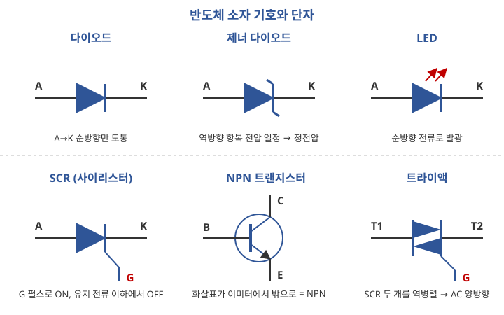

*기출에 나온 **제너다이오드**는 캐소드 막대 끝이 꺾여 있는 것으로 일반 다이오드와 구분한다. LED는 바깥으로 나가는 빛 화살표 두 개가 붙는다.*

### 조립 공구와 부품 (교재 05절)

| 구분 | 내용 |
| --- | --- |
| 공구 | 드라이버, 플라이어·롱노즈, **와이어 스트리퍼**(피복 벗기기), **니퍼**(절단), 렌치·래칫 렌치, 전동드릴, 납땜 도구(인두, 받침대, 납 흡입기) |
| 조립 베이스 | 알루미늄 슬롯 플레이트(교재 예: 1,000 × 800 mm, 슬롯 간격 20 mm) |
| 인덱스 테이블 | 일정 각도씩 돌며 공정을 차례로 수행. 구동원은 모터·유압·공압 |
| 스테핑 모터 + 드라이버 | PLC 펄스에 따라 정해진 **각도·방향**으로 회전, 각도·속도 제어 쉬움 → 인덱스 테이블 구동에 적합 |
| 컨베이어 | 공작물 이송 |
| 진공 발생기 (이젝터) | 압축공기가 좁은 단면을 빠르게 지나며 부압 → 진공 흡착 |
| 솔레노이드 밸브 터미널 | 공급(1)·배기(3, 5) 라인을 공통으로 묶어 여러 밸브를 한 번에 배관 |

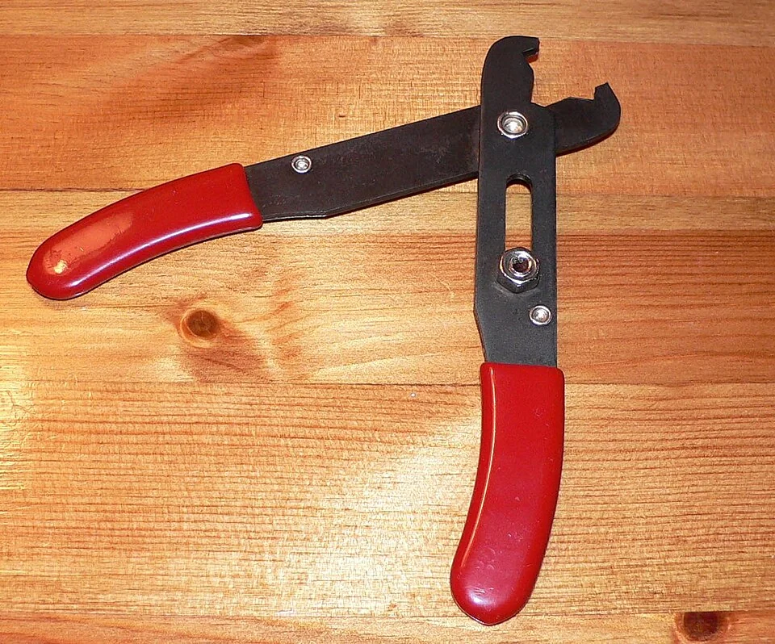

*와이어 스트리퍼는 **피복만** 벗긴다. 사진은 가운데 나사로 날이 닫히는 깊이를 전선 굵기에 맞추는 조절식이다(굵기별 홈이 파인 형식도 있다). 너무 깊게 맞추면 심선이 긁혀 끊어지기 쉽다. 전선을 **자르는** 공구는 니퍼다 — 두 공구의 쓰임을 바꿔 묻는 보기가 나온다.*

> [!question] 시험에서는
> "인덱스 테이블을 정해진 **각도·방향**으로 돌리는 기기"를 묻는다. 답은 펄스 수만큼 각도가 정해지는 **스테핑 모터(+드라이버)** 다. 자세한 원리는 [DC 모터와 스테핑 모터](DC모터와_스테핑모터.md).

## 2. 측정기 사용법

**직관**: 측정기는 **무엇을 어떻게 연결하느냐**가 전부다. 전압은 두 점 사이에 **병렬로** 대고, 전류는 회로를 끊고 **직렬로** 넣거나(멀티미터) 전선을 **감싸서**(클램프) 재고, 저항·절연은 **전원을 끈 뒤** 잰다.

| 측정기 | 측정 대상 | 사용 요령 |
| --- | --- | --- |
| 멀티미터 (테스터) | 전압, 전류, 저항, 도통, 다이오드 | 측정 전 레인지 확인, 모를 땐 큰 레인지부터 |
| 메거 (절연 저항계) | 절연 저항 [MΩ] | 전원 차단, 반도체 분리, 측정 후 방전 |
| 클램프 미터 | 부하 전류, 누설 전류 | 회로 차단 없이 측정 |
| 접지 저항계 | 접지 저항 [Ω] | 보조 접지봉 2개 사용(3극법) |
| 오실로스코프 | 전압 파형, 주파수, 펄스 | 프로브 배율(×1, ×10) 확인 |
| 검전기 | 충전 여부 | 작업 전 무전압 확인 |

### 멀티미터

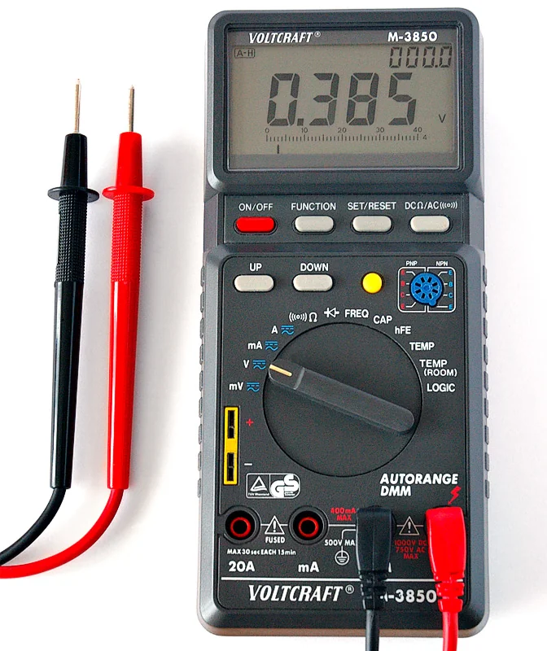

*로터리 스위치 둘레에 V(전압)·A·mA(전류)·Ω(저항)·부저 표시(도통)·다이오드 기호가 모여 있다. 아래 단자를 보면 **전류용(20 A, mA) 단자가 따로** 있다 — 전류 단자에 리드를 꽂은 채 전압을 재면 퓨즈가 끊어진다. 검정 리드는 항상 COM.*

- 아날로그 회로시험기 저항 읽기: 바늘 눈금 × 레인지 배율 (예: ×10 레인지에서 80 → 800 Ω).

### 메거 (절연 저항계)

| 메거 실물 | 측정 연결 |
| --- | --- |
| 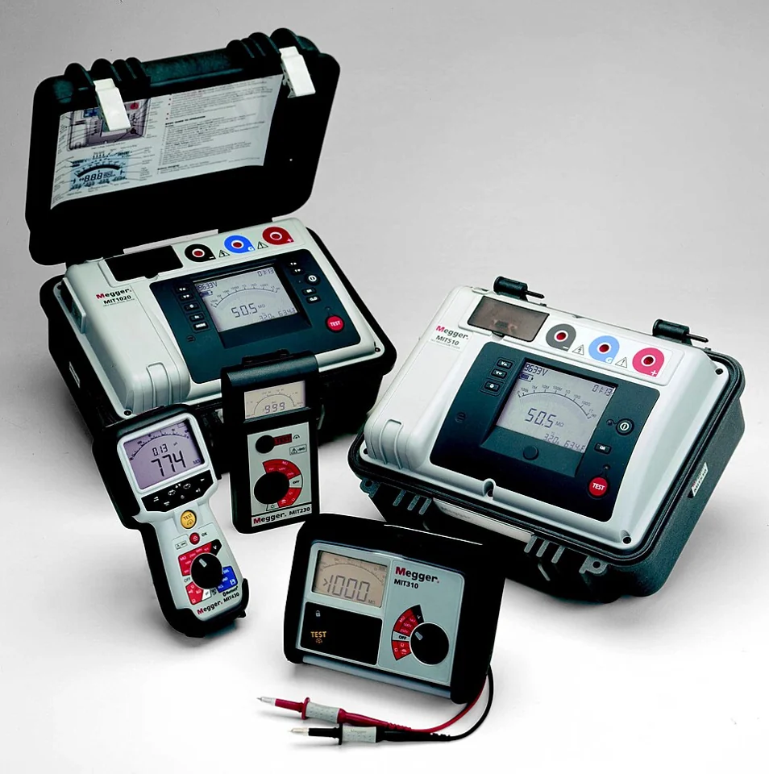 | 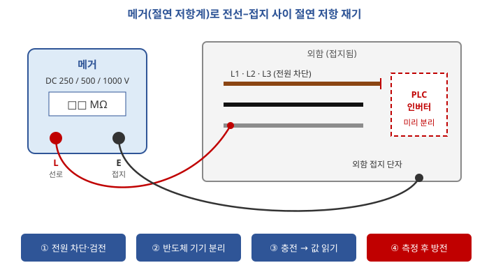 |

*메거는 스스로 **DC 250·500·1000 V**의 고전압을 만들어 절연물에 걸고, 흐르는 아주 작은 전류로 **MΩ** 단위 저항을 잰다. 사진 속 화면에도 MΩ 값과 시험 전압(V)이 함께 보인다. 오른쪽 그림처럼 **L(선로)–E(접지)** 사이를 재며, 고전압이 걸리므로 PLC·인버터 같은 반도체 기기는 먼저 떼어 내고, 측정이 끝나면 케이블에 충전된 전하를 **방전**한다.*

### 클램프 미터

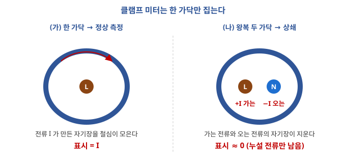

*클램프 미터의 집게는 **변류기(CT) 철심**이다. 전선에 흐르는 전류가 만든 자기장을 모아 재므로 회로를 끊을 필요가 없다. 가는 선과 오는 선을 같이 집으면 크기가 같고 방향이 반대인 자기장이 서로 지워져 **0에 가깝게** 나온다. 반대로 이 성질을 이용해 L·N을 함께 집으면 그 차이인 **누설 전류**만 볼 수 있다.*

### 접지 저항계 (3극법)

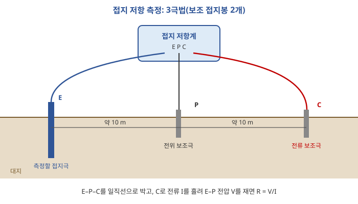

*보조 접지봉 2개(P·C)를 측정할 접지극 E와 **일직선**으로 박는 것이 핵심이다. C로 흘린 전류 I와 E–P 사이 전압 V에서 $R = V/I$ 를 구한다. 간격이 너무 가까우면 접지극 주변 전위가 겹쳐 값이 틀어진다.*

### 오실로스코프

| 실제 화면 | 읽는 법 |
| --- | --- |
| 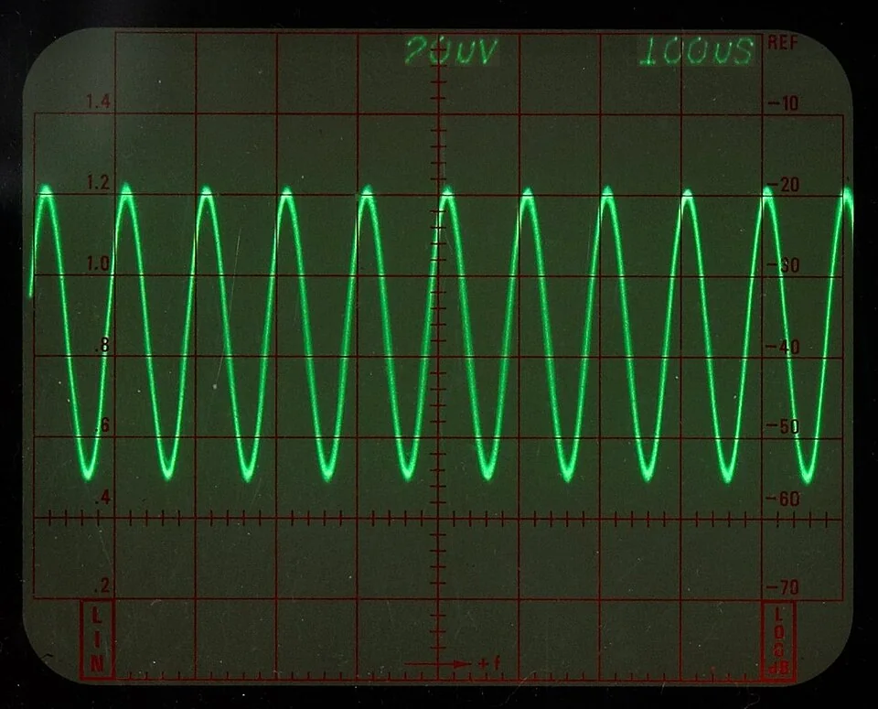 | 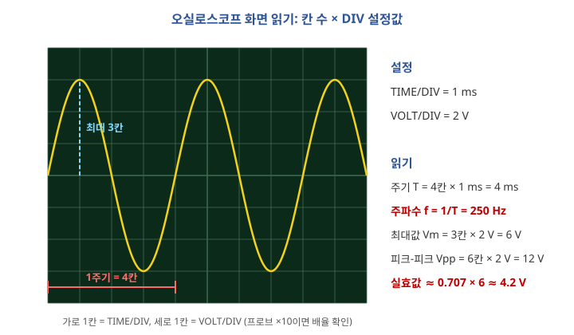 |

*왼쪽 사진은 실제 화면이다. 오른쪽 위에 시간축 **100 µs** 설정이 보이고, 정현파 한 주기가 가로 약 한 칸이므로 $T \approx 100\ \mu\text{s}$ → $f \approx 10\ \text{kHz}$ 로 파일 이름의 10 kHz와 맞는다. 화면은 보통 가로 10칸 × 세로 8칸 격자다. **가로 1칸 = TIME/DIV**, **세로 1칸 = VOLT/DIV**. 오른쪽 예에서 한 주기가 4칸이고 1 ms/DIV이므로 주기 4 ms, 주파수 250 Hz. 최대값은 3칸 × 2 V = 6 V. 프로브가 ×10이면 화면 값에 10을 곱해야 하는지(스코프 설정에 반영됐는지) 확인한다.*

- 오실로스코프 읽기: 주기 = 가로 칸 수 × TIME/DIV, 주파수 = 1/주기, 전압 = 세로 칸 수 × VOLT/DIV.

$$T = (\text{가로 칸 수}) \times \text{TIME/DIV}, \qquad f = \frac{1}{T}, \qquad V = (\text{세로 칸 수}) \times \text{VOLT/DIV}$$

### 검전기와 테스트 램프

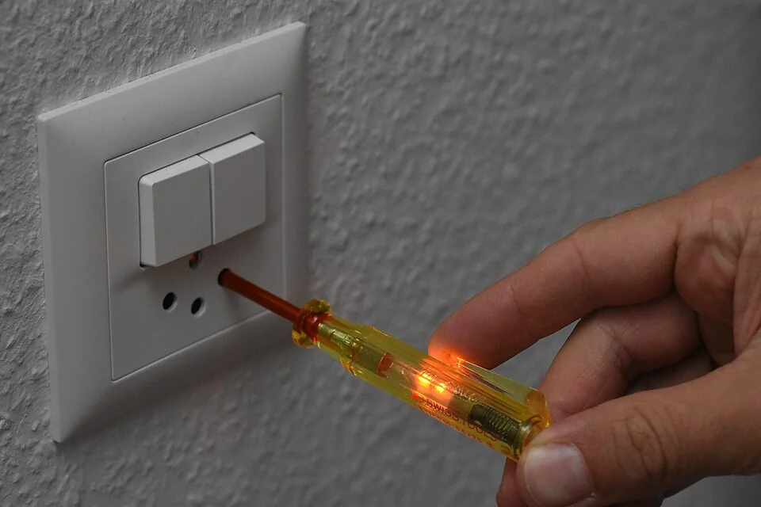

*드라이버 모양 검전기(무전원형 테스트 램프의 일종)를 콘센트에 넣고 손가락으로 끝을 대자 램프가 켜졌다 — **불이 켜지면 전압이 있다.** 작업 전 무전압 확인에 쓰고, 꺼져 있어도 기기 고장일 수 있으니 확실히 살아 있는 곳에서 먼저 동작을 확인한다.*

- **테스트 램프** (교재 06절): 무전원형은 전기가 오는지 확인, **자체 전원형**은 전원이 없는 회로에서 결선·합선 확인.

### 기능검사용 계측기 (교재 06절)

| 계측기 | 가로축 – 세로축 | 쓰임 |
| --- | --- | --- |
| 오실로스코프 | 시간 – 전압 | 파형 관찰 |
| 스펙트럼 애널라이저 | 주파수 – 전력(전압) | 전기장 세기, EMC 잡음 |
| 로직 애널라이저 | 시간 – High/Low | 디지털 신호 다채널(16~64ch) 저장·표시 |
| 네트워크 애널라이저 | 주파수 – 반사·통과 전력 | 고주파 회로 특성, 스미스 차트 |

> [!question] 시험에서는
> "**전압-시간** 파형을 보는 계측기"는 오실로스코프, "**주파수**가 가로축"이면 스펙트럼·네트워크 애널라이저, "**High/Low** 여러 채널"이면 로직 애널라이저. 가로축이 무엇인지만 보면 고를 수 있다.

## 3. 기능 검사

**직관**: 새 차를 받으면 시동부터 걸지 않는다. 먼저 겉을 둘러보고(외관), 오일·배선을 확인하고(무전원), 시동을 건 뒤(전원 투입) 기능을 하나씩 눌러 보고(동작), 마지막에 실제로 달려 본다(부하). **전원을 넣기 전에 할 수 있는 검사를 다 끝내는 것**이 순서의 핵심이다.

1. **무전원 검사**: 외관(손상·이물), 배선 대조(도면 vs 실제), 도통, 단자 조임.
2. **절연 검사**: 메거로 전선–접지, 전선–전선 사이.
3. **전원 투입 검사**: 전압 측정(정격 ±허용 범위), 극성, 상 순서(상회전계).
4. **동작 검사**: 입력 하나씩 넣어 출력 확인, 비상 정지·인터록·리밋 동작.
5. **부하 운전**: 전류·온도 상승·소음 확인, 기록.

### 기능시험의 관점 (교재 06절)

- 기능시험은 **통합시험**과 **인수시험**으로 나누고, 설계 규격서의 기능 목록에서 테스트 케이스를 뽑는다.
- 찾아내는 오류 6가지: 부정확한 기능, 누락된 기능, 인터페이스, 성능, 초기화·종료, 자료구조.
- 요구사항: **기능적**(완전성·일관성) / **비기능적**(성능, 보안성, 가용성).

### 측정시스템분석 (MSA) 5요소

**직관**: 검사 결과를 믿으려면 **측정기와 측정하는 사람부터** 믿을 수 있어야 한다. MSA는 "자(尺)가 정확한가(편의·선형성·안정성)"와 "재는 사람·반복에 따라 흔들리지 않는가(반복성·재현성)"를 나눠 본다.

| 요소 | 뜻 | 나빠지는 원인 |
| --- | --- | --- |
| 편의 (Bias) | 기준값과 측정 평균의 차이 | 마스터 오차, 계측기 노화, 교정 오류 |
| 안정성 | 오랜 기간 측정했을 때의 총변동 | 계측기 물성 변화 |
| 선형성 | 측정 범위에 따라 편의가 달라지는 정도 | 범위 양 끝 교정 부족, 마스터 오차 |
| 반복성 | 한 사람이 같은 기기로 반복 측정한 변동 | 기기 노후, 환경, 시력 |
| 재현성 | 여러 사람의 측정 평균 사이 변동 | 측정 방법·숙련 차이, 절차 불명확 → **지그(JIG)** 로 개선 |

> [!tip] 구분 요령
> - **시간**에 따라 변하면 → 안정성
> - 측정 **범위**(작은 값 ↔ 큰 값)에 따라 편의가 변하면 → 선형성
> - **한 사람** 반복 → 반복성, **여러 사람** 사이 → 재현성

## 4. 안전성 검사

**직관**: 기능 검사가 "제대로 **동작**하는가"라면, 안전성 검사는 "고장 나도 **사람이 다치지 않는가**"를 본다. 전기가 새지 않는지(절연·누설), 새더라도 땅으로 빠지는지(접지), 빠지면 바로 끊기는지(누전 차단)를 차례로 확인한다.

| 항목 | 내용 |
| --- | --- |
| 절연 저항 | KEC 기준 이상 |
| 접지 | 보호 도체 연결 확인, 외함 접지, 접지 저항 측정 |
| 누전 차단 | ELB 테스트 버튼 동작 확인 |
| 보호 장치 | 차단기·퓨즈 정격이 전선·부하에 맞는지 |
| 감전 방지 | 충전부 커버, 외함 잠금, 경고 표지 |
| 비상 정지 | 하드와이어 회로, 복귀 시 자동 재기동 금지 |

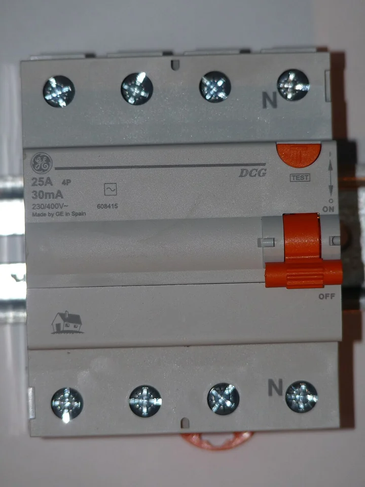

*안전성 검사에서 ELB는 **TEST 버튼**을 눌러 레버가 떨어지는지 확인한다. 정격 감도 전류 **30 mA**가 표시돼 있다. 자세한 동작은 [전동기 제어회로와 보호](전동기_제어회로와_보호.md#누전-차단기elb).*

### 교재(07절)의 안전성 검사 인증 테스트

교재는 안전검사 4항목을 **내전압, 절연저항, 누설전류, 접지 연속성**으로 묶고, 극성과 접지도통을 더해 설명한다.

| 시험 | 방법 | 확인하는 것 |
| --- | --- | --- |
| 내전압 | 절연부에 **고전압** 인가 (정상 전압 × 2 + 1,000 V, 120·240 V 제품은 1,250~1,500 VAC) | 위험 회로와 사용자 접촉부 사이 절연 장벽 |
| 절연저항 | 저항값을 읽음 (충전 → 유지 → 측정 → 방전) | 절연 상태, 정기 측정으로 절연 파괴 예측 |
| 누설전류 | 접지 단자가 없는 기기 **0.5 mA 이하** | 사용자에게 흐를 수 있는 전류 |
| 접지 연속성 | 낮은 DC 전류(1 A 미만) | 접지 경로가 이어졌는지 |
| 접지도통 (Ground Bond) | 높은 전류(25~30 A), 낮은 전압 | 고장 전류를 흘릴 만큼 접지 저항이 낮은지 |
| 극성 | 단자 확인 | 라인과 뉴트럴이 바뀌지 않았는지 |

$$V_{\text{내전압}} = 2 \times V_{\text{정상}} + 1000\ \text{V}$$

- 계산 예: 정상 동작 전압 220 V 제품 → 2 × 220 + 1,000 = **1,440 V**. 120 V 제품이면 1,240 V(실무에서는 1,250 V로 올림).
- 생산 라인 시험: 미국은 내전압·접지 연속성, 유럽은 여기에 접지도통을 더 요구한다.
- **불량 등급**: 치명(감전·화재 위험, 반드시 개선) / 중(사용에 뚜렷한 지장, 반드시 개선) / 경(기능과 무관, 개선 합의).
- **통전 시험**: 회로시험기를 낮은 저항 레인지에 두고 측정. 정상 = 고유 저항값, ∞ = 단선, 0 = 단락.

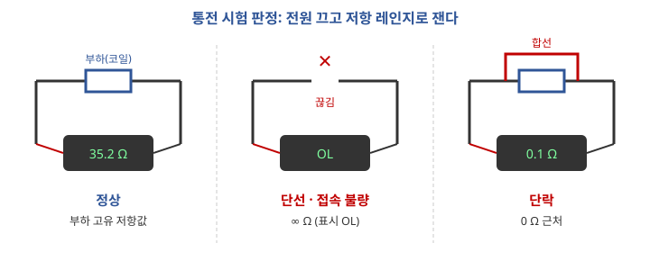

*같은 코일을 재도 결과는 셋 중 하나다. 선이 끊기면 전류가 못 흘러 **OL(∞)**, 어딘가 합선돼 부하를 건너뛰면 **0 Ω 근처**. "∞ = 단락"으로 바꿔 내는 함정에 주의.*

> [!question] 시험에서는
> - "내전압 시험은 정격 전류를 흘려 …" → **틀림**. 내전압은 **고전압**을 건다.
> - 접지 **연속성**(1 A 미만, 이어졌나) vs 접지**도통**(25~30 A, 충분히 낮은가)을 바꿔 쓴 보기.
> - 누설전류 기준 0.5 mA, NEC·GFCI 0.5 mA ("2 mA"는 틀린 보기).

## 5. 작업 안전

**직관**: 내가 작업하는 동안 **다른 사람이 스위치를 올리지 못하게** 하는 것이 LOTO(Lock Out, Tag Out)다. 차단기에 자물쇠를 채우고 이름표를 단 다음, 정말 전기가 없는지 검전기로 확인하고, 남은 전기(콘덴서)까지 빼고서야 손을 댄다.

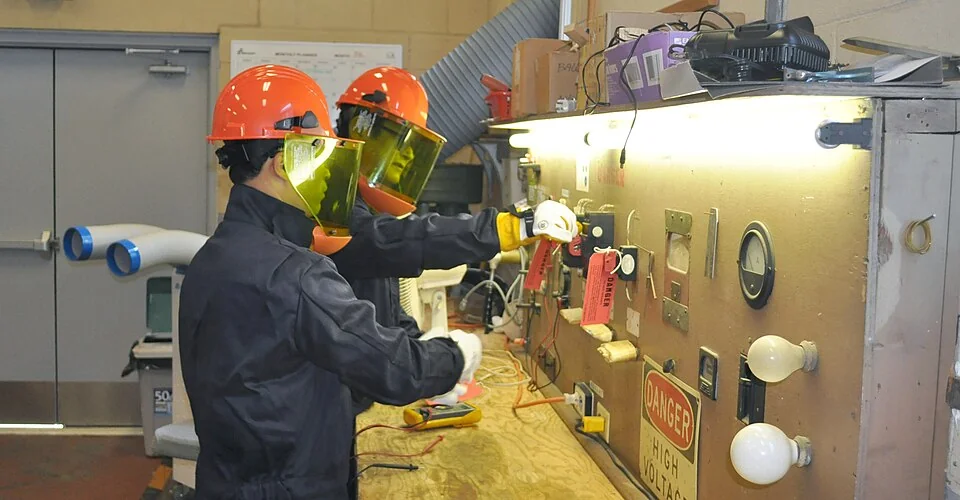

*패널 스위치에 걸린 빨간 **DANGER 꼬리표(Tag)** 가 보인다. 자물쇠(Lock)는 물리적으로 조작을 막고, 꼬리표는 누가·왜 잠갔는지 알린다. 열쇠는 작업자 본인이 가진다. 작업자는 보호구(면체·장갑)를 갖추고, 작업대의 멀티미터로 검전한다.*

- **정전 작업 순서**: 차단 → 잠금·표지(LOTO) → 검전 → 잔류 전하 방전 → 단락 접지 → 작업.

- 인버터·서보 드라이버는 전원을 꺼도 **DC 링크 콘덴서에 전압이 남는다** → 충전 표시등이 꺼질 때까지 대기.
- 감전 위험은 전류 크기와 시간에 좌우된다: 수 mA부터 느끼고, 수십 mA에서 위험. 그래서 ELB가 30 mA 기준.
- 인체 전류를 키우는 요인 (교재 07절): 전원 종류(**50/60 Hz 교류가 직류보다 위험**), 접촉 부위가 젖었는지, 신체 임피던스, 접촉 시간, 접촉 면적.
- 교재는 NEC가 젖은 장소에 **GFCI**(누전 차단 콘센트)를 요구하고, 접지 전류 **0.5 mA**가 수 ms 넘게 흐르면 차단한다고 설명한다.
- 보호구: 절연 장갑, 절연화, 보안경.

## 6. 보호 등급 (IP 코드)

**직관**: IP 코드는 외함이 **"무엇을 막는가"** 를 두 자리 숫자로 적은 것이다. 앞자리는 손가락·공구·먼지 같은 **고체**, 뒷자리는 **물**. 숫자가 클수록 더 잘 막는다.

- **IP 첫째 숫자**: 고체(먼지) 보호 0~6. **둘째 숫자**: 물 보호 0~8.
- 예: IP65 = 먼지 완전 차단 + 분사수 보호. IP67 = 일시 침수 보호.

| 숫자 | 첫째: 고체 보호 | 둘째: 물 보호 |
| --- | --- | --- |
| 0 | 보호 없음 | 보호 없음 |
| 1 | 지름 50 mm 이상 (손등) | 수직 낙하 물방울 |
| 2 | 지름 12.5 mm 이상 (손가락) | 15° 기울였을 때 물방울 |
| 3 | 지름 2.5 mm 이상 (공구) | 살수(분무) |
| 4 | 지름 1 mm 이상 (가는 전선) | 튀는 물 |
| 5 | 먼지 보호 (약간 들어와도 동작 지장 없음) | 분사수 |
| 6 | **먼지 완전 차단** | 강한 분사수 |
| 7 | — | **일시 침수** |
| 8 | — | 연속 침수 |

## 그림

## 기출 포인트

옛 생산자동화산업기사 2016–2020년 14회분에는 조립·검사·안전 문제가 측정기 일부 말고는 거의 없었다. 새 출제기준 범위라 교재 예제로 대비한다.

**교재 예제 유형** (Win-Q 2025 PART 01 CHAPTER 02, 04~07절): 제너다이오드 기호(그림), 인덱스 테이블을 각도·방향 제어로 돌리는 기기(스테핑 모터), 전압-시간 파형 계측기(오실로스코프), MSA 안정성 설명 중 틀린 것(편의의 총합 = 선형성), 안전 테스트 설명 중 틀린 것(내전압은 고전압 인가), NEC 차단 기준(0.5 mA).

## 관련 단원

- [전기 기초와 회로](전기_기초와_회로.md)
- [전자 소자와 전원 회로](전자_소자와_전원_회로.md)
- [전동기 제어회로와 보호](전동기_제어회로와_보호.md)
- [DC 모터와 스테핑 모터](DC모터와_스테핑모터.md)
- [공압 밸브](../30_공유압/공압_밸브.md)
- [PLC 시뮬레이션과 수정보완](PLC_시뮬레이션과_수정보완.md)

## 체크리스트

- [ ] KEC 전선 색상(L1·L2·L3·N·PE)을 외운다
- [ ] 멀티미터·메거·클램프 미터의 용도와 주의점을 구분한다
- [ ] KEC 저압 절연 저항 기준을 말한다
- [ ] 오실로스코프 화면에서 주파수와 전압을 읽는다
- [ ] 정전 작업 순서를 말한다
- [ ] IP 코드 두 숫자의 의미를 안다
- [ ] 계측기 4종(오실로스코프, 스펙트럼·로직·네트워크 애널라이저)의 축과 쓰임을 구분한다
- [ ] MSA 5요소(편의, 안정성, 선형성, 반복성, 재현성)를 구분한다
- [ ] 내전압 시험 전압을 계산하고 접지 연속성과 접지도통을 구분한다
- [ ] 통전 시험에서 단선과 단락을 판정한다

## 참고

- [큐넷 자동화설비산업기사 출제기준](https://www.q-net.or.kr/crf005.do?id=crf00503&jmCd=2034)
- 한국전기설비규정(KEC) – 전선 식별, 저압 전로의 절연 성능

### 그림 출처

위키미디어 공용(Wikimedia Commons)과 Openverse에서 가져온 공개 라이선스 자료이고, 노트에 맞게 크기를 줄이고 WebP로 변환했다.

| 그림 | 작성자 | 라이선스 | 출처 |
| --- | --- | --- | --- |
| [Dornbirn-Split ring terminals assortment-01ASD](https://commons.wikimedia.org/wiki/File:Dornbirn-Split_ring_terminals_assortment-01ASD.jpg) | Asurnipal | [CC BY-SA 4.0](https://creativecommons.org/licenses/by-sa/4.0) | Wikimedia Commons |
| [Wire ferrules with and without insulation](https://commons.wikimedia.org/wiki/File:Wire_ferrules_with_and_without_insulation.jpg) | Simon A. Eugster | [CC BY-SA 3.0](https://creativecommons.org/licenses/by-sa/3.0) | Wikimedia Commons |
| [Wire stripper](https://commons.wikimedia.org/wiki/File:Wire_stripper.jpg) | Raul654 | [CC BY-SA 3.0](http://creativecommons.org/licenses/by-sa/3.0/) | Wikimedia Commons |
| [Digital Multimeter Aka](https://commons.wikimedia.org/wiki/File:Digital_Multimeter_Aka.jpg) | André Karwath aka Aka | [CC BY-SA 2.5](https://creativecommons.org/licenses/by-sa/2.5) | Wikimedia Commons |
| [Insulation testers by Megger](https://commons.wikimedia.org/wiki/File:Insulation_testers_by_Megger.jpg) | Megger Ltd. | [CC BY 3.0](https://creativecommons.org/licenses/by/3.0) | Wikimedia Commons |
| [Sine wave 10 kHz displayed on analog oscilloscope](https://commons.wikimedia.org/wiki/File:Sine_wave_10_kHz_displayed_on_analog_oscilloscope.jpg) | Pittigrilli | [CC BY-SA 4.0](https://creativecommons.org/licenses/by-sa/4.0) | Wikimedia Commons |
| [Voltage test light active](https://commons.wikimedia.org/wiki/File:Voltage_test_light_active.jpg) | Simon A. Eugster | [CC BY-SA 4.0](https://creativecommons.org/licenses/by-sa/4.0) | Wikimedia Commons |
| [4-pole GE residual current device 30mA 400V](https://commons.wikimedia.org/wiki/File:4-pole_GE_residual_current_device_30mA_400V.JPG) | Dmitry G | [CC BY-SA 3.0](https://creativecommons.org/licenses/by-sa/3.0) | Wikimedia Commons |
| [Lockout Tagout (14853353063)](https://commons.wikimedia.org/wiki/File:Lockout_Tagout_(14853353063).jpg) | NAVFAC | 퍼블릭 도메인 | Wikimedia Commons |

직접 그린 그림(SVG, 이 볼트용으로 새로 작성): 배선 접지, KEC 전선색상, 반도체 소자기호, 메거 측정, 클램프미터 상쇄, 접지저항 3극법, 오실로스코프 읽기, 통전시험 판정.

