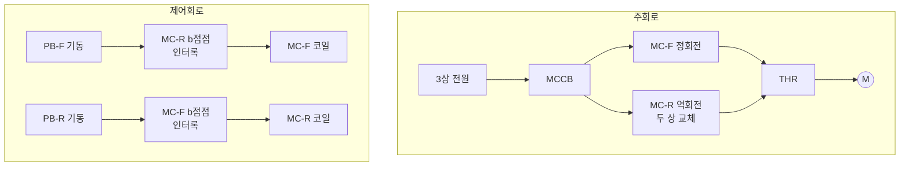

# 전동기 제어회로와 보호

> [!summary] 핵심 요약
> - 전동기 회로는 **주회로**(전원 → 차단기 → 전자접촉기 → 과부하 계전기 → 모터)와 **제어회로**(버튼·접점·코일)로 나뉜다.
> - **정역 회로**: 정회전 MC와 역회전 MC가 두 상을 바꿔 연결. 서로의 b접점으로 **인터록**.
> - **Y-Δ 회로**: 메인 MC + Y용 MC + Δ용 MC, 타이머로 Y → Δ 전환. Y·Δ MC끼리 인터록.
> - 보호: 단락은 **MCCB·퓨즈**, 과부하는 **열동 계전기(THR)·EOCR**, 누전은 **ELB**.

> [!warning] 자주 틀리는 포인트
> - 인터록이 없으면 정·역 MC가 동시에 붙어 **상간 단락**. 전기적 인터록 + 기계적 인터록을 함께 쓰기도 한다.
> - 열동 계전기(THR)는 **과부하** 보호용이다. 단락 전류는 차단기가 끊는다.
> - THR이 동작한 뒤에는 원인을 없애고 **수동 복귀**(리셋)한다.
> - 정지 버튼은 **b접점**, 기동 버튼은 **a접점**. 비상 정지는 **b접점·직렬**, 머리가 큰 빨간 버섯형.
> - 누전차단기는 일반적으로 **정격 감도 전류 30 mA, 동작 시간 0.03초 이내**(인체 보호용).

## 개념 정리

### 주요 기기

| 기기 | 기호(관용) | 역할 |
| --- | --- | --- |
| 배선용 차단기 | MCCB | 과전류·단락 차단, 개폐 |
| 누전 차단기 | ELB (ELCB) | 누전(지락) 차단 |
| 전자 접촉기 | MC | 코일 여자로 주접점 개폐, 원격·자동 운전 |
| 열동형 과부하 계전기 | THR | 바이메탈로 과부하 검출, b접점 개방 |
| 전자식 과전류 계전기 | EOCR | 전류 검출, 결상·구속까지 보호, 정밀 |
| 전자 개폐기 | MS | MC + THR 조합 |
| 보조 계전기 | R (CR) | 제어회로 접점 증폭·분기 |
| 타이머 | T | 한시 접점 (ON 딜레이·OFF 딜레이) |
| 푸시 버튼 | PB | 기동(a접점), 정지(b접점) |
| 표시등 | PL / RL·GL | 운전(적색)·정지(녹색) 표시 (관례) |

### 기본 회로

| 회로 | 구성 | 동작 |
| --- | --- | --- |
| 자기유지 | 기동 PB ∥ MC a접점, 정지 PB(b) 직렬 | 기동 후 손을 떼도 유지 |
| 인터록 | 상대 MC b접점을 직렬 | 동시 동작 금지 |
| 촌동(인칭) | 자기유지 없이 PB 누르는 동안만 | 위치 맞춤 |
| 한시 회로 | 타이머 접점 사용 | 일정 시간 후 동작 |
| 2개소 제어 | 기동 PB 병렬, 정지 PB 직렬 | 두 곳에서 조작 |

### 정역 운전 회로

- 정회전 MC-F: L1·L2·L3 → U·V·W
- 역회전 MC-R: L1·L2·L3 → **W·V·U** (두 상 교체)
- 제어 회로: MC-F 코일 앞에 MC-R b접점, MC-R 코일 앞에 MC-F b접점.
- 운전 중 바로 반대 방향으로 바꾸지 않고 **정지 후 전환**(필요하면 타이머 지연).

### Y-Δ 기동 회로

1. 기동 PB → MC-M(메인) + MC-Y 투입 → Y 기동, 타이머 시작.
2. 설정 시간 후 타이머 접점 → MC-Y 개방 → MC-Δ 투입 → Δ 운전.
3. MC-Y와 MC-Δ는 서로 인터록 (동시 투입 시 단락).
- 전동기 단자 6개(U1·V1·W1, U2·V2·W2)를 모두 끌어내야 한다.

### 시험 운전과 유지보수

| 시기 | 점검 항목 |
| --- | --- |
| 운전 전 | 절연 저항, 배선·단자 조임, 접지, THR 설정값(정격 전류 기준), 회전 방향 |
| 운전 중 | 전류(정격 이하, 상 불평형), 진동, 소음, 온도 상승, 냄새 |
| 정기 | 베어링 윤활·교체, 접점 마모(MC), 냉각 팬, 먼지 청소, 절연 저항 추이 |

- **결상 운전**: 한 상이 끊기면 나머지 상 전류가 커져 소손 → EOCR(결상 보호) 사용.
- 절연 저항은 **메거(절연 저항계)** 로 측정 → [전기전자장치 조립과 검사](전기전자장치_조립과_검사.md).

## 그림

## 관련 단원

- [유도전동기와 인버터](유도전동기와_인버터.md)
- [논리회로](논리회로.md)
- [전기전자장치 조립과 검사](전기전자장치_조립과_검사.md)

## 체크리스트

- [ ] MCCB·ELB·MC·THR·EOCR의 역할을 구분한다
- [ ] 자기유지·인터록 회로를 그린다
- [ ] 정역 회로에서 상 교체와 인터록 위치를 안다
- [ ] Y-Δ 기동 회로의 MC 3개 동작 순서를 말한다
- [ ] 결상 운전의 위험과 대책을 설명한다
- [ ] 운전 전·중 점검 항목을 말한다

## 참고

- [큐넷 자동화설비산업기사 출제기준](https://www.q-net.or.kr/crf005.do?id=crf00503&jmCd=2034)
