# 전동기 제어회로와 보호

> [!summary] 핵심 요약
> - 전동기 회로는 **주회로**(전원 → 차단기 → 전자접촉기 → 과부하 계전기 → 모터)와 **제어회로**(버튼·접점·코일)로 나뉜다.
> - **정역 회로**: 정회전 MC와 역회전 MC가 두 상을 바꿔 연결. 서로의 b접점으로 **인터록**.
> - **Y-Δ 회로**: 메인 MC + Y용 MC + Δ용 MC, 타이머로 Y → Δ 전환. Y·Δ MC끼리 인터록.
> - 보호: 단락은 **MCCB·퓨즈**, 과부하는 **열동 계전기(THR)·EOCR**, 누전은 **ELB**.

> [!warning] 자주 틀리는 포인트
> - 인터록이 없으면 정·역 MC가 동시에 붙어 **상간 단락**. 전기적 인터록 + 기계적 인터록을 함께 쓰기도 한다.
> - 열동 계전기(THR)는 **과부하** 보호용이다. 단락 전류는 차단기가 끊는다.
> - THR이 동작한 뒤에는 원인을 없애고 **수동 복귀**(리셋)한다.
> - 정지 버튼은 **b접점**, 기동 버튼은 **a접점**. 비상 정지는 **b접점·직렬**, 머리가 큰 빨간 버섯형.
> - 누전차단기는 일반적으로 **정격 감도 전류 30 mA, 동작 시간 0.03초 이내**(인체 보호용).
> - **a접점 = 평소 열림(NO)**, 동작하면 닫힘. **b접점 = 평소 닫힘(NC)**, 동작하면 열림. 정의를 바꿔 낸다.
> - **인칭(촌동)** 회로의 목적은 위치 맞춤·점검 시 **조금씩 움직여 안전하게** 조작하는 것. 전압·토크·기동 전류와는 관계없다.
> - "스위치를 누르면 바로 동작하고 설정 시간 뒤 멈추는" 회로는 **일정 시간 동작 회로**. 누른 뒤 늦게 동작하는 것은 지연 동작 회로.
> - 시퀀스의 **검출부**는 리밋·압력·온도·광전 스위치처럼 상태를 알아내는 기기. **타이머는 검출부가 아니라 제어부(명령 처리)**.
> - 단락 같은 큰 과전류로부터 회로를 보호하는 것은 **차단기(MCCB)**. 릴레이·타이머·카운터는 보호 기기가 아니다.
> - 전자식(반도체) 제어는 계전기식보다 빠르고 수명이 길지만 **전기적 노이즈에 약하다**.

## 학습 목표

이 단원을 마치면 다음을 할 수 있어야 한다.

1. 전동기 회로를 주회로와 제어회로로 나누고, 각 회로에 들어가는 기기를 순서대로 말한다.
2. MCCB·ELB·MC·THR·EOCR·MS의 역할을 구분하고, 단락·과부하·누전·결상을 각각 어느 기기가 막는지 짝짓는다.
3. a접점·b접점을 정의하고, 자기유지·인터록·2개소 제어·인칭 회로를 그린다.
4. 지연 동작·일정 시간 동작·지연 복귀 회로를 타임차트로 구분한다.
5. 정역 회로의 상 교체와 인터록 위치, Y-Δ 기동 회로의 MC 3개 동작 순서를 설명한다.
6. 운전 전·운전 중·정기 점검 항목과 결상 운전의 위험·대책을 말한다.

## 한눈에 보기

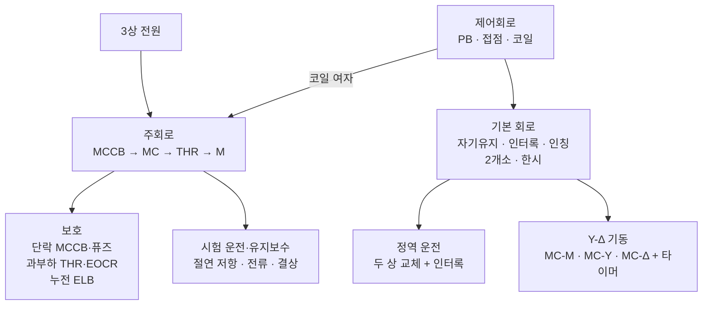

## 1. 주회로와 제어회로

**직관**: 전동기 회로는 **수도관과 수도꼭지 손잡이**로 나눠 생각하면 쉽다. 굵은 수도관(주회로)으로는 모터를 돌리는 큰 전류가 흐르고, 손잡이(제어회로)는 작은 전류로 버튼·접점·코일을 움직여 그 큰 관을 열고 닫는다. 둘을 잇는 것이 **전자접촉기(MC)** — 제어회로의 코일이 여자되면 주회로의 접점이 닫힌다.

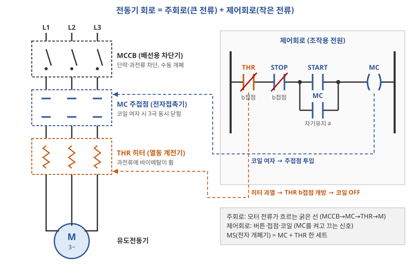

*왼쪽 굵은 세 선이 **주회로**다. 위에서부터 MCCB(단락 차단) → MC 주접점(개폐) → THR 히터(과부하 검출) → 모터 순서를 외워 두자. 오른쪽 **제어회로**에서 START를 누르면 MC 코일이 여자되고(파란 점선) 주접점 3개가 한꺼번에 닫혀 모터가 돈다. 과부하로 히터가 달아오르면(주황 점선) 제어회로 맨 앞의 THR b접점이 열려 코일이 떨어진다 — THR은 주회로를 직접 끊는 것이 아니라 **제어회로를 끊어 MC가 주회로를 끊게** 하는 것이다.*

- 주회로: 전원 → 차단기 → 전자접촉기 → 과부하 계전기 → 모터.
- 제어회로: 버튼·접점·코일. 주회로에서 두 선을 따거나 별도 조작 전원(예: AC 220 V, DC 24 V)을 쓴다.
- MC 한 대와 THR 한 대를 묶은 것이 **전자 개폐기(MS)** 다.

## 2. 주요 기기

**직관**: 기기 이름이 길지만 역할은 "끊는 것(차단기)", "붙였다 떼는 것(접촉기)", "지켜보다 신호 주는 것(계전기)" 세 종류다. 차단기는 사고 전류를 **직접** 끊고, 계전기는 이상을 감지해 **접점 신호**만 내준다.

| 배선용 차단기 (MCCB) | 전자 접촉기 (MC) |
| --- | --- |
| 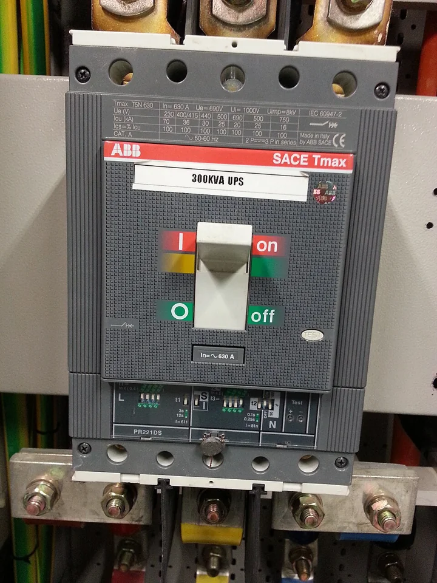 | 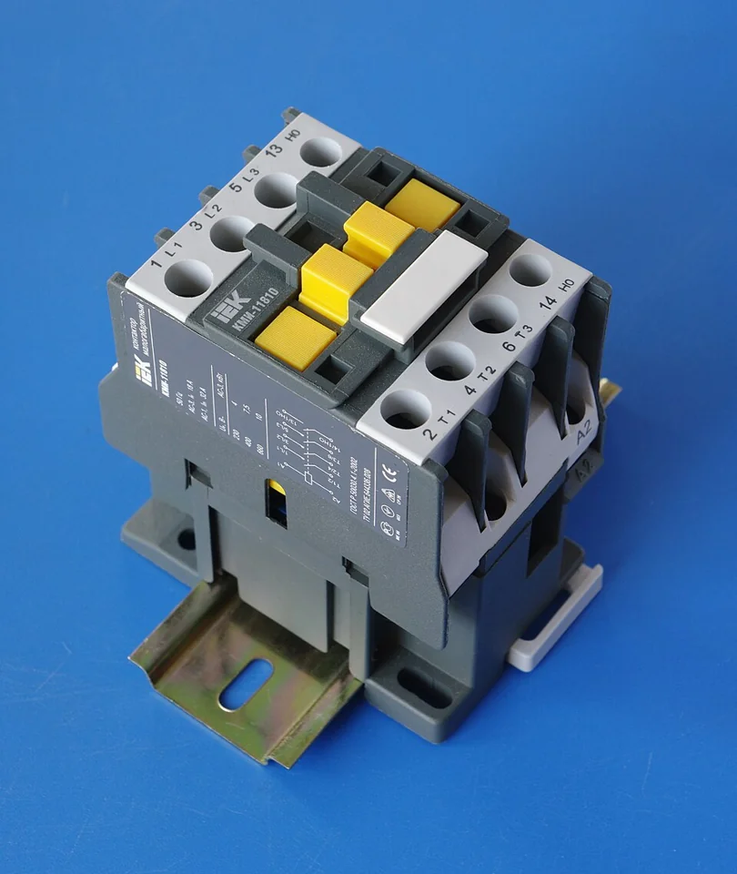 |
| 앞면의 큰 레버로 **사람이 직접** 켜고 끈다. 아래쪽 다이얼이 과전류·단락 트립 값을 정하는 부분이다. 위아래 굵은 단자에 부스바가 물려 있다 — 주회로 맨 앞에 서는 기기다. | 위쪽 1L1·3L2·5L3로 전원이 들어와 아래 2T1·4T2·6T3로 나간다(주접점 3극). 13–14 NO는 자기유지에 쓰는 **보조 a접점**이다. 코일 단자(A1·A2)에 전압이 걸리면 가운데 노란 가동부가 빨려 들어가 접점이 닫힌다. |

### 주요 기기 정리표

| 기기 | 기호(관용) | 역할 |
| --- | --- | --- |
| 배선용 차단기 | MCCB | 과전류·단락 차단, 개폐 |
| 누전 차단기 | ELB (ELCB) | 누전(지락) 차단 |
| 전자 접촉기 | MC | 코일 여자로 주접점 개폐, 원격·자동 운전 |
| 열동형 과부하 계전기 | THR | 바이메탈로 과부하 검출, b접점 개방 |
| 전자식 과전류 계전기 | EOCR | 전류 검출, 결상·구속까지 보호, 정밀 |
| 전자 개폐기 | MS | MC + THR 조합 |
| 보조 계전기 | R (CR) | 제어회로 접점 증폭·분기 |
| 타이머 | T | 한시 접점 (ON 딜레이·OFF 딜레이) |
| 푸시 버튼 | PB | 기동(a접점), 정지(b접점) |
| 표시등 | PL / RL·GL | 운전(적색)·정지(녹색) 표시 (관례) |

> [!tip] 감 잡기
> 이름 끝 글자로 나눈다. **~차단기**(MCCB·ELB)는 사고 전류를 스스로 끊는다. **~접촉기**(MC)는 명령대로 붙였다 뗀다. **~계전기**(THR·EOCR·R)는 신호용 접점만 바꾼다.

## 3. 보호 기기: 단락·과부하·누전

**직관**: 같은 "전류가 너무 많다"도 종류가 다르다. **과부하**는 정격의 몇 배 정도가 오래 흐르는 것(모터가 무거운 짐을 끌 때) — 천천히 데워지므로 조금 기다렸다 끊어도 된다. **단락**은 정격의 수십 배가 순식간에 흐르는 것 — 즉시 끊어야 한다. **누전**은 전류가 사람 몸이나 외함을 통해 땅으로 새는 것 — 양은 작아도 사람에게 위험하다. 셋을 각기 다른 기기가 맡는다.

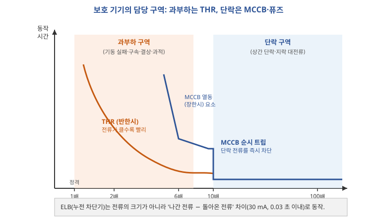

*주황 곡선(THR)은 **반한시** 특성이다 — 전류가 클수록 빨리, 작을수록 천천히 동작해서 모터 기동 전류처럼 잠깐 큰 전류에는 견디고, 과부하가 계속될 때만 끊는다. 파란 선(MCCB)은 과부하 구역에서는 THR보다 위(더 느림)에 있어 THR에 일을 맡기고, 단락 구역에 들어서면 **순시 트립**으로 바로 끊는다. 이 나눠 맡기가 "THR = 과부하, MCCB = 단락"의 이유다. 그래프는 개념도이며 실제 값은 기기마다 다르다.*

| 이상 | 담당 기기 | 동작 원리 |
| --- | --- | --- |
| 단락 (큰 과전류) | MCCB, 퓨즈 | 전자 트립(순시) 또는 퓨즈 용단 |
| 과부하 | THR, EOCR | THR은 바이메탈이 휨, EOCR은 CT로 전류 검출 |
| 결상·구속 | EOCR | 상별 전류 비교·기동 지연 감시 |
| 누전(지락) | ELB | 나간 전류와 돌아온 전류의 차(영상 전류) 검출 |

### 열동 계전기(THR)와 바이메탈

THR 안에는 열팽창률이 다른 두 금속을 붙인 **바이메탈**이 있다. 모터 전류가 히터를 데우면 바이메탈이 팽창이 작은 쪽으로 휘면서 b접점을 밀어 연다. 열로 움직이므로 동작이 느리고(반한시), 식은 뒤 **수동 복귀**(리셋 버튼)해야 다시 쓸 수 있다.

*처음에는 곧던 두 겹 막대가 열을 받으면 한쪽으로 활처럼 휜다. 바깥쪽(파랑)이 더 많이 늘어나는 금속, 안쪽(빨강)이 덜 늘어나는 금속이다. THR에서는 이 휘는 끝이 b접점을 밀어 연다. (Obsidian에서 움직이는 그림으로 보인다.)*

- THR 설정값은 모터 **정격 전류** 기준으로 맞춘다(운전 전 점검 항목).
- **EOCR**은 바이메탈 대신 전류 센서(CT)와 전자 회로로 판단해 정밀하고, **결상·구속**까지 잡아낸다.

### 누전 차단기(ELB)

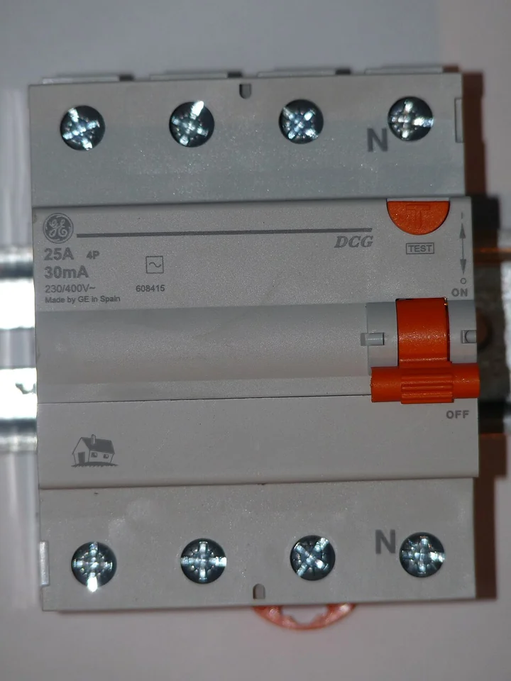

*왼쪽 글씨 **25A 4P 30mA**가 정격 전류·극수·정격 감도 전류다. 3상 3선에 중성선(N)까지 4극을 모두 지나게 해서 나간 전류와 돌아온 전류를 비교한다. 오른쪽 위 주황색 **TEST 버튼**을 누르면 일부러 작은 누설 전류를 만들어 레버가 OFF로 떨어지는지 확인한다.*

- 누전차단기는 일반적으로 정격 감도 전류 30 mA, 동작 시간 0.03초 이내 (인체 보호용).
- 정상일 때는 나간 전류 = 돌아온 전류. 그 차이가 생기면 어딘가로 새고 있다는 뜻이다.

> [!question] 시험에서는
> "단락 같은 큰 과전류로부터 회로를 보호하는 기기"를 고르는 문제에 THR·릴레이·타이머·카운터가 함께 나온다. 정답은 **차단기(MCCB)**. THR은 과부하, 릴레이·타이머·카운터는 보호 기기가 아니다.

## 4. 접점과 기본 시퀀스 회로

**직관**: 접점은 **문**이다. a접점은 평소 **닫혀 있는 문이 아니라 열려 있는 틈** — 누르거나 코일이 끌어당기면 그제야 이어진다. b접점은 평소 **이어져 있다가** 누르면 끊긴다. 그래서 "누르면 켜져야 하는" 기동 버튼은 a접점, "누르면 끊겨야 하는" 정지 버튼은 b접점이다.

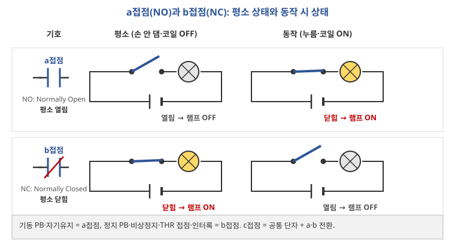

*같은 램프 회로에 접점만 바꿔 끼운 그림이다. 위 줄 **a접점**: 평소 날이 들려 있어 램프 OFF, 동작하면 닫혀 ON. 아래 줄 **b접점**: 평소 붙어 있어 램프 ON, 동작하면 열려 OFF. 기호에서 사선(/)이 그어진 것이 b접점이다.*

- **a접점 = 평소 열림(NO)**, 동작하면 닫힘. **b접점 = 평소 닫힘(NC)**, 동작하면 열림.
- 계전기는 코일 하나가 a·b접점 여러 개를 한꺼번에 바꾼다.

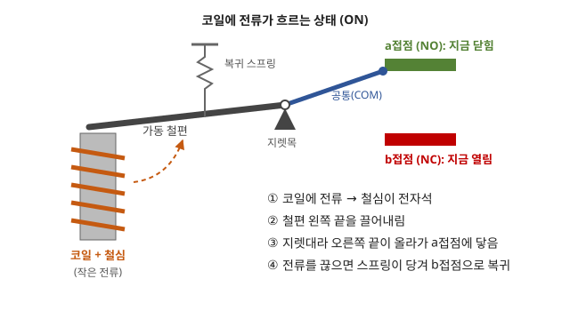

*코일에 전류가 흐르는 상태다. 가동 철편이 내려가면 지렛대 반대 끝이 올라가 **a접점은 닫히고 b접점은 열린다**. 전류를 끊으면 복귀 스프링이 되돌려 놓는다. MC도 같은 원리이며, 접점이 굵어 큰 전류를 끊을 수 있을 뿐이다.*

### 기본 회로

| 회로 | 구성 | 동작 |
| --- | --- | --- |
| 자기유지 | 기동 PB ∥ MC a접점, 정지 PB(b) 직렬 | 기동 후 손을 떼도 유지 |
| 인터록 | 상대 MC b접점을 직렬 | 동시 동작 금지 |
| 촌동(인칭) | 자기유지 없이 PB 누르는 동안만 | 위치 맞춤 |
| 한시 회로 | 타이머 접점 사용 | 일정 시간 후 동작 |
| 2개소 제어 | 기동 PB 병렬, 정지 PB 직렬 | 두 곳에서 조작 |
| 지연 동작 (ON 딜레이) | 타이머 a접점(한시 동작) | 입력 후 설정 시간 뒤 출력 ON |
| 일정 시간 동작 | 자기유지 + ON 딜레이 타이머의 한시 동작 b접점 | 입력 즉시 ON, 설정 시간 뒤 OFF |
| 지연 복귀 (OFF 딜레이) | OFF 딜레이 타이머 | 입력 OFF 후 설정 시간 뒤 OFF |
| 우선 회로 | 먼저 들어온 쪽이 상대를 막음 | 선착 우선, 신입 우선 |

### 자기유지와 인칭

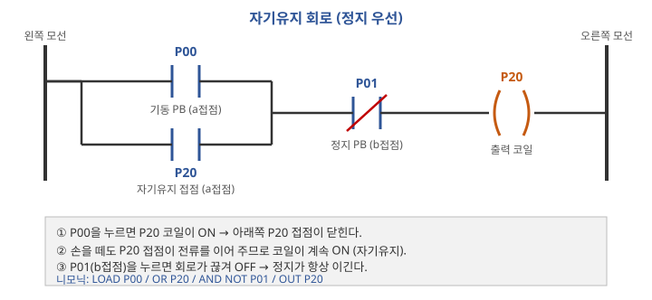

*PLC 주소로 그린 자기유지 회로지만 릴레이 회로와 똑같다. 기동 PB 아래에 **자기 자신의 a접점**을 병렬로 달아, 손을 떼도 그 접점이 전류를 이어 준다. 정지 PB(b접점)는 직렬이라 누르는 순간 모든 줄이 끊긴다 — 정지가 항상 이기는 **정지 우선** 회로다.*

- **인칭(촌동)** 은 이 그림에서 자기유지 접점(아래 줄)을 뺀 회로다. 누르는 동안만 돌고 손을 떼면 멈추므로 위치 맞춤·점검 때 조금씩 안전하게 움직인다.

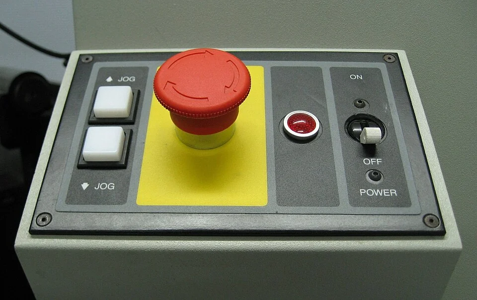

*왼쪽 **JOG** 버튼 두 개가 인칭(촌동) 버튼이다 — 누르는 동안만 위·아래로 조금씩 움직인다. 가운데 노란 바탕 위의 **빨간 버섯형** 버튼이 비상 정지로, 손바닥으로 세게 쳐도 누르기 쉽게 머리가 크다. 비상 정지는 **b접점**이고 제어회로에 **직렬**로 들어가 누르는 즉시 모든 줄을 끊는다. 눌린 채로 잠기며, 머리의 화살표 방향으로 돌려야 풀린다.*
### 2개소 제어

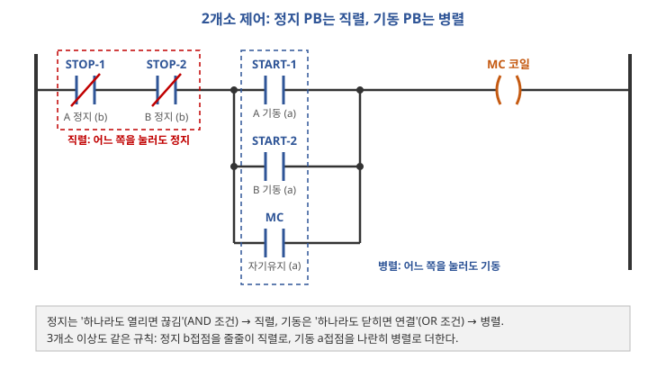

*빨간 점선 상자(정지)는 **직렬** — 둘 중 하나만 열려도 줄이 끊긴다. 파란 점선 상자(기동)는 **병렬** — 셋 중 하나만 닫혀도 이어진다. 자기유지 접점이 기동 PB들과 같은 병렬 묶음에 들어 있는 점도 보자.*

### 타이머 회로: 지연 동작·지연 복귀·일정 시간 동작

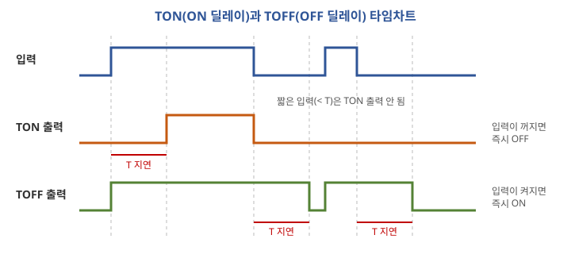

*가운데 줄이 **지연 동작(ON 딜레이)** — 입력 뒤 T만큼 늦게 켜진다. 아래 줄이 **지연 복귀(OFF 딜레이)** — 입력이 꺼져도 T만큼 더 켜져 있다. 입력이 T보다 짧으면 ON 딜레이 출력은 아예 나오지 않는다는 점도 그림에서 확인할 수 있다.*

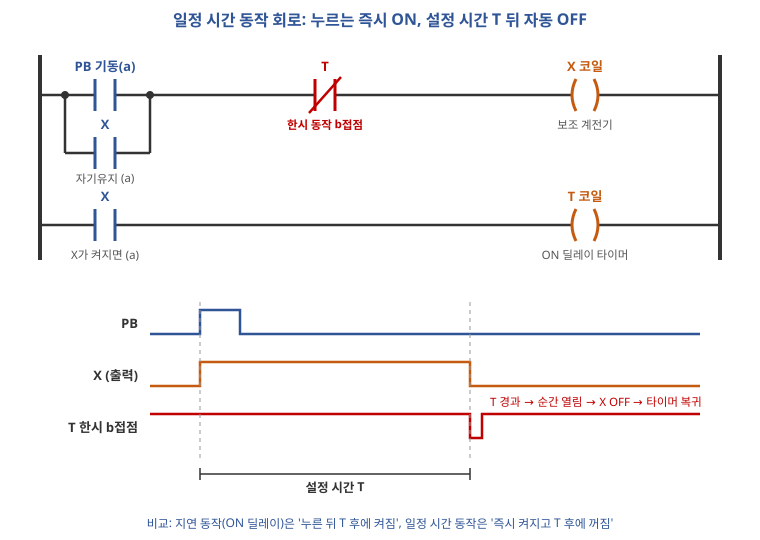

*PB를 누르면 X가 **즉시** 켜져 자기유지되고, 동시에 타이머가 시간을 잰다. T가 지나면 타이머의 **한시 동작 b접점**이 열려 X가 떨어지고, X가 꺼지면서 타이머도 복귀한다. "누르면 바로 동작, 설정 시간 뒤 멈춤" = **일정 시간 동작 회로**다.*

> [!question] 시험에서는
> "스위치를 누르면 바로 동작하고 설정 시간 뒤 멈추는" 회로의 이름을 묻는다. 정답은 **일정 시간 동작 회로**. "누른 뒤 늦게 동작"하는 지연 동작 회로, "입력이 꺼진 뒤 늦게 꺼지는" 지연 복귀 회로와 구분한다.

## 5. 시퀀스 제어계의 구성

**직관**: 시퀀스 제어는 사람의 몸과 같다. 버튼은 **명령**, 릴레이·PLC는 **두뇌**(제어부), 전자접촉기·솔레노이드는 **근육**(조작부), 리밋·근접 스위치는 **감각 기관**(검출부)이다. 타이머는 두뇌 안의 시계라서 검출부가 아니라 **제어부**에 속한다.

**시퀀스 제어계 구성**

**접점 기호 읽기**: 수동 조작(푸시버튼), 기계적 동작(리밋 스위치, 롤러 표시가 붙음), 한시 동작(타이머, 괄호·낙하산 모양), 계전기 코일·접점을 기호로 구분한다. 리밋 스위치는 **기계적 접촉으로 동작하는 접점** 기호를 쓴다.

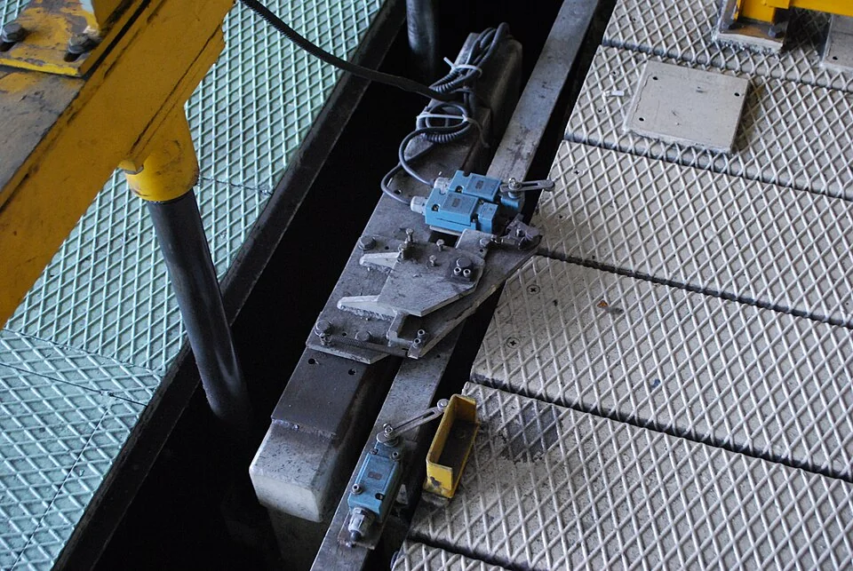

*리밋 스위치는 움직이는 물체가 롤러 레버를 **기계적으로 밀어** 접점을 바꾼다. 그래서 기호에도 롤러(작은 원)가 붙는다. 대표적인 **검출부** 기기다.*

| 구분 | 계전기(유접점) 방식 | 전자(무접점·반도체) 방식 |
| --- | --- | --- |
| 속도 | 느림 (기계 동작) | 빠름 |
| 수명 | 접점 마모로 짧음 | 길다 |
| 노이즈 | 강함 | **약함** |
| 과부하 내량 | 큼 | 작음 |

- 전자식(반도체) 제어는 계전기식보다 빠르고 수명이 길지만 전기적 노이즈에 약하다.
- 유접점·무접점 비교는 [논리회로](논리회로.md) 참고.

## 6. 정역 운전 회로

**직관**: 3상 모터는 세 선 중 **두 선만 바꿔 끼우면** 회전 자계 방향이 반대가 된다. 그래서 정회전 MC와 역회전 MC 두 대를 두고, 역회전 MC는 두 상을 바꿔 연결한다. 문제는 둘이 동시에 붙는 순간 — 바꿔 끼운 두 상이 MC를 통해 직접 이어져 **상간 단락**이 난다. 그래서 서로 상대의 b접점을 자기 코일 앞에 넣는다(인터록).

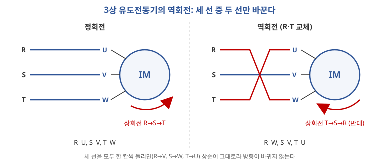

*왼쪽 정회전은 R–U, S–V, T–W 그대로, 오른쪽 역회전은 **R과 T만 교차**시켰다. 가운데 S–V는 그대로다. 세 선을 모두 한 칸씩 돌리면 상순이 그대로라 방향이 바뀌지 않는다는 아래 문장도 함께 기억하자.*

- 정회전 MC-F: L1·L2·L3 → U·V·W
- 역회전 MC-R: L1·L2·L3 → **W·V·U** (두 상 교체)
- 제어 회로: MC-F 코일 앞에 MC-R b접점, MC-R 코일 앞에 MC-F b접점.
- 운전 중 바로 반대 방향으로 바꾸지 않고 **정지 후 전환**(필요하면 타이머 지연).

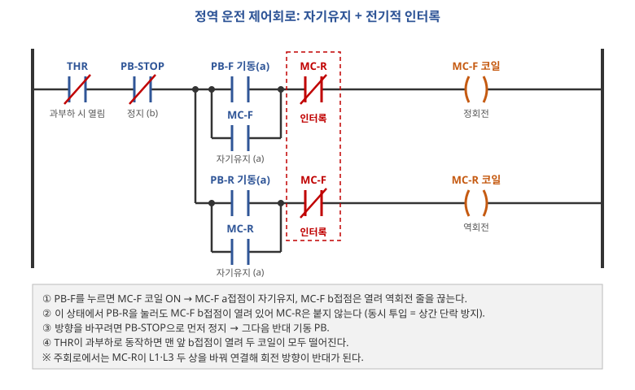

*빨간 점선 상자가 **인터록**이다. 위 줄(정회전) 코일 앞에는 **MC-R의 b접점**, 아래 줄(역회전) 코일 앞에는 **MC-F의 b접점**이 있다. MC-F가 붙어 있는 동안 아래 줄의 MC-F b접점이 열려 있으므로 PB-R을 눌러도 MC-R은 붙지 않는다. 맨 앞의 THR·정지 b접점은 두 줄이 같이 쓴다.*

> [!tip] 감 잡기
> 인터록 접점은 "**상대** 이름의 **b**접점"이다. 자기 이름의 a접점은 자기유지, 상대 이름의 b접점은 인터록 — 이 짝을 그림으로 외우면 회로도 문제에서 틀리지 않는다. 전기적 인터록에 더해 두 MC를 기계적으로 막는 **기계적 인터록**을 함께 쓰기도 한다.

## 7. Y-Δ 기동 회로

**직관**: 큰 모터를 바로 Δ로 기동하면 기동 전류가 크게 튄다. 처음 몇 초는 권선에 걸리는 전압을 $1/\sqrt{3}$로 낮춘 **Y 결선**으로 돌리고, 속도가 붙으면 **Δ 결선**으로 바꾼다. 그 바꿔 묶기를 MC 두 대(MC-Y, MC-Δ)가 하고, 언제 바꿀지는 타이머가 정한다. 전압·전류·토크 비율은 [유도전동기와 인버터](유도전동기와_인버터.md#y-δ-기동)에서 다룬다.

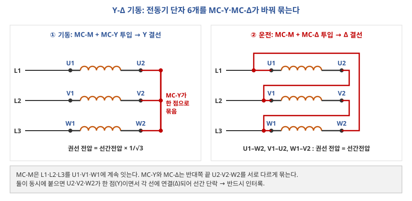

*모터 권선 세 개의 **양 끝 6단자**를 모두 밖으로 꺼낸 그림이다. 왼쪽(기동)은 MC-Y가 U2·V2·W2를 한 점으로 묶어 Y, 오른쪽(운전)은 MC-Δ가 각 권선의 끝을 다음 권선의 시작에 이어 Δ가 된다. 두 MC가 동시에 붙으면 묶인 한 점에 세 선이 바로 이어져 단락 — 그래서 MC-Y와 MC-Δ도 서로 인터록한다.*

1. 기동 PB → MC-M(메인) + MC-Y 투입 → Y 기동, 타이머 시작.
2. 설정 시간 후 타이머 접점 → MC-Y 개방 → MC-Δ 투입 → Δ 운전.
3. MC-Y와 MC-Δ는 서로 인터록 (동시 투입 시 단락).
- 전동기 단자 6개(U1·V1·W1, U2·V2·W2)를 모두 끌어내야 한다.

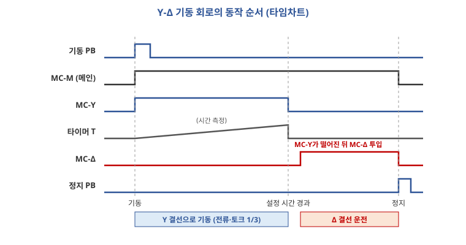

*위 순서 1~3을 시간 축으로 펼쳤다. MC-M은 기동부터 정지까지 계속 붙어 있고, **MC-Y와 MC-Δ는 결코 겹치지 않는다** — MC-Y가 떨어진 뒤 잠깐 틈을 두고 MC-Δ가 붙는다. 아래 띠가 그 시간 동안의 결선 상태다.*

> [!question] 시험에서는
> Y-Δ 기동에 필요한 MC 수(3개: 메인·Y·Δ)와 전환을 맡는 기기(타이머), 동시 투입 금지(인터록)를 묻는다. "전동기 단자는 3개만 있으면 된다"는 틀린 보기 — **6개**가 필요하다.

## 8. 시험 운전과 유지보수

**직관**: 운전 전에는 "켜도 안전한가"(절연·배선·접지·설정값·방향), 운전 중에는 "정상으로 돌고 있나"(전류·진동·소음·온도·냄새), 정기적으로는 "닳은 곳은 없나"(베어링·접점·팬·먼지)를 본다.

| 시기 | 점검 항목 |
| --- | --- |
| 운전 전 | 절연 저항, 배선·단자 조임, 접지, THR 설정값(정격 전류 기준), 회전 방향 |
| 운전 중 | 전류(정격 이하, 상 불평형), 진동, 소음, 온도 상승, 냄새 |
| 정기 | 베어링 윤활·교체, 접점 마모(MC), 냉각 팬, 먼지 청소, 절연 저항 추이 |

- **결상 운전**: 한 상이 끊기면 나머지 상 전류가 커져 소손 → EOCR(결상 보호) 사용.
- 절연 저항은 **메거(절연 저항계)** 로 측정 → [전기전자장치 조립과 검사](전기전자장치_조립과_검사.md).

> [!tip] 감 잡기
> 회전 방향은 **운전 전**에 잠깐 돌려(인칭) 확인한다. 방향이 반대면 위 6절처럼 두 선을 바꾼다. THR이 트립했다면 바로 리셋하지 말고 과부하·결상·구속 같은 원인부터 찾는다.

## 그림

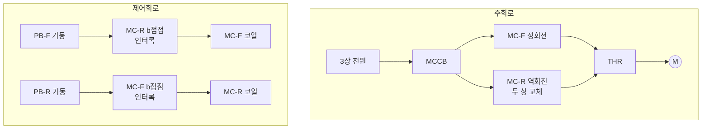

## 기출 포인트

출처: 생산자동화산업기사 2016–2020년 필기 14회분 (cbtbank.kr).

- 기본 시퀀스 회로 이름 (자기유지, 인칭 목적, 일정 시간 동작 회로) — 3회 (2018-2 ×2, 2018-3)
- 접점·기기 정의 (a/b접점, 리밋 스위치 기호, 단락 보호 = 차단기) — 3회 (2016-3 ×2, 2018-1)
- 시퀀스 검출부가 아닌 것, 계전기 방식과 전자 방식 비교 — 2회 (2019-1 ×2)
- 유접점·무접점 시퀀스 비교는 [논리회로](논리회로.md) 기출 포인트 참고 (4회)

## 관련 단원

- [유도전동기와 인버터](유도전동기와_인버터.md)
- [논리회로](논리회로.md)
- [전기전자장치 조립과 검사](전기전자장치_조립과_검사.md)
- [PLC 프로그래밍 언어와 명령어](PLC_프로그래밍_언어와_명령어.md)

## 체크리스트

- [ ] MCCB·ELB·MC·THR·EOCR의 역할을 구분한다
- [ ] 자기유지·인터록 회로를 그린다
- [ ] 정역 회로에서 상 교체와 인터록 위치를 안다
- [ ] Y-Δ 기동 회로의 MC 3개 동작 순서를 말한다
- [ ] 결상 운전의 위험과 대책을 설명한다
- [ ] 운전 전·중 점검 항목을 말한다
- [ ] a접점·b접점을 정확히 정의한다
- [ ] 지연 동작·일정 시간 동작·지연 복귀 회로를 구분한다
- [ ] 인칭 회로의 목적을 말한다
- [ ] 시퀀스 제어계의 검출부·제어부·조작부에 기기를 배치한다

## 참고

- [큐넷 자동화설비산업기사 출제기준](https://www.q-net.or.kr/crf005.do?id=crf00503&jmCd=2034)

### 그림 출처

위키미디어 공용(Wikimedia Commons)과 Openverse에서 가져온 공개 라이선스 자료이고, 노트에 맞게 크기를 줄이고 WebP로 변환했다.

| 그림 | 작성자 | 라이선스 | 출처 |
| --- | --- | --- | --- |
| [630 Amps Molded Case Circuit Breaker](https://commons.wikimedia.org/wiki/File:630_Amps_Molded_Case_Circuit_Breaker.jpg) | Balurbala | [CC BY-SA 3.0](https://creativecommons.org/licenses/by-sa/3.0) | Wikimedia Commons |
| [Contactor DIN IEK](https://commons.wikimedia.org/wiki/File:Contactor_DIN_IEK.jpg) | Kae | [CC BY-SA 3.0](https://creativecommons.org/licenses/by-sa/3.0) | Wikimedia Commons |
| [Bimetal](https://commons.wikimedia.org/wiki/File:Bimetal.gif) | Baran Ivo | [CC BY-SA 3.0](http://creativecommons.org/licenses/by-sa/3.0/) | Wikimedia Commons |
| [4-pole GE residual current device 30mA 400V](https://commons.wikimedia.org/wiki/File:4-pole_GE_residual_current_device_30mA_400V.JPG) | Dmitry G | [CC BY-SA 3.0](https://creativecommons.org/licenses/by-sa/3.0) | Wikimedia Commons |
| [Emergency stop button](https://commons.wikimedia.org/wiki/File:Emergency_stop_button.jpg) | Cjp24 | [CC BY-SA 3.0](https://creativecommons.org/licenses/by-sa/3.0) | Wikimedia Commons |
| [Limit Switches](https://commons.wikimedia.org/wiki/File:Limit_Switches.JPG) | Mixabest | [CC BY-SA 3.0](https://creativecommons.org/licenses/by-sa/3.0) | Wikimedia Commons |

직접 그린 그림(SVG, 이 볼트용으로 새로 작성): 전동기 주회로, 보호기기 동작특성, ab접점 동작, 릴레이 원리, 자기유지 래더, 2개소 제어, 타이머 타임차트, 일정시간 동작, 역회전 결선, 정역 제어회로, Y델타 단자결선, Y델타 타임차트.

