# 전자 소자와 전원 회로

> [!summary] 핵심 요약
> - **다이오드**: 한 방향으로만 전류. **트랜지스터**: 작은 베이스 전류로 큰 전류 스위칭·증폭. **SCR**: 게이트로 켜고, 전류가 유지 전류 아래로 떨어져야 꺼짐. **트라이액**: AC 양방향 SCR.
> - **포토커플러**: 빛으로 신호 전달 → 입출력 **전기적 절연**.
> - 전원 회로: 변압 → **정류**(브리지) → **평활**(콘덴서) → **정전압**(제너, 레귤레이터).
> - 축전지 용량은 **Ah** = 방전전류 × 방전시간.

> [!warning] 자주 틀리는 포인트
> - 실리콘 다이오드 순방향 전압 약 **0.7 V**, LED는 색에 따라 약 1.8~3.3 V.
> - **제너 다이오드**는 **역방향**으로 연결해, 역방향 항복 영역의 일정한 전압으로 정전압을 얻는다.
> - SCR은 게이트 신호를 끊어도 **꺼지지 않는다**. AC에서는 전압이 0을 지날 때 꺼진다.
> - P형 불순물은 3가(붕소·인듐·알루미늄·갈륨), N형은 5가(비소·인·안티몬). **비소는 N형**, **붕소는 P형**.
> - CMOS는 TTL보다 소비 전력이 작고 **잡음 여유가 크다**(속도는 느리고 정전기에 약함).
> - 비정현파 발진 회로는 **멀티바이브레이터**. 제너 다이오드를 쓰는 회로는 **정전압 회로**.
> - 같은 전지 2개 **병렬**: 전압은 그대로, 사용 시간 2배. **직렬**: 전압 2배.
> - 축전지는 큰 전류로 빨리 방전할수록 꺼낼 수 있는 용량이 **줄어든다**.

## 학습 목표

이 단원을 마치면 다음을 할 수 있어야 한다.

1. 4띠·5띠 저항의 색 띠를 읽어 저항값과 오차를 구하고, 콘덴서 종류별 특징(극성·용도)과 특성값을 구분한다.
2. 진성·P형·N형 반도체를 불순물 원소(3가·5가)와 다수 캐리어로 구분하고, PN 접합의 순방향·역방향 바이어스를 설명한다.
3. 다이오드·제너·LED·트랜지스터·SCR·트라이액·포토커플러의 기호와 동작을 구분하고, $I_E = I_B + I_C$를 계산한다.
4. 트랜지스터의 차단·포화 스위칭으로 릴레이를 구동하는 회로와 플라이휠 다이오드의 역할을 설명하고, TTL과 CMOS를 비교한다.
5. 반파·전파·브리지 정류와 평활·정전압 회로의 출력 파형을 그리고, 발진 회로의 종류(정현파·멀티바이브레이터)를 구분한다.
6. 축전지 용량(Ah), 방전율, 방전효율, 전지의 직렬·병렬 연결을 계산한다.

## 한눈에 보기

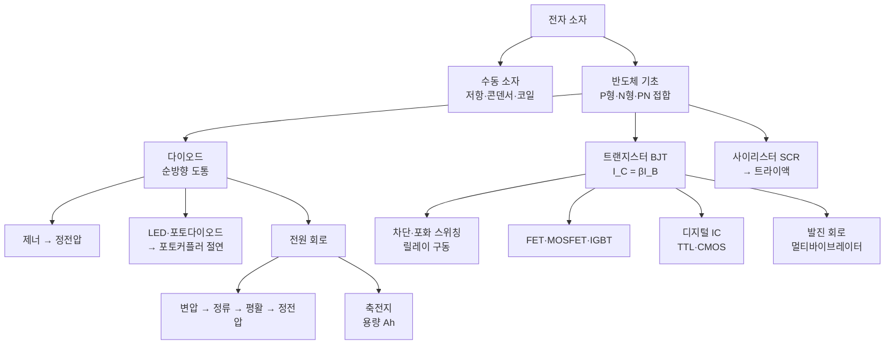

## 1. 수동 소자

**직관**: 수동 소자는 스스로 신호를 키우지 못하고 에너지를 쓰거나(저항) 잠시 담아 두는(콘덴서·코일) 부품이다. 저항은 배관의 좁은 목, 콘덴서는 물을 받아 두는 물통, 코일은 잘 돌아가기 시작하면 멈추기 싫어하는 무거운 물레방아에 비유할 수 있다.

| 소자 | 특징 |
| --- | --- |
| 저항 | 색 띠로 값 표시: 흑0 갈1 적2 등3 황4 녹5 청6 자7 회8 백9, 오차 금 ±5% 은 ±10% |
| 콘덴서 | 직류 차단·교류 통과, 전하 저장. 전해 콘덴서는 극성 있음 |
| 코일(인덕터) | 전류 변화 방해, 교류 차단·직류 통과 |
| 가변 저항 | 분압, 위치 검출(포텐셔미터) |

### 저항 색 띠 읽기

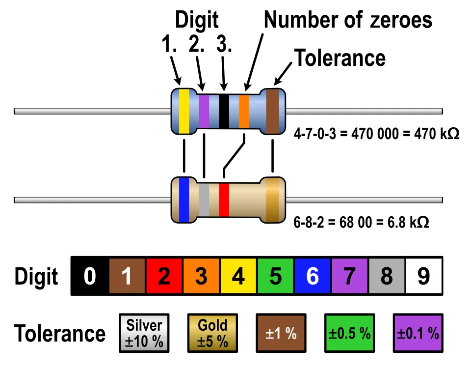

*위 저항은 5띠 정밀 저항이다. 숫자 3개(4·7·0) 뒤의 주황(3)은 "0을 3개 붙여라", 즉 승수 $10^3$이라 $470 \times 10^3 = 470\ \text{k}\Omega$, 맨 끝 갈색이 오차 ±1%다. 아래 4띠 저항은 청(6)·회(8) + 적(승수 $10^2$) → $68 \times 10^2 = 6.8\ \text{k}\Omega$. 오차 띠는 금 ±5%, 은 ±10%가 가장 자주 나온다.*

$$R = (\text{숫자 띠}) \times 10^{\text{승수 띠}} \quad \pm\ \text{오차 띠}$$

- 색 띠 예: 갈·흑·적·금 → $10 \times 10^2 = 1\text{ k}\Omega$ ±5%. 갈·적·흑·금 → $12 \times 10^0 = 12\ \Omega$ ±5% (교재 CH02 9-1).
- 4띠는 숫자 2개 + 승수 + 오차, 5띠 정밀 저항은 숫자 3개 + 승수 + 오차. 오차 색: 갈 ±1%, 적 ±2%, 녹 ±0.5%, 청 ±0.25%, 자 ±0.1%, 금 ±5%, 은 ±10%, 무색 ±20%. 금·은은 승수로도 쓰여 각각 $\times10^{-1}$, $\times10^{-2}$.
- 교재(CH02 09절) 색띠 표는 등색 오차를 ±0.05%로 적고 온도계수 열(흑 ±250 … 회 ±1 ppm/℃)까지 싣는다. 일반 표와 다른 칸이 있으니 시험 대비로는 숫자·승수·금/은 오차를 우선 외운다.
- **저항 종류** (교재 CH02 09절): 고정(탄소피막, 금속피막, 산화금속피막, 권선형, 네트워크), 가변, 반고정, **서미스터**(온도에 따라 저항 변화 → 온도 센서), **배리스터**(전압에 따라 저항 변화 → 과전압 보호).

> [!tip] 감 잡기
> 색 순서는 무지개 순서(적·등·황·녹·청·자) 앞에 흑·갈, 뒤에 회·백을 붙인 것이다. "흑갈적등황녹청자회백 = 0~9"를 한 번에 외우면 숫자·승수 띠를 모두 읽을 수 있다.

> [!question] 시험에서는
> 3번째 띠를 숫자로 읽는 실수가 흔하다. 4띠 저항이면 3번째 띠는 **승수**(0의 개수)다. 갈·적·흑·금에서 흑은 숫자 0이 아니라 $10^0 = 1$배라서 120 Ω이 아니라 **12 Ω**이다.

### 콘덴서 종류

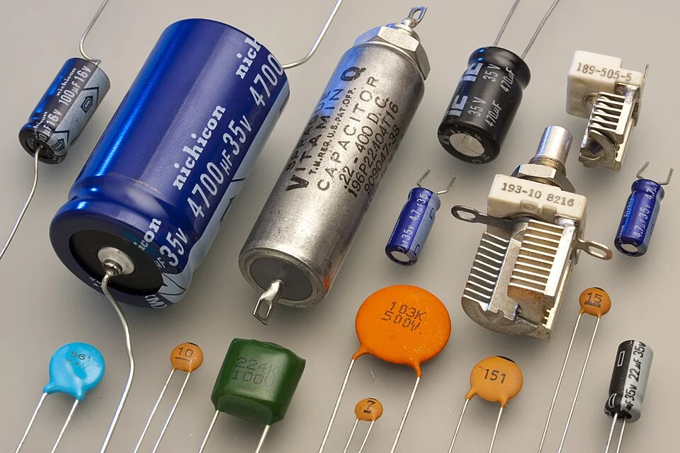

*원통형 전해 콘덴서는 몸통에 용량·정격 전압(예: 4700 µF 35 V)과 극성 표시가 찍혀 있고 크기에 비해 용량이 크다. 동전 모양의 원판형이 세라믹 콘덴서로, 용량은 작지만 고주파 바이패스에 쓴다. 몸통 숫자 "103"은 $10 \times 10^3$ pF = 0.01 µF처럼 저항 색 띠와 같은 규칙으로 읽는다.*

| 콘덴서 | 특징 |
| --- | --- |
| 전해 | 부피 대비 용량 큼, **극성 있음**, 저주파 바이패스·평활 |
| 탄탈 | 전해 콘덴서의 일종, 온도·주파수 특성 좋음 |
| 세라믹 | 유전율 큰 티탄산바륨, **고주파** 바이패스 |
| 슈퍼 커패시터 | 매우 큰 용량, 보조 전원 |
| 가변 | 용량 조절 (라디오 튜너) |

- 콘덴서 특성값: **정격 전압**(연속 사용), **서지 전압**(일시 허용), **누설 전류**(정격 전압에서 유전체로 새는 전류). 용량은 온도에 따라 변한다. 용량 계산과 합성은 [전기 기초와 회로](전기_기초와_회로.md).

> [!question] 시험에서는
> 극성이 있는 것은 **전해(탄탈 포함)** 콘덴서다. 거꾸로 꽂으면 누설 전류가 커져 부풀거나 터진다. 세라믹은 극성이 없고 고주파용, 전해는 평활(맥동 제거)용으로 짝지어 외운다.

## 2. 반도체 기초

**직관**: 순수한 실리콘은 전자가 모두 이웃과 손을 잡고(공유 결합) 있어 전기가 잘 흐르지 않는다. 여기에 원자가가 다른 불순물을 조금 섞으면 손이 하나 남거나(5가 → 남는 전자) 하나 모자라(3가 → 빈자리 = 정공) 전하를 나르는 일꾼이 생긴다.

*가운데 P형 그림에서 붕소(B, 3가) 옆의 빈칸 "Void (Hole)"가 정공이고, 오른쪽 N형 그림에서 안티몬(Sb, 5가) 위에 떠 있는 "Fifth valence electron"이 자유전자다. 3가를 넣으면 P(정공, Positive), 5가를 넣으면 N(전자, Negative)으로 기억한다.*

| 구분 | 불순물 | 다수 캐리어 |
| --- | --- | --- |
| 진성 반도체 | 없음 (순수 Si, Ge) | 자유전자 수 = 정공 수 |
| N형 | **5가** (비소 As, 인 P, 안티몬 Sb) = 도너 | 자유전자 |
| P형 | **3가** (붕소 B, 인듐 In, 알루미늄 Al, 갈륨 Ga) = 억셉터 | 정공 |

- **도핑**: 순수 반도체에 불순물을 넣어 캐리어 수를 늘리는 과정. 불순물 반도체에도 소수 캐리어는 있다.
- Si 원자끼리는 가전자를 서로 공유하는 **공유 결합**.
- PN 접합의 공핍층 양단 전위차 = **전위 장벽** (Si 약 0.7 V).

### PN 접합과 바이어스

P형과 N형을 맞붙이면 경계에서 전자와 정공이 만나 사라지면서 일꾼이 없는 **공핍층**이 생긴다. 외부 전압을 어느 방향으로 거느냐에 따라 이 벽이 얇아지거나 두꺼워진다.

| 순방향 바이어스 | 역방향 바이어스 |
| :-: | :-: |
| 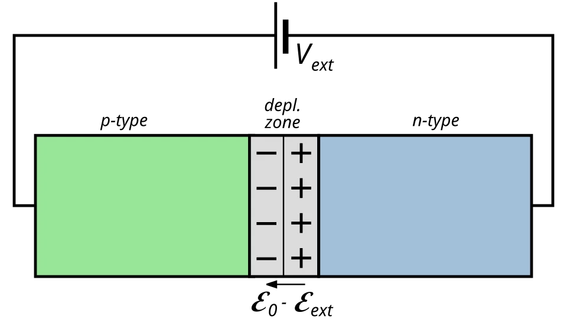 | 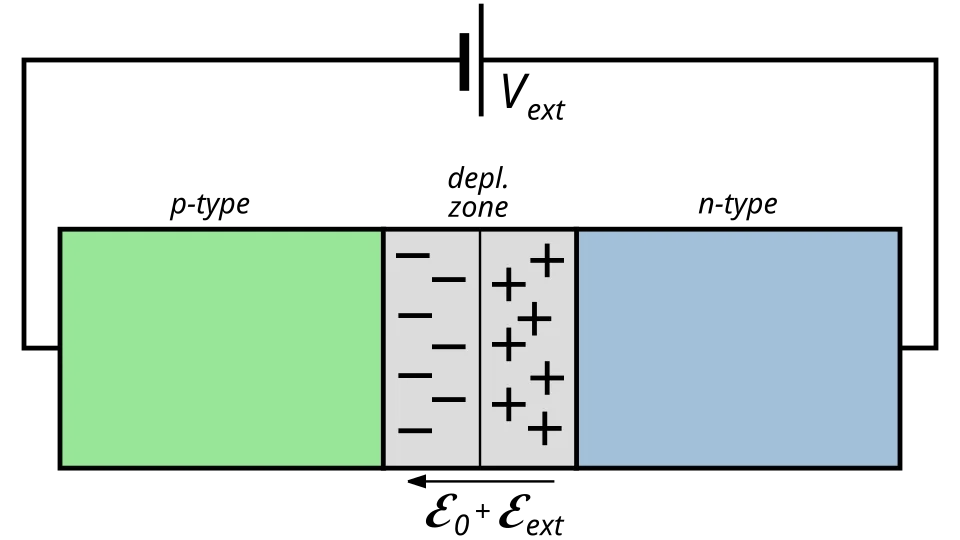 |
| P에 +, N에 − → 외부 전계가 내부 전계를 상쇄($\mathcal{E}_0 - \mathcal{E}_{ext}$) → 공핍층이 얇아져 **전류가 흐른다** | P에 −, N에 + → 두 전계가 더해져($\mathcal{E}_0 + \mathcal{E}_{ext}$) 공핍층이 넓어져 **거의 흐르지 않는다** |

*그림에서 회색 띠(depl. zone)의 두께를 비교한다. 순방향은 전위 장벽(Si 약 0.7 V)만 넘으면 전류가 급격히 늘고, 역방향은 항복 전압에 이를 때까지 아주 작은 누설 전류만 흐른다.*

## 3. 반도체 소자

**직관**: 다이오드는 **한쪽으로만 열리는 문(체크 밸브)**, 트랜지스터는 **작은 손잡이(베이스)로 큰 수도꼭지(컬렉터 전류)를 여닫는 밸브**, SCR은 **한 번 누르면 걸려서 유지되는 래치 스위치**다.

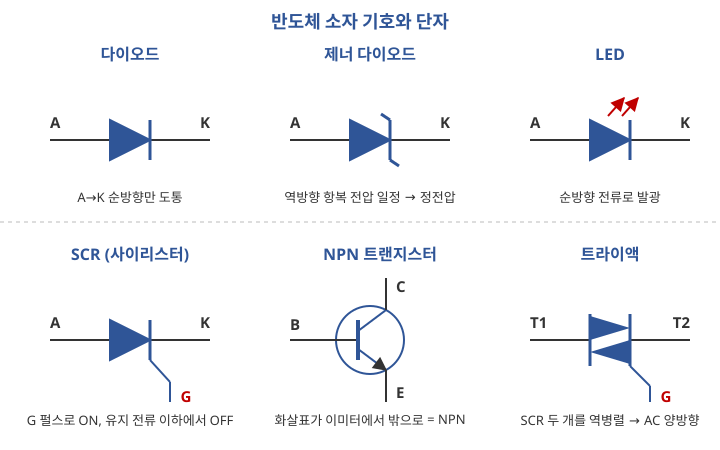

*삼각형이 가리키는 쪽이 전류가 흐르는 방향(애노드 A → 캐소드 K)이고, 막대가 캐소드다. 제너는 막대 끝이 굽어 있고, LED는 빛이 나가는 화살표가 붙는다. SCR은 다이오드에 게이트 G가, 트라이액은 두 방향 삼각형에 게이트 G가 붙는다. NPN은 이미터 화살표가 밖으로 나가고(Not Pointing iN), PNP는 안으로 들어온다.*

| 소자 | 동작 | 용도 |
| --- | --- | --- |
| 다이오드 | 순방향 도통, 역방향 차단 | 정류, 역기전력 흡수(플라이휠) |
| 제너 다이오드 | 역방향 항복 전압 일정 | 정전압 |
| LED | 순방향 전류로 발광 | 표시, 광원 |
| 포토다이오드·포토트랜지스터 | 빛 → 전류 | 광센서 수광부 |
| 트랜지스터 (BJT) | 베이스 전류로 컬렉터 전류 제어 ($I_C = \beta I_B$) | 증폭, 스위칭 |
| MOSFET | 게이트 전압으로 제어, 입력 임피던스 큼 | 고속 스위칭 |
| IGBT | MOSFET 입력 + BJT 출력 | 인버터, 서보 드라이버 |
| SCR (사이리스터) | 게이트 트리거로 턴온, 유지 전류 이하에서 턴오프 | 위상 제어, 정류 |
| 트라이액 | 양방향 SCR | AC 전력 제어, SSR |
| 포토커플러 | 발광부 + 수광부 | 절연, 노이즈 차단 |

### 다이오드와 제너 다이오드의 특성 곡선

| 일반 다이오드 | 제너 다이오드 |
| :-: | :-: |
| 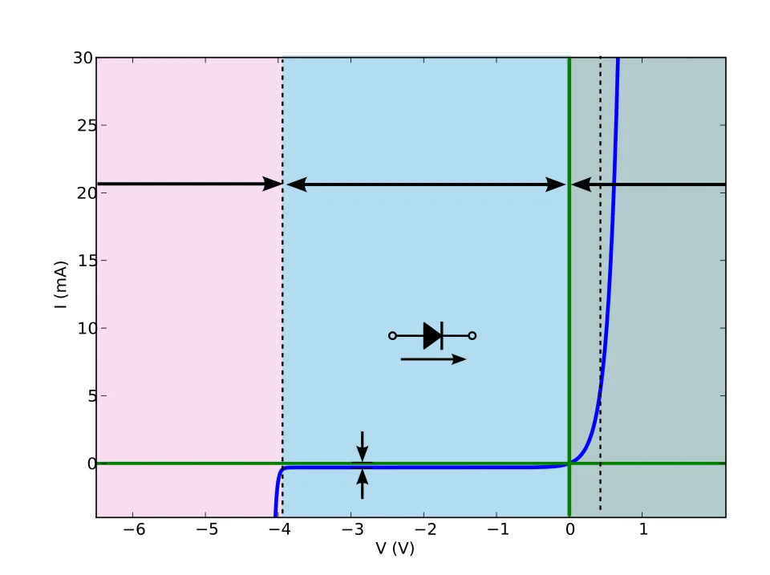 | 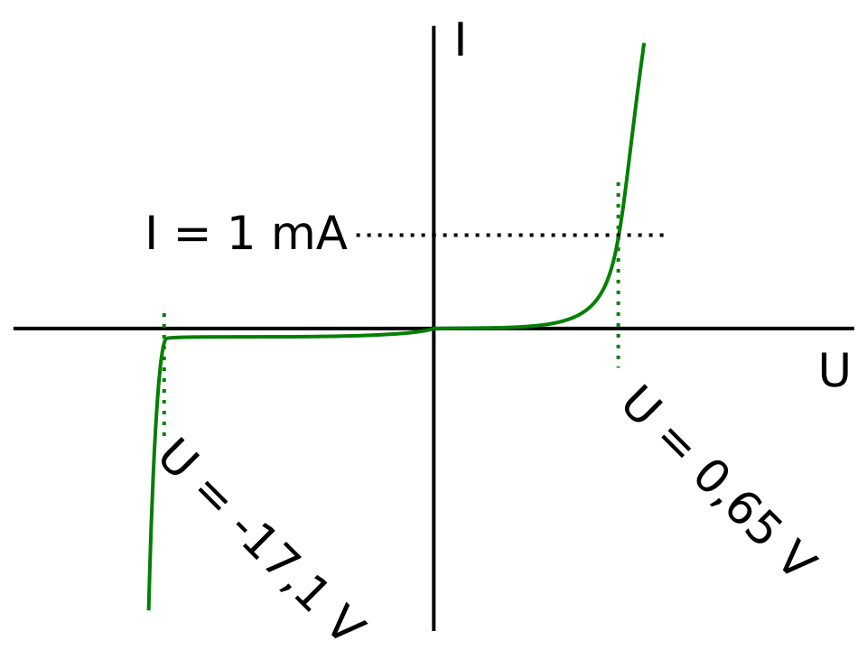 |
| 오른쪽(초록 배경)이 순방향 도통, 가운데(파랑)가 역방향 차단, 왼쪽(분홍)이 항복 영역 | 순방향은 일반 다이오드와 같고, 역방향 항복 전압(이 예에서는 약 17 V)에서 전류가 많이 변해도 **전압은 거의 일정** |

*두 곡선 모두 순방향에서는 문턱 전압(실리콘 약 0.6~0.7 V)을 넘자 전류가 급하게 솟는다. 일반 다이오드는 항복 영역에 들어가면 망가지기 쉬워 쓰지 않지만, 제너 다이오드는 바로 이 항복 영역의 "세로로 선 직선"을 정전압으로 쓴다.*

$$I_E = I_B + I_C \qquad I_C = \beta I_B$$

- 트랜지스터 전류: $I_E = I_B + I_C$ (예: 20 mA + 400 mA = 420 mA).
- NPN은 베이스에 + 전압을 주면 컬렉터–이미터가 도통, PNP는 베이스를 이미터보다 낮게 하면 도통.
- **FET**: 다수 캐리어만으로 동작(유니폴라), 입력 임피던스가 매우 높고 잡음이 적으며 **열적으로 안정**하다.

> [!tip] 감 잡기
> 예시 값으로 보면 $\beta = I_C/I_B = 400/20 = 20$이다. 베이스에 20 mA만 흘려도 컬렉터에 20배인 400 mA가 흐르고, 두 전류가 모두 이미터로 빠져나가므로 이미터 전류가 가장 크다.

### 포토커플러

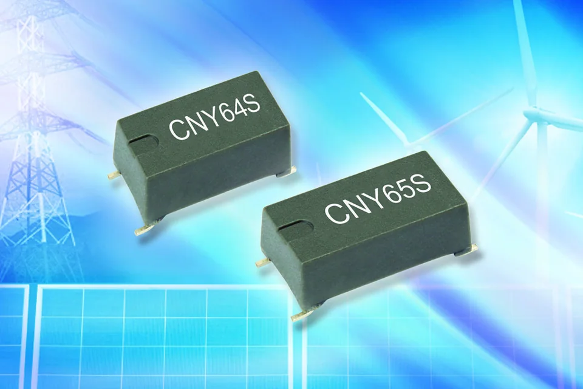

*사진은 고전압 절연용 포토커플러(CNY64S·CNY65S)다. 겉은 검은 직육면체 하나지만 안에 LED(발광부)와 포토트랜지스터(수광부)가 마주 보고 들어 있고, 몸체가 길쭉한 것은 입력 쪽과 출력 쪽 다리 사이 거리를 벌려 절연 내압을 높이기 위해서다. 두 쪽은 빛으로만 이어지고 전선으로는 이어지지 않아서, PLC 입력 회로에서 현장 쪽 노이즈·서지가 CPU로 들어오지 못하게 막는다.* PLC 입출력 회로에서의 쓰임은 [PLC 구성과 특성](PLC_구성과_특성.md) 참고.

### 디지털 IC: TTL과 CMOS

| 디지털 IC | TTL | CMOS |
| --- | --- | --- |
| 소비 전력 | 큼 | 매우 작음 |
| 속도 | 빠름 | 느린 편 |
| 잡음 여유 | 작음 | **큼** |
| 정전기 | 강함 | 약함 |
| 출력 형식 | 토템폴, 오픈 컬렉터, 3상태 | |

> [!question] 시험에서는
> "CMOS는 잡음 여유가 작다", "CMOS는 소비 전력이 크다"는 틀린 보기다. CMOS는 **저전력·큰 잡음 여유**가 장점이고, **정전기에 약하고 느린 편**인 것이 단점이다.

## 4. 트랜지스터 스위칭

**직관**: 스위치로 쓸 때 트랜지스터는 반쯤 열린 상태를 쓰지 않는다. 손잡이를 완전히 잠그거나(차단) 끝까지 여는(포화) 두 상태만 쓴다. 중간 상태(활성 영역)는 소리를 키우는 증폭에 쓴다.

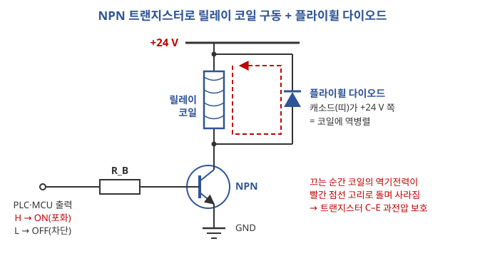

*입력이 H가 되면 베이스 전류가 흘러 트랜지스터가 포화(ON)되고 코일에 전류가 흐른다. 입력이 L이 되어 차단(OFF)되는 순간 코일은 전류를 계속 흘리려고 높은 역기전력을 만드는데, 이때 빨간 점선처럼 전류가 다이오드를 통해 코일로 되돌아 돌며 사라져 트랜지스터를 보호한다. 다이오드는 평소에는 역방향(캐소드가 +24 V 쪽)이라 아무 일도 하지 않는다.*

- **차단 영역**: 베이스 전류 0 → 스위치 OFF.
- **포화 영역**: 베이스 전류 충분 → 스위치 ON ($V_{CE}$ ≈ 0.2 V).
- **활성 영역**: 증폭에 사용.
- NPN 트랜지스터로 릴레이 코일을 구동할 때는 코일 양단에 **플라이휠 다이오드**를 역병렬로 단다.

> [!question] 시험에서는
> 플라이휠(환류) 다이오드는 코일과 **역병렬**이다. 순방향으로 달면 평소에 전원이 다이오드로 단락된다. 목적은 "턴오프 때 생기는 **역기전력 흡수**"이고, 정류나 정전압이 아니다.

## 5. 발진 회로

**직관**: 발진 회로는 외부 입력 없이 스스로 반복 신호를 만드는 회로다. 그네를 밀 때 타이밍에 맞춰 조금씩 힘을 보태면 계속 흔들리듯, 출력의 일부를 입력으로 되돌려(정궤환) 신호를 유지한다. 그래서 그네를 미는 힘에 해당하는 **DC 전원**과 **능동 소자**(트랜지스터 등)가 필요하다.

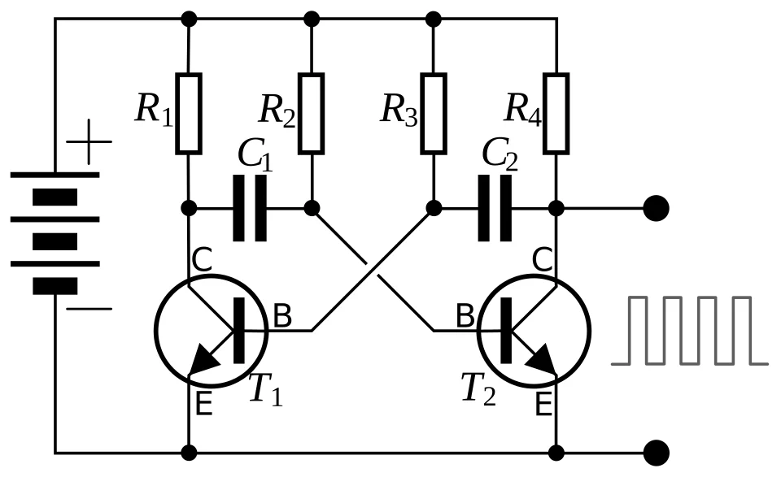

*두 트랜지스터 T1, T2가 콘덴서 C1, C2를 사이에 두고 서로의 베이스를 엇갈려 잡고 있다. 한쪽이 ON이면 다른 쪽은 OFF가 되고, 콘덴서가 R2·R3를 통해 충전되면 상태가 뒤집힌다. 이것이 반복되어 오른쪽처럼 정현파가 아닌 **구형파**가 나온다. 콘덴서와 저항 값(시정수)이 ON·OFF 시간을 정한다.*

- 정현파(LC, RC, 수정 발진) / 비정현파(**멀티바이브레이터**, 구형파). 발진에는 DC 전원과 능동 소자가 필요하다.

| 발진기 (교재 CH02 15절) | 특징 |
| --- | --- |
| CR | 정현파에 가깝지만 주파수 정밀도 낮음 |
| LC | 정밀도 개선, 약 100 kHz~수백 kHz |
| 수정 | 주파수가 가장 안정, 수백 kHz~20 MHz, 세라믹 진동자로 대체 가능 |
| 비정현파 | 멀티바이브레이터, 블로킹, 톱니파 발진기 |

> [!tip] 감 잡기
> 멀티바이브레이터는 출력 상태가 몇 개 안정한지로 나눈다. 두 상태를 계속 오가는 **비안정**(구형파 발진), 트리거 한 번에 일정 시간 한 펄스를 내는 **단안정**, 두 상태 모두 안정해 기억 소자(플립플롭)가 되는 **쌍안정**.

## 6. 정류와 전원 회로

**직관**: 콘센트의 교류를 전자 회로가 쓰는 깨끗한 직류로 바꾸는 과정은 정수 처리와 같다. 전압을 낮추고(변압) → 한 방향만 통과시키고(정류) → 출렁임을 물탱크로 잔잔하게 하고(평활) → 마지막에 수위를 일정하게 맞춘다(정전압).

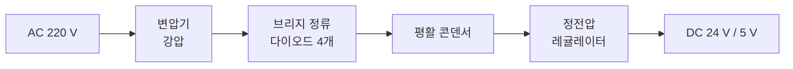

### 브리지 정류와 출력 파형

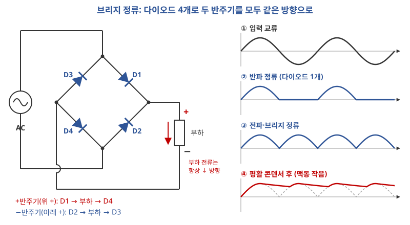

*입력의 위쪽이 +인 반주기에는 D1 → 부하 → D4로, 아래쪽이 +인 반주기에는 D2 → 부하 → D3로 전류가 흘러, 어느 반주기든 부하에는 같은 방향(위가 +)으로 흐른다. 그래서 ③처럼 음의 반쪽이 뒤집혀 위로 올라온다. 다이오드 1개인 반파 정류(②)는 절반을 버린다. 평활 콘덴서를 달면(④) 봉우리 사이에서 콘덴서가 방전하며 전압을 받쳐 주어 맥동(리플)이 작은 톱니 모양이 된다.*

| 회로 | 특징 |
| --- | --- |
| 반파 정류 | 다이오드 1개, 맥동 큼 |
| 전파 정류 (센터탭) | 다이오드 2개, 센터탭 변압기 |
| 브리지 정류 | 다이오드 4개, 가장 많이 사용 |
| 평활 회로 | 콘덴서로 맥동 감소 |
| 정전압 회로 | 제너 다이오드, 3단자 레귤레이터(7805 = +5 V) |
| SMPS | 고주파 스위칭, 소형·고효율 (PLC 전원 모듈) |

- 정류: 교류에서 **한 극성만 통과**시키고 나머지는 걸러 낸 전류 (교재 CH02 15절).

### 정전압 회로: 제너 다이오드와 3단자 레귤레이터

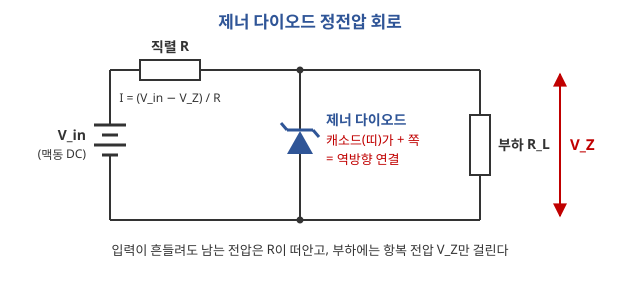

*제너 다이오드는 캐소드(띠)가 + 쪽을 향하도록 **역방향**으로 달아 항복 영역에서 동작시킨다. 입력 전압이 출렁이면 직렬 저항 R에 걸리는 전압과 제너 전류가 대신 변하고, 제너와 병렬인 부하에는 $V_Z$만 일정하게 걸린다.*

$$V_{out} = V_Z \qquad I_R = \frac{V_{in} - V_Z}{R} = I_Z + I_L$$

| 3단자 레귤레이터 실물 |
| :-: |
| 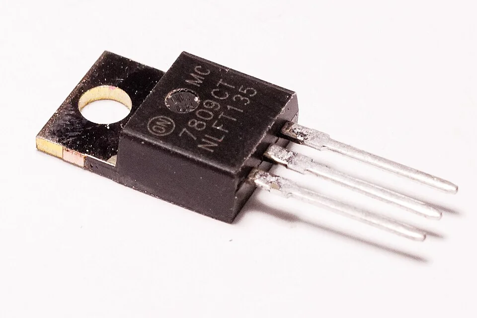 |
| 78xx 계열은 입력·공통(GND)·출력의 다리 3개로 정전압을 만든다. 끝 두 자리가 출력 전압: 7805 = +5 V, 이 사진의 7809 = +9 V, 7812 = +12 V. 79xx는 음(−) 전압용 |

> [!question] 시험에서는
> "제너 다이오드를 쓰는 회로는?" → **정전압 회로**. "제너 다이오드는 순방향으로 연결한다"는 틀린 보기다. 정류(교류 → 직류)에는 일반 다이오드, 평활에는 콘덴서, 정전압에는 제너·레귤레이터로 역할을 짝짓는다.

## 7. 축전지 (교재 CH02 10절)

**직관**: 축전지는 전기를 화학 물질의 형태로 저장해 두는 물탱크다. 용량 Ah는 탱크 크기로, "몇 암페어를 몇 시간 꺼낼 수 있는가"를 곱한 값이다.

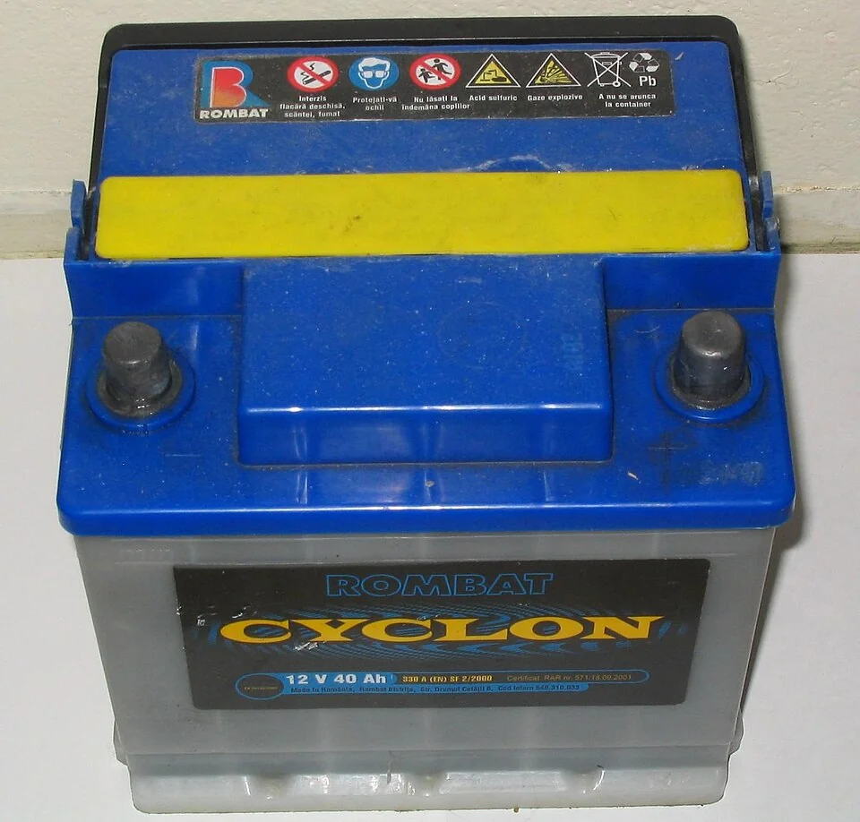

*라벨의 "12 V 40 Ah"를 본다. 12 V는 기전력(셀 6개 직렬), 40 Ah는 용량으로, 이론상 2 A로 20시간 또는 4 A로 10시간 쓸 수 있다는 뜻이다. 하지만 큰 전류로 빨리 꺼낼수록 실제로 꺼낼 수 있는 용량은 줄어든다.*

$$\text{용량 [Ah]} = \text{방전전류 [A]} \times \text{방전시간 [h]}$$

- 충전해서 다시 쓰는 **2차 전지**. 재료로는 **연축전지**와 **알칼리 축전지**, 제조 방법으로는 건식과 습식으로 나눈다.
- 충전: 전기에너지 → 화학에너지, 방전: 화학에너지 → 전기에너지.
- 기전력은 전해액 **비중이 높을수록** 높고, 온도가 오르면 약간 높아진다.
- 용량 [Ah] = 방전전류 × 방전시간. 방전율(얼마나 빨리 꺼내는지)에 따라 달라지며, 큰 전류일수록 용량이 작아진다.
- 방전효율 $= \dfrac{\text{방전전류} \times \text{방전시간}}{\text{충전전류} \times \text{충전시간}} \times 100\,\%$

| 전지 연결 | 전압 | 용량(사용 시간) |
| --- | --- | --- |
| 같은 전지 n개 직렬 | n배 | 그대로 |
| 같은 전지 n개 병렬 | 그대로 | n배 |

> [!question] 시험에서는
> 1.5 V 건전지 2개를 **병렬**로 연결하면 전압은 1.5 V 그대로이고 사용 시간이 2배다. "전압 3 V"는 직렬일 때의 답이다. 방전효율은 "꺼낸 전기량 ÷ 넣은 전기량"이므로 100 %를 넘을 수 없다.

## 그림

전원 회로 전체 흐름(변압 → 정류 → 평활 → 정전압)은 6절의 블록도와 브리지 정류 그림에 정리했다. 소자 기호는 3절의 기호 그림을 본다.

## 기출 포인트

출처: 생산자동화산업기사 2016–2020년 필기 14회분 (cbtbank.kr).

- 반도체 소자 (P/N형 불순물, 도핑, 공유 결합, 전위 장벽, 다이오드, 제너 다이오드 정전압, 트랜지스터 전류·도통 조건, FET, 소자 기호, TTL·CMOS, 발진 회로) — 17회 (2016-2, 2016-3, 2017-2 ×2, 2017-3, 2018-2, 2018-3, 2019-1 ×3, 2019-2 ×4, 2019-3, 2020-3 ×2)

**교재 예제 유형** (Win-Q 2025 PART 01 CHAPTER 02, 09·10·15절): 색띠 읽기(12 Ω ±5%), 전지 병렬 연결, 축전지 용량 단위(Ah), 제너 다이오드 회로(정전압), 비정현파 발진(멀티바이브레이터).

## 관련 단원

- [전기 기초와 회로](전기_기초와_회로.md)
- [전기전자장치 조립과 검사](전기전자장치_조립과_검사.md)
- [센서 회로와 신호처리](센서_회로와_신호처리.md)
- [PLC 시뮬레이션과 수정보완](PLC_시뮬레이션과_수정보완.md)
- [PLC 구성과 특성](PLC_구성과_특성.md)

## 체크리스트

- [ ] 저항 색 띠를 읽는다
- [ ] 콘덴서 종류별 특징과 특성값을 안다
- [ ] 다이오드·제너·SCR·트라이액의 동작을 구분한다
- [ ] P형·N형 불순물 원소를 구분한다
- [ ] 트랜지스터의 차단·포화 스위칭을 설명한다
- [ ] TTL과 CMOS의 특징을 비교한다
- [ ] 정류 회로 3종과 평활·정전압 회로를 안다
- [ ] 축전지 용량(Ah)과 방전율·방전효율을 설명한다

## 참고

- [큐넷 자동화설비산업기사 출제기준](https://www.q-net.or.kr/crf005.do?id=crf00503&jmCd=2034)

### 그림 출처

위키미디어 공용(Wikimedia Commons)과 Openverse에서 가져온 공개 라이선스 자료이고, 노트에 맞게 크기를 줄이고 WebP로 변환했다.

| 그림 | 작성자 | 라이선스 | 출처 |
| --- | --- | --- | --- |
| [Resistor Color Code](https://commons.wikimedia.org/wiki/File:Resistor_Color_Code.svg) | Knarfili | CC0 | Wikimedia Commons |
| [Capacitors (7189597135)](https://commons.wikimedia.org/wiki/File:Capacitors_(7189597135).jpg) | Eric Schrader from San Francisco, CA, United States | [CC BY-SA 2.0](https://creativecommons.org/licenses/by-sa/2.0) | Wikimedia Commons |
| [Silicon doping - Type P and N](https://commons.wikimedia.org/wiki/File:Silicon_doping_-_Type_P_and_N.svg) | VectorVoyager | [CC BY-SA 4.0](https://creativecommons.org/licenses/by-sa/4.0) | Wikimedia Commons |
| [Forward-Biased pn Junction](https://commons.wikimedia.org/wiki/File:Forward-Biased_pn_Junction.svg) | inductiveload | 퍼블릭 도메인 | Wikimedia Commons |
| [Reverse-Biased pn Junction](https://commons.wikimedia.org/wiki/File:Reverse-Biased_pn_Junction.svg) | inductiveload | 퍼블릭 도메인 | Wikimedia Commons |
| [Current vs. voltage for a semiconductor diode rectifier](https://commons.wikimedia.org/wiki/File:Current_vs._voltage_for_a_semiconductor_diode_rectifier.svg) | Hldsc | [CC BY-SA 3.0](https://creativecommons.org/licenses/by-sa/3.0) | Wikimedia Commons |
| [V-a characteristic Zener diode](https://commons.wikimedia.org/wiki/File:V-a_characteristic_Zener_diode.svg) | Filip Dominec | [CC BY-SA 3.0](http://creativecommons.org/licenses/by-sa/3.0/) | Wikimedia Commons |
| [New CNY64ST and CNY65ST Series High Voltage Isolation Optocouplers](https://www.flickr.com/photos/43093990@N05/6263689593) | Vishay Intertechnology | [CC BY 2.0](https://creativecommons.org/licenses/by/2.0/) | Openverse (flickr) |
| [Astable Multivibrator](https://commons.wikimedia.org/wiki/File:Astable_Multivibrator.svg) | Astable_multivibrator.png: Peo derivative work: McSush (talk) | [CC BY-SA 3.0](http://creativecommons.org/licenses/by-sa/3.0/) | Wikimedia Commons |
| [7809 (OnSemi) 01](https://commons.wikimedia.org/wiki/File:7809_(OnSemi)_01.jpg) | Retired electrician | CC0 | Wikimedia Commons |
| [Photo-CarBattery](https://commons.wikimedia.org/wiki/File:Photo-CarBattery.jpg) | No machine-readable author provided. Shaddack assumed (based on copyright claims). | 퍼블릭 도메인 | Wikimedia Commons |

직접 그린 그림(SVG, 이 볼트용으로 새로 작성): 반도체 소자기호, 트랜지스터 릴레이구동, 브리지 정류, 제너 정전압.

