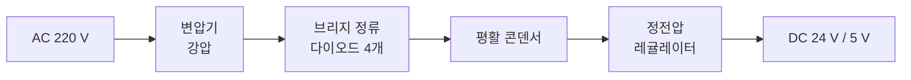

# 전자 소자와 전원 회로

> [!summary] 핵심 요약
> - **다이오드**: 한 방향으로만 전류. **트랜지스터**: 작은 베이스 전류로 큰 전류 스위칭·증폭. **SCR**: 게이트로 켜고, 전류가 유지 전류 아래로 떨어져야 꺼짐. **트라이액**: AC 양방향 SCR.
> - **포토커플러**: 빛으로 신호 전달 → 입출력 **전기적 절연**.
> - 전원 회로: 변압 → **정류**(브리지) → **평활**(콘덴서) → **정전압**(제너, 레귤레이터).
> - 축전지 용량은 **Ah** = 방전전류 × 방전시간.

> [!warning] 자주 틀리는 포인트
> - 실리콘 다이오드 순방향 전압 약 **0.7 V**, LED는 색에 따라 약 1.8~3.3 V.
> - **제너 다이오드**는 **역방향**으로 연결해, 역방향 항복 영역의 일정한 전압으로 정전압을 얻는다.
> - SCR은 게이트 신호를 끊어도 **꺼지지 않는다**. AC에서는 전압이 0을 지날 때 꺼진다.
> - P형 불순물은 3가(붕소·인듐·알루미늄·갈륨), N형은 5가(비소·인·안티몬). **비소는 N형**, **붕소는 P형**.
> - CMOS는 TTL보다 소비 전력이 작고 **잡음 여유가 크다**(속도는 느리고 정전기에 약함).
> - 비정현파 발진 회로는 **멀티바이브레이터**. 제너 다이오드를 쓰는 회로는 **정전압 회로**.
> - 같은 전지 2개 **병렬**: 전압은 그대로, 사용 시간 2배. **직렬**: 전압 2배.
> - 축전지는 큰 전류로 빨리 방전할수록 꺼낼 수 있는 용량이 **줄어든다**.

## 개념 정리

### 수동 소자

| 소자 | 특징 |
| --- | --- |
| 저항 | 색 띠로 값 표시: 흑0 갈1 적2 등3 황4 녹5 청6 자7 회8 백9, 오차 금 ±5% 은 ±10% |
| 콘덴서 | 직류 차단·교류 통과, 전하 저장. 전해 콘덴서는 극성 있음 |
| 코일(인덕터) | 전류 변화 방해, 교류 차단·직류 통과 |
| 가변 저항 | 분압, 위치 검출(포텐셔미터) |

- 색 띠 예: 갈·흑·적·금 → $10 \times 10^2 = 1\text{ k}\Omega$ ±5%. 갈·적·흑·금 → $12 \times 10^0 = 12\ \Omega$ ±5% (교재 CH02 9-1).
- 4띠는 숫자 2개 + 승수 + 오차, 5띠 정밀 저항은 숫자 3개 + 승수 + 오차. 오차 색: 갈 ±1%, 적 ±2%, 녹 ±0.5%, 청 ±0.25%, 자 ±0.1%, 금 ±5%, 은 ±10%, 무색 ±20%. 금·은은 승수로도 쓰여 각각 $\times10^{-1}$, $\times10^{-2}$.
- 교재(CH02 09절) 색띠 표는 등색 오차를 ±0.05%로 적고 온도계수 열(흑 ±250 … 회 ±1 ppm/℃)까지 싣는다. 일반 표와 다른 칸이 있으니 시험 대비로는 숫자·승수·금/은 오차를 우선 외운다.
- **저항 종류** (교재 CH02 09절): 고정(탄소피막, 금속피막, 산화금속피막, 권선형, 네트워크), 가변, 반고정, **서미스터**(온도에 따라 저항 변화 → 온도 센서), **배리스터**(전압에 따라 저항 변화 → 과전압 보호).

| 콘덴서 | 특징 |
| --- | --- |
| 전해 | 부피 대비 용량 큼, **극성 있음**, 저주파 바이패스·평활 |
| 탄탈 | 전해 콘덴서의 일종, 온도·주파수 특성 좋음 |
| 세라믹 | 유전율 큰 티탄산바륨, **고주파** 바이패스 |
| 슈퍼 커패시터 | 매우 큰 용량, 보조 전원 |
| 가변 | 용량 조절 (라디오 튜너) |

- 콘덴서 특성값: **정격 전압**(연속 사용), **서지 전압**(일시 허용), **누설 전류**(정격 전압에서 유전체로 새는 전류). 용량은 온도에 따라 변한다. 용량 계산과 합성은 [전기 기초와 회로](전기_기초와_회로.md).

### 반도체 소자

| 소자 | 동작 | 용도 |
| --- | --- | --- |
| 다이오드 | 순방향 도통, 역방향 차단 | 정류, 역기전력 흡수(플라이휠) |
| 제너 다이오드 | 역방향 항복 전압 일정 | 정전압 |
| LED | 순방향 전류로 발광 | 표시, 광원 |
| 포토다이오드·포토트랜지스터 | 빛 → 전류 | 광센서 수광부 |
| 트랜지스터 (BJT) | 베이스 전류로 컬렉터 전류 제어 ($I_C = \beta I_B$) | 증폭, 스위칭 |
| MOSFET | 게이트 전압으로 제어, 입력 임피던스 큼 | 고속 스위칭 |
| IGBT | MOSFET 입력 + BJT 출력 | 인버터, 서보 드라이버 |
| SCR (사이리스터) | 게이트 트리거로 턴온, 유지 전류 이하에서 턴오프 | 위상 제어, 정류 |
| 트라이액 | 양방향 SCR | AC 전력 제어, SSR |
| 포토커플러 | 발광부 + 수광부 | 절연, 노이즈 차단 |

### 반도체 기초

| 구분 | 불순물 | 다수 캐리어 |
| --- | --- | --- |
| 진성 반도체 | 없음 (순수 Si, Ge) | 자유전자 수 = 정공 수 |
| N형 | **5가** (비소 As, 인 P, 안티몬 Sb) = 도너 | 자유전자 |
| P형 | **3가** (붕소 B, 인듐 In, 알루미늄 Al, 갈륨 Ga) = 억셉터 | 정공 |

- **도핑**: 순수 반도체에 불순물을 넣어 캐리어 수를 늘리는 과정. 불순물 반도체에도 소수 캐리어는 있다.
- Si 원자끼리는 가전자를 서로 공유하는 **공유 결합**.
- PN 접합의 공핍층 양단 전위차 = **전위 장벽** (Si 약 0.7 V).
- 트랜지스터 전류: $I_E = I_B + I_C$ (예: 20 mA + 400 mA = 420 mA).
- NPN은 베이스에 + 전압을 주면 컬렉터–이미터가 도통, PNP는 베이스를 이미터보다 낮게 하면 도통.
- **FET**: 다수 캐리어만으로 동작(유니폴라), 입력 임피던스가 매우 높고 잡음이 적으며 **열적으로 안정**하다.

| 디지털 IC | TTL | CMOS |
| --- | --- | --- |
| 소비 전력 | 큼 | 매우 작음 |
| 속도 | 빠름 | 느린 편 |
| 잡음 여유 | 작음 | **큼** |
| 정전기 | 강함 | 약함 |
| 출력 형식 | 토템폴, 오픈 컬렉터, 3상태 | |

### 트랜지스터 스위칭

- **차단 영역**: 베이스 전류 0 → 스위치 OFF.
- **포화 영역**: 베이스 전류 충분 → 스위치 ON ($V_{CE}$ ≈ 0.2 V).
- **활성 영역**: 증폭에 사용.
- NPN 트랜지스터로 릴레이 코일을 구동할 때는 코일 양단에 **플라이휠 다이오드**를 역병렬로 단다.

### 발진 회로

- 정현파(LC, RC, 수정 발진) / 비정현파(**멀티바이브레이터**, 구형파). 발진에는 DC 전원과 능동 소자가 필요하다.

| 발진기 (교재 CH02 15절) | 특징 |
| --- | --- |
| CR | 정현파에 가깝지만 주파수 정밀도 낮음 |
| LC | 정밀도 개선, 약 100 kHz~수백 kHz |
| 수정 | 주파수가 가장 안정, 수백 kHz~20 MHz, 세라믹 진동자로 대체 가능 |
| 비정현파 | 멀티바이브레이터, 블로킹, 톱니파 발진기 |

### 정류와 전원 회로

| 회로 | 특징 |
| --- | --- |
| 반파 정류 | 다이오드 1개, 맥동 큼 |
| 전파 정류 (센터탭) | 다이오드 2개, 센터탭 변압기 |
| 브리지 정류 | 다이오드 4개, 가장 많이 사용 |
| 평활 회로 | 콘덴서로 맥동 감소 |
| 정전압 회로 | 제너 다이오드, 3단자 레귤레이터(7805 = +5 V) |
| SMPS | 고주파 스위칭, 소형·고효율 (PLC 전원 모듈) |

- 정류: 교류에서 **한 극성만 통과**시키고 나머지는 걸러 낸 전류 (교재 CH02 15절).

### 축전지 (교재 CH02 10절)

- 충전해서 다시 쓰는 **2차 전지**. 재료로는 **연축전지**와 **알칼리 축전지**, 제조 방법으로는 건식과 습식으로 나눈다.
- 충전: 전기에너지 → 화학에너지, 방전: 화학에너지 → 전기에너지.
- 기전력은 전해액 **비중이 높을수록** 높고, 온도가 오르면 약간 높아진다.
- 용량 [Ah] = 방전전류 × 방전시간. 방전율(얼마나 빨리 꺼내는지)에 따라 달라지며, 큰 전류일수록 용량이 작아진다.
- 방전효율 $= \dfrac{\text{방전전류} \times \text{방전시간}}{\text{충전전류} \times \text{충전시간}} \times 100\,\%$

## 그림

## 기출 포인트

출처: 생산자동화산업기사 2016–2020년 필기 14회분 (cbtbank.kr).

- 반도체 소자 (P/N형 불순물, 도핑, 공유 결합, 전위 장벽, 다이오드, 제너 다이오드 정전압, 트랜지스터 전류·도통 조건, FET, 소자 기호, TTL·CMOS, 발진 회로) — 17회 (2016-2, 2016-3, 2017-2 ×2, 2017-3, 2018-2, 2018-3, 2019-1 ×3, 2019-2 ×4, 2019-3, 2020-3 ×2)

**교재 예제 유형** (Win-Q 2025 PART 01 CHAPTER 02, 09·10·15절): 색띠 읽기(12 Ω ±5%), 전지 병렬 연결, 축전지 용량 단위(Ah), 제너 다이오드 회로(정전압), 비정현파 발진(멀티바이브레이터).

## 관련 단원

- [전기 기초와 회로](전기_기초와_회로.md)
- [전기전자장치 조립과 검사](전기전자장치_조립과_검사.md)
- [센서 회로와 신호처리](센서_회로와_신호처리.md)
- [PLC 시뮬레이션과 수정보완](PLC_시뮬레이션과_수정보완.md)

## 체크리스트

- [ ] 저항 색 띠를 읽는다
- [ ] 콘덴서 종류별 특징과 특성값을 안다
- [ ] 다이오드·제너·SCR·트라이액의 동작을 구분한다
- [ ] P형·N형 불순물 원소를 구분한다
- [ ] 트랜지스터의 차단·포화 스위칭을 설명한다
- [ ] TTL과 CMOS의 특징을 비교한다
- [ ] 정류 회로 3종과 평활·정전압 회로를 안다
- [ ] 축전지 용량(Ah)과 방전율·방전효율을 설명한다

## 참고

- [큐넷 자동화설비산업기사 출제기준](https://www.q-net.or.kr/crf005.do?id=crf00503&jmCd=2034)
