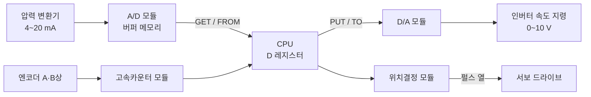

# 특수모듈 프로그래밍

> [!summary] 핵심 요약
> - 특수모듈은 자기 **버퍼 메모리**를 가진다. CPU는 이 메모리를 읽고 쓰며 모듈과 데이터를 주고받는다 (LS: GET/PUT, 미쓰비시: FROM/TO).
> - **분해능** = 아날로그 범위 ÷ 디지털 분할 수. 비트 수가 클수록 정밀하다.
> - 고속카운터는 스캔과 무관하게 펄스를 센다. 2상 엔코더는 **체배(1·2·4체배)** 로 분해능을 높인다.
> - 위치결정 모듈은 **펄스 수로 거리**, **펄스 주파수로 속도**를 지령한다.

> [!warning] 자주 틀리는 포인트
> - 4~20 mA 입력에서 **0 mA는 단선**을 뜻한다. 4 mA 기점이라 단선을 검출할 수 있다 (0~20 mA나 0~10 V는 불가).
> - 분해능 계산에서 분모는 비트 수 n이면 $2^n$ (또는 제조사 지정 최대 디지털값). 문제에 주어진 값을 쓴다.
> - **절대(ABS) 좌표**는 원점 기준 위치, **상대(INC) 좌표**는 현재 위치 기준 이동량.
> - 원점 복귀를 하지 않으면 절대 좌표 운전이 안 된다 (인크리멘털 엔코더의 경우).
> - D/A 출력 계산의 분모는 문제마다 다르다. **0~7 V, 3비트처럼 최대 코드(111 = 7)가 최대 전압**이면 1 LSB = $V/(2^n - 1)$, **0~5 V, 8비트에서 128 → 2.5 V처럼 절반 코드가 절반 전압**이면 1 LSB = $V/2^n$. 보기 숫자로 어느 쪽인지 확인한다.
> - **A/D 변환 속도**: 병렬 비교형(플래시)이 가장 빠름 > 축차 비교형 > 계수 비교형·이중 적분형(느리지만 노이즈에 강함).
> - **사다리형(R-2R) 변환기는 D/A** 변환기다. 병렬 비교·축차 근사·이중 적분은 A/D. 2진 사다리형 D/A는 OP 앰프 **가산기** 원리.
> - 엔코더 펄스처럼 빠른 신호를 PLC에 넣는 특수 유닛은 **고속카운터**. PID·D/A·컴퓨터 링크 유닛이 아니다.
> - PLC 명령어 체계는 **기본·응용·특수** 3가지. "사용자 명령어"는 없다 (교재 24-1).
> - 고속카운터는 CPU 카운터와 달리 **설정값에 도달해도 멈추지 않고** 최댓값까지 계속 센다.
> - 교재의 백분율 분해능은 $\dfrac{1}{2^n - 1}$: 4비트 → $1/15 \approx$ **6.67 %**.
> - 위치결정 모듈의 원점 복귀는 여러 방식이 있고, "시스템 종료 때만 가능"하지 않다 (교재 25-2).

## 개념 정리

### 준비 단계 (I/O 할당과 파라미터)

1. 시스템 구성 확인: 베이스·슬롯 번호, 모듈 종류.
2. I/O 할당: 슬롯마다 점수(16, 32, 64점) 배정 → 디바이스 주소가 정해진다.
3. 모듈 파라미터 설정: 입력 범위, 채널 사용 여부, 필터, 출력 상태(정지 시 유지/초기화) 등.
4. 프로그램에서 **운전 허가(모듈 Ready) 신호**를 확인한 뒤 데이터를 읽고 쓴다.

- **특수모듈**: CPU가 직접 처리하기 어려운 정보(아날로그, 고속 펄스, 위치, 온도, 통신)를 대신 처리해 전달하는 모듈.
- 명령어 체계(교재 24절): **기본**(접점·코일·타이머·카운터), **응용**(전송·비교·이동·사칙·BCD↔BIN 변환·분기·루프), **특수**(특수모듈 읽기·쓰기, GET/PUT·FROM/TO).
- 공정 표현(교재 25절): 서술식, **기호식**(전진·정회전 +, 반대 −, 동시 동작은 묶음), 테이블, 그래프(**작동선도** = 스텝 기준, **시간선도** = 시간 기준). 변위단계선도는 칸 간격을 시간과 무관하게 일정하게 그리고, 전진 1·후진 0으로 표시한다 ([공압 회로](../30_공유압/공압_회로.md) 참고).
- 공정도 작성법은 정해진 규정이 없고 회사 표준을 따른다. 결선은 제작사 결선도대로, 배선 후에는 반드시 **파라미터 설정**.

**모듈 배선 주의 (교재 26절)**

- 입력 모듈: DC 24 V 또는 AC 110/220 V 신호. 출력 모듈: CPU 신호를 외부 기기로.
- 교류 출력과 아날로그 신호는 **별도 케이블**, 동력선·고압선과 함께 배선하지 않는다.
- 전선은 **AWG22(0.3 mm²) 이상** 권장, 고온 기기 근처 피하기, 전원 넣기 전 **극성 확인**.

### A/D 변환 모듈 (아날로그 입력)

- 센서(압력, 온도 변환기 등)의 전압·전류 신호를 디지털 값으로.
- 표준 신호: **DC 4~20 mA**, 0~20 mA, 0~10 V, 1~5 V, −10~10 V. 입력 형태는 전압형·전류형·겸용형, 채널 수는 2·4·8·16.
- 교재는 디지털 값 범위를 **0~16,000**으로 예시한다 (기종마다 0~4000, 0~16000 등 다르니 문제에 주어진 값을 쓴다).
- 열전대 모듈의 출력은 부호 있는 16비트 2진수.
- 변환 3단계: **샘플링 → 양자화 → 부호화**(부호화 회로 = 인코더).
- **계산 예**: 4~20 mA를 0~4000으로 변환할 때 12 mA 입력 →
  $\dfrac{12 - 4}{20 - 4} \times 4000 = 2000$
- **분해능 예**: 0~10 V, 12비트(4096 분할) → $10\text{ V} / 4096 \approx 2.44\text{ mV}$
- 평균 처리(시간·횟수 평균)로 노이즈를 줄인다.
- **필요 비트 수 계산 예**: 0~100 ℃를 0.2 ℃ 분해능으로 → $100 / 0.2 = 500$ 단계 → $2^9 = 512 \ge 500$ → **9비트**.
  - 센서 출력 전압이 함께 주어져도(예: 1 mV/℃) 단계 수는 "측정 범위 ÷ 분해능"으로 같다.
- **분해능 계산 예 2**: 0~5 V, 8비트 → $5 / 255 \approx 19.6$ mV (또는 $5/256 \approx 19.5$ mV)
- **교재 예**: 0~200 ℃를 0.5 ℃ 단위로 → 400단계 → $2^9 = 512 \ge 400$ → **9비트**. 4비트 D/A 백분율 분해능 → $1/15 \approx 6.67\,\%$.
- 분해능이 높을수록 고성능이지만 데이터 용량이 더 든다.

**A/D 변환기 방식 비교**

| 방식 | 속도 | 특징 |
| --- | --- | --- |
| 병렬 비교형 (플래시) | 가장 빠름 | 비교기 $2^n - 1$개, 비쌈 |
| 축차 비교형 (축차 근사) | 빠름 | 상위 비트부터 1비트씩 결정, 가장 흔함 |
| 계수 비교형 (카운터형) | 느림 | 카운터를 올리며 비교 |
| 이중 적분형 | 느림 | 노이즈에 강함, 디지털 전압계 |

### D/A 변환 모듈 (아날로그 출력)

- 디지털 값을 전압·전류로 → 인버터 속도 지령, 비례 밸브 개도.
- **계산 예**: 0~4000 → 0~10 V일 때 디지털 1000 → $10 \times \dfrac{1000}{4000} = 2.5\text{ V}$
- CPU 정지 시 출력을 **유지할지, 0으로 할지** 파라미터로 정한다 (안전 고려).
- **D/A 기본식**: $V_o = V_{ref} \times \dfrac{D}{2^n}$ (또는 $\dfrac{D}{2^n - 1}$, 위 주의 참고).
  - 예 1: 4비트, 0~15 V(최대 코드 1111 = 15 V) → 1 LSB = 1 V, 입력 `1010` → **10 V**
  - 예 2: 10비트, $V_{ref}$ = 10 V, 입력 256 → $10 \times 256/1024 = 2.5$ V
- D/A 변환기는 디지털 계산값을 구동 장치가 쓸 수 있는 **아날로그 구동 신호**로 바꾸는 장치다. 방식: 가중 저항형, **R-2R 사다리형**(OP 앰프 가산 원리).

### 고속카운터 모듈

- 스캔 타임보다 빠른 펄스(수십~수백 kHz)를 하드웨어로 계수.
- 입력 방식: 1상(가산/감산), 2상(A·B상 위상차로 방향 판별), CW/CCW.
- **체배**: A·B상의 상승·하강 에지를 모두 세면 4체배 → 엔코더 1000 P/R가 4000 카운트/회전.
- 기능: 일치 출력(설정값과 같으면 출력), 프리셋, 링 카운터, 회전 속도 측정.
- 교재(24절) 특징: 계수 속도 1만~50만 count/s, 설정값 도달 후에도 **최댓값까지 계수**, 가감산, 1·2·4체배, 대소 비교 신호, **일치 신호를 모듈에서 바로 출력**(스캔을 기다리지 않음).

### 위치결정 모듈

- 서보·스테핑 드라이브에 **펄스 열**을 내보내 위치·속도를 제어.
- 펄스 출력 방식: 펄스+방향, CW/CCW 2펄스.
- **이동 펄스 계산 예**: 볼스크루 리드 10 mm, 1회전 10000 펄스, 100 mm 이동
  → 회전 수 $100/10 = 10$ → 펄스 수 $10 \times 10000 = 100000$
- **속도**: 펄스 주파수(pps). 위 조건에서 50 mm/s → $5\text{ rev/s} \times 10000 = 50000\text{ pps}$
- 운전 모드: 원점 복귀, JOG(누르는 동안 이동), 인칭(일정량 미세 이동), 단독·보간 운전.
- 가감속: 사다리꼴, S자 가감속 → 충격 감소.
- 소프트웨어 리밋(설정값)과 하드웨어 리밋(리밋 스위치)으로 오버트래블 방지.
- 교재(24~25절) 장점: PLC 한 대로 **시퀀스 제어와 위치 제어를 함께**, 위치 데이터를 메모리에 저장(축당 운전 데이터 400개 예시), 자가진단. 전환 제어: 위치↔속도, 위치→토크.

### 기타 특수모듈

| 모듈 | 용도 |
| --- | --- |
| 열전대(TC) 입력 | K, J형 등 온도 측정 |
| 측온 저항체(RTD) 입력 | Pt100으로 정밀 온도 측정 |
| 온도 제어(PID) | 측정 + PID 연산 + 출력까지 모듈 안에서 |
| 통신 | RS-232C/485, 이더넷, 필드버스 ([데이터 통신](데이터_통신.md)) |

## 그림

## 기출 포인트

출처: 생산자동화산업기사 2016–2020년 필기 14회분 (cbtbank.kr).

- A/D·D/A 계산 (센서 범위·분해능 → 필요 비트 수, 8비트 분해능 전압, 3비트·8비트 D/A 출력 전압) — 4회 (2017-1, 2018-2, 2019-3, 2020-3)
- 변환기 방식 구분 (가장 빠른 A/D, A/D가 아닌 사다리형, 사다리형 D/A의 원리) — 3회 (2016-1, 2017-1, 2017-3)
- D/A 변환기의 역할 — 1회 (2020-3)
- 엔코더 펄스 입력용 특수 유닛 = 고속카운터 — 1회 (2018-2)

**교재 예제 유형** (Win-Q 2025 PART 01 CHAPTER 01, 24~26절): 명령어 체계가 아닌 것(사용자 명령어), CPU가 처리하기 어려운 정보를 전달하는 장치(특수모듈), 한 가닥 통신선(필드버스 링크), 시간선도 고르기, 원점 복귀 시점(틀린 것), 서미스터 값을 저장하는 장치(A/D), 성격이 다른 변환기(사다리형 = D/A), 4비트 분해능 6.67 %, 최소 9비트.

## 관련 단원

- [PLC 구성과 특성](PLC_구성과_특성.md)
- [PLC 프로그래밍 언어와 명령어](PLC_프로그래밍_언어와_명령어.md)
- [아날로그 센서와 엔코더](아날로그_센서와_엔코더.md)
- [자동제어계의 기초](자동제어계의_기초.md)

## 체크리스트

- [ ] 버퍼 메모리와 GET/PUT(FROM/TO)의 관계를 설명한다
- [ ] 4~20 mA 입력의 디지털 값을 계산할 수 있다
- [ ] 비트 수로 분해능을 계산할 수 있다
- [ ] 4체배 시 1회전 카운트 수를 구한다
- [ ] 리드·펄스 수로 이동 펄스와 펄스 주파수를 계산한다
- [ ] 절대·상대 좌표와 원점 복귀의 필요성을 안다
- [ ] 측정 범위와 분해능으로 A/D 최소 비트 수를 구한다
- [ ] D/A 출력 전압을 $2^n$ / $2^n - 1$ 두 방식으로 계산해 보기와 맞춘다
- [ ] A/D 방식 4가지를 속도 순으로 나열하고, 사다리형은 D/A임을 안다

## 참고

- [큐넷 자동화설비산업기사 출제기준](https://www.q-net.or.kr/crf005.do?id=crf00503&jmCd=2034)
