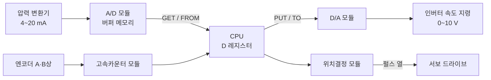

# 특수모듈 프로그래밍

> [!summary] 핵심 요약
> - 특수모듈은 자기 **버퍼 메모리**를 가진다. CPU는 이 메모리를 읽고 쓰며 모듈과 데이터를 주고받는다 (LS: GET/PUT, 미쓰비시: FROM/TO).
> - **분해능** = 아날로그 범위 ÷ 디지털 분할 수. 비트 수가 클수록 정밀하다.
> - 고속카운터는 스캔과 무관하게 펄스를 센다. 2상 엔코더는 **체배(1·2·4체배)** 로 분해능을 높인다.
> - 위치결정 모듈은 **펄스 수로 거리**, **펄스 주파수로 속도**를 지령한다.

> [!warning] 자주 틀리는 포인트
> - 4~20 mA 입력에서 **0 mA는 단선**을 뜻한다. 4 mA 기점이라 단선을 검출할 수 있다 (0~20 mA나 0~10 V는 불가).
> - 분해능 계산에서 분모는 비트 수 n이면 $2^n$ (또는 제조사 지정 최대 디지털값). 문제에 주어진 값을 쓴다.
> - **절대(ABS) 좌표**는 원점 기준 위치, **상대(INC) 좌표**는 현재 위치 기준 이동량.
> - 원점 복귀를 하지 않으면 절대 좌표 운전이 안 된다 (인크리멘털 엔코더의 경우).

## 개념 정리

### 준비 단계 (I/O 할당과 파라미터)

1. 시스템 구성 확인: 베이스·슬롯 번호, 모듈 종류.
2. I/O 할당: 슬롯마다 점수(16, 32, 64점) 배정 → 디바이스 주소가 정해진다.
3. 모듈 파라미터 설정: 입력 범위, 채널 사용 여부, 필터, 출력 상태(정지 시 유지/초기화) 등.
4. 프로그램에서 **운전 허가(모듈 Ready) 신호**를 확인한 뒤 데이터를 읽고 쓴다.

### A/D 변환 모듈 (아날로그 입력)

- 센서(압력, 온도 변환기 등)의 전압·전류 신호를 디지털 값으로.
- 표준 신호: **DC 4~20 mA**, 0~10 V, 1~5 V, −10~10 V.
- **계산 예**: 4~20 mA를 0~4000으로 변환할 때 12 mA 입력 →
  $\dfrac{12 - 4}{20 - 4} \times 4000 = 2000$
- **분해능 예**: 0~10 V, 12비트(4096 분할) → $10\text{ V} / 4096 \approx 2.44\text{ mV}$
- 평균 처리(시간·횟수 평균)로 노이즈를 줄인다.

### D/A 변환 모듈 (아날로그 출력)

- 디지털 값을 전압·전류로 → 인버터 속도 지령, 비례 밸브 개도.
- **계산 예**: 0~4000 → 0~10 V일 때 디지털 1000 → $10 \times \dfrac{1000}{4000} = 2.5\text{ V}$
- CPU 정지 시 출력을 **유지할지, 0으로 할지** 파라미터로 정한다 (안전 고려).

### 고속카운터 모듈

- 스캔 타임보다 빠른 펄스(수십~수백 kHz)를 하드웨어로 계수.
- 입력 방식: 1상(가산/감산), 2상(A·B상 위상차로 방향 판별), CW/CCW.
- **체배**: A·B상의 상승·하강 에지를 모두 세면 4체배 → 엔코더 1000 P/R가 4000 카운트/회전.
- 기능: 일치 출력(설정값과 같으면 출력), 프리셋, 링 카운터, 회전 속도 측정.

### 위치결정 모듈

- 서보·스테핑 드라이브에 **펄스 열**을 내보내 위치·속도를 제어.
- 펄스 출력 방식: 펄스+방향, CW/CCW 2펄스.
- **이동 펄스 계산 예**: 볼스크루 리드 10 mm, 1회전 10000 펄스, 100 mm 이동
  → 회전 수 $100/10 = 10$ → 펄스 수 $10 \times 10000 = 100000$
- **속도**: 펄스 주파수(pps). 위 조건에서 50 mm/s → $5\text{ rev/s} \times 10000 = 50000\text{ pps}$
- 운전 모드: 원점 복귀, JOG(누르는 동안 이동), 인칭(일정량 미세 이동), 단독·보간 운전.
- 가감속: 사다리꼴, S자 가감속 → 충격 감소.
- 소프트웨어 리밋(설정값)과 하드웨어 리밋(리밋 스위치)으로 오버트래블 방지.

### 기타 특수모듈

| 모듈 | 용도 |
| --- | --- |
| 열전대(TC) 입력 | K, J형 등 온도 측정 |
| 측온 저항체(RTD) 입력 | Pt100으로 정밀 온도 측정 |
| 온도 제어(PID) | 측정 + PID 연산 + 출력까지 모듈 안에서 |
| 통신 | RS-232C/485, 이더넷, 필드버스 ([데이터 통신](데이터_통신.md)) |

## 그림

## 관련 단원

- [PLC 구성과 특성](PLC_구성과_특성.md)
- [PLC 프로그래밍 언어와 명령어](PLC_프로그래밍_언어와_명령어.md)
- [자동제어계의 기초](자동제어계의_기초.md)

## 체크리스트

- [ ] 버퍼 메모리와 GET/PUT(FROM/TO)의 관계를 설명한다
- [ ] 4~20 mA 입력의 디지털 값을 계산할 수 있다
- [ ] 비트 수로 분해능을 계산할 수 있다
- [ ] 4체배 시 1회전 카운트 수를 구한다
- [ ] 리드·펄스 수로 이동 펄스와 펄스 주파수를 계산한다
- [ ] 절대·상대 좌표와 원점 복귀의 필요성을 안다

## 참고

- [큐넷 자동화설비산업기사 출제기준](https://www.q-net.or.kr/crf005.do?id=crf00503&jmCd=2034)
