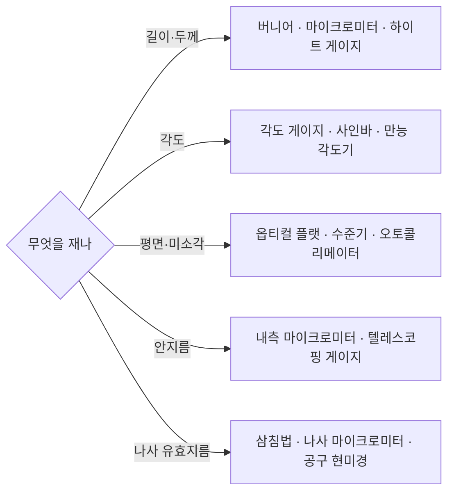

# 기계공작과 측정

> [!note] 출제기준과의 관계
> 새 출제기준 2과목 세부항목에는 기계공작·측정이 따로 없다. 옛 생산자동화산업기사에서는 1과목 "기계가공법"이었다. 교재(Win-Q 2025)는 CHAPTER 03 끝(23~30절)에 이 내용을 넣었으므로, 교재 예제 수준으로만 정리한다.

> [!summary] 핵심 요약
> - 기계 = **동력부(힘 발생) → 전달부 → 구동부(일)**. 에너지를 받아 유용한 일을 한다.
> - 공작기계 3대 기본 운동: **절삭 운동, 이송 운동, 위치 조정 운동**.
> - 치공구 3요소: **위치 결정면, 위치 결정구, 클램프**. **지그**는 공구 안내용 **부시**가 있고, **고정구**는 없다.
> - 측정 3원리: **아베**(표준자와 측정물이 한 축선), **테일러**(통과 측은 전체 동시, 정지 측은 하나씩), **헤르츠**(접촉 변형).
> - 마이크로미터 최소 눈금 = 스핀들 피치 ÷ 심블 등분 수 = 0.5 ÷ 50 = **0.01 mm**.
> - 사인바: $\sin\alpha = \dfrac{H - h}{L}$ (L: 롤러 중심 거리 = 호칭 치수). **45° 이하**에서 쓴다.
> - 삼침법은 나사의 **유효지름**을 가장 정밀하게 잰다.

> [!warning] 자주 틀리는 포인트
> - 공작물이 직선 왕복하면 **플레이너**, 공구가 왕복하면 **셰이퍼**. 셰이퍼를 세운 꼴이 **슬로터**(키 홈).
> - 키 홈·스플라인·다각형 구멍은 **브로칭**, 기어 창성은 **호빙**(호브, 차동 기구).
> - **카운터 보어**는 볼트 머리, **카운터 싱킹**은 접시머리를 묻는 가공이다. "구멍 다듬질"이 아니다.
> - 탭은 1·2·3번을 **순서대로** 쓴다. 다이스 번호는 순서가 아니라 서로 다른 크기다 (교재 24-5).
> - **지시 범위**와 **측정 범위**를 구분한다: 75~100 mm 마이크로미터의 지시 범위는 25 mm, 측정 범위는 75~100 mm.
> - **하이트 게이지**는 아베의 원리를 지키지 못하는 대표 예다.
> - 우연 오차는 원인을 모르고 **피할 수 없다** → "보정하면 없앨 수 있다"는 틀린 보기.
> - 백래시·마찰로 생기는 것은 **되돌림 오차**.
> - 링 게이지·옵티컬 플랫을 헷갈리지 않는다: 링 게이지는 **한계 게이지**(축 검사), 옵티컬 플랫은 **평면도**.
> - 사인바는 45°를 넘으면 오차가 커진다 → 보각으로 잰다.

## 개념 정리

### 기계와 제작 공정 (23절)

| 공정 | 요점 |
| --- | --- |
| 주조 | 원형으로 주형을 만들고 녹인 금속을 부어 주물을 얻는다 |
| 다이캐스팅 | 금형에 **압력**을 주어 주조. 치수 정밀, 기공 적음, 대량 생산. 주로 **용융점이 낮은** 비철 합금 |
| 소성가공 | 재료의 소성(연성·전성)을 이용한 단조·압연·압출·인발·프레스 |
| 용접 | 열로 일부를 녹여 접합 |
| 기계가공 | 절삭(연삭 포함) |
| 수가공 | 줄·톱·정·망치 등 손작업 |
| 열처리 | 가열·냉각으로 성질을 바꿈 |
| 표면처리 | 표면에 원하는 성질을 주려고 가열하거나 입히거나 벗김 |

- 교재는 **용접을 소성가공에 묶어** 설명한다. 일반 분류에서는 용접을 **접합** 공정으로 따로 둔다.
- 교재 23-1 해설은 보기의 "전기력" 표현 때문에 복수 정답 시비가 있을 수 있는 문제라고 적는다.

### 공작기계 (24절)

| 가공 | 공구 / 공작물 운동 | 대표 작업 |
| --- | --- | --- |
| 선반 | 공작물 회전, 공구 이송 | 원통·나사 |
| 밀링 | 공구 회전, 공작물 이송 | 평면·홈·기어 |
| 드릴링 | 드릴 회전 | 없는 구멍 뚫기 |
| 보링 | 보링 바 회전 | 있는 구멍 넓히기·정밀 다듬질 |
| 셰이퍼 | **공구** 직선 왕복 | 작은 평면 |
| 슬로터 | 공구 수직 왕복 (세운 셰이퍼) | 키 홈 |
| 플레이너 | **공작물** 직선 왕복 | 대형 평면 (평삭기) |
| 연삭 | 숫돌 회전 | 정밀 다듬질 |
| 래핑 | 랩제로 문지름 | 초정밀 면 |
| 호닝 | 혼 숫돌 | 구멍 내면 |
| 호빙 | 호브 | 스퍼·헬리컬 기어 창성 |
| 셰이빙 | 치형 커터 | 기어 다듬질 |
| 브로칭 | 브로치 1회 통과 | 키 홈·스플라인·다각형 구멍 |

- 공작기계 분류: **범용**(가공 범위 넓음), **전용**(특정 제품 대량 생산, 구조 간단, 사용 범위 좁음), **단능**(한 공정만), **만능**(여러 기계 작업을 한 대로).
- 수기가공 도구:
  - 서피스 게이지: 평행선 긋기, 평행면 검사.
  - 스크레이퍼: 줄 가공 뒤 정밀 다듬질.
  - 스트레이트 에지: 직선 긋기, 평면 검사. 나이프 에지: 다듬질면 평면 검사.
  - 앵글 플레이트: 공작물을 직각으로 세워 고정.
  - 탭은 암나사, 다이스는 수나사. 줄 눈은 황목(거침)·중목·세목.
- 탭이 부러지는 원인: 구멍이 작거나 굽음, 탭이 기울어짐, 핸들이 맞지 않음, 무리한 힘·과속, 막힌 구멍 바닥에 닿음. 탭 재질이 단단한 것은 원인이 아니다.
- **치공구**의 목적: 정밀도·호환성 향상, 불량 감소, 경제적 생산, 작업자 피로 감소와 안전.

### 측정 용어와 원리 (25~26절)

- 최소 눈금값, 감도(측정량 변화에 대한 지시 변화), 지시 범위, 측정 범위, 되돌림 오차, 측정력.
- 측정 종류: 직접(길이·각도를 바로 읽음), 간접(다른 양을 재서 계산), 절대(기본량만으로), 비교(기준과의 차), 한계 게이지(합격·불합격 판정, 비교 측정의 한 종류).

| 구분 | 직접 측정 | 비교 측정 |
| --- | --- | --- |
| 장점 | 측정 범위 넓음, 실제 치수 읽음, 다품종 소량 | 빠름, 형상 측정, 자동화 쉬움 |
| 단점 | 시간 오래, 숙련 필요, 개인 오차 | 치수를 직접 못 읽음, 표준 게이지 필요 |

- **오차**: 공차는 허용 범위, 오차는 참값과 측정값의 차.
  - 계통 오차: 원인이 일정 → 보정 가능. 계기 오차, 환경 오차(온도·습도·압력), 개인 오차.
  - 우연 오차: 원인 불명, 피할 수 없음 → 여러 번 재서 평균.
  - 과실 오차: 부주의. 주의로 줄인다. 교재는 개인 오차와 섞여 쓰이니 문제 맥락으로 판단하라고 한다.
  - 되돌림 오차(마찰·흔들림·백래시), 히스테리시스 오차(올릴 때와 내릴 때의 차).
- **온도 오차**: 길이 변화 $\Delta L = L\alpha\Delta T$. 20 mm 게이지 블록, $\alpha = 1.0 \times 10^{-6}$/℃, 20 → 36 ℃이면 $20 \times 10^{-6} \times 16 = 3.2 \times 10^{-4}$ mm (교재 25-6). 표준 온도는 **20 ℃**.

### 길이 측정 (27절)

- **버니어 캘리퍼스**: 아들자 0 바로 왼쪽의 어미자 값 + 어미자와 맞는 아들자 눈금. 종류 M1형, M2형, CM형(이송 바퀴).
- **마이크로미터**: 슬리브 + 심블. 최소 0.01 mm.

| 마이크로미터 | 용도 |
| --- | --- |
| 외측 | 바깥지름·두께 |
| 내측 | 안지름 |
| 깊이 | 깊이 |
| 그루브 | 구멍 안쪽 홈 |
| 지시 | 인디케이터 결합, 0.001 mm |
| 나사 | 나사 유효지름 |
| 포인트 | 끝이 뾰족 → 드릴 웨브 두께처럼 좁은 곳 |

| 하이트 게이지 | 특징 |
| --- | --- |
| HT형 | 표준형, 가장 많이 씀, 어미자 이동으로 0점 조정 가능 |
| HM형 | 견고, **금긋기 적당**, 0점 조정 **불가** |
| HB형 | 가벼운 상자형 슬라이더, 금긋기 부적당 |

- 측정기는 직사광선을 피해 보관한다.

### 각도·평면 측정 (28~29절)

| 측정기 | 요점 |
| --- | --- |
| 요한슨식 각도 게이지 | 85개조·49개조, **홀더**로 조합 |
| NPL식 각도 게이지 | 면이 크고 개수가 적음, 홀더 없이 밀착 조합 |
| 만능 각도기 | 각도를 직접 읽음 |
| 사인바 | 롤러 중심 거리 + 블록 게이지 높이로 계산, 45° 이하 |
| 광선 정반(옵티컬 플랫) | 빛 간섭무늬로 평면도·평행도 |
| 수준기 | 기포로 수평과 미소 경사 |
| 오토콜리메이터 | 시준기 + 망원경, 미소 각도·진직도·평면도 |

- **사인바 계산 예** (교재 28-5): 호칭 200 mm, 21°30′, 낮은 쪽 5 mm → $H = 5 + 200 \sin 21.5° = 5 + 73.3 = 78.3$ mm.
- **수준기**: 1눈금 길이 $l$, 감도 α(라디안), 기포관 곡률 반지름 $R = l/\alpha$. 1″ = 1/206265 rad. 2 mm·5″ → $R = 2 \div (5/206265) \approx 82{,}500$ mm = **82.5 m** (교재 29-1).
- **옵티컬 패럴렐**로 마이크로미터 앤빌·스핀들 평행도를 볼 때 교재는 "간섭무늬 수 최댓값 × 반파장(0.32 µm)"으로 계산한다 (28-6: 4 × 0.32 ≈ 1.28 → 약 1 µm). 두 면의 무늬 수를 더하는 자료도 있으니 시험에서는 교재 방식을 따른다.
- 그 밖의 형상 측정기:
  - 텔레스코핑 게이지: 안지름을 옮겨 외측 마이크로미터로 잰다.
  - 투영기: 확대상을 스크린에 비춤, 측정력 오차 없음, 길이·각도·복잡한 윤곽.
  - 3차원 측정기: 프로브 좌표로 측정. 얇거나 무른 재질은 **비접촉식(광학식) 프로브**.

### 나사 측정 (30절)

- 측정 대상: 바깥지름, 골지름, **유효지름**, 피치, 리드, 나사산 각.
- **삼침법**: 같은 지름의 침 3개(한쪽 2, 반대쪽 1)를 넣고 바깥 치수 M을 잰다. 미터·유니파이(60°)는 $d_2 = M - 3d_w + 0.866p$. 정밀도가 가장 높다.
- 나사 마이크로미터: 간단하지만 산 각이 맞지 않으면 오차.
- 공구 현미경·투영기: 피치·반각·유효지름을 광학적으로. 나사산 각은 공구 현미경, 투영기, 만능 측정 현미경으로 잰다.
- 피치 게이지: 판 게이지 한 조로 비교. 센터 게이지: 선반 나사 절삭 때 바이트 각도 맞춤.

## 그림

## 기출 포인트

- 옛 1과목 기계가공법 문항(나사 측정 4회, 카운터 싱킹 3회, 공기 마이크로미터 6회 등)은 새 출제기준 밖으로 분류해 두었다 ([기출분석 – 기계요소설계](../01_시험안내/기출분석_기계요소설계.md)). 교재가 다시 다루므로 개념만 확인한다.

**교재 예제 유형** (Win-Q 2025 PART 01 CHAPTER 03, 23~30절):
- 23절: 기계 설명 중 틀린 것(에너지를 쓰지 않는다), 표면처리를 소성가공이라 한 보기, 다이캐스팅 특징이 아닌 것(고용융점 금속).
- 24절: 공작물 왕복(플레이너), 호브·차동 기구(호빙 머신), 전용 공작기계, 카운터 보어 용도, 다이스 번호, 탭 파손 원인 아닌 것(탭 경도), 브로칭, 치공구 목적, 3대 기본 운동이 아닌 것(전단 운동).
- 25~26절: 측정 범위, 아베의 원리, 직접 측정 장점이 아닌 것, 테일러의 원리, 래디어스 게이지(곡률 반지름), 온도 오차 3.2×10⁻⁴ mm, 우연 오차, 백래시 → 되돌림 오차.
- 27절: 외경 측정과 먼 것(그루브), 최소 측정값 10 µm, 보관 주의(직사광선), 드릴 웨브(포인트), HM형 하이트 게이지.
- 28~29절: NPL과 관계없는 것(홀더), 각도 측정기가 아닌 것(나이프 에지), 사인바 호칭(롤러 중심 거리), 45° 이상 사용 불가, 사인바 78.3 mm, 옵티컬 패럴렐 약 1 µm, 수준기 82.5 m, 평면도와 무관(링 게이지), 오토콜리메이터, 텔레스코핑(안지름), 투영기(각도), 박판 구멍을 못 재는 것(옵티컬 플랫), 비접촉 프로브.
- 30절: 센터 게이지, 나사 마이크로미터로 산 각 직접 측정 불가, 삼침법(유효지름), 공구 현미경.

## 관련 단원

- [나사와 볼트](나사와_볼트.md)
- [치수공차와 끼워맞춤](치수공차와_끼워맞춤.md)
- [표면거칠기·열처리·가공기호](표면거칠기_열처리_가공기호.md)
- [기하공차](기하공차.md)

## 체크리스트

- [ ] 기계의 구성(동력·전달·구동)과 제작 공정을 구분한다
- [ ] 셰이퍼·슬로터·플레이너·브로칭·호빙의 차이를 말한다
- [ ] 치공구 3요소와 지그·고정구 차이를 안다
- [ ] 아베·테일러·헤르츠 원리를 구분한다
- [ ] 계통·우연·과실·되돌림 오차를 구분한다
- [ ] 마이크로미터 최소 눈금과 종류별 용도를 안다
- [ ] 하이트 게이지 HT·HM·HB 차이를 안다
- [ ] 사인바 높이와 수준기 곡률 반지름을 계산한다
- [ ] 삼침법으로 유효지름을 구하는 식을 쓴다

## 참고

- [큐넷 자동화설비산업기사 출제기준](https://www.q-net.or.kr/crf005.do?id=crf00503&jmCd=2034)
