# 기계공작과 측정

> [!note] 출제기준과의 관계
> 새 출제기준 2과목 세부항목에는 기계공작·측정이 따로 없다. 옛 생산자동화산업기사에서는 1과목 "기계가공법"이었다. 교재(Win-Q 2025)는 CHAPTER 03 끝(23~30절)에 이 내용을 넣었으므로, 교재 예제 수준으로만 정리한다.

> [!summary] 핵심 요약
> - 기계 = **동력부(힘 발생) → 전달부 → 구동부(일)**. 에너지를 받아 유용한 일을 한다.
> - 공작기계 3대 기본 운동: **절삭 운동, 이송 운동, 위치 조정 운동**.
> - 치공구 3요소: **위치 결정면, 위치 결정구, 클램프**. **지그**는 공구 안내용 **부시**가 있고, **고정구**는 없다.
> - 측정 3원리: **아베**(표준자와 측정물이 한 축선), **테일러**(통과 측은 전체 동시, 정지 측은 하나씩), **헤르츠**(접촉 변형).
> - 마이크로미터 최소 눈금 = 스핀들 피치 ÷ 심블 등분 수 = 0.5 ÷ 50 = **0.01 mm**.
> - 사인바: $\sin\alpha = \dfrac{H - h}{L}$ (L: 롤러 중심 거리 = 호칭 치수). **45° 이하**에서 쓴다.
> - 삼침법은 나사의 **유효지름**을 가장 정밀하게 잰다.

> [!warning] 자주 틀리는 포인트
> - 공작물이 직선 왕복하면 **플레이너**, 공구가 왕복하면 **셰이퍼**. 셰이퍼를 세운 꼴이 **슬로터**(키 홈).
> - 키 홈·스플라인·다각형 구멍은 **브로칭**, 기어 창성은 **호빙**(호브, 차동 기구).
> - **카운터 보어**는 볼트 머리, **카운터 싱킹**은 접시머리를 묻는 가공이다. "구멍 다듬질"이 아니다.
> - 탭은 1·2·3번을 **순서대로** 쓴다. 다이스 번호는 순서가 아니라 서로 다른 크기다 (교재 24-5).
> - **지시 범위**와 **측정 범위**를 구분한다: 75~100 mm 마이크로미터의 지시 범위는 25 mm, 측정 범위는 75~100 mm.
> - **하이트 게이지**는 아베의 원리를 지키지 못하는 대표 예다.
> - 우연 오차는 원인을 모르고 **피할 수 없다** → "보정하면 없앨 수 있다"는 틀린 보기.
> - 백래시·마찰로 생기는 것은 **되돌림 오차**.
> - 링 게이지·옵티컬 플랫을 헷갈리지 않는다: 링 게이지는 **한계 게이지**(축 검사), 옵티컬 플랫은 **평면도**.
> - 사인바는 45°를 넘으면 오차가 커진다 → 보각으로 잰다.

## 학습 목표

이 단원을 마치면 다음을 할 수 있어야 한다.

1. 기계의 구성(동력부·전달부·구동부)과 주조·소성가공·용접·절삭 같은 제작 공정을 구분한다.
2. 공구와 공작물 중 무엇이 움직이는지로 선반·밀링·셰이퍼·슬로터·플레이너·브로칭·호빙을 구분한다.
3. 치공구 3요소를 말하고, 부시 유무로 지그와 고정구를 구분한다.
4. 아베·테일러·헤르츠 원리와 계통·우연·과실·되돌림 오차를 구분하고, 온도에 따른 길이 오차를 계산한다.
5. 버니어 캘리퍼스·마이크로미터 눈금을 읽고, 측정 목적에 맞는 측정기를 고른다.
6. 사인바 블록 높이, 수준기 곡률 반지름, 삼침법 유효지름을 계산한다.

## 한눈에 보기

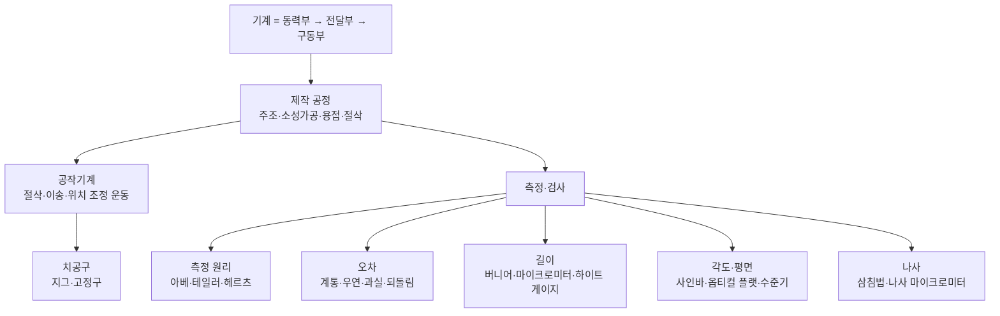

## 1. 기계와 제작 공정 (23절)

기계는 에너지를 받아 **힘을 만들고(동력부), 그 힘을 옮겨(전달부), 원하는 일을 한다(구동부).** 자동차라면 엔진 → 변속기·축 → 바퀴다. 이런 기계를 만드는 방법이 아래 제작 공정이다. 쇳물을 부어 모양을 만들지(주조), 두드리고 눌러 모양을 바꿀지(소성가공), 깎아 낼지(절삭)로 크게 나뉜다.

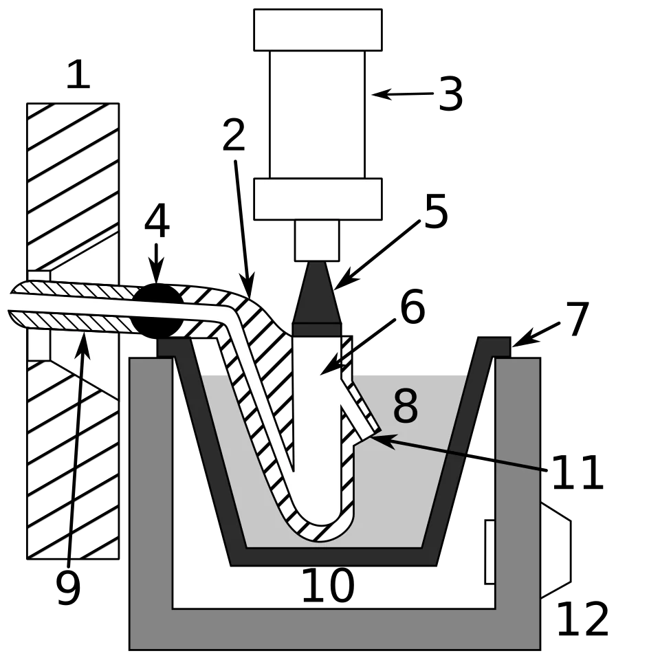

*다이캐스팅(고온 챔버식): 도가니 속 녹은 금속(8)을 유압 실린더(3)의 플런저(5)가 눌러, 구스넥(2)을 거쳐 왼쪽 금형(1) 안으로 **압력을 주어** 밀어 넣는다. 그래서 일반 주조보다 치수가 정밀하고 기공이 적다. 금형이 견뎌야 하므로 아연·알루미늄 같은 **용융점이 낮은** 비철 합금에 쓴다.*

| 공정 | 요점 |
| --- | --- |
| 주조 | 원형으로 주형을 만들고 녹인 금속을 부어 주물을 얻는다 |
| 다이캐스팅 | 금형에 **압력**을 주어 주조. 치수 정밀, 기공 적음, 대량 생산. 주로 **용융점이 낮은** 비철 합금 |
| 소성가공 | 재료의 소성(연성·전성)을 이용한 단조·압연·압출·인발·프레스 |
| 용접 | 열로 일부를 녹여 접합 |
| 기계가공 | 절삭(연삭 포함) |
| 수가공 | 줄·톱·정·망치 등 손작업 |
| 열처리 | 가열·냉각으로 성질을 바꿈 |
| 표면처리 | 표면에 원하는 성질을 주려고 가열하거나 입히거나 벗김 |

- 교재는 **용접을 소성가공에 묶어** 설명한다. 일반 분류에서는 용접을 **접합** 공정으로 따로 둔다.
- 교재 23-1 해설은 보기의 "전기력" 표현 때문에 복수 정답 시비가 있을 수 있는 문제라고 적는다.

> [!question] 시험에서는
> "기계는 에너지를 쓰지 않는다", "표면처리는 소성가공이다", "다이캐스팅은 용융점이 높은 금속에 쓴다" 같은 보기가 틀린 것으로 나온다.

## 2. 공작기계 (24절)

공작기계는 결국 **공구와 공작물 중 누가 돌고, 누가 왕복하고, 누가 조금씩 이송하느냐**로 구분된다. 깎는 동작이 **절삭 운동**, 다음 깎을 자리로 옮기는 동작이 **이송 운동**, 깎기 전에 깊이·위치를 맞추는 동작이 **위치 조정 운동**이다. 이 셋이 공작기계 3대 기본 운동이다.

### 2-1. 회전 절삭 — 선반과 밀링

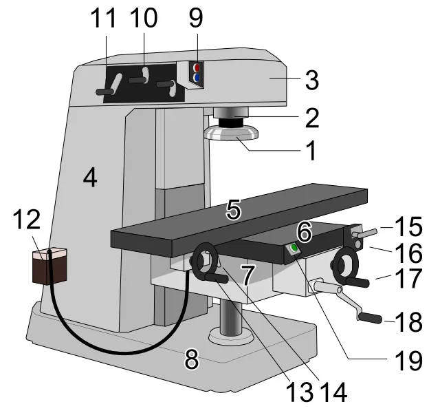

*수직 밀링: 헤드(3) 아래 주축 끝의 **커터(1)가 돌고**, 공작물을 실은 **테이블(5)이 핸들로 이송**된다. 선반은 반대로 주축에 물린 **공작물이 돌고** 바이트가 이송된다.*

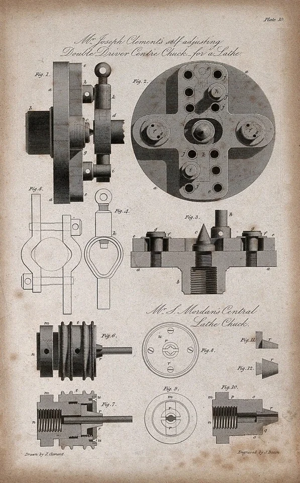

*선반에서 **공작물을 주축에 물려 돌리는 척류**를 그린 옛 도판이다(영문 글자는 부품 기호 a, b, c…와 도판 제목이다). 위쪽은 십자형 판에 여러 개의 구멍이 뚫린 **센터 구동 척**으로, 판 가운데의 센터(원뿔 끝)로 공작물을 받치고 구동 핀이 공작물을 끼워 돌린다. 아래쪽은 가운데에서 물려 돌리는 **중앙 척**의 외형과 단면이다. 오늘날 선반의 3조 척·4조 척과 모양은 다르지만, "주축에 달린 장치가 공작물을 잡아 돌린다"는 선반의 구성은 같다.*

| 선반: 공작물이 돈다 | 밀링: 공구가 돈다 |
| --- | --- |
| 주축에 물린 공작물이 회전, 바이트는 축 방향으로 이송 → 원통·나사 | 주축에 단 커터가 회전, 테이블 위 공작물이 이송 → 평면·홈·기어 |

### 2-2. 직선 왕복 절삭 — 셰이퍼·슬로터·플레이너

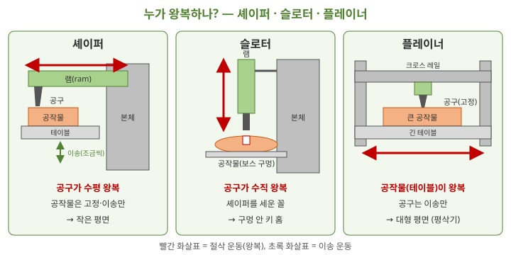

*빨간 화살표가 절삭 운동이다. **셰이퍼와 슬로터는 공구(램)가**, **플레이너는 공작물을 실은 테이블이** 왕복한다. 슬로터는 셰이퍼의 램을 세운 꼴이라 구멍 안쪽 키 홈을 판다.*

### 2-3. 특수 절삭 — 브로칭과 호빙

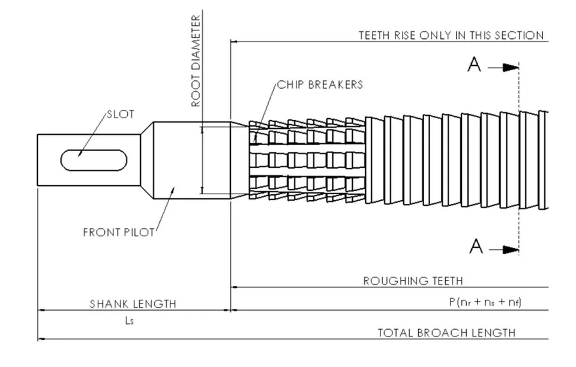

*브로치는 자루(SHANK) 뒤로 날이 줄지어 있고, **뒤쪽 날일수록 조금씩 높다(TEETH RISE)**. 한 번 당기거나 밀어 통과시키면 날 하나가 조금씩 깎아 최종 형상이 완성된다.*

| 브로칭: 브로치 1회 통과 | 호빙: 호브로 기어 창성 |
| --- | --- |
| 날이 조금씩 커지는 긴 공구를 한 번 밀거나 당겨 키 홈·스플라인·다각형 구멍 완성 | 나사 모양 커터(호브)와 기어 소재가 맞물려 돌며 치형을 깎는다(차동 기구) |

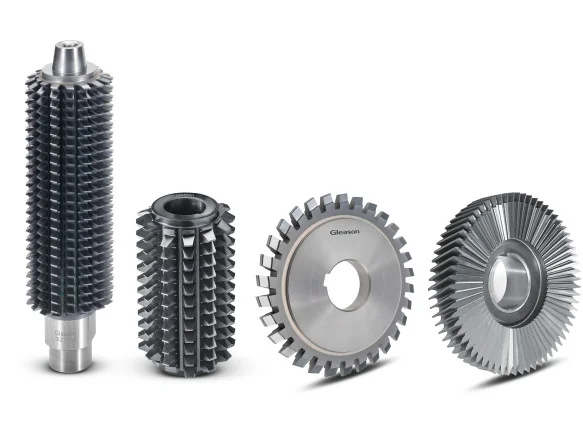

*Gleason 카탈로그의 기어 절삭 공구 사진(제조사 사진). **왼쪽 두 개가 호브**다 — 원통 둘레에 이(날)가 나사처럼 **나선으로 줄지어** 있고, 이 나사 모양 커터를 돌리면서 기어 소재와 맞물려 돌려 치형을 깎는다(호빙). 맨 왼쪽은 자루가 달린 긴 호브, 두 번째는 구멍에 축을 끼우는 짧은 호브다. 오른쪽의 원판형 공구 두 개는 호브가 아니라 날이 원판 둘레에 난 기어 절삭 커터다.*

### 가공 방법 정리표

| 가공 | 공구 / 공작물 운동 | 대표 작업 |
| --- | --- | --- |
| 선반 | 공작물 회전, 공구 이송 | 원통·나사 |
| 밀링 | 공구 회전, 공작물 이송 | 평면·홈·기어 |
| 드릴링 | 드릴 회전 | 없는 구멍 뚫기 |
| 보링 | 보링 바 회전 | 있는 구멍 넓히기·정밀 다듬질 |
| 셰이퍼 | **공구** 직선 왕복 | 작은 평면 |
| 슬로터 | 공구 수직 왕복 (세운 셰이퍼) | 키 홈 |
| 플레이너 | **공작물** 직선 왕복 | 대형 평면 (평삭기) |
| 연삭 | 숫돌 회전 | 정밀 다듬질 |
| 래핑 | 랩제로 문지름 | 초정밀 면 |
| 호닝 | 혼 숫돌 | 구멍 내면 |
| 호빙 | 호브 | 스퍼·헬리컬 기어 창성 |
| 셰이빙 | 치형 커터 | 기어 다듬질 |
| 브로칭 | 브로치 1회 통과 | 키 홈·스플라인·다각형 구멍 |

- 공작기계 분류: **범용**(가공 범위 넓음), **전용**(특정 제품 대량 생산, 구조 간단, 사용 범위 좁음), **단능**(한 공정만), **만능**(여러 기계 작업을 한 대로).

### 2-4. 구멍 가공 — 카운터 보어와 카운터 싱킹

*A 드릴로 없는 구멍을 뚫고, B 보링으로 있는 구멍을 넓히고, C·D 리머로 다듬고, H 탭으로 암나사를 낸다. E·G는 볼트 머리가 표면 위로 튀어나오지 않게 구멍 입구를 넓히는 가공이다(F 스폿 페이싱은 너트·와셔 자리만 얕게 평평하게 깎는다). **원통형 턱(E 카운터 보어)** 에는 육각 구멍 붙이 볼트 머리, **원뿔형 경사(G 카운터 싱크)** 에는 접시머리 나사가 묻힌다.*

### 2-5. 수기가공 도구

- 수기가공 도구:
  - 서피스 게이지: 평행선 긋기, 평행면 검사.
  - 스크레이퍼: 줄 가공 뒤 정밀 다듬질.
  - 스트레이트 에지: 직선 긋기, 평면 검사. 나이프 에지: 다듬질면 평면 검사.
  - 앵글 플레이트: 공작물을 직각으로 세워 고정.
  - 탭은 암나사, 다이스는 수나사. 줄 눈은 황목(거침)·중목·세목.
- 탭이 부러지는 원인: 구멍이 작거나 굽음, 탭이 기울어짐, 핸들이 맞지 않음, 무리한 힘·과속, 막힌 구멍 바닥에 닿음. 탭 재질이 단단한 것은 원인이 아니다.

> [!tip] 탭과 다이스 번호
> 탭 1·2·3번은 **같은 크기의 나사를 거칠게 → 곱게** 내는 한 조라서 순서대로 쓴다. 다이스 번호는 순서가 아니라 서로 다른 나사 크기다.

## 3. 치공구 — 지그와 고정구 (24절)

같은 부품을 수백 개 뚫을 때마다 금을 긋고 위치를 맞추면 느리고 들쭉날쭉하다. **치공구**는 공작물을 늘 같은 자리에 놓고(위치 결정), 꽉 잡고(클램프), 필요하면 공구까지 안내해서 **누가 해도 같은 위치에** 가공되게 하는 도구다.

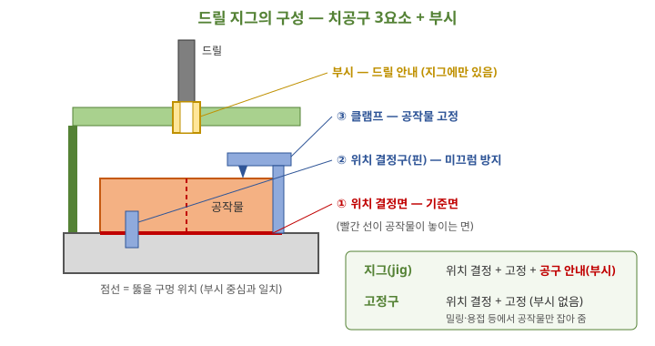

*① 위치 결정면에 공작물을 올리고 ② 핀으로 자리를 잡은 뒤 ③ 클램프로 누른다. 위쪽 판의 **부시**가 드릴을 정확한 위치로 안내한다. 부시가 있으면 **지그**, 없이 위치 결정·고정만 하면 **고정구**다.*

- 드릴 부시는 경화된 강 슬리브로, 드릴이 닿아도 닳지 않게 하고 마모되면 교체한다.

- **치공구**의 목적: 정밀도·호환성 향상, 불량 감소, 경제적 생산, 작업자 피로 감소와 안전.

## 4. 측정 용어·원리·오차 (25~26절)

### 4-1. 측정 용어와 종류

- 최소 눈금값, 감도(측정량 변화에 대한 지시 변화), 지시 범위, 측정 범위, 되돌림 오차, 측정력.
- 측정 종류: 직접(길이·각도를 바로 읽음), 간접(다른 양을 재서 계산), 절대(기본량만으로), 비교(기준과의 차), 한계 게이지(합격·불합격 판정, 비교 측정의 한 종류).

| 구분 | 직접 측정 | 비교 측정 |
| --- | --- | --- |
| 장점 | 측정 범위 넓음, 실제 치수 읽음, 다품종 소량 | 빠름, 형상 측정, 자동화 쉬움 |
| 단점 | 시간 오래, 숙련 필요, 개인 오차 | 치수를 직접 못 읽음, 표준 게이지 필요 |

> [!tip] 지시 범위 vs 측정 범위
> 75~100 mm 외측 마이크로미터는 프레임 크기로 75~100 mm만 물 수 있다(**측정 범위**). 그 안에서 눈금이 움직이는 폭은 25 mm다(**지시 범위**).

### 4-2. 아베의 원리

자로 길이를 잴 때 **자 눈금과 재는 물체가 한 줄 위에** 있어야 정확하다. 둘이 떨어져 있으면, 측정기가 조금만 기울어도 그 떨어진 거리만큼 오차가 커진다(지렛대처럼).

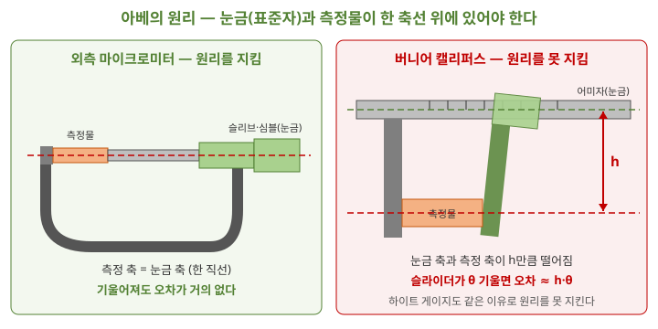

*마이크로미터는 측정물과 스핀들(눈금)이 한 직선 위에 있어 원리를 지킨다. 버니어 캘리퍼스와 **하이트 게이지**는 눈금 축과 측정 축이 $h$만큼 떨어져 있어, 슬라이더가 $\theta$ 기울면 약 $h\theta$의 오차가 생긴다.*

### 4-3. 테일러의 원리 — 한계 게이지

한계 게이지는 치수를 읽지 않고 **"들어가나, 안 들어가나"** 로 합격을 가린다. 테일러의 원리는 그 게이지를 어떻게 만들지 정한 규칙이다.

*구멍용 플러그 게이지. **통과측**(최소 허용 치수)은 길고 완전한 형상이라 지름·진원도·진직도를 **한꺼번에** 확인하고, **정지측**(최대 허용 치수)은 짧게 만들어 요소를 **하나씩** 확인한다.*

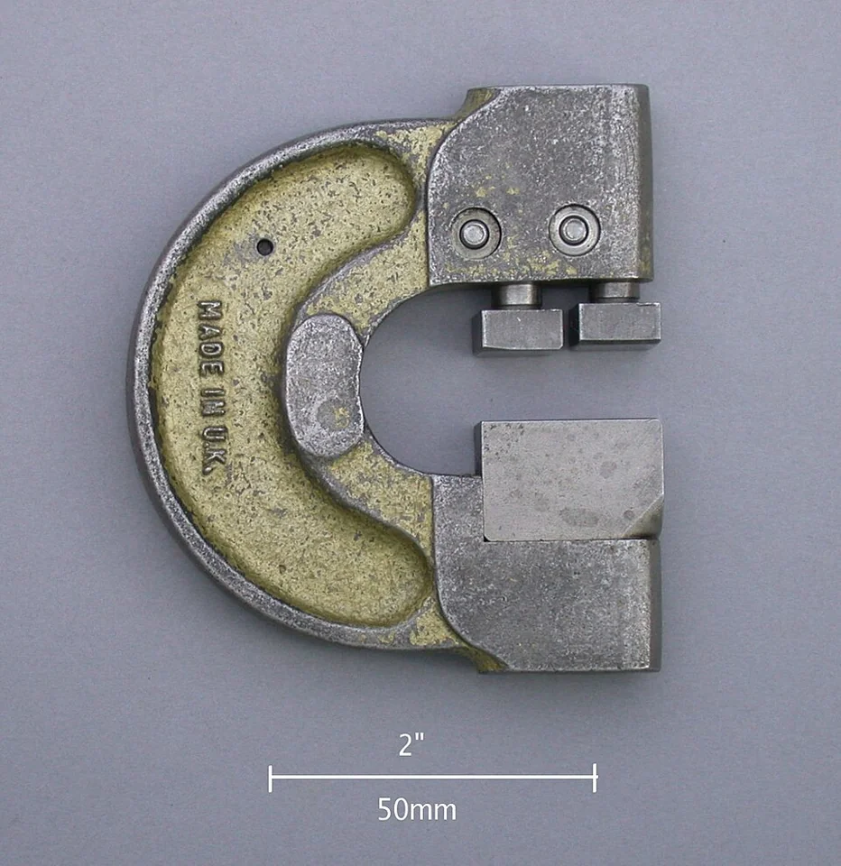

*축 검사용 스냅 게이지. 위쪽 앤빌 두 개 중 **입구 쪽이 통과측(최대 허용 치수)**, 안쪽이 그보다 조금 좁은 **정지측(최소 허용 치수)** 이다. 축을 밀어 넣어 첫 앤빌은 지나가고 둘째에서 걸리면 합격. 축은 스냅 게이지나 링 게이지로 같은 방식으로 판정한다. 링 게이지는 **한계 게이지**이지 평면도 측정기가 아니다.*

- **헤르츠의 원리**: 측정자와 측정물이 닿을 때 측정력 때문에 접촉부가 탄성 변형한다. 측정력을 일정하게 하는 정압 장치(마이크로미터 래칫 스톱)가 필요한 이유다.

### 4-4. 오차

- **오차**: 공차는 허용 범위, 오차는 참값과 측정값의 차.
  - 계통 오차: 원인이 일정 → 보정 가능. 계기 오차, 환경 오차(온도·습도·압력), 개인 오차.
  - 우연 오차: 원인 불명, 피할 수 없음 → 여러 번 재서 평균.
  - 과실 오차: 부주의. 주의로 줄인다. 교재는 개인 오차와 섞여 쓰이니 문제 맥락으로 판단하라고 한다.
  - 되돌림 오차(마찰·흔들림·백래시), 히스테리시스 오차(올릴 때와 내릴 때의 차).

| 오차 | 원인 | 줄이는 법 |
| --- | --- | --- |
| 계통 오차 | 일정함 (계기·온도·습관) | **보정** |
| 우연 오차 | 모름 | 여러 번 재서 **평균** (없앨 수는 없음) |
| 과실 오차 | 부주의 | 주의 |
| 되돌림 오차 | 마찰·백래시 | 한 방향으로 접근해 읽기 |

$$\Delta L = L\,\alpha\,\Delta T$$

- **온도 오차**: 길이 변화 $\Delta L = L\alpha\Delta T$. 20 mm 게이지 블록, $\alpha = 1.0 \times 10^{-6}$/℃, 20 → 36 ℃이면 $20 \times 10^{-6} \times 16 = 3.2 \times 10^{-4}$ mm (교재 25-6). 표준 온도는 **20 ℃**.

## 5. 길이 측정 (27절)

### 5-1. 버니어 캘리퍼스

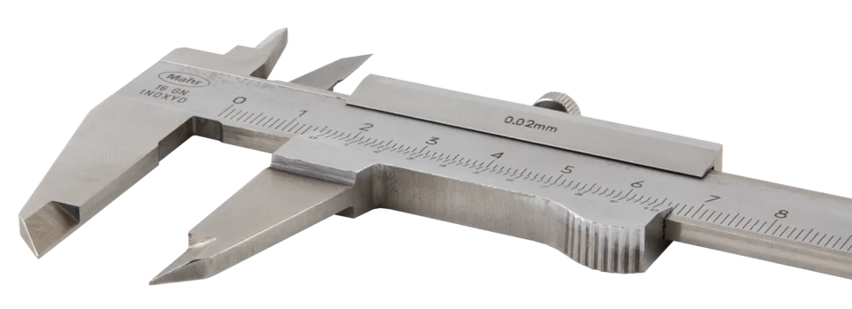

*아래 큰 조(jaw)로 바깥지름, 위 작은 조로 안지름을 잰다(깊이 바는 어미자 뒤쪽 끝에서 나온다). 어미자(본척) 위를 아들자(부척)가 미끄러지며, 이 제품은 아들자에 0.02mm라고 최소 눈금이 새겨져 있다.*

- **버니어 캘리퍼스**: 아들자 0 바로 왼쪽의 어미자 값 + 어미자와 맞는 아들자 눈금. 종류 M1형, M2형, CM형(이송 바퀴).

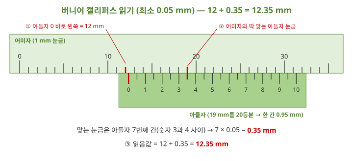

*19 mm를 20등분한 아들자는 한 칸이 0.95 mm라서, 어미자와 0.05 mm씩 어긋난다. 아들자 7번째 눈금이 어미자와 맞았으므로 $7 \times 0.05 = 0.35$ mm를 더한다.*

### 5-2. 마이크로미터

**나사 한 바퀴 = 피치만큼 전진**하는 원리다. 피치 0.5 mm 나사를 50등분한 심블로 돌리면, 한 눈금이 $0.5 \div 50 = 0.01$ mm가 된다.

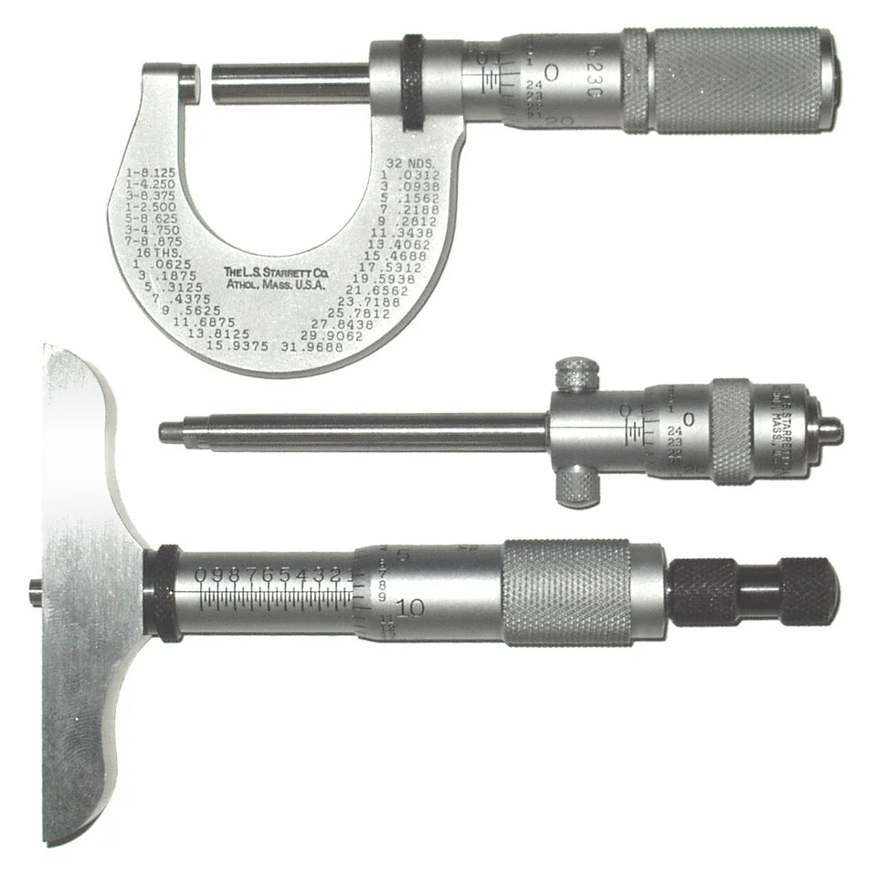

*위: U자 프레임의 **외측** 마이크로미터(앤빌과 스핀들 사이에 물건을 문다). 가운데: 막대 양 끝으로 구멍 안쪽을 미는 **내측** 마이크로미터. 아래: 넓은 받침을 구멍 입구에 대고 로드를 내려 재는 **깊이** 마이크로미터. 셋 다 슬리브 + 심블 눈금은 같다. (미국 제품이라 인치 눈금이다.)*

- **마이크로미터**: 슬리브 + 심블. 최소 0.01 mm.

$$\text{최소 눈금} = \frac{\text{스핀들 나사 피치}}{\text{심블 등분 수}} = \frac{0.5}{50} = 0.01\ \text{mm}$$

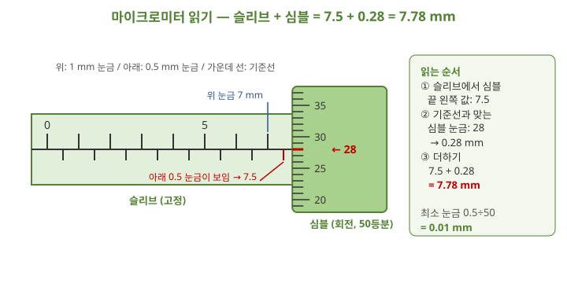

*슬리브에서 심블 끝 왼쪽에 보이는 마지막 눈금(아래 0.5 mm 눈금까지 포함)이 7.5, 기준선과 맞는 심블 눈금이 28 → 7.5 + 0.28 = **7.78 mm**.*

| 마이크로미터 | 용도 |
| --- | --- |
| 외측 | 바깥지름·두께 |
| 내측 | 안지름 |
| 깊이 | 깊이 |
| 그루브 | 구멍 안쪽 홈 |
| 지시 | 인디케이터 결합, 0.001 mm |
| 나사 | 나사 유효지름 |
| 포인트 | 끝이 뾰족 → 드릴 웨브 두께처럼 좁은 곳 |

### 5-3. 하이트 게이지

정반을 기준면으로 삼아 스크라이버(측정자)를 올리고 내려 높이를 재거나 금을 긋는다. 눈금(기둥)과 측정점이 떨어져 있어 **아베의 원리를 지키지 못한다.**

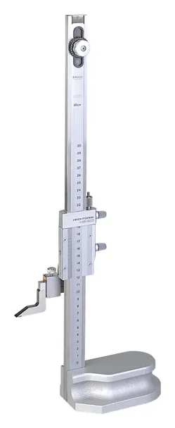

*Mitutoyo 카탈로그의 버니어 하이트 게이지 제품 사진(제조사 사진, 300 mm 모델). 아래 넓은 **베이스**를 정반 위에 놓고, 세워진 기둥의 **어미자 눈금**을 따라 **슬라이더**를 올리고 내린다. 슬라이더 아래 왼쪽으로 뻗은 날이 **스크라이버**(금긋기·높이 측정 날)다. 기둥 맨 위의 둥근 **조정 나사**로 어미자를 움직여 0점을 맞출 수 있는 것이 표준형(HT형)의 특징이다.*

| 하이트 게이지 | 특징 |
| --- | --- |
| HT형 | 표준형, 가장 많이 씀, 어미자 이동으로 0점 조정 가능 |
| HM형 | 견고, **금긋기 적당**, 0점 조정 **불가** |
| HB형 | 가벼운 상자형 슬라이더, 금긋기 부적당 |

- 측정기는 직사광선을 피해 보관한다.

## 6. 각도·평면 측정 (28~29절)

### 6-1. 사인바

**직각삼각형의 빗변(L)과 높이(H − h)를 정하면 각도가 정해진다.** 사인바는 길이를 정확히 아는 막대(롤러 중심 거리 L) 한쪽을 블록 게이지로 들어 올려 정밀한 각도를 만든다.

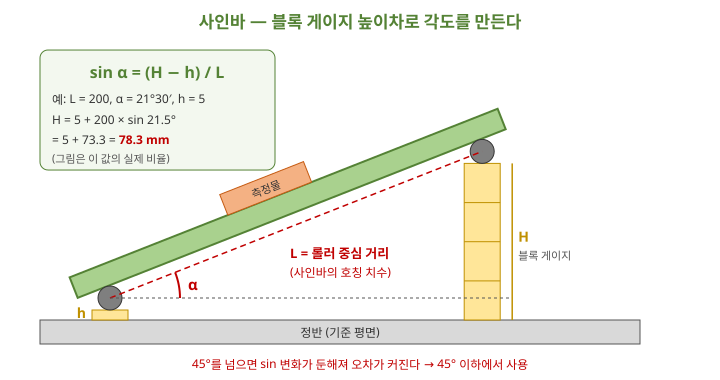

$$\sin\alpha = \frac{H - h}{L}$$

*그림은 아래 계산 예의 실제 비율(L = 200, h = 5, H = 78.3 → 21.5°)로 그렸다. 각이 커질수록 같은 높이 오차에도 각도 오차가 커져서 **45° 이하**에서만 쓴다.*

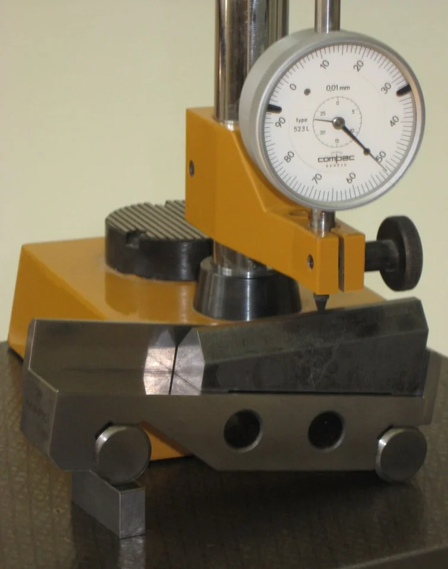

*왼쪽 롤러 밑에 블록 게이지를 받쳐 사인바를 기울이고, 그 위에 올린 공작물의 경사면을 **다이얼 게이지**(0.01 mm)로 훑는다. 바늘이 움직이지 않으면 경사면 각도가 사인바가 만든 각도와 같다.*

- **사인바 계산 예** (교재 28-5): 호칭 200 mm, 21°30′, 낮은 쪽 5 mm → $H = 5 + 200 \sin 21.5° = 5 + 73.3 = 78.3$ mm.

### 6-2. 옵티컬 플랫과 수준기

평평한 유리판(옵티컬 플랫)을 측정면에 올리면 두 면 사이 얇은 공기층 때문에 **간섭무늬**가 생긴다. 무늬가 곧고 나란하면 평면이고, 휘어 있으면 그 정도로 평면도를 읽는다. 박판 구멍처럼 면이 없는 곳은 잴 수 없다.

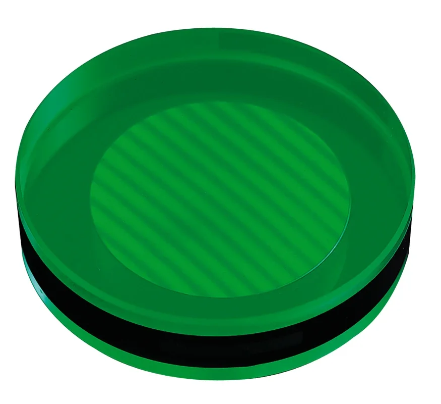

*Starrett 카탈로그의 옵티컬 플랫 제품 사진(제조사 사진, 코팅된 석영 유리 원판). 옵티컬 플랫은 이처럼 **두꺼운 원판 모양의 평평한 유리**다. 가운데 원 안에 비스듬히 나란한 **줄무늬(간섭무늬)**가 보이는데, 줄무늬가 곧고 간격이 고르면 맞댄 면이 평평하다는 뜻이다. 휘거나 둥글게 굽은 무늬는 그 면이 볼록·오목하다는 신호다.*

- **옵티컬 패럴렐**로 마이크로미터 앤빌·스핀들 평행도를 볼 때 교재는 "간섭무늬 수 최댓값 × 반파장(0.32 µm)"으로 계산한다 (28-6: 4 × 0.32 ≈ 1.28 → 약 1 µm). 두 면의 무늬 수를 더하는 자료도 있으니 시험에서는 교재 방식을 따른다.

$$R = \frac{l}{\alpha}\qquad (1'' = \tfrac{1}{206265}\ \text{rad})$$

- **수준기**: 1눈금 길이 $l$, 감도 α(라디안), 기포관 곡률 반지름 $R = l/\alpha$. 1″ = 1/206265 rad. 2 mm·5″ → $R = 2 \div (5/206265) \approx 82{,}500$ mm = **82.5 m** (교재 29-1).

> [!tip] 수준기 감 잡기
> 기포관은 반지름 $R$인 원호다. 수준기가 $\alpha$만큼 기울면 기포는 호 길이 $R\alpha$만큼 움직인다. 그 이동이 1눈금 $l$이 되는 기울기가 감도이므로 $R = l/\alpha$. 곡률 반지름이 클수록 예민하다.

### 각도·평면 측정기 정리표

| 측정기 | 요점 |
| --- | --- |
| 요한슨식 각도 게이지 | 85개조·49개조, **홀더**로 조합 |
| NPL식 각도 게이지 | 면이 크고 개수가 적음, 홀더 없이 밀착 조합 |
| 만능 각도기 | 각도를 직접 읽음 |
| 사인바 | 롤러 중심 거리 + 블록 게이지 높이로 계산, 45° 이하 |
| 광선 정반(옵티컬 플랫) | 빛 간섭무늬로 평면도·평행도 |
| 수준기 | 기포로 수평과 미소 경사 |
| 오토콜리메이터 | 시준기 + 망원경, 미소 각도·진직도·평면도 |

### 6-3. 그 밖의 형상 측정기

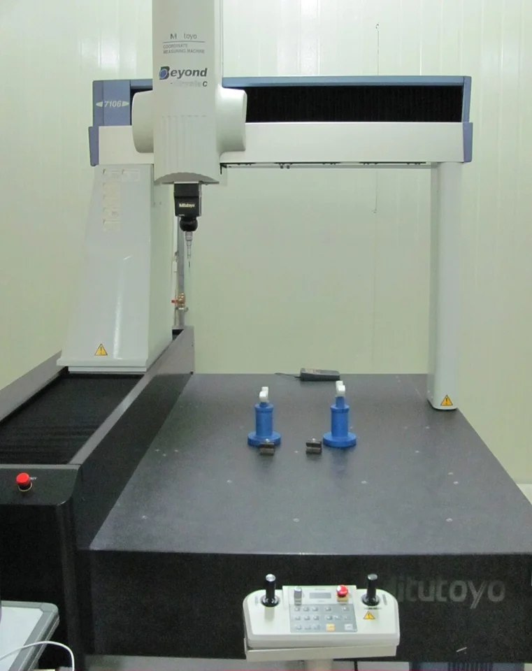

*검은 석정반 위의 공작물에 문형(브리지) 구조에 매달린 **프로브**를 대면, 그 점의 X·Y·Z 좌표가 기록된다. 여러 점의 좌표로 지름·거리·각도·기하공차를 계산한다. 앞쪽 조이스틱 박스로 프로브를 움직인다.*

- 그 밖의 형상 측정기:
  - 텔레스코핑 게이지: 안지름을 옮겨 외측 마이크로미터로 잰다.
  - 투영기: 확대상을 스크린에 비춤, 측정력 오차 없음, 길이·각도·복잡한 윤곽.
  - 3차원 측정기: 프로브 좌표로 측정. 얇거나 무른 재질은 **비접촉식(광학식) 프로브**.

## 7. 나사 측정 (30절)

나사 지름은 바깥지름·골지름·유효지름 세 가지가 있다. 나사가 서로 맞물리는 데 가장 중요한 것은 **유효지름**(산 폭과 골 폭이 같아지는 가상 원통의 지름)인데, 산과 골의 중간이라 자로는 직접 잴 수 없다. 그래서 **골에 침을 끼워** 침 바깥을 재고 계산으로 구한다.

- 측정 대상: 바깥지름, 골지름, **유효지름**, 피치, 리드, 나사산 각.

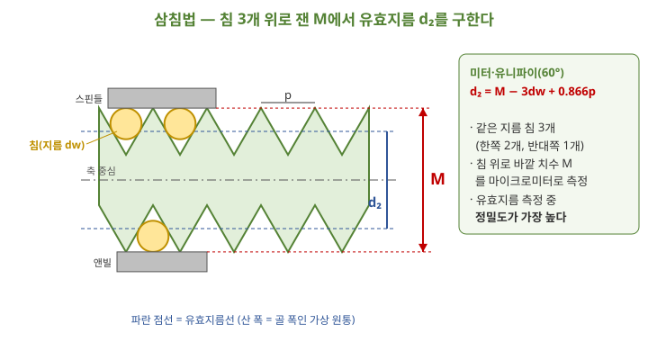

*한쪽 골 2개, 반대쪽 골 1개에 같은 지름 $d_w$의 침을 넣고 마이크로미터로 침 바깥 치수 $M$을 잰다. 그림은 60° 나사에 최적 침 지름($d_w \approx 0.577p$)을 넣은 경우로, 침이 유효지름선(파란 점선)에서 산 옆면에 닿는다.*

$$d_2 = M - 3d_w + 0.866p \qquad (\text{미터·유니파이 } 60°)$$

- **삼침법**: 같은 지름의 침 3개(한쪽 2, 반대쪽 1)를 넣고 바깥 치수 M을 잰다. 미터·유니파이(60°)는 $d_2 = M - 3d_w + 0.866p$. 정밀도가 가장 높다.
- 나사 마이크로미터: 간단하지만 산 각이 맞지 않으면 오차.
- 공구 현미경·투영기: 피치·반각·유효지름을 광학적으로. 나사산 각은 공구 현미경, 투영기, 만능 측정 현미경으로 잰다.

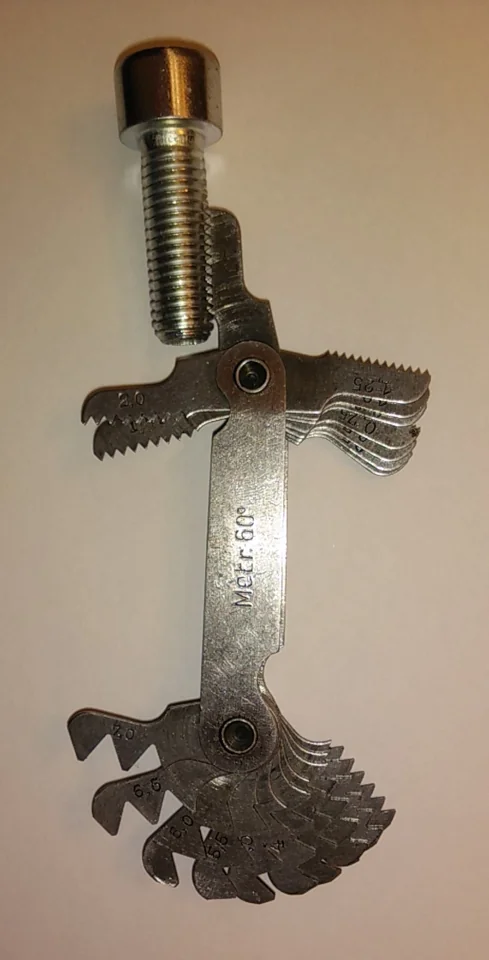

*판마다 피치(mm)가 새겨진 톱니 판 한 조다. 볼트 나사산에 하나씩 대 보아 틈 없이 맞는 판의 숫자가 피치다. 몸체에 'Metr 60°'라고 미터 나사용임이 표시돼 있다.*

- 피치 게이지: 판 게이지 한 조로 비교. 센터 게이지: 선반 나사 절삭 때 바이트 각도 맞춤.

> [!question] 시험에서는
> "나사의 유효지름을 가장 정밀하게 재는 방법" → **삼침법**. "나사 마이크로미터로 나사산 각을 직접 잰다"는 틀린 보기다(산 각은 공구 현미경·투영기).

## 그림

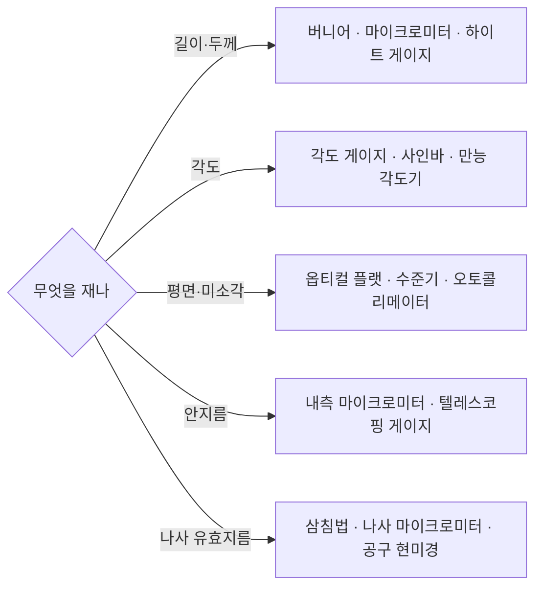

## 기출 포인트

- 옛 1과목 기계가공법 문항(나사 측정 4회, 카운터 싱킹 3회, 공기 마이크로미터 6회 등)은 새 출제기준 밖으로 분류해 두었다 ([기출분석 – 기계요소설계](../01_시험안내/기출분석_기계요소설계.md)). 교재가 다시 다루므로 개념만 확인한다.

**교재 예제 유형** (Win-Q 2025 PART 01 CHAPTER 03, 23~30절):
- 23절: 기계 설명 중 틀린 것(에너지를 쓰지 않는다), 표면처리를 소성가공이라 한 보기, 다이캐스팅 특징이 아닌 것(고용융점 금속).
- 24절: 공작물 왕복(플레이너), 호브·차동 기구(호빙 머신), 전용 공작기계, 카운터 보어 용도, 다이스 번호, 탭 파손 원인 아닌 것(탭 경도), 브로칭, 치공구 목적, 3대 기본 운동이 아닌 것(전단 운동).
- 25~26절: 측정 범위, 아베의 원리, 직접 측정 장점이 아닌 것, 테일러의 원리, 래디어스 게이지(곡률 반지름), 온도 오차 3.2×10⁻⁴ mm, 우연 오차, 백래시 → 되돌림 오차.
- 27절: 외경 측정과 먼 것(그루브), 최소 측정값 10 µm, 보관 주의(직사광선), 드릴 웨브(포인트), HM형 하이트 게이지.
- 28~29절: NPL과 관계없는 것(홀더), 각도 측정기가 아닌 것(나이프 에지), 사인바 호칭(롤러 중심 거리), 45° 이상 사용 불가, 사인바 78.3 mm, 옵티컬 패럴렐 약 1 µm, 수준기 82.5 m, 평면도와 무관(링 게이지), 오토콜리메이터, 텔레스코핑(안지름), 투영기(각도), 박판 구멍을 못 재는 것(옵티컬 플랫), 비접촉 프로브.
- 30절: 센터 게이지, 나사 마이크로미터로 산 각 직접 측정 불가, 삼침법(유효지름), 공구 현미경.

## 관련 단원

- [나사와 볼트](나사와_볼트.md)
- [치수공차와 끼워맞춤](치수공차와_끼워맞춤.md)
- [표면거칠기·열처리·가공기호](표면거칠기_열처리_가공기호.md)
- [기하공차](기하공차.md)

## 체크리스트

- [ ] 기계의 구성(동력·전달·구동)과 제작 공정을 구분한다
- [ ] 셰이퍼·슬로터·플레이너·브로칭·호빙의 차이를 말한다
- [ ] 치공구 3요소와 지그·고정구 차이를 안다
- [ ] 아베·테일러·헤르츠 원리를 구분한다
- [ ] 계통·우연·과실·되돌림 오차를 구분한다
- [ ] 마이크로미터 최소 눈금과 종류별 용도를 안다
- [ ] 하이트 게이지 HT·HM·HB 차이를 안다
- [ ] 사인바 높이와 수준기 곡률 반지름을 계산한다
- [ ] 삼침법으로 유효지름을 구하는 식을 쓴다

## 참고

- [큐넷 자동화설비산업기사 출제기준](https://www.q-net.or.kr/crf005.do?id=crf00503&jmCd=2034)

### 그림 출처

위키미디어 공용(Wikimedia Commons)과 Openverse에서 가져온 공개 라이선스 자료이고, 노트에 맞게 크기를 줄이고 WebP로 변환했다.

| 그림 | 작성자 | 라이선스 | 출처 |
| --- | --- | --- | --- |
| [Hot-chamber die casting machine schematic-2](https://commons.wikimedia.org/wiki/File:Hot-chamber_die_casting_machine_schematic-2.svg) | Zjc263 | [CC BY-SA 3.0](https://creativecommons.org/licenses/by-sa/3.0) | Wikimedia Commons |
| [Milling machine (Vertical, Manual) NT](https://commons.wikimedia.org/wiki/File:Milling_machine_(Vertical,_Manual)_NT.PNG) | Tosaka | [CC BY 3.0](https://creativecommons.org/licenses/by/3.0) | Wikimedia Commons |
| [Two chuck mechanisms engineer's lathe:](https://www.rawpixel.com/image/14006702/image-paper-cross-pattern) |  | CC0 | Openverse (rawpixel) |
| [Broaching 01](https://commons.wikimedia.org/wiki/File:Broaching_01.jpg) | Amos1947 | [CC BY-SA 4.0](https://creativecommons.org/licenses/by-sa/4.0) | Wikimedia Commons |
| [Gleason 호브와 밀링 커터 (카탈로그 사진)](https://www.gleason.com/en/products/tools/cylindrical/hobbing-and-milling/hobs-and-milling-cutters) | Gleason | 저작권 보유(개인 학습용, 비공개 저장소 한정) | Gleason 카탈로그 |
| [Machined Holes](https://commons.wikimedia.org/wiki/File:Machined_Holes.svg) | Inductiveload | 퍼블릭 도메인 | Wikimedia Commons |
| [GaugeGapPlainGoNoGo](https://commons.wikimedia.org/wiki/File:GaugeGapPlainGoNoGo.jpg) | Glenn McKechnie | [CC BY-SA 3.0](http://creativecommons.org/licenses/by-sa/3.0/) | Wikimedia Commons |
| [Mahr MarCal 16 N vernier caliper](https://commons.wikimedia.org/wiki/File:Mahr_MarCal_16_N_vernier_caliper.png) | Lucasbosch | [CC BY-SA 3.0](https://creativecommons.org/licenses/by-sa/3.0) | Wikimedia Commons |
| [Micrometers](https://commons.wikimedia.org/wiki/File:Micrometers.jpg) | Splarka at English Wikipedia | 퍼블릭 도메인 | Wikimedia Commons |
| [Mitutoyo 버니어 하이트 게이지 514-102 (카탈로그 사진)](https://pim.mitutoyo.com/products/small-tool-instruments-and-data-management/height-gages-2/mechanical-height-gages/vernier-height-gage/) | Mitutoyo | 저작권 보유(개인 학습용, 비공개 저장소 한정) | Mitutoyo 카탈로그 |
| [Sine bar in use](https://commons.wikimedia.org/wiki/File:Sine_bar_in_use.jpg) | Rrudzik | [CC BY-SA 4.0](https://creativecommons.org/licenses/by-sa/4.0) | Wikimedia Commons |
| [Starrett 옵티컬 플랫 OFS 4 RC (카탈로그 사진)](https://www.starrett.com/products/gage-blocks-and-calibration-solutions/optical-flats/OFS%204.%20RC) | Starrett | 저작권 보유(개인 학습용, 비공개 저장소 한정) | Starrett 카탈로그 |
| [Beyond CrystaC](https://commons.wikimedia.org/wiki/File:Beyond_CrystaC.jpg) | Blue tooth7 | [CC BY-SA 3.0](https://creativecommons.org/licenses/by-sa/3.0) | Wikimedia Commons |
| [Gewindeschablone](https://commons.wikimedia.org/wiki/File:Gewindeschablone.jpg) | Jahobr | CC0 | Wikimedia Commons |

제조사 카탈로그 사진은 저작권이 각 회사에 있으며, 개인 학습용으로 비공개 저장소에서만 쓴다(공개 전에 삭제).

직접 그린 그림(SVG, 이 볼트용으로 새로 작성): 셰이퍼 슬로터 플레이너, 지그 구성, 아베의원리, 테일러 한계게이지, 버니어 읽기, 마이크로미터 읽기, 사인바 원리, 삼침법.

