# 기계설계 기초와 재료강도

> [!summary] 핵심 요약
> - 응력 $\sigma = \dfrac{P}{A}$, 변형률 $\varepsilon = \dfrac{\Delta l}{l}$, 훅의 법칙 $\sigma = E\varepsilon$.
> - **안전율** $S = \dfrac{\text{기준 강도}}{\text{허용 응력}}$. 기준 강도는 하중 종류와 재료에 따라 고른다.
> - 굽힘 $\sigma_b = \dfrac{M}{Z}$, 비틀림 $\tau = \dfrac{T}{Z_p}$. 원형 단면 $Z = \dfrac{\pi d^3}{32}$, $Z_p = \dfrac{\pi d^3}{16}$.
> - 토크와 동력: $T[\text{N·m}] = \dfrac{9549\,H[\text{kW}]}{N[\text{rpm}]}$, 또는 $H = T\omega$.

> [!warning] 자주 틀리는 포인트
> - 기준 강도: 연성 재료 정하중 → **항복점**, 취성 재료 정하중 → **극한(인장) 강도**, 반복 하중 → **피로 한도**, 고온 → **크리프 한도**.
> - $Z_p$(극단면 계수)는 $Z$(단면 계수)의 **2배**. 비틀림은 16, 굽힘은 32.
> - 노치·구멍·키 홈에서는 **응력 집중**이 생긴다. 응력 집중 계수 $\alpha = \sigma_{max} / \sigma_{평균}$.
> - 단위: 1 MPa = 1 N/mm². 계산은 N과 mm로 맞추면 실수가 적다.
> - 응력은 **하중에 비례, 단면적에 반비례**한다. "면적이 크면 응력이 커진다", "응력은 단면적에 비례한다"는 단골 오답.
> - **전단 응력은 수직 응력이 아니다**. 수직 응력(인장·압축)은 단면에 **직각**, 전단 응력은 단면에 **나란하게** 작용한다.
> - 가위·프레스 전단·볼트 전단처럼 자르는 힘 → **전단 응력**. "피로 응력"이라는 응력 종류는 없다 (피로는 파괴 현상).
> - 응력은 "외력에 저항해 재료 **내부**에 생기는 단위 면적당 힘"이다. 내부·외부를 바꾼 정의는 틀린 것.
> - 응력 집중은 **구멍, 노치, 나사, 키 홈**처럼 단면이 급변하는 곳. 매끈한 긴 축의 중간은 해당하지 않는다.

## 학습 목표

이 단원을 마치면 다음을 할 수 있어야 한다.

1. 기계요소를 체결용·동력 전달용·축용·제어용·관용으로 분류한다.
2. 하중을 작용 방향(인장·압축·전단·굽힘·비틀림)과 시간 변화(정·반복·교번·충격)로 구분하고, 교번 하중이 가장 가혹한 이유를 말한다.
3. 수직 응력과 전단 응력의 방향 차이를 설명하고, 원형 단면의 인장·전단 응력을 kgf와 N 단위로 계산한다.
4. 연강의 응력–변형률 선도에서 비례 한도·탄성 한도·항복점·극한 강도·파단점을 짚는다.
5. 하중 조건에 맞는 기준 강도를 골라 안전율로 허용 응력과 봉 지름을 구한다.
6. 단면 계수 $Z$·$Z_p$와 보의 최대 굽힘 모멘트, 동력–토크 식으로 굽힘·비틀림 응력을 계산하고, 응력 집중·피로·크리프를 설명한다.

## 한눈에 보기

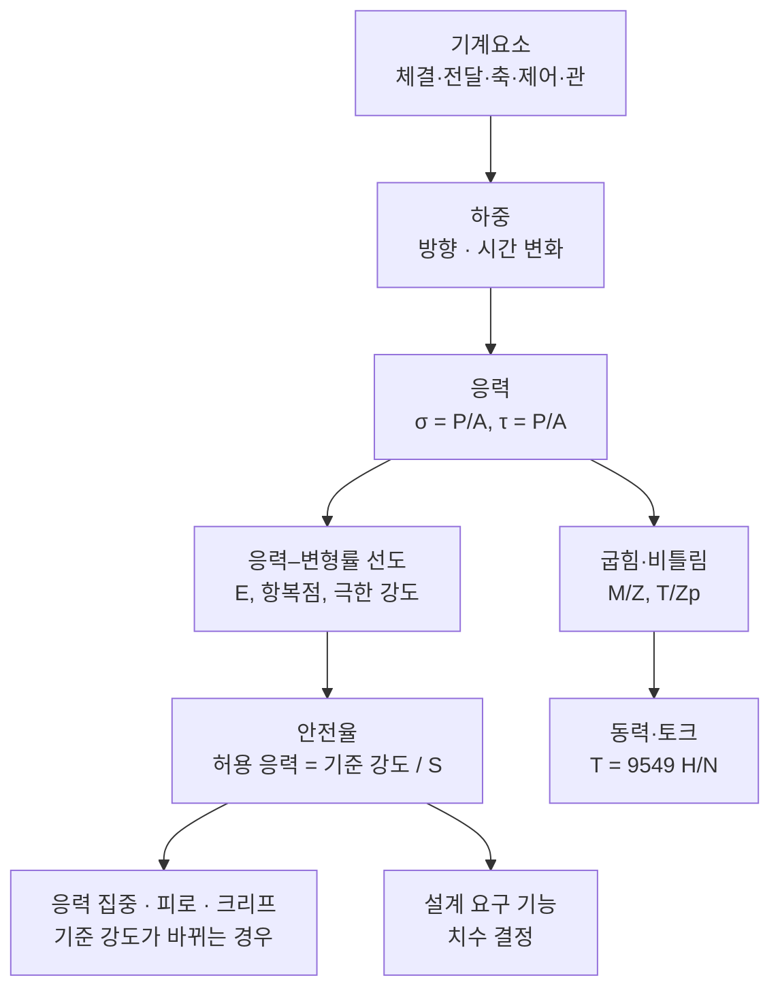

## 1. 기계요소의 분류 (교재 CH03 01절)

자동차든 로봇이든 분해하면 나사, 축, 베어링, 기어, 스프링처럼 **어느 기계에나 똑같이 들어가는 부품**이 나온다. 이것이 기계요소다. 용도(무엇을 하려고 넣었나)로 나누면 외우기 쉽다.

기계요소는 여러 기계에 공통으로 쓰이는 기본 부품, 즉 기계를 이루는 최소 단위다.

| 용도 | 요소 |
| --- | --- |
| 체결용 | 나사, 핀, 키 (리벳·코터 포함) |
| 동력 전달용 | 마찰차, 기어, 벨트·풀리, 체인·스프로킷 |
| 축용 | 축, 베어링, 클러치(축이음) |
| **제어용** | **브레이크, 스프링** — 제동하거나 진동·충격을 완충 |
| 관용 | 관, 밸브, 관이음 |

> [!question] 시험에서는
> "제동하거나 진동·충격을 완충하는 요소"를 묻으면 **제어용**(브레이크·스프링)이다. 축이음(클러치)은 축용, 체인은 동력 전달용이다.

## 2. 하중의 종류

부품에 걸리는 힘(하중)은 **어느 방향으로 거는가**와 **시간에 따라 어떻게 변하는가** 두 가지로 나눈다. 같은 크기라도 계속 방향이 뒤집히는 힘은 부품을 훨씬 빨리 망가뜨린다. 철사를 한 번 당겨서는 안 끊어져도, 이리저리 꺾기를 반복하면 끊어지는 것과 같다.

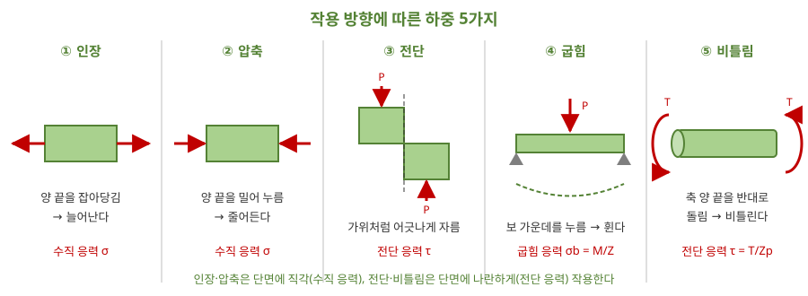

*① 인장·② 압축은 힘이 부재 축과 같은 방향이라 단면에 **직각**으로 응력이 생긴다(수직 응력). ③ 전단은 위아래가 **어긋나게** 미는 힘, ④ 굽힘은 보를 휘게 하는 힘(위는 압축·아래는 인장), ⑤ 비틀림은 축 양 끝을 반대로 돌리는 토크다. 비틀림이 만드는 응력도 전단 응력이다.*

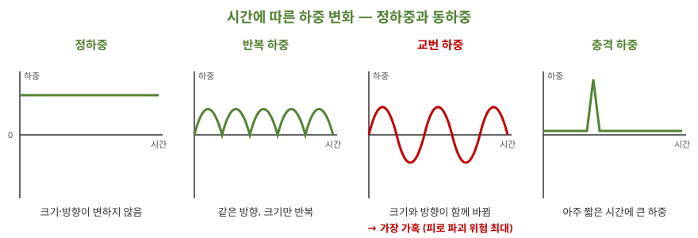

*반복 하중은 0과 최대 사이를 **같은 방향**으로 오가고, 교번 하중(빨강)은 0선을 넘나들며 **방향까지** 바뀐다. 충격 하중은 짧은 순간 솟는다.*

| 구분 | 종류 |
| --- | --- |
| 작용 방향 | 인장, 압축, 전단, 굽힘, 비틀림 |
| 시간 변화 | 정하중, 동하중(반복·교번·충격) |
| 분포 | 집중 하중, 분포 하중 |

- **반복 하중**: 같은 방향으로 크기만 변함. **교번 하중**: 방향까지 바뀜(가장 가혹). **충격 하중**: 짧은 시간에 큰 하중.
- 교재(CH03 19절) 작용 방법 분류: 충격, 피로(오랜 시간), 집중, 분포, 반복, 교번(크기와 **방향**이 주기적으로 변함, 교재 19-4), 정하중, 이동 하중.
- 응력 용어: 내부 저항력은 **응력**이지 변형률이 아니다 (교재 19-5). 실제 사용 중인 부재에 생기는 응력 = **사용 응력**, 이를 허용 응력 이하로 둔다 (교재 19-7). 재료 시험은 인장·압축(주로 콘크리트)·전단 시험.

> [!tip] 감 잡기
> 회전하는 축에 굽힘이 걸리면, 축이 반 바퀴 돌 때마다 같은 점이 인장 ↔ 압축을 오간다. 그래서 **회전축의 굽힘은 대표적인 교번 하중**이다.

## 3. 응력과 변형

같은 10 kN이라도 굵은 봉은 멀쩡하고 가는 철사는 끊어진다. 그래서 강도는 힘 자체가 아니라 **단면 1 mm²가 떠안는 힘**, 즉 응력으로 따진다. 응력은 외력에 맞서 재료 **내부**에 생기는 저항력이다.

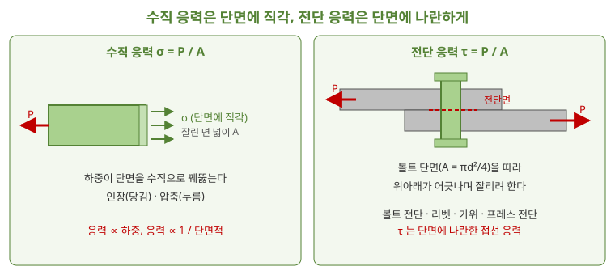

*왼쪽: 인장 봉을 자른 면에서 응력(초록 화살표)은 면을 **뚫고 나가는 방향**이다. 오른쪽: 두 판을 잇는 볼트는 빨간 점선(전단면)을 따라 위아래가 **미끄러지듯** 잘리려 한다. 두 경우 모두 식은 $P/A$지만 A가 무엇이냐(잘린 면, 볼트 단면 $\pi d^2/4$)를 정확히 잡는 것이 핵심이다.*

$$\sigma = \frac{P}{A}, \qquad \tau = \frac{P}{A}\ (\text{전단면}), \qquad 1\ \text{MPa} = 1\ \text{N/mm}^2$$

재료는 당기면 늘어나는 동시에 **가늘어진다**. 고무줄을 잡아당기면 얇아지는 것과 같다. 늘어난 비율이 세로 변형률, 가늘어진 비율이 가로 변형률이고, 둘의 비가 푸아송 비다.

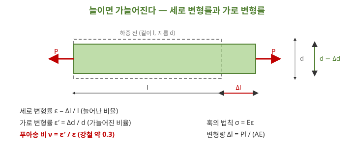

*점선이 하중 전, 초록이 하중 후다. 길이는 $l \to l+\Delta l$로 늘고 지름은 $d \to d-\Delta d$로 준다. 강철의 푸아송 비는 약 0.3.*

| 식 | 내용 |
| --- | --- |
| 수직 응력 | $\sigma = P/A$ |
| 전단 응력 | $\tau = P/A$ (전단면 면적) |
| 세로 탄성 계수 | $E = \sigma/\varepsilon$ |
| 가로 탄성 계수 | $G = \tau/\gamma$ |
| 푸아송 비 | $\nu = \varepsilon_{가로}/\varepsilon_{세로}$, $E = 2G(1 + \nu)$ |
| 변형량 | $\Delta l = \dfrac{Pl}{AE}$ |
| 열응력 | $\sigma = E\alpha\Delta t$ (양 끝 고정) |

> [!tip] 감 잡기 — 열응력
> 양 끝을 벽에 고정한 봉을 데우면 늘어나려 하지만 벽이 막는다. 늘어나지 못한 만큼($\alpha\Delta t$)을 벽이 눌러 줄인 셈이므로 $\sigma = E \times \alpha\Delta t$. 봉의 길이는 식에 들어가지 않는다.

## 4. 응력–변형률 선도 (연강)

시험편을 **만능 재료 시험기**에 물려 천천히 당기면서 하중과 늘어난 길이를 기록하면 응력–변형률 선도가 나온다. 재료의 E, 항복점, 인장 강도를 모두 여기서 읽는다.

| 만능 재료 시험기 | 시험 결과: 응력–변형률 선도 |
| --- | --- |
| 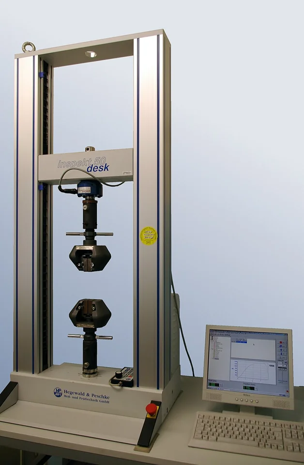 | 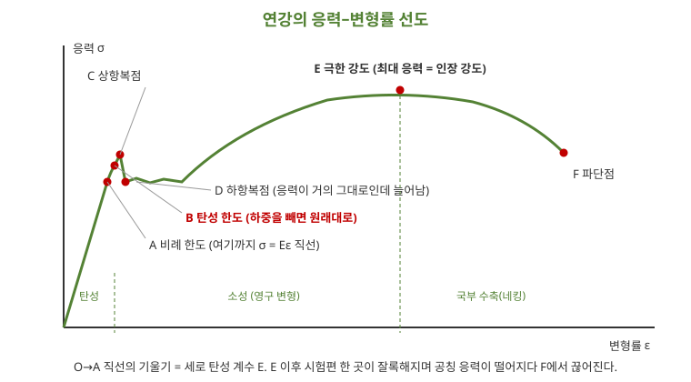 |

*왼쪽: 탁상형 만능 재료 시험기(50 kN급). 위아래 **쐐기형 그립**(검은 물림쇠)에 시험편을 물리고, 위 크로스헤드가 올라가며 당긴다. 그립 위의 파란 로드셀이 하중을 재고, 오른쪽 모니터에 하중–변위 곡선이 실시간으로 그려진다. 오른쪽: 그렇게 얻은 연강 선도. A까지 직선(기울기 = E), B까지는 하중을 빼면 원래대로 돌아오고, C(상항복점)에서 응력이 툭 떨어진 뒤 D(하항복점) 근처에서 응력이 거의 그대로인 채 늘어난다. 이후 다시 올라 E(극한 강도)에서 최대, 시험편 한 곳이 잘록해지며(네킹) F에서 끊어진다.*

비례 한도 → 탄성 한도 → **상항복점·하항복점** → 극한 강도(최대 응력) → 파단.

- 비례 한도 바로 위, 하중을 없애면 원래대로 돌아오는 한계가 **탄성 한도**. 선도에서 비례 한도 다음 점을 묻는 문제가 나온다.

| 연성 재료 (연강) | 취성 재료 (주철) |
| --- | --- |
| 뚜렷한 항복점, 크게 늘어난 뒤 네킹하고 파단 | 항복점 없이 거의 늘어나지 않고 갑자기 파단 |
| 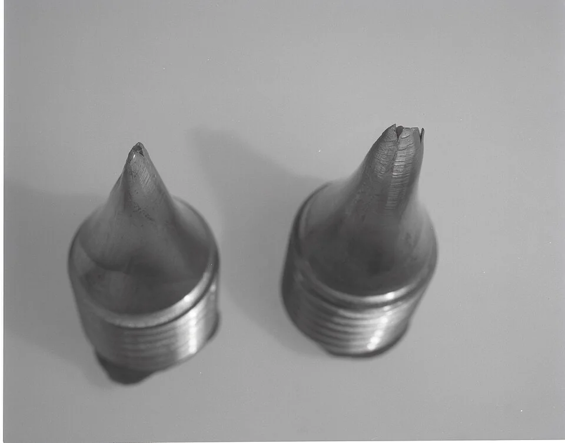 | 파단면이 축에 직각으로 평평하고, 잘록해진 곳 없이 그대로 끊긴다 |

*왼쪽: 인장 시험으로 끊어진 구리 시험편 두 조각(미국 국립문서보관소 자료). 끊어지기 전 한 곳이 크게 잘록해져(네킹) 파단부가 **뾰족한 원뿔꼴**로 늘어나 있다 — 연성 재료의 전형적인 모습이다. 오른쪽 주철 같은 취성 재료는 끊어진 면이 평평하고 잘록해진 곳(네킹)이 없다 — 항복점 없이 끊어지는 취성 재료라 항복점이 없으므로 기준 강도로 **극한 강도**를 쓴다.*

## 5. 안전율과 허용 응력

재료가 버틸 수 있는 한계(기준 강도)를 그대로 쓰면, 계산에 없던 충격·재료 편차·부식 하나로 바로 파손된다. 그래서 한계를 **안전율 S로 나눈 값까지만** 쓰게 하는 것이 허용 응력이다.

$$S = \frac{\text{기준 강도}}{\text{허용 응력}}, \qquad \sigma_{사용} \le \sigma_{허용} = \frac{\text{기준 강도}}{S}$$

| 하중·재료 조건 | 기준 강도 |
| --- | --- |
| 연성 재료 + 정하중 | 항복점 |
| 취성 재료 + 정하중 | 극한(인장) 강도 |
| 반복 하중 | 피로 한도 |
| 고온 | 크리프 한도 |

*위 표는 "자주 틀리는 포인트"의 첫 줄을 표로 옮긴 것이다. 실제 부재에 생기는 사용 응력이 허용 응력을 넘지 않게 치수를 정한다.*

## 6. 응력 계산 예

계산 문제는 거의 전부 **"면적 A를 구한다 → P를 나눈다"** 두 단계다. 단위(mm²와 cm², kgf와 N)를 먼저 맞추는 것이 실수를 줄이는 방법이다.

- **원형 봉 인장**: 지름 6 cm, 하중 2400 kgf → $A = \pi \times 6^2 / 4 \approx 28.3$ cm² → $\sigma \approx 85$ kgf/cm²
- **볼트 전단**: 지름 20 mm, 전단력 1000 kgf → $A = \pi \times 20^2 / 4 \approx 314$ mm² → $\tau \approx 3.18$ kgf/mm²
- **인장 시험편** (교재 19-2): 지름 15 mm, 최대 하중 7,600 kgf → $A \approx 176.7$ mm² → 약 **43 kgf/mm²**.
- **안전율** (교재 19-6): 지름 10 mm, 하중 500 kgf, 극한 강도 3,000 kgf/cm² → $\sigma = 500 / 0.785 \approx 637$ kgf/cm² → $S = 3000 / 637 \approx$ **4.71**. 단위(mm²와 cm²)를 먼저 맞춘다.
- **안전율로 지름 구하기**: 인장 하중 250 kgf, 인장 강도 40 kgf/mm², 안전율 4
  - 허용 응력 $= 40 / 4 = 10$ kgf/mm² → 필요 면적 $= 250 / 10 = 25$ mm²
  - $d = \sqrt{4 \times 25 / \pi} \approx 5.6$ mm → 보기 중 그보다 큰 **6 mm** 선택
- **경사 줄의 장력**: 물체 무게 W를 두 줄이 대칭으로 잡으면 각 줄 장력 $T = \dfrac{W}{2\cos\theta}$ (θ: 줄과 수직선 사이 각). 응력은 장력 ÷ 단면적.
- **접촉 압력**: 물체 무게 ÷ 접촉 면적. 압력과 응력은 단위가 같다 (N/m² = Pa).

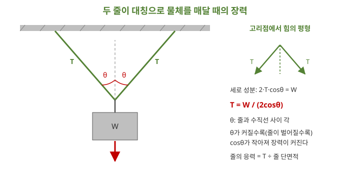

*고리점에서 두 줄 장력 T의 **세로 성분** $T\cos\theta$ 두 개가 무게 W를 떠받친다. θ가 0이면(줄이 수직) 각 줄은 W/2, 줄을 넓게 벌릴수록 cosθ가 작아져 장력이 커진다. 예: θ = 60°이면 $T = W/(2 \times 0.5) = W$.*

> [!question] 시험에서는
> - 원형 봉 문제에서 **지름을 반지름처럼** 넣는 실수($A = \pi d^2$)가 가장 많다. $A = \pi d^2/4$.
> - 볼트 전단은 볼트 **단면적**($\pi d^2/4$)으로 나눈다. 판의 면적이 아니다.

## 7. 굽힘과 비틀림

자를 양손으로 휘면 바깥쪽 면은 늘어나고 안쪽 면은 줄어든다. 가운데 어딘가에 길이가 변하지 않는 면이 있는데, 이것이 **중립축**이다. 비틀 때는 축 중심은 거의 안 돌고 **바깥 표면이 가장 많이 비틀린다**. 그래서 두 경우 모두 응력은 가장자리에서 최대다.

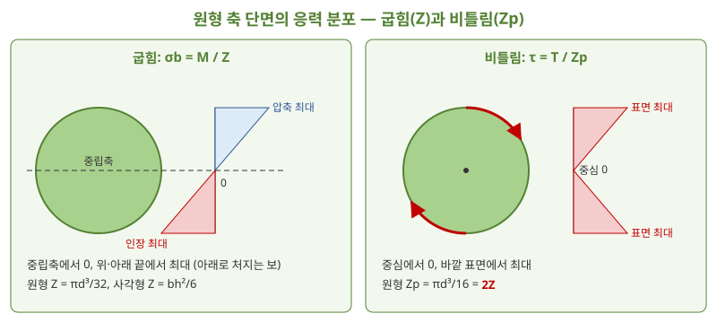

*굽힘(왼쪽)은 중립축에서 0이고 위·아래 끝으로 갈수록 직선으로 커진다. 비틀림(오른쪽)은 중심에서 0, 표면에서 최대다. 그 가장자리 최대 응력을 한 번에 구하게 만든 값이 단면 계수 $Z$와 극단면 계수 $Z_p$이고, 원형에서 $Z_p = 2Z$다.*

$$\sigma_b = \frac{M}{Z}, \qquad \tau = \frac{T}{Z_p}$$

| 단면 | 단면 계수 $Z$ | 극단면 계수 $Z_p$ |
| --- | --- | --- |
| 원형 (지름 d) | $\pi d^3/32$ | $\pi d^3/16$ |
| 사각형 (폭 b, 높이 h) | $bh^2/6$ | – |
| 중공 원형 (바깥 $d_2$, 안 $d_1$) | $\dfrac{\pi(d_2^4 - d_1^4)}{32 d_2}$ | $\dfrac{\pi(d_2^4 - d_1^4)}{16 d_2}$ |

굽힘 응력을 구하려면 먼저 그 보에 걸리는 **최대 굽힘 모멘트 M**을 알아야 한다. 시험에는 아래 세 경우만 나온다.

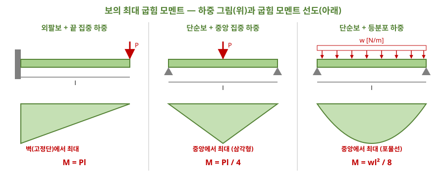

*위는 하중, 아래 초록 면은 위치별 굽힘 모멘트(선도)다. 외팔보는 **벽(고정단)** 에서, 단순보는 **중앙**에서 최대다. 집중 하중은 직선(삼각형), 등분포 하중은 포물선 모양이 된다.*

- **보의 최대 굽힘 모멘트**: 외팔보 끝 집중 하중 $M = Pl$, 단순보 중앙 집중 하중 $M = Pl/4$, 단순보 등분포 $M = wl^2/8$.

> [!tip] 감 잡기 — 왜 Pl/4인가
> 중앙에 P를 걸면 양 지점이 P/2씩 받친다. 지점에서 중앙까지 거리가 l/2이므로 $M = \dfrac{P}{2} \times \dfrac{l}{2} = \dfrac{Pl}{4}$. 등분포 하중 wl도 같은 방식으로 $\dfrac{wl}{2}\cdot\dfrac{l}{2} - \dfrac{wl}{2}\cdot\dfrac{l}{4} = \dfrac{wl^2}{8}$.

## 8. 동력·토크 계산

같은 동력이라도 **천천히 돌면 토크가 크고, 빨리 돌면 토크가 작다.** 자전거 기어를 낮추면 페달이 가벼워지는 대신 많이 돌려야 하는 것과 같다. 그래서 감속기 뒤의 저속축이 더 굵다.

$$H = T\omega, \qquad \omega = \frac{2\pi N}{60}$$

- $H = T\omega = T \cdot \dfrac{2\pi N}{60}$ [W] (T는 N·m)
- 실용식: $T[\text{N·m}] = 9549 \dfrac{H[\text{kW}]}{N[\text{rpm}]}$
- **계산 예**: 5 kW, 1000 rpm → $T = 9549 \times 5 / 1000 \approx 47.7$ N·m

> [!tip] 9549는 어디서 왔나
> $T = \dfrac{H}{\omega} = \dfrac{1000\,H[\text{kW}]}{2\pi N/60} = \dfrac{60000}{2\pi}\cdot\dfrac{H}{N} \approx 9549\,\dfrac{H}{N}$. 이렇게 구한 T를 $\tau = T/Z_p$에 넣으면 축의 비틀림 응력이 나온다 → [축과 축이음](축과_축이음.md).

## 9. 응력 집중, 피로와 크리프

같은 하중이라도 단면이 갑자기 바뀌는 곳에서는 힘의 흐름이 구멍을 돌아가느라 **좁은 곳에 몰린다.** 그래서 실제 부품은 평균 응력이 허용값 안이어도 구멍·노치에서 금이 가기 시작한다.

### 9-1. 응력 집중

| 원리 | 실제로 보면 |
| --- | --- |
| 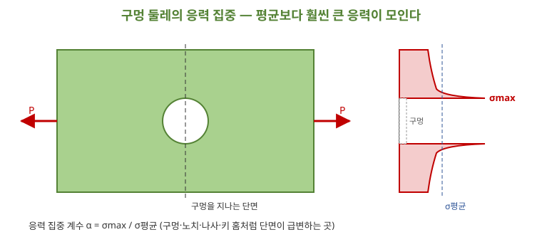 |  |

*왼쪽: 구멍을 지나는 단면의 응력 분포. 판 가장자리에서는 평균에 가깝지만 **구멍 바로 옆에서 σmax로 치솟는다**. 오른쪽: 투명 플라스틱 각도기를 편광 필터 사이에 두면 내부 응력이 무지개 무늬(광탄성)로 보인다. 색 띠가 촘촘할수록 응력이 크게 변하는 곳이다. 반원 눈금판과 직선 자가 만나 **안쪽으로 꺾인 모서리**(왼쪽 아래 "0" 옆, 오른쪽 위)에 색 띠가 몰려 있다 — 단면이 급변하는 노치 자리다.*

$$\alpha = \frac{\sigma_{max}}{\sigma_{평균}}$$

- 응력 집중이 생기는 곳: 구멍, 노치, 나사, 키 홈, 단(턱)이 진 축의 모서리. 매끈한 긴 축의 중간은 해당하지 않는다.
- 줄이는 방법: 모서리를 둥글게(필릿 반지름을 크게), 단면 변화를 완만하게.

### 9-2. 피로와 크리프

- **피로**: 항복점보다 낮은 응력이라도 수없이 반복되면 파괴. S-N 곡선의 수평부가 **피로 한도**.
- 피로 강도를 낮추는 요인: 노치(응력 집중), 표면 거칠기, 치수 효과(클수록 낮음), 부식.
- **크리프**: 고온에서 일정 하중을 오래 받으면 변형이 시간에 따라 증가.

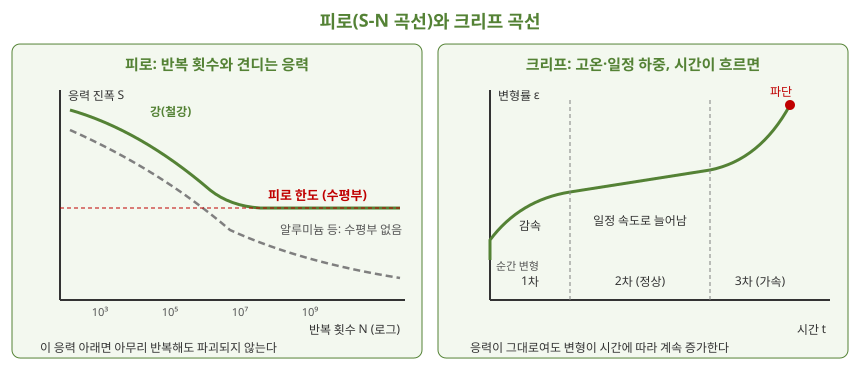

*왼쪽: 응력 진폭을 낮출수록 오래 견디다가, 강은 어느 응력 이하에서 곡선이 **수평**이 된다 — 그 높이가 피로 한도다. 알루미늄 같은 비철 금속은 수평부가 뚜렷하지 않다. 오른쪽: 크리프는 순간 변형 뒤 1차(감속)·2차(일정 속도)·3차(가속) 단계를 거쳐 파단한다. 응력은 그대로인데 시간만으로 변형이 커진다는 점이 핵심이다.*

피로 파단면은 금이 시작된 점에서 물결무늬(비치 마크)가 퍼져 나가다가, 남은 단면이 버티지 못한 마지막 부분만 거칠게 끊어진다. 시작점은 대개 나사골·필릿처럼 **응력 집중**이 있는 곳이다. 볼트는 나사골, 크랭크축은 저널과 암이 만나는 필릿에서 피로 파괴가 잘 일어난다.

## 10. 설계 요구 기능 파악

부품 치수를 정하기 전에 **무엇을 얼마나, 어디서, 몇 년** 하는 부품인지부터 정해야 앞의 하중·기준 강도·안전율을 고를 수 있다. 이것이 출제기준의 "요구기능 파악"이다.

- 기능: 전달할 힘·토크·속도, 운동 방향, 정밀도.
- 조건: 사용 환경(온도, 부식), 수명, 조립·분해 빈도, 비용, 표준 부품 사용 가능성.
- **표준화**(KS, ISO) 부품을 쓰면 호환성·조달·원가에 유리하다.

## 그림

*설계 순서: 하중 종류 → 기준 강도 → 안전율 → 허용 응력 → 치수. 절 2 → 4 → 5 → 6·7 순서와 같다.*

## 기출 포인트

옛 2과목 "기초공학" 파트(31~40번)에서 재료역학 문항이 매회 1~2개 나왔다.

- 응력의 정의·성질 — 6회: 응력 종류가 아닌 것 (2014-3), 응력 설명 중 틀린 것 (2017-1, 2017-3, 2018-1, 2019-1), 압축 응력의 방향 (2020-3)
- 응력 계산 — 6회: 원형 봉 인장 응력 (2016-3, 2018-3), 안전율로 봉 지름 (2015-2), 경사 줄 장력과 응력 (2015-1), 접촉 압력 (2018-1, 2019-3)
- 전단 응력 — 5회: 자르는 작업에 생기는 응력 (2014-1, 2017-2), 토크를 받는 축의 응력 (2016-1), 볼트 전단 응력 (2016-1), 리벳 전단 응력 (2020-1)
- 하중 종류(교번 하중) — 2회 (2014-2, 2019-3)
- 응력 집중이 생기지 않는 곳 — 1회 (2016-2)
- 응력–변형률 선도 점 이름(탄성 한도) — 1회 (2018-2)
- 단순보 등분포 하중 최대 굽힘 모멘트 $wl^2/8$ — 1회 (2014-3)
- 맞대기 용접 인장 응력 식 — 1회 (2019-2) → [키·핀·코터·리벳·용접](키_핀_코터_리벳_용접.md)
- 합계 **23회**. 힘·모멘트·단위 문제는 [기초공학 – 힘·운동·단위](기초공학_힘_운동_단위.md), 축 강도는 [축과 축이음](축과_축이음.md)에 정리.

**교재 예제 유형** (Win-Q 2025 PART 01 CHAPTER 03, 01·19절): 제동·진동 완충 요소의 분류(제어용), 응력 설명 중 틀린 것(전단 응력은 접선 응력), 인장 시험 응력(43 kgf/mm²), 볼트 전단 응력(3.18 kgf/mm²), 교번 하중, 내부 저항력 = 응력, 안전율(4.71), 사용 응력, 응력 집중이 없는 곳(긴 축의 중간). 옛 기출과 같은 문제가 많다.

## 관련 단원

- [기초공학 – 힘·운동·단위](기초공학_힘_운동_단위.md)
- [나사와 볼트](나사와_볼트.md)
- [축과 축이음](축과_축이음.md)
- [키·핀·코터·리벳·용접](키_핀_코터_리벳_용접.md)

## 체크리스트

- [ ] 하중 조건에 맞는 기준 강도를 고른다
- [ ] 안전율로 허용 응력을 구한다
- [ ] 원형 단면의 Z와 Zp를 쓴다
- [ ] 동력·회전수로 토크를 계산한다
- [ ] 응력 집중과 피로 한도를 설명한다
- [ ] E, G, ν 관계식을 안다
- [ ] 응력과 하중·단면적의 비례 관계를 바로 말한다
- [ ] 수직 응력과 전단 응력의 방향 차이를 안다
- [ ] 원형 단면 인장·전단 응력을 kgf와 N 단위로 모두 계산한다
- [ ] 안전율로 허용 응력을 구해 봉 지름을 정한다
- [ ] 반복 하중과 교번 하중을 구분한다

## 참고

- [큐넷 자동화설비산업기사 출제기준](https://www.q-net.or.kr/crf005.do?id=crf00503&jmCd=2034)

### 그림 출처

위키미디어 공용(Wikimedia Commons)과 Openverse에서 가져온 공개 라이선스 자료이고, 노트에 맞게 크기를 줄이고 WebP로 변환했다.

| 그림 | 작성자 | 라이선스 | 출처 |
| --- | --- | --- | --- |
| [Inspekt desk 50kN IMGP8563](https://commons.wikimedia.org/wiki/File:Inspekt_desk_50kN_IMGP8563.jpg) | Smial | [CC BY-SA 2.0 de](https://creativecommons.org/licenses/by-sa/2.0/de/deed.en) | Wikimedia Commons |
| [4 CU TEST SPECIMENS AND FRACTURE SURFACES OF TENSILE AND FATIGUE SPECIMENS - NARA - 17426028](https://commons.wikimedia.org/wiki/File:4_CU_TEST_SPECIMENS_AND_FRACTURE_SURFACES_OF_TENSILE_AND_FATIGUE_SPECIMENS_-_NARA_-_17426028.jpg) | Martin Brown | 퍼블릭 도메인 | Wikimedia Commons |
| [Plastic Protractor Polarized 05375](https://commons.wikimedia.org/wiki/File:Plastic_Protractor_Polarized_05375.jpg) | Nevit Dilmen | [CC BY-SA 3.0](http://creativecommons.org/licenses/by-sa/3.0/) | Wikimedia Commons |

직접 그린 그림(SVG, 이 볼트용으로 새로 작성): 하중 작용방향, 하중 시간변화, 수직응력 전단응력, 푸아송비, 응력변형률선도, 경사줄 장력, 굽힘 비틀림 응력분포, 보 굽힘모멘트, 응력집중, SN곡선 크리프.

