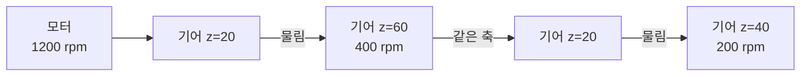

# 기어

> [!summary] 핵심 요약
> - **모듈** $m = \dfrac{D}{z}$ (피치원 지름 ÷ 잇수). 서로 물리는 기어는 **모듈이 같아야** 한다.
> - 원주 피치 $p = \pi m$, 이끝원 지름 $D_o = m(z + 2)$, 중심 거리 $C = \dfrac{m(z_1 + z_2)}{2}$.
> - 속도비 $i = \dfrac{N_2}{N_1} = \dfrac{z_1}{z_2} = \dfrac{D_1}{D_2}$. 잇수가 많은 기어가 느리게 돈다.
> - 치형: **인벌류트**(가장 많이 사용, 중심 거리 오차에 강함), 사이클로이드(시계 등 정밀).

> [!warning] 자주 틀리는 포인트
> - 지름 피치 $P_d = z / D[\text{inch}]$는 인치 기어. $m = 25.4 / P_d$.
> - **언더컷**: 잇수가 너무 적으면 이뿌리가 깎여 약해짐. 압력각 20° 표준 기어 이론 최소 잇수 **17**, 실용 **14**.
> - 언더컷 방지: **전위 기어**, 압력각 크게, 이 높이 낮게(낮은 이).
> - **웜 기어**: 큰 감속비, 역구동 방지(자립) 가능, 하지만 **효율 낮고 발열** 큼.
> - **헬리컬 기어**: 조용하고 큰 힘, 하지만 **축 방향 추력**이 생김 → 더블 헬리컬로 상쇄.
> - 기어 도시에서 **이끝원(잇봉우리원)은 굵은 실선**이다. "가는 실선"이라는 보기는 틀린 것. 이뿌리원(이골원)은 가는 실선이지만 **축에 직각 방향으로 본 단면도에서는 굵은 실선**.
> - 헬리컬·스파이럴 베벨 등 **잇줄 방향은 3개의 가는 실선**으로 표시한다 (정면도를 단면으로 그리면 가는 2점 쇄선 3개).
> - **요목표**에는 치형, 모듈, 압력각, 잇수, 기준 피치원 지름, 정밀도 등이 들어간다. **이폭**은 도면에 치수로 기입하므로 요목표 항목이 아니다.

## 개념 정리

### 기어 용어

| 용어 | 식·뜻 |
| --- | --- |
| 피치원 | 물림의 기준 원, 지름 $D = mz$ |
| 이끝원 | $D_o = m(z + 2)$ |
| 이뿌리원 | $D_r = m(z - 2.5)$ |
| 이 높이 | 이끝 높이 $m$ + 이뿌리 높이 $1.25m$ = $2.25m$ (m = 2면 4.5 mm) |
| 원주 피치 | $p = \pi m$ |
| 압력각 | 표준 20° (예전 14.5°). 교재는 14.5·17·20·22.5·25°를 든다 |
| 백래시 | 맞물린 이 사이 틈새 → 너무 작으면 걸림, 크면 덜컹 |
| 물림률 | 동시에 물리는 이 쌍의 평균 수, 1보다 커야 연속 회전 (보통 1.2 이상) |

**계산 예**: 모듈 2, 잇수 20과 60
- $D_1 = 40$, $D_2 = 120$ mm, 중심 거리 $= (40 + 120)/2 = 80$ mm
- 속도비 $20/60 = 1/3$ → 1200 rpm 입력 시 출력 400 rpm
- 이끝원 지름 $D_{o1} = 2 \times 22 = 44$ mm

### 기어 종류 (축의 관계별)

| 축 관계 | 기어 | 특징 |
| --- | --- | --- |
| 평행 | 스퍼 기어 (평기어) | 가장 기본, 제작 쉬움 |
| 평행 | 헬리컬 기어 | 조용, 큰 힘, 축 방향 추력 |
| 평행 | 더블 헬리컬 (헤링본) | 추력 상쇄 |
| 평행 | 랙과 피니언 | 회전 ↔ 직선 |
| 평행 | 내접 기어 | 같은 방향 회전, 유성 기어 |
| 교차 | 베벨 기어 (직선·스파이럴) | 직각 등 교차축 |
| 엇갈림 | 웜 기어 | 큰 감속비, 자립 가능 |
| 엇갈림 | 하이포이드 기어 | 자동차 차동 장치 |
| 엇갈림 | 나사 기어 (스크루) | 가벼운 하중 |

### 기어 트레인

- **단식**: 한 쌍. **복식**: 한 축에 기어 2개 → 큰 감속비. 전체 속도비 = 각 단 속도비의 곱.
- **아이들 기어**(중간 기어): 속도비는 그대로, **회전 방향만 바뀜**.
- **유성 기어 장치**: 선 기어 + 유성 기어 + 링 기어 + 캐리어. 소형으로 큰 감속비 (감속기, 자동 변속기).
- **하모닉 드라이브**: 탄성 변형을 이용한 초고감속, 백래시 거의 없음 (로봇 관절).

### 기어 강도와 손상

- 굽힘 강도: **루이스 식** $F = \sigma_b b m Y$ (Y: 치형 계수).
- 면압 강도: 이 표면 피로 → **피팅**(작은 구멍).
- 손상: 마모, 피팅, 스코어링(윤활 부족 긁힘), 이 부러짐.

### 도면에서 기어 그리기

- 이끝원: **굵은 실선**. 피치원: **가는 1점 쇄선**. 이뿌리원: **가는 실선** (단면도에서는 굵은 실선).
- 요목표에 모듈, 잇수, 압력각, 피치원 지름, 정밀도 등급을 적는다.
- 맞물린 한 쌍을 그릴 때 물림부의 이끝원은 **양쪽 모두 굵은 실선**, 단면도에서는 한쪽 이끝을 **숨은선**으로 그린다.
- 치형은 그리지 않고 **요목표**로 설명한다. 교재(CH03 10절) 요목표 항목: 치형, 기준 래크, 모듈, 압력각, 잇수, 피치원 지름, 전위량, 전체 이 높이, 걸치기 이 두께, 다듬질 방법, 정밀도(0~12급), 재료·열처리·경도. 예: m = 2, z = 36 → 피치원 72 mm, 전체 이 높이 4.5 mm, SCM415 침탄 담금질 55~60 HRC.
- 맞물려야 종류를 알 수 있는 기어(나사 기어 등)는 피니언과 기어를 **함께** 그린다.

| 치형 (교재 10절) | 장점 |
| --- | --- |
| 인벌류트 (실을 감았다 풀 때 끝의 궤적) | 이가 강하고, 호환성 좋고, 중심 거리 오차에 강하며 전위 기어 가능 |
| 사이클로이드 | 정밀도가 높고, 언더컷이 없으며, 미끄럼률이 균일 |

### 간략도로 기어 종류 알아보기

| 간략도 특징 | 기어 |
| --- | --- |
| 평행한 두 원, 잇줄 표시 없음 | 스퍼 기어 |
| 정면도에 비스듬한 가는 실선 3개 (한 방향) | 헬리컬 기어 |
| 두 축이 엇갈리고 각 기어에 비스듬한 잇줄 | 나사(스크루) 기어 |
| 원뿔 모양, 잇줄이 곧음 | 직선 베벨 기어 |
| 원뿔 모양, 잇줄이 곡선 | 스파이럴 베벨 기어 |
| 원뿔 모양인데 두 축이 **엇갈림**(오프셋) | 하이포이드 기어 |
| 나사 모양 축 + 휠 | 웜 기어 |

### 헬리컬 기어 치수

- 이직각 모듈 $m_n$, 비틀림각 $\beta$ → 축직각 모듈 $m_s = \dfrac{m_n}{\cos\beta}$, 피치원 지름 $D = m_s z = \dfrac{m_n z}{\cos\beta}$.
- 문제에서 "모듈"이 축직각 모듈인지 이직각 모듈인지 확인해야 한다. 축직각 모듈이면 스퍼 기어처럼 $z = D/m$.

## 그림

## 기출 포인트

- 간략도를 보고 기어 종류 고르기 — 3회: 헬리컬 (2014-2), 나사 기어 (2014-3), 하이포이드 (2017-2)
- 기어 도시 선 종류 — 1회: 이끝원·피치원·이뿌리원·잇줄 선 중 틀린 것 (2020-3)
- 스퍼 기어 요목표 항목이 아닌 것 — 1회 (2018-2)
- 모듈·피치원 지름으로 잇수 구하기 — 1회 (2014-1, 1과목 기계가공에서 출제)
- 2과목 합계 5회. 속도비·중심 거리 계산, 언더컷은 2014~2020년 2과목에 나오지 않았지만 새 출제기준(부품규격 확인)과 실무에서 기본이다.

**교재 예제 유형** (Win-Q 2025 PART 01 CHAPTER 03, 10절): 요목표에 보통 적지 않는 항목(치폭), 맞물린 간략도 종류(그림, 나사 기어), 도시된 기어(그림, 헬리컬). 기출과 같은 유형이다.

## 관련 단원

- [벨트·체인·스프링·브레이크](벨트_체인_스프링_브레이크.md)
- [축과 축이음](축과_축이음.md)
- [도면 양식과 투상법](도면_양식과_투상법.md)

## 체크리스트

- [ ] 모듈로 피치원·이끝원 지름과 중심 거리를 계산한다
- [ ] 잇수로 속도비와 출력 회전수를 구한다
- [ ] 축 관계별 기어 종류를 구분한다
- [ ] 언더컷 원인과 방지법을 말한다
- [ ] 아이들 기어와 유성 기어의 역할을 안다
- [ ] 도면에서 이끝원·피치원·이뿌리원 선 종류를 안다
- [ ] 단면도에서 이뿌리원이 굵은 실선으로 바뀌는 경우를 안다
- [ ] 간략도로 스퍼·헬리컬·나사·베벨·하이포이드·웜 기어를 구분한다
- [ ] 요목표 기입 항목과 아닌 것(이폭)을 구분한다

## 참고

- [큐넷 자동화설비산업기사 출제기준](https://www.q-net.or.kr/crf005.do?id=crf00503&jmCd=2034)
