# 기어

> [!summary] 핵심 요약
> - **모듈** $m = \dfrac{D}{z}$ (피치원 지름 ÷ 잇수). 서로 물리는 기어는 **모듈이 같아야** 한다.
> - 원주 피치 $p = \pi m$, 이끝원 지름 $D_o = m(z + 2)$, 중심 거리 $C = \dfrac{m(z_1 + z_2)}{2}$.
> - 속도비 $i = \dfrac{N_2}{N_1} = \dfrac{z_1}{z_2} = \dfrac{D_1}{D_2}$. 잇수가 많은 기어가 느리게 돈다.
> - 치형: **인벌류트**(가장 많이 사용, 중심 거리 오차에 강함), 사이클로이드(시계 등 정밀).

> [!warning] 자주 틀리는 포인트
> - 지름 피치 $P_d = z / D[\text{inch}]$는 인치 기어. $m = 25.4 / P_d$.
> - **언더컷**: 잇수가 너무 적으면 이뿌리가 깎여 약해짐. 압력각 20° 표준 기어 이론 최소 잇수 **17**, 실용 **14**.
> - 언더컷 방지: **전위 기어**, 압력각 크게, 이 높이 낮게(낮은 이).
> - **웜 기어**: 큰 감속비, 역구동 방지(자립) 가능, 하지만 **효율 낮고 발열** 큼.
> - **헬리컬 기어**: 조용하고 큰 힘, 하지만 **축 방향 추력**이 생김 → 더블 헬리컬로 상쇄.
> - 기어 도시에서 **이끝원(잇봉우리원)은 굵은 실선**이다. "가는 실선"이라는 보기는 틀린 것. 이뿌리원(이골원)은 가는 실선이지만 **축에 직각 방향으로 본 단면도에서는 굵은 실선**.
> - 헬리컬·스파이럴 베벨 등 **잇줄 방향은 3개의 가는 실선**으로 표시한다 (정면도를 단면으로 그리면 가는 2점 쇄선 3개).
> - **요목표**에는 치형, 모듈, 압력각, 잇수, 기준 피치원 지름, 정밀도 등이 들어간다. **이폭**은 도면에 치수로 기입하므로 요목표 항목이 아니다.

## 학습 목표

이 단원을 마치면 다음을 할 수 있어야 한다.

1. 모듈과 잇수로 피치원·이끝원·이뿌리원 지름, 이 높이, 원주 피치, 중심 거리를 계산한다.
2. 잇수(또는 피치원 지름)로 속도비와 출력 회전수를 구하고, 아이들 기어·복식 기어열의 효과를 설명한다.
3. 인벌류트 치형과 압력각의 뜻을 설명하고, 언더컷의 원인과 방지법을 말한다.
4. 두 축의 관계(평행·교차·엇갈림)로 기어 종류를 구분하고, 헬리컬 기어의 축직각 모듈을 계산한다.
5. 루이스 식으로 이의 굽힘 강도를 설명하고, 피팅·스코어링 같은 손상을 구분한다.
6. 기어 도면의 선 종류와 요목표 항목을 알고, 간략도를 보고 기어 종류를 고른다.

## 한눈에 보기

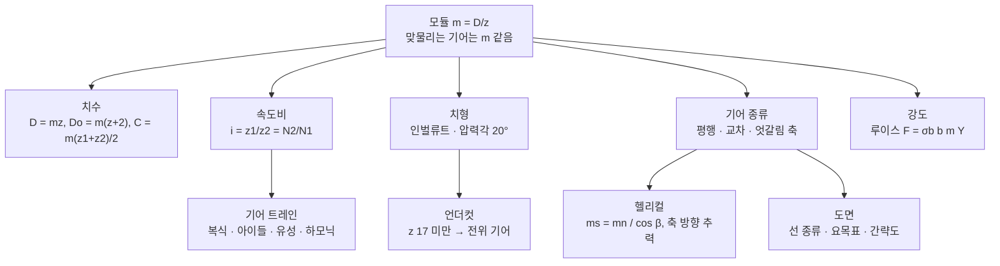

## 1. 기어 용어와 기본 치수

기어는 **이가 달린 마찰차**라고 생각하면 쉽다. 두 원판을 맞대어 굴리면 미끄러지지만, 원판 둘레에 이를 내면 미끄럼 없이 정확한 회전비로 힘을 전한다. 이때 미끄럼 없이 서로 구르는 가상의 원판이 **피치원**이고, 모든 치수는 이 원을 기준으로 잰다.

| 스퍼 기어 한 쌍 | 각부 명칭 |
| --- | --- |
| 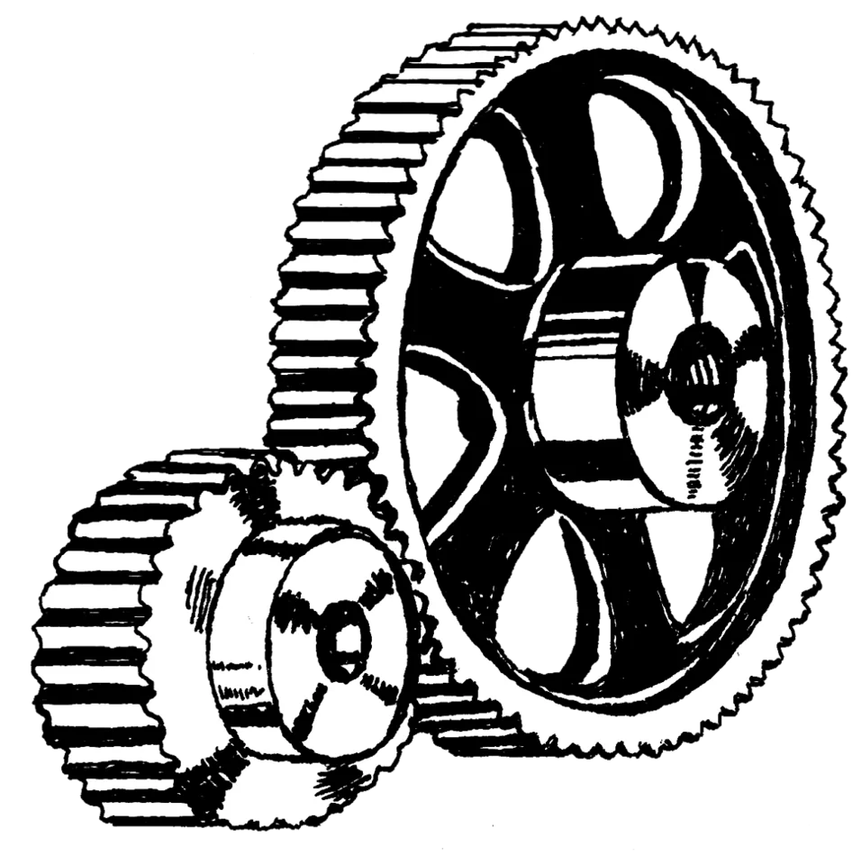 | 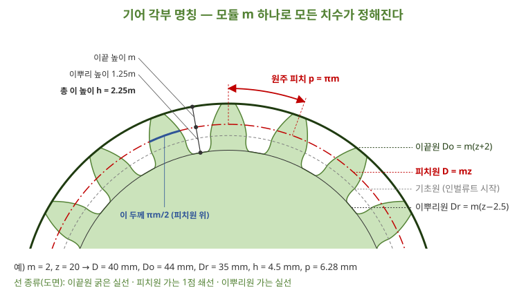 |

*왼쪽: 잇수가 많은 큰 기어(바퀴살이 있는 림)와 잇수가 적은 작은 기어(피니언)가 맞물린 스퍼 기어. 이가 축과 나란하게 곧다. 오른쪽: 이의 바깥 끝을 잇는 원이 **이끝원**, 이 사이 골 바닥을 잇는 원이 **이뿌리원**, 그 사이에서 맞물림의 기준이 되는 빨간 1점 쇄선이 **피치원**이다. 피치원에서 바깥쪽 높이가 이끝 높이 $m$, 안쪽 깊이가 이뿌리 높이 $1.25m$ — 상대 기어의 이끝이 바닥에 닿지 않도록 $0.25m$의 틈(이끝 틈새)을 둔다. 이웃한 두 이 사이의 피치원 위 호 길이가 원주 피치 $p = \pi m$이고, 이 두께는 그 절반 $\pi m/2$이다.*

$$m = \frac{D}{z}, \qquad p = \frac{\pi D}{z} = \pi m, \qquad D_o = D + 2m = m(z+2), \qquad D_r = D - 2.5m = m(z - 2.5)$$

> [!tip] 감 잡기 — 모듈은 "이의 크기"
> 모듈이 크면 이가 크고 굵다. 모듈이 다른 두 기어는 이 크기가 달라 서로 끼지 않는다. 그래서 **맞물리는 기어는 모듈이 같아야** 하고, 계산 문제에서 모듈은 두 기어에 공통으로 쓰인다.

### 기어 용어

| 용어 | 식·뜻 |
| --- | --- |
| 피치원 | 물림의 기준 원, 지름 $D = mz$ |
| 이끝원 | $D_o = m(z + 2)$ |
| 이뿌리원 | $D_r = m(z - 2.5)$ |
| 이 높이 | 이끝 높이 $m$ + 이뿌리 높이 $1.25m$ = $2.25m$ (m = 2면 4.5 mm) |
| 원주 피치 | $p = \pi m$ |
| 압력각 | 표준 20° (예전 14.5°). 교재는 14.5·17·20·22.5·25°를 든다 |
| 백래시 | 맞물린 이 사이 틈새 → 너무 작으면 걸림, 크면 덜컹 |
| 물림률 | 동시에 물리는 이 쌍의 평균 수, 1보다 커야 연속 회전 (보통 1.2 이상) |

> [!question] 시험에서는
> 인치 기어는 모듈 대신 **지름 피치** $P_d = z/D[\text{inch}]$를 쓴다. 모듈과는 **역수 관계**이고 단위가 인치라서 $m = 25.4/P_d$. "지름 피치가 크면 이가 크다"는 틀린 보기다(이가 작다).

## 2. 속도비와 중심 거리

두 피치원은 미끄럼 없이 구르므로 **같은 시간에 지나가는 둘레 길이가 같다**. 큰 기어는 둘레가 길어서 한 바퀴를 채우는 데 오래 걸린다. 그래서 잇수가 많은 기어가 느리게 돈다.

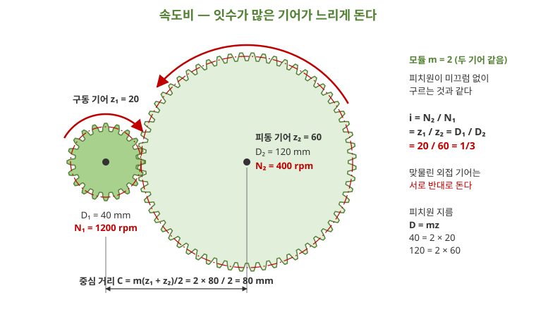

*작은 구동 기어(z₁ = 20)가 시계 방향으로 1200 rpm 돌면 큰 피동 기어(z₂ = 60)는 **반대 방향**으로 1/3 속도인 400 rpm으로 돈다. 두 피치원(빨간 1점 쇄선)이 한 점에서 맞닿으므로 중심 거리는 두 피치원 반지름의 합이다.*

$$i = \frac{N_2}{N_1} = \frac{z_1}{z_2} = \frac{D_1}{D_2}, \qquad C = \frac{D_1 + D_2}{2} = \frac{m(z_1 + z_2)}{2}$$

**계산 예**: 모듈 2, 잇수 20과 60
- $D_1 = 40$, $D_2 = 120$ mm, 중심 거리 $= (40 + 120)/2 = 80$ mm
- 속도비 $20/60 = 1/3$ → 1200 rpm 입력 시 출력 400 rpm
- 이끝원 지름 $D_{o1} = 2 \times 22 = 44$ mm

> [!tip] 감 잡기 — 잇수 구하기
> 모듈과 피치원 지름이 주어지면 $z = D/m$. 예를 들어 m = 3, D = 90 mm면 z = 30. 이끝원 지름만 주어지면 $z = D_o/m - 2$로 거꾸로 푼다.

## 3. 치형 — 인벌류트와 압력각

이의 옆면(치면) 곡선이 아무 모양이나 되면, 돌아가는 동안 회전비가 순간순간 흔들려 소음과 진동이 생긴다. 회전비를 늘 일정하게 만드는 곡선이 **인벌류트**와 **사이클로이드**다. 원통에 감긴 실을 팽팽하게 당기며 풀 때 실 끝이 그리는 곡선이 인벌류트다.

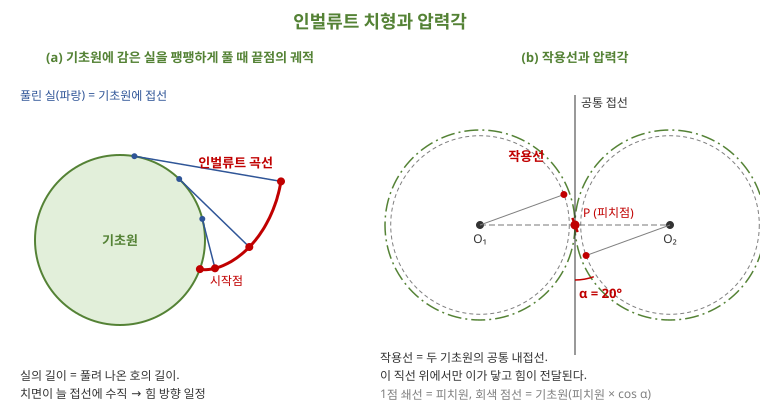

*(a) 기초원에 감은 실(파랑)을 풀면, 실은 늘 기초원에 접하고 실 끝(빨간 점)은 인벌류트 곡선을 그린다. 실의 길이는 풀려 나온 호의 길이와 같다. (b) 맞물린 두 인벌류트 기어의 이는 두 기초원의 공통 접선(빨간 **작용선**) 위에서만 닿는다. 힘은 늘 이 직선 방향으로 전달되고, 피치점 P에서 작용선이 피치원의 공통 접선과 이루는 각이 **압력각** α(표준 20°)다. 기초원 지름 = 피치원 지름 × cos α.*

| 치형 (교재 10절) | 장점 |
| --- | --- |
| 인벌류트 (실을 감았다 풀 때 끝의 궤적) | 이가 강하고, 호환성 좋고, 중심 거리 오차에 강하며 전위 기어 가능 |
| 사이클로이드 | 정밀도가 높고, 언더컷이 없으며, 미끄럼률이 균일 |

> [!tip] 감 잡기 — 중심 거리 오차에 강한 이유
> 인벌류트는 기초원에서 나온 곡선이라, 두 기어의 중심 거리가 조금 벌어져도 작용선이 두 기초원의 공통 접선이라는 사실은 그대로다. 회전비는 기초원 지름 비로 정해지므로 **중심 거리가 조금 틀려도 회전비가 변하지 않는다**(압력각과 백래시만 조금 바뀐다).

## 4. 언더컷과 전위 기어

기어는 보통 랙 모양 공구(랙 커터)나 호브를 기어 소재와 함께 굴리면서 깎는다(창성 가공). 잇수가 적은 기어를 이렇게 깎으면 공구 끝이 이뿌리 안쪽까지 파고들어 **이뿌리가 잘록하게 깎여 나간다**. 이것이 언더컷이다.

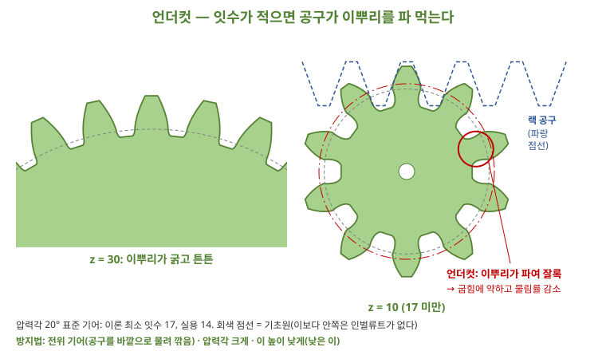

*같은 모듈로 랙 공구 창성을 계산해 그린 치형이다. 왼쪽 z = 30은 이뿌리로 갈수록 이가 두꺼워진다. 오른쪽 z = 10은 기초원(회색 점선)보다 안쪽에서 랙 공구(파랑 점선)의 끝이 이뿌리를 파 먹어, 빨간 원 부분이 **위쪽보다 오히려 가늘다**. 굽힘에 약해지고 인벌류트 구간이 줄어 물림률도 떨어진다.*

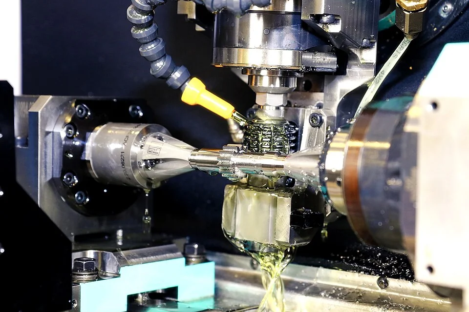

*가운데 위에서 내려온 나사 모양 공구가 **호브**이고, 그 아래 좌우 센터 사이에 물린 축 위의 작은 스퍼 기어가 공작물이다. 호브와 기어 소재가 맞물려 돌면서 치형을 창성한다(노란 노즐에서 절삭유 분사). 이렇게 공구와 함께 굴려 깎기 때문에 잇수가 적으면 언더컷이 생긴다.*

- **언더컷**: 잇수가 너무 적으면 이뿌리가 깎여 약해짐. 압력각 20° 표준 기어 이론 최소 잇수 **17**, 실용 **14**.
- 언더컷 방지: **전위 기어**(공구를 바깥쪽으로 물려 깎아 이뿌리를 두껍게), 압력각 크게, 이 높이 낮게(낮은 이).

> [!question] 시험에서는
> "언더컷 방지책이 아닌 것"으로 **잇수를 줄인다**, **압력각을 작게 한다**가 나온다. 잇수를 늘리거나 압력각을 키워야 한다. 사이클로이드 치형은 언더컷이 없다.

## 5. 기어 종류 (축의 관계별)

기어를 고르는 첫 질문은 "두 축이 어떻게 놓였나"다. 축이 **나란하면** 원통 기어, **한 점에서 만나면** 원뿔 모양 베벨 기어, **만나지도 나란하지도 않으면(엇갈림)** 웜·하이포이드·나사 기어를 쓴다.

| 축 관계 | 기어 | 특징 |
| --- | --- | --- |
| 평행 | 스퍼 기어 (평기어) | 가장 기본, 제작 쉬움 |
| 평행 | 헬리컬 기어 | 조용, 큰 힘, 축 방향 추력 |
| 평행 | 더블 헬리컬 (헤링본) | 추력 상쇄 |
| 평행 | 랙과 피니언 | 회전 ↔ 직선 |
| 평행 | 내접 기어 | 같은 방향 회전, 유성 기어 |
| 교차 | 베벨 기어 (직선·스파이럴) | 직각 등 교차축 |
| 엇갈림 | 웜 기어 | 큰 감속비, 자립 가능 |
| 엇갈림 | 하이포이드 기어 | 자동차 차동 장치 |
| 엇갈림 | 나사 기어 (스크루) | 가벼운 하중 |

### 평행축 기어

| 더블 헬리컬(헤링본) 기어 | 랙과 피니언 | 내접 기어 |
| --- | --- | --- |
| 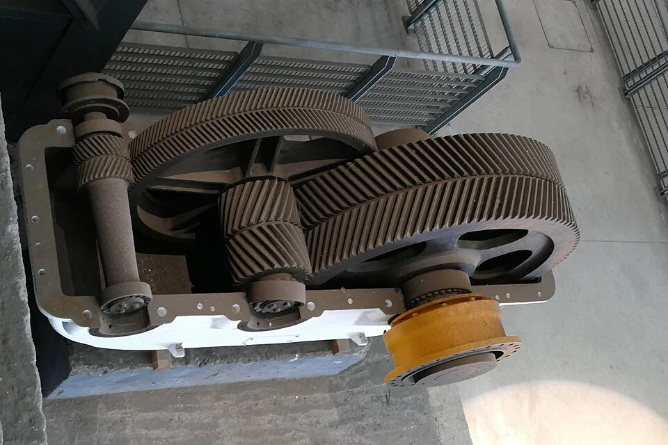 | 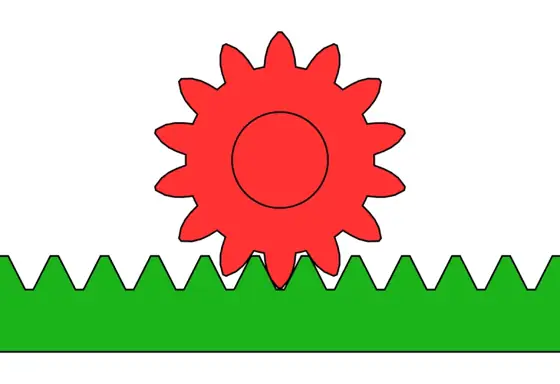 | 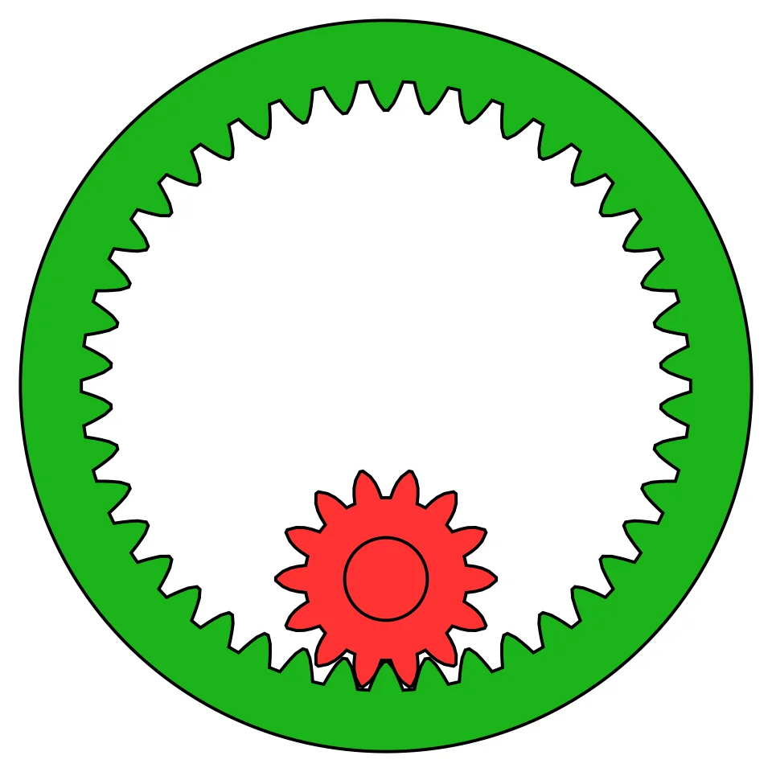 |

*왼쪽: 뚜껑을 연 대형 감속기. 큰 기어와 피니언 모두 이가 **V자(산 모양)**로 꺾여 있다 — 좌우 반쪽의 비틀림 방향이 반대라 축 방향 추력이 서로 상쇄된다. 가운데: 빨간 피니언이 돌면 초록 랙이 **직선으로** 움직인다(회전 ↔ 직선). 오른쪽: 초록 링 기어는 이가 **안쪽**에 나 있고, 그 안에서 빨간 작은 기어가 물려 **같은 방향**으로 돈다. 유성 기어 장치의 링 기어가 바로 이것이다.*

### 헬리컬 기어 치수

이가 축에 비스듬히(비틀림각 β) 나 있어 한 번에 여러 이가 조금씩 물린다. 그래서 스퍼 기어보다 조용하고 큰 힘을 전하지만, 비스듬한 면을 미는 힘에 **축 방향 성분(추력)**이 생긴다.

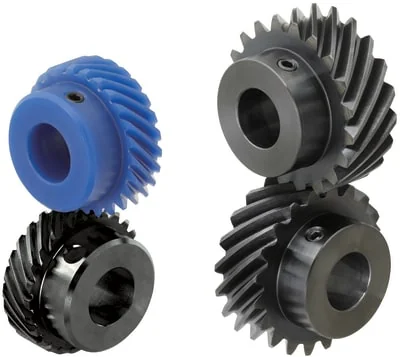

*MISUMI 카탈로그의 제품 사진(제조사 사진). 이가 축과 나란한 스퍼 기어와 달리 **비스듬히(나선 모양으로)** 나 있는 것을 보자. 파란 플라스틱 기어와 강철 기어가 맞물린 두 쌍이 있는데, 맞물리는 두 기어는 비틀림 **방향이 서로 반대**(오른쪽·왼쪽 비틀림)여야 한다.*

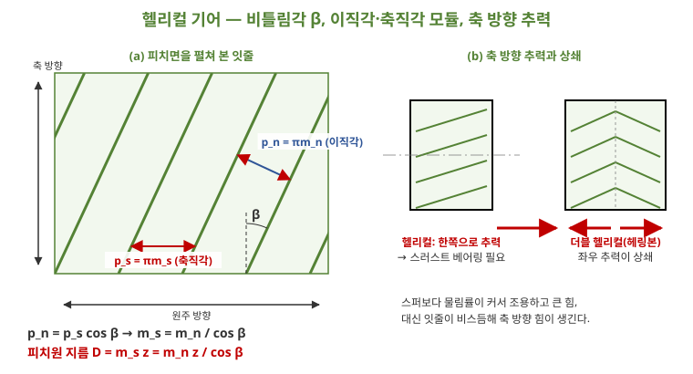

*(a) 피치원 둘레를 평면으로 펼치면 잇줄(초록)이 축 방향에서 β만큼 기울어 있다. 잇줄에 **직각으로** 잰 피치가 이직각 피치 $p_n$, **원주 방향으로** 잰 피치가 축직각 피치 $p_s$이고 $p_n = p_s\cos\beta$. 그래서 축직각 모듈이 더 크다. (b) 헬리컬은 한쪽으로 추력이 생겨 스러스트 베어링이 필요하고, 더블 헬리컬은 좌우 추력이 상쇄된다.*

- 이직각 모듈 $m_n$, 비틀림각 $\beta$ → 축직각 모듈 $m_s = \dfrac{m_n}{\cos\beta}$, 피치원 지름 $D = m_s z = \dfrac{m_n z}{\cos\beta}$.
- 문제에서 "모듈"이 축직각 모듈인지 이직각 모듈인지 확인해야 한다. 축직각 모듈이면 스퍼 기어처럼 $z = D/m$.

> [!tip] 감 잡기 — 계산 예
> $m_n = 2$, $\beta = 30°$, $z = 26$이면 $m_s = 2/\cos 30° = 2.31$, $D = 2.31 \times 26 ≈ 60$ mm. 같은 잇수의 스퍼 기어(52 mm)보다 피치원이 크다.

### 교차축·엇갈림축 기어

| 베벨 기어 (교차) | 웜 기어 (엇갈림) | 하이포이드 기어 (엇갈림) |
| --- | --- | --- |
| 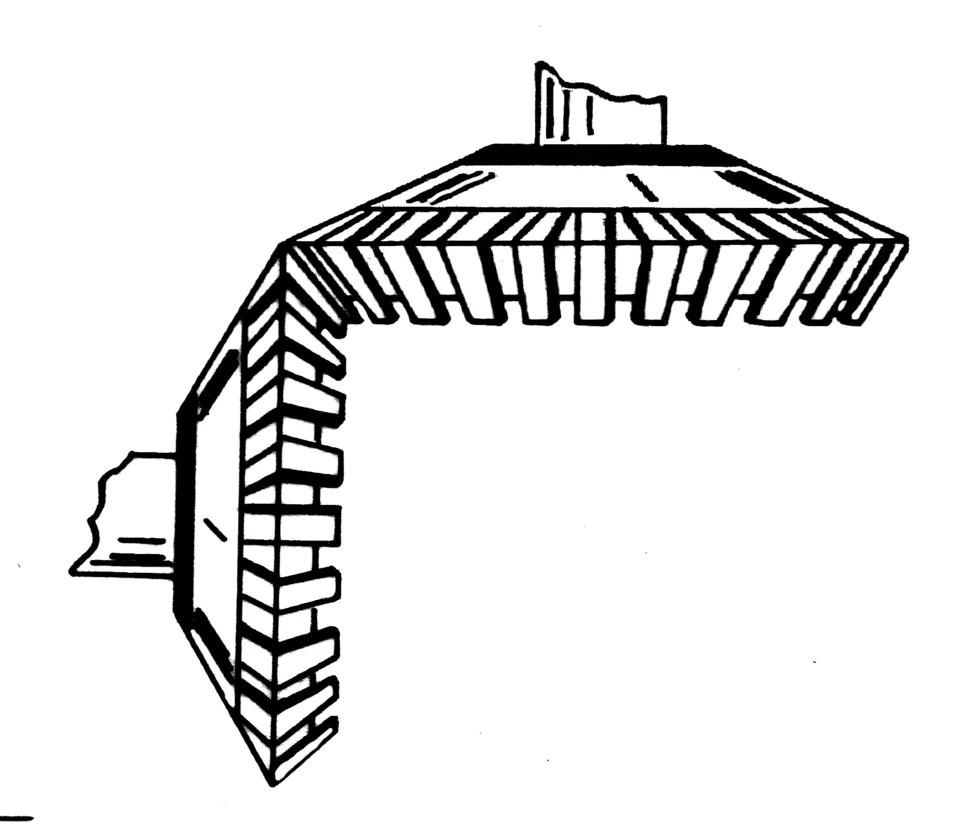 | 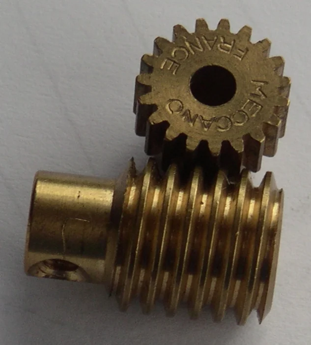 | 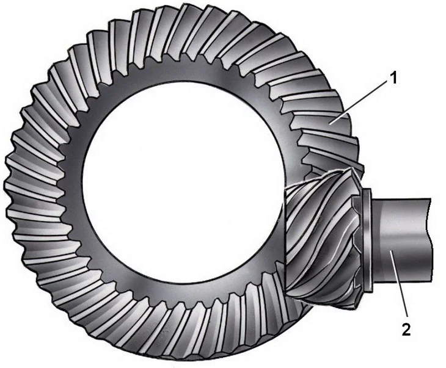 |

*왼쪽: 원뿔대 모양 기어 두 개가 **직각으로** 맞물린 직선 베벨 기어. 잇줄이 원뿔 꼭짓점을 향해 곧게 뻗는다. 가운데: 나사처럼 생긴 **웜**(아래)이 한 바퀴 돌 때 **웜 휠**(위)은 이 하나만큼 돈다. 웜 줄 수 1, 휠 잇수 18이면 감속비 1/18. 반대로 휠을 돌려 웜을 돌리기는 어려워 **자립(역구동 방지)**이 된다. 오른쪽: 자동차 차동 장치의 하이포이드 기어. 큰 링 기어(1)와 곡선 잇줄 피니언(2)이 맞물리는데, 피니언 축이 링 기어 중심을 지나지 않고 **아래로 비켜나(오프셋)** 있다. 스파이럴 베벨과 닮았지만 축이 엇갈린다는 점이 다르다.*

> [!question] 시험에서는
> 웜 기어는 "큰 감속비·자립"이 장점, "효율 낮고 발열"이 단점이다. **웜 기어의 효율이 높다**는 보기는 틀린 것. 미끄럼 접촉이 커서 열이 나므로 웜 휠은 보통 **청동**으로 만든다.

## 6. 기어 트레인

한 쌍으로 얻는 감속비에는 한계가 있다(큰 기어가 너무 커진다). 그래서 여러 기어를 이어 붙여 **속도비를 곱하는** 기어 트레인을 쓴다.

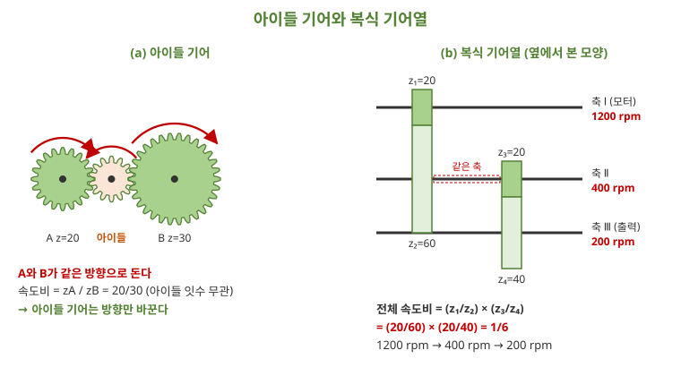

*(a) A와 B 사이에 아이들 기어(주황)를 끼우면 A와 B가 **같은 방향**으로 돈다. 속도비는 $z_A/z_B$ 그대로라 아이들 기어의 잇수와 무관하다. (b) 축 Ⅱ에 z₂ = 60과 z₃ = 20이 **같은 축**으로 붙어 있어 같은 속도로 돈다. 1단에서 1/3, 2단에서 1/2로 줄어 전체 1/6 — 1200 rpm이 200 rpm이 된다.*

- **단식**: 한 쌍. **복식**: 한 축에 기어 2개 → 큰 감속비. 전체 속도비 = 각 단 속도비의 곱.
- **아이들 기어**(중간 기어): 속도비는 그대로, **회전 방향만 바뀜**.
- **유성 기어 장치**: 선 기어 + 유성 기어 + 링 기어 + 캐리어. 소형으로 큰 감속비 (감속기, 자동 변속기).
- **하모닉 드라이브**: 탄성 변형을 이용한 초고감속, 백래시 거의 없음 (로봇 관절).

| 유성 기어 장치 | 하모닉 드라이브 부품 |
| --- | --- |
| 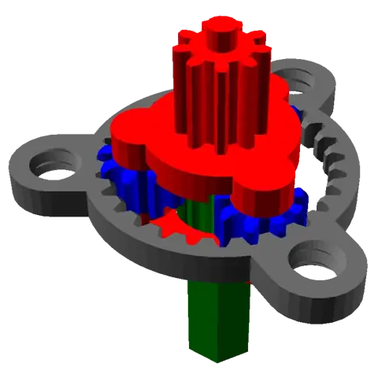 | 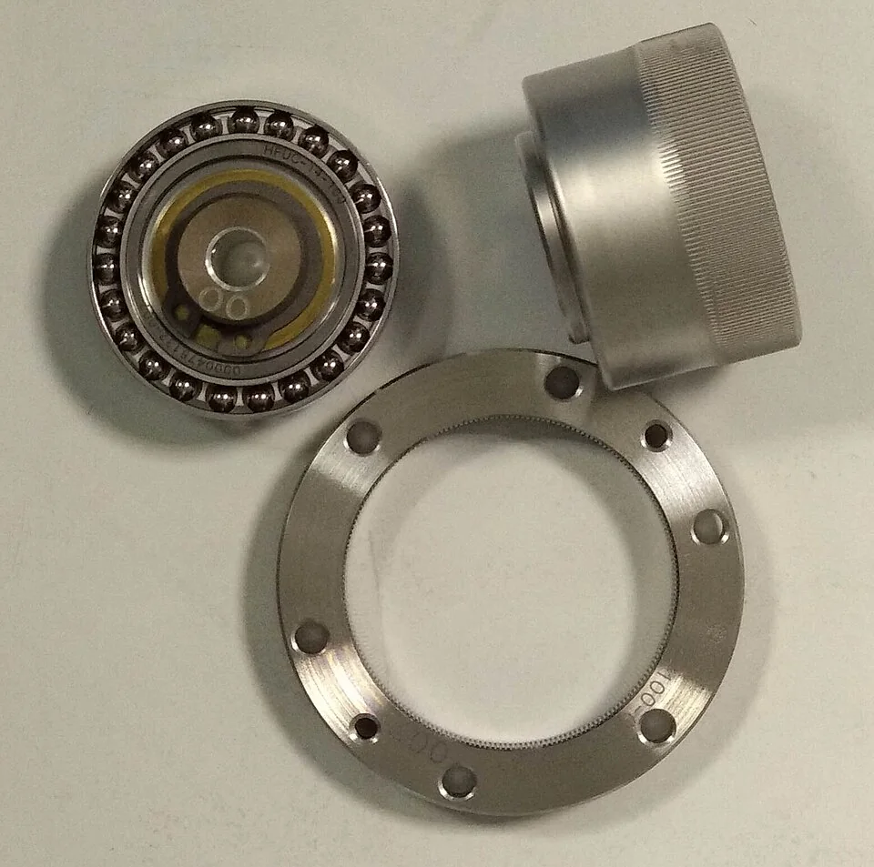 |

*왼쪽: 귀(볼트 구멍)가 달린 회색 **링 기어**는 안쪽에 이가 나 있고 고정되어 있다. 아래에서 들어온 초록 입력축 끝의 **선 기어**가 돌면, 그 둘레의 파란 **유성 기어**들이 링 기어 안쪽을 따라 굴러가고, 유성 기어 축을 묶은 빨간 **캐리어**가 천천히 돌며 위쪽 출력 기어를 돌린다. 이처럼 세 요소(선·링·캐리어) 중 하나를 고정하고 하나를 입력, 하나를 출력으로 하면 작은 부피로 큰 감속비를 얻는다. 힘이 여러 유성 기어로 나뉘어 전달되어 작아도 강하다. 오른쪽: 하모닉 드라이브의 세 부품. 왼쪽 위 타원형 캠에 볼 베어링을 끼운 **웨이브 제너레이터**, 오른쪽 위 얇은 컵 모양에 바깥 이가 난 **플렉스 스플라인**, 아래 안쪽 이가 난 링 **서큘러 스플라인**. 타원 캠이 얇은 컵을 찌그러뜨리며 돌면, 잇수가 2개 적은 플렉스 스플라인이 한 바퀴에 이 2개만큼만 밀려 초고감속이 된다.*

## 7. 기어 강도와 손상

이 하나는 뿌리가 몸체에 붙고 끝에 힘을 받는 **짧은 외팔보**다. 외팔보처럼 뿌리에서 굽힘 응력이 가장 크므로 이가 부러진다면 이뿌리에서 부러진다.

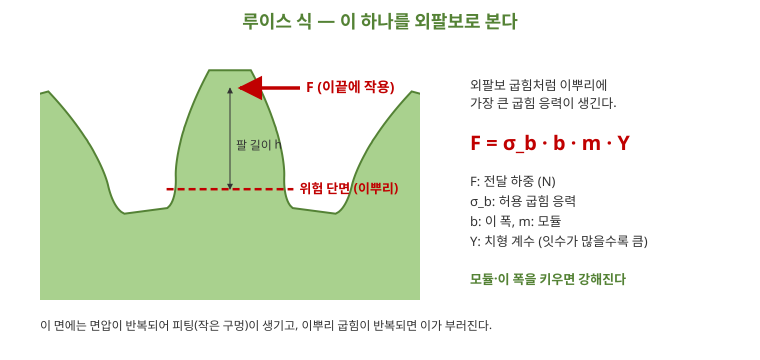

*이끝에 걸린 힘 F가 팔 길이 h만큼 떨어진 이뿌리(빨간 점선, 위험 단면)에 굽힘 모멘트를 만든다. 이 폭 b와 모듈 m이 클수록, 치형 계수 Y가 클수록(잇수가 많을수록) 버티는 힘이 크다.*

- 굽힘 강도: **루이스 식** $F = \sigma_b b m Y$ (Y: 치형 계수).
- 면압 강도: 이 표면 피로 → **피팅**(작은 구멍).
- 손상: 마모, 피팅, 스코어링(윤활 부족 긁힘), 이 부러짐.

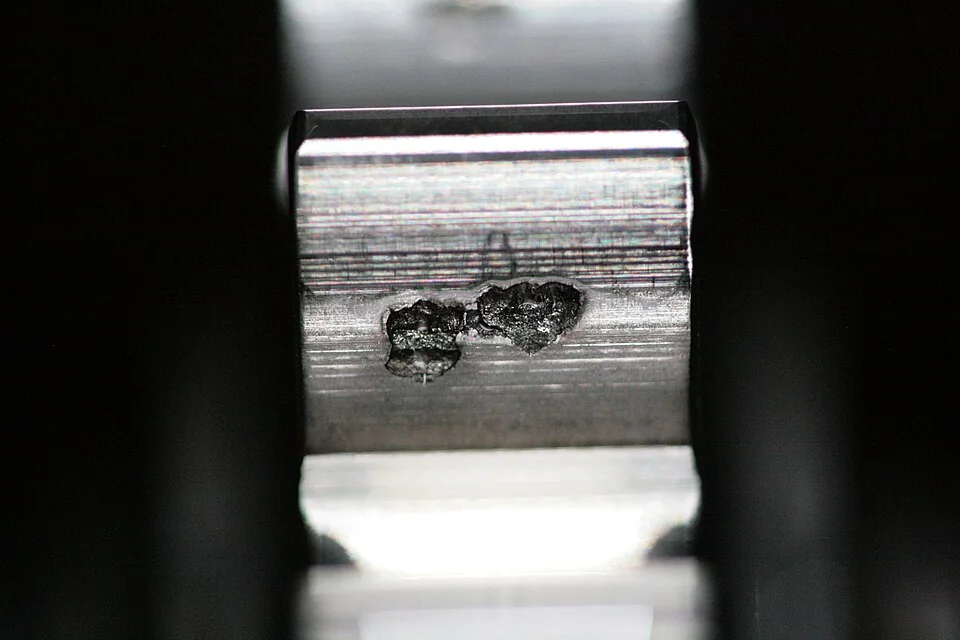

*이 하나를 정면에서 확대한 사진. 매끈하게 가공된 치면 가운데(피치선 부근)에 표면이 조각나 떨어져 나간 **검은 구멍 두 개**가 보인다. 이 면이 반복해서 눌리며(면압) 생긴 표면 피로 손상, 즉 피팅이다.*

> [!tip] 감 잡기 — 손상 구분
> **피팅** = 반복 면압에 의한 표면 피로(구멍). **스코어링** = 윤활유 막이 깨져 금속끼리 붙었다 뜯기며 생긴 긁힘. **마모** = 오래 쓰며 서서히 닳음. **이 부러짐** = 이뿌리 굽힘 피로나 충격.

## 8. 도면에서 기어 그리기

기어의 이를 하나하나 그리는 것은 시간 낭비이고 읽기도 어렵다. 그래서 도면에는 **원 몇 개와 선 종류**만 그리고, 치형 정보는 **요목표**에 적는다.

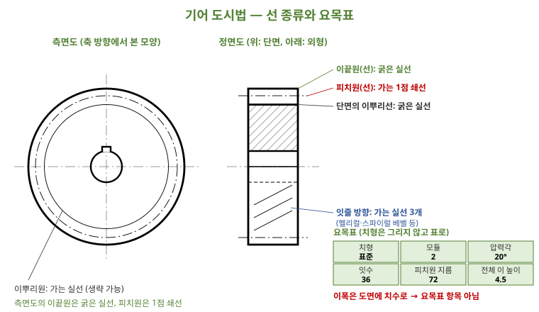

*왼쪽 측면도: 이끝원은 **굵은 실선**, 피치원은 **가는 1점 쇄선**, 이뿌리원은 **가는 실선**. 가운데 정면도는 위쪽 절반을 단면으로 그렸다. 단면에서는 이뿌리선이 **굵은 실선**으로 바뀌고 이 부분에는 해칭을 하지 않는다. 아래쪽 외형 절반에는 헬리컬 기어의 잇줄 방향을 **가는 실선 3개**로 나타낸다. 오른쪽 아래 요목표에는 치형·모듈·압력각·잇수·피치원 지름·전체 이 높이 등을 적고, 이폭은 도면에 치수로 기입한다.*

- 이끝원: **굵은 실선**. 피치원: **가는 1점 쇄선**. 이뿌리원: **가는 실선** (단면도에서는 굵은 실선).
- 요목표에 모듈, 잇수, 압력각, 피치원 지름, 정밀도 등급을 적는다.
- 맞물린 한 쌍을 그릴 때 물림부의 이끝원은 **양쪽 모두 굵은 실선**, 단면도에서는 한쪽 이끝을 **숨은선**으로 그린다.
- 치형은 그리지 않고 **요목표**로 설명한다. 교재(CH03 10절) 요목표 항목: 치형, 기준 래크, 모듈, 압력각, 잇수, 피치원 지름, 전위량, 전체 이 높이, 걸치기 이 두께, 다듬질 방법, 정밀도(0~12급), 재료·열처리·경도. 예: m = 2, z = 36 → 피치원 72 mm, 전체 이 높이 4.5 mm, SCM415 침탄 담금질 55~60 HRC.
- 맞물려야 종류를 알 수 있는 기어(나사 기어 등)는 피니언과 기어를 **함께** 그린다.

### 간략도로 기어 종류 알아보기

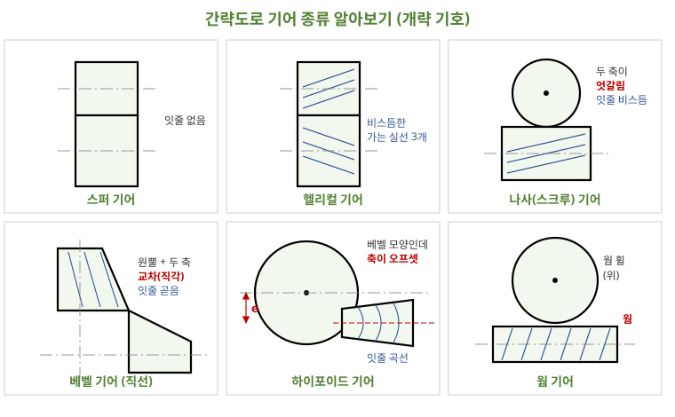

*시험 그림을 볼 때의 체크 순서. ① 모양이 **직사각형(원통)**인가 **사다리꼴(원뿔)**인가, ② **잇줄 선**(파랑 가는 실선)이 있는가, 곧은가 곡선인가, ③ 두 축이 **나란한가·만나는가·엇갈리는가**. 나사 기어는 한 기어가 원(축이 지면에 수직)으로, 다른 기어가 비스듬한 잇줄의 직사각형으로 보여 두 축이 엇갈린다. 하이포이드는 피니언 축(빨간 점선)이 링 기어 중심선에서 e만큼 비켜 있다. 직선 베벨의 잇줄을 곡선으로 그리면 스파이럴 베벨이다.*

| 간략도 특징 | 기어 |
| --- | --- |
| 평행한 두 원, 잇줄 표시 없음 | 스퍼 기어 |
| 정면도에 비스듬한 가는 실선 3개 (한 방향) | 헬리컬 기어 |
| 두 축이 엇갈리고 각 기어에 비스듬한 잇줄 | 나사(스크루) 기어 |
| 원뿔 모양, 잇줄이 곧음 | 직선 베벨 기어 |
| 원뿔 모양, 잇줄이 곡선 | 스파이럴 베벨 기어 |
| 원뿔 모양인데 두 축이 **엇갈림**(오프셋) | 하이포이드 기어 |
| 나사 모양 축 + 휠 | 웜 기어 |

## 그림

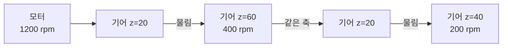

*6절 (b) 복식 기어열을 흐름으로 나타낸 것. 전체 속도비 $(20/60) \times (20/40) = 1/6$.*

## 기출 포인트

- 간략도를 보고 기어 종류 고르기 — 3회: 헬리컬 (2014-2), 나사 기어 (2014-3), 하이포이드 (2017-2)
- 기어 도시 선 종류 — 1회: 이끝원·피치원·이뿌리원·잇줄 선 중 틀린 것 (2020-3)
- 스퍼 기어 요목표 항목이 아닌 것 — 1회 (2018-2)
- 모듈·피치원 지름으로 잇수 구하기 — 1회 (2014-1, 1과목 기계가공에서 출제)
- 2과목 합계 5회. 속도비·중심 거리 계산, 언더컷은 2014~2020년 2과목에 나오지 않았지만 새 출제기준(부품규격 확인)과 실무에서 기본이다.

**교재 예제 유형** (Win-Q 2025 PART 01 CHAPTER 03, 10절): 요목표에 보통 적지 않는 항목(치폭), 맞물린 간략도 종류(그림, 나사 기어), 도시된 기어(그림, 헬리컬). 기출과 같은 유형이다.

## 관련 단원

- [벨트·체인·스프링·브레이크](벨트_체인_스프링_브레이크.md)
- [축과 축이음](축과_축이음.md)
- [도면 양식과 투상법](도면_양식과_투상법.md)
- [기계공작과 측정](기계공작과_측정.md) — 호빙(기어 창성 가공)
- [기계설계 기초와 재료강도](기계설계_기초와_재료강도.md) — 외팔보 굽힘, 피로

## 체크리스트

- [ ] 모듈로 피치원·이끝원 지름과 중심 거리를 계산한다
- [ ] 잇수로 속도비와 출력 회전수를 구한다
- [ ] 축 관계별 기어 종류를 구분한다
- [ ] 언더컷 원인과 방지법을 말한다
- [ ] 아이들 기어와 유성 기어의 역할을 안다
- [ ] 도면에서 이끝원·피치원·이뿌리원 선 종류를 안다
- [ ] 단면도에서 이뿌리원이 굵은 실선으로 바뀌는 경우를 안다
- [ ] 간략도로 스퍼·헬리컬·나사·베벨·하이포이드·웜 기어를 구분한다
- [ ] 요목표 기입 항목과 아닌 것(이폭)을 구분한다

## 참고

- [큐넷 자동화설비산업기사 출제기준](https://www.q-net.or.kr/crf005.do?id=crf00503&jmCd=2034)

### 그림 출처

위키미디어 공용(Wikimedia Commons)과 Openverse에서 가져온 공개 라이선스 자료이고, 노트에 맞게 크기를 줄이고 WebP로 변환했다(애니메이션 2개는 1 MB 이하로 맞추려고 프레임을 절반으로 줄였다).

| 그림 | 작성자 | 라이선스 | 출처 |
| --- | --- | --- | --- |
| [Gear - Spur (PSF)](https://commons.wikimedia.org/wiki/File:Gear_-_Spur_(PSF).png) | Pearson Scott Foresman | 퍼블릭 도메인 | Wikimedia Commons |
| [Gear-hobbing-spur-gear-on-cnc-cutting-machine](https://commons.wikimedia.org/wiki/File:Gear-hobbing-spur-gear-on-cnc-cutting-machine.jpg) | Affoltergroup | [CC BY-SA 4.0](https://creativecommons.org/licenses/by-sa/4.0) | Wikimedia Commons |
| [Double-helical gear](https://commons.wikimedia.org/wiki/File:Double-helical_gear.jpg) | Parchaco | CC0 | Wikimedia Commons |
| [Animated rack and pinion](https://commons.wikimedia.org/wiki/File:Animated_rack_and_pinion.gif) | Jahobr | CC0 | Wikimedia Commons |
| [Internal gear](https://commons.wikimedia.org/wiki/File:Internal_gear.svg) | Jahobr | CC0 | Wikimedia Commons |
| [MISUMI 헬리컬 기어 (카탈로그 사진)](https://kr.misumi-ec.com/vona2/mech/M1000000000/M1006000000/M1006030000/) | MISUMI | 저작권 보유(개인 학습용, 비공개 저장소 한정) | MISUMI 카탈로그 |
| [Gear - Bevel (PSF)](https://commons.wikimedia.org/wiki/File:Gear_-_Bevel_(PSF).png) | Pearson Scott Foresman | 퍼블릭 도메인 | Wikimedia Commons |
| [Worm Gear and Pinion](https://commons.wikimedia.org/wiki/File:Worm_Gear_and_Pinion.jpg) | Arthur Clarke at English Wikipedia | 퍼블릭 도메인 | Wikimedia Commons |
| [Hypoid gear](https://commons.wikimedia.org/wiki/File:Hypoid_gear.jpg) | Sam novo | 퍼블릭 도메인 | Wikimedia Commons |
| [Planetary Gear Animation](https://commons.wikimedia.org/wiki/File:Planetary_Gear_Animation.gif) | Laserlicht | CC0 | Wikimedia Commons |
| [Harmonic Drive AG strain wave gear set](https://commons.wikimedia.org/wiki/File:Harmonic_Drive_AG_strain_wave_gear_set.jpg) | Pieceofmetalwork | [CC BY-SA 4.0](https://creativecommons.org/licenses/by-sa/4.0) | Wikimedia Commons |
| [Pitting on gear flank](https://commons.wikimedia.org/wiki/File:Pitting_on_gear_flank.jpg) | Loscimmio | [CC BY-SA 4.0](https://creativecommons.org/licenses/by-sa/4.0) | Wikimedia Commons |

제조사 카탈로그 사진은 저작권이 각 회사에 있으며, 개인 학습용으로 비공개 저장소에서만 쓴다(공개 전에 삭제).

직접 그린 그림(SVG, 이 볼트용으로 새로 작성): 기어 각부명칭, 기어 속도비 중심거리, 인벌류트 압력각, 언더컷, 헬리컬 모듈 추력, 기어열 아이들 복식, 루이스식, 기어 도시 선종류, 기어 간략도. 기어 치형은 랙 공구 창성을 계산해서 그렸다.

