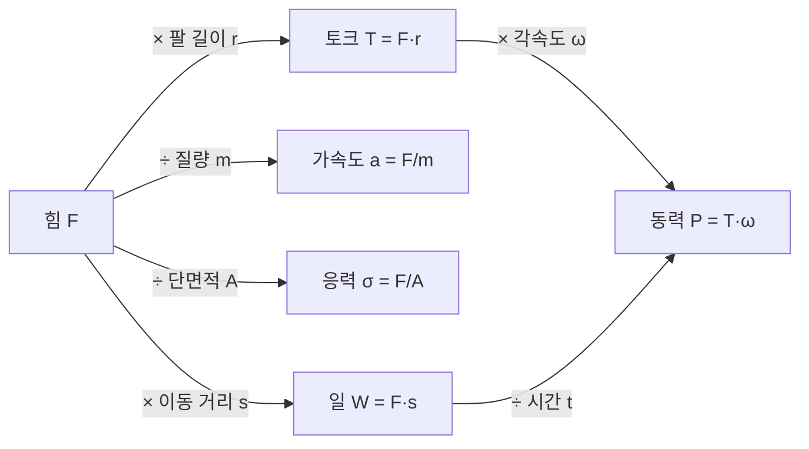

# 기초공학 – 힘·운동·단위

> [!summary] 핵심 요약
> - **토크(모멘트)** $T = F \times r$ (힘 × 회전 중심에서 힘의 작용선까지 수직 거리). 같은 힘이면 팔 길이에 비례.
> - **지렛대 평형**: $W_1 a = W_2 b$ (받침점 기준 모멘트 합 = 0). 무거운 쪽이 받침점에 가깝다.
> - **뉴턴 법칙**: 1법칙 관성, 2법칙 $F = ma$, 3법칙 작용·반작용(크기 같고 방향 반대).
> - 단위: 1 N = 1 kg·m/s² = $10^5$ dyn, 1 kgf ≈ 9.8 N, 1 J = 1 N·m, 1 bar = $10^5$ Pa, 1 kW ≈ 102 kgf·m/s, 1 PS = 75 kgf·m/s.

> [!warning] 자주 틀리는 포인트
> - 힘의 3요소는 **크기, 방향, 작용점**. 작용 시간·작용선은 3요소가 아니다.
> - 모멘트는 힘과 팔이 **직각**일 때 최대, 팔과 힘이 **나란하면(0° 또는 180°) 0**이다.
> - 스패너 길이를 n배로 하면 토크도 n배 (제곱이 아니다). 파이프를 끼워 늘린 경우 **늘어난 길이만큼의 토크 증가분**을 묻는지 전체 토크를 묻는지 확인.
> - **1 kgf는 질량 1 kg에 작용하는 중력**이다. 9.8 N = 1 kgf = 9.8 kg·m/s². 그런데 9.8 N은 $9.8 \times 10^5$ dyn이지 $10^5$ dyn이 아니다.
> - SI **기본 단위**: m, kg, s, A, K, mol, cd (7개). g, N, J, Pa는 기본 단위가 아니다 (N·J·Pa는 유도 단위).
> - 1 erg = 1 dyn × 1 **cm**. 1 J = 1 N × 1 m. 모멘트 1 N·m와 일 1 J는 차원이 같다.
> - 1 kgf/cm² ≈ **0.98 bar** ≈ 98 kPa. 1 atm ≈ 101.3 kPa.
> - **평균 속도 = 변위 ÷ 시간**(방향 고려), 평균 속력 = 이동 거리 ÷ 시간. 갔다가 되돌아오면 둘이 달라진다.
> - 모터 회전자와 고정자에 생기는 토크는 **작용·반작용**: 크기는 같고 방향은 반대.

## 개념 정리

### 힘과 모멘트

| 항목 | 식·내용 |
| --- | --- |
| 모멘트 (토크) | $M = F \cdot d$ (d: 회전 중심에서 작용선까지 수직 거리) |
| 각도가 있을 때 | $M = F \cdot r \sin\theta$ (θ: 팔과 힘 사이 각) |
| 모멘트 부호 | 문제에서 정한 방향(예: 시계 +, 반시계 −)으로 더한다 |
| 두 힘의 합력 | $R = \sqrt{F_1^2 + F_2^2 + 2F_1F_2\cos\theta}$ |
| 직각인 두 힘 | $R = \sqrt{F_1^2 + F_2^2}$ (3 N, 4 N → 5 N) |
| 평행력의 합력 위치 | $x = \dfrac{\sum F_i x_i}{\sum F_i}$ (바리뇽 정리) |
| 평형 조건 | $\sum F = 0$, $\sum M = 0$ |

**계산 예**

- 지렛대: 받침점에서 420 mm에 80 kgf → 840 mm 위치에 놓을 무게 $W_2 = 80 \times 420 / 840 = 40$ kgf.
- 막대 양 끝에 7 kgf와 3 kgf → 받침점까지 거리 비(왼:오른) = **3 : 7** (무게 비의 역수).
- 스패너: 40 cm 끝에 20 kgf → $T = 20 \times 0.4 = 8$ kgf·m.
- 핸들: 150 N으로 90 N·m 토크 → 반지름 $r = 90 / 150 = 0.6$ m = 600 mm.
- 단순보 반력: 길이 l, 왼쪽 지점 A에서 a만큼 떨어진 곳에 하중 P → $R_B = \dfrac{P a}{l}$, $R_A = P - R_B$.
  - 예 (교재 CH03 20-2): 2,000 mm 보, A에서 800 mm에 50 kgf → $R_B = 50 \times 800 / 2000 = 20$ kgf, $R_A = 30$ kgf.
- 평행력 합력 위치 (교재 20-4): 모멘트 합 6 N·m ÷ 합력 4 N = **1.5 m**.
- 스패너 20 cm → 50 cm로 늘리면 (같은 힘 20 kgf) 4 → 10 kgf·m, **증가분 6 kgf·m** (교재 20-5). 양손으로 같은 방향으로 돌리면 두 토크를 **더한다** (교재 20-6).
- 분포 하중은 도형의 **도심**에 놓인 집중 하중으로 바꿔 계산한다(등분포면 가운데). 외팔보는 한쪽을 완전히 고정, 단순보는 양쪽을 받침으로 지지.
- 교재(21절): 토크와 모멘트는 개념은 다르지만 같은 물리량(힘 × 거리)을 쓴다. 교재는 토크를 "회전이 가진 힘", 모멘트를 "회전시키려는 힘"으로 구분한다. 관성이 큰 회전체일수록 기동·제동에 큰 토크가 필요하지만, 회전을 유지하는 데는 큰 토크가 필요하지 않다. 모터를 고를 때 부하 관성을 따지는 이유다.
- 힘의 작용선이 회전 중심을 지나면(팔과 힘이 0° 또는 180°) 회전력이 생기지 않는다 (교재 21-6). 고정된 원형축에 토크가 걸리면 단면에 **전단 응력**이 생긴다 (교재 21-4).

### 운동

| 항목 | 식 |
| --- | --- |
| 속도 | $v = \dfrac{s}{t}$ (크기와 방향을 가짐, 벡터) |
| 가속도 | $a = \dfrac{v_2 - v_1}{t}$ |
| 등가속도 운동 | $v = v_0 + at$, $s = v_0 t + \dfrac{1}{2}at^2$ |
| 위치 식의 속도 | $x(t)$를 시간으로 미분 → $v = \dfrac{dx}{dt}$ |
| 뉴턴 2법칙 | $F = ma$ |
| 충격량 | $Ft = mv_2 - mv_1$ |
| 상대 속도 (B에서 본 A) | $v_{A/B} = v_A - v_B$ |
| 수평으로 던진 물체 | 떨어지는 시간 $t = \sqrt{2h/g}$, 수평 거리 $x = v_0 t$ |

- **등속 운동**: 속도(크기·방향) 일정. 속도가 변하지 않는 운동을 "등가속도 운동"이라 부르면 틀린다.
- **뉴턴 법칙 예**: 1법칙(관성) 버스 급정거 시 몸이 앞으로 쏠림 / 2법칙(가속도) 달리기 때 팔다리를 빠르게 휘두름 / 3법칙(작용·반작용) 걷기, 로켓 추진.
- **계산 예**: 정지 물체에 100 N을 4초 가해 40 m/s → $a = 10$ m/s², $m = F/a = 10$ kg.
- **회전수 변환**: 120 rpm = 2 rps. 0.25 rev/s = $0.25 \times 360 = 90$ °/s. 각속도 $\omega = \dfrac{2\pi N}{60}$ [rad/s].
- **속도 단위 변환**: 200 mm/s = 0.2 m/s = **12 m/min**. 1.5 cm/s로 2분 → $1.5 \times 120 = 180$ cm.

### 일·동력·에너지

| 항목 | 식·값 |
| --- | --- |
| 일 | $W = F \times s$ (힘 방향 이동 거리) |
| 동력 | $P = \dfrac{W}{t} = F v = T\omega$ |
| 1 kW | ≈ 102 kgf·m/s ≈ 1.36 PS |
| 1 PS | 75 kgf·m/s ≈ 735.5 W |
| 1 kWh | 1 kW로 1시간 한 일 = 3.6 MJ |
| 마력–토크 | $H[\text{PS}] = \dfrac{T[\text{kgf·m}] \times N}{716.2}$ |

- 동력이 일정하면 **토크는 회전 속도에 반비례** ($P = T\omega$). "토크가 회전 속도에 비례한다"는 틀린 보기.
- 회전 관성이 큰 기계는 기동할 때 큰 토크가 필요하다.

### 단위

| 물리량 | SI 단위 | 다른 단위와 관계 |
| --- | --- | --- |
| 힘 | N = kg·m/s² | 1 kgf ≈ 9.8 N, 1 N = $10^5$ dyn (= $10^5$ g·cm/s²) |
| 일·에너지 | J = N·m | 1 erg = 1 dyn·cm = $10^{-7}$ J |
| 압력·응력 | Pa = N/m² | 1 bar = $10^5$ Pa, 1 MPa = 1 N/mm², 1 kgf/cm² ≈ $9.8 \times 10^4$ Pa |
| 동력 | W = J/s | 위 표 참조 |
| 부피 | m³ | 1 m³ = 1000 L, 1 L = 1000 cm³ = 1000 cc |
| 비중량 | N/m³ | 4 °C 물 ≈ 9800 N/m³ (1000 kgf/m³) |

- **SI 기본 단위 7개**: 길이 m, 질량 kg, 시간 s, 전류 A, 온도 K, 물질량 mol, 광도 cd.
- **질량**은 장소에 관계없는 물체 고유의 양, **무게(중량)** 는 중력에 의한 힘. 중력은 항상 지구 중심(연직 아래) 방향이다.

### 면적·체적

| 도형 | 공식 |
| --- | --- |
| 원 | $A = \dfrac{\pi D^2}{4} = \pi r^2$ |
| 부채꼴 (중심각 θ) | $A = \pi r^2 \times \dfrac{\theta}{360°}$ |
| 정삼각형 (한 변 a) | $A = \dfrac{\sqrt{3}}{4}a^2$ |
| 정육각형 (한 변 a) | $A = \dfrac{3\sqrt{3}}{2}a^2$ (정삼각형 6개) |
| 원기둥 | $V = \dfrac{\pi d^2}{4} l$ |
| 구 | $V = \dfrac{4}{3}\pi r^3 = \dfrac{\pi D^3}{6}$ |
| 원뿔·각뿔 | $V = \dfrac{1}{3} A h$ |

- **계산 예**: 100 × 100 × 100 mm 각기둥에 지름 50 mm 관통 구멍 → $10^6 - \dfrac{\pi \times 50^2}{4} \times 100 \approx 1{,}000{,}000 - 196{,}350 \approx 803{,}650$ mm³.

### 옛 기초공학의 전기·유체 문항

- 옛 2과목 31~40번에는 전기 기초(옴의 법칙, 합성 저항·정전 용량, 전력, 키르히호프, 패러데이)와 유체(파스칼 원리, 연속 방정식, 유량)도 매회 섞여 나왔다.
- 새 출제기준에서는 각각 다른 과목에 해당하므로 그쪽 노트로 공부한다: [전기 기초와 회로](../10_자동제어/전기_기초와_회로.md), [공유압 기초](../30_공유압/공유압_기초.md).

## 그림

## 기출 포인트

옛 2과목 "기초공학" 파트(31~40번)에서 2014~2020년 19회분 기준. 새 출제기준에는 독립 항목으로 없지만 강도·토크 계산의 바탕이다.

- 힘·모멘트·토크 — **25회**
  - 스패너·핸들 토크 $T = Fr$ (반지름 역산, 길이 변화 포함) — 8회 (2014-1, 2015-2, 2016-2, 2017-2, 2017-3, 2018-3, 2019-1, 2020-1)
  - 모멘트 계산과 설명 — 5회 (2015-2, 2017-2 ×2, 2018-1, 2018-2)
  - 지렛대 평형 — 4회 (2014-3, 2016-1, 2016-3, 2019-2)
  - 합력 크기·평행력 합력 위치 — 3회 (2018-1, 2018-2, 2020-1)
  - 힘의 3요소 — 2회 (2017-1, 2020-3)
  - 반력 (2019-3), 토크가 가장 큰 경우 (2020-3), 회전자·고정자 토크의 작용·반작용 (2020-3)
- 운동 — **26회**
  - 속도·가속도·이동 거리 계산과 정의 — 16회 (2014-1, 2014-2, 2014-3, 2015-1, 2016-2, 2017-1, 2017-2, 2017-3, 2018-1, 2018-2, 2018-3, 2019-1, 2019-2, 2019-3, 2020-1, 2020-3)
  - 뉴턴 운동 법칙·$F = ma$ — 8회 (2014-2, 2015-2, 2016-1, 2016-2 ×2, 2016-3 ×2, 2018-3)
  - 회전수 단위 변환 — 2회 (2016-1, 2016-2)
- 단위 — **18회**: SI 기본·유도 단위 (2014-2, 2017-2, 2019-1, 2019-2), 힘 단위 N·kgf·dyn (2014-3, 2016-3, 2017-2), 일 단위 J·erg (2014-2, 2015-1, 2018-3), 압력 단위 (2014-1, 2017-2, 2019-2), 질량·중량 (2019-2, 2019-3), 부피 (2014-1), 비중량 (2020-3), 물리량–단위 짝 (2016-2)
- 면적·체적 계산 — **11회** (2014-1, 2014-2, 2014-3, 2015-1, 2015-2, 2016-2, 2016-3, 2017-3, 2018-2, 2018-3, 2020-1)
- 일·동력 — **7회**: 일의 정의 (2014-1, 2020-1), kW와 kgf·m/s 환산 (2014-3), 동력 일정 시 토크–속도 관계 (2017-3), 풀리 전달 마력 (2018-2), kWh 의미 (2019-1), 엔진 마력 (2019-2)

**교재 예제 유형** (Win-Q 2025 PART 01 CHAPTER 03, 20~21절): 모멘트 설명(거리 0이면 모멘트 0), 단순보 반력(그림, 20 kgf), 지렛대(그림, 40 kgf), 합력 작용선(그림, 1.5 m), 스패너 연장 토크 증가(6 kgf·m), 양손 토크(그림, 450 N·m), 외팔보 고정단 모멘트(그림, $Pl$), 1 N·m = 1 J, 핸들 반지름(600 mm), 스패너 토크 식 $T = FL$(그림), 토크 설명(전단 응력 발생), 회전 모멘트 설명 중 틀린 것(180°면 회전력 없음).

## 관련 단원

- [기계설계 기초와 재료강도](기계설계_기초와_재료강도.md)
- [축과 축이음](축과_축이음.md)
- [나사와 볼트](나사와_볼트.md)
- [전기 기초와 회로](../10_자동제어/전기_기초와_회로.md)
- [공유압 기초](../30_공유압/공유압_기초.md)

## 체크리스트

- [ ] 힘의 3요소를 말한다
- [ ] 스패너·핸들 토크와 반지름을 계산한다
- [ ] 지렛대 평형식으로 무게나 거리를 구한다
- [ ] 두 힘의 합력과 평행력의 합력 위치를 구한다
- [ ] 뉴턴 3법칙의 예를 구분한다
- [ ] 속도·가속도·평균 속도를 계산한다
- [ ] N·kgf·dyn, J·erg, Pa·bar·kgf/cm² 환산을 한다
- [ ] SI 기본 단위 7개를 쓴다
- [ ] kW·PS·kgf·m/s 환산과 마력–토크 식을 쓴다
- [ ] 정삼각형·정육각형 넓이, 구·원뿔 체적 공식을 쓴다

## 참고

- [큐넷 자동화설비산업기사 출제기준](https://www.q-net.or.kr/crf005.do?id=crf00503&jmCd=2034)
- 기출 출처: [CBT뱅크 생산자동화산업기사](https://cbtbank.kr/category/%EC%83%9D%EC%82%B0%EC%9E%90%EB%8F%99%ED%99%94%EC%82%B0%EC%97%85%EA%B8%B0%EC%82%AC)
