# 기초공학 – 힘·운동·단위

> [!summary] 핵심 요약
> - **토크(모멘트)** $T = F \times r$ (힘 × 회전 중심에서 힘의 작용선까지 수직 거리). 같은 힘이면 팔 길이에 비례.
> - **지렛대 평형**: $W_1 a = W_2 b$ (받침점 기준 모멘트 합 = 0). 무거운 쪽이 받침점에 가깝다.
> - **뉴턴 법칙**: 1법칙 관성, 2법칙 $F = ma$, 3법칙 작용·반작용(크기 같고 방향 반대).
> - 단위: 1 N = 1 kg·m/s² = $10^5$ dyn, 1 kgf ≈ 9.8 N, 1 J = 1 N·m, 1 bar = $10^5$ Pa, 1 kW ≈ 102 kgf·m/s, 1 PS = 75 kgf·m/s.

> [!warning] 자주 틀리는 포인트
> - 힘의 3요소는 **크기, 방향, 작용점**. 작용 시간·작용선은 3요소가 아니다.
> - 모멘트는 힘과 팔이 **직각**일 때 최대, 팔과 힘이 **나란하면(0° 또는 180°) 0**이다.
> - 스패너 길이를 n배로 하면 토크도 n배 (제곱이 아니다). 파이프를 끼워 늘린 경우 **늘어난 길이만큼의 토크 증가분**을 묻는지 전체 토크를 묻는지 확인.
> - **1 kgf는 질량 1 kg에 작용하는 중력**이다. 9.8 N = 1 kgf = 9.8 kg·m/s². 그런데 9.8 N은 $9.8 \times 10^5$ dyn이지 $10^5$ dyn이 아니다.
> - SI **기본 단위**: m, kg, s, A, K, mol, cd (7개). g, N, J, Pa는 기본 단위가 아니다 (N·J·Pa는 유도 단위).
> - 1 erg = 1 dyn × 1 **cm**. 1 J = 1 N × 1 m. 모멘트 1 N·m와 일 1 J는 차원이 같다.
> - 1 kgf/cm² ≈ **0.98 bar** ≈ 98 kPa. 1 atm ≈ 101.3 kPa.
> - **평균 속도 = 변위 ÷ 시간**(방향 고려), 평균 속력 = 이동 거리 ÷ 시간. 갔다가 되돌아오면 둘이 달라진다.
> - 모터 회전자와 고정자에 생기는 토크는 **작용·반작용**: 크기는 같고 방향은 반대.

## 학습 목표

이 단원을 마치면 다음을 할 수 있어야 한다.

1. 힘의 3요소를 말하고, 직각인 두 힘의 합력과 평행력의 합력 위치(바리뇽 정리)를 계산한다.
2. 팔 길이와 각도로 토크 $T = Fr\sin\theta$를 계산하고, 토크가 최대·0이 되는 경우를 구분한다.
3. 지렛대 평형식과 $\sum M = 0$으로 무게·거리·단순보 반력을 구한다.
4. 속도·가속도·변위·거리를 구분해 등가속도 운동과 수평 투사 문제를 풀고, 뉴턴 3법칙의 예를 고른다.
5. $P = Fv = T\omega$로 동력·토크·회전 속도의 관계를 설명하고, kW·PS·kgf·m/s를 환산한다.
6. SI 기본 단위 7개를 쓰고 N·kgf·dyn, J·erg, Pa·bar·kgf/cm², 넓이·부피 공식을 계산에 쓴다.

## 한눈에 보기

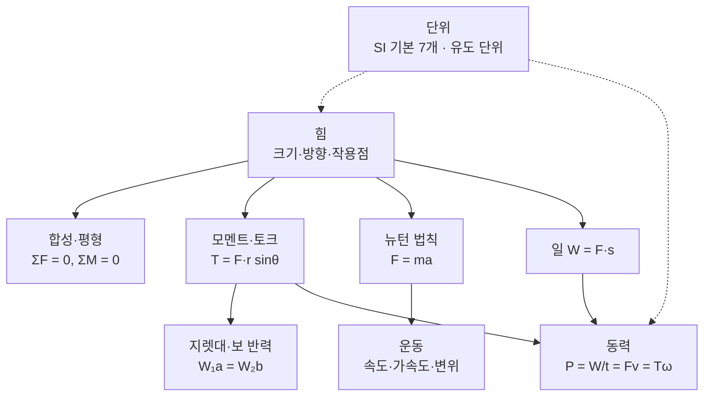

## 1. 힘과 모멘트(토크)

문을 열 때 경첩 바로 옆을 밀면 꿈쩍도 안 하지만, 손잡이(경첩에서 먼 곳)를 밀면 쉽게 열린다. 같은 힘이라도 **회전 중심에서 얼마나 떨어진 곳을, 어느 방향으로** 미느냐에 따라 돌리는 효과가 달라진다. 이 "돌리는 효과"가 모멘트(토크)다.

힘을 완전히 정하려면 **크기, 방향, 작용점** 세 가지가 필요하다(힘의 3요소). 같은 10 N이라도 어디에 어느 방향으로 거느냐에 따라 문이 열리기도, 안 열리기도 하기 때문이다.

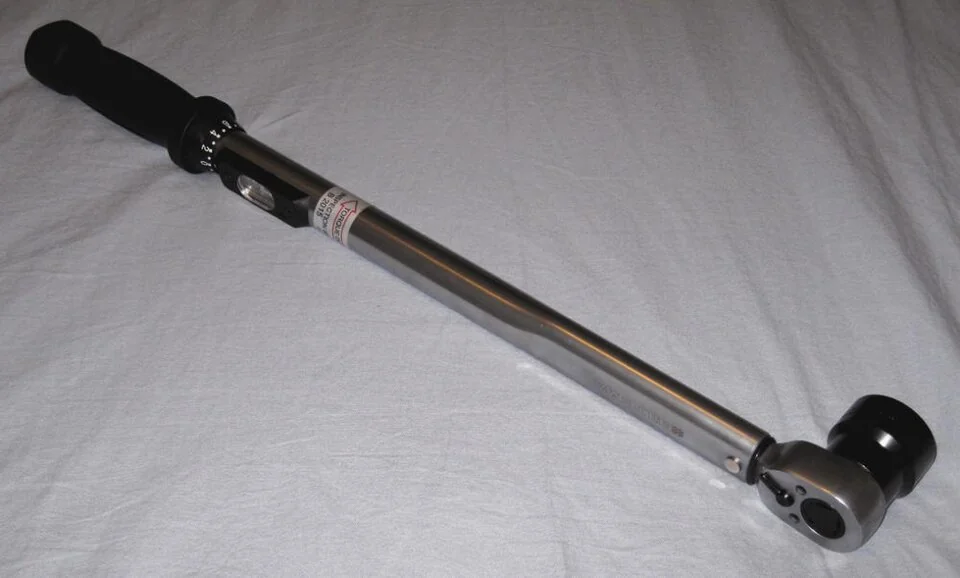

*20~220 N·m용 토크 렌치. 왼쪽 검은 손잡이 아래 눈금 링을 돌려 목표 토크를 맞추고, 오른쪽 래칫 머리를 볼트에 끼워 돌린다. 손잡이를 끝 쪽으로 잡을수록 팔 r이 길어져 같은 힘으로 큰 토크가 난다. 볼트를 "몇 N·m로 조여라"는 지시가 바로 $T = F \times r$이다.*

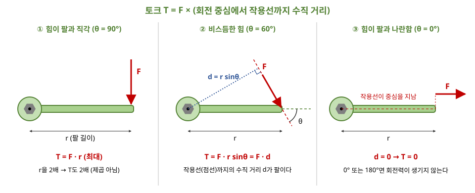

*① 힘이 팔과 직각이면 팔 길이 r 전체가 그대로 "팔"이 되어 토크가 최대다. ② 비스듬히 밀면 작용선(빨간 점선)까지의 수직 거리 $d = r\sin\theta$(파란 점선)만 팔로 쳐준다. ③ 팔 방향으로 당기면 작용선이 회전 중심을 지나 $d = 0$, 아무리 세게 당겨도 돌지 않는다.*

$$T = F \cdot d = F \cdot r \sin\theta \qquad [\text{N·m},\ \text{kgf·m}]$$

> [!tip] 감 잡기 — 토크와 모멘트
> 시험에서는 둘을 같은 식(힘 × 거리)으로 계산한다. 교재는 토크를 "회전이 가진 힘", 모멘트를 "회전시키려는 힘"으로 나눌 뿐이다. 단위 N·m는 일 J와 차원이 같지만, 토크는 "돌리는 효과", 일은 "이동시킨 에너지"라 뜻이 다르다.

> [!question] 시험에서는
> "토크가 가장 큰 경우"는 **팔이 가장 길고 힘이 팔과 직각**인 보기다. "180°로 작용하면 회전력이 최대"처럼 각도를 바꾼 보기는 틀린 것이다(0°·180°는 토크 0).

## 2. 힘의 합성과 평형

두 사람이 줄 두 개로 수레를 끌면, 수레는 두 줄 사이 어느 한 방향으로 간다. 두 힘을 **화살표 두 변으로 하는 평행사변형의 대각선**이 그 한 방향의 힘, 즉 합력이다. 여러 개의 평행한 힘은 "한 점에 모은 하나의 힘"으로 바꿀 수 있고, 그 위치는 모멘트가 같아지는 곳이다(바리뇽 정리).

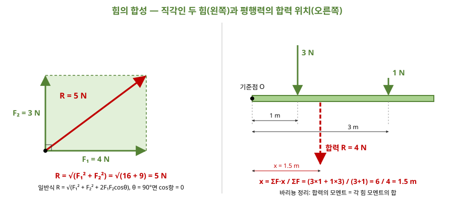

*왼쪽: 4 N과 3 N이 직각이면 합력은 피타고라스로 5 N(3-4-5 삼각형). 오른쪽: 기준점 O에서 1 m에 3 N, 3 m에 1 N → 모멘트 합 $3\times1 + 1\times3 = 6$ N·m를 합력 4 N으로 나누면 1.5 m. 교재 20-4의 "6 N·m ÷ 4 N = 1.5 m"과 같은 계산이다.*

$$R = \sqrt{F_1^2 + F_2^2 + 2F_1F_2\cos\theta}, \qquad x = \frac{\sum F_i x_i}{\sum F_i}, \qquad \sum F = 0,\ \sum M = 0\ (\text{평형})$$

### 힘과 모멘트

| 항목 | 식·내용 |
| --- | --- |
| 모멘트 (토크) | $M = F \cdot d$ (d: 회전 중심에서 작용선까지 수직 거리) |
| 각도가 있을 때 | $M = F \cdot r \sin\theta$ (θ: 팔과 힘 사이 각) |
| 모멘트 부호 | 문제에서 정한 방향(예: 시계 +, 반시계 −)으로 더한다 |
| 두 힘의 합력 | $R = \sqrt{F_1^2 + F_2^2 + 2F_1F_2\cos\theta}$ |
| 직각인 두 힘 | $R = \sqrt{F_1^2 + F_2^2}$ (3 N, 4 N → 5 N) |
| 평행력의 합력 위치 | $x = \dfrac{\sum F_i x_i}{\sum F_i}$ (바리뇽 정리) |
| 평형 조건 | $\sum F = 0$, $\sum M = 0$ |

## 3. 지렛대와 보의 반력

놀이터 시소에서 무거운 어른과 가벼운 아이가 균형을 맞추려면 **어른이 받침점 쪽으로 다가앉는다**. 양쪽이 받침점을 돌리려는 모멘트(무게 × 거리)가 같아지면 멈춘다. 보의 반력도 똑같은 원리로, 한 지점을 받침점 삼아 모멘트 합을 0으로 놓고 푼다.

| 실물: 놀이터 시소 | 원리: 받침점 기준 모멘트 평형 |
| --- | --- |
| 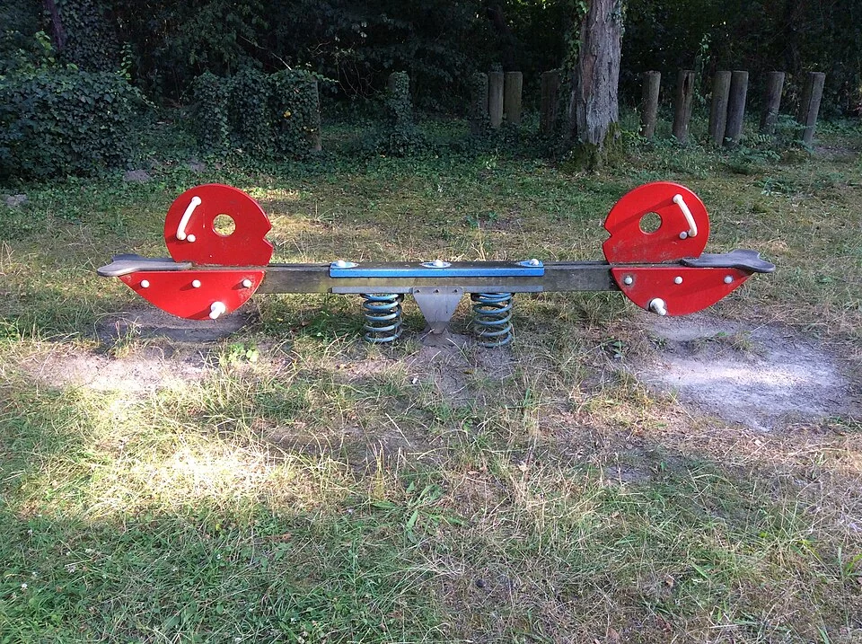 | 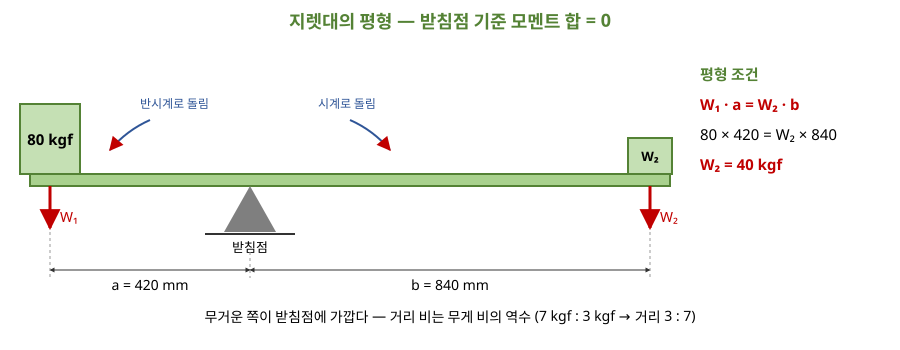 |

*왼쪽: 가운데 받침대(두 스프링 사이)가 받침점이고 양 끝 빨간 좌석이 하중점이다. 오른쪽: 교재 지렛대 예제 — 80 kgf는 420 mm, 반대편은 2배 거리(840 mm)이므로 무게는 절반인 40 kgf에서 평형이다.*

$$W_1 \cdot a = W_2 \cdot b \qquad (\text{받침점 기준 } \sum M = 0)$$

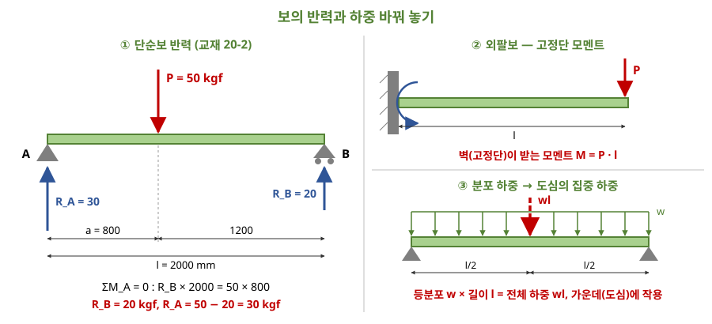

*① A점을 받침점으로 보고 모멘트를 잡으면 $R_B$가 바로 나온다: $R_B \times 2000 = 50 \times 800$ → 20 kgf, 나머지 30 kgf는 A가 받는다. 하중에 가까운 지점(A)이 더 많이 받는다. ② 외팔보는 벽이 하중 P와 모멘트 $Pl$을 모두 버틴다. ③ 등분포 하중은 전체 크기 $wl$을 도심(가운데)에 놓은 집중 하중으로 바꿔 계산한다.*

**계산 예**

- 지렛대: 받침점에서 420 mm에 80 kgf → 840 mm 위치에 놓을 무게 $W_2 = 80 \times 420 / 840 = 40$ kgf.
- 막대 양 끝에 7 kgf와 3 kgf → 받침점까지 거리 비(왼:오른) = **3 : 7** (무게 비의 역수).
- 스패너: 40 cm 끝에 20 kgf → $T = 20 \times 0.4 = 8$ kgf·m.
- 핸들: 150 N으로 90 N·m 토크 → 반지름 $r = 90 / 150 = 0.6$ m = 600 mm.
- 단순보 반력: 길이 l, 왼쪽 지점 A에서 a만큼 떨어진 곳에 하중 P → $R_B = \dfrac{P a}{l}$, $R_A = P - R_B$.
  - 예 (교재 CH03 20-2): 2,000 mm 보, A에서 800 mm에 50 kgf → $R_B = 50 \times 800 / 2000 = 20$ kgf, $R_A = 30$ kgf.
- 평행력 합력 위치 (교재 20-4): 모멘트 합 6 N·m ÷ 합력 4 N = **1.5 m**.
- 스패너 20 cm → 50 cm로 늘리면 (같은 힘 20 kgf) 4 → 10 kgf·m, **증가분 6 kgf·m** (교재 20-5). 양손으로 같은 방향으로 돌리면 두 토크를 **더한다** (교재 20-6).
- 분포 하중은 도형의 **도심**에 놓인 집중 하중으로 바꿔 계산한다(등분포면 가운데). 외팔보는 한쪽을 완전히 고정, 단순보는 양쪽을 받침으로 지지.
- 교재(21절): 토크와 모멘트는 개념은 다르지만 같은 물리량(힘 × 거리)을 쓴다. 교재는 토크를 "회전이 가진 힘", 모멘트를 "회전시키려는 힘"으로 구분한다. 관성이 큰 회전체일수록 기동·제동에 큰 토크가 필요하지만, 회전을 유지하는 데는 큰 토크가 필요하지 않다. 모터를 고를 때 부하 관성을 따지는 이유다.
- 힘의 작용선이 회전 중심을 지나면(팔과 힘이 0° 또는 180°) 회전력이 생기지 않는다 (교재 21-6). 고정된 원형축에 토크가 걸리면 단면에 **전단 응력**이 생긴다 (교재 21-4).

> [!question] 시험에서는
> 스패너 연장 문제는 "토크"를 묻는지 "증가한 토크"를 묻는지부터 본다. 20 kgf로 20 cm → 50 cm면 답은 10 kgf·m(전체)일 수도, 6 kgf·m(증가분)일 수도 있다. 반력 문제는 **구하려는 반력의 반대편 지점**을 받침점으로 잡으면 미지수가 하나만 남는다.

## 4. 운동 — 속도·가속도·변위

자동차 계기판의 숫자는 **속력**(빠르기)만 알려 준다. 내비게이션은 "어느 쪽으로 얼마나 빠르게"까지 알아야 하므로 **속도**(크기 + 방향)를 쓴다. 집에서 나가 한 바퀴 돌아 집에 오면 달린 거리는 있어도 변위는 0이다. 이 구분이 "평균 속도" 함정 문제의 핵심이다.

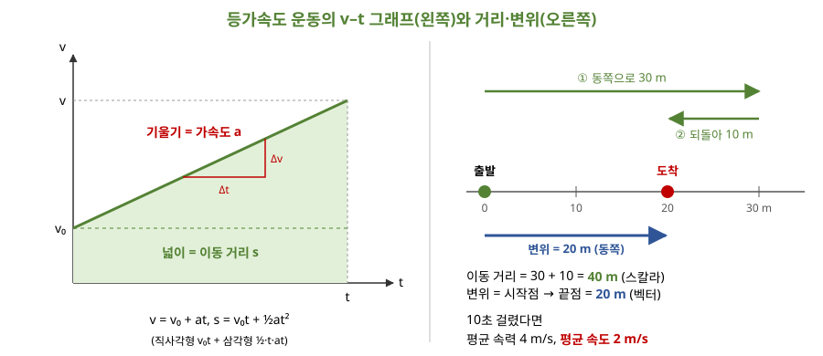

*왼쪽: 속도가 v₀에서 일정하게 커지면 v–t 그래프는 기운 직선이다. **기울기가 가속도**, 그래프 아래 **넓이가 이동 거리**(직사각형 $v_0t$ + 삼각형 $\tfrac12at^2$)라서 공식을 외우지 않아도 다시 만들 수 있다. 오른쪽: 동쪽 30 m 갔다가 10 m 되돌아오면 거리는 40 m, 변위는 20 m. 10초가 걸렸다면 평균 속력 4 m/s, 평균 속도 2 m/s로 답이 갈린다.*

$$v = v_0 + at, \qquad s = v_0 t + \frac{1}{2}at^2, \qquad v = \frac{dx}{dt}$$

책상 끝에서 공을 수평으로 굴려 떨어뜨리면, 옆으로는 처음 속도 그대로 가고 아래로는 그냥 떨어뜨린 공과 똑같이 떨어진다. 두 방향을 **따로** 계산하면 된다.

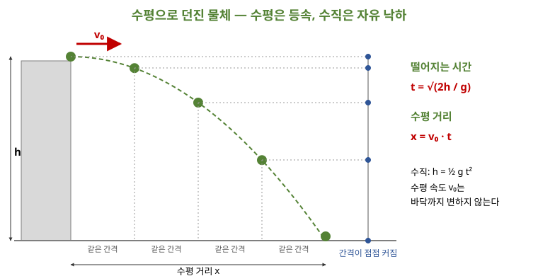

*같은 시간 간격으로 찍은 공의 위치. 아래 축(수평)의 간격은 일정하고(등속), 오른쪽 축(수직)의 간격은 점점 벌어진다(자유 낙하). 떨어지는 시간은 높이만으로 정해지고($t = \sqrt{2h/g}$), 수평 거리는 그 시간 동안 v₀로 간 거리다.*

### 운동

| 항목 | 식 |
| --- | --- |
| 속도 | $v = \dfrac{s}{t}$ (크기와 방향을 가짐, 벡터) |
| 가속도 | $a = \dfrac{v_2 - v_1}{t}$ |
| 등가속도 운동 | $v = v_0 + at$, $s = v_0 t + \dfrac{1}{2}at^2$ |
| 위치 식의 속도 | $x(t)$를 시간으로 미분 → $v = \dfrac{dx}{dt}$ |
| 뉴턴 2법칙 | $F = ma$ |
| 충격량 | $Ft = mv_2 - mv_1$ |
| 상대 속도 (B에서 본 A) | $v_{A/B} = v_A - v_B$ |
| 수평으로 던진 물체 | 떨어지는 시간 $t = \sqrt{2h/g}$, 수평 거리 $x = v_0 t$ |

- **등속 운동**: 속도(크기·방향) 일정. 속도가 변하지 않는 운동을 "등가속도 운동"이라 부르면 틀린다.
- **회전수 변환**: 120 rpm = 2 rps. 0.25 rev/s = $0.25 \times 360 = 90$ °/s. 각속도 $\omega = \dfrac{2\pi N}{60}$ [rad/s].
- **속도 단위 변환**: 200 mm/s = 0.2 m/s = **12 m/min**. 1.5 cm/s로 2분 → $1.5 \times 120 = 180$ cm.

## 5. 뉴턴의 운동 법칙

세 법칙은 한 문장씩으로 기억한다. **1법칙**: 힘이 없으면 하던 대로 한다(관성). **2법칙**: 힘을 주면 질량에 반비례해 가속된다. **3법칙**: 밀면 똑같은 크기로 되밀린다.

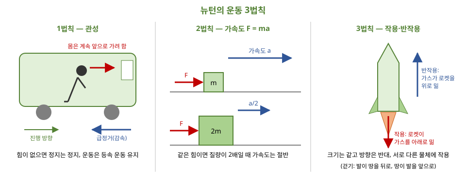

*1법칙: 버스가 급정거해도 승객의 몸은 원래 속도로 계속 가려 해서 앞으로 쏠린다. 2법칙: 같은 힘 F로 밀 때 질량이 2배면 가속도는 절반. 3법칙: 로켓이 가스를 아래로 밀어내면(작용) 가스가 로켓을 위로 민다(반작용). 두 힘은 **서로 다른 물체**에 작용하므로 상쇄되지 않는다.*

$$F = ma \qquad (1\ \text{N} = 1\ \text{kg} \times 1\ \text{m/s}^2)$$

*1969년 아폴로 11호 새턴 V 발사 장면. 아래쪽 엔진에서 뿜어 나오는 화염과 양옆으로 퍼지는 배기 구름이 "아래로 밀어낸 가스"이고, 그 반작용으로 로켓이 발사탑(오른쪽 붉은 철탑) 옆을 따라 위로 올라간다. 로켓은 공기를 밀어서 나는 것이 아니라 가스를 밀어서 날기 때문에 진공인 우주에서도 추진된다.*

- **뉴턴 법칙 예**: 1법칙(관성) 버스 급정거 시 몸이 앞으로 쏠림 / 2법칙(가속도) 달리기 때 팔다리를 빠르게 휘두름 / 3법칙(작용·반작용) 걷기, 로켓 추진.
- **계산 예**: 정지 물체에 100 N을 4초 가해 40 m/s → $a = 10$ m/s², $m = F/a = 10$ kg.

> [!question] 시험에서는
> 모터 회전자가 받는 토크와 고정자(케이스)가 받는 토크는 작용·반작용이다. 그래서 모터를 단단히 고정하지 않으면 케이스가 반대 방향으로 돌려 한다. "크기가 다르다", "방향이 같다"는 보기는 틀린 것이다.

## 6. 일·동력·에너지

무거운 상자를 10 m 밀었다면 한 **일**은 같지만, 10초에 밀었는지 1분에 밀었는지에 따라 필요한 **동력**(일률)이 다르다. 동력은 "얼마나 빨리 일을 하느냐"다. 회전하는 기계에서는 힘 대신 토크, 속도 대신 각속도를 쓰면 같은 식이 된다.

$$W = F \cdot s, \qquad P = \frac{W}{t} = F v = T \omega$$

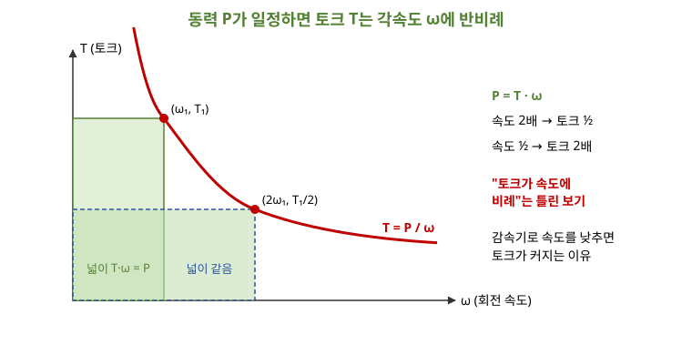

*$P = T\omega$가 일정하면 곡선 위 어느 점이든 직사각형 넓이($T \times \omega$)가 같다. 속도를 2배로 올리면 토크는 절반이 된다. 감속기로 회전을 줄이면 토크가 커지는 것, 자전거 저단 기어가 오르막에서 힘이 센 것이 모두 이 관계다.*

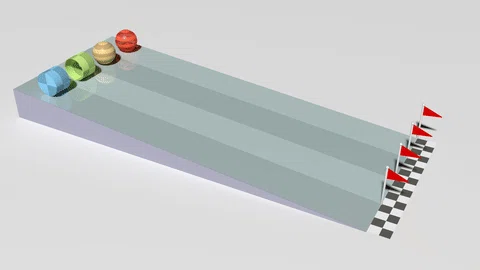

*같은 경사면에서 모양이 다른 네 물체가 동시에 굴러 내려가는 애니메이션. 무게가 아니라 **질량이 축에서 얼마나 멀리 퍼져 있느냐**(회전 관성)에 따라 출발 가속이 달라져 도착 순서가 갈린다. 관성이 큰 회전체일수록 기동·제동에 큰 토크가 필요하다는 말이 이것이다.*

### 일·동력·에너지 정리표

| 항목 | 식·값 |
| --- | --- |
| 일 | $W = F \times s$ (힘 방향 이동 거리) |
| 동력 | $P = \dfrac{W}{t} = F v = T\omega$ |
| 1 kW | ≈ 102 kgf·m/s ≈ 1.36 PS |
| 1 PS | 75 kgf·m/s ≈ 735.5 W |
| 1 kWh | 1 kW로 1시간 한 일 = 3.6 MJ |
| 마력–토크 | $H[\text{PS}] = \dfrac{T[\text{kgf·m}] \times N}{716.2}$ |

- 동력이 일정하면 **토크는 회전 속도에 반비례** ($P = T\omega$). "토크가 회전 속도에 비례한다"는 틀린 보기.
- 회전 관성이 큰 기계는 기동할 때 큰 토크가 필요하다.

> [!tip] 감 잡기 — 숫자 102와 75, 716.2
> 1 kW = 1000 N·m/s ÷ 9.8 ≈ **102** kgf·m/s. 1 PS는 정의가 **75** kgf·m/s. 마력–토크 식의 716.2는 $75 \times 60 / 2\pi$에서 나온다($P = T \cdot 2\pi N/60$을 PS로 바꾼 것).

## 7. 단위

단위는 "무엇을 1로 정했는가"의 약속이다. 세계 공통 SI는 **기본 단위 7개**만 정하고 나머지(N, J, Pa, W…)는 이들을 곱하고 나눠 만든다(유도 단위). 예전 공학 단위계(kgf, PS)는 "지구 중력으로 1 kg이 누르는 힘"을 1로 잡았기 때문에 SI와 바꿀 때 9.8이 끼어든다.

| SI 기본 단위 7개와 정의 상수 | 옛 질량 기준: 국제 킬로그램 원기 |
| --- | --- |
| 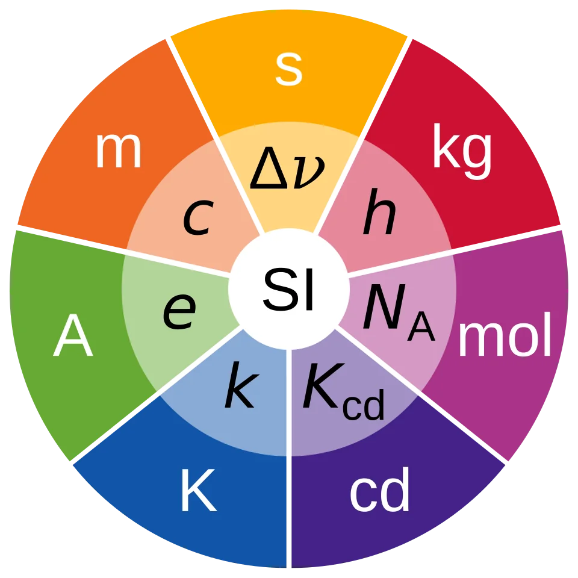 | 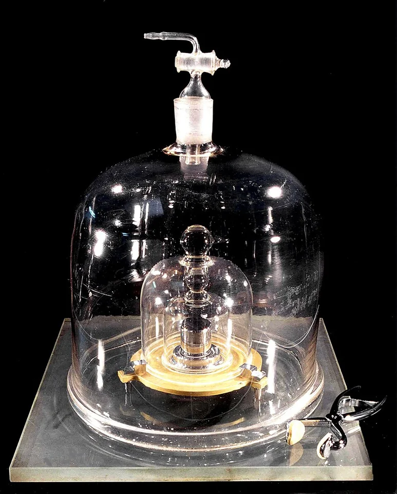 |

*왼쪽: 바깥 고리가 기본 단위 7개 — s, kg, mol, cd, K, A, m. 안쪽 고리는 2019년부터 각 단위를 정의하는 상수(빛의 속도 c, 플랑크 상수 h 등)다. N·J·Pa·g가 이 원에 없다는 것이 "기본 단위가 아닌 것" 문제의 답이다. 오른쪽: 2019년까지 1 kg의 기준이었던 백금–이리듐 원기둥(가운데 작은 금속 덩어리). 먼지와 공기를 막으려고 유리 종 두 겹 안에 보관했다.*

### 단위 정리표

| 물리량 | SI 단위 | 다른 단위와 관계 |
| --- | --- | --- |
| 힘 | N = kg·m/s² | 1 kgf ≈ 9.8 N, 1 N = $10^5$ dyn (= $10^5$ g·cm/s²) |
| 일·에너지 | J = N·m | 1 erg = 1 dyn·cm = $10^{-7}$ J |
| 압력·응력 | Pa = N/m² | 1 bar = $10^5$ Pa, 1 MPa = 1 N/mm², 1 kgf/cm² ≈ $9.8 \times 10^4$ Pa |
| 동력 | W = J/s | 위 표 참조 |
| 부피 | m³ | 1 m³ = 1000 L, 1 L = 1000 cm³ = 1000 cc |
| 비중량 | N/m³ | 4 °C 물 ≈ 9800 N/m³ (1000 kgf/m³) |

- **SI 기본 단위 7개**: 길이 m, 질량 kg, 시간 s, 전류 A, 온도 K, 물질량 mol, 광도 cd.
- **질량**은 장소에 관계없는 물체 고유의 양, **무게(중량)** 는 중력에 의한 힘. 중력은 항상 지구 중심(연직 아래) 방향이다.

> [!tip] 감 잡기 — dyn과 erg는 "cgs판 N과 J"
> N이 kg·m/s²이면 dyn은 g·cm/s². kg → g이 $10^3$, m → cm가 $10^2$이므로 1 N = $10^5$ dyn. 일도 같은 방식으로 1 J = 1 N × 1 m = $10^5$ dyn × $10^2$ cm = $10^7$ erg.

## 8. 면적·체적

복잡한 도형은 아는 도형으로 쪼개거나 빼서 구한다. 정육각형은 정삼각형 6개, 구멍 뚫린 블록은 "전체 − 구멍"이다. 원뿔은 같은 밑면·높이 원기둥의 정확히 1/3이다.

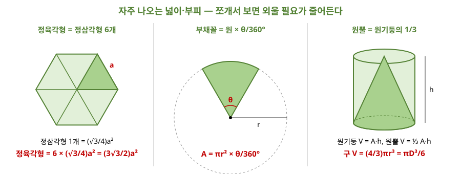

*가운데에서 꼭짓점으로 선을 그으면 정육각형은 한 변이 a인 정삼각형 6개로 나뉜다. 부채꼴은 원 전체 넓이에 중심각 비율을 곱한다. 원뿔(진한 초록)은 같은 밑면·높이 원기둥(연한 초록)의 1/3 부피다.*

### 면적·체적 정리표

| 도형 | 공식 |
| --- | --- |
| 원 | $A = \dfrac{\pi D^2}{4} = \pi r^2$ |
| 부채꼴 (중심각 θ) | $A = \pi r^2 \times \dfrac{\theta}{360°}$ |
| 정삼각형 (한 변 a) | $A = \dfrac{\sqrt{3}}{4}a^2$ |
| 정육각형 (한 변 a) | $A = \dfrac{3\sqrt{3}}{2}a^2$ (정삼각형 6개) |
| 원기둥 | $V = \dfrac{\pi d^2}{4} l$ |
| 구 | $V = \dfrac{4}{3}\pi r^3 = \dfrac{\pi D^3}{6}$ |
| 원뿔·각뿔 | $V = \dfrac{1}{3} A h$ |

- **계산 예**: 100 × 100 × 100 mm 각기둥에 지름 50 mm 관통 구멍 → $10^6 - \dfrac{\pi \times 50^2}{4} \times 100 \approx 1{,}000{,}000 - 196{,}350 \approx 803{,}650$ mm³.

## 9. 옛 기초공학의 전기·유체 문항

- 옛 2과목 31~40번에는 전기 기초(옴의 법칙, 합성 저항·정전 용량, 전력, 키르히호프, 패러데이)와 유체(파스칼 원리, 연속 방정식, 유량)도 매회 섞여 나왔다.
- 새 출제기준에서는 각각 다른 과목에 해당하므로 그쪽 노트로 공부한다: [전기 기초와 회로](../10_자동제어/전기_기초와_회로.md), [공유압 기초](../30_공유압/공유압_기초.md).

## 그림

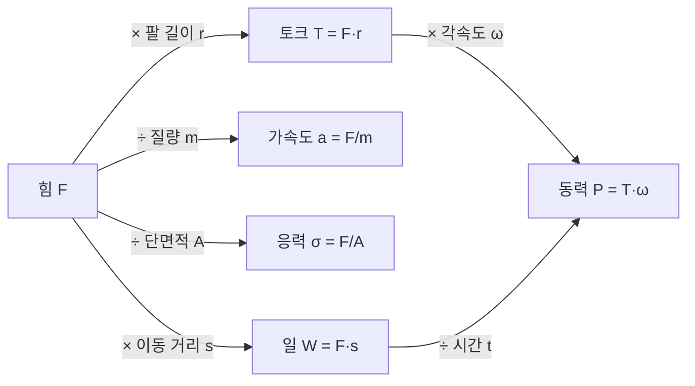

## 기출 포인트

옛 2과목 "기초공학" 파트(31~40번)에서 2014~2020년 19회분 기준. 새 출제기준에는 독립 항목으로 없지만 강도·토크 계산의 바탕이다.

- 힘·모멘트·토크 — **25회**
  - 스패너·핸들 토크 $T = Fr$ (반지름 역산, 길이 변화 포함) — 8회 (2014-1, 2015-2, 2016-2, 2017-2, 2017-3, 2018-3, 2019-1, 2020-1)
  - 모멘트 계산과 설명 — 5회 (2015-2, 2017-2 ×2, 2018-1, 2018-2)
  - 지렛대 평형 — 4회 (2014-3, 2016-1, 2016-3, 2019-2)
  - 합력 크기·평행력 합력 위치 — 3회 (2018-1, 2018-2, 2020-1)
  - 힘의 3요소 — 2회 (2017-1, 2020-3)
  - 반력 (2019-3), 토크가 가장 큰 경우 (2020-3), 회전자·고정자 토크의 작용·반작용 (2020-3)
- 운동 — **26회**
  - 속도·가속도·이동 거리 계산과 정의 — 16회 (2014-1, 2014-2, 2014-3, 2015-1, 2016-2, 2017-1, 2017-2, 2017-3, 2018-1, 2018-2, 2018-3, 2019-1, 2019-2, 2019-3, 2020-1, 2020-3)
  - 뉴턴 운동 법칙·$F = ma$ — 8회 (2014-2, 2015-2, 2016-1, 2016-2 ×2, 2016-3 ×2, 2018-3)
  - 회전수 단위 변환 — 2회 (2016-1, 2016-2)
- 단위 — **18회**: SI 기본·유도 단위 (2014-2, 2017-2, 2019-1, 2019-2), 힘 단위 N·kgf·dyn (2014-3, 2016-3, 2017-2), 일 단위 J·erg (2014-2, 2015-1, 2018-3), 압력 단위 (2014-1, 2017-2, 2019-2), 질량·중량 (2019-2, 2019-3), 부피 (2014-1), 비중량 (2020-3), 물리량–단위 짝 (2016-2)
- 면적·체적 계산 — **11회** (2014-1, 2014-2, 2014-3, 2015-1, 2015-2, 2016-2, 2016-3, 2017-3, 2018-2, 2018-3, 2020-1)
- 일·동력 — **7회**: 일의 정의 (2014-1, 2020-1), kW와 kgf·m/s 환산 (2014-3), 동력 일정 시 토크–속도 관계 (2017-3), 풀리 전달 마력 (2018-2), kWh 의미 (2019-1), 엔진 마력 (2019-2)

**교재 예제 유형** (Win-Q 2025 PART 01 CHAPTER 03, 20~21절): 모멘트 설명(거리 0이면 모멘트 0), 단순보 반력(그림, 20 kgf), 지렛대(그림, 40 kgf), 합력 작용선(그림, 1.5 m), 스패너 연장 토크 증가(6 kgf·m), 양손 토크(그림, 450 N·m), 외팔보 고정단 모멘트(그림, $Pl$), 1 N·m = 1 J, 핸들 반지름(600 mm), 스패너 토크 식 $T = FL$(그림), 토크 설명(전단 응력 발생), 회전 모멘트 설명 중 틀린 것(180°면 회전력 없음).

## 관련 단원

- [기계설계 기초와 재료강도](기계설계_기초와_재료강도.md)
- [축과 축이음](축과_축이음.md)
- [나사와 볼트](나사와_볼트.md)
- [전기 기초와 회로](../10_자동제어/전기_기초와_회로.md)
- [공유압 기초](../30_공유압/공유압_기초.md)

## 체크리스트

- [ ] 힘의 3요소를 말한다
- [ ] 스패너·핸들 토크와 반지름을 계산한다
- [ ] 지렛대 평형식으로 무게나 거리를 구한다
- [ ] 두 힘의 합력과 평행력의 합력 위치를 구한다
- [ ] 뉴턴 3법칙의 예를 구분한다
- [ ] 속도·가속도·평균 속도를 계산한다
- [ ] N·kgf·dyn, J·erg, Pa·bar·kgf/cm² 환산을 한다
- [ ] SI 기본 단위 7개를 쓴다
- [ ] kW·PS·kgf·m/s 환산과 마력–토크 식을 쓴다
- [ ] 정삼각형·정육각형 넓이, 구·원뿔 체적 공식을 쓴다

## 참고

- [큐넷 자동화설비산업기사 출제기준](https://www.q-net.or.kr/crf005.do?id=crf00503&jmCd=2034)
- 기출 출처: [CBT뱅크 생산자동화산업기사](https://cbtbank.kr/category/%EC%83%9D%EC%82%B0%EC%9E%90%EB%8F%99%ED%99%94%EC%82%B0%EC%97%85%EA%B8%B0%EC%82%AC)

### 그림 출처

위키미디어 공용(Wikimedia Commons)과 Openverse에서 가져온 공개 라이선스 자료이고, 노트에 맞게 크기를 줄이고 WebP로 변환했다.

| 그림 | 작성자 | 라이선스 | 출처 |
| --- | --- | --- | --- |
| [Torque wrench 20-220 Nm](https://commons.wikimedia.org/wiki/File:Torque_wrench_20-220_Nm.jpg) | Lead holder | [CC BY-SA 4.0](https://creativecommons.org/licenses/by-sa/4.0) | Wikimedia Commons |
| [Playground seesaw](https://commons.wikimedia.org/wiki/File:Playground_seesaw.jpg) | Killarnee | [CC BY-SA 4.0](https://creativecommons.org/licenses/by-sa/4.0) | Wikimedia Commons |
| [Apollo 11 Launch - GPN-2000-000630](https://commons.wikimedia.org/wiki/File:Apollo_11_Launch_-_GPN-2000-000630.jpg) | NASA | 퍼블릭 도메인 | Wikimedia Commons |
| [Rolling Racers - Moment of inertia](https://commons.wikimedia.org/wiki/File:Rolling_Racers_-_Moment_of_inertia.gif) | Lucas Vieira | 퍼블릭 도메인 | Wikimedia Commons |
| [SI Illustration Base Units and Constants Colour Full](https://commons.wikimedia.org/wiki/File:SI_Illustration_Base_Units_and_Constants_Colour_Full.svg) | BIPM (Original), User:Cmglee Rearranged version. | 퍼블릭 도메인 | Wikimedia Commons |
| [International prototype of the kilogram aka Le Grand K](https://commons.wikimedia.org/wiki/File:International_prototype_of_the_kilogram_aka_Le_Grand_K.jpg) | BIPM | [CC BY-SA 3.0 igo](https://creativecommons.org/licenses/by-sa/3.0/igo/deed.en) | Wikimedia Commons |

직접 그린 그림(SVG, 이 볼트용으로 새로 작성): 토크 팔길이, 힘의 합성, 지렛대 평형, 보 반력, 속도그래프 변위, 수평투사, 뉴턴 3법칙, 동력 토크 속도, 면적 체적 도형.

